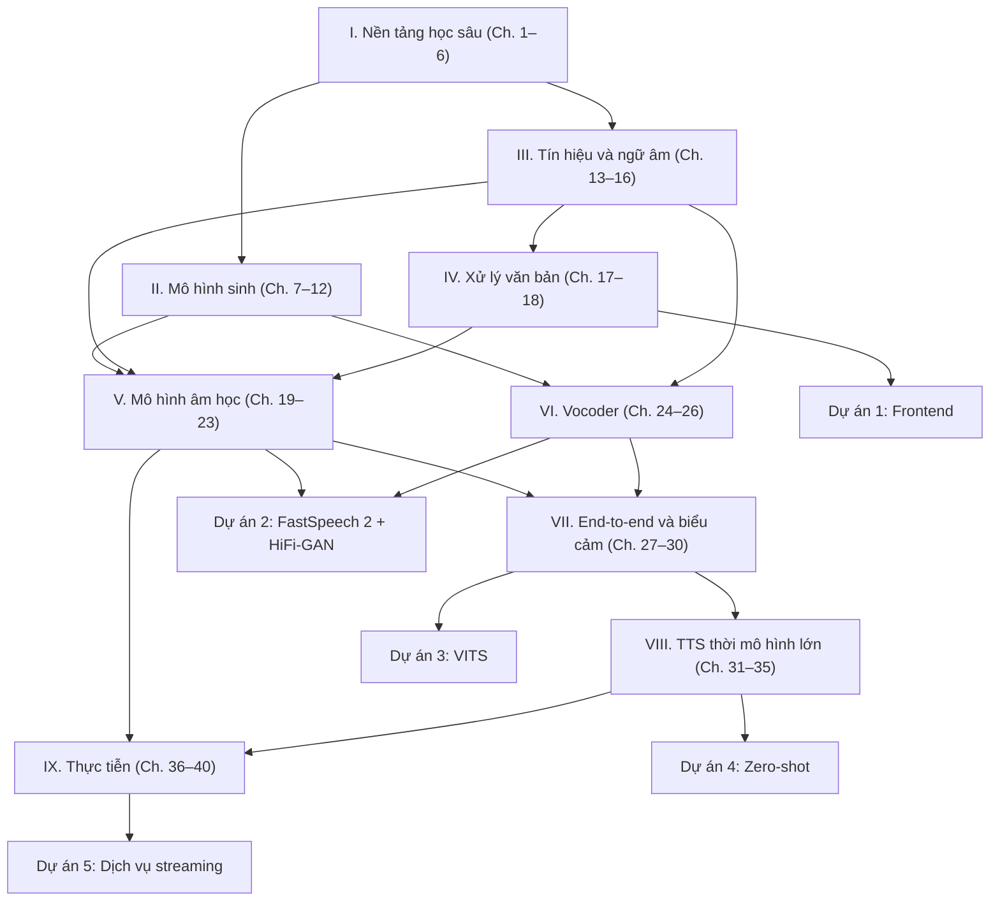

# Lộ trình học

Không phải ai cũng cần đọc cả 40 chương theo thứ tự. Trang này giúp bạn chọn lộ trình phù hợp với nền tảng và mục tiêu của mình.

## Bản đồ phụ thuộc giữa các phần

## Lộ trình A — Từ con số không (khoảng 16–20 tuần)

Dành cho người mới học học sâu. Đọc tuần tự, làm hết bài tập **[Cơ bản]** và phần lớn bài **[Lập trình]**.

| Tuần | Nội dung | Kết quả cần đạt |
|---|---|---|
| 1–2 | Chương 1–3 | Tự viết vòng lặp huấn luyện có AdamW, warmup, AMP |
| 3–4 | Chương 4–6 | Cài đặt Conv1d nhân giãn, LSTM, multi-head attention, RoPE; pipeline dữ liệu âm thanh |
| 5–6 | Chương 7–9 | Suy ra ELBO, KL giữa hai Gaussian, discriminator tối ưu của GAN |
| 7–8 | Chương 10–12 | Huấn luyện flow, DDPM và flow matching trên dữ liệu 2 chiều |
| 9 | Chương 13–14 | Tự tính mel-spectrogram, Griffin–Lim, trích xuất F0 |
| 10 | Chương 15–16 | Phân tích âm tiết tiếng Việt; mô tả sáu thanh điệu bằng đường F0 |
| 11 | Chương 17–18 + Dự án 1 | Frontend tiếng Việt chạy được |
| 12–13 | Chương 19–23 | Hiểu Tacotron 2, MAS, FastSpeech 2, Matcha-TTS |
| 14 | Chương 24–26 + Dự án 2 | Huấn luyện FastSpeech 2 + HiFi-GAN |
| 15 | Chương 27–30 + Dự án 3 | Huấn luyện VITS tiếng Việt |
| 16–17 | Chương 31–35 + Dự án 4 | Tinh chỉnh một mô hình zero-shot |
| 18–20 | Chương 36–40 + Dự án 5 | Đánh giá, triển khai dịch vụ streaming |

## Lộ trình B — Đã vững học sâu (khoảng 8–10 tuần)

Dành cho người đã quen PyTorch, Transformer và đã từng huấn luyện mô hình.

1. Lướt Phần I; đọc kỹ các mục về causal/dilated convolution và trường tiếp nhận ([Chương 4](../phan-1-nen-tang/ch04-cnn-rnn-mo-hinh-chuoi.md)), KV cache và chiến lược lấy mẫu ([Chương 5](../phan-1-nen-tang/ch05-transformer.md)), xử lý batch âm thanh độ dài thay đổi ([Chương 6](../phan-1-nen-tang/ch06-pytorch-cho-tieng-noi.md)).
2. **Không bỏ qua** [Chương 7](../phan-2-mo-hinh-sinh/ch07-tong-quan-mo-hinh-sinh.md) — lập luận "một-đối-nhiều" là sợi chỉ đỏ của cả cuốn sách. Đọc Chương 8–12 theo nhu cầu.
3. Đọc kỹ toàn bộ Phần III và IV — đây là kiến thức chuyên ngành mà người làm học sâu thường thiếu.
4. Phần V → VIII theo thứ tự, kết hợp Dự án 2–4.
5. Phần IX trước khi làm sản phẩm thật.

## Lộ trình C — Kỹ sư cần đưa TTS tiếng Việt vào sản phẩm (khoảng 4–6 tuần)

Mục tiêu: chọn đúng mô hình, chuẩn bị đúng dữ liệu, đánh giá và triển khai đúng cách.

1. [Chương 7](../phan-2-mo-hinh-sinh/ch07-tong-quan-mo-hinh-sinh.md) (bức tranh toàn cảnh), [Chương 14](../phan-3-tin-hieu-ngu-am/ch14-xu-ly-tin-hieu-so.md) (đặc trưng âm học), [Chương 15](../phan-3-tin-hieu-ngu-am/ch15-ngu-am-tieng-viet.md) (ngữ âm tiếng Việt).
2. Phần IV và [Dự án 1](../phan-10-du-an/du-an-1-frontend-tieng-viet.md) — phần lớn lỗi "đọc sai" trong sản phẩm đến từ frontend.
3. [Chương 27](../phan-7-e2e-bieu-cam/ch27-vits.md) (VITS) cho hệ thống nhẹ một/ít giọng; [Chương 33](../phan-8-mo-hinh-lon/ch33-nar-quy-mo-lon.md)–[34](../phan-8-mo-hinh-lon/ch34-he-thong-lai-hien-dai.md) cho hệ thống zero-shot.
4. Toàn bộ Phần IX, đặc biệt [Chương 36](../phan-9-thuc-tien/ch36-du-lieu-tts.md) (dữ liệu), [Chương 38](../phan-9-thuc-tien/ch38-danh-gia-tts.md) (đánh giá), [Chương 39](../phan-9-thuc-tien/ch39-trien-khai-production.md) (triển khai) và [Chương 40](../phan-9-thuc-tien/ch40-dao-duc-an-toan.md) (đạo đức, pháp lý).
5. [Dự án 5](../phan-10-du-an/du-an-5-tts-service-streaming.md) để dựng dịch vụ.

## Lộ trình D — Nhà nghiên cứu muốn theo kịp mô hình mới nhất

1. Phần II (đặc biệt [Chương 11](../phan-2-mo-hinh-sinh/ch11-diffusion.md) và [Chương 12](../phan-2-mo-hinh-sinh/ch12-flow-matching.md)).
2. [Chương 21](../phan-5-mo-hinh-am-hoc/ch21-alignment.md) (alignment), [Chương 23](../phan-5-mo-hinh-am-hoc/ch23-glow-grad-matcha.md), [Chương 27](../phan-7-e2e-bieu-cam/ch27-vits.md).
3. Toàn bộ Phần VIII và [Chương 38](../phan-9-thuc-tien/ch38-danh-gia-tts.md).
4. [Phụ lục B](../phu-luc/b-danh-muc-bai-bao.md) — danh mục bài báo cốt lõi để đọc bản gốc.

## Gợi ý học hiệu quả

- **Gõ lại mã, đừng chỉ đọc.** Hầu hết khối mã trong sách chạy được trên CPU trong vài giây.
- **Nghe thật nhiều.** Một kỹ sư TTS giỏi có "đôi tai" tốt: hãy nghe mẫu âm thanh sau mỗi thí nghiệm, so sánh với dữ liệu gốc.
- **Đọc bài báo gốc** sau khi học xong mỗi chương; phần *Tài liệu tham khảo* ghi đủ tên bài để bạn tìm.
- **Học nhóm.** Các bài tập **[Nâng cao]** rất phù hợp để thảo luận theo nhóm hoặc làm đề tài seminar.
