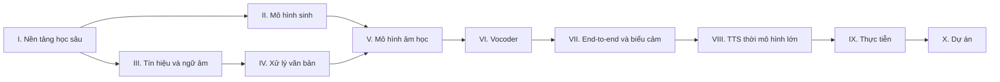

# Giáo trình Tổng hợp tiếng nói (Text-to-Speech) 2026

**Từ nền tảng học sâu đến làm chủ các hệ thống TTS hiện đại — viết bằng tiếng Việt, cho cộng đồng Việt Nam.**

Giáo trình mở này dẫn bạn đi trọn con đường: ôn lại toán và học sâu, nắm vững các mô hình sinh, hiểu tín hiệu tiếng nói và ngữ âm tiếng Việt, rồi lần lượt làm chủ từng thế hệ hệ thống TTS — Tacotron, FastSpeech, VITS, HiFi-GAN, cho tới codec language model, flow matching và các hệ thống zero-shot quy mô lớn của giai đoạn 2024–2026. Cuối sách là năm dự án thực hành, có mã nguồn chạy được, để bạn tự xây dựng hệ thống TTS tiếng Việt của riêng mình.

## Sách có gì?

| Phần | Nội dung chính | Bạn sẽ làm được |
|---|---|---|
| [I. Nền tảng học sâu](phan-1-nen-tang/index.md) | Toán, mạng nơ-ron, tối ưu, CNN/RNN, Transformer, PyTorch | Tự cài đặt và huấn luyện các khối kiến trúc dùng trong TTS |
| [II. Mô hình sinh](phan-2-mo-hinh-sinh/index.md) | VAE, GAN, normalizing flow, diffusion, flow matching | Hiểu tận gốc toán học đằng sau mọi mô hình TTS hiện đại |
| [III. Tín hiệu và ngữ âm](phan-3-tin-hieu-ngu-am/index.md) | Âm học, STFT, mel, F0, ngữ âm tiếng Việt, ngôn điệu | Trích xuất và hiểu đặc trưng âm học; nắm hệ thống thanh điệu |
| [IV. Xử lý văn bản](phan-4-frontend/index.md) | Chuẩn hóa văn bản tiếng Việt, G2P | Xây frontend đọc đúng số, ngày tháng, viết tắt, thanh điệu |
| [V. Mô hình âm học](phan-5-mo-hinh-am-hoc/index.md) | Lịch sử TTS, Tacotron 2, alignment, FastSpeech 2, Glow/Grad/Matcha-TTS | Huấn luyện mô hình văn bản → mel-spectrogram |
| [VI. Vocoder](phan-6-vocoder/index.md) | WaveNet, WaveGlow, HiFi-GAN, BigVGAN, Vocos, DiffWave | Biến mel-spectrogram thành sóng âm chất lượng cao |
| [VII. End-to-end và biểu cảm](phan-7-e2e-bieu-cam/index.md) | VITS, đa người nói, cảm xúc, trộn mã Việt–Anh | Làm giọng tự nhiên, có cảm xúc, nhiều người nói |
| [VIII. TTS thời mô hình lớn](phan-8-mo-hinh-lon/index.md) | Audio codec, VALL-E, F5-TTS, CosyVoice, speech LLM | Hiểu và tinh chỉnh các mô hình zero-shot hiện đại |
| [IX. Thực tiễn](phan-9-thuc-tien/index.md) | Dữ liệu, gỡ lỗi huấn luyện, đánh giá, triển khai, đạo đức | Đưa hệ thống TTS từ phòng thí nghiệm ra sản phẩm, có trách nhiệm |
| [X. Dự án](phan-10-du-an/index.md) | Năm dự án có mã nguồn | Một hệ thống TTS tiếng Việt hoàn chỉnh của riêng bạn |

## Bắt đầu từ đâu?

- **Mới học học sâu?** Đọc [Lời nói đầu](gioi-thieu/loi-noi-dau.md), rồi đi tuần tự từ [Phần I](phan-1-nen-tang/index.md).
- **Đã vững học sâu, muốn vào TTS ngay?** Xem [Lộ trình học](gioi-thieu/lo-trinh-hoc.md) để chọn lộ trình rút gọn; nên đọc kỹ [Chương 7](phan-2-mo-hinh-sinh/ch07-tong-quan-mo-hinh-sinh.md), [Chương 14](phan-3-tin-hieu-ngu-am/ch14-xu-ly-tin-hieu-so.md) và [Chương 15](phan-3-tin-hieu-ngu-am/ch15-ngu-am-tieng-viet.md).
- **Kỹ sư cần làm sản phẩm TTS tiếng Việt?** Đi thẳng tới [Phần IV](phan-4-frontend/index.md), [Phần IX](phan-9-thuc-tien/index.md) và các [dự án](phan-10-du-an/index.md), quay lại các chương lý thuyết khi cần.

## Cách đọc sách

Mỗi chương đều có cùng cấu trúc: **mục tiêu học tập → kiến thức cần có → nội dung (trực giác, toán học, mã minh họa, liên hệ TTS) → lỗi thường gặp → tóm tắt → bài tập → tài liệu tham khảo**. Các hộp màu được dùng thống nhất:

!!! abstract "Mục tiêu học tập"
    Những gì bạn sẽ làm được sau khi học xong chương.

!!! note "Góc tiếng Việt"
    Lưu ý riêng cho tiếng Việt: thanh điệu, phương ngữ, dấu phụ, dữ liệu, trộn mã Việt–Anh.

!!! warning "Cảnh báo"
    Những lỗi dễ mắc và cách tránh.

Ký hiệu toán học dùng chung được liệt kê ở trang [Ký hiệu](gioi-thieu/ky-hieu.md); thuật ngữ Anh–Việt ở [Phụ lục A](phu-luc/a-thuat-ngu.md).

## Đóng góp

Đây là dự án cộng đồng. Mọi góp ý — sửa lỗi chính tả, chỉnh công thức, bổ sung ví dụ tiếng Việt, viết thêm bài tập — đều quý giá. Xem [Quy ước biên soạn](gioi-thieu/quy-uoc-bien-soan.md) và mở *issue* hoặc *pull request* tại [kho mã GitHub](https://github.com/tuandung222/tts-books-2026).

!!! info "Giấy phép"
    Nội dung giáo trình phát hành theo giấy phép [CC BY-SA 4.0](https://creativecommons.org/licenses/by-sa/4.0/deed.vi); mã nguồn minh họa theo giấy phép MIT. Bạn được tự do chia sẻ, chỉnh sửa, dùng để giảng dạy — kể cả thương mại — miễn là ghi nguồn và chia sẻ lại theo cùng giấy phép.
