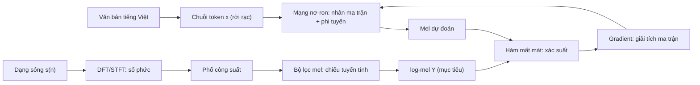

# Chương 1. Toán nền tảng cho học sâu

Một hệ thống tổng hợp tiếng nói hiện đại, dù là Tacotron 2, VITS hay một mô hình ngôn ngữ trên token âm thanh, rốt cuộc chỉ làm ba việc: **biểu diễn** văn bản và âm thanh bằng các mảng số, **biến đổi** các mảng số đó qua những hàm có tham số, và **điều chỉnh** tham số để đầu ra giống tiếng nói thật. Ba việc ấy tương ứng với ba mảng toán học: đại số tuyến tính, giải tích và xác suất thống kê. Thêm vào đó, lý thuyết thông tin cho ta ngôn ngữ để đo "hai phân phối khác nhau bao nhiêu", còn số phức là cửa ngõ dẫn tới phân tích Fourier, nền móng của mọi đặc trưng phổ trong xử lý tiếng nói.

Chương này không nhằm thay thế một giáo trình toán. Mục đích của nó là trang bị **đúng những công cụ** mà các chương sau sẽ dùng, trình bày theo cách người làm học sâu thực sự dùng chúng, và với mỗi công cụ, chỉ ra nó xuất hiện ở đâu trong TTS. Nếu bạn đã quen một phần nào đó, hãy lướt nhanh nhưng đừng bỏ qua các mục "liên hệ với TTS" và các đoạn mã: chúng là sợi chỉ nối toàn bộ cuốn sách.

!!! abstract "Mục tiêu học tập"
    Sau chương này, bạn có thể:

    - **Giải thích** vì sao bộ lọc mel là một phép chiếu tuyến tính làm mất thông tin, dựa trên khái niệm hạng và không gian rỗng.
    - **Tính** gradient và Jacobian của các biểu thức véc-tơ/ma trận thường gặp, và **kiểm chứng** chúng bằng `torch.autograd`.
    - **Sử dụng** SVD để xấp xỉ hạng thấp và ước lượng chuẩn phổ bằng phép lặp lũy thừa.
    - **Suy ra** hàm mất mát L2 từ phân phối Gauss và L1 từ phân phối Laplace, đồng thời **giải thích** vì sao chúng lần lượt dự đoán trung bình và trung vị.
    - **Áp dụng** công thức đổi biến cho hàm mật độ và ước lượng Monte Carlo.
    - **So sánh** entropy, entropy chéo, phân kỳ KL thuận và nghịch, thông tin tương hỗ, và **chỉ ra** vai trò của chúng trong các mô hình TTS.
    - **Biểu diễn** một tín hiệu hình sin bằng số phức và **cài đặt** DFT như một phép nhân ma trận.

!!! info "Kiến thức cần có"
    - Toán phổ thông và giải tích một biến (đạo hàm, tích phân cơ bản), làm quen với ký hiệu tổng $\sum$.
    - Python cơ bản; biết dùng `numpy` ở mức tạo mảng và nhân ma trận là đủ.
    - Đọc lướt trang [Ký hiệu toán học](../gioi-thieu/ky-hieu.md): chương này dùng đúng các ký hiệu đó.

## 1.1. Bức tranh tổng thể: toán học trong một hệ TTS

Trước khi đi vào chi tiết, hãy nhìn một hệ TTS hai giai đoạn kinh điển qua "lăng kính toán học". Sơ đồ dưới đây ghi rõ mỗi bước dùng công cụ nào của chương này.



- **Nhánh dưới** biến dạng sóng thành log-mel-spectrogram. Nó dùng số phức (Mục 1.6), phép chiếu tuyến tính (Mục 1.2) và phép lấy logarit (một phép đổi biến, Mục 1.4.5). Chi tiết xử lý tín hiệu nằm ở [Chương 14](../phan-3-tin-hieu-ngu-am/ch14-xu-ly-tin-hieu-so.md).
- **Nhánh trên** là mô hình âm học: một chuỗi phép nhân ma trận xen kẽ hàm phi tuyến (Chương 2, 4, 5).
- **Hàm mất mát** so sánh dự đoán với mục tiêu. Việc chọn L1, L2 hay entropy chéo không phải ngẫu nhiên: mỗi lựa chọn tương ứng với một giả định xác suất (Mục 1.4.7 và 1.5).
- **Gradient** của hàm mất mát theo tham số được tính bằng quy tắc dây chuyền cho véc-tơ (Mục 1.3), là nền tảng của lan truyền ngược ([Chương 2](ch02-hoc-may-va-mang-no-ron.md)) và các thuật toán tối ưu ([Chương 3](ch03-toi-uu-va-ky-thuat-huan-luyen.md)).

## 1.2. Đại số tuyến tính

### 1.2.1. Véc-tơ, ma trận và tensor

**Trực giác.** Trong học sâu, mọi thứ đều là mảng số. Một khung mel-spectrogram với 80 kênh là một điểm trong không gian 80 chiều; cả một câu nói dài $T$ khung là một ma trận; một batch nhiều câu là một mảng ba chiều.

**Hình thức hóa.** Theo quy ước của sách, véc-tơ là **véc-tơ cột** viết đậm chữ thường: $\mathbf{x} \in \mathbb{R}^{d}$. Ma trận viết đậm chữ hoa: $\mathbf{W} \in \mathbb{R}^{m \times n}$ có $m$ hàng, $n$ cột. Một log-mel-spectrogram được ký hiệu

$$
\mathbf{Y} = (\mathbf{y}_1, \ldots, \mathbf{y}_T) \in \mathbb{R}^{T \times F},
$$

trong đó mỗi $\mathbf{y}_t \in \mathbb{R}^{F}$ là một khung (thường $F = 80$ hoặc $100$). Khi gom $B$ câu thành một batch, ta có một **tensor** hình dạng `(B, T, F)`. "Tensor" trong học sâu đơn giản là mảng nhiều chiều; ta không cần đến nghĩa hình học vi phân của từ này.

**Tích ma trận–véc-tơ** có hai cách đọc, và cả hai đều hữu ích:

$$
\mathbf{W}\mathbf{x} = \sum_{j=1}^{n} x_j \, \mathbf{w}_{:,j}
\qquad\text{và}\qquad
(\mathbf{W}\mathbf{x})_i = \mathbf{w}_{i,:}\,\mathbf{x} = \sum_{j=1}^{n} W_{ij} x_j .
$$

Cách đọc thứ nhất (**theo cột**) nói rằng $\mathbf{W}\mathbf{x}$ là một *tổ hợp tuyến tính* các cột của $\mathbf{W}$, với hệ số là các thành phần của $\mathbf{x}$. Cách đọc thứ hai (**theo hàng**) nói rằng mỗi đầu ra là *tích vô hướng* của một hàng với $\mathbf{x}$, tức là một "bộ dò" đo xem $\mathbf{x}$ giống hàng đó đến đâu. Một lớp tuyến tính trong mạng nơ-ron là một ngân hàng các bộ dò như vậy.

Hàm $f(\mathbf{x}) = \mathbf{W}\mathbf{x}$ là **tuyến tính**: $f(a\mathbf{x} + b\mathbf{x}') = a f(\mathbf{x}) + b f(\mathbf{x}')$. Thêm độ lệch $\mathbf{b}$ ta được hàm **affine** $\mathbf{W}\mathbf{x} + \mathbf{b}$. Tích hai ma trận $\mathbf{A}\mathbf{B}$ biểu diễn **hợp** của hai phép biến đổi tuyến tính: áp dụng $\mathbf{B}$ trước, rồi đến $\mathbf{A}$. Hệ quả quan trọng: chồng nhiều lớp tuyến tính mà không có hàm phi tuyến xen giữa thì vẫn chỉ là *một* phép biến đổi tuyến tính, vì $\mathbf{W}_2(\mathbf{W}_1\mathbf{x}) = (\mathbf{W}_2\mathbf{W}_1)\mathbf{x}$. Đây là lý do mạng nơ-ron cần hàm kích hoạt ([Chương 2](ch02-hoc-may-va-mang-no-ron.md)).

Ngoài tích ma trận thông thường, ta thường dùng **tích Hadamard** $\mathbf{a} \odot \mathbf{b}$ (nhân từng phần tử) và **phép ghép** $[\mathbf{a}; \mathbf{b}]$ (nối hai véc-tơ thành một véc-tơ dài hơn), chẳng hạn khi ghép embedding người nói vào đầu ra của bộ mã hóa văn bản ([Chương 28](../phan-7-e2e-bieu-cam/ch28-da-nguoi-noi-voice-cloning.md)).

!!! warning "Hàng hay cột? Quy ước trong PyTorch"
    Sách viết véc-tơ là cột và lớp tuyến tính là $\mathbf{W}\mathbf{x} + \mathbf{b}$. Nhưng `torch.nn.Linear` nhận dữ liệu dạng hàng, hình dạng `(B, d_in)`, và tính `x @ W.T + b` với `W` có hình dạng `(d_out, d_in)`. Hai cách viết tương đương nhau, chỉ khác chuyển vị. Khi đọc bài báo và mã nguồn song song, hãy luôn kiểm tra quy ước nào đang được dùng.

### 1.2.2. Tích vô hướng, chuẩn và độ tương đồng cosine

**Tích vô hướng** (*inner product*) của hai véc-tơ cùng chiều là $\langle \mathbf{x}, \mathbf{y} \rangle = \mathbf{x}^\top \mathbf{y} = \sum_i x_i y_i$. Về mặt hình học,

$$
\mathbf{x}^\top \mathbf{y} = \lVert \mathbf{x} \rVert_2 \, \lVert \mathbf{y} \rVert_2 \cos\alpha ,
$$

với $\alpha$ là góc giữa hai véc-tơ. Từ đó suy ra **bất đẳng thức Cauchy–Schwarz** $\lvert \mathbf{x}^\top \mathbf{y} \rvert \le \lVert \mathbf{x} \rVert_2 \lVert \mathbf{y} \rVert_2$, dấu bằng khi hai véc-tơ cùng phương. Ta sẽ dùng bất đẳng thức này ngay ở Mục 1.3 để chứng minh gradient là hướng tăng nhanh nhất.

**Chuẩn** (*norm*) đo "độ lớn" của véc-tơ. Ba chuẩn hay gặp nhất:

$$
\lVert \mathbf{x} \rVert_1 = \sum_i \lvert x_i \rvert, \qquad
\lVert \mathbf{x} \rVert_2 = \Big(\sum_i x_i^2\Big)^{1/2}, \qquad
\lVert \mathbf{x} \rVert_\infty = \max_i \lvert x_i \rvert .
$$

Với ma trận, **chuẩn Frobenius** $\lVert \mathbf{A} \rVert_F = (\sum_{ij} A_{ij}^2)^{1/2}$ coi ma trận như một véc-tơ dài; **chuẩn phổ** $\lVert \mathbf{A} \rVert_2$ (Mục 1.2.6) đo mức khuếch đại lớn nhất mà ma trận gây ra. Khoảng cách $\lVert \mathbf{y} - \hat{\mathbf{y}} \rVert_1$ và $\lVert \mathbf{y} - \hat{\mathbf{y}} \rVert_2^2$ chính là hai hàm mất mát L1 và L2 dùng để so sánh mel dự đoán với mel thật; Mục 1.4.7 giải thích vì sao chúng hành xử khác nhau.

**Độ tương đồng cosine** $\cos\alpha = \mathbf{x}^\top\mathbf{y} / (\lVert \mathbf{x} \rVert_2 \lVert \mathbf{y} \rVert_2)$ chỉ quan tâm đến *hướng*, bỏ qua độ lớn. Trong TTS, đây là thước đo chuẩn để so sánh hai embedding người nói: độ giống giọng của câu tổng hợp với giọng tham chiếu thường được báo cáo bằng cosine giữa hai embedding do một mô hình xác minh người nói trích ra ([Chương 28](../phan-7-e2e-bieu-cam/ch28-da-nguoi-noi-voice-cloning.md), [Chương 38](../phan-9-thuc-tien/ch38-danh-gia-tts.md)).

### 1.2.3. Độc lập tuyến tính, hạng và không gian rỗng

Các véc-tơ $\mathbf{a}_1, \ldots, \mathbf{a}_n$ **độc lập tuyến tính** nếu không véc-tơ nào là tổ hợp tuyến tính của các véc-tơ còn lại. Tập mọi tổ hợp tuyến tính của chúng là **không gian sinh** (*span*). Với ma trận $\mathbf{A} \in \mathbb{R}^{m \times n}$:

- **Không gian cột** $\operatorname{col}(\mathbf{A})$ là span của các cột, tức tập mọi đầu ra $\mathbf{A}\mathbf{x}$ có thể có.
- **Hạng** (*rank*) $\operatorname{rank}(\mathbf{A})$ là số chiều của không gian cột, bằng số cột độc lập tuyến tính tối đa, và cũng bằng số hàng độc lập tối đa. Luôn có $\operatorname{rank}(\mathbf{A}) \le \min(m, n)$.
- **Không gian rỗng** (*null space*, còn gọi là hạt nhân) $\operatorname{null}(\mathbf{A}) = \{\mathbf{x} : \mathbf{A}\mathbf{x} = \mathbf{0}\}$ là tập các đầu vào bị ma trận "xóa sổ".

Hai đại lượng cuối liên hệ qua **định lý hạng–số khuyết** (*rank–nullity*):

$$
\dim \operatorname{null}(\mathbf{A}) + \operatorname{rank}(\mathbf{A}) = n .
$$

Hệ quả thực tế rất đáng nhớ: nếu $\mathbf{A}\mathbf{x} = \mathbf{A}\mathbf{x}'$ thì $\mathbf{x} - \mathbf{x}' \in \operatorname{null}(\mathbf{A})$. Khi không gian rỗng khác $\{\mathbf{0}\}$, **vô số đầu vào khác nhau cho cùng một đầu ra**, và không có cách nào khôi phục chính xác đầu vào từ đầu ra.

**Liên hệ với TTS: bộ lọc mel.** Với `n_fft = 1024`, phổ công suất của một khung có $K = 1024/2 + 1 = 513$ bin tần số. Bộ lọc mel gồm $F = 80$ bộ lọc tam giác, mỗi bộ lọc là một hàng của ma trận $\mathbf{M} \in \mathbb{R}^{80 \times 513}$, và khung mel là $\mathbf{m} = \mathbf{M}\mathbf{p}$ với $\mathbf{p}$ là phổ công suất. Vì $\operatorname{rank}(\mathbf{M}) \le 80$, không gian rỗng có ít nhất $513 - 80 = 433$ chiều. Nói cách khác, mel-spectrogram vứt bỏ phần lớn chi tiết tần số (cộng thêm toàn bộ thông tin pha, xem Mục 1.6). Đây là lý do một vocoder ([Phần VI](../phan-6-vocoder/ch24-vocoder-tu-hoi-quy-va-flow.md)) không thể là phép "nghịch đảo" đơn thuần: nó phải *sinh* lại các chi tiết bị mất sao cho nghe tự nhiên.

### 1.2.4. Phép chiếu và bình phương tối thiểu

**Bài toán.** Cho $\mathbf{A} \in \mathbb{R}^{m \times n}$ và $\mathbf{b} \in \mathbb{R}^{m}$, tìm $\mathbf{x}$ sao cho $\mathbf{A}\mathbf{x}$ gần $\mathbf{b}$ nhất:

$$
\min_{\mathbf{x}} \; \lVert \mathbf{A}\mathbf{x} - \mathbf{b} \rVert_2^2 .
$$

**Suy ra nghiệm.** Khai triển $\lVert \mathbf{A}\mathbf{x} - \mathbf{b} \rVert_2^2 = \mathbf{x}^\top \mathbf{A}^\top \mathbf{A} \mathbf{x} - 2\mathbf{b}^\top \mathbf{A}\mathbf{x} + \mathbf{b}^\top\mathbf{b}$. Dùng các đồng nhất thức ở Mục 1.3.4, gradient theo $\mathbf{x}$ là $2\mathbf{A}^\top\mathbf{A}\mathbf{x} - 2\mathbf{A}^\top\mathbf{b}$. Cho bằng không, ta được **phương trình chuẩn** (*normal equations*):

$$
\mathbf{A}^\top\mathbf{A}\,\mathbf{x}^\star = \mathbf{A}^\top \mathbf{b} .
$$

Nếu các cột của $\mathbf{A}$ độc lập tuyến tính thì $\mathbf{A}^\top\mathbf{A}$ khả nghịch và $\mathbf{x}^\star = (\mathbf{A}^\top\mathbf{A})^{-1}\mathbf{A}^\top\mathbf{b}$. Khi đó $\hat{\mathbf{b}} = \mathbf{A}\mathbf{x}^\star = \mathbf{P}\mathbf{b}$ với

$$
\mathbf{P} = \mathbf{A}(\mathbf{A}^\top\mathbf{A})^{-1}\mathbf{A}^\top ,
$$

là **ma trận chiếu trực giao** lên không gian cột. Bạn có thể kiểm tra $\mathbf{P}^2 = \mathbf{P}$ (chiếu hai lần như chiếu một lần) và $\mathbf{P}^\top = \mathbf{P}$. Ý nghĩa hình học: phần dư $\mathbf{b} - \hat{\mathbf{b}}$ vuông góc với mọi cột của $\mathbf{A}$, đúng như phương trình chuẩn nói: $\mathbf{A}^\top(\mathbf{b} - \mathbf{A}\mathbf{x}^\star) = \mathbf{0}$. Hồi quy tuyến tính ở [Chương 2](ch02-hoc-may-va-mang-no-ron.md) chính là bài toán này.

Khi $\mathbf{A}^\top\mathbf{A}$ không khả nghịch (ví dụ có nhiều ẩn hơn phương trình), bài toán có vô số nghiệm. **Giả nghịch đảo Moore–Penrose** $\mathbf{A}^{+}$ (tính qua SVD, Mục 1.2.6) chọn ra nghiệm có chuẩn nhỏ nhất. Với ma trận "béo" có hạng hàng đầy đủ như $\mathbf{M}$ của bộ lọc mel, $\mathbf{M}^{+} = \mathbf{M}^\top(\mathbf{M}\mathbf{M}^\top)^{-1}$, và $\mathbf{M}^{+}\mathbf{m}$ chính là **hình chiếu của phổ thật lên không gian hàng** của $\mathbf{M}$: mọi thành phần nằm trong không gian rỗng đều mất.

### 1.2.5. Trị riêng và véc-tơ riêng

**Trực giác.** Phần lớn véc-tơ bị ma trận vừa xoay vừa co giãn. Một số hướng đặc biệt chỉ bị co giãn mà không đổi phương: đó là các **véc-tơ riêng**.

**Định nghĩa.** Với ma trận vuông $\mathbf{A}$, nếu $\mathbf{A}\mathbf{v} = \lambda \mathbf{v}$ với $\mathbf{v} \ne \mathbf{0}$ thì $\lambda$ là **trị riêng** và $\mathbf{v}$ là **véc-tơ riêng** tương ứng.

Trường hợp quan trọng nhất trong học máy là **ma trận đối xứng thực** ($\mathbf{A} = \mathbf{A}^\top$). **Định lý phổ** khẳng định mọi ma trận như vậy đều phân rã được thành

$$
\mathbf{A} = \mathbf{Q}\boldsymbol{\Lambda}\mathbf{Q}^\top = \sum_{i=1}^{n} \lambda_i \mathbf{q}_i \mathbf{q}_i^\top ,
$$

với $\mathbf{Q}$ trực giao ($\mathbf{Q}^\top\mathbf{Q} = \mathbf{I}$, các cột $\mathbf{q}_i$ là véc-tơ riêng trực chuẩn) và $\boldsymbol{\Lambda} = \operatorname{diag}(\lambda_1, \ldots, \lambda_n)$ gồm các trị riêng thực. Ma trận đối xứng là **nửa xác định dương** (*positive semi-definite*, PSD) nếu $\mathbf{x}^\top\mathbf{A}\mathbf{x} \ge 0$ với mọi $\mathbf{x}$, tương đương mọi $\lambda_i \ge 0$; **xác định dương** nếu bất đẳng thức là chặt.

Ba nơi trị riêng xuất hiện liên tục trong sách:

1. **Ma trận hiệp phương sai** luôn PSD (Mục 1.4.3). Các véc-tơ riêng của nó là những hướng dữ liệu biến thiên nhiều nhất: đây là phân tích thành phần chính (PCA).
2. **Ma trận Hessian** (Mục 1.3.2) đo độ cong của hàm mất mát. Tỷ số giữa trị riêng lớn nhất và nhỏ nhất, gọi là **số điều kiện** (*condition number*) $\kappa = \lambda_{\max}/\lambda_{\min}$, quyết định gradient descent hội tụ nhanh hay chậm và tốc độ học tối đa được phép ([Chương 3](ch03-toi-uu-va-ky-thuat-huan-luyen.md)).
3. **Tích các Jacobian** qua nhiều lớp hoặc nhiều bước thời gian: nếu các trị riêng (chính xác hơn là giá trị kỳ dị) lớn hơn 1 thì gradient bùng nổ, nhỏ hơn 1 thì gradient tiêu biến ([Chương 4](ch04-cnn-rnn-mo-hinh-chuoi.md)).

### 1.2.6. Phân rã giá trị kỳ dị (SVD)

Phân rã riêng chỉ áp dụng cho ma trận vuông (và đẹp nhất với ma trận đối xứng). **Phân rã giá trị kỳ dị** (*singular value decomposition*, SVD, còn gọi là phân tích giá trị suy biến) áp dụng cho **mọi** ma trận $\mathbf{A} \in \mathbb{R}^{m \times n}$:

$$
\mathbf{A} = \mathbf{U}\boldsymbol{\Sigma}\mathbf{V}^\top = \sum_{i=1}^{r} \sigma_i \, \mathbf{u}_i \mathbf{v}_i^\top ,
$$

với $\mathbf{U} \in \mathbb{R}^{m \times m}$ và $\mathbf{V} \in \mathbb{R}^{n \times n}$ trực giao, $\boldsymbol{\Sigma}$ là ma trận "đường chéo" chứa các **giá trị kỳ dị** $\sigma_1 \ge \sigma_2 \ge \cdots \ge \sigma_r > 0$, và $r = \operatorname{rank}(\mathbf{A})$.

**Ý nghĩa hình học.** Mọi phép biến đổi tuyến tính đều là: *xoay* (bởi $\mathbf{V}^\top$), *co giãn dọc các trục* (bởi $\boldsymbol{\Sigma}$), rồi *xoay* tiếp (bởi $\mathbf{U}$). Một hình cầu đơn vị bị biến thành một ellipsoid với các bán trục dài $\sigma_i$.

**Liên hệ với phân rã riêng.** Vì $\mathbf{A}^\top\mathbf{A} = \mathbf{V}\boldsymbol{\Sigma}^\top\boldsymbol{\Sigma}\mathbf{V}^\top$, các $\sigma_i^2$ là trị riêng của $\mathbf{A}^\top\mathbf{A}$ và các cột của $\mathbf{V}$ là véc-tơ riêng tương ứng.

**Chuẩn phổ.** Giá trị kỳ dị lớn nhất bằng mức khuếch đại tối đa:

$$
\lVert \mathbf{A} \rVert_2 = \max_{\mathbf{x} \neq \mathbf{0}} \frac{\lVert \mathbf{A}\mathbf{x} \rVert_2}{\lVert \mathbf{x} \rVert_2} = \sigma_1 .
$$

Đây cũng là **hằng số Lipschitz** của ánh xạ $\mathbf{x} \mapsto \mathbf{A}\mathbf{x}$. Chuẩn hóa phổ (*spectral normalization*), một kỹ thuật ổn định bộ phân biệt trong GAN và vocoder GAN, chia ma trận trọng số cho $\sigma_1$ để khống chế hằng số này ([Chương 3](ch03-toi-uu-va-ky-thuat-huan-luyen.md), [Chương 9](../phan-2-mo-hinh-sinh/ch09-gan.md)). Trong thực tế $\sigma_1$ được ước lượng rẻ bằng **phép lặp lũy thừa** (*power iteration*): lặp $\mathbf{v} \leftarrow \mathbf{A}^\top\mathbf{A}\mathbf{v} / \lVert \mathbf{A}^\top\mathbf{A}\mathbf{v} \rVert$; sai số giảm theo cấp số nhân với tỷ số $(\sigma_2/\sigma_1)^2$ sau mỗi vòng.

**Xấp xỉ hạng thấp.** Giữ lại $k$ thành phần đầu, $\mathbf{A}_k = \sum_{i=1}^{k} \sigma_i \mathbf{u}_i\mathbf{v}_i^\top$. **Định lý Eckart–Young** (Eckart và Young, 1936) khẳng định $\mathbf{A}_k$ là ma trận hạng $k$ gần $\mathbf{A}$ nhất theo cả chuẩn Frobenius lẫn chuẩn phổ, với sai số

$$
\lVert \mathbf{A} - \mathbf{A}_k \rVert_F = \Big(\sum_{i > k} \sigma_i^2\Big)^{1/2} .
$$

Lưu $\mathbf{A}_k$ chỉ cần $k(m + n)$ số thay vì $mn$. Ý tưởng "cập nhật trọng số có hạng thấp" là nền tảng của LoRA (Hu và cộng sự, 2022), kỹ thuật fine-tune tiết kiệm bộ nhớ mà ta sẽ gặp khi tinh chỉnh các mô hình TTS lớn ([Chương 34](../phan-8-mo-hinh-lon/ch34-he-thong-lai-hien-dai.md), [Chương 37](../phan-9-thuc-tien/ch37-huan-luyen-va-debug.md)).

Đoạn mã sau kiểm chứng định lý Eckart–Young và phép lặp lũy thừa trên một ma trận có phổ giảm dần:

```python
import numpy as np

rng = np.random.default_rng(0)
# Tạo ma trận 64x48 có phổ suy giảm nhanh (giống nhiều ma trận trọng số thực tế)
U, _ = np.linalg.qr(rng.standard_normal((64, 48)))       # cột trực chuẩn
V, _ = np.linalg.qr(rng.standard_normal((48, 48)))
sigma = 10.0 * 0.7 ** np.arange(48)                      # giá trị kỳ dị giảm dần
A = U @ np.diag(sigma) @ V.T                             # (64, 48)

U_, S_, Vt_ = np.linalg.svd(A, full_matrices=False)
assert np.allclose(S_, sigma)

for k in [1, 4, 8, 16]:
    A_k = U_[:, :k] @ np.diag(S_[:k]) @ Vt_[:k]          # xấp xỉ hạng k
    err = np.linalg.norm(A - A_k)                        # chuẩn Frobenius
    theory = np.sqrt(np.sum(S_[k:] ** 2))                # định lý Eckart–Young
    print(f"k={k:2d}  sai số={err:.4f}  lý thuyết={theory:.4f}  "
          f"tham số={k * (64 + 48)} / {64 * 48}")
    assert np.isclose(err, theory)

# Lặp lũy thừa (power iteration) ước lượng giá trị kỳ dị lớn nhất
v = rng.standard_normal(48)
for _ in range(50):
    u = A @ v
    u /= np.linalg.norm(u)
    v = A.T @ u
    v /= np.linalg.norm(v)
sigma_max = u @ A @ v
print(f"power iteration: {sigma_max:.6f} | np.linalg.norm(A, 2): {np.linalg.norm(A, 2):.6f}")
assert np.isclose(sigma_max, np.linalg.norm(A, 2), rtol=1e-6)
```

Với $k = 8$, ta chỉ cần 896 trên 3 072 tham số mà sai số Frobenius đã giảm từ khoảng 9,8 (khi $k = 1$) xuống khoảng 0,81. Ma trận trọng số thật không phải lúc nào cũng có phổ giảm nhanh như vậy, nhưng phần *cập nhật* trọng số khi fine-tune thường được giả định là có hạng thấp, và đó chính là giả thuyết mà LoRA khai thác.

### 1.2.7. Ví dụ: bộ lọc mel là một phép chiếu tuyến tính

Ta ghép các ý trên lại trong một ví dụ cụ thể. Đoạn mã dựng bộ lọc mel bằng `librosa`, kiểm tra hạng, chiếu một khung phổ công suất xuống 80 kênh mel, rồi thử khôi phục bằng giả nghịch đảo.

```python
import numpy as np
import librosa

sr, n_fft, n_mels = 22050, 1024, 80
M = librosa.filters.mel(sr=sr, n_fft=n_fft, n_mels=n_mels)  # (F, K) = (80, 513)
K = n_fft // 2 + 1
assert M.shape == (n_mels, K)
assert (M >= 0).all()                                        # bộ lọc không âm

# Hạng của ma trận chiếu: tối đa là 80 < 513 -> mất thông tin
rank = np.linalg.matrix_rank(M)
print("hạng của M:", rank, "| số chiều không gian rỗng:", K - rank)

# Một khung tín hiệu tổng hợp: ba thành phần điều hòa của F0 = 220 Hz
n = np.arange(n_fft)
s = sum(a * np.sin(2 * np.pi * f * n / sr) for a, f in [(1.0, 220), (0.5, 440), (0.25, 660)])
window = np.hanning(n_fft)
power = np.abs(np.fft.rfft(s * window)) ** 2               # (K,) phổ công suất
mel = M @ power                                            # (F,) chiếu tuyến tính
print("phổ công suất:", power.shape, "-> mel:", mel.shape)

# Thử "đảo ngược" bằng giả nghịch đảo: chỉ khôi phục được hình chiếu
power_hat = np.linalg.pinv(M) @ mel                        # (K,)
rel_err = np.linalg.norm(power_hat - power) / np.linalg.norm(power)
print(f"sai số tương đối khi khôi phục bằng pinv: {rel_err:.3f}")
# Nhưng chiếu lại thì khớp hoàn toàn: M @ power_hat == mel
assert np.allclose(M @ power_hat, mel, rtol=1e-3, atol=1e-6 * mel.max())
```

Kết quả: hạng của $\mathbf{M}$ là 80, không gian rỗng có 433 chiều, và sai số tương đối khi khôi phục bằng giả nghịch đảo vào khoảng 0,5, tức một nửa "năng lượng chuẩn" của phổ đã nằm trong không gian rỗng và biến mất. Điều thú vị là $\mathbf{M}\hat{\mathbf{p}}$ vẫn khớp hoàn toàn với khung mel: hai phổ rất khác nhau cho cùng một mel. Giả nghịch đảo còn có thể cho giá trị *âm*, vô nghĩa với phổ công suất; vì thế `librosa.feature.inverse.mel_to_stft` giải bài toán bình phương tối thiểu **không âm** (NNLS) thay cho giả nghịch đảo. Cách xây dựng bộ lọc mel, các công thức HTK/Slaney và những khác biệt mặc định giữa thư viện được trình bày ở [Chương 14](../phan-3-tin-hieu-ngu-am/ch14-xu-ly-tin-hieu-so.md).

!!! tip "Cùng một ma trận, hai cách sắp xếp"
    `librosa.filters.mel` trả về ma trận hình dạng `(n_mels, 1 + n_fft // 2)`, còn `torchaudio.functional.melscale_fbanks` trả về `(n_freqs, n_mels)`, tức là chuyển vị của nhau. Với mel-spectrogram bố cục `(B, T, K)`, phép chiếu viết là `spec @ M.T` (librosa) hoặc `spec @ fb` (torchaudio). Nhầm chiều ở đây thường không báo lỗi khi kích thước tình cờ tương thích, nhưng cho kết quả sai hoàn toàn.

## 1.3. Giải tích và giải tích ma trận

### 1.3.1. Đạo hàm, đạo hàm riêng và gradient

Đạo hàm của hàm một biến, $f'(x) = \lim_{h \to 0} \frac{f(x + h) - f(x)}{h}$, cho biết $f$ thay đổi nhanh đến đâu khi $x$ nhích một chút. Với hàm nhiều biến $f : \mathbb{R}^{d} \to \mathbb{R}$, **đạo hàm riêng** $\partial f / \partial x_i$ đo tốc độ thay đổi khi chỉ nhích $x_i$ và giữ nguyên các biến còn lại. Gom các đạo hàm riêng lại ta được **gradient**:

$$
\nabla_{\mathbf{x}} f(\mathbf{x}) = \left( \frac{\partial f}{\partial x_1}, \ldots, \frac{\partial f}{\partial x_d} \right)^{\!\top} \in \mathbb{R}^{d} .
$$

**Vì sao gradient là hướng tăng nhanh nhất?** Đạo hàm theo hướng của véc-tơ đơn vị $\mathbf{u}$ là $D_{\mathbf{u}} f = \nabla f^\top \mathbf{u}$. Theo Cauchy–Schwarz, $\nabla f^\top \mathbf{u} \le \lVert \nabla f \rVert_2 \lVert \mathbf{u} \rVert_2 = \lVert \nabla f \rVert_2$, dấu bằng xảy ra khi $\mathbf{u} = \nabla f / \lVert \nabla f \rVert_2$. Vậy gradient chỉ hướng làm $f$ tăng nhanh nhất, và $-\nabla f$ là hướng **giảm** nhanh nhất. Toàn bộ học sâu dựa trên quan sát giản dị này: muốn giảm hàm mất mát $\mathcal{L}(\theta)$, hãy bước một bước nhỏ ngược chiều $\nabla_\theta \mathcal{L}$.

### 1.3.2. Khai triển Taylor

Quanh một điểm $\mathbf{x}$, hàm trơn được xấp xỉ bởi

$$
f(\mathbf{x} + \boldsymbol{\Delta}) \approx f(\mathbf{x}) + \nabla f(\mathbf{x})^\top \boldsymbol{\Delta} + \tfrac{1}{2}\boldsymbol{\Delta}^\top \mathbf{H}(\mathbf{x})\,\boldsymbol{\Delta},
$$

với **ma trận Hessian** $H_{ij} = \partial^2 f / \partial x_i \partial x_j$ (đối xứng nếu $f$ đủ trơn). Xấp xỉ bậc một là "mặt phẳng tiếp xúc", bậc hai thêm vào độ cong.

**Hệ quả 1: gradient descent giảm hàm mất mát nếu bước đủ nhỏ.** Đặt $\boldsymbol{\Delta} = -\eta \nabla f$ thì

$$
f(\mathbf{x} - \eta\nabla f) \approx f(\mathbf{x}) - \eta \lVert \nabla f \rVert_2^2 + \tfrac{\eta^2}{2} \nabla f^\top \mathbf{H} \nabla f .
$$

Số hạng bậc một luôn âm. Số hạng bậc hai có thể dương và lấn át khi $\eta$ lớn. Nếu $\lambda_{\max}$ là trị riêng lớn nhất của $\mathbf{H}$ thì $\nabla f^\top \mathbf{H} \nabla f \le \lambda_{\max}\lVert \nabla f \rVert_2^2$, nên chọn $\eta < 2/\lambda_{\max}$ đảm bảo vế phải nhỏ hơn $f(\mathbf{x})$ (trong phạm vi xấp xỉ bậc hai). Đây là nguồn gốc của giới hạn tốc độ học mà [Chương 3](ch03-toi-uu-va-ky-thuat-huan-luyen.md) sẽ phân tích kỹ.

**Hệ quả 2: kiểm tra gradient bằng sai phân trung tâm.** Viết khai triển Taylor cho $f(x + h)$ và $f(x - h)$ rồi trừ vế theo vế, các số hạng bậc chẵn triệt tiêu:

$$
\frac{f(x + h) - f(x - h)}{2h} = f'(x) + \frac{h^2}{6} f'''(x) + O(h^4).
$$

Sai số của sai phân trung tâm là $O(h^2)$, tốt hơn hẳn sai phân tiến $\frac{f(x+h) - f(x)}{h}$ có sai số $O(h)$. [Chương 2](ch02-hoc-may-va-mang-no-ron.md) dùng đúng công thức này để kiểm tra một cài đặt lan truyền ngược viết tay.

### 1.3.3. Jacobian và quy tắc dây chuyền cho véc-tơ

Với hàm véc-tơ $\mathbf{g} : \mathbb{R}^{n} \to \mathbb{R}^{m}$, **ma trận Jacobian** gom mọi đạo hàm riêng:

$$
\mathbf{J}_{\mathbf{g}}(\mathbf{x}) = \frac{\partial \mathbf{g}}{\partial \mathbf{x}} \in \mathbb{R}^{m \times n}, \qquad [\mathbf{J}_{\mathbf{g}}]_{ji} = \frac{\partial g_j}{\partial x_i} .
$$

Hàng $j$ là gradient (chuyển vị) của đầu ra thứ $j$. Jacobian là "xấp xỉ tuyến tính tốt nhất" của $\mathbf{g}$ quanh $\mathbf{x}$: $\mathbf{g}(\mathbf{x} + \boldsymbol{\Delta}) \approx \mathbf{g}(\mathbf{x}) + \mathbf{J}_{\mathbf{g}}\boldsymbol{\Delta}$. Ví dụ: Jacobian của $\mathbf{W}\mathbf{x}$ theo $\mathbf{x}$ chính là $\mathbf{W}$; Jacobian của hàm áp dụng từng phần tử $\phi(\mathbf{x}) = (\phi(x_1), \ldots, \phi(x_n))$ là ma trận đường chéo $\operatorname{diag}(\phi'(x_1), \ldots, \phi'(x_n))$.

**Quy tắc dây chuyền.** Với một biến, $(f \circ g)'(x) = f'(g(x))\,g'(x)$. Với hàm hợp $\mathbf{h} = \mathbf{f} \circ \mathbf{g}$, $\mathbf{x} \in \mathbb{R}^{n} \to \mathbf{y} = \mathbf{g}(\mathbf{x}) \in \mathbb{R}^{m} \to \mathbf{z} = \mathbf{f}(\mathbf{y}) \in \mathbb{R}^{p}$, ta có

$$
\frac{\partial z_k}{\partial x_i} = \sum_{j=1}^{m} \frac{\partial z_k}{\partial y_j} \frac{\partial y_j}{\partial x_i}
\quad\Longleftrightarrow\quad
\mathbf{J}_{\mathbf{f} \circ \mathbf{g}}(\mathbf{x}) = \mathbf{J}_{\mathbf{f}}(\mathbf{y})\,\mathbf{J}_{\mathbf{g}}(\mathbf{x}) .
$$

Tổng theo $j$ cộng dồn mọi "con đường" ảnh hưởng từ $x_i$ tới $z_k$ thông qua các biến trung gian. Jacobian của hàm hợp là **tích các Jacobian**.

**Trường hợp đặc biệt cực kỳ quan trọng: đầu ra là một số.** Trong học sâu, đầu ra cuối cùng là hàm mất mát vô hướng $\mathcal{L}$. Khi đó Jacobian của $\mathcal{L}$ theo $\mathbf{y}$ là một hàng $\nabla_{\mathbf{y}}\mathcal{L}^\top$, và quy tắc dây chuyền trở thành

$$
\nabla_{\mathbf{x}} \mathcal{L} = \mathbf{J}_{\mathbf{g}}(\mathbf{x})^\top \, \nabla_{\mathbf{y}} \mathcal{L} .
$$

Đây là **tích véc-tơ–Jacobian** (*vector–Jacobian product*, VJP). Với một chuỗi hàm $\mathbf{x} \to \mathbf{h}_1 \to \cdots \to \mathbf{h}_L \to \mathcal{L}$, ta nhân lần lượt các Jacobian chuyển vị **từ cuối về đầu**, mỗi bước chỉ là một phép nhân ma trận–véc-tơ. Ta không bao giờ cần dựng tường minh ma trận Jacobian khổng lồ; ví dụ với hàm từng phần tử, VJP chỉ là $\phi'(\mathbf{x}) \odot \nabla_{\mathbf{y}}\mathcal{L}$. Ý tưởng này chính là **lan truyền ngược** (*backpropagation*), được suy ra chi tiết cho mạng nhiều lớp ở [Chương 2](ch02-hoc-may-va-mang-no-ron.md).

### 1.3.4. Quy ước bố cục và các đồng nhất thức hữu ích

Giải tích ma trận nổi tiếng gây rối vì có hai quy ước bố cục. Sách thống nhất như sau:

- **Gradient của một số theo một véc-tơ hoặc ma trận có cùng hình dạng với biến đó.** Ví dụ $\nabla_{\mathbf{W}}\mathcal{L}$ có cùng hình dạng với $\mathbf{W}$. Đây cũng là quy ước của PyTorch: `W.grad.shape == W.shape`.
- **Jacobian** của $\mathbf{g} : \mathbb{R}^{n} \to \mathbb{R}^{m}$ là ma trận $m \times n$ như ở Mục 1.3.3.

Các đồng nhất thức dùng nhiều nhất (chứng minh được bằng cách viết ra từng thành phần):

| Biểu thức | Gradient/Jacobian | Dùng ở đâu |
|---|---|---|
| $\mathbf{a}^\top\mathbf{x}$ | $\nabla_{\mathbf{x}} = \mathbf{a}$ | Lớp tuyến tính |
| $\mathbf{x}^\top\mathbf{A}\mathbf{x}$ | $\nabla_{\mathbf{x}} = (\mathbf{A} + \mathbf{A}^\top)\mathbf{x}$ | Dạng toàn phương, mật độ Gauss |
| $\lVert \mathbf{W}\mathbf{x} - \mathbf{y} \rVert_2^2$ | $\nabla_{\mathbf{W}} = 2(\mathbf{W}\mathbf{x} - \mathbf{y})\mathbf{x}^\top$ | Hồi quy, mất mát L2 |
| $\mathbf{p} = \operatorname{softmax}(\mathbf{z})$ | $\partial\mathbf{p}/\partial\mathbf{z} = \operatorname{diag}(\mathbf{p}) - \mathbf{p}\mathbf{p}^\top$ | Phân loại, attention |
| $\log \sum_j e^{z_j}$ | $\nabla_{\mathbf{z}} = \operatorname{softmax}(\mathbf{z})$ | Entropy chéo |
| $\log \lvert \det \mathbf{A} \rvert$ | $\nabla_{\mathbf{A}} = \mathbf{A}^{-\top}$ | Normalizing flow |

Ta suy ra hai dòng làm ví dụ.

*Dòng thứ ba.* Viết $\mathcal{L} = \sum_i r_i^2$ với phần dư $r_i = \sum_j W_{ij}x_j - y_i$. Khi đó $\partial \mathcal{L}/\partial W_{ij} = 2 r_i \, \partial r_i / \partial W_{ij} = 2 r_i x_j$. Ma trận có phần tử $(i, j)$ bằng $2r_i x_j$ chính là tích ngoài $2\mathbf{r}\mathbf{x}^\top$. Chú ý dạng "**tích ngoài giữa tín hiệu lỗi và đầu vào**": mọi lớp tuyến tính trong mạng nơ-ron đều có gradient trọng số mang dạng này.

*Dòng thứ tư.* Với $p_i = e^{z_i}/S$, $S = \sum_k e^{z_k}$, quy tắc đạo hàm thương cho

$$
\frac{\partial p_i}{\partial z_j} = \frac{\mathbb{1}[i = j]\, e^{z_i} S - e^{z_i} e^{z_j}}{S^2} = p_i\big(\mathbb{1}[i = j] - p_j\big).
$$

Viết dưới dạng ma trận ta được $\operatorname{diag}(\mathbf{p}) - \mathbf{p}\mathbf{p}^\top$. [Chương 2](ch02-hoc-may-va-mang-no-ron.md) sẽ dùng Jacobian này để suy ra gradient gọn gàng $\mathbf{p} - \mathbf{y}$ của hàm mất mát entropy chéo.

Dòng cuối (công thức Jacobi) sẽ quan trọng ở [Chương 10](../phan-2-mo-hinh-sinh/ch10-normalizing-flows.md): các normalizing flow như Glow tối ưu trực tiếp một số hạng $\log\lvert\det\mathbf{W}\rvert$.

Cách tốt nhất để tin một đồng nhất thức là kiểm chứng bằng vi phân tự động. PyTorch tính gradient chính xác (đến sai số dấu phẩy động) cho mọi biểu thức ta viết ra:

```python
import torch

torch.manual_seed(0)
d, m = 5, 3
x = torch.randn(d, dtype=torch.float64, requires_grad=True)
A = torch.randn(d, d, dtype=torch.float64)

# (1) grad_x (x^T A x) = (A + A^T) x
f = x @ A @ x
(g,) = torch.autograd.grad(f, x)
assert torch.allclose(g, (A + A.T) @ x.detach())

# (2) grad_W ||W x - y||^2 = 2 (W x - y) x^T
W = torch.randn(m, d, dtype=torch.float64, requires_grad=True)
y = torch.randn(m, dtype=torch.float64)
loss = ((W @ x.detach() - y) ** 2).sum()
(gW,) = torch.autograd.grad(loss, W)
r = W.detach() @ x.detach() - y
assert torch.allclose(gW, 2 * torch.outer(r, x.detach()))

# (3) Jacobian của softmax = diag(p) - p p^T
z = torch.randn(4, dtype=torch.float64)
J = torch.autograd.functional.jacobian(lambda t: torch.softmax(t, dim=0), z)
p = torch.softmax(z, dim=0)
assert torch.allclose(J, torch.diag(p) - torch.outer(p, p))

# (4) grad_A log|det A| = A^{-T}
A2 = (torch.randn(d, d, dtype=torch.float64) + 3 * torch.eye(d)).requires_grad_()
(gA,) = torch.autograd.grad(torch.linalg.slogdet(A2).logabsdet, A2)
assert torch.allclose(gA, torch.linalg.inv(A2.detach()).T)
print("Cả bốn đồng nhất thức đều khớp với autograd.")
```

Lưu ý ta dùng `float64` khi kiểm chứng: với `float32`, sai số làm tròn có thể làm `allclose` thất bại dù công thức đúng.
