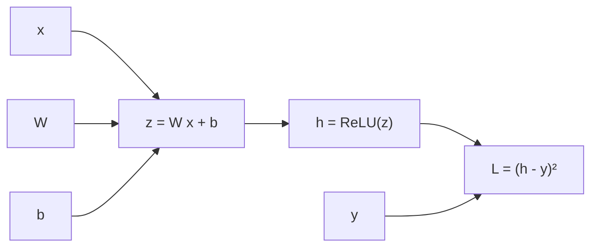

# Chương 2. Học máy và mạng nơ-ron

Chương 1 đã chuẩn bị các công cụ toán học. Chương này dùng chúng để trả lời câu hỏi trung tâm của học máy: **làm thế nào để một chương trình học được một hàm từ ví dụ**, và làm sao biết hàm đó sẽ hoạt động tốt trên dữ liệu chưa từng thấy? Ta sẽ đi từ khung lý thuyết (học có giám sát, cực tiểu hóa rủi ro thực nghiệm, độ chệch và phương sai), qua các mô hình tuyến tính, đến mạng nơ-ron nhiều lớp và thuật toán làm cho chúng huấn luyện được: **lan truyền ngược**.

Một điểm sẽ lặp lại suốt chương: **hàm mất mát không phải là lựa chọn tùy tiện**. Mỗi hàm mất mát quen thuộc (MSE, L1, entropy chéo) là hệ quả của một giả định xác suất về dữ liệu, và mỗi số hạng điều chuẩn là hệ quả của một niềm tin tiên nghiệm về tham số. Hiểu điều này giúp bạn đọc được *vì sao* các bài báo TTS chọn hàm mất mát như họ đã chọn, và khi nào những lựa chọn đó bắt đầu thất bại.

!!! abstract "Mục tiêu học tập"
    Sau chương này, bạn có thể:

    - **Phát biểu** bài toán học có giám sát dưới dạng cực tiểu hóa rủi ro thực nghiệm và **thiết kế** cách chia dữ liệu huấn luyện/kiểm định/kiểm tra phù hợp cho TTS.
    - **Suy ra** phân rã độ chệch–phương sai và **giải thích** vì sao số hạng nhiễu tương ứng với bản chất một-nhiều của TTS.
    - **Suy ra** MSE, L1, entropy chéo từ nguyên lý hợp lý cực đại, và các số hạng điều chuẩn L2/L1 từ ước lượng hậu nghiệm cực đại.
    - **Tính** gradient của hồi quy logistic và softmax, và **so sánh** các hàm kích hoạt sigmoid, tanh, ReLU, GELU, SiLU.
    - **Suy ra** từng bước thuật toán lan truyền ngược cho MLP và **cài đặt** một bộ vi phân tự động chế độ ngược thu nhỏ.
    - **Giải thích** khởi tạo Xavier/Glorot và He bằng lập luận bảo toàn phương sai.
    - **Cài đặt** một MLP từ đầu bằng numpy, **kiểm tra** gradient bằng sai phân hữu hạn và đối chiếu với `torch.autograd`.

!!! info "Kiến thức cần có"
    - [Chương 1](ch01-toan-nen-tang.md): tích ma trận, gradient, Jacobian và quy tắc dây chuyền cho véc-tơ (Mục 1.3), phân phối Gauss/Laplace/Categorical (Mục 1.4), entropy chéo và KL (Mục 1.5).
    - Python và numpy cơ bản; PyTorch ở mức tạo tensor và gọi `.backward()` là đủ (chi tiết hơn ở [Chương 6](ch06-pytorch-cho-tieng-noi.md)).

## 2.1. Bài toán học có giám sát

### 2.1.1. Bốn thành phần của một hệ học máy

Trong **học có giám sát** (*supervised learning*), ta có một tập ví dụ gồm các cặp (đầu vào, đầu ra mong muốn) và muốn tìm một hàm ánh xạ đầu vào thành đầu ra, sao cho hàm đó cũng đúng với những đầu vào mới. Mọi hệ học máy có giám sát, từ hồi quy tuyến tính đến một mô hình TTS hàng tỷ tham số, đều gồm bốn thành phần:

1. **Dữ liệu** $\mathcal{D} = \{(\mathbf{x}_i, \mathbf{y}_i)\}_{i=1}^{n}$, giả định được lấy mẫu độc lập từ một phân phối chưa biết $p_{\text{data}}(\mathbf{x}, \mathbf{y})$.
2. **Mô hình** (hay *lớp giả thuyết*) $\{f_\theta\}$: một họ hàm được tham số hóa bởi $\theta$, ví dụ mọi mạng nơ-ron có một kiến trúc cố định.
3. **Hàm mất mát** $\ell(\hat{\mathbf{y}}, \mathbf{y})$ đo mức "sai" của dự đoán $\hat{\mathbf{y}} = f_\theta(\mathbf{x})$ so với đáp án $\mathbf{y}$.
4. **Thuật toán tối ưu** tìm $\theta$ làm hàm mất mát nhỏ, thường là các biến thể của gradient descent ([Chương 3](ch03-toi-uu-va-ky-thuat-huan-luyen.md)).

Khi một mô hình TTS hoạt động kém, lỗi gần như luôn nằm ở một trong bốn thành phần này: dữ liệu bẩn hoặc lệch, kiến trúc thiếu năng lực hoặc sai thiên kiến quy nạp, hàm mất mát không phản ánh điều ta thực sự muốn, hay quá trình tối ưu không hội tụ. Tách bạch bốn thành phần là bước đầu tiên của mọi quy trình gỡ lỗi ([Chương 37](../phan-9-thuc-tien/ch37-huan-luyen-va-debug.md)).

### 2.1.2. Rủi ro kỳ vọng và cực tiểu hóa rủi ro thực nghiệm

Điều ta thực sự muốn là hàm $f$ có **rủi ro kỳ vọng** (*expected risk*) nhỏ, tức mất mát trung bình trên *toàn bộ* phân phối dữ liệu:

$$
R(f) = \mathbb{E}_{(\mathbf{x}, \mathbf{y}) \sim p_{\text{data}}}\big[\ell(f(\mathbf{x}), \mathbf{y})\big] .
$$

Nhưng ta không biết $p_{\text{data}}$; ta chỉ có $n$ mẫu. Vì vậy ta thay kỳ vọng bằng trung bình mẫu (một ước lượng Monte Carlo, Mục 1.4.6) và được **rủi ro thực nghiệm**:

$$
\hat{R}_n(f) = \frac{1}{n}\sum_{i=1}^{n} \ell\big(f(\mathbf{x}_i), \mathbf{y}_i\big),
\qquad
\hat{f} = \arg\min_{f \in \{f_\theta\}} \hat{R}_n(f) .
$$

Nguyên lý chọn $\hat{f}$ như trên gọi là **cực tiểu hóa rủi ro thực nghiệm** (*empirical risk minimization*, ERM). Với một hàm $f$ *cố định*, luật số lớn bảo đảm $\hat{R}_n(f) \to R(f)$. Nhưng $\hat{f}$ không cố định: nó được chọn *chính vì* có $\hat{R}_n$ nhỏ trên đúng tập dữ liệu này, nên $\hat{R}_n(\hat{f})$ thường **lạc quan** hơn $R(\hat{f})$. Khoảng cách $R(\hat{f}) - \hat{R}_n(\hat{f})$ gọi là **khoảng cách tổng quát hóa** (*generalization gap*). Toàn bộ Mục 2.2 bàn về cách kiểm soát nó.

### 2.1.3. TTS nhìn như một bài toán học có giám sát

Một hệ TTS gồm nhiều mô-đun, và mỗi mô-đun là một bài toán học có giám sát với loại đầu ra riêng:

| Mô-đun | Đầu vào $\mathbf{x}$ | Đầu ra $\mathbf{y}$ | Loại bài toán | Hàm mất mát điển hình |
|---|---|---|---|---|
| Mô hình âm học hồi quy (Tacotron 2, FastSpeech 2) | Chuỗi âm vị | Log-mel $\mathbf{Y} \in \mathbb{R}^{T \times F}$ | Hồi quy | L1 hoặc L2 |
| Bộ dự đoán trường độ | Chuỗi âm vị | $\log d_i$ (số khung) | Hồi quy | L2 trên log trường độ |
| Bộ dự đoán cao độ/năng lượng | Chuỗi âm vị | F0, năng lượng | Hồi quy | L2 hoặc L1 |
| Cờ dừng (Tacotron 2) | Trạng thái decoder | Dừng/chưa dừng | Phân loại nhị phân | Entropy chéo nhị phân |
| Codec language model (VALL-E) | Văn bản + token trước đó | Token âm thanh kế tiếp | Phân loại nhiều lớp | Entropy chéo |
| Vocoder GAN (HiFi-GAN) | Mel | Dạng sóng | Sinh có điều kiện | Đối kháng + L1 trên mel + feature matching |

Hai dòng cuối báo trước một điều: với những đầu ra phức tạp, "đáp án đúng" không còn duy nhất, và khung học có giám sát thuần túy phải được mở rộng thành **mô hình sinh có điều kiện** ([Phần II](../phan-2-mo-hinh-sinh/ch07-tong-quan-mo-hinh-sinh.md)). Nhưng các khái niệm của chương này (hàm mất mát, tổng quát hóa, lan truyền ngược) vẫn là nền tảng.

## 2.2. Tổng quát hóa

### 2.2.1. Tập huấn luyện, kiểm định và kiểm tra

Vì $\hat{R}_n(\hat{f})$ lạc quan, ta cần dữ liệu **chưa dùng để huấn luyện** để ước lượng $R(\hat{f})$ một cách trung thực. Quy trình chuẩn chia dữ liệu thành ba phần:

- **Tập huấn luyện** (*training set*): dùng để tối ưu tham số $\theta$.
- **Tập kiểm định** (*validation set*): dùng để chọn siêu tham số (tốc độ học, kích thước mô hình, số bước huấn luyện, checkpoint tốt nhất). Vì ta "chọn" dựa trên nó, tập này cũng dần bị khớp theo.
- **Tập kiểm tra** (*test set*): chỉ dùng **một lần** ở cuối để báo cáo kết quả. Nếu bạn nhìn kết quả trên tập kiểm tra rồi quay lại chỉnh mô hình, nó đã trở thành tập kiểm định.

Với TTS, việc chia dữ liệu có những điểm tinh tế riêng ([Chương 36](../phan-9-thuc-tien/ch36-du-lieu-tts.md), [Chương 38](../phan-9-thuc-tien/ch38-danh-gia-tts.md)):

- **Rò rỉ văn bản.** Nếu cùng một câu văn (hoặc những câu gần như trùng lặp, rất hay gặp trong sách nói và tin tức) xuất hiện ở cả tập huấn luyện lẫn tập kiểm tra, kết quả đánh giá sẽ đẹp một cách giả tạo.
- **Chia theo người nói.** Muốn đánh giá khả năng nhân bản giọng *zero-shot*, người nói trong tập kiểm tra phải **hoàn toàn không** xuất hiện trong tập huấn luyện.
- **Loss kiểm định không phải là chất lượng.** Với mô hình tự hồi quy huấn luyện bằng teacher forcing, loss kiểm định được tính khi mô hình được "nhắc" đáp án đúng ở mỗi bước, khác hẳn lúc suy luận thật. Với GAN, loss của bộ sinh gần như không nói lên chất lượng âm thanh. Hãy luôn **nghe** mẫu sinh ra và dùng các thước đo khách quan phù hợp ([Chương 38](../phan-9-thuc-tien/ch38-danh-gia-tts.md)).

### 2.2.2. Quá khớp và chưa khớp

**Năng lực** (*capacity*) của một lớp mô hình là mức độ phong phú của các hàm mà nó biểu diễn được. Mô hình quá đơn giản sẽ **chưa khớp** (*underfitting*): lỗi cao ngay trên tập huấn luyện. Mô hình quá phức tạp so với lượng dữ liệu sẽ **quá khớp** (*overfitting*): lỗi huấn luyện rất thấp nhưng lỗi kiểm định cao, vì nó học thuộc cả nhiễu. Dấu hiệu quá khớp kinh điển là đường loss huấn luyện tiếp tục giảm trong khi đường loss kiểm định chững lại rồi đi lên.

Bức tranh cổ điển này cần một lời bình: các mạng nơ-ron hiện đại thường có số tham số vượt xa số mẫu mà vẫn tổng quát hóa tốt, và lỗi kiểm định đôi khi giảm *trở lại* khi tiếp tục tăng kích thước mô hình, hiện tượng được gọi là **double descent** (Belkin và cộng sự, 2019). Thiên kiến quy nạp của kiến trúc, của thuật toán tối ưu và các kỹ thuật điều chuẩn ([Chương 3](ch03-toi-uu-va-ky-thuat-huan-luyen.md)) đều đóng vai trò. Dù vậy, với lượng dữ liệu TTS khiêm tốn, đặc biệt là tiếng Việt (vài giờ đến vài chục giờ cho một giọng), quá khớp vẫn là mối lo rất thực tế.

### 2.2.3. Phân rã độ chệch – phương sai

Phân rã độ chệch–phương sai (*bias–variance decomposition*) cho ta một cách định lượng để nghĩ về năng lực và quá khớp.

**Thiết lập.** Giả sử $y = f(\mathbf{x}) + \varepsilon$, với $f$ là hàm thật, nhiễu $\varepsilon$ có $\mathbb{E}[\varepsilon] = 0$, $\operatorname{Var}(\varepsilon) = \sigma^2$ và độc lập với mọi thứ khác. Huấn luyện trên một tập dữ liệu ngẫu nhiên $\mathcal{D}$ cho ta hàm $\hat{f}_{\mathcal{D}}$. Vì $\mathcal{D}$ ngẫu nhiên nên $\hat{f}_{\mathcal{D}}(\mathbf{x})$ cũng ngẫu nhiên; gọi $\bar{f}(\mathbf{x}) = \mathbb{E}_{\mathcal{D}}[\hat{f}_{\mathcal{D}}(\mathbf{x})]$ là dự đoán trung bình trên mọi tập huấn luyện có thể có.

**Suy ra.** Cố định một điểm $\mathbf{x}$ và viết tắt $f = f(\mathbf{x})$, $\hat{f} = \hat{f}_{\mathcal{D}}(\mathbf{x})$, $\bar{f} = \bar{f}(\mathbf{x})$. Sai số bình phương kỳ vọng trên một điểm mới là

$$
\mathbb{E}_{\mathcal{D}, \varepsilon}\big[(y - \hat{f})^2\big] = \mathbb{E}\big[(f - \hat{f} + \varepsilon)^2\big] = \mathbb{E}_{\mathcal{D}}\big[(f - \hat{f})^2\big] + 2\,\mathbb{E}\big[(f - \hat{f})\,\varepsilon\big] + \mathbb{E}[\varepsilon^2] .
$$

Số hạng giữa bằng 0 vì $\varepsilon$ độc lập với $\hat{f}$ và có kỳ vọng 0. Số hạng cuối là $\sigma^2$. Với số hạng đầu, cộng và trừ $\bar{f}$:

$$
\mathbb{E}_{\mathcal{D}}\big[(f - \hat{f})^2\big] = (f - \bar{f})^2 + 2(f - \bar{f})\,\mathbb{E}_{\mathcal{D}}\big[\bar{f} - \hat{f}\big] + \mathbb{E}_{\mathcal{D}}\big[(\hat{f} - \bar{f})^2\big] .
$$

Số hạng giữa lại bằng 0 vì $\mathbb{E}_{\mathcal{D}}[\hat{f}] = \bar{f}$. Kết hợp lại:

$$
\mathbb{E}\big[(y - \hat{f}(\mathbf{x}))^2\big] = \underbrace{\big(f(\mathbf{x}) - \bar{f}(\mathbf{x})\big)^2}_{\text{độ chệch}^2} + \underbrace{\mathbb{E}_{\mathcal{D}}\big[(\hat{f}(\mathbf{x}) - \bar{f}(\mathbf{x}))^2\big]}_{\text{phương sai}} + \underbrace{\sigma^2}_{\text{nhiễu không thể giảm}} .
$$

- **Độ chệch** đo mức "sai có hệ thống": ngay cả khi lấy trung bình trên vô số tập huấn luyện, mô hình vẫn lệch khỏi hàm thật. Mô hình quá đơn giản có độ chệch lớn.
- **Phương sai** đo độ nhạy của mô hình với tập huấn luyện cụ thể. Mô hình quá phức tạp có phương sai lớn.
- **Nhiễu không thể giảm** là giới hạn dưới của *mọi* dự đoán tất định.

Thí nghiệm sau khớp đa thức bậc 1, 3 và 12 vào 20 điểm nhiễu của hàm $\sin(\pi x)$, lặp lại trên 500 tập huấn luyện khác nhau:

```python
import numpy as np

rng = np.random.default_rng(0)
f_true = lambda x: np.sin(np.pi * x)            # hàm "thật" mà ta không biết
noise_std, n_train, n_repeat = 0.3, 20, 500
x_train = np.linspace(-1, 1, n_train)           # vị trí đầu vào cố định
x_test = np.linspace(-0.95, 0.95, 101)

for degree in [1, 3, 12]:
    preds = np.empty((n_repeat, x_test.size))
    for r in range(n_repeat):                    # nhiều tập huấn luyện khác nhau
        y = f_true(x_train) + noise_std * rng.standard_normal(n_train)
        poly = np.polynomial.Polynomial.fit(x_train, y, degree)
        preds[r] = poly(x_test)
    mean_pred = preds.mean(axis=0)               # "dự đoán trung bình" f_bar(x)
    bias2 = np.mean((mean_pred - f_true(x_test)) ** 2)
    var = np.mean(preds.var(axis=0))
    print(f"bậc {degree:2d}: bias^2 = {bias2:.4f}  variance = {var:.4f}  "
          f"sai số kỳ vọng = {bias2 + var + noise_std ** 2:.4f}")
```

Kết quả: bậc 1 có độ chệch bình phương khoảng 0,19 (đường thẳng không thể uốn theo hình sin); bậc 12 có độ chệch gần như bằng 0 nhưng phương sai khoảng 0,065, gấp hơn bốn lần bậc 3; bậc 3 cân bằng tốt nhất với sai số kỳ vọng khoảng 0,11. Tất cả đều không xuống dưới được $\sigma^2 = 0{,}09$.

**Liên hệ với TTS: nhiễu không thể giảm chính là tính một-nhiều.** Trong TTS, "nhiễu" $\varepsilon$ không chỉ là tạp âm thu âm. Nó bao gồm mọi biến thiên của tiếng nói mà văn bản không quyết định: người đọc ngắt nghỉ ở đâu, nhấn vào từ nào, tốc độ ra sao, hơi thở, cảm xúc. Với một bộ hồi quy tất định, phần biến thiên này là "không thể giảm", và cách tốt nhất mà hồi quy L2 làm được là dự đoán **trung bình** của nó (Mục 1.4.7), dẫn tới giọng đều đều, phẳng. Muốn vượt qua giới hạn này, ta phải ngừng dự đoán một giá trị và bắt đầu **mô hình hóa cả phân phối**: đó là chủ đề của [Phần II](../phan-2-mo-hinh-sinh/ch07-tong-quan-mo-hinh-sinh.md).

## 2.3. Mô hình tuyến tính

Mô hình tuyến tính đáng học kỹ vì hai lý do. Thứ nhất, lớp cuối của gần như mọi mạng nơ-ron là một mô hình tuyến tính đặt trên các đặc trưng học được. Thứ hai, chúng là nơi ta thấy rõ nhất mối liên hệ giữa hàm mất mát, xác suất và gradient.

### 2.3.1. Hồi quy tuyến tính

Mô hình $\hat{y} = \mathbf{w}^\top\mathbf{x} + b$. Gộp độ lệch vào trọng số bằng cách thêm một thành phần hằng 1 vào $\mathbf{x}$, rồi xếp $n$ mẫu thành ma trận thiết kế $\mathbf{X} \in \mathbb{R}^{n \times d}$ (mỗi hàng là một mẫu) và véc-tơ đích $\mathbf{y} \in \mathbb{R}^{n}$. Hàm mất mát MSE là

$$
\mathcal{L}(\mathbf{w}) = \frac{1}{n}\lVert \mathbf{X}\mathbf{w} - \mathbf{y} \rVert_2^2 ,
\qquad
\nabla_{\mathbf{w}}\mathcal{L} = \frac{2}{n}\mathbf{X}^\top(\mathbf{X}\mathbf{w} - \mathbf{y}) .
$$

Đây đúng là bài toán bình phương tối thiểu ở Mục 1.2.4, với nghiệm dạng đóng $\mathbf{w}^\star = (\mathbf{X}^\top\mathbf{X})^{-1}\mathbf{X}^\top\mathbf{y}$ khi $\mathbf{X}^\top\mathbf{X}$ khả nghịch. Với mạng nơ-ron ta không còn nghiệm dạng đóng, nhưng dạng gradient "**ma trận đầu vào chuyển vị nhân phần dư**" sẽ xuất hiện lại ở mọi lớp tuyến tính.

### 2.3.2. Hồi quy logistic

Với nhãn nhị phân $y \in \{0, 1\}$, ta muốn mô hình xuất ra một **xác suất**. Hồi quy logistic tính một điểm số tuyến tính $z = \mathbf{w}^\top\mathbf{x} + b$, gọi là **logit**, rồi ép nó vào khoảng $(0, 1)$ bằng hàm sigmoid:

$$
\hat{\pi} = p(y = 1 \mid \mathbf{x}) = \sigma(z) = \frac{1}{1 + e^{-z}} .
$$

Logit có một ý nghĩa đẹp: $z = \log\frac{\hat{\pi}}{1 - \hat{\pi}}$, tức logarit của tỷ lệ cược. Hàm mất mát là negative log-likelihood của phân phối Bernoulli, còn gọi là **entropy chéo nhị phân** (BCE):

$$
\ell(z, y) = -\big[y\log\sigma(z) + (1 - y)\log(1 - \sigma(z))\big] .
$$

**Gradient.** Dùng $\sigma'(z) = \sigma(z)(1 - \sigma(z))$ (bạn hãy tự kiểm tra), ta có $\frac{d}{dz}\log\sigma(z) = 1 - \sigma(z)$ và $\frac{d}{dz}\log(1 - \sigma(z)) = -\sigma(z)$. Do đó

$$
\frac{\partial \ell}{\partial z} = -\big[y(1 - \sigma(z)) - (1 - y)\sigma(z)\big] = \sigma(z) - y ,
\qquad
\nabla_{\mathbf{w}}\ell = (\sigma(z) - y)\,\mathbf{x} .
$$

Gradient theo logit đơn giản là **dự đoán trừ nhãn**. Không có thừa số $\sigma'(z)$ nào làm gradient tiêu biến khi mô hình sai một cách tự tin, và đó là lý do ta ghép sigmoid với BCE thay vì với MSE.

**Trong TTS**, Tacotron 2 dự đoán ở mỗi bước decoder một xác suất "dừng" bằng đúng cơ chế này ([Chương 20](../phan-5-mo-hinh-am-hoc/ch20-tacotron.md)). Một câu dài vài trăm khung chỉ có **một** khung dương, nên dữ liệu mất cân bằng nghiêm trọng; một số bản cài đặt tăng trọng số cho lớp dương (tham số `pos_weight` của `BCEWithLogitsLoss`) để mô hình không học cách "không bao giờ dừng".

### 2.3.3. Hồi quy softmax

Với $K$ lớp, mô hình tính $K$ logit $\mathbf{z} = \mathbf{W}\mathbf{x} + \mathbf{b} \in \mathbb{R}^{K}$ và biến chúng thành phân phối Categorical bằng softmax, $p_k = e^{z_k}/\sum_j e^{z_j}$. Hàm mất mát là entropy chéo với nhãn one-hot $\mathbf{y}$ (Mục 1.5.2):

$$
\ell(\mathbf{z}, y) = -\log p_y = -z_y + \log\sum_{j} e^{z_j} .
$$

**Gradient, cách 1** (dùng đồng nhất thức log-sum-exp ở Mục 1.3.4): $\nabla_{\mathbf{z}}\big(\log\sum_j e^{z_j}\big) = \mathbf{p}$ và $\nabla_{\mathbf{z}}(-z_y) = -\mathbf{y}$, nên

$$
\nabla_{\mathbf{z}}\ell = \mathbf{p} - \mathbf{y} .
$$

**Cách 2** (dùng Jacobian của softmax): $\partial\ell/\partial p_k = -y_k/p_k$. Nhân với Jacobian chuyển vị $\operatorname{diag}(\mathbf{p}) - \mathbf{p}\mathbf{p}^\top$ (Mục 1.3.4): thành phần thứ $j$ là $\sum_k (p_k\mathbb{1}[k = j] - p_k p_j)(-y_k/p_k) = -y_j + p_j\sum_k y_k = p_j - y_j$. Hai cách cho cùng kết quả, và lại là "**dự đoán trừ nhãn**". Gradient theo trọng số là tích ngoài $(\mathbf{p} - \mathbf{y})\mathbf{x}^\top$.

Đoạn mã sau kiểm chứng cả hai công thức bằng autograd:

```python
import torch
import torch.nn.functional as F

torch.manual_seed(0)
B, K = 4, 6                                   # 4 mẫu, 6 lớp (ví dụ: 6 thanh điệu)
z = torch.randn(B, K, dtype=torch.float64, requires_grad=True)   # (B, K) logit
y = torch.tensor([0, 3, 5, 1])                # (B,) nhãn đúng

loss = F.cross_entropy(z, y)                  # nhận LOGIT, tự làm log-softmax
loss.backward()
p = torch.softmax(z.detach(), dim=1)
y_onehot = F.one_hot(y, K).double()
assert torch.allclose(z.grad, (p - y_onehot) / B)   # dL/dz = (p - y) / B

# Trường hợp nhị phân: cờ dừng (stop token) với BCE trên logit
s = torch.randn(B, dtype=torch.float64, requires_grad=True)       # (B,) logit
t = torch.tensor([0.0, 0.0, 0.0, 1.0], dtype=torch.float64)      # (B,) nhãn
F.binary_cross_entropy_with_logits(s, t).backward()
assert torch.allclose(s.grad, (torch.sigmoid(s.detach()) - t) / B)
print("Gradient của CE và BCE theo logit đều có dạng (dự đoán - nhãn).")
```

Thừa số $1/B$ xuất hiện vì `F.cross_entropy` mặc định lấy **trung bình** trên batch. Chi tiết nhỏ này trở nên quan trọng khi ta tích lũy gradient qua nhiều batch con ([Chương 3](ch03-toi-uu-va-ky-thuat-huan-luyen.md)).

!!! warning "Truyền logit, đừng truyền xác suất"
    `F.cross_entropy` nhận **logit** và tự tính `log_softmax` theo cách ổn định số học; `F.binary_cross_entropy_with_logits` cũng vậy. Nếu bạn áp `softmax` (hoặc `sigmoid`) trước rồi mới đưa vào, mô hình vẫn chạy nhưng học chậm và sai lệch, vì softmax bị áp hai lần. Đây là một trong những lỗi phổ biến nhất của người mới.

## 2.4. Hàm mất mát từ góc nhìn xác suất: MLE và MAP

### 2.4.1. Ước lượng hợp lý cực đại

Thay vì tự chọn một hàm mất mát, ta chọn một **mô hình xác suất có điều kiện** $p_\theta(\mathbf{y} \mid \mathbf{x})$ và tìm tham số làm dữ liệu quan sát được "hợp lý nhất". Với dữ liệu độc lập cùng phân phối, hàm hợp lý (*likelihood*) là tích $\prod_i p_\theta(\mathbf{y}_i \mid \mathbf{x}_i)$; lấy logarit biến tích thành tổng (và tránh tràn số), nên **ước lượng hợp lý cực đại** (*maximum likelihood estimation*, MLE) là

$$
\theta_{\text{MLE}} = \arg\max_\theta \sum_{i=1}^{n}\log p_\theta(\mathbf{y}_i \mid \mathbf{x}_i) = \arg\min_\theta \frac{1}{n}\sum_{i=1}^{n}\big[-\log p_\theta(\mathbf{y}_i \mid \mathbf{x}_i)\big] .
$$

Vế phải chính là ERM với hàm mất mát $\ell = -\log p_\theta$, gọi là **negative log-likelihood** (NLL). Theo Mục 1.5.3, đây cũng là cực tiểu hóa (ước lượng thực nghiệm của) $D_{\mathrm{KL}}(p_{\text{data}} \,\Vert\, p_\theta)$. Chọn họ phân phối nào, ta được hàm mất mát tương ứng:

- **Gauss với phương sai cố định** cho MSE, và mô hình học trung bình có điều kiện (Mục 1.4.7).
- **Laplace với thang đo cố định** cho L1, và mô hình học trung vị có điều kiện.
- **Bernoulli** cho entropy chéo nhị phân (Mục 2.3.2).
- **Categorical** cho entropy chéo (Mục 2.3.3).

**Mở rộng: học cả phương sai.** Nếu mạng xuất cả trung bình $\mu_\theta(\mathbf{x})$ lẫn phương sai $\sigma^2_\theta(\mathbf{x})$ thì NLL Gauss (bỏ hằng số) là

$$
\ell = \frac{(y - \mu_\theta(\mathbf{x}))^2}{2\sigma_\theta^2(\mathbf{x})} + \tfrac{1}{2}\log\sigma_\theta^2(\mathbf{x}) .
$$

Mô hình giờ có thể "thừa nhận" những vùng khó đoán bằng cách tăng $\sigma$, đổi lại bị phạt bởi số hạng $\log\sigma^2$. Đây là ý tưởng của các mạng mật độ hỗn hợp (*mixture density network*) và của tiên nghiệm có phương sai học được trong một số mô hình dựa trên flow ([Chương 7](../phan-2-mo-hinh-sinh/ch07-tong-quan-mo-hinh-sinh.md), [Chương 23](../phan-5-mo-hinh-am-hoc/ch23-glow-grad-matcha.md)). Trong thực hành, nên tham số hóa $\log\sigma^2$ thay vì $\sigma^2$ và đặt một ngưỡng dưới cho nó, nếu không mô hình có thể đẩy $\sigma \to 0$ trên các mẫu dễ và làm loss tiến về $-\infty$.

### 2.4.2. Hậu nghiệm cực đại và điều chuẩn

MLE chỉ nhìn vào dữ liệu. Nếu ta có **niềm tin tiên nghiệm** $p(\theta)$ về tham số (ví dụ: trọng số không nên quá lớn), quy tắc Bayes cho hậu nghiệm $p(\theta \mid \mathcal{D}) \propto p(\mathcal{D} \mid \theta)\,p(\theta)$, và **ước lượng hậu nghiệm cực đại** (MAP) là

$$
\theta_{\text{MAP}} = \arg\min_\theta \Big[\sum_{i=1}^{n} -\log p_\theta(\mathbf{y}_i \mid \mathbf{x}_i) \;-\; \log p(\theta)\Big] .
$$

Số hạng $-\log p(\theta)$ chính là một **số hạng điều chuẩn** (*regularizer*):

- **Tiên nghiệm Gauss** $\theta \sim \mathcal{N}(\mathbf{0}, \tau^2\mathbf{I})$: $-\log p(\theta) = \frac{1}{2\tau^2}\lVert\theta\rVert_2^2 + \text{hằng số}$. Đây là **điều chuẩn L2** (*weight decay*, ridge). Tiên nghiệm càng hẹp ($\tau$ nhỏ) thì phạt càng mạnh.
- **Tiên nghiệm Laplace** $p(\theta_j) \propto e^{-\lvert\theta_j\rvert/b}$: $-\log p(\theta) = \frac{1}{b}\lVert\theta\rVert_1 + \text{hằng số}$. Đây là **điều chuẩn L1** (lasso), có xu hướng đẩy nhiều tham số về **đúng bằng 0** (thưa).

Với hồi quy tuyến tính, nhiễu Gauss phương sai $\sigma^2$ và tiên nghiệm Gauss phương sai $\tau^2$, MAP có nghiệm dạng đóng $\mathbf{w}^\star = (\mathbf{X}^\top\mathbf{X} + \lambda\mathbf{I})^{-1}\mathbf{X}^\top\mathbf{y}$ với $\lambda = \sigma^2/\tau^2$ (Bài tập 3). Số hạng $\lambda\mathbf{I}$ còn có lợi ích số học: nó làm ma trận luôn khả nghịch và giảm số điều kiện. [Chương 3](ch03-toi-uu-va-ky-thuat-huan-luyen.md) sẽ chỉ ra một điểm tinh tế: với các bộ tối ưu thích nghi như Adam, "thêm L2 vào hàm mất mát" và "weight decay" **không còn tương đương**, và đó là lý do AdamW ra đời.

### 2.4.3. Bảng tổng hợp

| Giả định xác suất | Hàm mất mát / điều chuẩn | Mô hình học được | Ví dụ trong TTS |
|---|---|---|---|
| $y \sim \mathcal{N}(\hat{y}, \sigma^2)$ | MSE (L2) | Trung bình có điều kiện | Mel của Tacotron 2; trường độ, F0, năng lượng của FastSpeech 2 |
| $y \sim \operatorname{Laplace}(\hat{y}, b)$ | L1 (MAE) | Trung vị có điều kiện | Mất mát mel phụ trợ của HiFi-GAN, VITS |
| $y \sim \operatorname{Bernoulli}(\sigma(z))$ | Entropy chéo nhị phân | Xác suất lớp dương | Cờ dừng |
| $y \sim \operatorname{Cat}(\operatorname{softmax}(\mathbf{z}))$ | Entropy chéo | Phân phối trên các lớp | Token codec, mẫu μ-law của WaveNet |
| $\theta \sim \mathcal{N}(\mathbf{0}, \tau^2\mathbf{I})$ | Phạt $\lVert\theta\rVert_2^2$ | Trọng số nhỏ | Weight decay trong AdamW |
| $\theta_j \sim \operatorname{Laplace}(0, b)$ | Phạt $\lVert\theta\rVert_1$ | Trọng số thưa | Cắt tỉa (*pruning*) mô hình |

## 2.5. Mạng nơ-ron nhiều lớp

### 2.5.1. Vì sao cần phi tuyến: bài toán XOR

Mô hình tuyến tính chỉ vẽ được **siêu phẳng** làm biên quyết định. Bài toán XOR (bốn điểm $(0,0), (1,1)$ thuộc lớp 0 và $(0,1), (1,0)$ thuộc lớp 1) không thể tách bằng một đường thẳng. Nhưng nếu ta trước hết biến đổi đầu vào bằng hai đặc trưng phi tuyến $h_1 = \operatorname{ReLU}(x_1 + x_2)$ và $h_2 = \operatorname{ReLU}(x_1 + x_2 - 1)$, thì $h_1 - 2h_2$ cho đúng $0, 1, 1, 0$ trên bốn điểm. Bài học: **một tầng ẩn phi tuyến biến bài toán không tuyến tính thành bài toán tuyến tính trong không gian đặc trưng mới.** Mạng nơ-ron là cách *học* những đặc trưng như vậy thay vì tự thiết kế.

Như Mục 1.2.1 đã nhấn mạnh, hàm phi tuyến là bắt buộc: không có nó, mọi tầng tuyến tính chồng lên nhau sụp đổ về một tầng.

### 2.5.2. Kiến trúc MLP

**Perceptron nhiều lớp** (*multilayer perceptron*, MLP) gồm $L$ lớp, mỗi lớp là một phép biến đổi affine theo sau bởi một hàm kích hoạt $\phi$ áp dụng từng phần tử:

$$
\mathbf{h}^{(0)} = \mathbf{x}, \qquad
\mathbf{z}^{(l)} = \mathbf{W}^{(l)}\mathbf{h}^{(l-1)} + \mathbf{b}^{(l)}, \qquad
\mathbf{h}^{(l)} = \phi\big(\mathbf{z}^{(l)}\big), \qquad l = 1, \ldots, L ,
$$

với $\mathbf{W}^{(l)} \in \mathbb{R}^{d_l \times d_{l-1}}$. Lớp cuối thường không có hàm kích hoạt (hồi quy) hoặc xuất logit cho softmax (phân loại). Ta gọi $\mathbf{z}^{(l)}$ là **tiền kích hoạt** (*pre-activation*) và $\mathbf{h}^{(l)}$ là **kích hoạt**.

MLP xuất hiện ở khắp nơi trong TTS, thường dưới những cái tên khác: **pre-net** của Tacotron 2 là một MLP hai lớp 256 đơn vị với ReLU và dropout; **mạng truyền thẳng** (*feed-forward network*, FFN) trong mỗi khối Transformer là một MLP hai lớp áp dụng độc lập cho từng vị trí ([Chương 5](ch05-transformer.md)); các phép chiếu embedding người nói hay embedding thời gian $t$ trong diffusion cũng thường là MLP nhỏ.

### 2.5.3. Các hàm kích hoạt

| Tên | Công thức $\phi(z)$ | Đạo hàm $\phi'(z)$ | Ưu điểm | Nhược điểm | Hay gặp ở |
|---|---|---|---|---|---|
| Sigmoid | $\sigma(z) = \frac{1}{1 + e^{-z}}$ | $\sigma(z)(1 - \sigma(z)) \le \frac{1}{4}$ | Đầu ra trong $(0, 1)$, hiểu như xác suất hoặc cổng | Bão hòa, gradient tiêu biến; không đối xứng quanh 0 | Cổng của LSTM, cờ dừng |
| tanh | $\frac{e^{z} - e^{-z}}{e^{z} + e^{-z}}$ | $1 - \tanh^2(z) \le 1$ | Đối xứng quanh 0 | Vẫn bão hòa ở hai đầu | Post-net Tacotron 2, đơn vị cổng của WaveNet |
| ReLU | $\max(0, z)$ | $\mathbb{1}[z > 0]$ | Rẻ, không bão hòa với $z > 0$ | "Chết" nếu $z < 0$ mãi mãi | Pre-net Tacotron 2, FFN của Transformer gốc, FastSpeech |
| Leaky ReLU | $\max(az, z)$, $0 < a < 1$ | $1$ hoặc $a$ | Không bao giờ "chết" hẳn | Thêm siêu tham số $a$ | HiFi-GAN, MelGAN (với $a = 0{,}1$ hoặc $0{,}2$) |
| GELU | $z\,\Phi(z)$ | $\Phi(z) + z\,\varphi(z)$ | Trơn, hoạt động tốt trong Transformer | Đắt hơn ReLU một chút | BERT, GPT, nhiều Transformer hiện đại |
| SiLU/Swish | $z\,\sigma(z)$ | $\sigma(z)\big(1 + z(1 - \sigma(z))\big)$ | Trơn, không đơn điệu | Đắt hơn ReLU một chút | Conformer, các khối gated như SwiGLU |

Ở đây $\Phi$ và $\varphi$ là hàm phân phối tích lũy và hàm mật độ của $\mathcal{N}(0, 1)$. Một vài nhận xét quan trọng:

- **Bão hòa và gradient tiêu biến.** Đạo hàm của sigmoid không vượt quá $1/4$. Qua 10 lớp sigmoid, gradient bị nhân với một thừa số tối đa $(1/4)^{10} \approx 10^{-6}$ (chưa kể trọng số). Đây là lý do mạng sâu chỉ thực sự huấn luyện được sau khi ReLU trở nên phổ biến (Nair và Hinton, 2010; Glorot và cộng sự, 2011), cùng với khởi tạo tốt (Mục 2.7), chuẩn hóa và kết nối tắt ([Chương 3](ch03-toi-uu-va-ky-thuat-huan-luyen.md), [Chương 4](ch04-cnn-rnn-mo-hinh-chuoi.md)).
- **ReLU "chết".** Nếu một nơ-ron ReLU có tiền kích hoạt âm với mọi đầu vào (ví dụ sau một bước cập nhật quá lớn), gradient qua nó bằng 0 vĩnh viễn. Leaky ReLU (Maas và cộng sự, 2013) để lại một độ dốc nhỏ $a$ cho phần âm. Các vocoder GAN như HiFi-GAN dùng Leaky ReLU với độ dốc 0,1 xen giữa các lớp tích chập.
- **GELU** (Hendrycks và Gimpel, 2016) có thể hiểu là "nhân đầu vào với xác suất nó dương" dưới phân phối chuẩn. Dạng xấp xỉ $0{,}5z\big(1 + \tanh\big[\sqrt{2/\pi}(z + 0{,}044715z^3)\big]\big)$ được dùng rộng rãi; trong PyTorch đó là `F.gelu(x, approximate="tanh")`, với sai số tuyệt đối so với dạng chính xác dưới $5 \times 10^{-4}$.
- **SiLU/Swish** (Elfwing và cộng sự, 2018; Ramachandran và cộng sự, 2017) có giá trị nhỏ nhất xấp xỉ $-0{,}28$ tại $z \approx -1{,}28$: hơi âm với đầu vào âm vừa phải, rồi tiến về 0. Nó là thành phần của SwiGLU, khối FFN có cổng trong nhiều mô hình ngôn ngữ lớn mà các hệ TTS dựa trên LLM thừa hưởng ([Chương 5](ch05-transformer.md), [Chương 34](../phan-8-mo-hinh-lon/ch34-he-thong-lai-hien-dai.md)).
- **Snake**, $z + \frac{1}{\alpha}\sin^2(\alpha z)$ với $\alpha$ học được (Ziyin và cộng sự, 2020), đưa một thiên kiến quy nạp **tuần hoàn** vào mạng. BigVGAN dùng nó để vocoder tái tạo tốt hơn các thành phần điều hòa của tiếng nói ([Chương 25](../phan-6-vocoder/ch25-gan-vocoder.md)). Đây là ví dụ đẹp về việc chọn hàm kích hoạt theo *bản chất của tín hiệu*.

### 2.5.4. Định lý xấp xỉ vạn năng

Mạng nơ-ron biểu diễn được những hàm nào? **Định lý xấp xỉ vạn năng** (Cybenko, 1989; Hornik và cộng sự, 1989; Leshno và cộng sự, 1993) khẳng định: một MLP với **một** tầng ẩn đủ rộng và hàm kích hoạt không phải đa thức (sigmoid, ReLU, ...) có thể xấp xỉ bất kỳ hàm liên tục nào trên một tập compact với sai số tùy ý.

**Trực giác với ReLU.** Hiệu của hai ReLU lệch nhau, $\operatorname{ReLU}(z - a) - \operatorname{ReLU}(z - b)$, là một "đoạn dốc" lên rồi đi ngang. Tổ hợp hai đoạn dốc ngược chiều cho ta một "cái bướu" hình thang. Cộng nhiều cái bướu có chiều cao khác nhau, ta xấp xỉ được bất kỳ đường cong liên tục nào bằng một hàm tuyến tính từng khúc, càng nhiều nơ-ron càng mịn. Trong nhiều chiều, ý tưởng tương tự (dù kỹ thuật phức tạp hơn) vẫn đúng.

**Những gì định lý *không* nói.** (1) Số nơ-ron cần thiết có thể lớn theo cấp số mũ với số chiều đầu vào. (2) Định lý chỉ nói *tồn tại* bộ tham số tốt, không nói gradient descent sẽ *tìm* được nó. (3) Nó không nói gì về tổng quát hóa từ dữ liệu hữu hạn. Trong thực tế, mạng **sâu** thường hiệu quả hơn hẳn mạng nông rộng với cùng số tham số, vì chúng biểu diễn được các hàm có cấu trúc phân cấp: âm vị ghép thành âm tiết, âm tiết thành từ, từ thành ngữ đoạn. Và quan trọng không kém là **thiên kiến quy nạp**: tích chập cho tín hiệu cục bộ và bất biến tịnh tiến, attention cho các phụ thuộc xa ([Chương 4](ch04-cnn-rnn-mo-hinh-chuoi.md), [Chương 5](ch05-transformer.md)).

## 2.6. Lan truyền ngược

Một mô hình TTS hiện đại có từ vài triệu đến vài tỷ tham số. Để huấn luyện bằng gradient descent, ở mỗi bước ta cần $\nabla_\theta\mathcal{L}$ theo **mọi** tham số. Tính từng đạo hàm riêng bằng sai phân hữu hạn sẽ cần số lần chạy mô hình tỷ lệ với số tham số: hoàn toàn bất khả thi. **Lan truyền ngược** (*backpropagation*, Rumelhart và cộng sự, 1986) tính toàn bộ gradient với chi phí chỉ cỡ **vài lần** một lượt chạy xuôi. Nó không phải là một phép màu, mà là quy tắc dây chuyền (Mục 1.3.3) được tổ chức khéo léo.

### 2.6.1. Đồ thị tính toán

Mọi phép tính trong mạng nơ-ron có thể vẽ thành một **đồ thị tính toán**: mỗi nút là một biến (đầu vào, tham số, kết quả trung gian), mỗi cạnh là sự phụ thuộc qua một phép toán cơ bản. Với một lớp tuyến tính, ReLU và hàm mất mát MSE:



**Lượt xuôi** (*forward pass*) đi từ trái sang phải, tính giá trị mỗi nút và **lưu lại** các giá trị trung gian cần cho đạo hàm. **Lượt ngược** (*backward pass*) đi từ phải sang trái: bắt đầu với $\partial\mathcal{L}/\partial\mathcal{L} = 1$, mỗi nút nhận gradient từ các nút "con" của nó, nhân với đạo hàm cục bộ, rồi chuyển tiếp cho các nút "cha". Nếu một nút được dùng ở nhiều nơi (ví dụ một tham số dùng chung), gradient từ các nhánh được **cộng dồn**, đúng như tổng theo mọi con đường trong quy tắc dây chuyền.

### 2.6.2. Suy ra lan truyền ngược cho MLP

Ta suy ra công thức cho MLP ở Mục 2.5.2 với một mẫu, sau đó viết lại cho cả batch.

**Định nghĩa tín hiệu lỗi.** Với mỗi lớp, đặt

$$
\boldsymbol{\delta}^{(l)} = \frac{\partial\mathcal{L}}{\partial\mathbf{z}^{(l)}} \in \mathbb{R}^{d_l},
$$

tức gradient của hàm mất mát theo tiền kích hoạt của lớp $l$. Đại lượng này là "trái tim" của thuật toán: biết nó, ta suy ra được mọi thứ khác ở lớp đó.

**Bước 1: lớp cuối.** $\boldsymbol{\delta}^{(L)}$ tính trực tiếp từ hàm mất mát. Với softmax + entropy chéo, theo Mục 2.3.3, $\boldsymbol{\delta}^{(L)} = \mathbf{p} - \mathbf{y}$. Với MSE $\mathcal{L} = \lVert\mathbf{z}^{(L)} - \mathbf{y}\rVert_2^2$ trên đầu ra tuyến tính, $\boldsymbol{\delta}^{(L)} = 2(\mathbf{z}^{(L)} - \mathbf{y})$.

**Bước 2: gradient theo tham số của lớp $l$.** Vì $\mathbf{z}^{(l)} = \mathbf{W}^{(l)}\mathbf{h}^{(l-1)} + \mathbf{b}^{(l)}$, ta có $\partial z^{(l)}_i/\partial W^{(l)}_{ij} = h^{(l-1)}_j$, và $W^{(l)}_{ij}$ chỉ ảnh hưởng tới $\mathcal{L}$ qua $z^{(l)}_i$. Do đó

$$
\frac{\partial\mathcal{L}}{\partial W^{(l)}_{ij}} = \delta^{(l)}_i\,h^{(l-1)}_j
\quad\Longrightarrow\quad
\nabla_{\mathbf{W}^{(l)}}\mathcal{L} = \boldsymbol{\delta}^{(l)}\big(\mathbf{h}^{(l-1)}\big)^\top,
\qquad
\nabla_{\mathbf{b}^{(l)}}\mathcal{L} = \boldsymbol{\delta}^{(l)} .
$$

Lại là dạng "**tích ngoài giữa tín hiệu lỗi và đầu vào của lớp**" đã gặp ở Mục 1.3.4.

**Bước 3: truyền tín hiệu lỗi về lớp trước.** $\mathbf{h}^{(l-1)}$ ảnh hưởng tới $\mathcal{L}$ qua $\mathbf{z}^{(l)}$, với Jacobian $\partial\mathbf{z}^{(l)}/\partial\mathbf{h}^{(l-1)} = \mathbf{W}^{(l)}$. Theo quy tắc tích véc-tơ–Jacobian:

$$
\frac{\partial\mathcal{L}}{\partial\mathbf{h}^{(l-1)}} = \big(\mathbf{W}^{(l)}\big)^\top\boldsymbol{\delta}^{(l)} .
$$

Tiếp theo, $\mathbf{h}^{(l-1)} = \phi(\mathbf{z}^{(l-1)})$ áp dụng từng phần tử, với Jacobian đường chéo $\operatorname{diag}(\phi'(\mathbf{z}^{(l-1)}))$, nên

$$
\boxed{\;\boldsymbol{\delta}^{(l-1)} = \Big(\big(\mathbf{W}^{(l)}\big)^\top\boldsymbol{\delta}^{(l)}\Big) \odot \phi'\big(\mathbf{z}^{(l-1)}\big)\;}
$$

**Bước 4: lặp.** Bắt đầu từ $l = L$, lần lượt áp dụng Bước 2 và Bước 3 cho tới $l = 1$.

**Dạng batch.** Trong cài đặt, ta xử lý $B$ mẫu cùng lúc và xếp chúng thành **hàng** (bố cục `(B, d)` giống PyTorch): $\mathbf{Z}^{(l)} = \mathbf{H}^{(l-1)}\mathbf{W}^{(l)\top} + \mathbf{1}\mathbf{b}^{(l)\top}$, với $\mathbf{H}^{(l-1)} \in \mathbb{R}^{B \times d_{l-1}}$. Ký hiệu $\boldsymbol{\Delta}^{(l)} \in \mathbb{R}^{B \times d_l}$ là ma trận xếp các $\boldsymbol{\delta}^{(l)}$ theo hàng. Với hàm mất mát lấy trung bình trên batch, $\boldsymbol{\Delta}^{(L)} = (\mathbf{P} - \mathbf{Y})/B$, và

$$
\nabla_{\mathbf{W}^{(l)}}\mathcal{L} = \boldsymbol{\Delta}^{(l)\top}\mathbf{H}^{(l-1)}, \qquad
\nabla_{\mathbf{b}^{(l)}}\mathcal{L} = \boldsymbol{\Delta}^{(l)\top}\mathbf{1}, \qquad
\boldsymbol{\Delta}^{(l-1)} = \big(\boldsymbol{\Delta}^{(l)}\mathbf{W}^{(l)}\big) \odot \phi'\big(\mathbf{Z}^{(l-1)}\big) .
$$

Tích $\boldsymbol{\Delta}^{(l)\top}\mathbf{H}^{(l-1)}$ tự động **cộng** đóng góp gradient của $B$ mẫu. Mỗi lớp trong lượt ngược cần hai phép nhân ma trận (một cho gradient trọng số, một để truyền lỗi), so với một phép nhân ở lượt xuôi: đó là lý do lượt ngược tốn cỡ **gấp đôi** lượt xuôi về số phép tính.

**Hai hệ quả thực tế.**

1. **Bộ nhớ.** Bước 2 cần $\mathbf{H}^{(l-1)}$ và Bước 3 cần $\phi'(\mathbf{Z}^{(l-1)})$, nên mọi kích hoạt của lượt xuôi phải được giữ lại tới lúc lượt ngược dùng xong. Với TTS, nơi một batch có thể chứa hàng chục nghìn khung mel hay hàng triệu mẫu âm thanh, **bộ nhớ kích hoạt** thường là giới hạn chính, không phải bộ nhớ tham số. Kỹ thuật *gradient checkpointing* (`torch.utils.checkpoint`) đánh đổi bằng cách không lưu một số kích hoạt mà tính lại chúng trong lượt ngược ([Chương 6](ch06-pytorch-cho-tieng-noi.md)).
2. **Gradient tiêu biến và bùng nổ.** Mở công thức truy hồi ra, $\boldsymbol{\delta}^{(1)}$ chứa tích $\prod_l \mathbf{W}^{(l)\top}\operatorname{diag}(\phi'(\mathbf{z}^{(l-1)}))$. Nếu các thừa số này "co" (giá trị kỳ dị nhỏ hơn 1, như với sigmoid bão hòa), gradient ở các lớp đầu tiêu biến; nếu chúng "giãn", gradient bùng nổ. Khởi tạo hợp lý (Mục 2.7), chuẩn hóa và cắt gradient ([Chương 3](ch03-toi-uu-va-ky-thuat-huan-luyen.md)), kết nối tắt và các cổng của LSTM ([Chương 4](ch04-cnn-rnn-mo-hinh-chuoi.md)) đều là lời đáp cho vấn đề này.

### 2.6.3. Vi phân tự động: chế độ ngược và chế độ xuôi

Lan truyền ngược là trường hợp riêng của **vi phân tự động** (*automatic differentiation*, autodiff), kỹ thuật tính đạo hàm *chính xác* (đến sai số dấu phẩy động) của một chương trình bằng cách áp quy tắc dây chuyền lên từng phép toán cơ bản (Baydin và cộng sự, 2018). Nó khác với **vi phân ký hiệu** (biến đổi công thức, dễ bùng nổ biểu thức) và **vi phân số** (sai phân hữu hạn, xấp xỉ và chậm).

Có hai cách tổ chức tích các Jacobian $\mathbf{J}_L\cdots\mathbf{J}_2\mathbf{J}_1$ của một hàm $\mathbb{R}^{n} \to \mathbb{R}^{m}$:

- **Chế độ xuôi** (*forward mode*) nhân từ phải sang trái, đẩy một véc-tơ hướng $\mathbf{v} \in \mathbb{R}^{n}$ đi cùng lượt tính xuôi để được $\mathbf{J}\mathbf{v}$ (tích Jacobian–véc-tơ, JVP). Mỗi lượt cho đạo hàm theo **một hướng đầu vào**; muốn cả gradient cần $n$ lượt.
- **Chế độ ngược** (*reverse mode*) nhân từ trái sang phải, kéo một véc-tơ $\mathbf{u} \in \mathbb{R}^{m}$ ngược về để được $\mathbf{u}^\top\mathbf{J}$ (VJP). Mỗi lượt cho gradient của **một đầu ra** theo mọi đầu vào.

Với huấn luyện mạng nơ-ron, $n$ là số tham số (hàng triệu) còn $m = 1$ (hàm mất mát vô hướng), nên chế độ ngược thắng tuyệt đối: một lượt ngược cho toàn bộ gradient. Cái giá phải trả là phải lưu các giá trị trung gian, như đã nói ở trên. (Chế độ xuôi vẫn hữu ích trong những tình huống khác, chẳng hạn khi cần đạo hàm theo thời gian $t$ của một trường véc-tơ; PyTorch cung cấp nó qua `torch.func.jvp`.)

### 2.6.4. Một micro-autograd

Để thấy autodiff chế độ ngược đơn giản đến đâu, ta cài đặt một phiên bản tí hon, lấy cảm hứng từ dự án giáo dục micrograd của Karpathy. Mỗi đối tượng `Value` giữ một số, gradient của nó, các nút cha và **đạo hàm cục bộ** theo từng nút cha. Hàm `backward` sắp xếp đồ thị theo thứ tự topo rồi duyệt ngược, cộng dồn gradient đúng như Mục 2.6.1 mô tả.

```python
import math

class Value:
    """Một nút vô hướng trong đồ thị tính toán, hỗ trợ autodiff chế độ ngược."""

    def __init__(self, data, parents=(), local_grads=()):
        self.data = float(data)
        self.grad = 0.0
        self._parents = parents          # các nút đầu vào
        self._local_grads = local_grads  # đạo hàm riêng của nút này theo từng đầu vào

    def __add__(self, other):
        other = other if isinstance(other, Value) else Value(other)
        return Value(self.data + other.data, (self, other), (1.0, 1.0))

    def __mul__(self, other):
        other = other if isinstance(other, Value) else Value(other)
        return Value(self.data * other.data, (self, other), (other.data, self.data))

    __radd__ = __add__
    __rmul__ = __mul__

    def tanh(self):
        t = math.tanh(self.data)
        return Value(t, (self,), (1.0 - t * t,))

    def relu(self):
        return Value(max(0.0, self.data), (self,), (float(self.data > 0),))

    def backward(self):
        # 1) Sắp xếp topo: nút nào cũng đứng sau mọi nút mà nó phụ thuộc
        order, seen = [], set()
        def visit(v):
            if id(v) not in seen:
                seen.add(id(v))
                for p in v._parents:
                    visit(p)
                order.append(v)
        visit(self)
        # 2) Duyệt ngược, cộng dồn gradient theo quy tắc dây chuyền
        self.grad = 1.0
        for v in reversed(order):
            for parent, local in zip(v._parents, v._local_grads):
                parent.grad += local * v.grad
```

Chạy tiếp trong cùng phiên Python, ta đối chiếu với PyTorch trên một biểu thức trong đó biến trung gian `y` được dùng hai lần (để kiểm tra việc cộng dồn gradient):

```python
import torch

# Một nơ-ron nhỏ: y = tanh(w1*x1 + w2*x2 + b); L dùng y hai lần
x1, x2, w1, w2, b = Value(0.5), Value(-1.5), Value(0.8), Value(-0.3), Value(0.1)
y = (w1 * x1 + w2 * x2 + b).tanh()
L = y * 2 + (x1 * w2).relu() + y * w1
L.backward()

# Làm lại y hệt bằng PyTorch để đối chiếu
t = {k: torch.tensor(v, dtype=torch.float64, requires_grad=True)
     for k, v in dict(x1=0.5, x2=-1.5, w1=0.8, w2=-0.3, b=0.1).items()}
ty = torch.tanh(t["w1"] * t["x1"] + t["w2"] * t["x2"] + t["b"])
tL = ty * 2 + torch.relu(t["x1"] * t["w2"]) + ty * t["w1"]
tL.backward()
for name, node in dict(x1=x1, x2=x2, w1=w1, w2=w2, b=b).items():
    assert abs(node.grad - t[name].grad.item()) < 1e-12, name
    print(f"dL/d{name} = {node.grad:+.6f}")
print("micro-autograd khớp với torch.autograd.")
```

PyTorch về bản chất làm đúng như vậy, chỉ khác là mỗi nút là một **tensor** thay vì một số, và mỗi phép toán có một hàm `backward` tính VJP được tối ưu hóa (thay cho việc lưu đạo hàm cục bộ dạng số).

### 2.6.5. Autograd trong PyTorch: những điều cần nhớ

- **Đồ thị động.** PyTorch dựng đồ thị *trong khi* chạy lượt xuôi. Vòng lặp, rẽ nhánh `if` hay độ dài chuỗi thay đổi theo từng câu (rất phổ biến trong TTS) đều được hỗ trợ tự nhiên.
- **Gradient được cộng dồn.** `loss.backward()` **cộng** vào `.grad` của các tensor lá thay vì ghi đè. Vì vậy phải gọi `optimizer.zero_grad()` trước mỗi bước (trừ khi bạn cố ý tích lũy gradient qua nhiều batch con, [Chương 3](ch03-toi-uu-va-ky-thuat-huan-luyen.md)).
- **Đồ thị bị giải phóng sau `backward()`.** Muốn gọi `backward` hai lần trên cùng đồ thị phải truyền `retain_graph=True`; nhưng nếu bạn thấy mình cần điều đó, hãy kiểm tra lại logic trước.
- **Tắt autograd khi suy luận.** Bọc mã suy luận trong `torch.no_grad()` hoặc `torch.inference_mode()` để không lưu kích hoạt, tiết kiệm đáng kể bộ nhớ và thời gian.
- **`.detach()` cắt dòng gradient.** Kỹ thuật này được dùng có chủ đích ở nhiều nơi trong TTS: chặn gradient từ bộ dự đoán trường độ chảy ngược vào bộ mã hóa văn bản (như trong Glow-TTS và VITS), hay tách đầu ra bộ sinh khi cập nhật bộ phân biệt trong GAN ([Chương 9](../phan-2-mo-hinh-sinh/ch09-gan.md)).
- **Kiểm tra gradient tự viết.** Khi tự viết một hàm `backward` (ví dụ qua `torch.autograd.Function`), dùng `torch.autograd.gradcheck` với đầu vào `float64` để so sánh với sai phân hữu hạn.

## 2.7. Khởi tạo tham số

**Vì sao không khởi tạo bằng 0?** Nếu mọi trọng số của một lớp bằng nhau, mọi nơ-ron trong lớp đó nhận cùng đầu vào, cho cùng đầu ra và nhận cùng gradient: chúng mãi mãi giống hệt nhau. Khởi tạo ngẫu nhiên **phá vỡ tính đối xứng** này. Nhưng *độ lớn* của nhiễu ngẫu nhiên cũng quan trọng không kém: quá nhỏ thì tín hiệu tắt dần qua các lớp, quá lớn thì tín hiệu bùng nổ hoặc làm hàm kích hoạt bão hòa.

**Lập luận bảo toàn phương sai.** Xét một nơ-ron $z_i = \sum_{j=1}^{n_{\text{in}}} W_{ij}h_j$. Giả sử các $W_{ij}$ độc lập, kỳ vọng 0, phương sai $\operatorname{Var}(W)$, và độc lập với các $h_j$ (cũng độc lập cùng phân phối). Theo Mục 1.4.3, mỗi số hạng $W_{ij}h_j$ có kỳ vọng 0 và phương sai $\mathbb{E}[W_{ij}^2]\,\mathbb{E}[h_j^2] = \operatorname{Var}(W)\,\mathbb{E}[h^2]$, nên

$$
\operatorname{Var}(z_i) = n_{\text{in}}\operatorname{Var}(W)\,\mathbb{E}[h^2] .
$$

Ta muốn "độ lớn" tín hiệu không đổi qua các lớp.

- **Kích hoạt gần tuyến tính quanh 0 (tanh) — Xavier/Glorot.** Trong vùng tuyến tính, $\mathbb{E}[h^2] \approx \operatorname{Var}(z_{\text{lớp trước}})$, nên lượt xuôi bảo toàn phương sai khi $n_{\text{in}}\operatorname{Var}(W) = 1$. Lập luận y hệt cho lượt ngược ($\boldsymbol{\delta}^{(l-1)} \approx \mathbf{W}^\top\boldsymbol{\delta}^{(l)}$) đòi hỏi $n_{\text{out}}\operatorname{Var}(W) = 1$. Hai điều kiện không thể cùng đúng khi $n_{\text{in}} \ne n_{\text{out}}$, nên Glorot và Bengio (2010) chọn trung bình điều hòa:

    $$
    \operatorname{Var}(W) = \frac{2}{n_{\text{in}} + n_{\text{out}}}, \qquad\text{hoặc dạng đều}\quad W \sim \mathcal{U}\Big(-\sqrt{\tfrac{6}{n_{\text{in}} + n_{\text{out}}}},\, \sqrt{\tfrac{6}{n_{\text{in}} + n_{\text{out}}}}\Big),
    $$

    vì phân phối đều $\mathcal{U}(-a, a)$ có phương sai $a^2/3$.

- **ReLU — He (Kaiming).** Nếu $z$ đối xứng quanh 0 thì $\operatorname{ReLU}(z)$ giữ nguyên một nửa phân phối và đặt nửa kia về 0, nên $\mathbb{E}[\operatorname{ReLU}(z)^2] = \frac{1}{2}\mathbb{E}[z^2] = \frac{1}{2}\operatorname{Var}(z)$. Khi đó $\operatorname{Var}(z^{(l)}) = \frac{1}{2}n_{\text{in}}\operatorname{Var}(W)\operatorname{Var}(z^{(l-1)})$, và để bảo toàn cần

    $$
    \operatorname{Var}(W) = \frac{2}{n_{\text{in}}} \qquad\text{(He và cộng sự, 2015).}
    $$

    Thừa số 2 chính là để bù cho "một nửa bị ReLU cắt bỏ".

Thí nghiệm sau đẩy một batch ngẫu nhiên qua 20 lớp rộng 256 và đo căn trung bình bình phương (RMS) của kích hoạt:

```python
import numpy as np

rng = np.random.default_rng(0)
B, width, depth = 512, 256, 20
X = rng.standard_normal((B, width))                     # (B, C) đầu vào chuẩn hóa

def forward_stats(weight_std, act):
    H, stds = X, []
    for _ in range(depth):
        W = rng.normal(0.0, weight_std, (width, width))  # (C_out, C_in)
        H = act(H @ W.T)
        stds.append(np.sqrt(np.mean(H ** 2)))      # căn trung bình bình phương
    return stds

relu = lambda z: np.maximum(z, 0.0)
configs = {
    "N(0, 0.01^2), ReLU": (0.01, relu),
    "Xavier, tanh": (np.sqrt(2.0 / (width + width)), np.tanh),
    "Xavier, ReLU": (np.sqrt(2.0 / (width + width)), relu),
    "He, ReLU": (np.sqrt(2.0 / width), relu),
}
for name, (std, act) in configs.items():
    s = forward_stats(std, act)
    print(f"{name:20s} RMS lớp 1: {s[0]:.3e} | lớp 10: {s[9]:.3e} | lớp 20: {s[19]:.3e}")
```

Kết quả trong một lần chạy:

| Cấu hình | RMS lớp 1 | RMS lớp 10 | RMS lớp 20 |
|---|---|---|---|
| $\mathcal{N}(0, 0{,}01^2)$, ReLU | $\approx 0{,}11$ | $\approx 4 \times 10^{-10}$ | $\approx 10^{-19}$ |
| Xavier, tanh | $\approx 0{,}63$ | $\approx 0{,}23$ | $\approx 0{,}16$ |
| Xavier, ReLU | $\approx 0{,}70$ | $\approx 0{,}028$ | $\approx 9 \times 10^{-4}$ |
| He, ReLU | $\approx 1{,}0$ | $\approx 1{,}2$ | $\approx 1{,}5$ |

Khởi tạo "nhỏ cho an toàn" $\mathcal{N}(0, 0{,}01^2)$ làm tín hiệu biến mất sau vài lớp: mỗi lớp nhân bình phương độ lớn với $n_{\text{in}}\operatorname{Var}(W)/2 = 256 \times 10^{-4}/2 \approx 0{,}013$. Xavier với ReLU mất một nửa năng lượng mỗi lớp ($0{,}5^{20/2} \approx 10^{-3}$ sau 20 lớp, khớp với thí nghiệm). He giữ RMS ở bậc 1; giá trị dao động quanh 1 vì độ rộng hữu hạn, một hiệu ứng ngẫu nhiên không có trong lập luận kỳ vọng. Với tanh, Xavier giữ tín hiệu tốt hơn nhiều nhưng vẫn suy giảm chậm vì tanh "nén" tín hiệu ra khỏi vùng tuyến tính.

**Trong thực tế.**

- PyTorch khởi tạo `nn.Linear` và `nn.Conv1d` theo phân phối đều $\mathcal{U}(-1/\sqrt{n_{\text{in}}}, 1/\sqrt{n_{\text{in}}})$ (cài đặt qua `kaiming_uniform_` với `a=math.sqrt(5)`), với $n_{\text{in}}$ là số đầu vào của mỗi nơ-ron (với `Conv1d`: số kênh vào nhân kích thước kernel, chia cho số nhóm). Phương sai tương ứng là $1/(3n_{\text{in}})$, nhỏ hơn khởi tạo He sáu lần; với mạng nông hoặc có chuẩn hóa thì không sao, nhưng với mạng sâu không có chuẩn hóa, hãy cân nhắc khởi tạo lại bằng `nn.init.kaiming_normal_` hoặc `xavier_uniform_`.
- Các mạng sâu hiện đại ít phụ thuộc vào khởi tạo hơn nhờ chuẩn hóa và kết nối tắt ([Chương 3](ch03-toi-uu-va-ky-thuat-huan-luyen.md)), nhưng một số mẹo khởi tạo vẫn rất quan trọng. Ví dụ nổi tiếng là khởi tạo **bằng 0** cho lớp chiếu cuối của mỗi nhánh dư, khiến mỗi khối ban đầu là ánh xạ đồng nhất; adaLN-Zero trong DiT, nền tảng của nhiều mô hình TTS flow matching như F5-TTS, dùng ý tưởng này ([Chương 5](ch05-transformer.md)).
- Mã nguồn công bố của HiFi-GAN khởi tạo các lớp tích chập của bộ sinh theo $\mathcal{N}(0, 0{,}01^2)$, kết hợp với weight normalization ([Chương 3](ch03-toi-uu-va-ky-thuat-huan-luyen.md), [Chương 25](../phan-6-vocoder/ch25-gan-vocoder.md)). Đây là lời nhắc rằng khởi tạo, chuẩn hóa và kiến trúc phải được xem xét cùng nhau; một "công thức" khởi tạo không có giá trị tách rời khỏi phần còn lại của mạng.

## 2.8. Thực hành: MLP từ đầu bằng numpy

Ta ghép tất cả lại: dữ liệu, mô hình, hàm mất mát, lan truyền ngược viết tay, kiểm tra gradient, vòng lặp SGD và đối chiếu với PyTorch. Bài toán đồ chơi là **phân loại sáu thanh điệu tiếng Việt từ đường nét F0**.

!!! note "Góc tiếng Việt"
    Các đường F0 dưới đây là **phiên bản cách điệu hóa** do chúng tôi đặt ra để minh họa (ngang gần bằng, huyền thấp và đi xuống, sắc đi lên, hỏi đi xuống rồi lên nhẹ, ngã đi lên với một chỗ "đứt" ở giữa, nặng rơi gấp). Chúng nắm được vài nét chính của giọng Bắc nhưng **không** phải mô tả ngữ âm chính xác: thanh điệu thật còn khác nhau về chất giọng (giọng thanh quản hóa ở ngã và nặng), trường độ, và biến đổi mạnh theo phương ngữ, ngữ cảnh. Mô tả đầy đủ có ở [Chương 15](../phan-3-tin-hieu-ngu-am/ch15-ngu-am-tieng-viet.md). Ở đây ta cũng mô phỏng hai nguồn biến thiên quan trọng trong dữ liệu thật: **độ lệch cao độ giữa người nói** (giọng nam, giọng nữ) và **nhiễu của bộ trích xuất F0**.

**Bước 1: dữ liệu.**

```python
import numpy as np

TONES = ["ngang", "huyền", "sắc", "hỏi", "ngã", "nặng"]
D = 20                                            # số điểm lấy mẫu trên đường F0

def stylized_contour(tone, u):
    """Đường F0 cách điệu hóa (đơn vị: bán cung, so với mức trung bình của người nói)."""
    if tone == 0: return 1.0 - 0.5 * u                          # ngang: gần như bằng
    if tone == 1: return -1.0 - 2.0 * u                         # huyền: thấp, đi xuống
    if tone == 2: return -0.5 + 4.0 * u ** 2                    # sắc: đi lên
    if tone == 3: return -1.0 - 4.0 * u + 4.0 * u ** 2          # hỏi: xuống rồi lên nhẹ
    if tone == 4: return -0.5 + 4.5 * u - 2.5 * np.exp(-((u - 0.45) / 0.08) ** 2)  # ngã: lên, đứt quãng
    return -1.0 - 5.0 * u ** 2                                  # nặng: rơi gấp

def make_dataset(n_per_tone, rng):
    X, y = [], []
    for tone in range(6):
        for _ in range(n_per_tone):
            u = np.linspace(0, 1, D) ** rng.uniform(0.8, 1.25)  # co giãn thời gian
            f0 = stylized_contour(tone, u)
            f0 += rng.normal(0, 1.0)                             # độ lệch cao độ giữa người nói
            f0 += rng.normal(0, 0.5, D)                          # nhiễu trích xuất F0
            X.append(f0)
            y.append(tone)
    return np.array(X), np.array(y)                              # (n, D), (n,)

rng = np.random.default_rng(0)
X_train, y_train = make_dataset(200, rng)
X_val, y_val = make_dataset(50, rng)
print(X_train.shape, y_train.shape, X_val.shape)                 # (1200, 20) (1200,) (300, 20)
```

**Bước 2: mô hình.** Ta dùng tanh cho các lớp ẩn (hàm trơn giúp kiểm tra gradient sạch sẽ, xem mục "Lỗi thường gặp") và cài đặt đúng các công thức dạng batch ở Mục 2.6.2.

```python
def init_params(sizes, rng):
    """sizes = [D, H1, ..., K]. Khởi tạo kiểu Xavier/Glorot (chuẩn) cho tanh."""
    params = []
    for d_in, d_out in zip(sizes[:-1], sizes[1:]):
        W = rng.normal(0.0, np.sqrt(2.0 / (d_in + d_out)), (d_out, d_in))
        params.append([W, np.zeros(d_out)])
    return params

def forward(params, X):
    """Trả về logit và bộ đệm (cache) các kích hoạt để dùng khi lan truyền ngược."""
    H, cache = X, [X]
    for l, (W, b) in enumerate(params):
        Z = H @ W.T + b                                   # (B, d_out)
        H = np.tanh(Z) if l < len(params) - 1 else Z      # lớp cuối giữ nguyên logit
        cache.append(H)
    return H, cache

def softmax_cross_entropy(logits, y):
    """Mất mát CE trung bình và gradient theo logit, tính ổn định số học."""
    z = logits - logits.max(axis=1, keepdims=True)
    log_p = z - np.log(np.exp(z).sum(axis=1, keepdims=True))
    B = len(y)
    loss = -log_p[np.arange(B), y].mean()
    dlogits = np.exp(log_p)                               # p
    dlogits[np.arange(B), y] -= 1.0                       # p - y_onehot
    return loss, dlogits / B

def backward(params, cache, dlogits):
    """Lan truyền ngược: delta là dL/dZ của lớp hiện tại, hình dạng (B, d_out)."""
    grads = [None] * len(params)
    delta = dlogits
    for l in reversed(range(len(params))):
        W, _ = params[l]
        H_prev = cache[l]                                 # (B, d_in)
        grads[l] = [delta.T @ H_prev, delta.sum(axis=0)]  # dL/dW (d_out, d_in), dL/db
        if l > 0:
            dH = delta @ W                                # (B, d_in) = dL/dH_prev
            delta = dH * (1.0 - H_prev ** 2)              # tanh'(z) = 1 - tanh(z)^2
    return grads
```

Lưu ý dòng cuối: ta không cần lưu $\mathbf{Z}$ vì đạo hàm của tanh tính được từ chính đầu ra, $\tanh'(z) = 1 - \tanh^2(z)$. PyTorch cũng dùng mẹo này để tiết kiệm bộ nhớ.

**Bước 3: kiểm tra gradient.** Trước khi huấn luyện, hãy *luôn* kiểm tra lan truyền ngược tự viết bằng sai phân trung tâm (Mục 1.3.2). Thước đo hợp lý là **sai số tương đối** $\lvert g_{\text{num}} - g_{\text{ana}} \rvert / (\lvert g_{\text{num}} \rvert + \lvert g_{\text{ana}} \rvert)$, vì sai số tuyệt đối phụ thuộc độ lớn của gradient.

```python
rng = np.random.default_rng(1)
params = init_params([D, 16, 16, 6], rng)
Xb, yb = X_train[:32], y_train[:32]

logits, cache = forward(params, Xb)
_, dlogits = softmax_cross_entropy(logits, yb)
grads = backward(params, cache, dlogits)

def loss_fn():
    return softmax_cross_entropy(forward(params, Xb)[0], yb)[0]

h, worst = 1e-5, 0.0
for l in range(len(params)):
    for k in range(2):                                    # k = 0: W, k = 1: b
        P, G = params[l][k], grads[l][k]
        for idx in [tuple(rng.integers(0, s) for s in P.shape) for _ in range(5)]:
            old = P[idx]
            P[idx] = old + h; lp = loss_fn()
            P[idx] = old - h; lm = loss_fn()
            P[idx] = old
            num = (lp - lm) / (2 * h)                     # sai phân trung tâm
            rel = abs(num - G[idx]) / max(1e-12, abs(num) + abs(G[idx]))
            worst = max(worst, rel)
print(f"sai số tương đối lớn nhất: {worst:.2e}")
assert worst < 1e-6
```

Với `float64`, sai số tương đối lớn nhất cỡ $10^{-8}$: cài đặt đúng. Theo kinh nghiệm, với `float64` và hàm trơn, sai số cỡ $10^{-7}$ trở xuống là tốt; cỡ $10^{-4}$ trở lên gần như chắc chắn có lỗi.

**Bước 4: huấn luyện bằng SGD minibatch.**

```python
rng = np.random.default_rng(0)
params = init_params([D, 32, 32, 6], rng)
lr, batch_size = 0.1, 64

for epoch in range(60):
    perm = rng.permutation(len(X_train))                  # xáo trộn mỗi epoch
    for start in range(0, len(perm), batch_size):
        idx = perm[start:start + batch_size]
        logits, cache = forward(params, X_train[idx])
        loss, dlogits = softmax_cross_entropy(logits, y_train[idx])
        grads = backward(params, cache, dlogits)
        for (W, b), (dW, db) in zip(params, grads):       # bước SGD, cập nhật tại chỗ
            W -= lr * dW
            b -= lr * db
    if epoch % 20 == 19:
        val_logits, _ = forward(params, X_val)
        val_loss, _ = softmax_cross_entropy(val_logits, y_val)
        acc = (val_logits.argmax(axis=1) == y_val).mean()
        print(f"epoch {epoch + 1:3d}  loss train {loss:.3f}  loss val {val_loss:.3f}  acc val {acc:.3f}")
```

Trong một lần chạy, độ chính xác kiểm định đạt khoảng 96–97% sau 60 epoch, và loss huấn luyện (khoảng 0,04) thấp hơn rõ rệt loss kiểm định (khoảng 0,10): một khoảng cách tổng quát hóa nhỏ nhưng thấy được. Để so sánh, hồi quy softmax thuần (`init_params([D, 6], rng)`, không có tầng ẩn) đạt khoảng 94% trên cùng dữ liệu. Ma trận nhầm lẫn cho thấy cặp hay nhầm nhất là **sắc và ngã**, hai thanh cùng đi lên mà trong dữ liệu đồ chơi chỉ khác nhau ở chỗ "đứt" giữa âm tiết, một chi tiết dễ bị nhiễu F0 che lấp. Bạn sẽ khám phá điều này trong Bài tập 8.

**Bước 5: đối chiếu với PyTorch.** Cuối cùng, ta xác nhận gradient viết tay trùng với gradient do autograd tính:

```python
import torch
import torch.nn.functional as F

rng = np.random.default_rng(2)
params = init_params([D, 16, 6], rng)
Xb, yb = X_train[:8], y_train[:8]
logits, cache = forward(params, Xb)
_, dlogits = softmax_cross_entropy(logits, yb)
grads = backward(params, cache, dlogits)

# Dựng lại cùng mạng bằng PyTorch và để autograd tính gradient
tp = [[torch.tensor(W, requires_grad=True), torch.tensor(b, requires_grad=True)]
      for W, b in params]
h = torch.tensor(Xb)
for l, (W, b) in enumerate(tp):
    h = h @ W.T + b
    if l < len(tp) - 1:
        h = torch.tanh(h)
F.cross_entropy(h, torch.tensor(yb)).backward()
for (W, b), (dW, db) in zip(tp, grads):
    assert np.allclose(W.grad.numpy(), dW) and np.allclose(b.grad.numpy(), db)
print("Gradient numpy khớp với torch.autograd.")
```

Từ chương sau trở đi, ta sẽ để PyTorch lo phần gradient. Nhưng hiểu chính xác điều gì xảy ra bên trong `loss.backward()` sẽ giúp bạn rất nhiều khi gỡ lỗi những mô hình TTS phức tạp: gradient bằng 0 ở một nhánh, `NaN` xuất hiện từ một phép chia, hay bộ nhớ tràn vì lưu quá nhiều kích hoạt.

## Lỗi thường gặp và mẹo thực hành

- **Lan truyền (broadcasting) ngầm trong hàm mất mát.** Nếu `y_hat` có hình dạng `(B, 1)` còn `y` có hình dạng `(B,)`, thì `y_hat - y` có hình dạng `(B, B)` và MSE tính trên mọi cặp chéo nhau. `F.mse_loss` sẽ cảnh báo, nhưng phép trừ tự viết thì không. Hãy `assert y_hat.shape == y.shape` trước khi tính loss.
- **Áp softmax/sigmoid hai lần.** Truyền xác suất vào `F.cross_entropy` hoặc `BCEWithLogitsLoss` thay vì logit (xem hộp cảnh báo ở Mục 2.3.3).
- **Quên `zero_grad()`.** Gradient cộng dồn qua các bước khiến bước cập nhật ngày càng lớn và huấn luyện phân kỳ một cách khó hiểu.
- **Quên chế độ `eval()`.** Dropout và BatchNorm hoạt động khác nhau khi huấn luyện và khi suy luận ([Chương 3](ch03-toi-uu-va-ky-thuat-huan-luyen.md)). Đánh giá trên tập kiểm định ở chế độ `train()` cho số liệu sai lệch (ngoại lệ có chủ đích: pre-net của Tacotron 2 giữ dropout cả khi suy luận, [Chương 20](../phan-5-mo-hinh-am-hoc/ch20-tacotron.md)).
- **Kiểm tra gradient tại điểm gãy của ReLU.** Nếu sai phân hữu hạn "bước qua" điểm $z = 0$ của một ReLU, kết quả số sẽ lệch dù cài đặt đúng. Kiểm tra với hàm trơn (tanh, GELU) hoặc dùng $h$ nhỏ và chấp nhận một vài ngoại lệ.
- **Không chuẩn hóa đặc trưng đầu vào/đầu ra.** Đặc trưng có thang đo rất khác nhau làm hàm mất mát có số điều kiện tồi và gradient descent hội tụ chậm ([Chương 3](ch03-toi-uu-va-ky-thuat-huan-luyen.md)). Trong TTS, log-mel thường được chuẩn hóa (theo trung bình và độ lệch chuẩn của tập huấn luyện, hoặc về một khoảng cố định), F0 thường được biến đổi sang thang log hoặc chuẩn hóa theo từng người nói. Hãy lưu các thống kê chuẩn hóa cùng checkpoint, vì suy luận phải dùng *đúng* các thống kê đó.
- **Chia dữ liệu sau khi đã tiền xử lý dùng thống kê toàn cục.** Tính trung bình/độ lệch chuẩn trên *toàn bộ* dữ liệu rồi mới chia tập là một dạng rò rỉ nhẹ. Tính thống kê chỉ trên tập huấn luyện.
- **Overfit một batch trước tiên.** Trước khi huấn luyện dài, hãy cho mô hình học thuộc một batch nhỏ: loss phải giảm gần về 0. Nếu không, lỗi nằm ở mô hình, hàm mất mát hoặc gradient, không phải ở dữ liệu hay siêu tham số ([Chương 37](../phan-9-thuc-tien/ch37-huan-luyen-va-debug.md)).

## Tóm tắt

- Học có giám sát gồm bốn thành phần: dữ liệu, mô hình, hàm mất mát, thuật toán tối ưu. ERM thay rủi ro kỳ vọng bằng trung bình trên tập huấn luyện, nên cần tập kiểm định và kiểm tra tách biệt để đo tổng quát hóa; với TTS cần tránh rò rỉ văn bản và chia người nói đúng mục đích đánh giá.
- Sai số kỳ vọng phân rã thành độ chệch², phương sai và nhiễu không thể giảm. Trong TTS, "nhiễu" bao gồm mọi biến thiên ngôn điệu mà văn bản không quyết định, nên bộ hồi quy tất định không thể vượt qua nó.
- MLE biến giả định xác suất thành hàm mất mát: Gauss → MSE, Laplace → L1, Bernoulli → BCE, Categorical → entropy chéo. MAP thêm tiên nghiệm: Gauss → điều chuẩn L2, Laplace → L1.
- Với sigmoid + BCE và softmax + entropy chéo, gradient theo logit có dạng gọn "dự đoán trừ nhãn"; luôn truyền logit vào các hàm mất mát của PyTorch.
- MLP xếp chồng các phép affine và hàm kích hoạt phi tuyến; định lý xấp xỉ vạn năng bảo đảm năng lực biểu diễn nhưng không bảo đảm học được hay tổng quát hóa. ReLU, GELU, SiLU tránh bão hòa; Snake mang thiên kiến tuần hoàn cho vocoder.
- Lan truyền ngược tính $\boldsymbol{\delta}^{(l-1)} = (\mathbf{W}^{(l)\top}\boldsymbol{\delta}^{(l)}) \odot \phi'(\mathbf{z}^{(l-1)})$ và $\nabla_{\mathbf{W}^{(l)}}\mathcal{L} = \boldsymbol{\delta}^{(l)}\mathbf{h}^{(l-1)\top}$; nó là autodiff chế độ ngược, hiệu quả vì hàm mất mát là vô hướng, nhưng phải lưu kích hoạt.
- Khởi tạo bảo toàn phương sai: Xavier $\operatorname{Var}(W) = 2/(n_{\text{in}} + n_{\text{out}})$ cho tanh, He $\operatorname{Var}(W) = 2/n_{\text{in}}$ cho ReLU. Khởi tạo quá nhỏ làm tín hiệu tắt theo cấp số nhân qua độ sâu.
- Luôn kiểm tra gradient tự viết bằng sai phân trung tâm trong `float64`, và đối chiếu với autograd.

## Bài tập

**Bài 1 [Cơ bản].** Chứng minh $\sigma'(z) = \sigma(z)(1 - \sigma(z))$ và $\tanh(z) = 2\sigma(2z) - 1$. Từ đó giải thích vì sao một mạng dùng tanh và một mạng dùng sigmoid có năng lực biểu diễn như nhau (đến một phép biến đổi affine của tham số).

??? tip "Gợi ý"
    Với đẳng thức thứ hai, viết $2\sigma(2z) - 1 = \frac{2}{1 + e^{-2z}} - 1 = \frac{1 - e^{-2z}}{1 + e^{-2z}}$ rồi nhân cả tử và mẫu với $e^{z}$. Một nơ-ron tanh $\tanh(\mathbf{w}^\top\mathbf{x} + b)$ bằng $2\sigma(2\mathbf{w}^\top\mathbf{x} + 2b) - 1$: thay đổi trọng số của lớp này và lớp sau là bù được.

**Bài 2 [Cơ bản].** Một hệ TTS cho một giọng đọc được huấn luyện trên 10 giờ sách nói. Bạn chia ngẫu nhiên các câu thành 95% huấn luyện, 5% kiểm định. Nêu ít nhất hai cách mà phép chia này có thể cho kết quả kiểm định lạc quan một cách giả tạo, và đề xuất cách chia tốt hơn.

??? success "Lời giải"
    (1) Sách nói thường lặp lại cụm từ, tên nhân vật, câu mở đầu chương; các câu gần trùng lặp có thể nằm ở cả hai tập. (2) Các câu liền kề trong cùng một chương có chung ngữ cảnh, tốc độ đọc và điều kiện thu âm, nên mô hình "đã thấy" bối cảnh của câu kiểm định. (3) Nếu bộ chuẩn hóa văn bản được tinh chỉnh dựa trên lỗi quan sát ở toàn bộ dữ liệu, tập kiểm định cũng bị rò rỉ. Cách tốt hơn: chia theo **chương hoặc theo tác phẩm**, loại các câu trùng hoặc gần trùng (so khớp văn bản sau chuẩn hóa), và giữ riêng một bộ câu kiểm tra thiết kế riêng (số, ngày tháng, từ mượn, câu hỏi) không lấy từ sách.

**Bài 3 [Nâng cao].** Cho hồi quy tuyến tính với nhiễu $y_i = \mathbf{w}^\top\mathbf{x}_i + \varepsilon_i$, $\varepsilon_i \sim \mathcal{N}(0, \sigma^2)$, và tiên nghiệm $\mathbf{w} \sim \mathcal{N}(\mathbf{0}, \tau^2\mathbf{I})$. Chứng minh rằng ước lượng MAP là $\mathbf{w}^\star = (\mathbf{X}^\top\mathbf{X} + \lambda\mathbf{I})^{-1}\mathbf{X}^\top\mathbf{y}$ với $\lambda = \sigma^2/\tau^2$. Điều gì xảy ra khi $\tau \to \infty$? Khi $\tau \to 0$?

??? success "Lời giải"
    Hàm mục tiêu MAP (bỏ hằng số) là $\frac{1}{2\sigma^2}\lVert\mathbf{X}\mathbf{w} - \mathbf{y}\rVert_2^2 + \frac{1}{2\tau^2}\lVert\mathbf{w}\rVert_2^2$. Gradient bằng $\frac{1}{\sigma^2}\mathbf{X}^\top(\mathbf{X}\mathbf{w} - \mathbf{y}) + \frac{1}{\tau^2}\mathbf{w}$. Cho bằng 0 và nhân hai vế với $\sigma^2$: $(\mathbf{X}^\top\mathbf{X} + \frac{\sigma^2}{\tau^2}\mathbf{I})\mathbf{w} = \mathbf{X}^\top\mathbf{y}$. Ma trận vế trái luôn khả nghịch khi $\lambda > 0$ vì nó là tổng của một ma trận PSD và một ma trận xác định dương. Khi $\tau \to \infty$ (tiên nghiệm "phẳng"), $\lambda \to 0$ và ta về lại MLE (bình phương tối thiểu). Khi $\tau \to 0$, $\lambda \to \infty$ và $\mathbf{w}^\star \to \mathbf{0}$: tiên nghiệm áp đảo dữ liệu.

**Bài 4 [Nâng cao].** Với Leaky ReLU độ dốc âm $a$, chứng minh $\mathbb{E}[\phi(z)^2] = \frac{1 + a^2}{2}\operatorname{Var}(z)$ khi $z$ đối xứng quanh 0, và suy ra khởi tạo He tổng quát $\operatorname{Var}(W) = \frac{2}{(1 + a^2)n_{\text{in}}}$. So sánh với hàm `torch.nn.init.calculate_gain("leaky_relu", a)`.

??? tip "Gợi ý"
    Tách kỳ vọng thành hai nửa $z > 0$ và $z < 0$, mỗi nửa đóng góp $\frac{1}{2}\operatorname{Var}(z)$ trước khi nhân với $1$ hoặc $a^2$. Hàm `calculate_gain` trả về $\sqrt{2/(1 + a^2)}$, và `kaiming_normal_` dùng độ lệch chuẩn bằng gain chia cho $\sqrt{n_{\text{in}}}$.

**Bài 5 [Nâng cao].** Xét mạng $L$ lớp tuyến tính (không có hàm kích hoạt) $\mathbf{z}^{(L)} = \mathbf{W}^{(L)}\cdots\mathbf{W}^{(1)}\mathbf{x}$. (a) Chứng minh rằng mạng này chỉ biểu diễn được các hàm tuyến tính. (b) Dù vậy, động lực học của gradient descent trên mạng này khác với trên một ma trận duy nhất. Viết gradient theo $\mathbf{W}^{(1)}$ và nhận xét nó phụ thuộc vào các lớp khác như thế nào.

??? tip "Gợi ý"
    (b) Dùng công thức lan truyền ngược với $\phi'(z) = 1$: $\nabla_{\mathbf{W}^{(1)}}\mathcal{L} = (\mathbf{W}^{(L)}\cdots\mathbf{W}^{(2)})^\top\boldsymbol{\delta}^{(L)}\mathbf{x}^\top$. Bước cập nhật của mỗi lớp bị "co giãn" bởi tích các lớp còn lại; nếu các lớp được khởi tạo nhỏ, ban đầu gradient rất bé và việc học chậm, một hiện tượng thường được phân tích như mô hình đơn giản của động lực học mạng sâu.

**Bài 6 [Lập trình].** Mở rộng lớp `Value` ở Mục 2.6.4 với các phép toán `__pow__` (số mũ là hằng số), `exp`, `log`, `__neg__`, `__sub__`, `__truediv__`. Dùng chúng để tính entropy chéo của softmax ba lớp với logit $(2{,}0;\, -1{,}0;\, 0{,}5)$ và nhãn đúng là lớp 0, rồi kiểm tra gradient theo logit bằng công thức $\mathbf{p} - \mathbf{y}$.

??? tip "Gợi ý"
    Đạo hàm cục bộ: $\frac{d}{dx}x^k = kx^{k-1}$, $\frac{d}{dx}e^{x} = e^{x}$, $\frac{d}{dx}\log x = 1/x$. Phép chia có thể viết qua `self * other ** -1`, phép trừ qua `self + (-other)`. Nhớ rằng `Value` chưa xử lý ổn định số học: với logit lớn, hãy trừ giá trị lớn nhất (một hằng số) trước khi lấy `exp`.

**Bài 7 [Lập trình].** Trong MLP numpy ở Mục 2.8, thay tanh bằng ReLU (nhớ đổi cả đạo hàm trong `backward` và khởi tạo sang He). (a) Chạy lại kiểm tra gradient và quan sát xem có phần tử nào vượt ngưỡng không; giải thích. (b) So sánh tốc độ hội tụ và độ chính xác kiểm định với phiên bản tanh.

??? tip "Gợi ý"
    Trong `backward`, cần $\phi'(\mathbf{Z})$ chứ không tính được từ $\mathbf{H}$ theo cách của tanh, nhưng với ReLU, $\mathbb{1}[z > 0] = \mathbb{1}[h > 0]$, nên vẫn dùng được `H_prev > 0`. Các phần tử có tiền kích hoạt rất gần 0 có thể cho sai số tương đối lớn trong kiểm tra gradient vì sai phân hữu hạn bước qua điểm gãy.

**Bài 8 [Lập trình].** Tính **ma trận nhầm lẫn** $6 \times 6$ trên tập kiểm định của bài toán thanh điệu ở Mục 2.8. (a) Cặp thanh nào hay nhầm nhất? (b) Thử tăng độ lệch cao độ giữa người nói (tham số `rng.normal(0, 1.0)`) lên 2,0: độ chính xác giảm ở những cặp nào, và vì sao? (c) Đề xuất một phép chuẩn hóa đầu vào giúp mô hình bớt nhạy với cao độ của người nói, và thảo luận cái giá của nó với các cặp thanh chủ yếu khác nhau về *độ cao* (như ngang và huyền).

??? tip "Gợi ý"
    (c) Trừ đi trung bình F0 của chính đường nét (chuẩn hóa theo từng mẫu) loại bỏ độ lệch giữa người nói, nhưng cũng xóa thông tin độ cao tuyệt đối, vốn là đặc trưng phân biệt ngang (cao) với huyền (thấp) khi hình dạng của chúng tương tự. Trong thực tế, người ta chuẩn hóa theo **thống kê của người nói** (trung bình và độ lệch chuẩn log-F0 trên toàn bộ dữ liệu của người đó) chứ không theo từng âm tiết; xem [Chương 16](../phan-3-tin-hieu-ngu-am/ch16-ngon-dieu.md).

## Tài liệu tham khảo

1. Bishop, C. M. (2006). *Pattern Recognition and Machine Learning*. Springer.
2. Goodfellow, I., Bengio, Y., Courville, A. (2016). *Deep Learning* (Chương 5–6). MIT Press.
3. Hastie, T., Tibshirani, R., Friedman, J. (2009). *The Elements of Statistical Learning* (ấn bản 2). Springer.
4. Rumelhart, D. E., Hinton, G. E., Williams, R. J. (1986). *Learning representations by back-propagating errors*. Nature.
5. Baydin, A. G. và cộng sự (2018). *Automatic differentiation in machine learning: A survey*. Journal of Machine Learning Research.
6. Paszke, A. và cộng sự (2019). *PyTorch: An imperative style, high-performance deep learning library*. NeurIPS.
7. Cybenko, G. (1989). *Approximation by superpositions of a sigmoidal function*. Mathematics of Control, Signals and Systems.
8. Hornik, K., Stinchcombe, M., White, H. (1989). *Multilayer feedforward networks are universal approximators*. Neural Networks.
9. Leshno, M., Lin, V. Y., Pinkus, A., Schocken, S. (1993). *Multilayer feedforward networks with a nonpolynomial activation function can approximate any function*. Neural Networks.
10. Belkin, M., Hsu, D., Ma, S., Mandal, S. (2019). *Reconciling modern machine-learning practice and the classical bias–variance trade-off*. Proceedings of the National Academy of Sciences.
11. Glorot, X., Bengio, Y. (2010). *Understanding the difficulty of training deep feedforward neural networks*. AISTATS.
12. He, K., Zhang, X., Ren, S., Sun, J. (2015). *Delving deep into rectifiers: Surpassing human-level performance on ImageNet classification*. ICCV.
13. Nair, V., Hinton, G. E. (2010). *Rectified linear units improve restricted Boltzmann machines*. ICML.
14. Glorot, X., Bordes, A., Bengio, Y. (2011). *Deep sparse rectifier neural networks*. AISTATS.
15. Maas, A. L., Hannun, A. Y., Ng, A. Y. (2013). *Rectifier nonlinearities improve neural network acoustic models*. ICML Workshop on Deep Learning for Audio, Speech and Language Processing.
16. Hendrycks, D., Gimpel, K. (2016). *Gaussian error linear units (GELUs)*. arXiv:1606.08415.
17. Ramachandran, P., Zoph, B., Le, Q. V. (2017). *Searching for activation functions*. arXiv:1710.05941.
18. Elfwing, S., Uchibe, E., Doya, K. (2018). *Sigmoid-weighted linear units for neural network function approximation in reinforcement learning*. Neural Networks.
19. Ziyin, L., Hartwig, T., Ueda, M. (2020). *Neural networks fail to learn periodic functions and how to fix it*. NeurIPS.
20. Shen, J. và cộng sự (2018). *Natural TTS synthesis by conditioning WaveNet on mel spectrogram predictions*. ICASSP.
21. Kong, J., Kim, J., Bae, J. (2020). *HiFi-GAN: Generative adversarial networks for efficient and high fidelity speech synthesis*. NeurIPS.
22. Karpathy, A. (2020). *micrograd: A tiny scalar-valued autograd engine*. Kho mã nguồn mở trên GitHub.
