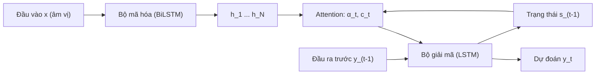

# Chương 4. CNN, RNN và mô hình chuỗi

!!! abstract "Mục tiêu học tập"
    Sau chương này, bạn có thể:

    - **Tính** hình dạng đầu ra, số tham số và trường tiếp nhận (*receptive field*) của một chồng `Conv1d` bất kỳ (stride, padding, dilation, groups), rồi kiểm chứng bằng thực nghiệm.
    - **Cài đặt** tích chập nhân quả giãn nở (*causal dilated convolution*) và chứng minh bằng kiểm thử rằng nó không "nhìn trộm" tương lai.
    - **Giải thích** cơ chế của tích chập chuyển vị (*transposed convolution*), nguồn gốc hiện tượng bàn cờ (*checkerboard artifacts*) và các cách khắc phục trong vocoder.
    - **So sánh** các khối xây dựng: khối dư, đơn vị kích hoạt có cổng, tích chập tách theo chiều sâu, khối ConvNeXt 1D.
    - **Suy ra** lan truyền ngược theo thời gian (BPTT), giải thích vì sao gradient tiêu biến hoặc bùng nổ và vì sao LSTM, GRU giảm nhẹ được vấn đề này.
    - **Xây dựng** một mô hình seq2seq LSTM có attention; phân tích teacher forcing và exposure bias.
    - **So sánh** các chiến lược giải mã greedy, beam search, lấy mẫu và chỉ ra khi nào mỗi chiến lược phù hợp với TTS.

!!! info "Kiến thức cần có"
    - [Chương 1](ch01-toan-nen-tang.md): nhân ma trận, chuẩn ma trận, giá trị kỳ dị, quy tắc chuỗi cho véc-tơ.
    - [Chương 2](ch02-hoc-may-va-mang-no-ron.md): MLP, hàm kích hoạt, lan truyền ngược, entropy chéo.
    - [Chương 3](ch03-toi-uu-va-ky-thuat-huan-luyen.md): Adam, cắt gradient (*gradient clipping*), LayerNorm.
    - Các khối mã trong chương được thiết kế để **chạy tuần tự như một notebook** (khối sau có thể dùng lại hàm của khối trước), trên CPU, mỗi khối mất từ vài giây đến khoảng hai chục giây.

Tiếng nói là một chuỗi: chuỗi mẫu âm thanh, chuỗi khung mel-spectrogram, chuỗi âm vị, chuỗi token. Gần như mọi mô hình TTS mà bạn sẽ gặp trong cuốn sách này đều được lắp ráp từ một số ít "viên gạch" xử lý chuỗi: tích chập một chiều (trong WaveNet, HiFi-GAN, FastSpeech, Vocos), mạng hồi quy (trong Tacotron 2, WaveRNN, LPCNet), và attention (trong mọi thứ, từ Tacotron đến các codec language model). Chương này trình bày hai họ đầu tiên một cách kỹ lưỡng, rồi giới thiệu attention trong khung seq2seq như một bước đệm cho [Chương 5](ch05-transformer.md).

Mục tiêu không chỉ là biết "lớp này làm gì", mà là **tính toán được** chúng: một kỹ sư TTS cần trả lời ngay được những câu như "vocoder này nhìn được bao nhiêu mili-giây ngữ cảnh?", "vì sao lớp nâng mẫu này gây tiếng rè?", "vì sao attention của tôi lặp từ?".

## 4.1 Vì sao cần kiến trúc riêng cho dữ liệu chuỗi

Hãy bắt đầu bằng một phép tính. Một giây âm thanh ở tần số lấy mẫu $f_s = 22\,050$ Hz có 22 050 mẫu. Một lớp nối đầy đủ (*fully connected*) ánh xạ 22 050 mẫu sang 22 050 đơn vị ẩn cần $22\,050^2 \approx 4{,}9 \times 10^8$ trọng số — chỉ cho một lớp, và chỉ dùng được cho đúng những đoạn âm thanh dài đúng một giây. MLP của [Chương 2](ch02-hoc-may-va-mang-no-ron.md) rõ ràng không phải là công cụ phù hợp.

Ba tính chất của tín hiệu tiếng nói gợi ý những thiết kế tốt hơn:

1. **Tính cục bộ.** Các mẫu gần nhau tương quan rất mạnh. Nhiều cấu trúc quan trọng có độ dài ngắn: một chu kỳ cao độ chỉ dài 2–20 ms (ứng với F0 từ 500 Hz xuống 50 Hz), một chuyển tiếp formant kéo dài vài chục mili-giây.
2. **Tính bất biến (gần đúng) theo tịnh tiến.** Nguyên âm /a/ ở đầu câu hay cuối câu có đặc trưng phổ tương tự nhau. Một bộ phát hiện mẫu hình học được ở vị trí này nên dùng lại được ở vị trí khác — tức là **chia sẻ trọng số theo thời gian**.
3. **Độ dài thay đổi và phụ thuộc xa.** Câu dài ngắn khác nhau; ngữ điệu ở đầu câu có thể phụ thuộc vào một tiểu từ ở cuối câu.

Hai họ kiến trúc kinh điển khai thác các tính chất này theo hai cách khác nhau:

- **Mạng tích chập (CNN)** áp đặt tính cục bộ và chia sẻ trọng số; mọi vị trí được tính **song song**. Ngữ cảnh xa đạt được bằng cách xếp chồng nhiều lớp.
- **Mạng hồi quy (RNN)** duy trì một **trạng thái ẩn** tóm tắt toàn bộ quá khứ; về nguyên tắc nó nhìn được ngữ cảnh dài vô hạn, nhưng phải xử lý **tuần tự** từng bước.

Attention, chủ đề của [Chương 5](ch05-transformer.md), là họ thứ ba: mỗi vị trí truy cập trực tiếp mọi vị trí khác.

## 4.2 Tích chập một chiều (Conv1d)

### 4.2.1 Định nghĩa

**Trực giác.** Một bộ lọc tích chập là một "cửa sổ trượt": tại mỗi vị trí thời gian, nó lấy một đoạn ngắn của đầu vào, nhân từng phần tử với một bộ trọng số rồi cộng lại. Cùng một bộ trọng số được dùng ở mọi vị trí.

**Hình thức hóa.** Gọi đầu vào là $\mathbf{X} \in \mathbb{R}^{C_{\text{in}} \times T_{\text{in}}}$ (số kênh × số bước thời gian), trọng số $\mathcal{W} \in \mathbb{R}^{C_{\text{out}} \times C_{\text{in}} \times k}$ với $k$ là **kích thước kernel**, độ lệch $\mathbf{b} \in \mathbb{R}^{C_{\text{out}}}$. Với bước nhảy (*stride*) $s$, đệm (*padding*) $p$ và độ giãn (*dilation*) $d$, kênh ra $o$ tại vị trí $t$ là

$$
y_{o}[t] = b_o + \sum_{c=1}^{C_{\text{in}}} \sum_{m=0}^{k-1} \mathcal{W}_{o,c,m}\; x_c[\,s\,t + d\,m - p\,],
$$

trong đó $x_c[n] = 0$ nếu $n$ nằm ngoài $[0, T_{\text{in}} - 1]$ (đệm số không). Công thức nói rằng: đầu ra tại $t$ là tổ hợp tuyến tính của $k$ mẫu đầu vào, cách nhau $d$ bước, bắt đầu từ vị trí $s\,t - p$, trên **mọi** kênh vào.

Hai lưu ý về thuật ngữ:

- Trong xử lý tín hiệu, tích chập $(x \ast w)[t] = \sum_m w[m]\,x[t - m]$ có **lật** kernel. Các thư viện học sâu thực ra tính *tương quan chéo* (*cross-correlation*, không lật). Vì $\mathcal{W}$ được học, hai cách là tương đương — mô hình chỉ học ra kernel đã lật.
- Bố cục tensor của `nn.Conv1d` trong PyTorch là `(B, C, T)`: batch, kênh, thời gian. Mel-spectrogram thường được lưu dạng `(B, T, F)` nên phải `transpose(1, 2)` trước khi đưa vào `Conv1d`. Đây là nguồn lỗi im lặng số một (xem mục Lỗi thường gặp).

### 4.2.2 Độ dài đầu ra

Kernel có độ giãn $d$ phủ một khoảng $d(k-1) + 1$ mẫu, gọi là **kích thước kernel hiệu dụng**. Vị trí đầu ra cuối cùng $t$ hợp lệ khi điểm cuối của cửa sổ còn nằm trong đầu vào đã đệm: $s\,t + d(k-1) - p \le T_{\text{in}} - 1 + p$. Giải ra $t$ và đếm cả vị trí $t = 0$:

$$
T_{\text{out}} = \left\lfloor \frac{T_{\text{in}} + 2p - d(k-1) - 1}{s} \right\rfloor + 1 .
$$

Hệ quả quan trọng:

- Với $s = 1$, chọn $p = d(k-1)/2$ thì $T_{\text{out}} = T_{\text{in}}$ (đệm "same"). Điều này chỉ đối xứng được khi $d(k-1)$ chẵn — đó là lý do kernel lẻ (3, 5, 7…) phổ biến.
- Với $s > 1$, độ dài giảm khoảng $s$ lần: đây là cách **hạ mẫu** (*downsampling*) có học.

### 4.2.3 Số tham số, chi phí và tham số `groups`

Một lớp `Conv1d` có $C_{\text{out}} \cdot C_{\text{in}} \cdot k + C_{\text{out}}$ tham số và cần khoảng $T_{\text{out}} \cdot C_{\text{out}} \cdot C_{\text{in}} \cdot k$ phép nhân–cộng. Số tham số **không phụ thuộc vào độ dài chuỗi** — khác hẳn lớp nối đầy đủ ở mục 4.1.

Tham số `groups` $= g$ chia các kênh thành $g$ nhóm độc lập; mỗi kênh ra chỉ nhìn $C_{\text{in}}/g$ kênh vào, nên số tham số và chi phí giảm $g$ lần. Trường hợp cực đoan $g = C_{\text{in}}$ gọi là **tích chập theo chiều sâu** (*depthwise convolution*): mỗi kênh được lọc riêng, không trộn kênh. Ta sẽ dùng nó ở mục 4.6.

### 4.2.4 Tích chập là phép nhân ma trận

Vì $y_o[t]$ tuyến tính theo $\mathbf{X}$, ta có thể duỗi $\mathbf{X}$ thành véc-tơ $\mathbf{x}$ và viết $\mathbf{y} = \mathbf{C}\mathbf{x}$, với $\mathbf{C}$ là một **ma trận Toeplitz theo khối**, thưa (mỗi hàng chỉ có $C_{\text{in}} \cdot k$ phần tử khác không) và có các phần tử lặp lại dọc đường chéo (chia sẻ trọng số). Góc nhìn này hữu ích ở hai chỗ: (i) nó cho thấy CNN là một MLP bị **ràng buộc cấu trúc** — cục bộ và chia sẻ trọng số — chính là các thiên kiến quy nạp (*inductive bias*) ta muốn từ mục 4.1; (ii) nó cho ta định nghĩa sạch sẽ của tích chập chuyển vị ở mục 4.5: phép nhân với $\mathbf{C}^\top$.

**Mã minh họa.** Hàm dưới đây cài đặt công thức độ dài và đối chiếu với PyTorch trên một lưới tham số. Hàm cho tích chập chuyển vị sẽ được giải thích ở mục 4.5.

```python
import torch
import torch.nn as nn

def conv1d_out_len(t_in, k, s=1, p=0, d=1):
    """Độ dài đầu ra của Conv1d."""
    return (t_in + 2 * p - d * (k - 1) - 1) // s + 1

def conv_transpose1d_out_len(t_in, k, s=1, p=0, d=1, output_padding=0):
    """Độ dài đầu ra của ConvTranspose1d (xem mục 4.5)."""
    return (t_in - 1) * s - 2 * p + d * (k - 1) + output_padding + 1

# Đối chiếu với PyTorch trên một lưới tham số nhỏ
for t_in in [7, 16, 101]:
    for k, s, p, d in [(3, 1, 1, 1), (5, 2, 2, 1), (3, 1, 4, 4), (4, 3, 0, 2)]:
        x = torch.randn(1, 2, t_in)                          # (B, C, T)
        y = nn.Conv1d(2, 3, k, stride=s, padding=p, dilation=d)(x)
        assert y.shape[-1] == conv1d_out_len(t_in, k, s, p, d)
        z = nn.ConvTranspose1d(2, 3, k, stride=s, padding=p, dilation=d)(x)
        assert z.shape[-1] == conv_transpose1d_out_len(t_in, k, s, p, d)

# Lớp nâng mẫu kiểu HiFi-GAN: k = 2s, p = s/2  =>  T_out = s * T_in
for s in [8, 2]:
    assert conv_transpose1d_out_len(50, k=2 * s, s=s, p=s // 2) == s * 50
print("Công thức độ dài khớp với PyTorch")
```

## 4.3 Tích chập nhân quả và tích chập giãn nở

### 4.3.1 Tính nhân quả

Một mô hình **tự hồi quy** (*autoregressive*) sinh mẫu $x[t]$ dựa trên các mẫu trước đó $x[0], \ldots, x[t-1]$ (xem [Chương 7](../phan-2-mo-hinh-sinh/ch07-tong-quan-mo-hinh-sinh.md)). Khi huấn luyện, ta muốn tính dự đoán cho **mọi** $t$ song song bằng một lần chạy tích chập, nhưng phải bảo đảm đầu ra tại $t$ không phụ thuộc vào đầu vào tại các thời điểm sau $t$. Tích chập như vậy gọi là **nhân quả** (*causal*).

Với $s = 1$, cách cài đặt đơn giản là **đệm toàn bộ $(k-1)d$ mẫu ở bên trái, không đệm bên phải**. Khi đó, trong công thức ở mục 4.2.1 với $p$ thay bằng việc dịch trái, chỉ số đầu vào lớn nhất mà $y[t]$ dùng là $t$:

$$
y[t] = \sum_{m=0}^{k-1} w_m\, x[\,t - d\,(k-1-m)\,].
$$

Tích chập nhân quả là xương sống của WaveNet (van den Oord và cộng sự, 2016) và của mọi mô hình **streaming**: khi âm thanh hay token đến từng đoạn, mô hình không được phép chờ tương lai ([Chương 35](../phan-8-mo-hinh-lon/ch35-streaming-speech-llm.md)). Ngược lại, các mô hình ngoại tuyến như bộ sinh HiFi-GAN hay bộ mã hóa văn bản dùng tích chập **đối xứng** (không nhân quả), vì toàn bộ đầu vào đã có sẵn.

### 4.3.2 Tích chập giãn nở

Với kernel $k$ và $L$ lớp nhân quả thông thường ($d = 1$), mỗi đầu ra nhìn được $1 + L(k-1)$ mẫu — tăng **tuyến tính** theo độ sâu. Để nhìn 0,1 giây ở 22 050 Hz (2 205 mẫu) với $k = 2$ ta cần hơn 2 000 lớp. Không khả thi.

**Tích chập giãn nở** (*dilated convolution*) chèn khoảng cách $d$ giữa các nhịp của kernel. Nếu cho độ giãn tăng theo cấp số nhân $d_\ell = 2^{\ell}$ với $\ell = 0, \ldots, M-1$ và $k = 2$, trường tiếp nhận sau $M$ lớp là

$$
1 + \sum_{\ell=0}^{M-1} (2-1) \cdot 2^{\ell} = 2^{M},
$$

tức là tăng **theo hàm mũ** của độ sâu, trong khi số tham số vẫn tăng tuyến tính. WaveNet dùng chính lịch độ giãn $1, 2, 4, \ldots, 512$ và lặp lại khối này vài lần.

Có một cách nhìn đẹp vì sao lịch lũy thừa của 2 "phủ kín" quá khứ mà không bỏ sót hay trùng lặp: mỗi lớp $\ell$ chọn dịch thêm $0$ hoặc $2^{\ell}$ mẫu, nên tổng độ dịch là $\sum_\ell b_\ell 2^\ell$ với $b_\ell \in \{0, 1\}$ — chính là **biểu diễn nhị phân** của mọi số từ $0$ đến $2^M - 1$, mỗi số đúng một lần. Tương tự, kernel $k = 3$ với độ giãn $1, 3, 9, \ldots$ ứng với biểu diễn cơ số 3. Nếu chọn độ giãn không khéo (ví dụ mọi lớp đều $d = 4$), một số vị trí trong quá khứ không bao giờ được nhìn thấy — hiện tượng "lưới thưa" (*gridding*).

**Mã minh họa.** Lớp `CausalConv1d` dưới đây đệm trái rồi gọi `Conv1d` gốc. Hai phép kiểm thử quan trọng nhất cho mọi lớp nhân quả: (1) thay đổi tương lai không làm thay đổi quá khứ; (2) đầu ra tại $t$ chỉ phụ thuộc đúng cửa sổ trường tiếp nhận.

```python
import torch.nn.functional as F

class CausalConv1d(nn.Conv1d):
    """Conv1d nhân quả: đệm (k-1)*d mẫu ở bên trái, không đệm bên phải."""
    def __init__(self, c_in, c_out, kernel_size, dilation=1):
        super().__init__(c_in, c_out, kernel_size, dilation=dilation, padding=0)
        self.left_pad = (kernel_size - 1) * dilation

    def forward(self, x):                         # x: (B, C_in, T)
        x = F.pad(x, (self.left_pad, 0))          # (B, C_in, T + left_pad)
        return super().forward(x)                 # (B, C_out, T)

class DilatedCausalStack(nn.Module):
    """Chồng tích chập nhân quả giãn nở có kết nối dư."""
    def __init__(self, channels=16, kernel_size=3, dilations=(1, 2, 4, 8)):
        super().__init__()
        self.layers = nn.ModuleList(
            CausalConv1d(channels, channels, kernel_size, d) for d in dilations)
        self.rf = 1 + sum((kernel_size - 1) * d for d in dilations)

    def forward(self, x):                         # x: (B, C, T)
        for conv in self.layers:
            x = x + torch.tanh(conv(x))           # giữ nguyên (B, C, T)
        return x

torch.manual_seed(0)
net = DilatedCausalStack()
x = torch.randn(2, 16, 100)                       # (B, C, T)
y = net(x)
assert y.shape == x.shape

# Kiểm thử 1 — tính nhân quả: thay đổi tương lai (t >= 60) không làm đổi quá khứ
x2 = x.clone()
x2[:, :, 60:] = torch.randn(2, 16, 40)
y2 = net(x2)
assert torch.allclose(y[:, :, :60], y2[:, :, :60])
assert not torch.allclose(y[:, :, 60:], y2[:, :, 60:])

# Kiểm thử 2 — trường tiếp nhận: đầu ra tại t chỉ phụ thuộc x[t-rf+1 .. t]
x3 = x.clone()
x3[:, :, : 80 - net.rf + 1] = 0.0                 # xóa mọi thứ ngoài cửa sổ của t = 80
assert torch.allclose(net(x3)[:, :, 80], y[:, :, 80], atol=1e-6)
print("Trường tiếp nhận:", net.rf, "mẫu; tính nhân quả: OK")
```

## 4.4 Trường tiếp nhận

**Trường tiếp nhận** (*receptive field*) của một đơn vị đầu ra là tập các mẫu đầu vào có thể ảnh hưởng tới nó. Đây là con số quan trọng bậc nhất khi thiết kế vocoder và bộ dự đoán ngôn điệu: một vocoder có trường tiếp nhận 5 ms không thể "biết" cao độ của một giọng nam trầm có chu kỳ 10 ms; một bộ dự đoán cao độ chỉ nhìn một âm vị không thể dựng được đường nét ngữ điệu của cả câu.

### 4.4.1 Công thức truy hồi

Xét một chồng $L$ lớp tích chập, lớp $\ell$ có kernel $k_\ell$, stride $s_\ell$, độ giãn $d_\ell$. Định nghĩa hai đại lượng, đo bằng **số mẫu đầu vào gốc**:

- $r_\ell$: trường tiếp nhận của một đơn vị ở đầu ra lớp $\ell$;
- $j_\ell$: **bước nhảy tích lũy** (*jump*) — khoảng cách (theo mẫu đầu vào gốc) giữa hai đơn vị kề nhau ở đầu ra lớp $\ell$.

Khởi đầu $r_0 = 1$, $j_0 = 1$ (mỗi mẫu đầu vào chỉ "nhìn" chính nó). Khi đó

$$
r_\ell = r_{\ell-1} + (k_\ell - 1)\, d_\ell\, j_{\ell-1}, \qquad j_\ell = j_{\ell-1}\, s_\ell .
$$

**Chứng minh.** Một đơn vị ở lớp $\ell$ đọc $k_\ell$ đơn vị của lớp $\ell-1$, cách nhau $d_\ell$ vị trí, tức là trải trên $(k_\ell - 1) d_\ell$ "bước" của lớp $\ell - 1$. Mỗi bước đó tương ứng với $j_{\ell-1}$ mẫu đầu vào gốc. Trường tiếp nhận của đơn vị ngoài cùng bên trái và ngoài cùng bên phải đều có độ rộng $r_{\ell-1}$, và chúng lệch nhau $(k_\ell - 1) d_\ell j_{\ell-1}$ mẫu. Hợp của chúng (cùng mọi đơn vị ở giữa) phủ một đoạn dài $r_{\ell-1} + (k_\ell - 1) d_\ell j_{\ell-1}$. Còn bước nhảy thì nhân thêm $s_\ell$ vì lớp $\ell$ chỉ giữ một trong mỗi $s_\ell$ vị trí. $\blacksquare$

Khai triển truy hồi cho dạng đóng:

$$
r_L = 1 + \sum_{\ell=1}^{L} (k_\ell - 1)\, d_\ell \prod_{i=1}^{\ell-1} s_i .
$$

Công thức nói rằng các lớp càng sâu (sau nhiều lần hạ mẫu) thì mỗi nhịp kernel càng "đáng giá" nhiều mẫu đầu vào. Ba nhận xét thực hành:

- **Kết nối dư** không làm tăng trường tiếp nhận: nhánh tắt có trường tiếp nhận nhỏ hơn, và hợp của hai nhánh bằng nhánh lớn hơn.
- Công thức cho **độ rộng** của vùng ảnh hưởng. Nếu lịch độ giãn tạo "lưới thưa", bên trong vùng này có thể có những mẫu không ảnh hưởng gì.
- Với lớp **nâng mẫu** (mục 4.5), bước nhảy bị chia cho hệ số nâng mẫu; khi đó cách chắc chắn nhất là **đo trực tiếp** bằng gradient như trong mã dưới đây.

### 4.4.2 Ví dụ tính toán

**WaveNet.** Với $k = 2$ và độ giãn $1, 2, \ldots, 512$ (10 lớp): $r = 1 + (1 + 2 + \cdots + 512) = 1024$ mẫu. Lặp lại khối này 3 lần: $r = 1 + 3 \times 1023 = 3070$ mẫu, tức khoảng 139 ms ở 22 050 Hz. (Cấu hình cụ thể trong bài báo gốc thay đổi theo thí nghiệm; ở đây ta chỉ dùng nó làm ví dụ tính.)

**Khối dư của HiFi-GAN.** Cấu hình V1 của HiFi-GAN (Kong và cộng sự, 2020) dùng ba khối dư song song với kernel $3, 7, 11$; mỗi khối gồm ba cặp tích chập, cặp thứ $i$ là một tích chập giãn $d_i \in \{1, 3, 5\}$ theo sau bởi một tích chập $d = 1$. Trường tiếp nhận của một khối với kernel $k$ là

$$
r = 1 + (k-1)\,(1 + 1 + 3 + 1 + 5 + 1) = 1 + 12\,(k-1),
$$

tức 25, 73 và 121 vị trí cho $k = 3, 7, 11$. Điều thú vị là cùng một số vị trí lại ứng với thời lượng rất khác nhau tùy độ phân giải của tầng. Với hop $H = 256$, sau lớp nâng mẫu đầu tiên ($\times 8$) mỗi vị trí ứng với $256/8 = 32$ mẫu âm thanh, nên 121 vị trí phủ $121 \times 32 = 3872$ mẫu ≈ 176 ms; ở tầng cuối cùng (đủ 22 050 Hz) thì 121 vị trí chỉ là ≈ 5,5 ms. Tầng thô nắm cấu trúc dài (cao độ, đường bao năng lượng), tầng mịn lo chi tiết dạng sóng — đó là tinh thần "đa trường tiếp nhận" (*multi-receptive field*) của HiFi-GAN ([Chương 25](../phan-6-vocoder/ch25-gan-vocoder.md)).

**Đổi đơn vị.** Trường tiếp nhận $r$ mẫu ứng với $r / f_s$ giây; $r$ khung mel ứng với $r \cdot H / f_s$ giây. Ví dụ 25 khung với $H = 256$, $f_s = 22\,050$ Hz là khoảng 0,29 s.

### 4.4.3 Trường tiếp nhận lý thuyết và hiệu dụng

Công thức trên cho trường tiếp nhận **lý thuyết**: vùng mà một mẫu *có thể* ảnh hưởng. Luo và cộng sự (2016) chỉ ra rằng ảnh hưởng thực tế (đo bằng độ lớn gradient) thường tập trung ở giữa vùng, có dạng gần với hình chuông, và **trường tiếp nhận hiệu dụng** chỉ chiếm một phần nhỏ của trường lý thuyết; với chồng các lớp giống nhau, độ rộng hiệu dụng tăng chậm hơn nhiều (theo phân tích của họ, xấp xỉ theo căn bậc hai của số lớp). Bài học thực hành: hãy thiết kế trường tiếp nhận lý thuyết **dư dả** hơn nhu cầu, và khi nghi ngờ, đo ảnh hưởng thực tế bằng gradient.

**Mã minh họa.** Bộ tính trường tiếp nhận và phép kiểm chứng thực nghiệm: gán trọng số dương cho mọi lớp (để tránh các đóng góp triệt tiêu ngẫu nhiên), lan truyền ngược từ một đầu ra ở giữa và đếm các mẫu đầu vào có gradient khác không.

```python
def receptive_field(layers):
    """layers: danh sách (kernel_size, stride, dilation) theo thứ tự từ đầu vào.
    Trả về (r, j): trường tiếp nhận và bước nhảy tích lũy, tính theo mẫu đầu vào."""
    r, j = 1, 1
    for k, s, d in layers:
        r = r + (k - 1) * d * j
        j = j * s
    return r, j

def empirical_rf(model, t_in=4096, c_in=1):
    """Đo trường tiếp nhận bằng gradient: những mẫu đầu vào nào ảnh hưởng tới 1 đầu ra."""
    x = torch.zeros(1, c_in, t_in, requires_grad=True)       # (B, C, T)
    y = model(x)                                               # (B, C', T')
    y[0, :, y.shape[-1] // 2].sum().backward()                 # chọn đầu ra ở giữa
    nz = (x.grad[0].abs().sum(0) > 0).nonzero().squeeze(-1)
    return int(nz.max() - nz.min() + 1)

def build_stack(layers, channels=4):
    mods, c_in = [], 1
    for k, s, d in layers:
        conv = nn.Conv1d(c_in, channels, k, stride=s, dilation=d)
        nn.init.constant_(conv.weight, 0.1)   # trọng số dương: tránh triệt tiêu ngẫu nhiên
        mods += [conv, nn.Tanh()]             # tanh'(0) = 1 nên gradient không bị chặn
        c_in = channels
    return nn.Sequential(*mods)

# Ví dụ 1: kiểu WaveNet, k = 2, độ giãn 1, 2, ..., 512 (10 lớp)
wavenet = [(2, 1, 2 ** i) for i in range(10)]
print("WaveNet 1 khối:", receptive_field(wavenet))           # (1024, 1)
print("WaveNet 3 khối:", receptive_field(wavenet * 3))       # (3070, 1)

# Ví dụ 2: có stride — mỗi nhịp kernel ở lớp sâu "đáng giá" nhiều mẫu hơn
strided = [(4, 2, 1), (4, 2, 1), (3, 1, 2)]
print("Có stride:", receptive_field(strided))                 # (26, 4)

# Ví dụ 3: khối dư HiFi-GAN với kernel 11, độ giãn (1, 3, 5), xen kẽ d = 1
hifigan_rb = [(11, 1, d) for pair in [(1, 1), (3, 1), (5, 1)] for d in pair]
print("Khối dư HiFi-GAN, k=11:", receptive_field(hifigan_rb)) # (121, 1)

for cfg in [wavenet, strided, hifigan_rb, [(5, 1, 1)] * 3]:
    assert receptive_field(cfg)[0] == empirical_rf(build_stack(cfg))
print("Công thức khớp với đo đạc bằng gradient")
```

!!! note "Góc tiếng Việt"
    Thanh điệu tiếng Việt là một đường nét cao độ trải trên **toàn bộ phần vần** của âm tiết, và hình dạng của nó còn chịu ảnh hưởng đồng cấu âm từ các âm tiết lân cận ([Chương 15](../phan-3-tin-hieu-ngu-am/ch15-ngu-am-tieng-viet.md), [Chương 16](../phan-3-tin-hieu-ngu-am/ch16-ngon-dieu.md)). Hệ quả cho thiết kế:

    - Bộ mã hóa văn bản theo **ký tự** phải có trường tiếp nhận đủ phủ cả âm tiết để "biết" dấu thanh thuộc về âm tiết nào. Ví dụ, bộ mã hóa của Tacotron 2 có ba lớp tích chập kernel 5, nên trường tiếp nhận của phần tích chập là $1 + 3 \times 4 = 13$ ký tự — phủ được một âm tiết dài như "nghiêng" (7 chữ cái) cùng phần lân cận. Phần BiLSTM phía sau (mục 4.7.6) mở rộng ngữ cảnh ra cả câu.
    - Bộ dự đoán cao độ/trường độ ở mức khung hoặc âm vị nên nhìn được ít nhất **âm tiết đứng trước và đứng sau**. Một bộ dự đoán chỉ nhìn vài khung sẽ sinh đường F0 đúng xu hướng chung nhưng sai hình dạng thanh (ví dụ thanh hỏi không "gãy" xuống rồi lên).

## 4.5 Tích chập chuyển vị và hiện tượng bàn cờ

### 4.5.1 Từ khung mel tới mẫu âm thanh: bài toán nâng mẫu

Một vocoder nhận mel-spectrogram có khoảng $f_s / H$ khung mỗi giây (với $H = 256$, $f_s = 22\,050$ Hz là khoảng 86 khung/giây) và phải sinh ra $f_s$ mẫu mỗi giây: mỗi khung phải "nở" thành $H$ mẫu. Các vocoder GAN như MelGAN và HiFi-GAN làm việc này bằng một dãy lớp **nâng mẫu có học** (*learned upsampling*) với tích các hệ số bằng đúng $H$; ví dụ HiFi-GAN V1 dùng các hệ số $8 \times 8 \times 2 \times 2 = 256$.

### 4.5.2 Định nghĩa

Ở mục 4.2.4 ta thấy một tích chập stride $s$ là phép nhân với ma trận $\mathbf{C} \in \mathbb{R}^{T_{\text{out}} \times T_{\text{in}}}$ "béo" (ít hàng hơn cột), ánh xạ chuỗi dài thành chuỗi ngắn. **Tích chập chuyển vị** là phép nhân với $\mathbf{C}^\top$: nó ánh xạ chuỗi ngắn trở lại chuỗi dài. Lưu ý $\mathbf{C}^\top$ **không phải** nghịch đảo của $\mathbf{C}$; nó chỉ có cùng "mẫu hình kết nối" theo chiều ngược lại. (Tên gọi "deconvolution" vì thế là gây hiểu nhầm.)

Một cách hình dung tương đương và trực quan hơn là **góc nhìn "rải"** (*scatter*): mỗi mẫu đầu vào $x[n]$ cộng một bản sao của kernel, nhân với $x[n]$, vào các vị trí đầu ra $n s, n s + 1, \ldots, n s + k - 1$ (khi $d = 1$):

$$
y[t] = \sum_{n} \sum_{m=0}^{k-1} \mathbb{1}[\,t = n s + m\,]\; w_m\, x[n] .
$$

Từ đó suy ra độ dài đầu ra (cùng công thức ta đã dùng trong mã ở mục 4.2):

$$
T_{\text{out}} = (T_{\text{in}} - 1)\, s - 2p + d\,(k-1) + p_{\text{out}} + 1,
$$

với $p_{\text{out}}$ là tham số `output_padding` dùng để khử sự mơ hồ về độ dài. Một lựa chọn phổ biến là $k = 2s$, $p = s/2$, cho $T_{\text{out}} = s \cdot T_{\text{in}}$ đúng bằng hệ số nâng mẫu — đây cũng là quy tắc chọn kernel của HiFi-GAN (kernel 16 cho hệ số 8, kernel 4 cho hệ số 2).

### 4.5.3 Hiện tượng bàn cờ

Trong góc nhìn "rải", vị trí đầu ra $t$ nhận đóng góp từ mọi $n$ thỏa $0 \le t - n s \le k - 1$. Nếu $k$ **chia hết** cho $s$, mỗi vị trí (xa biên) nhận đúng $k/s$ đóng góp. Nếu không, số đóng góp **dao động tuần hoàn** giữa $\lfloor k/s \rfloor$ và $\lceil k/s \rceil$ với chu kỳ $s$. Với ảnh, điều này tạo ra họa tiết bàn cờ (Odena và cộng sự, 2016); với âm thanh, một thành phần tuần hoàn chu kỳ $s$ mẫu là một **âm thuần** ở tần số $f_{\text{out}}/s$ và các họa âm của nó — nghe như tiếng rè, tiếng "kim loại" cố định không đổi theo nội dung.

Điều kiện "$k$ chia hết cho $s$" là **cần nhưng chưa đủ**. Góc nhìn đa pha (*polyphase*) cho thấy vì sao: các vị trí đầu ra có cùng pha $r = t \bmod s$ chỉ dùng các nhịp kernel $w_r, w_{r+s}, w_{r+2s}, \ldots$. Vậy tích chập chuyển vị thực chất là $s$ bộ lọc con độc lập, mỗi bộ lo một pha, rồi đan xen kết quả. Nếu các bộ lọc con có độ lợi (*gain*) khác nhau — điều hoàn toàn có thể xảy ra với trọng số đã học — thì một đầu vào hằng số vẫn cho đầu ra tuần hoàn. Pons và cộng sự (2021) phân tích chi tiết các nguồn nhiễu do nâng mẫu trong tổng hợp âm thanh: theo họ, tích chập chuyển vị và sub-pixel dễ gây nhiễu dạng âm thuần (*tonal artifacts*), còn nâng mẫu bằng nội suy thì gây nhiễu kiểu lọc (*filtering artifacts*).

Các cách khắc phục thường gặp:

1. **Chọn $k$ là bội số của $s$** (ví dụ $k = 2s$), như HiFi-GAN.
2. **Nội suy rồi tích chập** (*resize-convolution*): nâng mẫu bằng láng giềng gần nhất hoặc nội suy tuyến tính, sau đó dùng `Conv1d` thường. Mọi vị trí dùng chung một bộ lọc nên không có thành phần tuần hoàn do cấu trúc.
3. **Sub-pixel 1D** (*pixel shuffle*): một `Conv1d` sinh $C \cdot s$ kênh rồi xếp lại thành $C$ kênh dài gấp $s$ lần. Về khả năng biểu diễn, nó tương đương tích chập chuyển vị, nên vẫn cần khởi tạo cẩn thận.
4. **Tránh nâng mẫu trong miền thời gian**: các vocoder như iSTFTNet, Vocos dự đoán hệ số STFT ở tốc độ khung rồi dùng iSTFT ([Chương 25](../phan-6-vocoder/ch25-gan-vocoder.md)).

Ngoài ra, các phi tuyến (như Leaky ReLU) áp lên tín hiệu đã nâng mẫu có thể sinh ra tần số vượt Nyquist và gây **chồng phổ** (*aliasing*); BigVGAN xử lý bằng các hàm kích hoạt chống chồng phổ — chi tiết ở [Chương 25](../phan-6-vocoder/ch25-gan-vocoder.md).

**Mã minh họa.** Cho đầu vào hằng 1 và kernel hằng 1, đầu ra của tích chập chuyển vị chính là "số lần chồng lấp" tại mỗi vị trí.

```python
def overlap_pattern(kernel_size, stride, t_in=8):
    """Đầu vào hằng 1, kernel hằng 1: đầu ra đếm số lần chồng lấp tại mỗi vị trí."""
    up = nn.ConvTranspose1d(1, 1, kernel_size, stride=stride, bias=False)
    nn.init.ones_(up.weight)
    with torch.no_grad():
        y = up(torch.ones(1, 1, t_in))            # (1, 1, (t_in-1)*s + k)
    k = kernel_size
    return y[0, 0, k:-k].int().tolist()           # bỏ vùng biên

print("k=3, s=2:", overlap_pattern(3, 2))   # không chia hết -> 1, 2, 1, 2, ...
print("k=4, s=2:", overlap_pattern(4, 2))   # chia hết -> đều
print("k=5, s=4:", overlap_pattern(5, 4))   # 1, 1, 1, 2, 1, 1, 1, 2, ...

# Khắc phục 1: nội suy láng giềng gần nhất rồi tích chập thường
x = torch.ones(1, 1, 8)
conv = nn.Conv1d(1, 1, 3, padding=1, bias=False)
nn.init.ones_(conv.weight)
with torch.no_grad():
    y = conv(F.interpolate(x, scale_factor=2, mode="nearest"))
print("nearest + conv:", y[0, 0, 2:-2].int().tolist())        # đều: 3, 3, 3, ...

# Khắc phục 2: sub-pixel 1D — tích chập ra C*s kênh rồi xếp lại theo thời gian
def pixel_shuffle_1d(x, s):                           # x: (B, C*s, T)
    b, cs, t = x.shape
    x = x.view(b, cs // s, s, t).permute(0, 1, 3, 2)  # (B, C, T, s)
    return x.reshape(b, cs // s, t * s)               # (B, C, T*s)

z = pixel_shuffle_1d(torch.arange(6.).view(1, 2, 3), 2)
assert z.tolist() == [[[0., 3., 1., 4., 2., 5.]]]
```

## 4.6 Các khối xây dựng hiện đại

### 4.6.1 Khối dư

Khi xếp chồng hàng chục lớp tích chập, việc tối ưu trở nên khó khăn: gradient phải đi qua một tích dài các Jacobian. **Khối dư** (*residual block*; He và cộng sự, 2016) học phần **hiệu chỉnh** thay vì toàn bộ ánh xạ:

$$
\mathbf{y} = \mathbf{x} + \mathcal{F}(\mathbf{x}), \qquad \frac{\partial \mathbf{y}}{\partial \mathbf{x}} = \mathbf{I} + \frac{\partial \mathcal{F}}{\partial \mathbf{x}} .
$$

Số hạng $\mathbf{I}$ trong Jacobian tạo một "đường cao tốc" cho gradient: kể cả khi $\partial \mathcal{F} / \partial \mathbf{x}$ nhỏ, gradient vẫn truyền nguyên vẹn về các lớp đầu. Khi số kênh vào và ra khác nhau, nhánh tắt dùng một tích chập $1 \times 1$. Gần như mọi vocoder và mô hình âm học hiện đại đều là chồng các khối dư.

### 4.6.2 Đơn vị kích hoạt có cổng

PixelCNN có điều kiện (van den Oord và cộng sự, 2016b) và WaveNet dùng **đơn vị kích hoạt có cổng** (*gated activation unit*):

$$
\mathbf{z} = \tanh(\mathcal{W}_f \ast \mathbf{x}) \odot \sigma(\mathcal{W}_g \ast \mathbf{x}),
$$

trong đó $\ast$ là tích chập, $\odot$ là tích từng phần tử. Nhánh $\tanh$ mang "nội dung", nhánh sigmoid là một **van** trong $(0, 1)$ quyết định bao nhiêu nội dung được đi qua, và van này phụ thuộc vào chính đầu vào. Phép nhân giữa hai nhánh tạo ra tương tác bậc hai mà một phi tuyến đơn (như ReLU) không có — cùng tinh thần với các cổng của LSTM ở mục 4.7.

Điều kiện hóa được đưa vào **bên trong** cả hai nhánh. Với điều kiện cục bộ $\mathbf{c}$ (ví dụ mel đã nâng mẫu lên tốc độ mẫu) và điều kiện toàn cục $\mathbf{g}$ (ví dụ embedding người nói), WaveNet dùng

$$
\mathbf{z} = \tanh\!\left(\mathcal{W}_f \ast \mathbf{x} + \mathcal{V}_f \ast \mathbf{c} + \mathbf{U}_f\, \mathbf{g}\right) \odot \sigma\!\left(\mathcal{W}_g \ast \mathbf{x} + \mathcal{V}_g \ast \mathbf{c} + \mathbf{U}_g\, \mathbf{g}\right).
$$

Một biến thể gần gũi là **GLU** (*Gated Linear Unit*; Dauphin và cộng sự, 2017): $(\mathbf{W}\mathbf{x}) \odot \sigma(\mathbf{V}\mathbf{x})$, bỏ $\tanh$ ở nhánh nội dung. Dauphin và cộng sự lập luận rằng nhánh tuyến tính giúp gradient không bị co lại bởi đạo hàm của $\tanh$. GLU xuất hiện trong mô-đun tích chập của Conformer ([Chương 5](ch05-transformer.md)) và trong biến thể SwiGLU của Transformer hiện đại.

WaveNet còn tách đầu ra mỗi khối thành hai nhánh: nhánh **dư** đi tiếp tới khối sau, và nhánh **skip** được cộng dồn từ mọi khối rồi đưa vào phần đầu ra. Nhánh skip cho phép đầu ra kết hợp trực tiếp đặc trưng ở mọi thang thời gian. Chi tiết WaveNet được trình bày ở [Chương 24](../phan-6-vocoder/ch24-vocoder-tu-hoi-quy-va-flow.md).

### 4.6.3 Tích chập tách theo chiều sâu

Một `Conv1d` thông thường làm đồng thời hai việc: trộn thông tin **theo thời gian** (trong cửa sổ $k$) và **theo kênh**. **Tích chập tách theo chiều sâu** (*depthwise-separable convolution*; xem Chollet, 2017) tách hai việc này: một tích chập theo chiều sâu ($g = C$, chỉ trộn thời gian) rồi một tích chập $1 \times 1$ (chỉ trộn kênh). Với $C$ kênh vào, $C'$ kênh ra, bỏ qua độ lệch:

$$
\frac{\text{tham số tách}}{\text{tham số thường}} = \frac{C k + C C'}{C C' k} = \frac{1}{C'} + \frac{1}{k}.
$$

Với $C' = 256$, $k = 7$, tỷ lệ này khoảng 0,147 — tiết kiệm gần 7 lần. Giả định ngầm là "mẫu hình thời gian" và "tổ hợp kênh" có thể học tách rời mà không mất nhiều năng lực biểu diễn; thực nghiệm trên nhiều miền cho thấy giả định này khá hợp lý, nhất là khi bù lại bằng nhiều kênh hơn.

### 4.6.4 Khối ConvNeXt 1D

ConvNeXt (Liu và cộng sự, 2022) "hiện đại hóa" khối tích chập bằng các lựa chọn thiết kế học từ Transformer:

1. Tích chập theo chiều sâu với **kernel lớn** (7) để trộn thời gian — vai trò giống attention cục bộ;
2. **LayerNorm** thay vì BatchNorm;
3. MLP từng vị trí kiểu **nút cổ chai ngược** (*inverted bottleneck*): mở rộng số kênh (bài báo gốc dùng hệ số 4), GELU, rồi thu hẹp lại — giống khối FFN của Transformer;
4. **Layer scale**: nhân nhánh dư với véc-tơ $\boldsymbol{\gamma}$ khởi tạo rất nhỏ, để mỗi khối gần như là ánh xạ đồng nhất lúc đầu huấn luyện;
5. Ít hàm kích hoạt và ít lớp chuẩn hóa hơn khối ResNet cổ điển.

Phiên bản 1D của khối này là xương sống của vocoder **Vocos** (Siuzdak, 2024), chạy ở tốc độ khung thay vì tốc độ mẫu nên rất nhanh; F5-TTS cũng dùng các khối ConvNeXt (phiên bản V2) để tinh chỉnh biểu diễn văn bản trước khi đưa vào Transformer ([Chương 33](../phan-8-mo-hinh-lon/ch33-nar-quy-mo-lon.md)).

**Mã minh họa.** Khối dư có cổng kiểu WaveNet và khối ConvNeXt 1D; cuối cùng so sánh số tham số của tích chập thường và tích chập tách.

```python
class GatedResidualBlock(nn.Module):
    """Khối dư kiểu WaveNet: tích chập giãn nở nhân quả + kích hoạt có cổng
    + điều kiện cục bộ (ví dụ mel đã nâng mẫu) + nhánh skip."""
    def __init__(self, channels, cond_channels, kernel_size=3, dilation=1):
        super().__init__()
        self.pad = (kernel_size - 1) * dilation
        self.conv = nn.Conv1d(channels, 2 * channels, kernel_size, dilation=dilation)
        self.cond = nn.Conv1d(cond_channels, 2 * channels, 1)   # chiếu điều kiện 1x1
        self.res = nn.Conv1d(channels, channels, 1)
        self.skip = nn.Conv1d(channels, channels, 1)

    def forward(self, x, c):                      # x: (B, C, T), c: (B, C_cond, T)
        h = self.conv(F.pad(x, (self.pad, 0))) + self.cond(c)    # (B, 2C, T)
        h_f, h_g = h.chunk(2, dim=1)                             # 2 x (B, C, T)
        z = torch.tanh(h_f) * torch.sigmoid(h_g)                 # cổng: (B, C, T)
        return x + self.res(z), self.skip(z)                     # (dư, skip)

class ConvNeXtBlock1d(nn.Module):
    """Khối ConvNeXt 1D: depthwise conv -> LayerNorm -> MLP mở rộng với GELU
    -> layer scale -> cộng dư."""
    def __init__(self, dim, kernel_size=7, expansion=4, layer_scale=1e-6):
        super().__init__()
        self.dwconv = nn.Conv1d(dim, dim, kernel_size, padding=kernel_size // 2, groups=dim)
        self.norm = nn.LayerNorm(dim)
        self.pw1 = nn.Linear(dim, expansion * dim)
        self.pw2 = nn.Linear(expansion * dim, dim)
        self.gamma = nn.Parameter(layer_scale * torch.ones(dim))

    def forward(self, x):                         # x: (B, C, T)
        h = self.dwconv(x).transpose(1, 2)        # (B, T, C): LayerNorm trên trục kênh
        h = self.pw2(F.gelu(self.pw1(self.norm(h))))
        return x + (self.gamma * h).transpose(1, 2)   # (B, C, T)

def n_params(m):
    return sum(p.numel() for p in m.parameters())

B, C, T = 2, 64, 50
blk = GatedResidualBlock(C, cond_channels=80, dilation=4)
res, skip = blk(torch.randn(B, C, T), torch.randn(B, 80, T))
assert res.shape == skip.shape == (B, C, T)
cnx = ConvNeXtBlock1d(C)
assert cnx(torch.randn(B, C, T)).shape == (B, C, T)

# Tích chập thường vs tách theo chiều sâu (C_in = C_out = 256, k = 7)
full = nn.Conv1d(256, 256, 7, padding=3)
sep = nn.Sequential(nn.Conv1d(256, 256, 7, padding=3, groups=256), nn.Conv1d(256, 256, 1))
print("Conv thường:", n_params(full), "| tách theo chiều sâu:", n_params(sep))
print("Tỷ lệ:", round(n_params(sep) / n_params(full), 3), "≈ 1/7 + 1/256 =", round(1 / 7 + 1 / 256, 3))
```

## 4.7 Mạng nơ-ron hồi quy

### 4.7.1 RNN cơ bản

**Trực giác.** Thay vì nhìn một cửa sổ cố định, RNN đọc chuỗi từng bước và cập nhật một **trạng thái ẩn** $\mathbf{h}_t$ — một "bản tóm tắt" về mọi thứ đã thấy. Cùng một hàm cập nhật được dùng ở mọi bước, tức là trọng số được chia sẻ theo thời gian như CNN, nhưng ngữ cảnh không bị giới hạn bởi cửa sổ.

**Hình thức hóa.** RNN Elman với đầu vào $\mathbf{x}_t \in \mathbb{R}^{D}$, trạng thái $\mathbf{h}_t \in \mathbb{R}^{H}$:

$$
\mathbf{a}_t = \mathbf{W}\mathbf{h}_{t-1} + \mathbf{U}\mathbf{x}_t + \mathbf{b}, \qquad
\mathbf{h}_t = \tanh(\mathbf{a}_t), \qquad
\hat{\mathbf{y}}_t = \mathbf{V}\mathbf{h}_t + \mathbf{e},
$$

với $\mathbf{W} \in \mathbb{R}^{H \times H}$ là ma trận hồi quy, $\mathbf{U} \in \mathbb{R}^{H \times D}$, $\mathbf{V}$ và $\mathbf{e}$ là phần đầu ra. "Mở" (*unroll*) RNN theo thời gian ta được một mạng truyền thẳng rất sâu — sâu bằng độ dài chuỗi — trong đó mọi lớp dùng chung $(\mathbf{W}, \mathbf{U}, \mathbf{b})$.

### 4.7.2 Lan truyền ngược theo thời gian (BPTT)

Hàm mất mát là tổng theo thời gian $\mathcal{L} = \sum_{t=1}^{T} \ell_t(\hat{\mathbf{y}}_t)$. Áp dụng lan truyền ngược ([Chương 2](ch02-hoc-may-va-mang-no-ron.md)) cho mạng đã mở gọi là **lan truyền ngược theo thời gian** (*backpropagation through time*, BPTT; Werbos, 1990). Ta suy ra từng bước.

**Bước 1 — gradient theo trạng thái.** $\mathbf{h}_t$ ảnh hưởng tới $\mathcal{L}$ qua hai đường: trực tiếp qua $\ell_t$, và gián tiếp qua $\mathbf{a}_{t+1}$ (rồi mọi bước sau). Đặt $\mathbf{g}_t = \partial \mathcal{L} / \partial \mathbf{h}_t$ và $\boldsymbol{\delta}_t = \partial \mathcal{L} / \partial \mathbf{a}_t$:

$$
\mathbf{g}_t = \mathbf{V}^\top \frac{\partial \ell_t}{\partial \hat{\mathbf{y}}_t} + \mathbf{W}^\top \boldsymbol{\delta}_{t+1}, \qquad \boldsymbol{\delta}_{T+1} = \mathbf{0} .
$$

**Bước 2 — qua phi tuyến.** Vì $\mathbf{h}_t = \tanh(\mathbf{a}_t)$ tác động từng phần tử và $\tanh'(a) = 1 - \tanh^2(a)$:

$$
\boldsymbol{\delta}_t = (1 - \mathbf{h}_t \odot \mathbf{h}_t) \odot \mathbf{g}_t .
$$

Hai công thức trên được tính **ngược** từ $t = T$ về $t = 1$.

**Bước 3 — gradient theo tham số.** Vì tham số được chia sẻ, gradient là tổng đóng góp của mọi bước:

$$
\frac{\partial \mathcal{L}}{\partial \mathbf{W}} = \sum_{t=1}^{T} \boldsymbol{\delta}_t\, \mathbf{h}_{t-1}^\top, \qquad
\frac{\partial \mathcal{L}}{\partial \mathbf{U}} = \sum_{t=1}^{T} \boldsymbol{\delta}_t\, \mathbf{x}_t^\top, \qquad
\frac{\partial \mathcal{L}}{\partial \mathbf{b}} = \sum_{t=1}^{T} \boldsymbol{\delta}_t .
$$

Chi phí bộ nhớ của BPTT tỷ lệ với $T$ vì phải lưu mọi $\mathbf{h}_t$. Với chuỗi rất dài, người ta dùng **BPTT cắt cụt** (*truncated BPTT*): chia chuỗi thành các đoạn $k$ bước, truyền trạng thái ẩn sang đoạn sau nhưng **cắt gradient** (`h = h.detach()` trong PyTorch) ở ranh giới đoạn.

### 4.7.3 Gradient tiêu biến và bùng nổ

Ghép hai bước trên, gradient truyền từ bước $t$ về bước $k < t$ phải đi qua tích các Jacobian:

$$
\frac{\partial \mathbf{h}_t}{\partial \mathbf{h}_k} = \prod_{i=k+1}^{t} \frac{\partial \mathbf{h}_i}{\partial \mathbf{h}_{i-1}} = \prod_{i=k+1}^{t} \operatorname{diag}\!\left(1 - \mathbf{h}_i \odot \mathbf{h}_i\right) \mathbf{W}
$$

(tích lấy theo thứ tự $i = t, t-1, \ldots, k+1$ từ trái sang phải). Dùng tính chất $\lVert \mathbf{A}\mathbf{B} \rVert \le \lVert \mathbf{A} \rVert \lVert \mathbf{B} \rVert$ với chuẩn phổ, và $|\tanh'| \le \gamma = 1$:

$$
\left\lVert \frac{\partial \mathbf{h}_t}{\partial \mathbf{h}_k} \right\rVert \le \left(\gamma\, \sigma_{\max}(\mathbf{W})\right)^{t-k},
$$

với $\sigma_{\max}(\mathbf{W})$ là giá trị kỳ dị lớn nhất. Suy ra (Bengio và cộng sự, 1994; Pascanu và cộng sự, 2013):

- Nếu $\sigma_{\max}(\mathbf{W}) < 1/\gamma$, gradient **tiêu biến** theo hàm mũ của khoảng cách $t - k$ — điều kiện **đủ**. Mô hình gần như không học được phụ thuộc xa.
- Để gradient **bùng nổ**, **cần** $\sigma_{\max}(\mathbf{W}) > 1/\gamma$. Khi đó một vài bước cập nhật khổng lồ có thể phá hỏng quá trình huấn luyện.

Bùng nổ thì chữa tương đối dễ bằng **cắt gradient theo chuẩn** ([Chương 3](ch03-toi-uu-va-ky-thuat-huan-luyen.md)) — gần như bắt buộc khi huấn luyện RNN. Tiêu biến thì khó hơn nhiều, và đó là động lực của LSTM.

**Mã minh họa.** Ta chọn $\mathbf{W} = \rho\,\mathbf{Q}$ với $\mathbf{Q}$ trực giao, nên mọi giá trị kỳ dị của $\mathbf{W}$ đều bằng $\rho$. Với RNN tuyến tính, chuẩn gradient đúng bằng $\rho^{t-k}$ nhân hằng số; với $\tanh$, đạo hàm $\tanh' < 1$ còn làm gradient co thêm.

```python
def grad_norm_through_time(rho, steps, hidden=32, nonlinear=True, seed=0):
    """Chuẩn của dL/dh_0 với L = <u, h_T>, W = rho * Q (Q trực giao)."""
    g = torch.Generator().manual_seed(seed)
    q, _ = torch.linalg.qr(torch.randn(hidden, hidden, generator=g))
    W = rho * q                                   # mọi giá trị kỳ dị của W đều bằng rho
    h0 = (0.1 * torch.randn(hidden, generator=g)).requires_grad_()
    x = 0.1 * torch.randn(steps, hidden, generator=g)   # đầu vào nhỏ
    u = torch.randn(hidden, generator=g)
    h = h0
    for t in range(steps):
        a = W @ h + x[t]
        h = torch.tanh(a) if nonlinear else a
    (u @ h).backward()
    return h0.grad.norm().item()

for rho in [0.8, 1.0, 1.2]:
    lin = [grad_norm_through_time(rho, T, nonlinear=False) for T in (10, 50, 100)]
    nl = [grad_norm_through_time(rho, T, nonlinear=True) for T in (10, 50, 100)]
    print(f"rho={rho}: tuyến tính {['%.1e' % v for v in lin]} | tanh {['%.1e' % v for v in nl]}")
```

Kết quả điển hình: với $\rho = 0{,}8$, chuẩn gradient sau 100 bước giảm xuống cỡ $10^{-9}$–$10^{-10}$; với $\rho = 1{,}2$ ở mạng tuyến tính, nó tăng lên cỡ $10^{8}$. Với $\tanh$ và $\rho = 1{,}2$ thì gradient *không* bùng nổ vì trạng thái bị bão hòa ($\tanh' \approx 0$) — nhưng chính sự bão hòa này lại là một nguồn tiêu biến khác. Ngay cả $\rho = 1$ (trường hợp "lý tưởng" của mạng tuyến tính) cũng tiêu biến khi có $\tanh$.

### 4.7.4 LSTM

**Long Short-Term Memory** (Hochreiter và Schmidhuber, 1997; cổng quên được bổ sung bởi Gers và cộng sự, 2000) thêm một **ô nhớ** $\mathbf{c}_t$ được cập nhật theo kiểu **cộng** và được điều khiển bởi ba cổng:

$$
\begin{aligned}
\mathbf{i}_t &= \sigma(\mathbf{W}_i \mathbf{h}_{t-1} + \mathbf{U}_i \mathbf{x}_t + \mathbf{b}_i) && \text{(cổng vào)}\\
\mathbf{f}_t &= \sigma(\mathbf{W}_f \mathbf{h}_{t-1} + \mathbf{U}_f \mathbf{x}_t + \mathbf{b}_f) && \text{(cổng quên)}\\
\mathbf{o}_t &= \sigma(\mathbf{W}_o \mathbf{h}_{t-1} + \mathbf{U}_o \mathbf{x}_t + \mathbf{b}_o) && \text{(cổng ra)}\\
\tilde{\mathbf{c}}_t &= \tanh(\mathbf{W}_c \mathbf{h}_{t-1} + \mathbf{U}_c \mathbf{x}_t + \mathbf{b}_c) && \text{(nội dung mới)}\\
\mathbf{c}_t &= \mathbf{f}_t \odot \mathbf{c}_{t-1} + \mathbf{i}_t \odot \tilde{\mathbf{c}}_t \\
\mathbf{h}_t &= \mathbf{o}_t \odot \tanh(\mathbf{c}_t)
\end{aligned}
$$

**Vì sao LSTM giảm tiêu biến gradient?** Xét riêng đường đi qua ô nhớ (bỏ qua ảnh hưởng gián tiếp qua các cổng, vốn phụ thuộc $\mathbf{h}_{t-1}$):

$$
\frac{\partial \mathbf{c}_t}{\partial \mathbf{c}_{t-1}} \approx \operatorname{diag}(\mathbf{f}_t)
\quad\Longrightarrow\quad
\frac{\partial \mathbf{c}_t}{\partial \mathbf{c}_k} \approx \operatorname{diag}\!\Big(\prod_{i=k+1}^{t} \mathbf{f}_i\Big).
$$

Không còn phép nhân với ma trận $\mathbf{W}$ và đạo hàm $\tanh'$ ở mỗi bước, chỉ còn tích của các giá trị cổng quên — **do mô hình tự quyết định**. Khi $\mathbf{f}_i \approx 1$, thông tin và gradient đi qua hàng trăm bước gần như nguyên vẹn. Đây cũng chính là ý tưởng của khối dư ở mục 4.6.1, nhưng theo trục thời gian: cập nhật cộng $\mathbf{c}_t = \mathbf{c}_{t-1} + (\ldots)$ khi $\mathbf{f}_t = 1$.

Hai chi tiết thực hành:

- **Khởi tạo độ lệch cổng quên dương** (thường là 1) để lúc đầu mạng "nhớ lâu", một khuyến nghị được Jozefowicz và cộng sự (2015) xác nhận bằng thực nghiệm.
- Trong PyTorch, `nn.LSTM` xếp trọng số bốn cổng theo thứ tự **(i, f, g, o)** — `g` là $\tilde{\mathbf{c}}_t$ — và có **hai** véc-tơ độ lệch `bias_ih`, `bias_hh` (tổng của chúng mới là $\mathbf{b}$). Số tham số một lớp là $4H(D + H) + 8H$.

### 4.7.5 GRU

**Gated Recurrent Unit** (Cho và cộng sự, 2014) gộp ô nhớ vào trạng thái ẩn và chỉ dùng hai cổng. Theo quy ước của PyTorch:

$$
\begin{aligned}
\mathbf{r}_t &= \sigma(\mathbf{W}_r \mathbf{h}_{t-1} + \mathbf{U}_r \mathbf{x}_t + \mathbf{b}_r) && \text{(cổng đặt lại)}\\
\mathbf{z}_t &= \sigma(\mathbf{W}_z \mathbf{h}_{t-1} + \mathbf{U}_z \mathbf{x}_t + \mathbf{b}_z) && \text{(cổng cập nhật)}\\
\tilde{\mathbf{h}}_t &= \tanh\!\big(\mathbf{U}_n \mathbf{x}_t + \mathbf{b}_n + \mathbf{r}_t \odot (\mathbf{W}_n \mathbf{h}_{t-1} + \mathbf{b}'_n)\big)\\
\mathbf{h}_t &= (1 - \mathbf{z}_t) \odot \tilde{\mathbf{h}}_t + \mathbf{z}_t \odot \mathbf{h}_{t-1}
\end{aligned}
$$

Cổng cập nhật $\mathbf{z}_t$ nội suy giữa trạng thái cũ và ứng viên mới, đóng cả vai trò cổng quên và cổng vào của LSTM. (Một số tài liệu dùng quy ước ngược lại, đổi vai trò của $\mathbf{z}_t$ và $1 - \mathbf{z}_t$; bản chất không đổi.) GRU ít tham số hơn LSTM khoảng một phần tư, và các so sánh thực nghiệm (ví dụ Chung và cộng sự, 2014) cho thấy hai kiến trúc thường ngang ngửa nhau, tùy bài toán. Trong TTS, các vocoder tự hồi quy hiệu quả như WaveRNN và LPCNet dựa trên GRU ([Chương 24](../phan-6-vocoder/ch24-vocoder-tu-hoi-quy-va-flow.md)), còn Tacotron 2 dùng LSTM.

**Mã minh họa.** Cài đặt một bước LSTM bằng tay, dùng chính trọng số của `nn.LSTM`, và kiểm tra hai bên cho kết quả giống hệt — cách tốt nhất để chắc chắn bạn hiểu đúng thứ tự cổng.

```python
torch.manual_seed(0)
D, H = 8, 16
lstm = nn.LSTM(D, H, batch_first=True)

def lstm_step(x_t, h, c, m):
    """Một bước LSTM viết tay, dùng trọng số của nn.LSTM (thứ tự cổng: i, f, g, o)."""
    z = x_t @ m.weight_ih_l0.T + m.bias_ih_l0 + h @ m.weight_hh_l0.T + m.bias_hh_l0  # (B, 4H)
    i, f, g, o = z.chunk(4, dim=-1)
    i, f, o = torch.sigmoid(i), torch.sigmoid(f), torch.sigmoid(o)
    c = f * c + i * torch.tanh(g)                 # cập nhật ô nhớ: đường "cộng"
    h = o * torch.tanh(c)
    return h, c

x = torch.randn(3, 5, D)                          # (B, T, D)
h = c = torch.zeros(3, H)
outs = []
for t in range(x.shape[1]):
    h, c = lstm_step(x[:, t], h, c, lstm)
    outs.append(h)
ref, (h_n, c_n) = lstm(x)                         # ref: (B, T, H)
assert torch.allclose(torch.stack(outs, 1), ref, atol=1e-6)
assert torch.allclose(c, c_n[0], atol=1e-6)

n = sum(p.numel() for p in lstm.parameters())
assert n == 4 * H * (D + H) + 8 * H               # PyTorch có 2 véc-tơ bias
print("LSTM viết tay khớp nn.LSTM; số tham số =", n)

# Mẹo: khởi tạo độ lệch cổng quên = 1 (đặt ở bias_ih, còn bias_hh để 0)
with torch.no_grad():
    for name, p in lstm.named_parameters():
        if "bias" in name:
            p.zero_()
            if "bias_ih" in name:
                p[H:2 * H] = 1.0                  # đoạn [H, 2H) ứng với cổng quên f
```

### 4.7.6 RNN hai chiều và chuỗi có độ dài thay đổi

Một RNN một chiều tại bước $t$ chỉ biết quá khứ. Với bài toán mà **toàn bộ đầu vào có sẵn** — như mã hóa một câu văn bản trước khi tổng hợp — ta muốn mỗi vị trí biết cả ngữ cảnh phía sau. **RNN hai chiều** (Schuster và Paliwal, 1997) chạy một RNN xuôi và một RNN ngược rồi ghép trạng thái: $\mathbf{h}_t = [\overrightarrow{\mathbf{h}}_t; \overleftarrow{\mathbf{h}}_t]$. Bộ mã hóa của Tacotron 2 dùng một lớp BiLSTM 512 đơn vị (256 mỗi chiều) sau ba lớp tích chập (Shen và cộng sự, 2018). RNN hai chiều **không dùng được** cho phần sinh tự hồi quy hay cho streaming, vì chiều ngược cần tương lai.

Khi huấn luyện theo batch, các câu có độ dài khác nhau được **đệm** (*padding*) tới cùng độ dài. Với RNN một chiều, phần đệm nằm *sau* nội dung thật nên không làm hỏng trạng thái tại các vị trí thật. Nhưng với chiều **ngược** của BiLSTM, RNN bắt đầu đọc từ phần đệm — trạng thái tại các vị trí thật bị "nhiễm" phần đệm. Cách đúng trong PyTorch là **đóng gói** chuỗi bằng `pack_padded_sequence`.

```python
from torch.nn.utils.rnn import pack_padded_sequence, pad_packed_sequence

torch.manual_seed(0)
bilstm = nn.LSTM(input_size=4, hidden_size=8, batch_first=True, bidirectional=True)
lengths = torch.tensor([6, 3])
x = torch.randn(2, 6, 4)                          # (B, N, D) — câu thứ 2 dài 3, còn lại là đệm
x[1, 3:] = 0.0

# Cách SAI: chạy thẳng trên chuỗi đã đệm -> chiều ngược "đọc" cả phần đệm
naive, _ = bilstm(x)                              # (B, N, 2H)

# Cách ĐÚNG: đóng gói theo độ dài thật
packed = pack_padded_sequence(x, lengths, batch_first=True, enforce_sorted=False)
out, _ = bilstm(packed)
out, _ = pad_packed_sequence(out, batch_first=True, total_length=6)   # (B, N, 2H)

# Đối chứng: chạy riêng câu thứ 2 không đệm
alone, _ = bilstm(x[1:2, :3])                     # (1, 3, 2H)
assert torch.allclose(out[1, :3], alone[0], atol=1e-6)
print("Sai lệch chiều xuôi (cách sai):", (naive[1, :3, :8] - alone[0, :, :8]).abs().max().item())
print("Sai lệch chiều ngược (cách sai):", (naive[1, :3, 8:] - alone[0, :, 8:]).abs().max().item())
```

Chiều xuôi khớp (sai lệch cỡ $10^{-8}$, chỉ là sai số dấu phẩy động), còn chiều ngược sai lệch đáng kể. Lỗi này **không gây ra ngoại lệ nào**: mô hình vẫn huấn luyện được, chỉ kém hơn và hành xử khác nhau tùy độ dài câu khác trong batch.

!!! note "Góc tiếng Việt"
    Kiểu câu tiếng Việt thường được đánh dấu bằng **tiểu từ cuối câu**: "Anh đi à?", "Anh đi nhé.", "Anh có đi không?". Ngữ điệu của cả câu — kể cả các âm tiết đầu — phụ thuộc vào tiểu từ này ([Chương 16](../phan-3-tin-hieu-ngu-am/ch16-ngon-dieu.md)). Một bộ mã hóa văn bản hai chiều (BiLSTM, hoặc self-attention ở [Chương 5](ch05-transformer.md)) nhìn được tiểu từ ngay từ đầu. Ngược lại, trong TTS streaming chỉ được nhìn trước một ít token, mô hình có thể đã đọc xong nửa đầu câu với ngữ điệu trần thuật trước khi "thấy" chữ "không?" ở cuối — một lý do để các hệ thống streaming chọn ranh giới đoạn theo cụm từ và dấu câu ([Chương 35](../phan-8-mo-hinh-lon/ch35-streaming-speech-llm.md)).

## 4.8 Mô hình seq2seq và attention

### 4.8.1 Khung encoder–decoder

Nhiều bài toán chuỗi có đầu vào và đầu ra **khác độ dài và không thẳng hàng**: dịch máy, nhận dạng tiếng nói, và tất nhiên TTS — $N$ âm vị phải biến thành $T$ khung mel với $T$ thường lớn gấp nhiều lần $N$. Mô hình **seq2seq** (Sutskever và cộng sự, 2014; Cho và cộng sự, 2014) giải quyết bằng hai mạng:

- **Bộ mã hóa** (*encoder*) đọc toàn bộ đầu vào $\mathbf{x} = (x_1, \ldots, x_N)$ và sinh các biểu diễn $\mathbf{h}_1, \ldots, \mathbf{h}_N$.
- **Bộ giải mã** (*decoder*) sinh đầu ra từng bước theo phân rã tự hồi quy

$$
p(\mathbf{y} \mid \mathbf{x}) = \prod_{t=1}^{T} p(y_t \mid y_{<t}, \mathbf{x}),
$$

với trạng thái $\mathbf{s}_t$ được cập nhật từ $\mathbf{s}_{t-1}$, đầu ra trước $y_{t-1}$ và thông tin từ bộ mã hóa.

Trong phiên bản đầu tiên, "thông tin từ bộ mã hóa" chỉ là **một véc-tơ** — trạng thái cuối $\mathbf{h}_N$. Toàn bộ câu bị nén vào một véc-tơ có kích thước cố định: một **nút cổ chai**. Cho và cộng sự (2014) quan sát thấy chất lượng giảm rõ khi câu dài ra. Với TTS, nơi một câu có thể dài hàng trăm âm vị và hàng nghìn khung, nút cổ chai này là không chấp nhận được.

### 4.8.2 Attention: căn chỉnh mềm có học

**Trực giác.** Khi đọc to một câu, tại mỗi thời điểm bạn chỉ tập trung vào một vài chữ. Attention cho bộ giải mã làm điều tương tự: ở mỗi bước $t$, nó tính một **phân phối trọng số** $\boldsymbol{\alpha}_t$ trên các vị trí của bộ mã hóa, rồi lấy trung bình có trọng số để được **véc-tơ ngữ cảnh** (*context vector*) $\mathbf{c}_t$ (ký hiệu theo Bahdanau; không liên quan đến ô nhớ LSTM ở mục 4.7.4):

$$
e_{t,i} = \operatorname{score}(\mathbf{s}, \mathbf{h}_i), \qquad
\alpha_{t,i} = \frac{\exp(e_{t,i})}{\sum_{i'=1}^{N} \exp(e_{t,i'})}, \qquad
\mathbf{c}_t = \sum_{i=1}^{N} \alpha_{t,i}\, \mathbf{h}_i .
$$

Mọi phép toán đều khả vi, nên "nhìn vào đâu" được học hoàn toàn từ dữ liệu, không cần nhãn căn chỉnh.

**Attention cộng** (Bahdanau và cộng sự, 2015) dùng trạng thái **trước** $\mathbf{s}_{t-1}$ và một MLP một lớp ẩn:

$$
e_{t,i} = \mathbf{v}^\top \tanh\!\left(\mathbf{W}_q \mathbf{s}_{t-1} + \mathbf{W}_k \mathbf{h}_i\right),
$$

rồi đưa $\mathbf{c}_t$ vào cập nhật $\mathbf{s}_t$. Lưu ý $\mathbf{W}_k \mathbf{h}_i$ không phụ thuộc $t$, nên được tính **một lần** cho cả chuỗi.

**Attention nhân** (Luong và cộng sự, 2015) cập nhật $\mathbf{s}_t$ trước rồi mới tính attention với $\mathbf{s}_t$, bằng các hàm điểm đơn giản hơn:

$$
\operatorname{score}(\mathbf{s}_t, \mathbf{h}_i) \in \left\{\, \mathbf{s}_t^\top \mathbf{h}_i \ (\textit{dot}),\ \ \mathbf{s}_t^\top \mathbf{W}_a \mathbf{h}_i \ (\textit{general}),\ \ \mathbf{v}^\top \tanh(\mathbf{W}_a [\mathbf{s}_t; \mathbf{h}_i]) \ (\textit{concat}) \,\right\}.
$$

Dạng *dot* và *general* chỉ là tích vô hướng — nhanh, dễ song song hóa thành phép nhân ma trận. Thêm một hệ số tỷ lệ $1/\sqrt{d}$ vào dạng *dot* và bạn có **scaled dot-product attention**, viên gạch của Transformer; vì sao cần hệ số đó được suy ra ở [Chương 5](ch05-transformer.md).

**Ma trận căn chỉnh.** Xếp các $\alpha_{t,i}$ thành ma trận ta được chính **ma trận căn chỉnh mềm** $\mathbf{A} \in [0, 1]^{N \times T}$ trong [bảng ký hiệu](../gioi-thieu/ky-hieu.md), với $A_{i,t} = \alpha_{t,i}$ (mỗi cột có tổng bằng 1). Trong TTS, căn chỉnh đúng phải **đơn điệu** (đọc từ trái sang phải) và gần **đường chéo**. Attention dựa thuần nội dung như ở trên không có ràng buộc nào như vậy, nên có thể nhảy cóc (bỏ từ), quay lui (lặp từ) hoặc "kẹt" (không dừng) — các lỗi kinh điển của Tacotron. Tacotron 2 dùng **attention nhạy vị trí** (*location-sensitive attention*), thêm đặc trưng từ căn chỉnh ở bước trước vào hàm điểm ([Chương 20](../phan-5-mo-hinh-am-hoc/ch20-tacotron.md)); các cơ chế căn chỉnh đơn điệu và cứng được bàn ở [Chương 21](../phan-5-mo-hinh-am-hoc/ch21-alignment.md).



### 4.8.3 Teacher forcing và exposure bias

Khi huấn luyện, ta có sẵn chuỗi đích, nên ở bước $t$ ta đưa vào bộ giải mã **giá trị thật** $y_{t-1}$ thay vì dự đoán của chính mô hình. Kỹ thuật này gọi là **teacher forcing** (Williams và Zipser, 1989). Nó chính là cực đại hóa log-likelihood theo phân rã ở mục 4.8.1: mỗi thừa số $p(y_t \mid y_{<t}, \mathbf{x})$ được tối ưu với ngữ cảnh $y_{<t}$ lấy từ dữ liệu. Ưu điểm: ổn định, và với bộ giải mã không hồi quy (như Transformer) thì mọi bước được tính song song.

Nhược điểm: khi **suy luận**, mô hình phải ăn chính đầu ra của nó. Nếu nó mắc một lỗi nhỏ ở bước $t$, bước $t+1$ nhận một đầu vào mà nó **chưa bao giờ thấy khi huấn luyện**; lỗi có thể khuếch đại dần. Sự lệch phân phối giữa huấn luyện và suy luận này gọi là **exposure bias** (thuật ngữ do Ranzato và cộng sự, 2016 phổ biến). Các biện pháp:

- **Scheduled sampling** (Bengio và cộng sự, 2015): trong khi huấn luyện, với xác suất tăng dần, thay $y_{t-1}$ thật bằng dự đoán của mô hình.
- **Thêm nhiễu/dropout vào đầu vào bộ giải mã**: pre-net của Tacotron 2 giữ dropout **cả lúc suy luận** — một lựa chọn nghe lạ nhưng có lý do sâu xa ([Chương 20](../phan-5-mo-hinh-am-hoc/ch20-tacotron.md)).
- **Giảm số bước tự hồi quy**: sinh nhiều khung mỗi bước (*reduction factor*), hoặc bỏ hẳn tự hồi quy như FastSpeech ([Chương 22](../phan-5-mo-hinh-am-hoc/ch22-fastspeech.md)).

Với đầu ra **liên tục** như mel, vấn đề còn trầm trọng hơn: mô hình hồi quy L1/L2 dự đoán giá trị "trung bình", nên các khung tự sinh mờ hơn khung thật, và bộ giải mã liên tục bị nuôi bằng đầu vào mờ. Mối liên hệ giữa hồi quy và hiện tượng "quá mượt" được phân tích ở [Chương 7](../phan-2-mo-hinh-sinh/ch07-tong-quan-mo-hinh-sinh.md).

### 4.8.4 Mã minh họa: seq2seq LSTM có attention

Ta xây một seq2seq nhỏ cho bài toán đồ chơi **đảo ngược dãy chữ số**. Bài toán này hay ở chỗ căn chỉnh đúng là **đường chéo ngược**: bước đầu ra thứ $t$ phải nhìn vào vị trí $N - 1 - t$ của đầu vào. Bộ mã hóa là BiLSTM (có đóng gói chuỗi), bộ giải mã là `LSTMCell` với attention cộng.

```python
PAD, BOS, EOS, VOCAB = 0, 1, 2, 13                # token 3..12 là 10 "chữ số"

class AdditiveAttention(nn.Module):
    """Attention cộng (Bahdanau): e_i = v^T tanh(W_q s + W_k h_i)."""
    def __init__(self, q_dim, k_dim, attn_dim):
        super().__init__()
        self.w_q = nn.Linear(q_dim, attn_dim, bias=False)
        self.w_k = nn.Linear(k_dim, attn_dim, bias=False)
        self.v = nn.Linear(attn_dim, 1, bias=False)

    def forward(self, query, keys, mask):         # (B, Dq), (B, N, Dk), (B, N) bool
        e = self.v(torch.tanh(self.w_q(query)[:, None] + self.w_k(keys))).squeeze(-1)  # (B, N)
        alpha = e.masked_fill(~mask, float("-inf")).softmax(dim=-1)                   # (B, N)
        context = torch.bmm(alpha[:, None], keys).squeeze(1)                          # (B, Dk)
        return context, alpha

class Seq2Seq(nn.Module):
    def __init__(self, vocab=VOCAB, emb=32, hid=64):
        super().__init__()
        self.hid = hid
        self.emb = nn.Embedding(vocab, emb, padding_idx=PAD)
        self.encoder = nn.LSTM(emb, hid, batch_first=True, bidirectional=True)
        self.attn = AdditiveAttention(hid, 2 * hid, hid)
        self.decoder = nn.LSTMCell(emb + 2 * hid, hid)
        self.out = nn.Linear(hid + 2 * hid, vocab)

    def encode(self, src, src_len):               # src: (B, N)
        packed = pack_padded_sequence(self.emb(src), src_len, batch_first=True,
                                      enforce_sorted=False)
        memory, _ = pad_packed_sequence(self.encoder(packed)[0], batch_first=True,
                                        total_length=src.shape[1])                    # (B, N, 2H)
        mask = torch.arange(src.shape[1])[None] < src_len[:, None]                    # (B, N)
        return memory, mask

    def step(self, y_prev, state, memory, mask):  # y_prev: (B,)
        context, alpha = self.attn(state[0], memory, mask)     # dùng trạng thái s_{t-1}
        h, c = self.decoder(torch.cat([self.emb(y_prev), context], -1), state)
        logits = self.out(torch.cat([h, context], -1))         # (B, V)
        return logits, (h, c), alpha

    def forward(self, src, src_len, tgt_in):      # teacher forcing; tgt_in: (B, T)
        memory, mask = self.encode(src, src_len)
        state = (memory.new_zeros(src.shape[0], self.hid),) * 2
        logits = []
        for t in range(tgt_in.shape[1]):
            l, state, _ = self.step(tgt_in[:, t], state, memory, mask)
            logits.append(l)
        return torch.stack(logits, 1)             # (B, T, V)

    @torch.no_grad()
    def greedy(self, src, src_len, max_len=12):   # tự hồi quy: đầu vào là dự đoán trước đó
        memory, mask = self.encode(src, src_len)
        state = (memory.new_zeros(src.shape[0], self.hid),) * 2
        y = torch.full((src.shape[0],), BOS)
        out, alphas = [], []
        for _ in range(max_len):
            logits, state, alpha = self.step(y, state, memory, mask)
            y = logits.argmax(-1)
            out.append(y)
            alphas.append(alpha)
        return torch.stack(out, 1), torch.stack(alphas, 1)    # (B, T), (B, T, N)
```

Huấn luyện bằng teacher forcing, rồi đánh giá ở chế độ **tự hồi quy** (đầu vào mỗi bước là dự đoán của bước trước) — đánh giá đúng như cách mô hình sẽ được dùng.

```python
def make_batch(batch_size, min_len=3, max_len=8):
    """Bài toán đồ chơi: đảo ngược một dãy chữ số."""
    lens = torch.randint(min_len, max_len + 1, (batch_size,))
    src = torch.full((batch_size, max_len), PAD)
    tgt = torch.full((batch_size, max_len + 2), PAD)
    for b, n in enumerate(lens.tolist()):
        seq = torch.randint(3, VOCAB, (n,))
        src[b, :n] = seq
        tgt[b, 0], tgt[b, 1:n + 1], tgt[b, n + 1] = BOS, seq.flip(0), EOS
    return src, lens, tgt

torch.manual_seed(0)
model = Seq2Seq()
opt = torch.optim.Adam(model.parameters(), lr=3e-3)
loss_fn = nn.CrossEntropyLoss(ignore_index=PAD)
for step in range(500):
    src, lens, tgt = make_batch(64)
    logits = model(src, lens, tgt[:, :-1])        # vào: <bos> y_1 ...; đích: y_1 ... <eos>
    loss = loss_fn(logits.reshape(-1, VOCAB), tgt[:, 1:].reshape(-1))
    opt.zero_grad()
    loss.backward()
    nn.utils.clip_grad_norm_(model.parameters(), 1.0)
    opt.step()

src, lens, tgt = make_batch(500)
pred, alphas = model.greedy(src, lens)
acc = sum(pred[b, :n + 1].tolist() == tgt[b, 1:n + 2].tolist()
          for b, n in enumerate(lens.tolist())) / len(lens)
print(f"Loss cuối: {loss.item():.4f} | độ chính xác toàn chuỗi (tự hồi quy): {acc:.1%}")
assert acc > 0.9

b = int(lens.argmax())                            # một ví dụ dài nhất
n = lens[b].item()
print("N =", n, "| vị trí được chú ý nhiều nhất ở mỗi bước:", alphas[b, :n].argmax(-1).tolist())
```

Sau khoảng 500 bước (vài chục giây trên CPU), mô hình đạt độ chính xác toàn chuỗi gần 100% và dòng in cuối cho dãy vị trí giảm dần $N-1, N-2, \ldots, 0$ — attention đã tự học được căn chỉnh đường chéo ngược mà không hề được dạy. Trong Tacotron, ta mong thấy điều tương tự với đường chéo **xuôi**; khi nó không hình thành, đó là dấu hiệu đầu tiên cần kiểm tra ([Chương 37](../phan-9-thuc-tien/ch37-huan-luyen-va-debug.md)).

## 4.9 Giải mã: greedy, beam search và lấy mẫu

Khi đã có mô hình $p(y_t \mid y_{<t}, \mathbf{x})$, làm sao chọn ra chuỗi đầu ra? Chuỗi "tốt nhất" theo nghĩa MAP, $\hat{\mathbf{y}} = \arg\max_{\mathbf{y}} p(\mathbf{y} \mid \mathbf{x})$, đòi hỏi duyệt $V^T$ chuỗi với $V$ là kích thước từ vựng — bất khả thi. Ba chiến lược thực dụng:

**Greedy.** Ở mỗi bước chọn $\hat{y}_t = \arg\max_{y} p(y \mid \hat{y}_{<t}, \mathbf{x})$. Nhanh, tất định, nhưng **cận thị**: một lựa chọn tốt nhất cục bộ có thể dẫn vào nhánh mà mọi tiếp diễn đều kém.

**Beam search.** Giữ $B$ giả thuyết dở dang tốt nhất (theo tổng log-xác suất). Mỗi bước, mở rộng mỗi giả thuyết bằng mọi token, rồi chỉ giữ lại $B$ ứng viên tốt nhất; giả thuyết nào sinh token kết thúc thì đưa vào danh sách hoàn chỉnh. Chi phí khoảng $O(T B V)$. Vì log-xác suất luôn âm, tổng log-xác suất **thiên vị chuỗi ngắn**; cách chữa phổ biến là **chuẩn hóa độ dài**, chấm điểm bằng $\log p(\mathbf{y} \mid \mathbf{x}) / |\mathbf{y}|^{\alpha}$ với $\alpha \in [0, 1]$ (hệ thống GNMT của Wu và cộng sự, 2016 dùng một biến thể của công thức này). Với $B = 1$ ta có lại greedy; với $B$ đủ lớn, beam search trở thành tìm kiếm vét cạn.

**Lấy mẫu** (*sampling*). Rút $y_t \sim p(\cdot \mid y_{<t}, \mathbf{x})$ — lấy mẫu tổ tiên (*ancestral sampling*). Kết quả **đa dạng** và phản ánh đúng phân phối mô hình, nhưng cũng có thể rút phải token đuôi phân phối kém chất lượng. Các kỹ thuật điều chỉnh — nhiệt độ, top-k, top-p, phạt lặp — được trình bày ở [Chương 5](ch05-transformer.md).

**Mã minh họa.** Beam search tổng quát (nhận vào một hàm trả log-xác suất bước kế tiếp) và một "mô hình ngôn ngữ" đồ chơi được dựng sao cho greedy chọn sai.

```python
import itertools
import math

def beam_search(log_prob_fn, bos, eos, beam_size, max_len, alpha=0.0):
    """Beam search tổng quát. log_prob_fn(seq) -> tensor (V,) log p(y_t | y_<t).
    alpha > 0: chuẩn hóa độ dài, điểm = log p / (độ dài) ** alpha."""
    beams, finished = [([bos], 0.0)], []
    for _ in range(max_len):
        cands = [(seq + [tok], score + lp)
                 for seq, score in beams
                 for tok, lp in enumerate(log_prob_fn(seq).tolist()) if lp > -math.inf]
        cands.sort(key=lambda c: c[1], reverse=True)
        beams = []
        for seq, score in cands:
            (finished if seq[-1] == eos else beams).append((seq, score))
            if len(beams) == beam_size:
                break
        if not beams:
            break
    pool = finished or beams
    return max(pool, key=lambda c: c[1] / (len(c[0]) - 1) ** alpha)

# "Mô hình ngôn ngữ" đồ chơi (Markov bậc 1): 0=<bos>, 1=<eos>, 2=A, 3=B, 4=C, 5=D
P = torch.zeros(6, 6)
P[0, 2], P[0, 3] = 0.6, 0.4                       # <bos> -> A (0.6) | B (0.4)
P[2, 1], P[2, 4], P[2, 5] = 0.4, 0.3, 0.3         # A -> <eos> | C | D
P[3, 1], P[3, 2] = 0.9, 0.1                       # B -> <eos> (0.9) | A
P[4, 1] = P[5, 1] = 1.0
logP = P.log()                                    # log 0 = -inf
lm = lambda seq: logP[seq[-1]]

greedy = beam_search(lm, 0, 1, beam_size=1, max_len=5)
beam = beam_search(lm, 0, 1, beam_size=2, max_len=5)
print("Greedy:", greedy[0], "p =", round(math.exp(greedy[1]), 3))   # [0, 2, 1] p = 0.24
print("Beam=2:", beam[0], "p =", round(math.exp(beam[1]), 3))       # [0, 3, 1] p = 0.36

# Đối chiếu với tìm kiếm vét cạn trên mọi chuỗi độ dài <= 4
def seq_logp(seq):
    return sum(logP[a, b].item() for a, b in zip(seq, seq[1:]))
best = max(([0, *mid, 1] for n in range(4) for mid in itertools.product(range(2, 6), repeat=n)),
           key=seq_logp)
assert best == beam[0]
```

Greedy chọn A (0,6) ở bước đầu, rồi chỉ còn chuỗi tốt nhất có xác suất $0{,}6 \times 0{,}4 = 0{,}24$; beam search với $B = 2$ giữ lại cả nhánh B và tìm ra chuỗi $0{,}4 \times 0{,}9 = 0{,}36$.

**Chiến lược nào cho TTS?**

- **Mô hình hồi quy mel tự hồi quy** (Tacotron) không có gì để "tìm kiếm": mỗi bước dự đoán một véc-tơ liên tục (trung bình của một phân phối Gauss hoặc Laplace ngầm định), và đưa thẳng vào bước sau. Quyết định rời rạc duy nhất là **khi nào dừng** (token dừng vượt ngưỡng).
- **Mô hình token rời rạc** (codec language model, [Chương 32](../phan-8-mo-hinh-lon/ch32-codec-language-model.md)) có phân phối trên token và cần chiến lược giải mã. Kinh nghiệm từ sinh văn bản (Holtzman và cộng sự, 2020) là các chiến lược tìm chuỗi xác suất cao (greedy, beam) dễ sa vào **lặp lại suy biến**; với âm thanh, điều này biểu hiện thành vòng lặp âm tiết, khoảng lặng kéo dài hoặc giọng đều đều. Vì vậy các codec LM thường dùng **lấy mẫu** có kiểm soát cho phần tự hồi quy (VALL-E dùng lấy mẫu cho tầng tự hồi quy và greedy cho tầng không tự hồi quy).
- **Beam search** vẫn hữu ích ở những chỗ khác của hệ thống: ASR dùng để đánh giá ([Chương 38](../phan-9-thuc-tien/ch38-danh-gia-tts.md)), G2P dạng seq2seq ([Chương 18](../phan-4-frontend/ch18-g2p-bieu-dien-dau-vao.md)), hay chuẩn hóa văn bản bằng mô hình neural ([Chương 17](../phan-4-frontend/ch17-chuan-hoa-van-ban.md)).

## 4.10 Bản đồ: các khối trong chương này nằm ở đâu trong TTS

| Khối xây dựng | Xuất hiện trong | Vai trò |
|---|---|---|
| Tích chập nhân quả giãn nở + kích hoạt có cổng | WaveNet, các vocoder streaming | Trường tiếp nhận dài với ít tham số, sinh tự hồi quy |
| Tích chập chuyển vị | MelGAN, HiFi-GAN | Nâng mẫu từ tốc độ khung lên tốc độ mẫu |
| Khối dư giãn nở đa kernel (MRF) | HiFi-GAN, BigVGAN | Mô hình hóa cấu trúc ở nhiều thang thời gian |
| ConvNeXt 1D | Vocos, phần xử lý văn bản của F5-TTS | Xương sống tích chập hiện đại, nhanh |
| Conv + BiLSTM | Bộ mã hóa văn bản Tacotron 2 | Ngữ cảnh cục bộ + toàn câu |
| LSTM tự hồi quy + attention | Bộ giải mã Tacotron 2 | Sinh mel từng bước, căn chỉnh mềm |
| GRU | WaveRNN, LPCNet | Vocoder tự hồi quy hiệu quả trên CPU |
| Tích chập 1D trong khối FFT | FastSpeech, FastSpeech 2 | Thay FFN từng vị trí bằng tích chập cục bộ |

## Lỗi thường gặp và mẹo thực hành

- **Nhầm bố cục `(B, C, T)` và `(B, T, C)`.** `Conv1d` cần `(B, C, T)`; `nn.Linear`, `LayerNorm` và Transformer làm việc trên trục cuối nên cần `(B, T, C)`. Lỗi này nguy hiểm vì khi $C = T$ (ví dụ cả hai đều là 80 trong một bài kiểm thử nhỏ) chương trình vẫn chạy. Hãy viết kiểm thử với các kích thước **đôi một khác nhau** (ví dụ `B=2, C=5, T=7`) và chú thích hình dạng ở mỗi dòng quan trọng.
- **Rò rỉ tương lai trong tích chập nhân quả.** Nếu dùng `padding=(k-1)*d` của `Conv1d` (đệm cả hai phía) thì phải cắt bỏ đúng $(k-1)d$ phần tử ở **cuối** đầu ra; cắt thiếu hay cắt nhầm đầu là mô hình nhìn trộm tương lai. Loss huấn luyện khi đó giảm "đẹp" bất thường còn suy luận thì vô nghĩa. Luôn chạy kiểm thử nhân quả như ở mục 4.3.
- **Độ dài đầu ra lệch vài mẫu.** Tích các hệ số nâng mẫu phải đúng bằng hop $H$, và kernel/padding phải cho $T_{\text{out}} = s\,T_{\text{in}}$ chính xác; nếu không, dạng sóng sinh ra lệch vài mẫu so với âm thanh thật, làm hỏng loss so khớp từng mẫu. Hãy `assert` độ dài thay vì cắt tùy tiện.
- **Trường tiếp nhận quá nhỏ.** Vocoder hay bộ dự đoán ngôn điệu nhìn quá ít ngữ cảnh cho kết quả rè, cao độ chập chờn. Tính trường tiếp nhận (bằng công thức hoặc gradient) và đổi ra mili-giây trước khi huấn luyện.
- **Tiếng rè tần số cố định** trong vocoder tự thiết kế: kiểm tra $k$ có chia hết cho stride không, thử thay tích chập chuyển vị bằng nội suy + tích chập để khoanh vùng.
- **BiLSTM trên chuỗi đệm mà không đóng gói** (mục 4.7.6). Nhớ thêm `enforce_sorted=False` nếu batch không được sắp xếp theo độ dài.
- **Quên `batch_first=True`.** Mặc định `nn.LSTM`, `nn.GRU` dùng bố cục `(T, B, D)`.
- **Gradient bùng nổ với RNN.** Luôn cắt gradient theo chuẩn (giá trị ngưỡng khoảng 1 là điểm khởi đầu phổ biến); theo dõi chuẩn gradient trong log.
- **BPTT cắt cụt quên `detach()`.** Nếu truyền trạng thái ẩn sang batch sau mà không cắt gradient, đồ thị tính toán dài mãi và bộ nhớ tăng dần — hoặc PyTorch báo lỗi lan truyền ngược qua đồ thị đã giải phóng.
- **Chỉ đánh giá bằng teacher forcing.** Loss xác thực khi có teacher forcing có thể rất thấp trong khi suy luận tự hồi quy thất bại hoàn toàn. Luôn đánh giá thêm ở chế độ tự sinh (như mục 4.8.4) và nghe/nhìn kết quả.
- **Mặt nạ attention bằng `-inf` cho hàng toàn bị che** sẽ cho NaN sau softmax (ví dụ một câu độ dài 0 trong batch). Lọc dữ liệu rỗng từ khâu chuẩn bị dữ liệu.

## Tóm tắt

- `Conv1d` áp đặt tính cục bộ và chia sẻ trọng số theo thời gian; độ dài đầu ra là $\lfloor (T_{\text{in}} + 2p - d(k-1) - 1)/s \rfloor + 1$, số tham số không phụ thuộc độ dài chuỗi.
- Tích chập nhân quả (đệm trái $(k-1)d$) cho phép huấn luyện song song mô hình tự hồi quy và là nền của streaming; tích chập giãn nở với lịch lũy thừa làm trường tiếp nhận tăng theo hàm mũ độ sâu.
- Trường tiếp nhận tính theo truy hồi $r_\ell = r_{\ell-1} + (k_\ell - 1) d_\ell j_{\ell-1}$, $j_\ell = j_{\ell-1} s_\ell$; trường hiệu dụng nhỏ hơn trường lý thuyết, nên hãy thiết kế dư dả và kiểm chứng bằng gradient.
- Tích chập chuyển vị là phép nhân với $\mathbf{C}^\top$; khi kernel không chia hết cho stride (hoặc các bộ lọc pha không cân bằng) nó sinh nhiễu tuần hoàn — tiếng rè tần số cố định trong vocoder.
- Khối dư, kích hoạt có cổng, tích chập tách theo chiều sâu và ConvNeXt 1D là các viên gạch chủ lực của vocoder và mô hình âm học hiện đại.
- BPTT nhân các Jacobian $\operatorname{diag}(\tanh') \mathbf{W}$ qua thời gian, dẫn tới gradient tiêu biến ($\sigma_{\max} < 1$) hoặc có thể bùng nổ ($\sigma_{\max} > 1$); cắt gradient chữa bùng nổ, LSTM/GRU chữa tiêu biến nhờ đường cập nhật cộng có cổng.
- Seq2seq với attention thay nút cổ chai một véc-tơ bằng căn chỉnh mềm có học; ma trận attention chính là ma trận căn chỉnh $\mathbf{A}$, và trong TTS nó phải đơn điệu, gần đường chéo.
- Teacher forcing giúp huấn luyện ổn định nhưng gây exposure bias khi suy luận; luôn đánh giá ở chế độ tự hồi quy.
- Greedy và beam search tìm chuỗi xác suất cao; lấy mẫu cho đa dạng. Mô hình mel liên tục không cần tìm kiếm, còn codec LM rời rạc thường dùng lấy mẫu có kiểm soát.

## Bài tập

1. **[Cơ bản]** Một vocoder dùng 3 khối, mỗi khối gồm các tích chập nhân quả kernel $k = 3$ với độ giãn $1, 2, 4, 8, 16, 32$. Tính trường tiếp nhận theo số mẫu và theo mili-giây ở $f_s = 24\,000$ Hz.

    ??? success "Lời giải"
        Mỗi khối đóng góp $(k-1)(1+2+4+8+16+32) = 2 \times 63 = 126$. Ba khối: $r = 1 + 3 \times 126 = 379$ mẫu, tức $379 / 24\,000 \approx 15{,}8$ ms. Con số này đủ cho chu kỳ cao độ của hầu hết giọng nói (dưới 20 ms) nhưng không đủ để "thấy" đường nét thanh điệu của cả âm tiết — thông tin đó phải đến từ điều kiện mel.

2. **[Cơ bản]** Thiết kế các lớp `ConvTranspose1d` để nâng mẫu từ khung mel lên dạng sóng với hop $H = 300$ (ví dụ 24 kHz với khung 12,5 ms). Chọn các hệ số, kernel và padding sao cho $T_{\text{out}} = H \cdot T_{\text{in}}$ chính xác và không có chồng lấp không đều.

    ??? tip "Gợi ý"
        Phân tích $300 = 5 \times 5 \times 3 \times 2 \times 2$ hoặc $300 = 10 \times 5 \times 3 \times 2$. Với hệ số chẵn $s$, chọn $k = 2s$, $p = s/2$. Với hệ số lẻ, $k = 2s$ cho $p = s/2$ không nguyên: hãy dùng công thức độ dài ở mục 4.5 để tìm tổ hợp $(k, p, p_{\text{out}})$ phù hợp, ví dụ $k = 2s$, $p = \lceil s/2 \rceil$, $p_{\text{out}} = 1$, rồi kiểm tra bằng hàm `conv_transpose1d_out_len`.

3. **[Nâng cao]** Chứng minh rằng với kernel $k = 2$ và độ giãn $d_\ell = 2^\ell$, $\ell = 0, \ldots, M-1$, mỗi độ trễ $\tau \in \{0, 1, \ldots, 2^M - 1\}$ được nối từ đầu vào tới đầu ra bởi **đúng một** đường đi qua mạng (bỏ qua kết nối dư). Tổng quát hóa cho kernel $k$ với độ giãn $k^\ell$.

    ??? tip "Gợi ý"
        Mỗi lớp chọn một trong $k$ nhịp, tức là chọn chữ số $b_\ell \in \{0, \ldots, k-1\}$ và đóng góp độ trễ $b_\ell k^\ell$. Dùng tính duy nhất của biểu diễn cơ số $k$.

4. **[Nâng cao]** Với LSTM, hãy viết đầy đủ $\partial \mathbf{c}_t / \partial \mathbf{c}_{t-1}$ khi tính cả ảnh hưởng gián tiếp (qua $\mathbf{h}_{t-1} = \mathbf{o}_{t-1} \odot \tanh(\mathbf{c}_{t-1})$ đi vào các cổng). Giải thích vì sao số hạng $\operatorname{diag}(\mathbf{f}_t)$ vẫn chi phối khi các cổng bão hòa.

5. **[Nâng cao]** Chứng minh rằng beam search với $B \ge V^{T_{\max}}$ (trong đó $T_{\max}$ là độ dài tối đa) trả về đúng chuỗi MAP. Cho một ví dụ (có thể dựng như "mô hình ngôn ngữ" đồ chơi ở mục 4.9) mà beam search với $B = 2$ trả về chuỗi tệ hơn $B = 3$.

6. **[Lập trình]** Dùng hàm `empirical_rf` để đo trường tiếp nhận (tính theo **khung mel đầu vào**) của một bộ sinh kiểu HiFi-GAN thu nhỏ: `Conv1d(k=7)` → `ConvTranspose1d(s=8, k=16, p=4)` → khối dư (kernel 3, độ giãn 1, 3, 5) → `ConvTranspose1d(s=8, k=16, p=4)` → khối dư → `Conv1d(k=7)`. Nhớ dùng đệm "same" cho các tích chập để độ dài khớp. Giải thích vì sao tầng thô đóng góp nhiều nhất vào trường tiếp nhận tính theo khung.

7. **[Lập trình]** Sửa mô hình ở mục 4.8.4 để dùng attention nhân dạng *general* của Luong. Sau đó cài đặt scheduled sampling: ở mỗi bước, với xác suất $\epsilon$ thay token thật bằng token mô hình dự đoán. Huấn luyện với chuỗi dài hơn (8–16 chữ số) và so sánh độ chính xác tự hồi quy khi $\epsilon = 0$ và khi $\epsilon$ tăng dần từ 0 lên 0,25.

8. **[Lập trình]** Cài đặt `PixelShuffle1d` như một `nn.Module` (tích chập ra $C \cdot s$ kênh rồi xếp lại). Khởi tạo sao cho cả $s$ bộ lọc pha **giống hệt nhau** (khởi tạo kiểu "ICNR": khởi tạo một bộ lọc rồi sao chép) và kiểm chứng rằng với đầu vào hằng số, đầu ra (xa biên) là hằng số ngay từ đầu huấn luyện.

## Tài liệu tham khảo

1. Bahdanau, D., Cho, K., và Bengio, Y. (2015). *Neural Machine Translation by Jointly Learning to Align and Translate*. ICLR 2015.
2. Bengio, S., Vinyals, O., Jaitly, N., và Shazeer, N. (2015). *Scheduled Sampling for Sequence Prediction with Recurrent Neural Networks*. NeurIPS 2015.
3. Bengio, Y., Simard, P., và Frasconi, P. (1994). *Learning Long-Term Dependencies with Gradient Descent is Difficult*. IEEE Transactions on Neural Networks, 5(2).
4. Cho, K. và cộng sự (2014). *Learning Phrase Representations using RNN Encoder–Decoder for Statistical Machine Translation*. EMNLP 2014.
5. Chollet, F. (2017). *Xception: Deep Learning with Depthwise Separable Convolutions*. CVPR 2017.
6. Chung, J., Gulcehre, C., Cho, K., và Bengio, Y. (2014). *Empirical Evaluation of Gated Recurrent Neural Networks on Sequence Modeling*. NIPS 2014 Workshop on Deep Learning.
7. Dauphin, Y. N., Fan, A., Auli, M., và Grangier, D. (2017). *Language Modeling with Gated Convolutional Networks*. ICML 2017.
8. Dumoulin, V. và Visin, F. (2016). *A Guide to Convolution Arithmetic for Deep Learning*. arXiv:1603.07285.
9. Gers, F. A., Schmidhuber, J., và Cummins, F. (2000). *Learning to Forget: Continual Prediction with LSTM*. Neural Computation, 12(10).
10. Goodfellow, I., Bengio, Y., và Courville, A. (2016). *Deep Learning*, Chương 9–10. MIT Press.
11. He, K., Zhang, X., Ren, S., và Sun, J. (2016). *Deep Residual Learning for Image Recognition*. CVPR 2016.
12. Hochreiter, S. và Schmidhuber, J. (1997). *Long Short-Term Memory*. Neural Computation, 9(8).
13. Holtzman, A. và cộng sự (2020). *The Curious Case of Neural Text Degeneration*. ICLR 2020.
14. Jozefowicz, R., Zaremba, W., và Sutskever, I. (2015). *An Empirical Exploration of Recurrent Network Architectures*. ICML 2015.
15. Kong, J., Kim, J., và Bae, J. (2020). *HiFi-GAN: Generative Adversarial Networks for Efficient and High Fidelity Speech Synthesis*. NeurIPS 2020.
16. Liu, Z. và cộng sự (2022). *A ConvNet for the 2020s*. CVPR 2022.
17. Luo, W., Li, Y., Urtasun, R., và Zemel, R. (2016). *Understanding the Effective Receptive Field in Deep Convolutional Neural Networks*. NeurIPS 2016.
18. Luong, M.-T., Pham, H., và Manning, C. D. (2015). *Effective Approaches to Attention-based Neural Machine Translation*. EMNLP 2015.
19. Odena, A., Dumoulin, V., và Olah, C. (2016). *Deconvolution and Checkerboard Artifacts*. Distill.
20. Pascanu, R., Mikolov, T., và Bengio, Y. (2013). *On the Difficulty of Training Recurrent Neural Networks*. ICML 2013.
21. Pons, J., Pascual, S., Cengarle, G., và Serrà, J. (2021). *Upsampling Artifacts in Neural Audio Synthesis*. ICASSP 2021.
22. Ranzato, M., Chopra, S., Auli, M., và Zaremba, W. (2016). *Sequence Level Training with Recurrent Neural Networks*. ICLR 2016.
23. Schuster, M. và Paliwal, K. K. (1997). *Bidirectional Recurrent Neural Networks*. IEEE Transactions on Signal Processing, 45(11).
24. Shen, J. và cộng sự (2018). *Natural TTS Synthesis by Conditioning WaveNet on Mel Spectrogram Predictions*. ICASSP 2018.
25. Siuzdak, H. (2024). *Vocos: Closing the Gap between Time-Domain and Fourier-Based Neural Vocoders for High-Quality Audio Synthesis*. ICLR 2024.
26. Sutskever, I., Vinyals, O., và Le, Q. V. (2014). *Sequence to Sequence Learning with Neural Networks*. NeurIPS 2014.
27. van den Oord, A. và cộng sự (2016). *WaveNet: A Generative Model for Raw Audio*. arXiv:1609.03499.
28. van den Oord, A. và cộng sự (2016b). *Conditional Image Generation with PixelCNN Decoders*. NeurIPS 2016.
29. Werbos, P. J. (1990). *Backpropagation Through Time: What It Does and How to Do It*. Proceedings of the IEEE, 78(10).
30. Williams, R. J. và Zipser, D. (1989). *A Learning Algorithm for Continually Running Fully Recurrent Neural Networks*. Neural Computation, 1(2).
31. Wu, Y. và cộng sự (2016). *Google's Neural Machine Translation System: Bridging the Gap between Human and Machine Translation*. arXiv:1609.08144.
