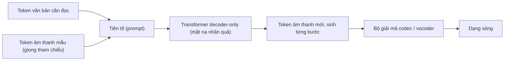

# Chương 5. Attention và Transformer

!!! abstract "Mục tiêu học tập"
    Sau chương này, bạn có thể:

    - **Suy ra** vì sao scaled dot-product attention chia điểm cho $\sqrt{d_k}$, và **cài đặt** multi-head attention từ đầu, đối chiếu chính xác với `torch.nn.functional.scaled_dot_product_attention`.
    - **Xây dựng** đúng các mặt nạ padding và nhân quả, phân biệt self-attention và cross-attention, tránh các bẫy về quy ước mặt nạ.
    - **So sánh** các mã hóa vị trí (sinusoidal, học được, tương đối, ALiBi, RoPE) và **chứng minh** tính chất tương đối của RoPE.
    - **Giải thích** các lựa chọn thiết kế của khối Transformer hiện đại: Pre-LN và Post-LN, RMSNorm, SwiGLU.
    - **Cài đặt** giải mã tự hồi quy với KV cache và các chiến lược lấy mẫu (nhiệt độ, top-k, top-p, phạt lặp) dùng trong codec language model.
    - **Phân tích** độ phức tạp $O(N^2)$ của attention và ý tưởng của FlashAttention (softmax trực tuyến).
    - **Mô tả** khối Conformer và các cơ chế điều kiện hóa FiLM, AdaLN, adaLN-Zero dùng trong TTS dựa trên DiT.

!!! info "Kiến thức cần có"
    - [Chương 1](ch01-toan-nen-tang.md): ma trận, ma trận quay, số phức và công thức Euler.
    - [Chương 3](ch03-toi-uu-va-ky-thuat-huan-luyen.md): LayerNorm, RMSNorm, warmup tốc độ học.
    - [Chương 4](ch04-cnn-rnn-mo-hinh-chuoi.md): seq2seq, attention cộng và nhân, teacher forcing, các chiến lược giải mã.
    - Các khối mã trong chương **chạy tuần tự như một notebook**; khối sau có thể dùng lại hàm của khối trước.

Ở [Chương 4](ch04-cnn-rnn-mo-hinh-chuoi.md), attention xuất hiện như một "phụ kiện" giúp bộ giải mã RNN nhìn lại bộ mã hóa. Năm 2017, Vaswani và cộng sự đặt câu hỏi ngược lại: nếu attention đã làm được việc nặng nhất, liệu có cần RNN nữa không? Câu trả lời — Transformer — đã trở thành kiến trúc chủ đạo của gần như toàn bộ học sâu, và TTS không ngoại lệ: bộ mã hóa văn bản của FastSpeech và VITS, bộ giải mã của Transformer-TTS, các codec language model như VALL-E, CosyVoice, và các mô hình flow matching dựa trên DiT như F5-TTS đều là các biến thể của Transformer.

Chương này đi từ phép toán cốt lõi (scaled dot-product attention) đến những chi tiết kỹ thuật quyết định một mô hình TTS hiện đại có chạy được hay không: mã hóa vị trí cho chuỗi rất dài, KV cache cho sinh tự hồi quy, chiến lược lấy mẫu cho token âm thanh, và cơ chế điều kiện hóa cho mô hình khuếch tán/flow.

## 5.1 Từ RNN có attention đến Transformer

Một RNN có hai hạn chế cấu trúc:

1. **Tuần tự.** Muốn tính $\mathbf{h}_t$ phải có $\mathbf{h}_{t-1}$. Với chuỗi 1 000 khung mel, ta có 1 000 bước nối tiếp nhau — không tận dụng được hàng nghìn lõi của GPU.
2. **Đường đi dài.** Thông tin từ vị trí $i$ tới vị trí $j$ phải đi qua $|i - j|$ bước cập nhật, mỗi bước là một cơ hội để bị "quên" hay để gradient tiêu biến.

Attention giải quyết cả hai. Mọi cặp vị trí được nối **trực tiếp** (đường đi độ dài 1), và mọi vị trí được tính **song song** bằng phép nhân ma trận. Cái giá phải trả là chi phí tăng theo **bình phương** độ dài chuỗi — chủ đề của mục 5.10.

Trực giác hữu ích nhất cho attention là một **từ điển mềm**. Một từ điển thông thường nhận một khóa và trả về đúng một giá trị. Attention nhận một **truy vấn** (*query*) $\mathbf{q}$, so sánh nó với mọi **khóa** (*key*) $\mathbf{k}_j$, rồi trả về **trung bình có trọng số** của các **giá trị** (*value*) $\mathbf{v}_j$ — khóa nào càng giống truy vấn, giá trị tương ứng càng được coi trọng.

## 5.2 Scaled dot-product attention

### 5.2.1 Định nghĩa

Xếp $N_q$ truy vấn, $N_k$ khóa và $N_k$ giá trị thành các ma trận $\mathbf{Q} \in \mathbb{R}^{N_q \times d_k}$, $\mathbf{K} \in \mathbb{R}^{N_k \times d_k}$, $\mathbf{V} \in \mathbb{R}^{N_k \times d_v}$ (mỗi hàng là một véc-tơ). **Scaled dot-product attention** là

$$
\operatorname{Attention}(\mathbf{Q}, \mathbf{K}, \mathbf{V}) = \operatorname{softmax}\!\left(\frac{\mathbf{Q}\mathbf{K}^\top}{\sqrt{d_k}} + \mathbf{M}\right)\mathbf{V},
$$

trong đó softmax lấy theo từng hàng, và $\mathbf{M} \in \{0, -\infty\}^{N_q \times N_k}$ (hoặc một ma trận thực bất kỳ) là **mặt nạ cộng** dùng để cấm hoặc ưu tiên một số cặp (mục 5.4). Đọc từ trong ra ngoài:

- $\mathbf{S} = \mathbf{Q}\mathbf{K}^\top / \sqrt{d_k} \in \mathbb{R}^{N_q \times N_k}$: **ma trận điểm**, phần tử $(i, j)$ đo độ giống giữa truy vấn $i$ và khóa $j$.
- $\mathbf{P} = \operatorname{softmax}(\mathbf{S} + \mathbf{M})$: **ma trận trọng số attention**, mỗi hàng là một phân phối xác suất trên các khóa.
- $\mathbf{P}\mathbf{V}$: mỗi hàng đầu ra là trung bình các giá trị theo phân phối đó.

So với attention cộng của Bahdanau ([Chương 4](ch04-cnn-rnn-mo-hinh-chuoi.md)), hàm điểm ở đây chỉ là tích vô hướng — toàn bộ $N_q \times N_k$ điểm được tính bằng **một phép nhân ma trận**, phép toán mà GPU làm nhanh nhất.

### 5.2.2 Vì sao chia cho $\sqrt{d_k}$?

Giả sử (như lúc khởi tạo, khi đầu vào đã được chuẩn hóa) các thành phần $q_i, k_i$ là các biến ngẫu nhiên độc lập, kỳ vọng 0, phương sai 1. Khi đó:

$$
\mathbb{E}[\mathbf{q}^\top \mathbf{k}] = \sum_{i=1}^{d_k} \mathbb{E}[q_i]\,\mathbb{E}[k_i] = 0,
\qquad
\operatorname{Var}(\mathbf{q}^\top \mathbf{k}) = \sum_{i=1}^{d_k} \operatorname{Var}(q_i k_i) = \sum_{i=1}^{d_k} \mathbb{E}[q_i^2]\,\mathbb{E}[k_i^2] = d_k .
$$

(Bước thứ hai dùng tính độc lập giữa các số hạng; bước thứ ba dùng $\operatorname{Var}(q_i k_i) = \mathbb{E}[q_i^2 k_i^2] - (\mathbb{E}[q_i k_i])^2 = 1 \cdot 1 - 0$.) Vậy độ lệch chuẩn của điểm tăng như $\sqrt{d_k}$: với $d_k = 64$, các điểm có độ lớn cỡ 8; với $d_k = 512$, cỡ 23.

Điểm lớn thì có hại vì softmax **bão hòa**. Jacobian của $\mathbf{p} = \operatorname{softmax}(\mathbf{s})$ là

$$
\frac{\partial p_i}{\partial s_j} = p_i(\delta_{ij} - p_j), \qquad \mathbf{J} = \operatorname{diag}(\mathbf{p}) - \mathbf{p}\mathbf{p}^\top .
$$

Khi các điểm cách nhau xa, $\mathbf{p}$ tiến về một véc-tơ one-hot $\mathbf{e}_j$, và $\mathbf{J} \to \operatorname{diag}(\mathbf{e}_j) - \mathbf{e}_j\mathbf{e}_j^\top = \mathbf{0}$: gradient qua softmax **tiêu biến**, attention "đông cứng" vào một lựa chọn ngẫu nhiên ngay từ đầu huấn luyện. Chia cho $\sqrt{d_k}$ đưa phương sai của điểm về 1 **bất kể** $d_k$, giữ softmax ở vùng có gradient tốt.

**Mã minh họa.** Đo entropy của phân phối attention và chuẩn Frobenius của Jacobian softmax, có và không có hệ số tỷ lệ.

```python
import math
import torch
import torch.nn as nn
import torch.nn.functional as F

def softmax_stats(scores):
    """Entropy trung bình và chuẩn Frobenius trung bình của Jacobian softmax J = diag(p) - p p^T."""
    p = scores.softmax(-1)                                         # (M, n)
    ent = -(p * p.clamp_min(1e-12).log()).sum(-1).mean().item()
    jac = torch.diag_embed(p) - p[:, :, None] * p[:, None, :]       # (M, n, n)
    return ent, jac.flatten(1).norm(dim=-1).mean().item()

torch.manual_seed(0)
n_keys = 32
print(f"Entropy cực đại (đều trên {n_keys} khóa) = {math.log(n_keys):.2f}")
for d_k in [4, 64, 512]:
    q = torch.randn(2000, d_k)                    # mỗi thành phần ~ N(0, 1)
    k = torch.randn(2000, n_keys, d_k)
    scores = torch.einsum("md,mnd->mn", q, k)     # (2000, 32)
    e_raw, j_raw = softmax_stats(scores)
    e_sc, j_sc = softmax_stats(scores / math.sqrt(d_k))
    print(f"d_k={d_k:3d} | std(q·k)={scores.std().item():5.1f} (√d_k={math.sqrt(d_k):4.1f}) | "
          f"không chia: H={e_raw:.2f}, ‖J‖={j_raw:.3f} | chia √d_k: H={e_sc:.2f}, ‖J‖={j_sc:.3f}")
```

Kết quả: độ lệch chuẩn của điểm khớp đúng $\sqrt{d_k}$; khi không chia, entropy giảm từ khoảng 2,3 xuống 0,15 và chuẩn Jacobian giảm gần 4 lần khi $d_k$ tăng từ 4 lên 512; khi có chia, cả hai gần như không đổi theo $d_k$.

### 5.2.3 Attention là một căn chỉnh mềm

Trong cross-attention giữa bộ giải mã mel và bộ mã hóa văn bản, hàng $t$ của $\mathbf{P}$ cho biết khung $t$ "đang đọc" token nào. Chuyển vị lại, ta có đúng ma trận căn chỉnh mềm $\mathbf{A} \in [0, 1]^{N \times T}$ của [bảng ký hiệu](../gioi-thieu/ky-hieu.md). Vẽ ma trận này là công cụ chẩn đoán số một của các mô hình TTS dựa trên attention: một đường chéo sắc nét nghĩa là mô hình đã học được căn chỉnh; một vệt mờ hoặc đứt đoạn báo trước các lỗi lặp từ, bỏ từ ([Chương 20](../phan-5-mo-hinh-am-hoc/ch20-tacotron.md), [Chương 21](../phan-5-mo-hinh-am-hoc/ch21-alignment.md)).

## 5.3 Multi-head attention

Một phép attention cho mỗi truy vấn **một** phân phối trên các khóa, và đầu ra là **một** trung bình. Nếu truy vấn cần đồng thời hai loại thông tin — ví dụ một khung mel cần biết cả âm vị đang được đọc *và* dấu câu ở cuối cụm từ để định ngữ điệu — một phân phối duy nhất buộc phải "chia đôi" sự chú ý và trộn lẫn hai thông tin.

**Multi-head attention** chạy $h$ phép attention song song trên các phép chiếu khác nhau, rồi ghép kết quả:

$$
\operatorname{head}_i = \operatorname{Attention}(\mathbf{X}_q \mathbf{W}_i^{Q},\ \mathbf{X}_{kv} \mathbf{W}_i^{K},\ \mathbf{X}_{kv} \mathbf{W}_i^{V}),
\qquad
\operatorname{MHA}(\mathbf{X}_q, \mathbf{X}_{kv}) = [\operatorname{head}_1; \ldots; \operatorname{head}_h]\, \mathbf{W}^{O},
$$

với $\mathbf{W}_i^{Q}, \mathbf{W}_i^{K}, \mathbf{W}_i^{V} \in \mathbb{R}^{d \times d/h}$ và $\mathbf{W}^{O} \in \mathbb{R}^{d \times d}$ ($d$ là chiều mô hình, ở đây ghép theo chiều đặc trưng). Mỗi head làm việc trong không gian con $d/h$ chiều, nên tổng chi phí xấp xỉ một head đầy đủ $d$ chiều; số tham số là $4d^2$ (cộng $4d$ độ lệch). Trong cài đặt, ta chiếu một lần ra $d$ chiều rồi **tách** thành $h$ head bằng `view` + `transpose`, thay vì giữ $h$ ma trận riêng.

Trong các mô hình TTS dựa trên attention, người ta thường quan sát thấy chỉ một số head của cross-attention có dạng đường chéo rõ (làm nhiệm vụ căn chỉnh), các head khác phân tán hơn. Điều này có hệ quả thực hành: khi dùng attention để trích trường độ hay để áp đặt ràng buộc đường chéo, ta thường chọn hoặc ràng buộc **một vài head** cụ thể thay vì tất cả.

## 5.4 Mặt nạ; self-attention và cross-attention

### 5.4.1 Self-attention và cross-attention

- **Self-attention**: $\mathbf{X}_q = \mathbf{X}_{kv} = \mathbf{X}$ — mỗi vị trí của một chuỗi nhìn các vị trí khác của **chính chuỗi đó**. Dùng trong bộ mã hóa văn bản (mỗi âm vị nhìn cả câu) và trong bộ giải mã (mỗi khung nhìn các khung khác).
- **Cross-attention**: truy vấn từ chuỗi này, khóa/giá trị từ chuỗi khác — ví dụ truy vấn từ khung mel, khóa/giá trị từ đầu ra bộ mã hóa văn bản. Đây là cơ chế căn chỉnh của Transformer-TTS (Li và cộng sự, 2019).

Không phải mọi mô hình TTS hiện đại đều cần cross-attention. Các codec language model kiểu decoder-only (mục 5.7) đặt văn bản và token âm thanh vào **cùng một chuỗi** và chỉ dùng self-attention; E2 TTS và F5-TTS đệm chuỗi ký tự cho bằng độ dài mel rồi ghép theo kênh ([Chương 33](../phan-8-mo-hinh-lon/ch33-nar-quy-mo-lon.md)). Căn chỉnh khi đó được học **ngầm** bên trong self-attention.

### 5.4.2 Mặt nạ padding và mặt nạ nhân quả

**Mặt nạ padding.** Trong một batch, các câu ngắn được đệm. Khóa ở vị trí đệm phải bị cấm: $M_{ij} = -\infty$ nếu khóa $j$ là đệm. Truy vấn ở vị trí đệm thì vẫn tính ra *một* giá trị (vô nghĩa), nên phải loại các vị trí đó khỏi hàm mất mát và khỏi mọi phép gộp (*pooling*) phía sau.

**Mặt nạ nhân quả.** Trong bộ giải mã tự hồi quy, vị trí $i$ chỉ được nhìn các vị trí $j \le i$: $M_{ij} = -\infty$ nếu $j > i$ — ma trận tam giác dưới. Nhờ mặt nạ này, ta huấn luyện **mọi** bước của một chuỗi song song trong một lần chạy, mà vẫn bảo đảm tính tự hồi quy — cùng tinh thần với tích chập nhân quả ở [Chương 4](ch04-cnn-rnn-mo-hinh-chuoi.md). Hai mặt nạ được kết hợp bằng phép "và" (với mặt nạ bool) hoặc phép cộng (với mặt nạ số thực).

!!! warning "Bẫy: quy ước mặt nạ bool ngược nhau giữa các API"
    - Trong `F.scaled_dot_product_attention`, mặt nạ bool `True` nghĩa là **được chú ý**; mặt nạ số thực được **cộng** vào điểm.
    - Trong `nn.MultiheadAttention`, `key_padding_mask` và `attn_mask` dạng bool thì `True` nghĩa là **bị cấm**.

    Truyền nhầm quy ước không gây ra lỗi nào; mô hình chỉ âm thầm chú ý vào phần đệm và bỏ qua nội dung thật. Hãy luôn viết một kiểm thử đối chiếu như khối mã dưới đây.

**Mã minh họa.** Multi-head attention viết từ đầu; đối chiếu với `F.scaled_dot_product_attention` (SDPA) và với `nn.MultiheadAttention` (sau khi chép trọng số). Khối mã cũng kiểm chứng tính đồng biến hoán vị sẽ bàn ở mục 5.5.

```python
def attention(q, k, v, mask=None):
    """Scaled dot-product attention viết tay.
    q: (B, h, N_q, d), k, v: (B, h, N_k, d); mask: bool, True = ĐƯỢC chú ý."""
    scores = q @ k.transpose(-2, -1) / math.sqrt(q.shape[-1])   # (B, h, N_q, N_k)
    if mask is not None:
        scores = scores.masked_fill(~mask, float("-inf"))
    return scores.softmax(dim=-1) @ v                             # (B, h, N_q, d)

class MultiHeadAttention(nn.Module):
    def __init__(self, d_model, n_heads):
        super().__init__()
        assert d_model % n_heads == 0
        self.h, self.d = n_heads, d_model // n_heads
        self.w_q = nn.Linear(d_model, d_model)
        self.w_k = nn.Linear(d_model, d_model)
        self.w_v = nn.Linear(d_model, d_model)
        self.w_o = nn.Linear(d_model, d_model)

    def split(self, x):                           # (B, N, d_model) -> (B, h, N, d)
        return x.view(x.shape[0], x.shape[1], self.h, self.d).transpose(1, 2)

    def forward(self, x_q, x_kv, mask=None, use_sdpa=False):
        q, k, v = self.split(self.w_q(x_q)), self.split(self.w_k(x_kv)), self.split(self.w_v(x_kv))
        if use_sdpa:
            o = F.scaled_dot_product_attention(q, k, v, attn_mask=mask)
        else:
            o = attention(q, k, v, mask)          # (B, h, N_q, d)
        o = o.transpose(1, 2).reshape(x_q.shape[0], x_q.shape[1], -1)   # (B, N_q, d_model)
        return self.w_o(o)

def make_masks(lengths, n_max, causal=False):
    """Mặt nạ bool (B, 1, N, N): True = được chú ý. Kết hợp padding và (tùy chọn) nhân quả."""
    valid = torch.arange(n_max)[None] < lengths[:, None]           # (B, N)
    mask = valid[:, None, None, :]                                 # che KHÓA là đệm
    if causal:
        mask = mask & torch.ones(n_max, n_max, dtype=torch.bool).tril()
    return mask

torch.manual_seed(0)
B, N, D, H = 2, 6, 32, 4
x = torch.randn(B, N, D)                          # (B, N, d_model)
lengths = torch.tensor([6, 4])
mha = MultiHeadAttention(D, H)
for causal in [False, True]:
    m = make_masks(lengths, N, causal)
    assert torch.allclose(mha(x, x, m), mha(x, x, m, use_sdpa=True), atol=1e-5)

# Đối chiếu với nn.MultiheadAttention: chép trọng số; CHÚ Ý quy ước mặt nạ ngược lại
torch_mha = nn.MultiheadAttention(D, H, batch_first=True)
with torch.no_grad():
    torch_mha.in_proj_weight.copy_(torch.cat([mha.w_q.weight, mha.w_k.weight, mha.w_v.weight]))
    torch_mha.in_proj_bias.copy_(torch.cat([mha.w_q.bias, mha.w_k.bias, mha.w_v.bias]))
    torch_mha.out_proj.weight.copy_(mha.w_o.weight)
    torch_mha.out_proj.bias.copy_(mha.w_o.bias)
pad = torch.arange(N)[None] >= lengths[:, None]   # True = BỎ QUA (ngược với SDPA!)
ref, _ = torch_mha(x, x, x, key_padding_mask=pad)
assert torch.allclose(mha(x, x, make_masks(lengths, N)), ref, atol=1e-5)

# Tự chú ý không có mã hóa vị trí là "đồng biến hoán vị" (mục 5.5.1)
perm = torch.randperm(N)
assert torch.allclose(mha(x[:, perm], x[:, perm]), mha(x, x)[:, perm], atol=1e-5)
print("MHA tự cài đặt khớp SDPA và nn.MultiheadAttention")
```

## 5.5 Mã hóa vị trí

### 5.5.1 Vì sao cần mã hóa vị trí?

Gọi $\mathbf{\Pi}$ là một ma trận hoán vị (đổi chỗ các hàng). Với self-attention không có thông tin vị trí, $\mathbf{Q} = \mathbf{X}\mathbf{W}^Q$, ..., ta có

$$
\operatorname{softmax}\!\left(\frac{\mathbf{\Pi}\mathbf{X}\mathbf{W}^Q (\mathbf{\Pi}\mathbf{X}\mathbf{W}^K)^\top}{\sqrt{d_k}}\right)\mathbf{\Pi}\mathbf{X}\mathbf{W}^V
= \mathbf{\Pi}\,\operatorname{softmax}\!\left(\frac{\mathbf{X}\mathbf{W}^Q (\mathbf{X}\mathbf{W}^K)^\top}{\sqrt{d_k}}\right)\mathbf{\Pi}^\top \mathbf{\Pi}\mathbf{X}\mathbf{W}^V
= \mathbf{\Pi}\,\operatorname{Attention}(\mathbf{X}),
$$

vì softmax theo hàng giao hoán với việc hoán vị đồng thời hàng và cột ($\operatorname{softmax}(\mathbf{\Pi}\mathbf{S}\mathbf{\Pi}^\top) = \mathbf{\Pi}\operatorname{softmax}(\mathbf{S})\mathbf{\Pi}^\top$) và $\mathbf{\Pi}^\top\mathbf{\Pi} = \mathbf{I}$. Nói cách khác, self-attention là **đồng biến hoán vị** (*permutation equivariant*): xáo trộn đầu vào thì đầu ra bị xáo trộn y hệt, ngoài ra không có gì thay đổi. Với nó, một câu chỉ là một "túi token". Khối mã ở mục trước đã kiểm chứng điều này bằng số.

!!! note "Góc tiếng Việt"
    Tiếng Việt là ngôn ngữ **đơn lập**: từ không biến hình, quan hệ ngữ pháp được thể hiện chủ yếu bằng **trật tự từ** và hư từ. "Con mèo cắn con chó" và "con chó cắn con mèo" có cùng một túi âm tiết nhưng nghĩa ngược nhau — và với TTS, cả cách nhấn, cách ngắt cũng khác. Một bộ mã hóa không có thông tin vị trí sẽ không phân biệt được hai câu này. Ở mức âm thanh, vấn đề còn hiển nhiên hơn: hoán vị các khung mel là phá hủy tiếng nói.

Có hai cách đưa vị trí vào: **tuyệt đối** (cộng một véc-tơ phụ thuộc vị trí vào embedding) và **tương đối** (sửa điểm attention để phụ thuộc vào khoảng cách $i - j$).

### 5.5.2 Mã hóa sinusoidal

Transformer gốc cộng vào embedding ở vị trí $\text{pos}$ véc-tơ

$$
\mathrm{PE}(\text{pos}, 2i) = \sin(\text{pos}\cdot\omega_i), \qquad \mathrm{PE}(\text{pos}, 2i+1) = \cos(\text{pos}\cdot\omega_i), \qquad \omega_i = 10000^{-2i/d}.
$$

Mỗi cặp chiều là một "kim đồng hồ" quay với tần số $\omega_i$; các tần số trải theo cấp số nhân, từ chu kỳ $2\pi$ đến $2\pi \cdot 10000$ vị trí — giống cách các chữ số nhị phân của một bộ đếm lật với tần số khác nhau.

**Tính chất quan trọng:** dịch vị trí là một **phép biến đổi tuyến tính không phụ thuộc vị trí**. Từ công thức cộng góc $\sin(a + b) = \sin a \cos b + \cos a \sin b$ và $\cos(a + b) = \cos a \cos b - \sin a \sin b$, với $a = \text{pos}\,\omega_i$, $b = k\,\omega_i$:

$$
\begin{bmatrix} \mathrm{PE}(\text{pos} + k, 2i) \\ \mathrm{PE}(\text{pos} + k, 2i+1) \end{bmatrix}
=
\begin{bmatrix} \cos k\omega_i & \sin k\omega_i \\ -\sin k\omega_i & \cos k\omega_i \end{bmatrix}
\begin{bmatrix} \mathrm{PE}(\text{pos}, 2i) \\ \mathrm{PE}(\text{pos}, 2i+1) \end{bmatrix}.
$$

Vậy $\mathrm{PE}(\text{pos} + k) = \mathbf{M}_k\, \mathrm{PE}(\text{pos})$ với $\mathbf{M}_k$ là ma trận quay khối chỉ phụ thuộc $k$: về nguyên tắc, mô hình có thể học cách "nhìn sang trái $k$ vị trí" bằng một phép tuyến tính dùng được ở mọi vị trí. Đây chính là mầm mống của RoPE (mục 5.5.6).

Transformer-TTS (Li và cộng sự, 2019) dùng mã hóa sinusoidal nhưng nhân thêm một **hệ số tỷ lệ học được** trước khi cộng vào embedding, vì embedding âm vị và embedding khung mel có thang đo khác nhau — một chi tiết nhỏ cho thấy việc "cộng vị trí vào nội dung" nhạy cảm với tỷ lệ như thế nào.

### 5.5.3 Mã hóa vị trí học được

Thay công thức bằng một bảng embedding `nn.Embedding(max_len, d)` học từ dữ liệu (như BERT, GPT-2). Đơn giản và linh hoạt, nhưng **không ngoại suy** được: vị trí lớn hơn `max_len` không có embedding, và các vị trí hiếm gặp khi huấn luyện (cuối các câu dài) được học kém. Với TTS, nơi một câu dài có thể vượt nghìn khung mel, đây là một nhược điểm thật sự.

### 5.5.4 Biểu diễn vị trí tương đối (Shaw và cộng sự)

Shaw, Uszkoreit và Vaswani (2018) đưa khoảng cách trực tiếp vào attention. Với mỗi khoảng cách $j - i$ (bị cắt trong $[-k, k]$), học hai véc-tơ $\mathbf{a}^K_{j-i}, \mathbf{a}^V_{j-i}$:

$$
e_{ij} = \frac{\mathbf{q}_i^\top (\mathbf{k}_j + \mathbf{a}^K_{\operatorname{clip}(j-i, k)})}{\sqrt{d_k}}, \qquad
\mathbf{z}_i = \sum_j \alpha_{ij}\, (\mathbf{v}_j + \mathbf{a}^V_{\operatorname{clip}(j-i, k)}).
$$

Mô hình chỉ cần học $2k + 1$ véc-tơ; điểm phụ thuộc vào khoảng cách chứ không vào vị trí tuyệt đối, nên **bất biến tịnh tiến** và dùng được cho chuỗi dài hơn lúc huấn luyện. Với văn bản đầu vào TTS, thông tin quan trọng nhất thường là "âm vị bên cạnh là gì", nên một cửa sổ nhỏ là đủ. Bộ mã hóa văn bản của Glow-TTS và VITS dùng biến thể của cách tiếp cận này (theo mã nguồn chính thức, với cửa sổ khoảng cách nhỏ, cỡ 4 vị trí mỗi phía). Các biến thể khác: T5 (Raffel và cộng sự, 2020) chỉ học một **độ lệch vô hướng** cho mỗi nhóm khoảng cách và mỗi head; Transformer-XL (Dai và cộng sự, 2019) dùng mã hóa tương đối dạng sinusoidal — biến thể được Conformer sử dụng (mục 5.11).

### 5.5.5 ALiBi

ALiBi (*Attention with Linear Biases*; Press, Smith và Lewis, 2022) đơn giản đến bất ngờ: không cộng gì vào embedding, chỉ trừ vào điểm một lượng tỷ lệ với khoảng cách:

$$
e_{ij}^{(h)} = \frac{\mathbf{q}_i^\top \mathbf{k}_j}{\sqrt{d_k}} - m_h\,(i - j), \qquad j \le i,
$$

với độ dốc $m_h$ khác nhau cho từng head, lấy theo cấp số nhân; với 8 head là $\tfrac{1}{2}, \tfrac{1}{4}, \ldots, \tfrac{1}{256}$ (tổng quát $m_h = 2^{-8h/H}$ khi số head $H$ là lũy thừa của 2). Head có độ dốc lớn chỉ nhìn gần, head có độ dốc nhỏ nhìn xa. Press và cộng sự cho thấy mô hình ngôn ngữ huấn luyện với ALiBi ngoại suy tốt sang chuỗi dài hơn lúc huấn luyện. Trong TTS, ALiBi ít phổ biến hơn RoPE, nhưng ý tưởng "thiên vị theo khoảng cách" rất gần với các kỹ thuật thiên vị đường chéo dùng để ổn định căn chỉnh.

**Mã minh họa.** Mã hóa sinusoidal (kiểm chứng tính chất $\mathrm{PE}(\text{pos} + k) = \mathbf{M}_k \mathrm{PE}(\text{pos})$) và độ lệch ALiBi dùng như mặt nạ số thực của SDPA.

```python
def sinusoidal_pe(n, d, base=10000.0):
    """PE[pos, 2i] = sin(pos * w_i), PE[pos, 2i+1] = cos(pos * w_i), w_i = base^(-2i/d)."""
    w = base ** (-torch.arange(0, d, 2).float() / d)              # (d/2,)
    ang = torch.arange(n).float()[:, None] * w[None]               # (n, d/2)
    pe = torch.zeros(n, d)
    pe[:, 0::2], pe[:, 1::2] = ang.sin(), ang.cos()
    return pe                                                      # (n, d)

# Tính chất: PE[pos + k] = M_k @ PE[pos], M_k là ma trận quay khối KHÔNG phụ thuộc pos
d, k = 16, 7
pe = sinusoidal_pe(64, d)
w = 10000.0 ** (-torch.arange(0, d, 2).float() / d)
M = torch.zeros(d, d)
for i, wi in enumerate(w):
    c, s = math.cos(k * wi), math.sin(k * wi)
    M[2 * i:2 * i + 2, 2 * i:2 * i + 2] = torch.tensor([[c, s], [-s, c]])
for pos in [0, 10, 40]:
    assert torch.allclose(M @ pe[pos], pe[pos + k], atol=1e-5)

def alibi_bias(n, n_heads):
    """ALiBi (bản nhân quả): bias[h, i, j] = -m_h * (i - j) với j <= i, -inf với j > i."""
    slopes = 2.0 ** (-8.0 * torch.arange(1, n_heads + 1) / n_heads)     # (h,)
    rel = (torch.arange(n)[None, :] - torch.arange(n)[:, None]).float()  # rel[i, j] = j - i
    bias = slopes[:, None, None] * rel.clamp(max=0)                     # (h, n, n)
    causal = torch.ones(n, n, dtype=torch.bool).tril()
    return bias.masked_fill(~causal, float("-inf"))

print("Độ dốc ALiBi với 8 head:", (2.0 ** (-8.0 * torch.arange(1, 9) / 8)).tolist())
q = k_ = v = torch.randn(1, 8, 5, 16)            # (B, h, N, d)
out = F.scaled_dot_product_attention(q, k_, v, attn_mask=alibi_bias(5, 8))  # mặt nạ thực: CỘNG
manual = ((q @ k_.transpose(-2, -1)) / 4.0 + alibi_bias(5, 8)).softmax(-1) @ v
assert torch.allclose(out, manual, atol=1e-5)
print("Sinusoidal và ALiBi: OK")
```

### 5.5.6 RoPE: mã hóa vị trí bằng phép quay

RoPE (*Rotary Position Embedding*; Su và cộng sự, 2024) là cách mã hóa vị trí phổ biến nhất trong các mô hình ngôn ngữ lớn hiện nay (LLaMA, Qwen…), và do đó trong các TTS dùng LLM làm xương sống; nhiều mô hình TTS dạng DiT như F5-TTS cũng dùng nó (theo mã nguồn công bố). Ý tưởng: thay vì **cộng** vị trí vào nội dung, ta **quay** truy vấn và khóa một góc tỷ lệ với vị trí.

**Trường hợp 2 chiều.** Gọi $\mathbf{R}(\phi) = \begin{bmatrix} \cos\phi & -\sin\phi \\ \sin\phi & \cos\phi \end{bmatrix}$. Đặt truy vấn ở vị trí $m$ thành $\mathbf{R}(m\theta)\mathbf{q}$ và khóa ở vị trí $n$ thành $\mathbf{R}(n\theta)\mathbf{k}$. Khi đó

$$
\left(\mathbf{R}(m\theta)\mathbf{q}\right)^\top \left(\mathbf{R}(n\theta)\mathbf{k}\right)
= \mathbf{q}^\top \mathbf{R}(m\theta)^\top \mathbf{R}(n\theta)\, \mathbf{k}
= \mathbf{q}^\top \mathbf{R}\big((n - m)\theta\big)\, \mathbf{k},
$$

vì ma trận quay là trực giao, $\mathbf{R}(\alpha)^\top = \mathbf{R}(-\alpha)$, và hợp của hai phép quay là phép quay với tổng góc. Điểm attention **chỉ phụ thuộc vào khoảng cách** $n - m$, dù ta chỉ áp dụng thông tin vị trí tuyệt đối cho từng véc-tơ riêng lẻ.

**Góc nhìn số phức.** Đồng nhất $\mathbf{q} = (q_1, q_2)$ với $\tilde q = q_1 + \mathrm{i}\, q_2$. Phép quay là nhân với $e^{\mathrm{i} m\theta}$, và tích vô hướng thực bằng phần thực của $\tilde q\, \overline{\tilde k}$:

$$
\operatorname{Re}\!\left[(\tilde q\, e^{\mathrm{i} m\theta})\,\overline{(\tilde k\, e^{\mathrm{i} n\theta})}\right] = \operatorname{Re}\!\left[\tilde q\,\overline{\tilde k}\, e^{\mathrm{i}(m - n)\theta}\right].
$$

**Nhiều chiều.** Chia $d$ chiều thành $d/2$ cặp, cặp thứ $i$ quay với tần số riêng $\theta_i = 10000^{-2i/d}$ — đúng các tần số của mã hóa sinusoidal. Ma trận quay toàn phần là khối chéo, nên lập luận trên áp dụng cho từng cặp và tổng lại. Các tính chất:

- Điểm attention chỉ phụ thuộc $m - n$ (vị trí tương đối), nhưng cài đặt chỉ cần biết vị trí tuyệt đối của từng token — rất tiện cho KV cache: khóa đã quay một lần thì lưu luôn.
- Phép quay **bảo toàn chuẩn**, không làm thay đổi thang đo của $\mathbf{q}, \mathbf{k}$.
- Chỉ quay $\mathbf{q}$ và $\mathbf{k}$, **không** quay $\mathbf{v}$: thông tin vị trí chỉ cần đi vào điểm.
- Có nhiều kỹ thuật mở rộng ngữ cảnh cho RoPE bằng cách co giãn góc quay (nội suy vị trí và các biến thể); chúng nằm ngoài phạm vi chương này.

!!! warning "Bẫy: hai quy ước ghép cặp của RoPE"
    Bài báo gốc ghép cặp các chiều **kề nhau** $(2i, 2i+1)$. Nhiều mã nguồn (ví dụ họ GPT-NeoX/LLaMA trong một số thư viện) ghép chiều $i$ với chiều $i + d/2$ (hàm `rotate_half`). Hai quy ước tương đương sai khác **một hoán vị kênh cố định** — nhưng một checkpoint huấn luyện với quy ước này sẽ cho kết quả sai nếu chạy với quy ước kia. Khi nạp trọng số từ nơi khác, hãy kiểm tra quy ước; các script chuyển đổi checkpoint thường phải hoán vị hàng của $\mathbf{W}^Q, \mathbf{W}^K$ chính vì lý do này.

**Mã minh họa.** Cài đặt RoPE (quy ước cặp kề nhau) và kiểm chứng: điểm chỉ phụ thuộc khoảng cách, chuẩn được bảo toàn, và hai quy ước sai khác một hoán vị.

```python
def rope_cos_sin(n, d, base=10000.0, offset=0):
    """Góc quay m * theta_i cho vị trí m = offset..offset+n-1, theta_i = base^(-2i/d)."""
    theta = base ** (-torch.arange(0, d, 2).float() / d)          # (d/2,)
    ang = torch.arange(offset, offset + n).float()[:, None] * theta[None]   # (n, d/2)
    return ang.cos(), ang.sin()

def apply_rope(x, cos, sin):
    """Quay từng cặp (x_{2i}, x_{2i+1}) một góc m*theta_i. x: (..., n, d)."""
    x1, x2 = x[..., 0::2], x[..., 1::2]                            # (..., n, d/2)
    out = torch.stack([x1 * cos - x2 * sin, x1 * sin + x2 * cos], dim=-1)
    return out.flatten(-2)                                         # (..., n, d)

torch.manual_seed(0)
d = 64
q, k = torch.randn(d), torch.randn(d)

def score(m, n):
    """<RoPE(q, m), RoPE(k, n)> với q đặt ở vị trí m, k ở vị trí n."""
    cq, sq = rope_cos_sin(1, d, offset=m)
    ck, sk = rope_cos_sin(1, d, offset=n)
    return (apply_rope(q[None], cq, sq) @ apply_rope(k[None], ck, sk).T).item()

# 1) Điểm attention chỉ phụ thuộc vào khoảng cách m - n
for m, n in [(3, 1), (10, 2), (100, 0)]:
    assert abs(score(m, n) - score(m + 37, n + 37)) < 1e-3
# 2) Phép quay bảo toàn chuẩn; 3) vị trí 0 là phép đồng nhất
cos, sin = rope_cos_sin(50, d)
x = torch.randn(50, d)
assert torch.allclose(apply_rope(x, cos, sin).norm(dim=-1), x.norm(dim=-1), atol=1e-4)
assert torch.allclose(apply_rope(x[:1], cos[:1], sin[:1]), x[:1])

# Quy ước "rotate_half" (ghép cặp i với i + d/2) tương đương sai khác một hoán vị kênh
def apply_rope_half(x, cos, sin):
    x1, x2 = x[..., : d // 2], x[..., d // 2:]
    return torch.cat([x1 * cos - x2 * sin, x1 * sin + x2 * cos], dim=-1)
perm = torch.cat([torch.arange(0, d, 2), torch.arange(1, d, 2)])  # xen kẽ -> tách nửa
assert torch.allclose(apply_rope_half(x[:, perm], cos, sin), apply_rope(x, cos, sin)[:, perm], atol=1e-5)
print("RoPE: tính tương đối, bảo toàn chuẩn, tương đương giữa hai quy ước — OK")
```

### 5.5.7 So sánh

| Phương pháp | Đưa vào ở đâu | Tương đối? | Ngoại suy độ dài | Ví dụ trong TTS |
|---|---|---|---|---|
| Sinusoidal | Cộng vào embedding | Gián tiếp (qua phép quay tuyến tính) | Trung bình | Transformer-TTS, FastSpeech |
| Học được | Cộng vào embedding | Không | Không vượt `max_len` | Các TTS dựa trên GPT-2 như Tortoise, XTTS (theo mã nguồn công bố) |
| Shaw / T5 | Sửa điểm (và giá trị) | Có, trong cửa sổ cắt | Tốt | Bộ mã hóa văn bản Glow-TTS, VITS |
| ALiBi | Trừ vào điểm | Có | Tốt (theo báo cáo gốc) | Ít gặp |
| RoPE | Quay $\mathbf{q}, \mathbf{k}$ | Có | Khá, có kỹ thuật mở rộng | LM xương sống của TTS dựa trên LLM, F5-TTS |

## 5.6 Khối Transformer

### 5.6.1 Các thành phần

Một khối Transformer gồm hai **khối con**, mỗi khối con bọc trong kết nối dư và chuẩn hóa:

1. **Multi-head self-attention** — trộn thông tin **giữa các vị trí**;
2. **Mạng truyền thẳng từng vị trí** (*position-wise feed-forward network*, FFN) — biến đổi phi tuyến **tại từng vị trí**, độc lập nhau:

$$
\operatorname{FFN}(\mathbf{x}) = \mathbf{W}_2\, \phi(\mathbf{W}_1 \mathbf{x} + \mathbf{b}_1) + \mathbf{b}_2,
\qquad \mathbf{W}_1 \in \mathbb{R}^{d_{\text{ff}} \times d},\ d_{\text{ff}} = 4d \text{ (thông dụng)},
$$

với $\phi$ là ReLU (bản gốc) hoặc GELU. Attention "thu thập", FFN "xử lý" — một cách hình dung thô nhưng hữu ích. Số tham số mỗi khối: $4d^2$ (attention) $+\ 8d^2$ (FFN với $d_{\text{ff}} = 4d$) $= 12d^2$, bỏ qua độ lệch và chuẩn hóa.

FastSpeech thay FFN bằng **hai lớp tích chập 1D** (gọi là khối FFT, *feed-forward Transformer*), vì trong chuỗi âm vị và khung mel, các vị trí kề nhau liên quan chặt chẽ — một thiên kiến cục bộ mà FFN từng vị trí không có ([Chương 22](../phan-5-mo-hinh-am-hoc/ch22-fastspeech.md)).

### 5.6.2 Post-LN và Pre-LN

Transformer gốc đặt LayerNorm **sau** phép cộng dư (Post-LN); các mô hình hiện đại (từ GPT-2 trở đi) đặt nó **trước** khối con (Pre-LN):

$$
\text{Post-LN: } \mathbf{x}_{l+1} = \operatorname{LN}\!\big(\mathbf{x}_l + \mathcal{F}_l(\mathbf{x}_l)\big),
\qquad
\text{Pre-LN: } \mathbf{x}_{l+1} = \mathbf{x}_l + \mathcal{F}_l\big(\operatorname{LN}(\mathbf{x}_l)\big).
$$

Khai triển Pre-LN: $\mathbf{x}_L = \mathbf{x}_0 + \sum_{l} \mathcal{F}_l(\operatorname{LN}(\mathbf{x}_l))$ — có một **đường đồng nhất** thông suốt từ đầu ra về mọi lớp, giống khối dư thuần túy ở [Chương 4](ch04-cnn-rnn-mo-hinh-chuoi.md). Ở Post-LN, mỗi LayerNorm nằm **trên** đường chính và co giãn lại gradient đi qua. Xiong và cộng sự (2020) phân tích rằng với Post-LN, gradient của các tham số gần đầu ra lúc khởi tạo rất lớn, nên cần **warmup** tốc độ học ([Chương 3](ch03-toi-uu-va-ky-thuat-huan-luyen.md)) để không phân kỳ; với Pre-LN gradient được kiểm soát tốt hơn và có thể huấn luyện với ít hoặc không warmup.

Đổi lại, Pre-LN cần thêm một LayerNorm **cuối cùng** (vì $\mathbf{x}_L$ chưa được chuẩn hóa), và chuẩn của "dòng dư" $\mathbf{x}_l$ có xu hướng tăng theo độ sâu, làm đóng góp tương đối của các lớp sâu nhỏ đi. Một số nghiên cứu báo cáo Post-LN (nếu huấn luyện ổn định được) cho chất lượng cuối tốt hơn; trong thực hành hiện nay, Pre-LN là lựa chọn mặc định vì độ bền. Các mô hình TTS đời đầu (Transformer-TTS, FastSpeech) dùng Post-LN như bản gốc; các mô hình lớn hơn gần đây dùng Pre-LN hoặc biến thể như adaLN (mục 5.12).

### 5.6.3 RMSNorm và SwiGLU

**RMSNorm** (Zhang và Sennrich, 2019) bỏ bước trừ trung bình của LayerNorm, chỉ chia cho căn trung bình bình phương:

$$
\operatorname{RMSNorm}(\mathbf{x}) = \frac{\mathbf{x}}{\sqrt{\tfrac{1}{d}\sum_{i} x_i^2 + \epsilon}} \odot \mathbf{g}.
$$

Rẻ hơn một chút, và thực nghiệm cho thấy chất lượng tương đương; nó được dùng rộng rãi trong các LLM ([Chương 3](ch03-toi-uu-va-ky-thuat-huan-luyen.md) trình bày chi tiết các phép chuẩn hóa).

**SwiGLU** (Shazeer, 2020) thay FFN bằng một biến thể có cổng của GLU ([Chương 4](ch04-cnn-rnn-mo-hinh-chuoi.md)):

$$
\operatorname{FFN}_{\text{SwiGLU}}(\mathbf{x}) = \mathbf{W}_2\big(\operatorname{SiLU}(\mathbf{W}_1 \mathbf{x}) \odot \mathbf{W}_3 \mathbf{x}\big),
\qquad \operatorname{SiLU}(z) = z\,\sigma(z).
$$

Vì có ba ma trận thay vì hai, chiều ẩn thường đặt khoảng $\tfrac{2}{3} \cdot 4d = \tfrac{8}{3}d$ để giữ nguyên số tham số $8d^2$. Bộ ba **Pre-LN + RMSNorm + SwiGLU** (cùng RoPE) là "công thức chuẩn" của các LLM như LLaMA (Touvron và cộng sự, 2023), và vì vậy cũng là của các TTS dựng trên LLM.

**Mã minh họa.** Khối Pre-LN với RMSNorm, SwiGLU và self-attention nhân quả dùng RoPE, có hỗ trợ KV cache (giải thích ở mục 5.8). Ta lắp chúng thành một mô hình ngôn ngữ decoder-only tí hon.

```python
class RMSNorm(nn.Module):
    def __init__(self, d, eps=1e-6):
        super().__init__()
        self.eps, self.weight = eps, nn.Parameter(torch.ones(d))

    def forward(self, x):                         # (..., d)
        return x * torch.rsqrt(x.pow(2).mean(-1, keepdim=True) + self.eps) * self.weight

class SwiGLU(nn.Module):
    """FFN(x) = W2 (SiLU(W1 x) ⊙ W3 x)."""
    def __init__(self, d, hidden):
        super().__init__()
        self.w1 = nn.Linear(d, hidden, bias=False)
        self.w3 = nn.Linear(d, hidden, bias=False)
        self.w2 = nn.Linear(hidden, d, bias=False)

    def forward(self, x):
        return self.w2(F.silu(self.w1(x)) * self.w3(x))

class CausalSelfAttention(nn.Module):
    def __init__(self, d, n_heads):
        super().__init__()
        self.h, self.dh = n_heads, d // n_heads
        self.qkv = nn.Linear(d, 3 * d, bias=False)
        self.proj = nn.Linear(d, d, bias=False)

    def forward(self, x, cache=None):             # x: (B, n, d); cache: dict hoặc None
        B, n, _ = x.shape
        q, k, v = self.qkv(x).view(B, n, 3, self.h, self.dh).permute(2, 0, 3, 1, 4)  # (B, h, n, dh)
        t0 = cache["k"].shape[2] if cache and "k" in cache else 0     # số token đã có trong cache
        cos, sin = rope_cos_sin(n, self.dh, offset=t0)                 # vị trí t0 .. t0+n-1
        q, k = apply_rope(q, cos, sin), apply_rope(k, cos, sin)
        if cache is not None:
            if "k" in cache:
                k, v = torch.cat([cache["k"], k], 2), torch.cat([cache["v"], v], 2)
            cache["k"], cache["v"] = k, v                              # (B, h, t0+n, dh)
        S = k.shape[2]
        mask = torch.ones(n, S, dtype=torch.bool).tril(diagonal=S - n)  # nhân quả "căn dưới-phải"
        o = F.scaled_dot_product_attention(q, k, v, attn_mask=mask)    # (B, h, n, dh)
        return self.proj(o.transpose(1, 2).reshape(B, n, -1))

class PreLNBlock(nn.Module):
    def __init__(self, d, n_heads):
        super().__init__()
        self.norm1, self.norm2 = RMSNorm(d), RMSNorm(d)
        self.attn = CausalSelfAttention(d, n_heads)
        self.ffn = SwiGLU(d, hidden=int(8 * d / 3))  # giữ số tham số ≈ FFN 4d thông thường

    def forward(self, x, cache=None):
        x = x + self.attn(self.norm1(x), cache)      # Pre-LN: chuẩn hóa TRƯỚC khối con
        return x + self.ffn(self.norm2(x))

class TinyLM(nn.Module):
    def __init__(self, vocab=100, d=64, n_heads=4, n_layers=2):
        super().__init__()
        self.emb = nn.Embedding(vocab, d)
        self.blocks = nn.ModuleList(PreLNBlock(d, n_heads) for _ in range(n_layers))
        self.norm, self.head = RMSNorm(d), nn.Linear(d, vocab, bias=False)

    def forward(self, ids, caches=None):          # ids: (B, n) -> logits (B, n, V)
        x = self.emb(ids)
        for i, blk in enumerate(self.blocks):
            x = blk(x, None if caches is None else caches[i])
        return self.head(self.norm(x))            # LayerNorm cuối — bắt buộc với Pre-LN
```

## 5.7 Encoder–decoder, encoder-only và decoder-only

Transformer gốc là một mô hình **encoder–decoder**: bộ mã hóa (self-attention hai chiều) đọc đầu vào, bộ giải mã (self-attention nhân quả + cross-attention tới bộ mã hóa) sinh đầu ra. Từ khung này tách ra ba "họ":

| Họ | Attention | Ví dụ ngoài TTS | Ví dụ trong TTS |
|---|---|---|---|
| Encoder-only | Self-attention hai chiều | BERT | Bộ mã hóa văn bản của FastSpeech, VITS; bộ giải mã mel không tự hồi quy của FastSpeech |
| Encoder–decoder | Self hai chiều + self nhân quả + cross | Transformer dịch máy, Whisper | Transformer-TTS |
| Decoder-only | Self-attention nhân quả trên một chuỗi chung | GPT, LLaMA | Tầng tự hồi quy của VALL-E; LM của CosyVoice; các TTS dựa trên LLM |

Mô hình **decoder-only** cho TTS hoạt động như sau: văn bản (dạng âm vị hoặc token BPE) và token âm thanh được nối thành **một chuỗi**; mô hình học dự đoán token kế tiếp với mặt nạ nhân quả. Khi suy luận, ta đưa vào phần **tiền tố** gồm văn bản cần đọc và (với nhân bản giọng zero-shot) một đoạn âm thanh mẫu đã mã hóa thành token, rồi để mô hình sinh tiếp phần token âm thanh ([Chương 32](../phan-8-mo-hinh-lon/ch32-codec-language-model.md)).



Vì sao decoder-only thắng thế ở quy mô lớn? Nó **đơn giản** (một kiến trúc, một hàm mất mát), tận dụng được toàn bộ hạ tầng huấn luyện và phục vụ LLM, cho phép **học trong ngữ cảnh** (*in-context learning*: "bắt chước giọng trong tiền tố"), và có thể khởi tạo từ một LLM văn bản đã huấn luyện sẵn. Đổi lại, nó thừa hưởng mọi điểm yếu của sinh tự hồi quy: chậm, có thể lặp hoặc bỏ từ, khó kiểm soát độ dài ([Chương 32](../phan-8-mo-hinh-lon/ch32-codec-language-model.md), [Chương 34](../phan-8-mo-hinh-lon/ch34-he-thong-lai-hien-dai.md)).

## 5.8 Suy luận tự hồi quy với KV cache

### 5.8.1 Vấn đề

Khi sinh token thứ $t + 1$, mô hình decoder-only cần $\mathbf{q}_{t}$ của token mới nhất và **mọi** $\mathbf{k}_j, \mathbf{v}_j$ với $j \le t$. Cách ngây thơ là chạy lại toàn bộ mô hình trên cả chuỗi $t$ token ở mỗi bước. Nhưng với mặt nạ nhân quả, biểu diễn của token $j$ ở mọi lớp **không phụ thuộc** vào các token sau nó — nên $\mathbf{k}_j, \mathbf{v}_j$ tính ở bước trước vẫn đúng ở bước này. Tính lại chúng là lãng phí thuần túy.

**KV cache** lưu $\mathbf{K}, \mathbf{V}$ của mọi lớp. Mỗi bước, ta chỉ đưa vào **token mới**, tính $\mathbf{q}, \mathbf{k}, \mathbf{v}$ của nó, nối $\mathbf{k}, \mathbf{v}$ vào cache, rồi cho $\mathbf{q}$ chú ý tới toàn bộ cache. Chi phí sinh $T$ token (bỏ qua hằng số, $d$ là chiều mô hình):

| | Phép chiếu tuyến tính và FFN | Attention |
|---|---|---|
| Không cache | $\sum_{t} O(t\,d^2) = O(T^2 d^2)$ | $\sum_t O(t^2 d) = O(T^3 d)$ |
| Có cache | $O(T\, d^2)$ | $O(T^2 d)$ |

Quá trình chia hai pha: **prefill** — xử lý cả tiền tố một lần (song song, giống huấn luyện), và **decode** — mỗi bước một token.

### 5.8.2 Chi phí bộ nhớ

Cache lưu $\mathbf{K}$ và $\mathbf{V}$ cho mỗi lớp, mỗi head, mỗi token:

$$
\text{bộ nhớ KV} = 2 \times n_{\text{layers}} \times B \times S \times n_{\text{kv-heads}} \times d_{\text{head}} \times \text{số byte mỗi phần tử}.
$$

Ví dụ: một mô hình 24 lớp, $n_{\text{kv-heads}} \cdot d_{\text{head}} = 1024$, fp16 (2 byte), một chuỗi $S = 2000$ token: $2 \times 24 \times 2000 \times 1024 \times 2 \approx 1{,}97 \times 10^8$ byte, tức khoảng 197 MB cho **một** chuỗi; phục vụ đồng thời 32 chuỗi cần khoảng 6,3 GB chỉ cho cache. Đây là lý do các kỹ thuật **multi-query attention** (MQA; Shazeer, 2019) và **grouped-query attention** (GQA; Ainslie và cộng sự, 2023) — cho nhiều head truy vấn **dùng chung** một số ít head khóa/giá trị — trở nên phổ biến: giảm $n_{\text{kv-heads}}$ đi 4–8 lần là giảm cache đúng chừng ấy lần.

!!! warning "Bẫy: `is_causal=True` khi dùng cache"
    `F.scaled_dot_product_attention(..., is_causal=True)` dựng mặt nạ tam giác dưới **căn góc trên-trái** của ma trận $n \times S$. Khi decode với $n = 1$ truy vấn và $S$ khóa trong cache, mặt nạ này chỉ cho truy vấn thấy **khóa đầu tiên** — sai hoàn toàn mà không báo lỗi. Cách đúng: khi $n = 1$ không cần mặt nạ; khi $n > 1$ (prefill theo khúc) dùng mặt nạ **căn góc dưới-phải**, như `tril(diagonal=S - n)` trong mã trên hoặc `torch.nn.attention.bias.causal_lower_right`. Tương tự, vị trí RoPE của token mới phải là $t_0$ (số token đã có trong cache), không phải 0.

**Mã minh họa.** Sinh 20 token bằng `TinyLM` theo hai cách — tính lại toàn bộ và dùng KV cache — và khẳng định hai cách cho **cùng** logits ở mọi bước. Cuối khối là minh họa cho cái bẫy `is_causal`.

```python
torch.manual_seed(0)
lm = TinyLM().eval()
prompt = torch.randint(0, 100, (2, 5))            # (B, n_prompt)

@torch.no_grad()
def generate(model, prompt, steps, use_cache):
    ids, all_logits = prompt, []
    caches = [{} for _ in model.blocks] if use_cache else None
    for step in range(steps):
        if use_cache:   # bước 0: prefill cả prompt; các bước sau: chỉ token mới nhất
            logits = model(ids if step == 0 else ids[:, -1:], caches)[:, -1]
        else:           # tính lại TOÀN BỘ chuỗi ở mỗi bước
            logits = model(ids)[:, -1]
        all_logits.append(logits)
        nxt = logits.argmax(-1, keepdim=True)     # (B, 1) — greedy cho dễ so sánh
        ids = torch.cat([ids, nxt], 1)
    return ids, torch.stack(all_logits, 1)

ids_a, logits_a = generate(lm, prompt, 20, use_cache=False)
ids_b, logits_b = generate(lm, prompt, 20, use_cache=True)
assert torch.equal(ids_a, ids_b) and torch.allclose(logits_a, logits_b, atol=1e-4)
print("Sinh có KV cache cho kết quả giống hệt sinh không cache")

# Bẫy: is_causal=True dùng mặt nạ "căn trên-trái" (tril của ma trận n x S).
# Khi n = 1 truy vấn và S khóa trong cache, truy vấn chỉ thấy đúng khóa ĐẦU TIÊN!
q1, K, V = torch.randn(1, 1, 1, 8), torch.randn(1, 1, 6, 8), torch.randn(1, 1, 6, 8)
wrong = F.scaled_dot_product_attention(q1, K, V, is_causal=True)
assert torch.allclose(wrong, V[:, :, :1])         # = giá trị của khóa 0
right = F.scaled_dot_product_attention(q1, K, V)  # truy vấn mới nhất được thấy mọi khóa
assert not torch.allclose(wrong, right)
```

## 5.9 Chiến lược lấy mẫu

Với một mô hình token rời rạc, mỗi bước cho ta logits $\mathbf{z} \in \mathbb{R}^{V}$. [Chương 4](ch04-cnn-rnn-mo-hinh-chuoi.md) đã so sánh greedy, beam search và lấy mẫu thuần túy. Trong thực hành, các codec LM dùng lấy mẫu **có điều chỉnh**: giữ tính đa dạng (giọng tự nhiên, ngữ điệu không đều đều) nhưng cắt bỏ phần đuôi phân phối — nơi chứa các token "rác" mà mô hình gán xác suất nhỏ nhưng tổng lại không nhỏ.

**Nhiệt độ** $\tau$:

$$
p_i = \frac{\exp(z_i / \tau)}{\sum_j \exp(z_j / \tau)}.
$$

$\tau < 1$ làm phân phối nhọn hơn (tiến tới greedy khi $\tau \to 0$), $\tau > 1$ làm phẳng hơn (tiến tới phân phối đều khi $\tau \to \infty$). Nhiệt độ không đổi **thứ tự** các token, chỉ đổi độ chênh lệch.

**Top-k** (Fan và cộng sự, 2018): chỉ giữ $k$ token có logits lớn nhất, chuẩn hóa lại rồi lấy mẫu. Nhược điểm: $k$ cố định không thích nghi — khi mô hình rất chắc chắn, $k$ token vẫn bị giữ (thêm nhiễu); khi mô hình phân vân giữa nhiều lựa chọn tốt, $k$ có thể cắt mất một số.

**Top-p** hay **nucleus sampling** (Holtzman và cộng sự, 2020): giữ **tập nhỏ nhất** các token có tổng xác suất $\ge p$. Kích thước tập tự co giãn theo độ chắc chắn của mô hình.

**Phạt lặp** (*repetition penalty*; Keskar và cộng sự, 2019): giảm logits của các token đã xuất hiện. Cài đặt phổ biến: logit dương thì chia cho hệ số phạt $\rho > 1$, logit âm thì nhân với $\rho$ (để luôn **giảm** xác suất, bất kể dấu).

Thứ tự áp dụng thông dụng: phạt lặp → nhiệt độ → top-k → top-p → lấy mẫu. Thứ tự này có ảnh hưởng: ví dụ top-p tính trên phân phối **sau** nhiệt độ.

**Trong TTS, điều này nghĩa là gì?**

- Nhiệt độ quá thấp hoặc greedy thường dẫn tới giọng đơn điệu, và đáng lo hơn, **vòng lặp**: mô hình kẹt trong một chu trình token (lặp âm tiết, kéo dài khoảng lặng).
- Nhiệt độ quá cao sinh nhiễu, âm thanh lạ, thậm chí "ảo giác" ra từ không có trong văn bản.
- **Phạt lặp phải dùng thận trọng với token âm thanh.** Khác với văn bản, lặp lại token là **bình thường** trong âm thanh: một nguyên âm kéo dài hay một khoảng lặng có thể là cùng một token lặp nhiều khung liền. Phạt quá tay sẽ làm méo những đoạn này. VALL-E 2 đề xuất lấy mẫu "có ý thức về lặp" (*repetition-aware sampling*) chỉ can thiệp khi phát hiện lặp bất thường ([Chương 32](../phan-8-mo-hinh-lon/ch32-codec-language-model.md)).
- Không có bộ siêu tham số đúng cho mọi mô hình. Hãy quét một lưới nhỏ (nhiệt độ, top-p) trên một tập câu kiểm thử và đo WER/CER cùng độ tương đồng người nói ([Chương 38](../phan-9-thuc-tien/ch38-danh-gia-tts.md)) thay vì chỉ nghe vài câu.

**Mã minh họa.** Bộ lấy mẫu đầy đủ cho batch, với các kiểm thử trên một phân phối đã biết.

```python
def apply_repetition_penalty(logits, prev_ids, penalty):
    """Kiểu CTRL: logit > 0 thì chia cho penalty, logit < 0 thì nhân với penalty.
    logits: (B, V), prev_ids: (B, n) các token đã sinh."""
    if penalty == 1.0 or prev_ids.numel() == 0:
        return logits
    picked = logits.gather(1, prev_ids)                            # (B, n)
    picked = torch.where(picked > 0, picked / penalty, picked * penalty)
    return logits.scatter(1, prev_ids, picked)

def filter_logits(logits, temperature=1.0, top_k=0, top_p=1.0):
    """Trả về logits đã chỉnh (token bị loại có giá trị -inf). logits: (B, V)."""
    logits = logits / max(temperature, 1e-5)
    if top_k > 0:
        kth = logits.topk(top_k, dim=-1).values[:, -1:]            # (B, 1) ngưỡng thứ k
        logits = logits.masked_fill(logits < kth, float("-inf"))
    if top_p < 1.0:
        sorted_logits, idx = logits.sort(dim=-1, descending=True)
        probs = sorted_logits.softmax(-1)
        cum_before = probs.cumsum(-1) - probs                      # khối lượng TRƯỚC token này
        drop_sorted = cum_before >= top_p                          # giữ tập nhỏ nhất đạt >= top_p
        drop = drop_sorted.scatter(1, idx, drop_sorted)            # trả về thứ tự gốc
        logits = logits.masked_fill(drop, float("-inf"))
    return logits

def sample_next(logits, prev_ids, temperature=1.0, top_k=0, top_p=1.0,
                repetition_penalty=1.0, generator=None):
    logits = apply_repetition_penalty(logits, prev_ids, repetition_penalty)
    logits = filter_logits(logits, temperature, top_k, top_p)
    return torch.multinomial(logits.softmax(-1), 1, generator=generator)   # (B, 1)

# Kiểm thử trên một phân phối đã biết
probs = torch.tensor([[0.5, 0.2, 0.15, 0.1, 0.05]])
logits = probs.log()
kept = lambda l: (l > float("-inf")).int().tolist()[0]
assert kept(filter_logits(logits, top_k=2)) == [1, 1, 0, 0, 0]
assert kept(filter_logits(logits, top_p=0.65)) == [1, 1, 0, 0, 0]     # 0.5 < 0.65 <= 0.5 + 0.2
assert kept(filter_logits(logits, top_p=0.75)) == [1, 1, 1, 0, 0]     # cần thêm 0.15
assert kept(filter_logits(logits, top_p=0.01)) == [1, 0, 0, 0, 0]     # luôn giữ ít nhất 1 token
for t in [0.5, 1.0, 2.0]:   # nhiệt độ thấp: nhọn hơn; nhiệt độ cao: phẳng hơn
    print(f"T={t}: ", [round(p, 3) for p in filter_logits(logits, temperature=t).softmax(-1)[0].tolist()])
pen = apply_repetition_penalty(torch.tensor([[2.0, -1.0, 0.5]]), torch.tensor([[0, 1]]), 1.5)
assert torch.allclose(pen, torch.tensor([[2.0 / 1.5, -1.5, 0.5]]))   # cả hai token đều bị giảm
g = torch.Generator().manual_seed(0)
draws = torch.cat([sample_next(logits, torch.empty(1, 0, dtype=torch.long), top_k=2, generator=g)
                   for _ in range(2000)])
print("Tần suất với top_k=2:", torch.bincount(draws.flatten(), minlength=5).tolist())  # ≈ 5:2
```

## 5.10 Độ phức tạp và attention hiệu quả

### 5.10.1 Chi phí bậc hai và độ dài chuỗi tiếng nói

Self-attention trên $N$ vị trí tốn $O(N^2 d)$ phép tính và — nếu cài đặt ngây thơ — $O(N^2)$ bộ nhớ cho ma trận điểm (mỗi head). Với tiếng nói, $N$ phụ thuộc mạnh vào **mức biểu diễn**:

| Biểu diễn của 10 giây tiếng nói | Số vị trí $N$ | Số phần tử ma trận điểm (một head) |
|---|---|---|
| Âm vị (cỡ 10–15 âm vị/giây) | ~100–150 | ~$10^4$ |
| Token codec, ví dụ EnCodec 24 kHz (75 khung/giây) | 750 | ~$5{,}6 \times 10^5$ |
| Khung mel, $f_s = 22\,050$ Hz, $H = 256$ (~86 khung/giây) | 861 | ~$7{,}4 \times 10^5$ |
| Mẫu âm thanh thô, 22 050 Hz | 220 500 | ~$4{,}9 \times 10^{10}$ |

Ở mức mẫu thô, ma trận điểm của một head ở fp16 đã chiếm gần 100 GB — attention trực tiếp lên dạng sóng là không khả thi. Đó là lý do Transformer trong TTS làm việc trên âm vị, khung mel hoặc token codec, còn việc sinh mẫu thô được giao cho vocoder dùng tích chập ([Chương 4](ch04-cnn-rnn-mo-hinh-chuoi.md)). Đó cũng là động lực cho các codec có **tốc độ khung thấp** ([Chương 31](../phan-8-mo-hinh-lon/ch31-audio-codec-speech-token.md)): giảm số token mỗi giây là giảm bậc hai chi phí attention.

!!! note "Góc tiếng Việt"
    Độ dài chuỗi văn bản cũng phụ thuộc vào cách bạn biểu diễn chữ Việt. Ở dạng Unicode **NFC**, "Tiếng Việt" có 10 điểm mã (14 byte UTF-8); ở dạng **NFD** (dấu tách rời) nó có 14 điểm mã (18 byte), vì "ệ" bị tách thành "e" + dấu nặng + dấu mũ. Một mô hình đọc ký tự hoặc byte sẽ thấy chuỗi dài hơn, tốn attention và KV cache nhiều hơn, và — tệ hơn — thấy **hai biểu diễn khác nhau** cho cùng một chữ nếu dữ liệu trộn NFC và NFD. Ngoài ra, bộ tách từ BPE của nhiều LLM được huấn luyện chủ yếu trên tiếng Anh thường cắt một âm tiết tiếng Việt có dấu thành nhiều token. Hãy chuẩn hóa NFC từ khâu đầu ([Chương 17](../phan-4-frontend/ch17-chuan-hoa-van-ban.md)) và kiểm tra số token trung bình mỗi âm tiết khi chọn LM xương sống ([Chương 34](../phan-8-mo-hinh-lon/ch34-he-thong-lai-hien-dai.md)).

### 5.10.2 FlashAttention: chính xác nhưng không tạo ma trận $N \times N$

FlashAttention (Dao và cộng sự, 2022) không xấp xỉ gì cả — nó tính **đúng** attention, nhưng tổ chức phép tính sao cho ma trận điểm $N \times N$ không bao giờ được ghi ra bộ nhớ chính (HBM) của GPU. Nút thắt của attention trên GPU hiện đại thường không phải số phép tính mà là **băng thông bộ nhớ**: đọc/ghi ma trận $N \times N$ qua HBM chậm hơn nhiều so với tính toán trong bộ nhớ trên chip (SRAM). FlashAttention chia $\mathbf{Q}, \mathbf{K}, \mathbf{V}$ thành các khối vừa SRAM, và dùng **softmax trực tuyến** (Milakov và Gimelshein, 2018) để ghép kết quả từng khối.

**Suy ra softmax trực tuyến.** Xét một truy vấn với các điểm $s_1, \ldots, s_N$ được duyệt theo từng khối. Ta duy trì ba đại lượng sau khi đã xem tập chỉ số $\mathcal{J}$:

$$
m = \max_{j \in \mathcal{J}} s_j, \qquad \ell = \sum_{j \in \mathcal{J}} e^{s_j - m}, \qquad \mathbf{o} = \sum_{j \in \mathcal{J}} e^{s_j - m}\, \mathbf{v}_j .
$$

Khi gặp khối mới $\mathcal{B}$, đặt $m' = \max(m, \max_{j \in \mathcal{B}} s_j)$. Vì $e^{s_j - m} = e^{s_j - m'} \cdot e^{m' - m}$, nhân các tổng cũ với $e^{m - m'}$ là đưa chúng về cùng "mốc" $m'$:

$$
\ell' = e^{m - m'}\, \ell + \sum_{j \in \mathcal{B}} e^{s_j - m'}, \qquad
\mathbf{o}' = e^{m - m'}\, \mathbf{o} + \sum_{j \in \mathcal{B}} e^{s_j - m'}\, \mathbf{v}_j .
$$

Bất biến được giữ sau mỗi khối (quy nạp), nên khi duyệt hết, $\mathbf{o}/\ell = \sum_j \operatorname{softmax}(\mathbf{s})_j \mathbf{v}_j$ — đúng chính xác. Trừ $m$ trong số mũ là thủ thuật ổn định số học quen thuộc (tránh tràn số với $e^{s}$ lớn). Bộ nhớ cần cho mỗi truy vấn chỉ là $O(d)$ thay vì $O(N)$. Khi lan truyền ngược, FlashAttention **tính lại** các khối điểm thay vì lưu chúng — đổi thêm phép tính lấy ít truy cập bộ nhớ hơn, và vẫn nhanh hơn.

```python
def blockwise_attention(q, k, v, block=16):
    """Attention chính xác, duyệt K/V theo từng khối với softmax trực tuyến.
    Không bao giờ tạo ma trận điểm đầy đủ (N_q, N_k). q: (N_q, d), k, v: (N_k, d)."""
    scale = 1.0 / math.sqrt(q.shape[-1])
    m = torch.full((q.shape[0], 1), float("-inf"))   # max chạy của điểm, (N_q, 1)
    l = torch.zeros(q.shape[0], 1)                   # tổng chạy của exp(điểm - m)
    o = torch.zeros(q.shape[0], v.shape[-1])         # tử số chạy (chưa chuẩn hóa)
    for j in range(0, k.shape[0], block):
        s = (q @ k[j:j + block].T) * scale            # (N_q, block)
        m_new = torch.maximum(m, s.max(-1, keepdim=True).values)
        corr = torch.exp(m - m_new)                   # hệ số đưa các tổng cũ về mốc mới
        p = torch.exp(s - m_new)
        l = corr * l + p.sum(-1, keepdim=True)
        o = corr * o + p @ v[j:j + block]
        m = m_new
    return o / l

torch.manual_seed(0)
q, k, v = torch.randn(40, 32), torch.randn(100, 32), torch.randn(100, 32)
full = torch.softmax(q @ k.T / math.sqrt(32), dim=-1) @ v
assert torch.allclose(blockwise_attention(q, k, v, block=16), full, atol=1e-5)
assert torch.allclose(blockwise_attention(q, k, v, block=7), full, atol=1e-5)
print("Softmax trực tuyến theo khối cho kết quả chính xác như attention đầy đủ")
```

### 5.10.3 SDPA trong PyTorch và các hướng khác

Bạn hiếm khi phải tự viết FlashAttention. `torch.nn.functional.scaled_dot_product_attention` tự chọn một trong các backend — FlashAttention, "memory-efficient" attention, cuDNN, hoặc cài đặt toán học thuần (`MATH`) — dựa trên thiết bị, kiểu dữ liệu, kích thước head và loại mặt nạ. Các điều kiện cụ thể thay đổi theo phiên bản (ví dụ một số backend chỉ chạy với fp16/bf16 trên GPU, hoặc không hỗ trợ mặt nạ tùy ý), nên khi cần biết chắc backend nào đang chạy, hãy dùng trình quản lý ngữ cảnh `torch.nn.attention.sdpa_kernel` để ép backend và xem có lỗi không. Một hệ quả thực hành: **truyền mặt nạ tùy ý có thể làm mất backend nhanh nhất**; nếu chỉ cần mặt nạ nhân quả thuần, dùng `is_causal=True` (với $n = S$) thay vì tự dựng ma trận.

Ngoài attention chính xác, có nhiều hướng **xấp xỉ** hoặc **hạn chế** attention để giảm chi phí bậc hai: attention cục bộ/cửa sổ trượt (mỗi vị trí chỉ nhìn $w$ lân cận — gần với tích chập), attention theo khúc (*chunked*) cho streaming ([Chương 34](../phan-8-mo-hinh-lon/ch34-he-thong-lai-hien-dai.md), [Chương 35](../phan-8-mo-hinh-lon/ch35-streaming-speech-llm.md)), attention tuyến tính dựa trên hạt nhân (Katharopoulos và cộng sự, 2020), và các mô hình không gian trạng thái. Với độ dài chuỗi điển hình của TTS ở mức khung hoặc token codec, attention chính xác kết hợp FlashAttention thường vẫn là lựa chọn mặc định.

## 5.11 Khối Conformer

Tiếng nói có cấu trúc ở **hai** thang: cục bộ (chuyển tiếp formant, ranh giới âm vị — vài chục mili-giây) và toàn cục (ngữ điệu, nhịp điệu của cả câu). Self-attention giỏi phụ thuộc toàn cục nhưng không có thiên kiến cục bộ; tích chập thì ngược lại. **Conformer** (Gulati và cộng sự, 2020), ban đầu cho nhận dạng tiếng nói, kết hợp cả hai trong một khối:

$$
\begin{aligned}
\tilde{\mathbf{x}} &= \mathbf{x} + \tfrac{1}{2}\operatorname{FFN}(\mathbf{x}),\\
\mathbf{x}' &= \tilde{\mathbf{x}} + \operatorname{MHSA}(\tilde{\mathbf{x}}),\\
\mathbf{x}'' &= \mathbf{x}' + \operatorname{Conv}(\mathbf{x}'),\\
\mathbf{y} &= \operatorname{LayerNorm}\!\big(\mathbf{x}'' + \tfrac{1}{2}\operatorname{FFN}(\mathbf{x}'')\big).
\end{aligned}
$$

Ba điểm đáng chú ý:

1. **Hai nửa FFN kẹp hai bên** (kiểu "macaron"), mỗi nửa có hệ số $\tfrac{1}{2}$ ở nhánh dư.
2. **Mô-đun tích chập**: LayerNorm → tích chập $1 \times 1$ mở rộng gấp đôi kênh → GLU → tích chập theo chiều sâu (kernel tương đối lớn) → BatchNorm → Swish (SiLU) → tích chập $1 \times 1$. Đây chính là các viên gạch của [Chương 4](ch04-cnn-rnn-mo-hinh-chuoi.md): GLU, tích chập tách theo chiều sâu.
3. MHSA trong bài báo gốc dùng mã hóa vị trí **tương đối** kiểu Transformer-XL; mã minh họa dưới đây dùng MHA thường cho gọn.

Trong hệ sinh thái TTS, Conformer xuất hiện ở các bộ mã hóa ASR dùng để đánh giá hoặc để trích token ngữ nghĩa, và ở một số biến thể mô hình âm học (ví dụ các công thức FastSpeech 2 với khối Conformer trong một số bộ công cụ mã nguồn mở).

```python
class ConformerConv(nn.Module):
    """Mô-đun tích chập của Conformer: LN -> pointwise (2C) -> GLU -> depthwise
    -> BatchNorm -> Swish -> pointwise."""
    def __init__(self, d, kernel_size=31):
        super().__init__()
        self.norm = nn.LayerNorm(d)
        self.pw1 = nn.Conv1d(d, 2 * d, 1)
        self.dw = nn.Conv1d(d, d, kernel_size, padding=kernel_size // 2, groups=d)
        self.bn = nn.BatchNorm1d(d)
        self.pw2 = nn.Conv1d(d, d, 1)

    def forward(self, x, mask):                   # x: (B, T, C), mask: (B, T) True = hợp lệ
        m = mask[:, None, :]                      # (B, 1, T)
        h = self.norm(x).transpose(1, 2)          # (B, C, T)
        h = F.glu(self.pw1(h), dim=1) * m         # (B, C, T); xóa phần đệm trước depthwise
        h = F.silu(self.bn(self.dw(h)))
        return self.pw2(h).transpose(1, 2) * mask[..., None]       # (B, T, C)

class ConformerBlock(nn.Module):
    """FFN/2 -> MHSA -> Conv -> FFN/2 -> LN ("macaron"), mỗi khối con có nhánh dư."""
    def __init__(self, d, n_heads, kernel_size=31):
        super().__init__()
        ffn = lambda: nn.Sequential(nn.LayerNorm(d), nn.Linear(d, 4 * d), nn.SiLU(), nn.Linear(4 * d, d))
        self.ff1, self.ff2 = ffn(), ffn()
        self.norm_att = nn.LayerNorm(d)
        self.att = nn.MultiheadAttention(d, n_heads, batch_first=True)
        self.conv = ConformerConv(d, kernel_size)
        self.norm_out = nn.LayerNorm(d)

    def forward(self, x, mask):                   # x: (B, T, C)
        x = x + 0.5 * self.ff1(x)
        h = self.norm_att(x)
        x = x + self.att(h, h, h, key_padding_mask=~mask, need_weights=False)[0]
        x = x + self.conv(x, mask)
        x = x + 0.5 * self.ff2(x)
        return self.norm_out(x)

torch.manual_seed(0)
blk = ConformerBlock(d=64, n_heads=4).eval()
x = torch.randn(2, 30, 64)                        # (B, T, C)
mask = torch.arange(30)[None] < torch.tensor([30, 18])[:, None]
y = blk(x, mask)
assert y.shape == x.shape
# Phần đệm không được rò rỉ vào vị trí hợp lệ: đổi nội dung phần đệm, đầu ra hợp lệ giữ nguyên
x2 = x.clone()
x2[1, 18:] = 100 * torch.randn(12, 64)
assert torch.allclose(blk(x2, mask)[1, :18], y[1, :18], atol=1e-5)
print("Conformer block: hình dạng đúng, không rò rỉ phần đệm")
```

Lưu ý dòng nhân mặt nạ **trước** tích chập theo chiều sâu: nếu bỏ đi, giá trị rác ở phần đệm sẽ "chảy" vào các vị trí hợp lệ gần biên qua kernel tích chập — một lỗi mà attention có mặt nạ không mắc nhưng tích chập thì có. Kiểm thử cuối khối bắt đúng lỗi này. (Ở chế độ huấn luyện, BatchNorm còn tính thống kê **cả trên phần đệm**; một số cài đặt thay nó bằng LayerNorm hoặc dùng thống kê có mặt nạ.)

## 5.12 Cơ chế điều kiện hóa

Gần như mọi mô hình TTS đều là mô hình **có điều kiện**: sinh tiếng nói theo văn bản, theo người nói $\mathbf{g}$, theo phong cách, và với mô hình khuếch tán/flow là theo **bước thời gian** $t$. Có bao nhiêu cách đưa một véc-tơ điều kiện $\mathbf{c}$ vào một mạng?

**Cộng hoặc ghép.** Chiếu $\mathbf{c}$ rồi cộng (hoặc ghép theo kênh) vào mọi vị trí: $\mathbf{h}_t \leftarrow \mathbf{h}_t + \mathbf{W}\mathbf{c}$. Đơn giản, và là cách nhiều mô hình đa người nói đưa embedding người nói vào bộ mã hóa ([Chương 28](../phan-7-e2e-bieu-cam/ch28-da-nguoi-noi-voice-cloning.md)). Nhưng nó chỉ **dịch chuyển** biểu diễn, không thay đổi được cách các đặc trưng tương tác.

**Cross-attention.** Khi điều kiện là một **chuỗi** (văn bản, đoạn âm thanh tham chiếu), mỗi vị trí truy vấn điều kiện theo nội dung của nó (mục 5.4). Mạnh nhưng tốn thêm attention.

**FiLM** (*Feature-wise Linear Modulation*; Perez và cộng sự, 2018): điều kiện sinh ra một hệ số co giãn và một độ dịch cho **từng kênh**:

$$
\operatorname{FiLM}(\mathbf{h} \mid \mathbf{c}) = \boldsymbol{\gamma}(\mathbf{c}) \odot \mathbf{h} + \boldsymbol{\beta}(\mathbf{c}).
$$

Phép cộng là trường hợp riêng $\boldsymbol{\gamma} = \mathbf{1}$; thêm $\boldsymbol{\gamma}$ cho phép điều kiện **bật/tắt, khuếch đại/nén** từng đặc trưng — giống một cổng mềm.

**Chuẩn hóa thích nghi.** Ghép FiLM với chuẩn hóa: chuẩn hóa $\mathbf{h}$ (không có tham số affine riêng), rồi áp $\boldsymbol{\gamma}(\mathbf{c}), \boldsymbol{\beta}(\mathbf{c})$:

$$
\operatorname{AdaLN}(\mathbf{h} \mid \mathbf{c}) = \boldsymbol{\gamma}(\mathbf{c}) \odot \frac{\mathbf{h} - \mu(\mathbf{h})}{\sigma(\mathbf{h})} + \boldsymbol{\beta}(\mathbf{c}).
$$

Chuẩn hóa xóa thống kê "cũ" của đặc trưng, rồi điều kiện áp thống kê "mới". Tùy trục chuẩn hóa mà có AdaIN (Huang và Belongie, 2017 — chuẩn hóa theo thời gian cho từng kênh, phổ biến trong chuyển đổi phong cách và một số mô hình TTS/chuyển giọng), hay **LayerNorm có điều kiện** (chuẩn hóa theo kênh tại từng vị trí — ví dụ AdaSpeech dùng để thích nghi người nói, [Chương 28](../phan-7-e2e-bieu-cam/ch28-da-nguoi-noi-voice-cloning.md)).

**adaLN-Zero** (Peebles và Xie, 2023). Trong DiT (*Diffusion Transformer*), mỗi khối Transformer nhận điều kiện $\mathbf{c}$ (embedding của bước thời gian, có thể cộng thêm embedding lớp/người nói) và một MLP nhỏ sinh ra **sáu** véc-tơ: $(\boldsymbol{\beta}_1, \boldsymbol{\gamma}_1, \boldsymbol{\alpha}_1)$ cho khối attention và $(\boldsymbol{\beta}_2, \boldsymbol{\gamma}_2, \boldsymbol{\alpha}_2)$ cho FFN:

$$
\begin{aligned}
\mathbf{x} &\leftarrow \mathbf{x} + \boldsymbol{\alpha}_1 \odot \operatorname{Attn}\!\big(\operatorname{LN}(\mathbf{x}) \odot (1 + \boldsymbol{\gamma}_1) + \boldsymbol{\beta}_1\big),\\
\mathbf{x} &\leftarrow \mathbf{x} + \boldsymbol{\alpha}_2 \odot \operatorname{FFN}\!\big(\operatorname{LN}(\mathbf{x}) \odot (1 + \boldsymbol{\gamma}_2) + \boldsymbol{\beta}_2\big).
\end{aligned}
$$

Chữ "Zero" chỉ cách khởi tạo: lớp tuyến tính cuối của MLP sinh điều kiện được khởi tạo **bằng 0**, nên lúc đầu $\boldsymbol{\gamma} = \boldsymbol{\beta} = \boldsymbol{\alpha} = \mathbf{0}$ và **mỗi khối là ánh xạ đồng nhất**. Cùng tinh thần với layer scale ở [Chương 4](ch04-cnn-rnn-mo-hinh-chuoi.md): một chồng sâu bắt đầu như một mạng nông, ổn định hơn nhiều. Peebles và Xie so sánh nhiều cách điều kiện hóa (đưa điều kiện vào như token, cross-attention, adaLN, adaLN-Zero) và báo cáo adaLN-Zero cho kết quả tốt nhất trong thí nghiệm của họ.

Trong TTS, F5-TTS dùng xương sống DiT với adaLN-Zero để điều kiện hóa theo bước thời gian $t$ của flow matching, còn văn bản và âm thanh tham chiếu được đưa vào bằng cách ghép ở đầu vào ([Chương 12](../phan-2-mo-hinh-sinh/ch12-flow-matching.md), [Chương 33](../phan-8-mo-hinh-lon/ch33-nar-quy-mo-lon.md)).

**Mã minh họa.** Khối adaLN-Zero; kiểm chứng rằng lúc khởi tạo nó là ánh xạ đồng nhất **chính xác**, và quan sát một điều thú vị về gradient ở bước đầu tiên.

```python
class AdaLNZeroBlock(nn.Module):
    """Khối Transformer kiểu DiT với adaLN-Zero: điều kiện c sinh ra (shift, scale, gate)
    cho từng khối con; lớp sinh được khởi tạo bằng 0 => khối là ánh xạ đồng nhất lúc đầu."""
    def __init__(self, d, n_heads, cond_dim):
        super().__init__()
        self.norm1 = nn.LayerNorm(d, elementwise_affine=False, eps=1e-6)
        self.attn = nn.MultiheadAttention(d, n_heads, batch_first=True)
        self.norm2 = nn.LayerNorm(d, elementwise_affine=False, eps=1e-6)
        self.mlp = nn.Sequential(nn.Linear(d, 4 * d), nn.GELU(approximate="tanh"), nn.Linear(4 * d, d))
        self.ada = nn.Sequential(nn.SiLU(), nn.Linear(cond_dim, 6 * d))
        nn.init.zeros_(self.ada[-1].weight)
        nn.init.zeros_(self.ada[-1].bias)

    def forward(self, x, c):                      # x: (B, T, C), c: (B, C_cond), ví dụ embedding của t
        sh1, sc1, g1, sh2, sc2, g2 = self.ada(c)[:, None].chunk(6, dim=-1)   # mỗi cái (B, 1, C)
        h = self.norm1(x) * (1 + sc1) + sh1                                  # AdaLN
        x = x + g1 * self.attn(h, h, h, need_weights=False)[0]               # cổng g1
        h = self.norm2(x) * (1 + sc2) + sh2
        return x + g2 * self.mlp(h)

torch.manual_seed(0)
blk = AdaLNZeroBlock(d=32, n_heads=4, cond_dim=16)
x, c = torch.randn(2, 10, 32), torch.randn(2, 16)
y = blk(x, c)
assert torch.equal(y, x)                          # đồng nhất chính xác lúc khởi tạo
y.pow(2).sum().backward()
print("‖grad‖ lớp sinh điều kiện:", round(blk.ada[-1].weight.grad.norm().item(), 3))
print("‖grad‖ attention        :", blk.attn.in_proj_weight.grad.norm().item())   # = 0 vì cổng = 0
```

Ở bước đầu tiên, gradient của tham số attention **bằng 0** (vì nhánh attention bị nhân với cổng $\boldsymbol{\alpha}_1 = \mathbf{0}$), nhưng gradient của lớp sinh điều kiện thì khác 0 (vì $\partial \mathcal{L} / \partial \boldsymbol{\alpha}_1$ tỷ lệ với đầu ra attention, vốn khác 0). Sau bước cập nhật đầu tiên, các cổng "mở hé" và phần còn lại của khối bắt đầu học. Một hệ quả thực hành quan trọng: nếu bạn có một hàm khởi tạo trọng số "toàn cục" chạy **sau** khi dựng mô hình (ví dụ khởi tạo lại mọi `nn.Linear`), nó sẽ xóa mất khởi tạo bằng 0 này — hãy kiểm tra bằng `assert` như trên.

## 5.13 Bản đồ: các thành phần trong chương này nằm ở đâu trong TTS

| Thành phần | Mô hình TTS tiêu biểu | Chương chi tiết |
|---|---|---|
| Cross-attention mềm cho căn chỉnh | Tacotron 2, Transformer-TTS | [20](../phan-5-mo-hinh-am-hoc/ch20-tacotron.md), [21](../phan-5-mo-hinh-am-hoc/ch21-alignment.md) |
| Bộ mã hóa Transformer + vị trí tương đối | Glow-TTS, VITS | [23](../phan-5-mo-hinh-am-hoc/ch23-glow-grad-matcha.md), [27](../phan-7-e2e-bieu-cam/ch27-vits.md) |
| Khối FFT (attention + tích chập) | FastSpeech, FastSpeech 2 | [22](../phan-5-mo-hinh-am-hoc/ch22-fastspeech.md) |
| Decoder-only + KV cache + lấy mẫu | VALL-E, CosyVoice (phần LM), TTS dựa trên LLM | [32](../phan-8-mo-hinh-lon/ch32-codec-language-model.md), [34](../phan-8-mo-hinh-lon/ch34-he-thong-lai-hien-dai.md) |
| DiT + adaLN-Zero + RoPE | F5-TTS và các mô hình flow matching dạng DiT | [12](../phan-2-mo-hinh-sinh/ch12-flow-matching.md), [33](../phan-8-mo-hinh-lon/ch33-nar-quy-mo-lon.md) |
| Attention theo khúc, mặt nạ nhân quả | TTS streaming | [34](../phan-8-mo-hinh-lon/ch34-he-thong-lai-hien-dai.md), [35](../phan-8-mo-hinh-lon/ch35-streaming-speech-llm.md) |
| Attention trên token cố định (GST) | Mô hình phong cách | [29](../phan-7-e2e-bieu-cam/ch29-prosody-cam-xuc-phong-cach.md) |

## Lỗi thường gặp và mẹo thực hành

- **Nhầm quy ước mặt nạ** (`True` = được chú ý trong SDPA, `True` = bị cấm trong `nn.MultiheadAttention`). Luôn có một kiểm thử: đổi nội dung phần đệm thành giá trị lớn ngẫu nhiên, đầu ra ở các vị trí hợp lệ phải giữ nguyên.
- **NaN do hàng bị che toàn bộ.** Softmax của một hàng toàn $-\infty$ là NaN. Xảy ra khi một chuỗi có độ dài 0, hoặc khi kết hợp mặt nạ sai. Lọc dữ liệu rỗng; nếu buộc phải xử lý, thay $-\infty$ bằng một số âm lớn hữu hạn và đặt lại đầu ra hàng đó bằng 0.
- **Dùng `float("-inf")` hoặc `-1e9` với fp16.** Giá trị $-10^9$ tràn số ở fp16 (giới hạn khoảng $6{,}5 \times 10^4$) — dùng `torch.finfo(dtype).min` hoặc để SDPA tự xử lý mặt nạ bool.
- **Quên chia cho $\sqrt{d_k}$** khi tự cài đặt, hoặc chia **hai lần** khi vừa tự chia vừa gọi SDPA (vốn đã chia sẵn, trừ khi truyền `scale=`).
- **Sai vị trí khi dùng KV cache**: RoPE của token mới phải dùng vị trí $t_0$; mặt nạ khi prefill theo khúc phải căn dưới-phải; không dùng `is_causal=True` khi số truy vấn khác số khóa.
- **Áp RoPE lên $\mathbf{v}$** hoặc lên embedding trước khi chiếu — mất tính chất tương đối. RoPE áp lên $\mathbf{q}, \mathbf{k}$ **sau** phép chiếu, cho từng head.
- **Lệch quy ước RoPE** (cặp kề nhau và `rotate_half`) khi nạp checkpoint từ thư viện khác: mô hình chạy nhưng sinh ra rác.
- **Post-LN không warmup** dễ phân kỳ ở những bước đầu. Nếu dùng Post-LN (ví dụ tái hiện Transformer-TTS/FastSpeech), giữ warmup như bài báo gốc.
- **Mặt nạ bị bỏ quên trong tích chập** của các khối lai (Conformer, FFT): attention có mặt nạ nhưng tích chập vẫn kéo rác từ phần đệm vào. Nhân mặt nạ trước mỗi tích chập.
- **Khởi tạo lại phá adaLN-Zero.** Một hàm `init_weights` áp lên mọi `nn.Linear` sẽ xóa khởi tạo bằng 0; kiểm tra khối là đồng nhất lúc khởi tạo.
- **Đo tốc độ sai cách.** So sánh có/không có KV cache, hay giữa các backend SDPA, phải đồng bộ GPU (`torch.cuda.synchronize()`) và bỏ qua vài lần chạy khởi động.

## Tóm tắt

- Scaled dot-product attention là một "từ điển mềm": $\operatorname{softmax}(\mathbf{Q}\mathbf{K}^\top / \sqrt{d_k} + \mathbf{M})\mathbf{V}$. Hệ số $1/\sqrt{d_k}$ đưa phương sai của điểm về 1, tránh softmax bão hòa làm gradient tiêu biến.
- Multi-head attention cho phép chú ý đồng thời theo nhiều quan hệ trong các không gian con; ma trận attention của cross-attention chính là căn chỉnh mềm $\mathbf{A}$.
- Mặt nạ padding và nhân quả cho phép huấn luyện song song trên batch có độ dài khác nhau; quy ước mặt nạ bool khác nhau giữa các API là nguồn lỗi im lặng.
- Self-attention đồng biến hoán vị nên cần mã hóa vị trí. RoPE quay $\mathbf{q}, \mathbf{k}$ để điểm chỉ phụ thuộc khoảng cách — chuẩn mực trong các LM hiện đại; vị trí tương đối kiểu Shaw dùng trong bộ mã hóa văn bản của Glow-TTS/VITS; ALiBi trừ một độ lệch tuyến tính theo khoảng cách.
- Khối Transformer hiện đại: Pre-LN (dễ huấn luyện hơn Post-LN), RMSNorm, FFN dạng SwiGLU; mỗi khối khoảng $12d^2$ tham số.
- Decoder-only với chuỗi chung văn bản–âm thanh là kiến trúc của các codec LM; KV cache giảm chi phí sinh từ $O(T^3 d)$ xuống $O(T^2 d)$ cho phần attention, đổi lại tốn bộ nhớ tỷ lệ với độ dài chuỗi — MQA/GQA giảm bộ nhớ đó.
- Nhiệt độ, top-k, top-p và phạt lặp điều chỉnh lấy mẫu; với token âm thanh, lặp lại là hiện tượng tự nhiên nên phạt lặp cần dùng thận trọng.
- Attention tốn $O(N^2)$; FlashAttention tính chính xác bằng softmax trực tuyến theo khối, giảm bộ nhớ và truy cập HBM. Đây là lý do Transformer trong TTS làm việc trên âm vị, khung mel hoặc token codec, không trên mẫu thô.
- Conformer ghép attention (toàn cục) với tích chập (cục bộ); FiLM, AdaLN và adaLN-Zero là các cách điều kiện hóa, trong đó adaLN-Zero khởi tạo mỗi khối thành ánh xạ đồng nhất và là lựa chọn của các TTS dựa trên DiT như F5-TTS.

## Bài tập

1. **[Cơ bản]** Giả sử các thành phần của $\mathbf{q}$ và $\mathbf{k}$ độc lập, kỳ vọng 0, phương sai lần lượt $\sigma_q^2$ và $\sigma_k^2$. Tính $\operatorname{Var}(\mathbf{q}^\top \mathbf{k})$ và đề xuất hệ số tỷ lệ phù hợp. Vì sao trong thực tế người ta vẫn dùng $1/\sqrt{d_k}$?

    ??? success "Lời giải"
        $\operatorname{Var}(\mathbf{q}^\top \mathbf{k}) = d_k \sigma_q^2 \sigma_k^2$, nên hệ số tự nhiên là $1/(\sqrt{d_k}\,\sigma_q \sigma_k)$. Trong thực tế, đầu vào của attention đã qua LayerNorm/RMSNorm và các phép chiếu được khởi tạo để giữ phương sai cỡ 1, nên $\sigma_q \sigma_k \approx 1$ lúc khởi tạo; trong quá trình huấn luyện, mô hình tự học được độ lớn phù hợp của $\mathbf{W}^Q, \mathbf{W}^K$ (tương đương học "nhiệt độ" của attention).

2. **[Cơ bản]** Một codec LM có 30 lớp, 16 head truy vấn với $d_{\text{head}} = 64$, chạy bf16. Tính bộ nhớ KV cache cho một batch 16 chuỗi, mỗi chuỗi 3 000 token, trong hai trường hợp: (a) multi-head attention thông thường; (b) GQA với 4 head khóa/giá trị.

    ??? success "Lời giải"
        (a) $2 \times 30 \times 16 \times 3000 \times (16 \times 64) \times 2$ byte $= 5{,}90 \times 10^9$ byte, khoảng 5,9 GB. (b) Số head khóa/giá trị giảm 4 lần nên cache còn khoảng 1,47 GB.

3. **[Nâng cao]** (a) Chứng minh $\operatorname{softmax}(\mathbf{\Pi}\mathbf{S}\mathbf{\Pi}^\top) = \mathbf{\Pi}\operatorname{softmax}(\mathbf{S})\mathbf{\Pi}^\top$ với softmax theo hàng và $\mathbf{\Pi}$ là ma trận hoán vị. (b) Với **mặt nạ nhân quả** và không có mã hóa vị trí, self-attention còn đồng biến hoán vị không? Lập luận vì sao một Transformer nhân quả vẫn có thể "suy ra" vị trí tuyệt đối từ dữ liệu.

    ??? tip "Gợi ý"
        (b) Token ở vị trí đầu tiên chỉ thấy chính nó, token thứ $i$ thấy đúng $i$ token. Hãy nghĩ tới một head chú ý đều lên mọi token được phép thấy, và một embedding đặc biệt chỉ có ở token đầu: đầu ra của head đó thay đổi theo $1/i$.

4. **[Nâng cao]** Chứng minh tính chất tương đối của RoPE trong trường hợp $d$ chiều tổng quát, dùng ma trận quay khối chéo $\mathbf{R}_m = \operatorname{diag}(\mathbf{R}(m\theta_1), \ldots, \mathbf{R}(m\theta_{d/2}))$. Giải thích vì sao áp dụng phép quay lên $\mathbf{v}$ không đem lại tính chất tương đối cho đầu ra.

5. **[Nâng cao]** Mở rộng chứng minh softmax trực tuyến (mục 5.10.2) để đồng thời tính $\operatorname{logsumexp}(\mathbf{s}) = m + \log \ell$. Vì sao đại lượng này đủ để tính lại xác suất attention trong lượt lan truyền ngược mà không cần lưu ma trận $N \times N$?

6. **[Nâng cao]** Với khối adaLN-Zero ở mục 5.12, chứng minh rằng tại khởi tạo, $\partial \mathcal{L} / \partial \boldsymbol{\theta}_{\text{attn}} = \mathbf{0}$ nhưng $\partial \mathcal{L} / \partial \boldsymbol{\alpha}_1 \ne \mathbf{0}$ (nói chung). Điều gì xảy ra nếu ta khởi tạo bằng 0 cả các tham số của nhánh attention và FFN?

7. **[Lập trình]** Sửa `CausalSelfAttention` để hỗ trợ **GQA**: $h$ head truy vấn dùng chung $h_{kv}$ head khóa/giá trị. Kiểm chứng (i) khi $h_{kv} = h$ kết quả trùng với bản gốc; (ii) kết quả khớp với `F.scaled_dot_product_attention(..., enable_gqa=True)`; (iii) cache nhỏ đi $h / h_{kv}$ lần.

8. **[Lập trình]** Dùng `TinyLM` (khởi tạo ngẫu nhiên hoặc huấn luyện nhanh trên một chuỗi lặp có quy luật) để sinh 200 token với các cấu hình: greedy; $\tau = 0{,}7$; top-p $0{,}9$; phạt lặp $1{,}3$. Đo tỷ lệ $n$-gram lặp lại (ví dụ 4-gram) và entropy của phân phối token sinh ra. Nhận xét.

9. **[Lập trình]** Cài đặt self-attention với biểu diễn vị trí tương đối kiểu Shaw (chỉ phần $\mathbf{a}^K$, cắt khoảng cách tại $k = 4$). Kiểm chứng rằng khi dịch toàn bộ chuỗi (thêm token đệm ở đầu và che chúng), đầu ra tại các vị trí nội dung không đổi.

## Tài liệu tham khảo

1. Ainslie, J. và cộng sự (2023). *GQA: Training Generalized Multi-Query Transformer Models from Multi-Head Checkpoints*. EMNLP 2023.
2. Ba, J. L., Kiros, J. R., và Hinton, G. E. (2016). *Layer Normalization*. arXiv:1607.06450.
3. Chen, Y. và cộng sự (2024). *F5-TTS: A Fairytaler that Fakes Fluent and Faithful Speech with Flow Matching*. arXiv preprint.
4. Dai, Z. và cộng sự (2019). *Transformer-XL: Attentive Language Models beyond a Fixed-Length Context*. ACL 2019.
5. Dao, T., Fu, D. Y., Ermon, S., Rudra, A., và Ré, C. (2022). *FlashAttention: Fast and Memory-Efficient Exact Attention with IO-Awareness*. NeurIPS 2022.
6. Fan, A., Lewis, M., và Dauphin, Y. (2018). *Hierarchical Neural Story Generation*. ACL 2018.
7. Gulati, A. và cộng sự (2020). *Conformer: Convolution-augmented Transformer for Speech Recognition*. Interspeech 2020.
8. Holtzman, A. và cộng sự (2020). *The Curious Case of Neural Text Degeneration*. ICLR 2020.
9. Huang, X. và Belongie, S. (2017). *Arbitrary Style Transfer in Real-time with Adaptive Instance Normalization*. ICCV 2017.
10. Katharopoulos, A., Vyas, A., Pappas, N., và Fleuret, F. (2020). *Transformers are RNNs: Fast Autoregressive Transformers with Linear Attention*. ICML 2020.
11. Keskar, N. S. và cộng sự (2019). *CTRL: A Conditional Transformer Language Model for Controllable Generation*. arXiv:1909.05858.
12. Kim, J., Kim, S., Kong, J., và Yoon, S. (2020). *Glow-TTS: A Generative Flow for Text-to-Speech via Monotonic Alignment Search*. NeurIPS 2020.
13. Kim, J., Kong, J., và Son, J. (2021). *Conditional Variational Autoencoder with Adversarial Learning for End-to-End Text-to-Speech* (VITS). ICML 2021.
14. Li, N. và cộng sự (2019). *Neural Speech Synthesis with Transformer Network*. AAAI 2019.
15. Milakov, M. và Gimelshein, N. (2018). *Online Normalizer Calculation for Softmax*. arXiv preprint.
16. Peebles, W. và Xie, S. (2023). *Scalable Diffusion Models with Transformers*. ICCV 2023.
17. Perez, E., Strub, F., de Vries, H., Dumoulin, V., và Courville, A. (2018). *FiLM: Visual Reasoning with a General Conditioning Layer*. AAAI 2018.
18. Press, O., Smith, N. A., và Lewis, M. (2022). *Train Short, Test Long: Attention with Linear Biases Enables Input Length Extrapolation*. ICLR 2022.
19. Raffel, C. và cộng sự (2020). *Exploring the Limits of Transfer Learning with a Unified Text-to-Text Transformer*. JMLR 21.
20. Ren, Y. và cộng sự (2019). *FastSpeech: Fast, Robust and Controllable Text to Speech*. NeurIPS 2019.
21. Shaw, P., Uszkoreit, J., và Vaswani, A. (2018). *Self-Attention with Relative Position Representations*. NAACL 2018.
22. Shazeer, N. (2019). *Fast Transformer Decoding: One Write-Head is All You Need*. arXiv:1911.02150.
23. Shazeer, N. (2020). *GLU Variants Improve Transformer*. arXiv:2002.05202.
24. Su, J. và cộng sự (2024). *RoFormer: Enhanced Transformer with Rotary Position Embedding*. Neurocomputing 568.
25. Touvron, H. và cộng sự (2023). *LLaMA: Open and Efficient Foundation Language Models*. arXiv preprint.
26. Vaswani, A. và cộng sự (2017). *Attention Is All You Need*. NeurIPS 2017.
27. Wang, C. và cộng sự (2023). *Neural Codec Language Models are Zero-Shot Text to Speech Synthesizers* (VALL-E). arXiv:2301.02111.
28. Xiong, R. và cộng sự (2020). *On Layer Normalization in the Transformer Architecture*. ICML 2020.
29. Zhang, B. và Sennrich, R. (2019). *Root Mean Square Layer Normalization*. NeurIPS 2019.
