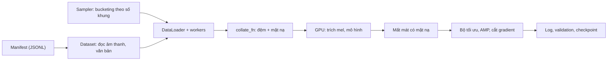

# Chương 6. PyTorch cho xử lý tiếng nói

!!! abstract "Mục tiêu học tập"
    Sau chương này, bạn có thể:

    - **Quản lý** tensor, thiết bị và kiểu dữ liệu; **phân biệt** tham số, buffer và `state_dict`, và nạp checkpoint giữa các môi trường (DDP, `torch.compile`, weight norm).
    - **Đọc/ghi** âm thanh bằng `soundfile`, **tái lấy mẫu** và **trích xuất** mel-spectrogram bằng `torchaudio`, đồng thời **chẩn đoán** sai khác giữa `torchaudio` và `librosa`.
    - **Thiết kế** `Dataset`/`DataLoader` cho dữ liệu độ dài thay đổi: `collate_fn` với padding, mặt nạ độ dài, mất mát có mặt nạ, bucketing theo ngân sách khung.
    - **Tổ chức** vòng huấn luyện của một dự án TTS: cấu hình, logging, validation, lưu và **resume chính xác** từ checkpoint.
    - **Áp dụng** AMP, `torch.compile` và DDP với `torchrun`; **nhận biết** các bẫy thường gặp của từng công cụ.
    - **Chẩn đoán** nút thắt hiệu năng và bộ nhớ bằng profiler; **thiết lập** tính tái lập của thí nghiệm.

!!! info "Kiến thức cần có"
    - [Chương 2](ch02-hoc-may-va-mang-no-ron.md) và [Chương 3](ch03-toi-uu-va-ky-thuat-huan-luyen.md): vòng huấn luyện, AdamW, lịch tốc độ học, độ chính xác hỗn hợp, cắt gradient, EMA.
    - [Chương 4](ch04-cnn-rnn-mo-hinh-chuoi.md) và [Chương 5](ch05-transformer.md): `Conv1d`, RNN, attention, mặt nạ.
    - Biết sơ lược mel-spectrogram là gì; chi tiết toán học nằm ở [Chương 14](../phan-3-tin-hieu-ngu-am/ch14-xu-ly-tin-hieu-so.md).
    - Các khối mã **chạy tuần tự như một notebook** trên CPU (PyTorch 2.x, `torchaudio`, `soundfile`, `librosa`); riêng ví dụ DDP chạy bằng `torchrun` và được ghi chú rõ.

Bốn chương trước trang bị cho bạn toán học và kiến trúc. Chương này lo phần "đường ống nước": làm sao đưa hàng chục nghìn đoạn âm thanh dài ngắn khác nhau vào GPU một cách hiệu quả, làm sao để một lần huấn luyện kéo dài nhiều ngày có thể dừng và chạy tiếp mà không sai lệch, làm sao biết chương trình đang chậm ở đâu. Đây là những kỹ năng ít được dạy nhưng quyết định phần lớn thời gian của một kỹ sư TTS. Chúng ta sẽ xây dựng từng mảnh của một **đường ống dữ liệu và huấn luyện kiểu TTS thu nhỏ** — dữ liệu giả, mô hình đồ chơi, nhưng cấu trúc giống hệt các dự án thật ở [Phần X](../phan-10-du-an/du-an-2-fastspeech2-hifigan.md).



## 6.1 Tensor, thiết bị và kiểu dữ liệu

### 6.1.1 Bố cục và bộ nhớ

Một tensor PyTorch là một vùng nhớ liên tục cộng với **hình dạng** (*shape*) và **bước nhảy** (*stride*) cho biết cách đọc vùng nhớ đó. `transpose` và `permute` chỉ đổi stride, không chép dữ liệu, nên kết quả thường **không liên tục** (*non-contiguous*); `view` đòi hỏi tensor liên tục, còn `reshape` tự chép khi cần. Trong TTS bạn sẽ chuyển qua lại liên tục giữa bố cục `(B, T, F)` (cách lưu mel, cách Transformer làm việc) và `(B, F, T)` (cách `Conv1d` làm việc), nên hãy nắm chắc điểm này.

### 6.1.2 Kiểu dữ liệu

| Kiểu | Dùng cho | Ghi chú |
|---|---|---|
| `float32` | Mặc định cho tham số, đặc trưng, mất mát | An toàn nhất |
| `float16` | Tính toán với AMP trên GPU | Giá trị lớn nhất 65 504; số rất nhỏ bị làm tròn về 0, cần *loss scaling* |
| `bfloat16` | Tính toán với AMP trên GPU đời mới | Cùng dải giá trị với `float32` nhưng ít bit định trị hơn; thường không cần loss scaling |
| `int64` (`long`) | ID token văn bản, chỉ số | `nn.Embedding` và `cross_entropy` cần kiểu này |
| `int16` | Âm thanh PCM 16-bit trên đĩa | Chia cho 32 768 để được số thực trong $[-1, 1)$ |
| `bool` | Mặt nạ | Chú ý quy ước True/False của từng API ([Chương 5](ch05-transformer.md)) |

[Chương 3](ch03-toi-uu-va-ky-thuat-huan-luyen.md) giải thích vì sao fp16 cần loss scaling còn bf16 thì thường không; mã dưới đây cho thấy trực tiếp: $10^{-8}$ bị làm tròn về 0 ở fp16 nhưng vẫn biểu diễn được ở bf16.

```python
import math
import os
import random
import numpy as np
import torch
import torch.nn as nn
import torch.nn.functional as F

# PCM 16-bit -> số thực trong [-1, 1)
pcm = np.array([0, 16384, -32768, 32767], dtype=np.int16)
wav = torch.from_numpy(pcm).float() / 32768.0
print(wav.tolist())                                # [0.0, 0.5, -1.0, 0.99997]

mel = torch.randn(4, 200, 80)                      # (B, T, F): bố cục hay dùng để lưu trữ
x = mel.transpose(1, 2)                            # (B, F, T): bố cục của Conv1d
print("Liên tục sau transpose?", x.is_contiguous())  # False: chỉ đổi stride, không chép dữ liệu
try:
    x.view(4, -1)
except RuntimeError as e:
    print("view lỗi:", str(e)[:50], "...")
y = x.reshape(4, -1)                               # reshape tự chép khi cần (hoặc .contiguous().view)

device = "cuda" if torch.cuda.is_available() else "cpu"
ids = torch.tensor([[3, 7, 1]])                    # ID token: int64
print(ids.dtype, torch.finfo(torch.float16).max, torch.finfo(torch.bfloat16).max)
print(torch.tensor(1e-8, dtype=torch.float16).item(), torch.tensor(1e-8, dtype=torch.bfloat16).item())
```

Về thiết bị: dùng `tensor.to(device, non_blocking=True)` cùng với `pin_memory=True` ở `DataLoader` để việc chép từ CPU sang GPU chạy song song với tính toán. Tránh các thao tác buộc CPU chờ GPU (*synchronization*) trong vòng lặp nóng: `loss.item()`, `print(tensor)`, `tensor.cpu()`, hay lấy `int(lengths.max())` từ một tensor nằm trên GPU. Mỗi lần như vậy, hàng đợi GPU bị "xả" và bạn mất tính song song.

## 6.2 `nn.Module`, tham số, buffer và `state_dict`

Một `nn.Module` là một cây các module con. Nó sở hữu hai loại tensor:

- **Tham số** (`nn.Parameter`): được bộ tối ưu cập nhật, có gradient.
- **Buffer** (`register_buffer`): là trạng thái nhưng **không** được học bằng gradient — ví dụ ma trận filterbank mel, cửa sổ Hann, thống kê chạy của BatchNorm, trung bình/độ lệch chuẩn để chuẩn hóa mel. Buffer đi theo module khi gọi `.to(device)` và `.half()`.

Buffer có thể đánh dấu `persistent=False`: khi đó nó **không** được ghi vào `state_dict`. Đây là lựa chọn đúng cho những thứ **tính lại được từ cấu hình** (filterbank, cửa sổ): checkpoint nhỏ hơn, và quan trọng hơn, đổi cách tính filterbank về sau không làm hỏng việc nạp checkpoint cũ. Ngược lại, thống kê chuẩn hóa ước lượng từ dữ liệu thì **phải** được lưu.

`state_dict()` là một từ điển có thứ tự `tên → tensor`. Tên phản ánh vị trí trong cây module (`encoder.layers.0.attn.w_q.weight`). Ba tình huống làm tên bị đổi mà bạn sẽ gặp:

1. **DDP** bọc mô hình, mọi khóa có thêm tiền tố `module.`.
2. **`torch.compile`** trả về một module bọc, khóa có tiền tố `_orig_mod.`.
3. **Weight normalization** — dùng nhiều trong vocoder GAN ([Chương 25](../phan-6-vocoder/ch25-gan-vocoder.md)). Bản mới `torch.nn.utils.parametrizations.weight_norm` lưu hai khóa `parametrizations.weight.original0` (độ lớn $g$) và `original1` (hướng $\mathbf{v}$), khác với bản cũ `torch.nn.utils.weight_norm` lưu `weight_g`, `weight_v`. Checkpoint HiFi-GAN công khai từ vài năm trước thường dùng kiểu cũ; khi nạp vào mã mới, bạn cần ánh xạ lại tên khóa.

Một quy tắc đơn giản tránh được phần lớn rắc rối: **luôn lưu `state_dict` của mô hình gốc** (`model.module` với DDP, mô hình chưa compile), và khi nạp thì bóc các tiền tố thừa.

```python
import torchaudio

class LogMel(nn.Module):
    """Trích log-mel như một module: filterbank và cửa sổ là buffer (đi theo .to(device))."""
    def __init__(self, sr=22050, n_fft=1024, hop=256, n_mels=80, f_max=8000.0):
        super().__init__()
        self.n_fft, self.hop = n_fft, hop
        fb = torchaudio.functional.melscale_fbanks(
            n_freqs=n_fft // 2 + 1, f_min=0.0, f_max=f_max, n_mels=n_mels,
            sample_rate=sr, norm="slaney", mel_scale="slaney")         # (n_freqs, F)
        self.register_buffer("fb", fb, persistent=False)               # không lưu vào checkpoint
        self.register_buffer("window", torch.hann_window(n_fft), persistent=False)

    def forward(self, wav):                                            # wav: (B, L)
        with torch.autocast(device_type=wav.device.type, enabled=False):   # STFT luôn ở fp32
            spec = torch.stft(wav.float(), self.n_fft, self.hop, window=self.window,
                              center=True, pad_mode="reflect", return_complex=True).abs()  # (B, n_freqs, T)
            mel = (spec.transpose(1, 2) @ self.fb).transpose(1, 2)    # (B, F, T)
            return torch.log(mel.clamp(min=1e-5))

class TinyAcoustic(nn.Module):
    def __init__(self):
        super().__init__()
        self.frontend = LogMel()
        self.conv = nn.Conv1d(80, 80, 3, padding=1)
        self.register_buffer("mel_mean", torch.zeros(80, 1))            # thống kê chuẩn hóa: CẦN lưu

    def forward(self, wav):
        return self.conv(self.frontend(wav) - self.mel_mean)           # (B, F, T)

m = TinyAcoustic()
print("Tham số:", [n for n, _ in m.named_parameters()])
print("Buffer :", [n for n, _ in m.named_buffers()])
print("state_dict:", list(m.state_dict().keys()))   # không có fb, window
assert m(torch.randn(2, 22050)).shape == (2, 80, 87)  # T = 1 + 22050 // 256

def strip_prefixes(state_dict, prefixes=("module.", "_orig_mod.")):
    """Bỏ tiền tố do DDP ('module.') và torch.compile ('_orig_mod.') thêm vào tên khóa."""
    out = {}
    for k, v in state_dict.items():
        changed = True
        while changed:
            changed = False
            for p in prefixes:
                if k.startswith(p):
                    k, changed = k[len(p):], True
        out[k] = v
    return out

compiled = torch.compile(m)                       # chưa biên dịch thật cho tới lần gọi đầu
print("Khóa sau torch.compile:", list(compiled.state_dict().keys())[:1])
fresh = TinyAcoustic()
fresh.load_state_dict(strip_prefixes(compiled.state_dict()))   # strict=True mặc định: phải khớp đủ

# weight_norm kiểu mới (parametrizations) đổi tên khóa trong state_dict
from torch.nn.utils.parametrizations import weight_norm
from torch.nn.utils.parametrize import remove_parametrizations
wn = weight_norm(nn.Conv1d(4, 4, 3))
print("Khóa weight_norm:", list(wn.state_dict().keys()))
remove_parametrizations(wn, "weight")             # gộp g, v thành weight thường khi suy luận/xuất
print("Sau khi gỡ      :", list(wn.state_dict().keys()))
```

Hai chi tiết khác của `nn.Module` hay gây lỗi:

- **Chế độ huấn luyện và đánh giá.** `model.train()` bật dropout và cho BatchNorm cập nhật thống kê; `model.eval()` làm ngược lại. Quên `eval()` khi validation cho kết quả nhiễu và — với BatchNorm — làm hỏng thống kê chạy. Lưu ý riêng cho Tacotron 2: pre-net của nó cố ý giữ dropout cả khi suy luận, nên phải dùng `F.dropout(x, p, training=True)` thay vì `nn.Dropout` ([Chương 20](../phan-5-mo-hinh-am-hoc/ch20-tacotron.md)).
- **Đóng băng tham số** khi fine-tune: `p.requires_grad_(False)` cho phần cần giữ nguyên, và chỉ đưa các tham số còn học vào bộ tối ưu. Kiểm tra lại bằng cách đếm số tham số có `requires_grad`.

## 6.3 Âm thanh: đọc/ghi, tái lấy mẫu và mel-spectrogram

### 6.3.1 Đọc và ghi tệp âm thanh

Với WAV và FLAC, thư viện `soundfile` (dựa trên libsndfile) là lựa chọn đơn giản và ổn định:

- `sf.read(path, dtype="float32", always_2d=True)` trả về mảng NumPy hình dạng `(L, C)` — **mẫu trước, kênh sau** — và tần số lấy mẫu. PyTorch/torchaudio quen dùng `(C, L)`, nên nhớ chuyển vị.
- `sf.write(path, data, sr, subtype="PCM_16")` ghi tệp; `subtype` quyết định độ sâu bit (`PCM_16`, `PCM_24`, `FLOAT`).
- `sf.info(path)` đọc tần số lấy mẫu, số kênh, số mẫu **mà không đọc dữ liệu** — rất tiện khi lập manifest cho hàng trăm nghìn tệp.

!!! warning "API đọc/ghi âm thanh của torchaudio đã thay đổi"
    Từ khoảng phiên bản 2.9, `torchaudio.load` và `torchaudio.save` dựa vào thư viện **TorchCodec** để giải mã/mã hóa, và một số tham số cũ (như `backend`, `normalize`) chỉ còn được giữ để tương thích ngược (theo tài liệu của chính hàm trong phiên bản được dùng để kiểm thử chương này). Mã cũ trên mạng có thể không chạy, hoặc chạy nhưng cần cài thêm TorchCodec. Vì thế sách này dùng `soundfile` cho I/O và chỉ dùng `torchaudio` cho xử lý tín hiệu (`functional`, `transforms`). Hãy kiểm tra tài liệu của phiên bản bạn cài: `help(torchaudio.load)`.

### 6.3.2 Tái lấy mẫu

Dữ liệu TTS thường được thu ở 44,1 hoặc 48 kHz rồi hạ xuống tần số mô hình dùng (thường 16, 22,05 hoặc 24 kHz). `torchaudio.functional.resample` dùng nội suy sinc có cửa sổ, với các tham số như `lowpass_filter_width` và `rolloff` điều khiển chất lượng bộ lọc chống chồng phổ ([Chương 14](../phan-3-tin-hieu-ngu-am/ch14-xu-ly-tin-hieu-so.md)). Nếu tái lấy mẫu nhiều tệp với cùng cặp tần số, `torchaudio.transforms.Resample` tính sẵn nhân lọc một lần và dùng lại. Nguyên tắc thực hành: **tái lấy mẫu một lần, ngoại tuyến**, trong khâu tiền xử lý — đừng làm việc này trong `__getitem__` ở mỗi epoch.

### 6.3.3 Mel-spectrogram trên GPU

`torchaudio.transforms.MelSpectrogram` gói STFT + filterbank mel thành một `nn.Module` chạy được trên GPU theo batch. Các tham số quan trọng: `sample_rate`, `n_fft`, `win_length`, `hop_length`, `f_min`, `f_max`, `n_mels`, `power` (1 cho biên độ, 2 cho năng lượng), `center`, `pad_mode`, và hai tham số hay bị bỏ quên: `mel_scale` (`"htk"` hay `"slaney"`) và `norm` (`None` hay `"slaney"`).

**Cái bẫy kinh điển:** giá trị mặc định của `torchaudio` (thang HTK, không chuẩn hóa diện tích, đệm `reflect`) **khác** `librosa` (thang Slaney, chuẩn hóa `"slaney"`, đệm `constant` trong các phiên bản gần đây). Một vocoder huấn luyện trên mel tính bằng thư viện này sẽ cho âm thanh méo nếu nhận mel tính bằng thư viện kia — dù hình dạng tensor giống hệt nhau. [Chương 14](../phan-3-tin-hieu-ngu-am/ch14-xu-ly-tin-hieu-so.md) phân tích chi tiết các công thức; ở đây ta chỉ kiểm chứng bằng số.

```python
import soundfile as sf
import librosa
import torchaudio.transforms as AT

# Ghi một tệp stereo 24 kHz rồi đọc lại
sr = 24000
t = np.arange(int(0.5 * sr)) / sr
tone = (0.5 * np.sin(2 * np.pi * 220 * t)).astype(np.float32)
sf.write("demo.wav", np.stack([tone, 0.5 * tone], axis=1), sr, subtype="PCM_16")   # (L, 2)
info = sf.info("demo.wav")
print(info.samplerate, info.channels, info.subtype, info.frames)
data, sr_read = sf.read("demo.wav", dtype="float32", always_2d=True)    # (L, C)
x = torch.from_numpy(data.T).mean(0, keepdim=True)                      # (1, L): trộn về mono
x22 = torchaudio.functional.resample(x, orig_freq=24000, new_freq=22050)  # (1, L')
print(x.shape, "->", x22.shape)

# So sánh mel của torchaudio và librosa
torch.manual_seed(0)
y = x22 + 0.01 * torch.randn_like(x22)            # thêm chút nhiễu để mọi bin đều có năng lượng
cfg = dict(sample_rate=22050, n_fft=1024, win_length=1024, hop_length=256, n_mels=80,
           f_min=0.0, f_max=8000.0, power=1.0)
mel_ta_default = AT.MelSpectrogram(**cfg)(y)      # mặc định: mel_scale="htk", norm=None, pad "reflect"
mel_ta_slaney = AT.MelSpectrogram(**cfg, mel_scale="slaney", norm="slaney", pad_mode="constant")(y)
mel_lr = librosa.feature.melspectrogram(          # mặc định: thang Slaney, norm="slaney", pad "constant"
    y=y[0].numpy(), sr=22050, n_fft=1024, hop_length=256, win_length=1024,
    n_mels=80, fmin=0.0, fmax=8000.0, power=1.0)
mel_lr = torch.from_numpy(mel_lr)[None]           # (1, F, T)
print("Hình dạng:", tuple(mel_ta_default.shape), tuple(mel_lr.shape))   # T = 1 + L // hop
log = lambda m: torch.log(m.clamp(min=1e-5))
print("Sai lệch log-mel, cấu hình mặc định:", (log(mel_ta_default) - log(mel_lr)).abs().max().item())
print("Sai lệch log-mel, cấu hình khớp    :", (log(mel_ta_slaney) - log(mel_lr)).abs().max().item())
```

Với cấu hình mặc định, log-mel lệch nhau tới khoảng 10 đơn vị (tức là gấp hàng nghìn lần về biên độ ở một số bin); khi khớp đủ ba tham số, sai lệch chỉ còn cỡ $10^{-5}$. Bài học: **ghi toàn bộ cấu hình mel vào tệp cấu hình và vào checkpoint**, và viết một kiểm thử so sánh mel của mô hình âm học với mel mà vocoder mong đợi.

Hai lựa chọn kiến trúc cho việc trích mel:

- **Tính trước** (*precompute*) và lưu `.npy`: tiết kiệm tính toán mỗi epoch, nhưng tốn đĩa và cứng nhắc (đổi cấu hình là phải tính lại).
- **Tính trực tiếp trên GPU** trong bước huấn luyện, như module `LogMel` ở mục 6.2: linh hoạt, cho phép tăng cường dữ liệu trên dạng sóng, và với GPU hiện đại chi phí STFT thường nhỏ so với mô hình. Khi đó hãy giữ STFT ở **fp32** (như trong `LogMel`): nhiều phép FFT ở fp16 có hạn chế về kích thước và độ chính xác, và mel dùng làm **đích** huấn luyện cần chính xác.

Vocoder GAN (HiFi-GAN và họ hàng) thường tính mel bằng hàm riêng với các quy ước riêng (ví dụ đệm `(n_fft - hop) / 2` mẫu rồi `center=False`); khi dùng lại một vocoder có sẵn, hãy sao chép **đúng** hàm trích mel của nó ([Chương 26](../phan-6-vocoder/ch26-diffusion-vocoder-va-so-sanh.md)).

!!! note "Góc tiếng Việt"
    - **Tên tệp có dấu.** Tên tệp kiểu `xin_chào.wav` có thể được hệ thống tệp hoặc công cụ đồng bộ trả về ở dạng NFD thay vì NFC (đã gặp trên macOS và khi giải nén các tệp nén tạo trên hệ điều hành khác). Khi đó đường dẫn trong manifest (NFC) không khớp với tên trên đĩa, và lỗi chỉ xuất hiện ở một phần dữ liệu. Hãy đặt tên tệp âm thanh bằng **ID ASCII** (`spk01_000123.wav`) và để văn bản tiếng Việt trong manifest.
    - **Văn bản trong manifest** phải được chuẩn hóa NFC và qua cùng một bộ chuẩn hóa văn bản sẽ dùng khi suy luận ([Chương 17](../phan-4-frontend/ch17-chuan-hoa-van-ban.md)). Một kiểm thử nhỏ `assert unicodedata.normalize("NFC", s) == s` khi nạp manifest giúp bắt lỗi sớm.

## 6.4 `Dataset` và `DataLoader` cho dữ liệu độ dài thay đổi

### 6.4.1 Manifest và `Dataset`

Dữ liệu TTS thường được mô tả bằng một **manifest**: mỗi dòng một mẫu, dạng JSON Lines:

```json
{"id": "spk01_000123", "audio": "wavs/spk01_000123.wav", "text": "xin chào các bạn", "duration": 1.84, "speaker": "spk01"}
```

Trường `duration` (tính sẵn bằng `sf.info`) cho phép lọc và bucketing **mà không cần mở tệp âm thanh**. Một `Dataset` kiểu map chỉ cần `__len__` và `__getitem__(i)` trả về một mẫu — thường là một từ điển các tensor có độ dài khác nhau. Để các ví dụ chạy được ở mọi nơi, ta dùng một bộ dữ liệu **giả** mô phỏng đúng thống kê quan trọng nhất: số khung mel tỷ lệ (gần đúng) với số token văn bản.

### 6.4.2 `collate_fn`: đệm và mặt nạ

`DataLoader` gom các mẫu thành batch bằng `collate_fn`. Hàm mặc định chỉ xếp chồng các tensor **cùng hình dạng**, nên với dữ liệu tiếng nói ta phải tự viết: đệm mọi chuỗi tới độ dài lớn nhất trong batch, trả về độ dài thật và **mặt nạ** (*mask*) cho biết vị trí nào hợp lệ. Hai quyết định nhỏ nhưng quan trọng:

- **Giá trị đệm.** Với ID token, dùng một ID dành riêng (thường là 0, khớp với `padding_idx` của `nn.Embedding`). Với log-mel, đệm bằng giá trị tương ứng với "im lặng" — ví dụ $\log(10^{-5}) \approx -11{,}5$ nếu bạn kẹp biên độ tại $10^{-5}$ trước khi lấy log — thay vì 0, vì 0 trong miền log là một mức năng lượng khá lớn. Nếu mọi mất mát và phép gộp đều dùng mặt nạ thì giá trị đệm về lý thuyết không quan trọng; nhưng các lớp tích chập vẫn "nhìn thấy" vùng đệm ở biên, nên một giá trị hợp lý giảm sai khác giữa huấn luyện và suy luận.
- **Mất mát có mặt nạ.** Mất mát phải là **trung bình trên các phần tử hợp lệ**, không phải trung bình trên cả tensor đã đệm. Nếu không, câu ngắn trong batch có nhiều phần đệm sẽ bị "pha loãng", và giá trị mất mát phụ thuộc vào câu dài nhất mà nó tình cờ được xếp cùng.

```python
from torch.utils.data import Dataset, DataLoader, Sampler

class FakeTTSDataset(Dataset):
    """Dữ liệu giả kiểu TTS: chuỗi token văn bản + log-mel có độ dài tương quan."""
    def __init__(self, n_items=400, n_mels=80, vocab=60, seed=0):
        g = torch.Generator().manual_seed(seed)
        self.n_mels, self.vocab = n_mels, vocab
        self.text_lens = torch.randint(5, 120, (n_items,), generator=g)          # N_i
        rate = 5 + 3 * torch.rand(n_items, generator=g)                           # khung/token
        self.mel_lens = (self.text_lens * rate).long()                            # T_i
        self.seeds = torch.randint(0, 2**31 - 1, (n_items,), generator=g)

    def __len__(self):
        return len(self.text_lens)

    def __getitem__(self, i):
        g = torch.Generator().manual_seed(int(self.seeds[i]))   # mẫu i luôn giống nhau
        n, t = int(self.text_lens[i]), int(self.mel_lens[i])
        return {"id": i,
                "text": torch.randint(1, self.vocab, (n,), generator=g),          # (N,), 0 = PAD
                "mel": torch.randn(t, self.n_mels, generator=g)}                 # (T, F)

def sequence_mask(lengths, max_len=None):
    """(B,) -> (B, max_len) bool, True tại vị trí hợp lệ."""
    max_len = max_len or int(lengths.max())
    return torch.arange(max_len, device=lengths.device)[None] < lengths[:, None]

MEL_PAD = math.log(1e-5)          # log-mel của "im lặng" — giá trị đệm hợp lý cho log-mel

def tts_collate(batch):
    text_lens = torch.tensor([b["text"].shape[0] for b in batch])
    mel_lens = torch.tensor([b["mel"].shape[0] for b in batch])
    B, N, T, F = len(batch), int(text_lens.max()), int(mel_lens.max()), batch[0]["mel"].shape[1]
    text = torch.zeros(B, N, dtype=torch.long)                    # (B, N)
    mel = torch.full((B, T, F), MEL_PAD)                          # (B, T, F)
    for i, b in enumerate(batch):
        text[i, : text_lens[i]] = b["text"]
        mel[i, : mel_lens[i]] = b["mel"]
    return {"ids": torch.tensor([b["id"] for b in batch]),
            "text": text, "text_lens": text_lens, "text_mask": sequence_mask(text_lens, N),
            "mel": mel, "mel_lens": mel_lens, "mel_mask": sequence_mask(mel_lens, T)}

def masked_l1(pred, target, mask):
    """L1 trung bình chỉ trên các khung hợp lệ. pred, target: (B, T, F); mask: (B, T)."""
    m = mask[..., None].to(pred.dtype)                            # (B, T, 1)
    return ((pred - target).abs() * m).sum() / (m.sum() * pred.shape[-1]).clamp(min=1)

ds = FakeTTSDataset()
batch = tts_collate([ds[i] for i in range(4)])
print({k: tuple(v.shape) for k, v in batch.items()})
assert batch["mel_mask"].sum() == batch["mel_lens"].sum()
# Mất mát có mặt nạ không phụ thuộc vào giá trị đệm
pred = torch.randn_like(batch["mel"])
l1 = masked_l1(pred, batch["mel"], batch["mel_mask"])
batch["mel"][~batch["mel_mask"]] = 123.0
assert torch.isclose(l1, masked_l1(pred, batch["mel"], batch["mel_mask"]))
```

### 6.4.3 Bucketing và batch động theo số khung

**Vấn đề.** Nếu gom batch ngẫu nhiên, mỗi batch chứa cả câu 1 giây lẫn câu 15 giây; phần lớn bộ nhớ và tính toán dành cho phần đệm. Có thể ước lượng: giả sử độ dài phân phối đều trên $[0, \ell_{\max}]$ và batch có $B$ mẫu. Kỳ vọng của độ dài lớn nhất trong $B$ mẫu đều là $\tfrac{B}{B+1}\ell_{\max}$, còn độ dài trung bình là $\tfrac{1}{2}\ell_{\max}$. Hiệu suất (tỷ lệ phần tử thật trên tổng phần tử sau đệm) xấp xỉ

$$
\frac{\tfrac{1}{2}\ell_{\max}}{\tfrac{B}{B+1}\ell_{\max}} = \frac{B+1}{2B} \xrightarrow{B \to \infty} 50\%.
$$

Tức là gần **một nửa** tính toán bị phí với batch lớn.

**Giải pháp: bucketing.** Gom các mẫu có độ dài **gần nhau** vào cùng batch. Thêm một cải tiến quan trọng cho TTS: thay vì cố định **số mẫu** mỗi batch, cố định **ngân sách khung** — mỗi batch thỏa $\ell_{\max}^{\text{batch}} \times B \le$ `max_frames`. Batch câu ngắn sẽ có nhiều mẫu, batch câu dài có ít mẫu, và bộ nhớ GPU dùng gần như **không đổi** giữa các batch (giảm nguy cơ hết bộ nhớ đột ngột ở một batch toàn câu dài).

Vài lựa chọn thiết kế của sampler dưới đây:

- **Xáo trộn trước, sắp xếp trong từng "thùng"** cỡ `bucket_size` mẫu, rồi xáo thứ tự các batch: cân bằng giữa ít đệm (sắp xếp) và tính ngẫu nhiên (xáo trộn). Nếu sắp xếp toàn cục, các batch giống hệt nhau mỗi epoch — kém ngẫu nhiên hơn.
- **Thứ tự chỉ phụ thuộc vào `(seed, epoch)`** — dùng một `random.Random` riêng thay vì RNG toàn cục. Nhờ vậy khi resume ta không cần lưu trạng thái RNG của sampler, chỉ cần biết epoch và số batch đã dùng.
- **Hỗ trợ DDP**: mỗi tiến trình (*rank*) lấy một phần các batch, và mọi rank có **cùng số batch**. Nếu không, rank nào hết dữ liệu trước sẽ đứng chờ all-reduce mãi mãi — chương trình treo mà không báo lỗi.

```python
class FrameBudgetBucketSampler(Sampler):
    """Batch sampler theo "ngân sách khung": gom mẫu có độ dài gần nhau, mỗi batch thỏa
    max_len * batch_size <= max_frames. Thứ tự chỉ phụ thuộc (seed, epoch) nên resume không
    cần lưu trạng thái RNG. Hỗ trợ DDP: mọi rank nhận CÙNG số batch, không trùng mẫu."""
    def __init__(self, lengths, max_frames, bucket_size=100, num_replicas=1, rank=0, seed=0):
        self.lengths, self.max_frames, self.bucket_size = list(lengths), max_frames, bucket_size
        self.num_replicas, self.rank, self.seed = num_replicas, rank, seed
        self.epoch, self.start = 0, 0

    def set_epoch(self, epoch, start_batch=0):    # start_batch > 0: resume giữa epoch
        self.epoch, self.start = epoch, start_batch

    def _batches(self):
        rng = random.Random(self.seed * 100_003 + self.epoch)
        idx = list(range(len(self.lengths)))
        rng.shuffle(idx)                                  # xáo trước: thùng khác nhau mỗi epoch
        batches = []
        for s in range(0, len(idx), self.bucket_size):
            bucket = sorted(idx[s:s + self.bucket_size], key=lambda i: self.lengths[i])
            cur, cur_max = [], 0
            for i in bucket:
                L = self.lengths[i]
                if cur and max(cur_max, L) * (len(cur) + 1) > self.max_frames:
                    batches.append(cur)
                    cur, cur_max = [], 0
                cur.append(i)
                cur_max = max(cur_max, L)
            if cur:
                batches.append(cur)
        rng.shuffle(batches)                              # xáo thứ tự các batch
        n = len(batches) // self.num_replicas * self.num_replicas   # cắt cho chia hết số rank
        return batches[self.rank:n:self.num_replicas]

    def __iter__(self):
        return iter(self._batches()[self.start:])

    def __len__(self):
        return len(self._batches()) - self.start

def padding_efficiency(batches, lengths):
    real = sum(lengths[i] for b in batches for i in b)
    padded = sum(max(lengths[i] for i in b) * len(b) for b in batches)
    return real / padded

lengths = ds.mel_lens.tolist()
sampler = FrameBudgetBucketSampler(lengths, max_frames=8000)
bucketed = list(sampler)
rand_idx = torch.randperm(len(ds), generator=torch.Generator().manual_seed(0)).tolist()
random_batches = [rand_idx[i:i + 16] for i in range(0, len(rand_idx), 16)]
print(f"Ngẫu nhiên, 16 mẫu/batch   : hiệu suất {padding_efficiency(random_batches, lengths):.1%}")
print(f"Bucket theo ngân sách khung: hiệu suất {padding_efficiency(bucketed, lengths):.1%}, "
      f"{len(bucketed)} batch, cỡ batch từ {min(map(len, bucketed))} đến {max(map(len, bucketed))}")
assert all(max(lengths[i] for i in b) * len(b) <= 8000 or len(b) == 1 for b in bucketed)

# DDP: hai rank có cùng số batch và không trùng mẫu
r0 = FrameBudgetBucketSampler(lengths, 8000, num_replicas=2, rank=0)
r1 = FrameBudgetBucketSampler(lengths, 8000, num_replicas=2, rank=1)
assert len(r0) == len(r1)
assert not set(sum(list(r0), [])) & set(sum(list(r1), []))

loader = DataLoader(ds, batch_sampler=sampler, collate_fn=tts_collate,
                    num_workers=2, pin_memory=torch.cuda.is_available(), persistent_workers=True)
for epoch in range(2):
    sampler.set_epoch(epoch)                      # thứ tự mới mỗi epoch, tái lập được
    n_frames = sum(int(b["mel_lens"].sum()) for b in loader)
    print(f"epoch {epoch}: {n_frames} khung hợp lệ")
```

Trên dữ liệu giả, gom ngẫu nhiên 16 mẫu cho hiệu suất khoảng 51% — rất gần ước lượng lý thuyết $(B+1)/(2B) \approx 53\%$ — còn bucketing theo ngân sách khung đạt khoảng 85%, với cỡ batch thay đổi từ vài mẫu (câu dài) tới vài chục mẫu (câu ngắn). Với dữ liệu thật, phân phối độ dài thường lệch (nhiều câu ngắn–trung bình, ít câu rất dài), nhưng mức cải thiện tương tự là điều thường thấy.

!!! note "Góc tiếng Việt"
    Hãy bucketing theo **số khung âm thanh** (tính từ `duration`), không theo độ dài văn bản. Số ký tự của một câu tiếng Việt tương quan khá lỏng với thời lượng: dấu thanh và dấu phụ không làm tăng thời lượng, các chữ ghép như "ngh", "ch", "tr" là một âm, còn tốc độ đọc và chỗ ngừng thay đổi theo người nói và thể loại (tin tức, truyện, hội thoại). Nếu cần một đại lượng từ văn bản (ví dụ để lọc dữ liệu bất thường), **số âm tiết** là ước lượng tốt hơn số ký tự; một mẫu có tỷ lệ "giây trên âm tiết" quá xa trung vị thường là dấu hiệu bản ghi lệch văn bản ([Chương 36](../phan-9-thuc-tien/ch36-du-lieu-tts.md)).

### 6.4.4 Các tham số của `DataLoader` và RNG trong worker

- `num_workers`: số tiến trình con đọc và tiền xử lý dữ liệu song song. Bắt đầu với số lõi CPU dành cho mỗi GPU (thường 4–8) và đo: nếu GPU thường xuyên "đói" (xem mục 6.8), tăng lên.
- `pin_memory=True`: đặt batch vào bộ nhớ khóa trang để chép sang GPU nhanh và bất đồng bộ (dùng kèm `non_blocking=True`).
- `persistent_workers=True`: giữ các worker sống giữa các epoch, tránh chi phí khởi tạo lại (đáng kể khi `Dataset` nạp manifest lớn).
- `prefetch_factor`: số batch mỗi worker chuẩn bị trước.

Khi dùng `batch_sampler`, sampler chạy trong **tiến trình chính**, nên `set_epoch` có tác dụng ngay cả khi worker là persistent. Một bẫy liên quan đến số ngẫu nhiên trong worker: PyTorch cấp cho mỗi worker một seed khác nhau cho RNG của `torch`, `random` và (trong các phiên bản gần đây) cả RNG toàn cục của NumPy. Nhưng nếu `Dataset` **tự giữ một đối tượng RNG** tạo trong `__init__` — rất thường gặp với tăng cường dữ liệu — thì mọi worker được sao chép **cùng một trạng thái**, và các worker sinh ra cùng một chuỗi "ngẫu nhiên":

```python
from torch.utils.data import get_worker_info

class OwnRNG(Dataset):                            # SAI: RNG tạo trước khi tách worker
    def __init__(self):
        self.rng = np.random.default_rng(0)
    def __len__(self):
        return 8
    def __getitem__(self, i):
        return torch.tensor([i, self.rng.integers(1000)])

class LazyRNG(Dataset):                           # ĐÚNG: tạo RNG lần đầu bên trong worker
    def __init__(self):
        self.rng = None
    def __len__(self):
        return 8
    def __getitem__(self, i):
        if self.rng is None:                      # torch.initial_seed() khác nhau giữa các worker
            self.rng = np.random.default_rng(torch.initial_seed())
        return torch.tensor([i, self.rng.integers(1000)])

for cls in (OwnRNG, LazyRNG):
    vals = torch.cat(list(DataLoader(cls(), batch_size=1, num_workers=2)))[:, 1].tolist()
    print(f"{cls.__name__:7s}:", vals)            # OwnRNG: các giá trị lặp đôi một
```

Với `OwnRNG`, hai worker (mỗi worker xử lý xen kẽ một mẫu) cho ra từng cặp giá trị giống hệt nhau — "tăng cường dữ liệu" thực ra chỉ có một nửa số biến thể như bạn tưởng.

## 6.5 Cấu trúc một dự án huấn luyện TTS

### 6.5.1 Tổ chức mã và cấu hình

Một bố cục dự án gọn gàng, đủ dùng cho các dự án ở [Phần X](../phan-10-du-an/du-an-2-fastspeech2-hifigan.md):

```text
my_tts/
├── configs/            # cấu hình YAML: dữ liệu, đặc trưng âm thanh, mô hình, huấn luyện
├── data/               # manifest JSONL (train/val/test), thống kê chuẩn hóa
├── my_tts/
│   ├── audio.py        # đọc/ghi, tái lấy mẫu, trích mel (MỘT nơi duy nhất định nghĩa mel)
│   ├── text.py         # chuẩn hóa văn bản, G2P, bảng ký hiệu
│   ├── dataset.py      # Dataset, collate_fn, sampler
│   ├── model.py        # kiến trúc
│   └── train.py        # vòng huấn luyện, checkpoint, logging
├── scripts/            # tiền xử lý, suy luận, đánh giá
└── tests/              # kiểm thử hình dạng, mặt nạ, độ khớp mel
```

Cấu hình nên là **một nguồn sự thật duy nhất** (một `dataclass` hoặc tệp YAML), được **lưu vào mọi checkpoint**. Sáu tháng sau, khi muốn biết một checkpoint dùng `f_max` bao nhiêu hay bảng ký hiệu nào, bạn sẽ cảm ơn quyết định này.

### 6.5.2 Logging và validation với mẫu âm thanh

Cần ghi lại tối thiểu: mất mát huấn luyện từng thành phần, chuẩn gradient (trước khi cắt), tốc độ học, mất mát validation, và — quan trọng nhất với TTS — **mẫu âm thanh** cùng **hình ảnh** (mel dự đoán so với mel thật, ma trận căn chỉnh). Mất mát mel giảm đều không bảo đảm âm thanh nghe được; một lần nghe mất 10 giây có thể phát hiện lỗi mà nhìn đường cong mất mát cả ngày không thấy ([Chương 37](../phan-9-thuc-tien/ch37-huan-luyen-va-debug.md)). TensorBoard (`torch.utils.tensorboard.SummaryWriter`) có sẵn `add_scalar`, `add_audio`, `add_image`, `add_figure`; các công cụ quản lý thí nghiệm khác có API tương tự.

Mã dưới đây định nghĩa một lớp `Logger` mỏng (dùng TensorBoard nếu đã cài, nếu không thì in ra màn hình và ghi tệp WAV), một mô hình TTS đồ chơi, và hàm validation. Mô hình đồ chơi dùng một "bộ điều chỉnh độ dài" với **trường độ đều** — mỗi token chiếm số khung như nhau — chỉ để có một ánh xạ từ văn bản `(B, N)` sang mel `(B, T, F)`; bộ điều chỉnh độ dài thật dùng trường độ dự đoán được trình bày ở [Chương 22](../phan-5-mo-hinh-am-hoc/ch22-fastspeech.md).

```python
try:
    from torch.utils.tensorboard import SummaryWriter
except ImportError:                               # chưa cài tensorboard: in ra màn hình/ghi tệp
    SummaryWriter = None

class Logger:
    def __init__(self, log_dir, verbose=True):
        self.tb = SummaryWriter(log_dir) if SummaryWriter else None
        self.log_dir, self.verbose = log_dir, verbose
        os.makedirs(log_dir, exist_ok=True)

    def scalar(self, tag, value, step):
        if self.tb:
            self.tb.add_scalar(tag, value, step)
        elif self.verbose:
            print(f"[{step:5d}] {tag} = {value:.4f}")

    def audio(self, tag, wav, step, sr):          # wav: (L,) trong [-1, 1]
        if self.tb:
            self.tb.add_audio(tag, wav[None], step, sample_rate=sr)
        else:
            sf.write(os.path.join(self.log_dir, f"{tag.replace('/', '_')}_{step}.wav"), wav.numpy(), sr)

class TinyTTS(nn.Module):
    """Mô hình đồ chơi: embedding văn bản -> điều chỉnh độ dài với trường độ đều -> conv -> mel."""
    def __init__(self, vocab=60, d=64, n_mels=80):
        super().__init__()
        self.emb = nn.Embedding(vocab, d, padding_idx=0)
        self.enc = nn.Conv1d(d, d, 5, padding=2)
        self.dec = nn.Sequential(nn.Conv1d(d, d, 5, padding=2), nn.ReLU(), nn.Dropout(0.1),
                                 nn.Conv1d(d, n_mels, 1))

    def forward(self, text, text_lens, mel_lens):                   # text: (B, N)
        h = self.enc(self.emb(text).transpose(1, 2))                # (B, C, N)
        frame = torch.arange(int(mel_lens.max()), device=text.device)[None]                  # (1, T)
        idx = (frame * text_lens[:, None] // mel_lens[:, None]).clamp(max=text.shape[1] - 1)  # (B, T)
        h = h.gather(2, idx[:, None, :].expand(-1, h.shape[1], -1))  # (B, C, T)
        return self.dec(h).transpose(1, 2)                          # (B, T, F)

@torch.no_grad()
def validate(model, batches):
    was_training = model.training
    model.eval()                                  # tắt dropout; BatchNorm dùng thống kê chạy
    losses = [masked_l1(model(b["text"], b["text_lens"], b["mel_lens"]), b["mel"], b["mel_mask"])
              for b in batches]
    model.train(was_training)
    return torch.stack(losses).mean().item()
```

Khi validation cho một mô hình thật, hãy dùng một **tập câu cố định** (ghi ID vào cấu hình) để các mẫu âm thanh so sánh được giữa các checkpoint, gồm cả câu khó: câu rất dài, câu có số và từ viết tắt, câu hỏi, và với tiếng Việt là các cặp tối thiểu về thanh điệu ([Chương 38](../phan-9-thuc-tien/ch38-danh-gia-tts.md)). Với mô hình tự hồi quy, ghi cả kết quả teacher forcing **và** kết quả tự sinh ([Chương 4](ch04-cnn-rnn-mo-hinh-chuoi.md)).
