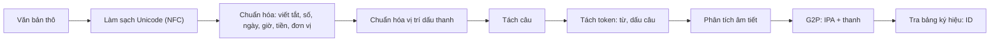

# Dự án 1. Frontend tiếng Việt

!!! abstract "Mục tiêu dự án"
    Sau dự án này, bạn sẽ có một gói Python thuần `code/vn_frontend/` biến văn bản tiếng Việt "thô" thành chuỗi ký hiệu sẵn sàng cho mọi mô hình TTS trong các dự án sau. Cụ thể, bạn sẽ:

    - **cài đặt** chuẩn hóa Unicode và chuẩn hóa vị trí dấu thanh (*hoà* → *hòa*), kèm phép làm sạch các ký tự "trông giống mà khác";
    - **cài đặt** bộ đọc số tiếng Việt chính xác tuyệt đối với các quy tắc *mười/mươi, mốt, tư/bốn, lăm/nhăm, linh/lẻ, không trăm, nghìn/triệu/tỷ*;
    - **xây dựng** bộ chuẩn hóa ngày tháng, giờ, tiền tệ, phần trăm, đơn vị, số điện thoại, viết tắt và từ viết tắt theo nguyên tắc "cụ thể trước, tổng quát sau";
    - **cài đặt** bộ phân tích âm tiết (âm đầu, âm đệm, âm chính, âm cuối, thanh điệu) và bộ G2P giọng Bắc sinh âm vị IPA cùng token thanh điệu;
    - **thiết kế** bảng ký hiệu ổn định làm "hợp đồng" giữa front-end và mô hình;
    - **viết** bộ kiểm thử `pytest` dạng bảng và kiểm thử tính chất (lũy đẳng, khứ hồi), rồi **mở rộng** hệ thống cho giọng Nam và từ mượn tiếng Anh.

!!! info "Kiến thức cần có"
    - [Chương 15. Ngữ âm và âm vị học tiếng Việt](../phan-3-tin-hieu-ngu-am/ch15-ngu-am-tieng-viet.md): cấu trúc âm tiết, hệ thống âm vị, sáu thanh, khác biệt phương ngữ.
    - [Chương 17. Chuẩn hóa văn bản tiếng Việt](../phan-4-frontend/ch17-chuan-hoa-van-ban.md): phân loại từ không chuẩn, các hướng tiếp cận chuẩn hóa.
    - [Chương 18. G2P và biểu diễn đầu vào](../phan-4-frontend/ch18-g2p-bieu-dien-dau-vao.md): lựa chọn đơn vị đầu vào, cách biểu diễn thanh điệu, thiết kế bảng ký hiệu.
    - Python ở mức khá: biểu thức chính quy (`re`), `dataclass`, `pytest`.

Ba chương trên trình bày *lý thuyết* và các đoạn mã minh họa ngắn. Dự án này gom tất cả lại thành một gói phần mềm thật: có cấu trúc mô-đun, có giao diện lập trình (API) ổn định, có giao diện dòng lệnh và gần hai trăm ca kiểm thử. Các dự án sau đều dùng gói này: [Dự án 2](du-an-2-fastspeech2-hifigan.md) lấy chuỗi ID làm đầu vào cho FastSpeech 2, [Dự án 3](du-an-3-vits-tieng-viet.md) dùng bảng ký hiệu cho VITS, [Dự án 4](du-an-4-zero-shot-tts.md) dùng phần chuẩn hóa cho mô hình đầu vào ký tự, và [Dự án 5](du-an-5-tts-service-streaming.md) dùng chuẩn hóa và tách câu trong dịch vụ streaming.

## 1. Bài toán và yêu cầu

### 1.1. Front-end làm gì, và vì sao nó quyết định chất lượng

Một hệ thống TTS hai giai đoạn kinh điển gồm **front-end** (xử lý văn bản) và **back-end** (mô hình âm học cộng vocoder). Người mới thường dồn toàn bộ sức lực vào back-end vì đó là phần "học sâu". Thực tế triển khai lại cho thấy một lượng lớn lỗi mà người nghe nhận ra ngay đến từ front-end: đọc "2/9" thành "hai phần chín" thay vì "hai tháng chín", đọc "VTV" thành một âm tiết vô nghĩa, đọc "1005" thành "một nghìn linh năm" (thiếu "không trăm"), hay đọc sai thanh vì văn bản chứa ký tự tổ hợp dạng NFD mà mô hình chưa từng thấy. Không mô hình âm học nào, dù lớn đến đâu, sửa được những lỗi này nếu chuỗi ký hiệu đưa vào đã sai.

Front-end của chúng ta nhận một chuỗi Unicode bất kỳ và trả về:

1. văn bản đã **chuẩn hóa** sang dạng đọc (mọi chữ số, ký hiệu, viết tắt đã thành chữ);
2. danh sách **câu** (để tổng hợp từng câu, hoặc để streaming);
3. chuỗi **token âm vị + thanh điệu** (đầu ra của G2P);
4. chuỗi **ID số nguyên** theo một bảng ký hiệu cố định — thứ mà lớp `nn.Embedding` của mô hình cần.

### 1.2. Yêu cầu thiết kế

Trước khi viết dòng mã nào, ta chốt các yêu cầu. Mỗi yêu cầu đều xuất phát từ một lỗi thực tế đã gặp trong các dự án TTS.

| Yêu cầu | Lý do |
|---|---|
| **Python thuần**, không phụ thuộc ngoài | Front-end chạy ở mọi nơi: máy huấn luyện, máy chủ suy luận, thiết bị biên. Một phụ thuộc nặng (ví dụ một bộ tách từ cần Java) dễ làm vỡ triển khai. |
| **Tất định** (*deterministic*) | Cùng văn bản phải luôn ra cùng chuỗi ID, nếu không mô hình sẽ thấy dữ liệu "nhiễu" khi huấn luyện và cho kết quả khác nhau khi suy luận. |
| **Lũy đẳng** (*idempotent*) | `normalize_text(normalize_text(x)) == normalize_text(x)`. Văn bản thường đi qua nhiều tầng xử lý; chuẩn hóa hai lần không được làm hỏng gì. |
| **Đầu ra NFC** | Mô hình đầu vào ký tự (Dự án 4) coi "ệ" dựng sẵn và "ệ" tổ hợp là hai chuỗi khác nhau. |
| **Nhất quán huấn luyện ↔ suy luận** | Dùng *đúng một* front-end để tạo dữ liệu huấn luyện và để phục vụ người dùng. Đây là nguồn lỗi "mô hình đọc số sai" phổ biến nhất. |
| **Có kiểm thử** | Quy tắc đọc số và chính tả có rất nhiều ngoại lệ; thiếu kiểm thử thì sửa chỗ này hỏng chỗ khác. |
| **Dễ mở rộng** | Bảng dữ liệu (viết tắt, đơn vị, tên chữ cái, từ mượn) tách khỏi logic, phương ngữ được tham số hóa. |

Ta cũng nói rõ những gì **không** làm trong dự án này: tách từ (*word segmentation*) bằng mô hình thống kê, chuẩn hóa bằng mạng nơ-ron, xử lý trộn mã Việt–Anh đầy đủ. Các chủ đề đó được bàn ở [Chương 17](../phan-4-frontend/ch17-chuan-hoa-van-ban.md), [Chương 18](../phan-4-frontend/ch18-g2p-bieu-dien-dau-vao.md) và [Chương 30](../phan-7-e2e-bieu-cam/ch30-da-ngon-ngu-code-switching.md); gói của chúng ta để sẵn "chỗ cắm" cho chúng.

### 1.3. Hợp đồng API

Các dự án khác phụ thuộc vào đúng sáu tên sau, nên chúng được giữ ổn định:

| Tên | Chữ ký | Ý nghĩa |
|---|---|---|
| `normalize_text` | `(text: str) -> str` | NFC, chuẩn hóa dấu thanh, số/ngày/giờ/tiền/phần trăm/viết tắt → chữ |
| `split_sentences` | `(text: str) -> list[str]` | tách câu theo luật |
| `parse_syllable` | `(syllable: str) -> Syllable` | phân tích âm tiết; `tone` là số nguyên 1..6 |
| `g2p` | `(text: str, dialect: str = "north") -> list[str]` | token âm vị IPA + token thanh + ranh giới từ + dấu câu |
| `text_to_sequence` | `(text: str, dialect: str = "north") -> list[int]` | ID trong `SYMBOLS` |
| `SYMBOLS` | `list[str]` | bảng ký hiệu: đệm, blank, ranh giới, dấu câu, âm vị, thanh |

Quy ước đánh số thanh điệu dùng trong toàn bộ gói (và toàn bộ các dự án):

| Số | Thanh | Dấu | Token | Ví dụ |
|---|---|---|---|---|
| 1 | ngang | không dấu | `T1` | ma |
| 2 | huyền | dấu huyền | `T2` | mà |
| 3 | sắc | dấu sắc | `T3` | má |
| 4 | hỏi | dấu hỏi | `T4` | mả |
| 5 | ngã | dấu ngã | `T5` | mã |
| 6 | nặng | dấu nặng | `T6` | mạ |

!!! warning "Đánh số thanh không có chuẩn chung"
    Thứ tự "ngang, huyền, sắc, hỏi, ngã, nặng" là thứ tự quen thuộc trong sách giáo khoa và nhiều công cụ xử lý tiếng Việt, nhưng không phải công cụ nào cũng dùng. Một số bộ dữ liệu hoặc phần mềm đánh số theo thứ tự khác, hoặc tách sắc/nặng ở âm tiết khép (-p, -t, -c, -ch) thành hai "thanh" riêng (thành tám thanh). Khi ghép dữ liệu từ nhiều nguồn, hãy luôn kiểm tra quy ước đánh số trước khi trộn.

Đoạn mã sau cho thấy toàn bộ API hoạt động cùng nhau (chạy được khi đứng trong thư mục `code/`):

```python
from vn_frontend import (normalize_text, split_sentences, parse_syllable,
                         g2p, text_to_sequence, SYMBOLS)

raw = "Ngày 2/9/1945, Chủ tịch Hồ Chí Minh đọc Tuyên ngôn Độc lập. Hoà bình!"
text = normalize_text(raw)
print(text)
# Ngày hai tháng chín năm một nghìn chín trăm bốn mươi lăm, Chủ tịch Hồ Chí Minh đọc Tuyên ngôn Độc lập. Hòa bình!
print(split_sentences(text))
# ['Ngày hai tháng chín ... Độc lập.', 'Hòa bình!']
print(parse_syllable("hoàng"))
# Syllable(onset='h', glide='o', nucleus='a', coda='ng', tone=2)
print(g2p("Hòa bình!"))
# ['h', 'w', 'a', 'T2', ' ', 'ɓ', 'i', 'ɲ', 'T2', '!']
ids = text_to_sequence("Hòa bình!")
print(ids, len(SYMBOLS))
assert [SYMBOLS[i] for i in ids] == g2p("Hòa bình!")
```

## 2. Kiến trúc tổng thể

### 2.1. Luồng xử lý



Hai điểm đáng chú ý. Thứ nhất, **chuẩn hóa chạy trước tách câu**: văn bản thô chứa nhiều dấu chấm không kết thúc câu ("TP.HCM", "3.5", "PGS.TS."), và sau khi chuẩn hóa thì phần lớn chúng đã biến mất. Bộ tách câu vẫn đủ cẩn thận để chạy được trên văn bản thô, nhưng chạy sau chuẩn hóa thì ít rủi ro hơn hẳn. Thứ hai, **G2P làm việc trên từng âm tiết**: tiếng Việt viết cách theo âm tiết, và chữ quốc ngữ gần như biểu âm, nên một bộ phân tích âm tiết tốt là nền móng của cả G2P lẫn việc chuẩn hóa dấu thanh.

### 2.2. Bố cục mô-đun

| Tệp | Trách nhiệm | Phụ thuộc vào |
|---|---|---|
| `orthography.py` | hằng số thanh điệu, tách/gắn dấu thanh, vị trí dấu, làm sạch Unicode | — |
| `syllable.py` | `Syllable`, `parse_syllable`, kiểm tra chính tả chặt | `orthography` |
| `numbers.py` | đọc số đếm, thập phân, thứ tự, từng chữ số, số La Mã | — |
| `lexicon.py` | **bảng dữ liệu**: viết tắt, tên chữ cái, đơn vị, tiền tệ, từ mượn | — |
| `normalize.py` | `normalize_text`: chuỗi các luật biểu thức chính quy | `numbers`, `lexicon`, `syllable` |
| `sentences.py` | `split_sentences` | `lexicon` |
| `g2p.py` | bảng âm vị, `syllable_to_phones`, `g2p` | `syllable`, `normalize` |
| `symbols.py` | `SYMBOLS`, `text_to_sequence`, `intersperse` | `g2p` |
| `__main__.py` | giao diện dòng lệnh | tất cả |

Nguyên tắc tổ chức là **dữ liệu tách khỏi logic**. Khi người dùng báo "hệ thống đọc sai *ThS.*", việc sửa chỉ là thêm một dòng vào `lexicon.py` cùng một ca kiểm thử, không phải động vào biểu thức chính quy nào. Đồ thị phụ thuộc giữa các mô-đun cũng không có chu trình, nên có thể kiểm thử từng tầng độc lập.

## 3. Chính tả và Unicode

### 3.1. NFC, NFD và dấu thanh tổ hợp

Unicode cho phép biểu diễn chữ "ệ" theo hai cách: một ký tự **dựng sẵn** (U+1EC7) hoặc chuỗi **tổ hợp** gồm "e" + dấu mũ (U+0302) + dấu nặng (U+0323). Hai dạng chuẩn hóa quan trọng là **NFC** (ưu tiên dựng sẵn) và **NFD** (tách hết thành ký tự cơ sở + dấu tổ hợp). Văn bản sao chép từ PDF, từ một số bàn phím trên macOS, hoặc từ các hệ thống cũ (bảng mã Windows-1258) rất hay ở dạng tổ hợp hoặc lẫn lộn.

Với front-end, NFD lại là một **công cụ** hữu ích: sau khi tách NFD, năm dấu thanh của tiếng Việt chính là năm ký tự tổ hợp riêng biệt, còn các dấu phụ chỉ chất lượng nguyên âm (mũ, trăng, móc) là những ký tự khác. Vì vậy tách thanh điệu ra khỏi một từ chỉ là: chuyển sang NFD, lọc bỏ ký tự dấu thanh và ghi nhớ nó, rồi chuyển lại NFC.

| Thanh | Ký tự tổ hợp | Tên Unicode |
|---|---|---|
| huyền | U+0300 | COMBINING GRAVE ACCENT |
| sắc | U+0301 | COMBINING ACUTE ACCENT |
| hỏi | U+0309 | COMBINING HOOK ABOVE |
| ngã | U+0303 | COMBINING TILDE |
| nặng | U+0323 | COMBINING DOT BELOW |

Trích từ `orthography.py`:

```python
def split_tone(word: str) -> tuple[str, int]:
    tone = NGANG
    kept: list[str] = []
    for ch in unicodedata.normalize("NFD", word):
        t = _MARK_TO_TONE.get(ch)
        if t is None:
            kept.append(ch)
            continue
        if tone != NGANG and t != tone:
            raise ValueError(f"từ có nhiều hơn một dấu thanh: {word!r}")
        tone = t
    return unicodedata.normalize("NFC", "".join(kept)), tone
```

Một chi tiết tinh tế: với "ậ", dạng NFD là "a" + U+0323 + U+0302 (dấu nặng đứng *trước* dấu mũ vì Unicode sắp xếp dấu tổ hợp theo "lớp kết hợp", dấu ở dưới có lớp nhỏ hơn dấu ở trên). Thuật toán trên không quan tâm thứ tự này, vì nó chỉ lọc theo *tập* ký tự dấu thanh; phép NFC cuối cùng sẽ dựng lại "â" đúng. Ví dụ chạy được:

```python
import unicodedata
from vn_frontend import split_tone, normalize_tone_marks

s = "hoà"
print([hex(ord(c)) for c in unicodedata.normalize("NFD", s)])
# ['0x68', '0x6f', '0x61', '0x300']   -> h, o, a, dấu huyền tổ hợp
print(split_tone("Việt"), split_tone("người"))
# ('Viêt', 6) ('ngươi', 2)
print(normalize_tone_marks("Hoà bình, khoẻ mạnh, thuỷ thủ, quý vị"))
# Hòa bình, khỏe mạnh, thủy thủ, quý vị
print(normalize_tone_marks("hòa khỏe thủy", style="new"))
# hoà khoẻ thuỷ
nfc, nfd = "Việt", unicodedata.normalize("NFD", "Việt")
print(nfc == nfd, len(nfc), len(nfd))
# False 4 6
```

### 3.2. Vị trí dấu thanh: "hòa" hay "hoà"?

Chữ quốc ngữ có hai thói quen đặt dấu cùng tồn tại. Kiểu "cũ" (truyền thống, cũng là quy ước của giáo trình này) viết *hóa, khỏe, thủy*; kiểu "mới" viết *hoá, khoẻ, thuỷ*. Hai kiểu chỉ khác nhau ở **ba vần mở** *oa, oe, uy*; mọi trường hợp khác đều trùng nhau. Với người đọc, đây là chuyện thẩm mỹ. Với máy, "hòa" và "hoà" là hai chuỗi khác nhau: một mô hình đầu vào ký tự sẽ phải học hai cách viết cho cùng một âm tiết, còn một từ điển tra theo chuỗi sẽ tra trượt một nửa số trường hợp.

Thay vì dùng một bảng ánh xạ "hoà → hòa" (luôn thiếu), ta **đặt lại dấu từ đầu**: tách thanh, phân tích âm tiết để tìm cụm nguyên âm, rồi áp luật đặt dấu. Luật được tóm tắt như sau, với $V$ là cụm nguyên âm của âm tiết (sau khi đã bỏ phần "qu" và "gi" thuộc âm đầu):

1. Nếu $V$ có nguyên âm mang dấu phụ (ă, â, ê, ô, ơ, ư), đặt dấu lên nguyên âm mang dấu phụ **cuối cùng**: *ươ* → ơ (người), *uô* → ô (muốn), *iê/yê* → ê (tiếng, khuyến), *ưa* → ư (mưa), *uâ* → â (xuân).
2. Nếu $V$ chỉ có một nguyên âm: đặt lên nguyên âm đó.
3. Nếu sau $V$ có phụ âm cuối: đặt lên nguyên âm **cuối** của $V$ (*hoàn*, *thuyền* đã thuộc luật 1, *huỳnh*).
4. Nếu $V$ có ba nguyên âm (vần mở): đặt lên nguyên âm **giữa** (*ngoài*, *khuỷu*, *ngoẹo*, *xoáy*).
5. Nếu $V$ có hai nguyên âm (vần mở): đặt lên nguyên âm **đầu** (*mái, cáo, của, mía, túi*); riêng kiểu "mới" đặt lên nguyên âm thứ hai với *oa, oe, uy*.

Vì sao phải bỏ "qu" và "gi" ra trước? Vì trong *quả*, chữ "u" là âm đệm thuộc phần đầu âm tiết, nên cụm nguyên âm chỉ là "a" và dấu đặt trên "a"; nếu coi "ua" là cụm nguyên âm hai chữ thì luật 5 sẽ đặt sai thành "qủa". Tương tự, trong *giữa* thì "gi" là âm đầu và cụm nguyên âm là "ưa". Trường hợp đặc biệt là *gì, gìn*: sau "gi" không còn nguyên âm nào, nên chữ "i" vừa thuộc âm đầu vừa là âm chính. Hàm `split_orthographic` xử lý đúng các trường hợp này và được dùng chung cho cả việc đặt dấu lẫn phân tích âm tiết (mục 4), nhờ vậy hai phần không bao giờ "bất đồng" về cấu trúc âm tiết.

Trích hàm chọn vị trí dấu:

```python
def tone_position(base: str, style: str = "old") -> int:
    low = base.lower()
    _, start, end = split_orthographic(low)
    cluster = low[start:end]
    has_coda = end < len(low)
    marked = [i for i, c in enumerate(cluster) if c in _DIACRITIC_VOWELS]
    if marked:
        idx = marked[-1]  # "ươ" -> đặt trên ơ; "uô" -> ô; "iê" -> ê
    elif len(cluster) == 1:
        idx = 0
    elif has_coda:
        idx = len(cluster) - 1  # "oan" -> a, "uynh" -> y
    elif len(cluster) == 3:
        idx = 1  # "oai" -> a, "uyu" -> y, "oeo" -> e
    elif style == "new" and cluster in ("oa", "oe", "uy"):
        idx = 1
    else:
        idx = 0  # "ai" -> á, "ua" -> ủ (của), "ia" -> í (mía), old: hóa
    return start + idx
```

Để giữ chữ hoa/thường, `apply_tone` đặt dấu trên chữ thường rồi viết hoa lại nếu ký tự gốc là chữ hoa (*HOÀ* → *HÒA*). Từ nào không phân tích được như âm tiết tiếng Việt (tên nước ngoài, lỗi gõ có hai dấu thanh) thì được **giữ nguyên**: front-end không bao giờ được "sửa sai" một cách tự tin khi nó không hiểu đầu vào.

!!! note "Góc tiếng Việt"
    Vị trí dấu thanh không ảnh hưởng đến phát âm, nhưng ảnh hưởng rất lớn đến *thống kê* của dữ liệu. Khi tinh chỉnh một mô hình lớn đầu vào ký tự (Dự án 4) trên dữ liệu thu thập từ Internet, bạn sẽ gặp cả hai kiểu đặt dấu, cả NFC lẫn NFD. Nếu không chuẩn hóa, bảng từ vựng phình ra và mỗi biến thể chỉ có ít dữ liệu hơn. Hãy chọn **một** kiểu (giáo trình chọn kiểu cũ), áp dụng nhất quán cho cả dữ liệu huấn luyện lẫn văn bản lúc suy luận, và ghi lựa chọn đó vào tài liệu mô hình.

### 3.3. Làm sạch "ký tự giống mà khác"

Hàm `clean_unicode` xử lý những thứ mắt thường không thấy nhưng làm hỏng mô hình:

- khoảng trắng không ngắt dòng (U+00A0), ký tự rộng bằng 0 (U+200B), BOM, dấu gạch nối mềm: bỏ hoặc thay bằng khoảng trắng thường;
- gạch ngang (–), dấu trừ toán học (−): thống nhất về "-", để luật "khoảng số" (5–10) và "số âm" nhận ra;
- nháy cong và ngoặc kép kiểu Pháp: thống nhất về nháy thẳng;
- **Ð** (U+00D0, chữ Eth của tiếng Iceland) trông *giống hệt* **Đ** (U+0110) nhưng là ký tự khác — lỗi này có thật trong văn bản gõ bằng một số bảng mã cũ;
- chữ Kirin trông như chữ Latinh (а, е, о, р, с...) chỉ được thay khi chúng **lẫn trong một từ có chữ Latinh**, để không phá văn bản tiếng Nga thật;
- ba dấu chấm "..." thành ký tự "…", để dấu chấm lửng không bị nhầm với ba dấu kết thúc câu.

## 4. Phân tích âm tiết

### 4.1. Cấu trúc và các quyết định chính tả

Theo mô hình cấu trúc âm tiết quen thuộc của ngữ âm học tiếng Việt (xem [Chương 15](../phan-3-tin-hieu-ngu-am/ch15-ngu-am-tieng-viet.md)), một âm tiết gồm:

$$
\text{âm tiết} = [\text{âm đầu}] + \underbrace{[\text{âm đệm}] + \text{âm chính} + [\text{âm cuối}]}_{\text{vần}} + \text{thanh điệu}.
$$

Lớp `Syllable` lưu năm thành phần này ở dạng **chữ viết** (chữ thường, không dấu thanh), còn việc đổi sang âm vị để dành cho G2P. Tách hai bước như vậy có lợi: bộ phân tích thuần túy là bài toán chính tả, kiểm thử được bằng bảng; bộ G2P thuần túy là bảng tra âm vị, thay được theo phương ngữ.

Chữ quốc ngữ gần biểu âm nhưng có một số chỗ "một âm nhiều chữ" hoặc "một chữ hai vai trò". Bộ phân tích phải ra quyết định nhất quán cho từng chỗ:

| Hiện tượng | Ví dụ | Quyết định trong `parse_syllable` |
|---|---|---|
| "qu" | *quốc, quả, quyết* | âm đầu `q`, âm đệm `u` (âm vị /k/ + /w/) |
| "gi" + nguyên âm | *gia, giữa, gió* | âm đầu `gi`, âm chính là phần sau |
| "gi" không có nguyên âm theo sau | *gì, gìn* | âm đầu `gi`, âm chính `i` (dùng chung chữ i) |
| "gi" + ê + âm cuối | *giếng, giết, giễu* | âm chính `iê` (chữ i dùng chung với nguyên âm đôi) |
| âm đệm "o" | *hoa, hoặc, khỏe* | `o` là âm đệm khi đứng trước a, ă, e |
| âm đệm "u" | *thủy, thuế, xuân, thuở* | `u` là âm đệm khi đứng trước y, ê, â, ơ |
| nguyên âm đôi /iə/ | *tiên, yên, mía, khuya* | âm chính `iê`, `yê`, `ia`, `ya` (giữ cách viết) |
| nguyên âm đôi /uə/, /ɨə/ | *muốn, mua; người, mưa* | âm chính `uô`, `ua`, `ươ`, `ưa` |
| bán nguyên âm cuối | *mai, máy, cao, cau, kêu* | âm cuối `i`, `y`, `o`, `u` |
| "oo", "ôô" | *xoong, boong* | âm chính `oo` (nguyên âm dài, hiếm) |

Hai điểm cần giải thích thêm. *Thứ nhất*, vì sao "ua" trong *mua* là nguyên âm đôi còn "ua" trong *qua* thì không? Vì trong *qua*, chữ "u" đã được gán cho âm đệm (đi với "q"), nên phần còn lại chỉ là "a". Bộ phân tích xử lý "qu" **trước** khi xét âm đệm, nhờ đó hai trường hợp tự tách ra. *Thứ hai*, "u" chỉ là âm đệm khi đứng trước y, ê, â, ơ; trước "a" và "ô" thì "ua", "uô" là nguyên âm đôi (*mua, muốn*). Luật này đọc thẳng từ chính tả nên không cần từ điển.

Sau khi tách âm đệm, phần nguyên âm còn lại được chia thành âm chính và (nếu có) bán nguyên âm cuối: nếu có phụ âm cuối thì toàn bộ là âm chính; nếu phần còn lại là một trong bốn nguyên âm đôi mở (*ia, ya, ua, ưa*) thì giữ nguyên; nếu chữ cuối là i, y, o, u và phần trước là một âm chính hợp lệ thì tách chữ cuối làm âm cuối. Ví dụ *người* → ươ + i, *khuỷu* → (đệm u) + y + u, *máy* → a + y.

```python
from vn_frontend import parse_syllable, is_vietnamese_syllable

for w in ["quốc", "giếng", "gì", "khuỷu", "người", "oanh", "xoong", "khuya", "máy"]:
    s = parse_syllable(w)
    print(f"{w:7s} đầu={s.onset!r:5} đệm={s.glide!r:4} chính={s.nucleus!r:5} cuối={s.coda!r:5} thanh={s.tone} ({s.tone_name})")
print(is_vietnamese_syllable("kiến"), is_vietnamese_syllable("ceo"), is_vietnamese_syllable("tàp"))
# True False False
```

Kết quả:

```text
quốc    đầu='q'   đệm='u'  chính='ô'   cuối='c'   thanh=3 (sắc)
giếng   đầu='gi'  đệm=''   chính='iê'  cuối='ng'  thanh=3 (sắc)
gì      đầu='gi'  đệm=''   chính='i'   cuối=''    thanh=2 (huyền)
khuỷu   đầu='kh'  đệm='u'  chính='y'   cuối='u'   thanh=4 (hỏi)
người   đầu='ng'  đệm=''   chính='ươ'  cuối='i'   thanh=2 (huyền)
oanh    đầu=''    đệm='o'  chính='a'   cuối='nh'  thanh=1 (ngang)
xoong   đầu='x'   đệm=''   chính='oo'  cuối='ng'  thanh=1 (ngang)
khuya   đầu='kh'  đệm='u'  chính='ya'  cuối=''    thanh=1 (ngang)
máy     đầu='m'   đệm=''   chính='a'   cuối='y'   thanh=3 (sắc)
```

### 4.2. Chế độ kiểm tra chặt

`parse_syllable(w)` mặc định **khoan dung**: nó chấp nhận mọi chuỗi có cấu trúc "phụ âm đầu + cụm nguyên âm + phụ âm cuối hợp lệ", kể cả những chuỗi không đúng chính tả như *tàp*. Điều này có chủ đích: G2P nên cố gắng đọc được văn bản có lỗi gõ nhỏ hơn là bỏ cuộc. Ngược lại, khi cần biết một chuỗi *có phải* âm tiết tiếng Việt hay không — ví dụ để quyết định "TIN" là chữ viết hoa hay từ viết tắt cần đánh vần (mục 6.6) — ta dùng `strict=True` (hoặc `is_vietnamese_syllable`), kiểm tra thêm:

- quy tắc c/k/q: "k" chỉ đứng trước e, ê, i, y; "c" không đứng trước các nguyên âm đó; âm /kw/ phải viết "qu";
- quy tắc g/gh, ng/ngh: "gh", "ngh" chỉ đứng trước e, ê, i;
- âm tiết khép (kết thúc bằng p, t, c, ch) chỉ mang thanh **sắc** hoặc **nặng** — một ràng buộc âm vị học quan trọng của tiếng Việt;
- nguyên âm đôi viết đúng dạng: *iê, yê, uô, ươ* khi có âm cuối, *ia, ya, ua, ưa* khi không có;
- "ă" cần phụ âm cuối, "â" cần âm cuối; "nh/ch" chỉ đứng sau a, ê, i/y; bán nguyên âm cuối "y" chỉ sau a, â; "o" chỉ sau a, e.

## 5. Đọc số tiếng Việt

### 5.1. Các quy tắc

Đọc số là phần "dễ mà khó" nhất của front-end: ai cũng biết đọc, nhưng hệ quy tắc có nhiều biến thể ngữ cảnh mà một chương trình viết vội rất dễ sai. Ta liệt kê quy tắc trước, sau đó mới viết mã.

| Quy tắc | Đúng | Sai thường gặp |
|---|---|---|
| 10 đọc "mười" (có dấu huyền); 20–90 đọc "... mươi" (không dấu) | hai mươi | hai mười |
| hàng đơn vị 1 sau "mươi" đọc "mốt" | hai mươi mốt | hai mươi một |
| nhưng sau "mười" vẫn là "một" | mười một | mười mốt |
| hàng đơn vị 4 sau "mươi" thường đọc "tư" (cũng có thể "bốn") | hai mươi tư | — |
| nhưng sau "mười" đọc "bốn" | mười bốn | mười tư |
| hàng đơn vị 5 sau "mười/mươi" đọc "lăm" (khẩu ngữ Bắc: "nhăm" sau "mươi") | mười lăm, hai mươi lăm | mười năm |
| nhưng 5 đứng một mình, hoặc sau "linh/lẻ", vẫn là "năm" | một trăm linh năm | một trăm linh lăm |
| hàng chục bằng 0 giữa số: "linh" (Bắc) hoặc "lẻ" (Nam) | một trăm linh một | một trăm một |
| nhóm ba chữ số không đứng đầu luôn đọc đủ ba hàng | một nghìn không trăm linh năm | một nghìn linh năm |
| bỏ qua nhóm toàn số 0 | một triệu không trăm linh một | một triệu không nghìn... |
| bậc lớn: nghìn (ngàn), triệu, tỷ; trên tỷ ghép lại | một nghìn tỷ | — |

Quy tắc "bỏ qua nhóm toàn số 0" và "đọc đủ ba hàng" có thể khác nhau đôi chút giữa các văn bản quy chuẩn và thói quen từng vùng (ví dụ có người đọc 1.000.001 là "một triệu lẻ một"). Gói của chúng ta chọn cách đọc đầy đủ, rõ ràng nhất; nếu dữ liệu ghi âm của bạn đọc khác, hãy sửa cho khớp với **người đọc trong dữ liệu**, vì nhất quán quan trọng hơn "đúng chuẩn".

### 5.2. Hình thức hóa

Viết số nguyên dương $n < 10^9$ theo các nhóm ba chữ số:

$$
n = g_2 \cdot 10^6 + g_1 \cdot 10^3 + g_0, \qquad 0 \le g_k < 1000 .
$$

Gọi $k^\ast$ là chỉ số nhóm khác 0 cao nhất. Cách đọc là ghép, theo thứ tự $k = k^\ast, \ldots, 0$ và bỏ qua mọi $g_k = 0$, chuỗi $\mathrm{R}(g_k, \text{đủ}_k)$ rồi đến tên bậc ("triệu", "nghìn" hoặc rỗng), trong đó $\text{đủ}_k$ đúng khi và chỉ khi đã có nhóm nào đó được đọc trước nhóm $k$. Hàm $\mathrm{R}(g, \text{đủ})$ đọc một nhóm $g = 100h + 10t + u$:

- nếu $\text{đủ}$ hoặc $h > 0$: đọc "$\text{chữ}(h)$ trăm" (kể cả "không trăm");
- nếu $t = 0$ và $u > 0$: thêm "linh" khi trước đó đã có chữ, rồi đọc $\text{chữ}(u)$;
- nếu $t \ge 1$: áp các quy tắc mười/mươi, mốt, tư, lăm của bảng trên.

Với $n \ge 10^9$, tách $n = q \cdot 10^9 + r$ và đọc đệ quy: $\text{đọc}(q)$ + "tỷ" + $\text{đọc}_{\text{đủ}}(r)$. Nhờ đệ quy, $10^{12}$ tự động thành "một nghìn tỷ" và $10^{18}$ thành "một tỷ tỷ" mà không cần thêm tên bậc nào.

### 5.3. Cài đặt

Trích `numbers.py` (tham số `st` là một `NumberStyle` chứa các lựa chọn nghìn/ngàn, linh/lẻ, tư/bốn, lăm/nhăm):

```python
def _two_digits(tens: int, units: int, st: NumberStyle) -> list[str]:
    """Đọc phần chục-đơn vị khi ``tens >= 1``."""
    if tens == 1:
        if units == 0:
            return ["mười"]
        if units == 5:
            return ["mười", "lăm"]
        return ["mười", DIGITS[units]]  # 11 mười một, 14 mười bốn
    words = [DIGITS[tens], "mươi"]
    if units == 0:
        return words
    if units == 1:
        return words + ["mốt"]
    if units == 4:
        return words + [st.four]
    if units == 5:
        return words + [st.five]
    return words + [DIGITS[units]]


def _three_digits(n: int, full: bool, st: NumberStyle) -> list[str]:
    """Đọc một nhóm 0 < n < 1000. ``full``: đọc đủ "không trăm" (nhóm không đứng đầu)."""
    h, t, u = n // 100, (n // 10) % 10, n % 10
    words: list[str] = []
    if full or h > 0:
        words += [DIGITS[h], "trăm"]
    if t == 0:
        if u:
            if words:
                words.append(st.zero_tens)  # 105 = một trăm linh năm
            words.append(DIGITS[u])
        return words
    return words + _two_digits(t, u, st)


def _read(n: int, full: bool, st: NumberStyle) -> list[str]:
    """Đọc số nguyên dương ``n``; ``full=True`` khi ``n`` là phần tiếp sau một bậc lớn hơn."""
    if n >= 10**9:
        high, low = divmod(n, 10**9)
        words = _read(high, full, st) + [st.billion]
        if low:
            words += _read(low, True, st)
        return words
    words: list[str] = []
    groups = ((n // 10**6) % 1000, "triệu"), ((n // 1000) % 1000, st.thousand), (n % 1000, "")
    for value, scale in groups:
        if value == 0:
            continue  # bỏ qua nhóm toàn số 0
        words += _three_digits(value, full or bool(words), st)
        if scale:
            words.append(scale)
    return words
```

Hãy lần theo một ví dụ: $n = 1\,001\,000$. Các nhóm là $(g_2, g_1, g_0) = (1, 1, 0)$. Nhóm $g_2 = 1$ được đọc không đủ (chưa có chữ nào trước nó): "một" + "triệu". Nhóm $g_1 = 1$ được đọc đủ: "không trăm" + "linh" + "một" + "nghìn". Nhóm $g_0 = 0$ bị bỏ qua. Kết quả: "một triệu không trăm linh một nghìn".

```python
from vn_frontend import number_to_words, NumberStyle

for n in [15, 21, 24, 25, 105, 1005, 1_001_000, 2_500_000_000]:
    print(f"{n:>13,}".replace(",", "."), "->", number_to_words(n))
south = NumberStyle(thousand="ngàn", zero_tens="lẻ", four="bốn")
print(number_to_words(1024, south))
# một ngàn không trăm hai mươi bốn
```

```text
           15 -> mười lăm
           21 -> hai mươi mốt
           24 -> hai mươi tư
           25 -> hai mươi lăm
          105 -> một trăm linh năm
        1.005 -> một nghìn không trăm linh năm
    1.001.000 -> một triệu không trăm linh một nghìn
2.500.000.000 -> hai tỷ năm trăm triệu
```

Ngoài số đếm, `numbers.py` còn có: `digits_to_words` (đọc từng chữ số, cho số điện thoại và mã số), `decimal_to_words` (phần thập phân ≤ 3 chữ số và không bắt đầu bằng 0 được đọc như số nguyên: *3,14* → "ba phẩy mười bốn"; ngược lại đọc từng chữ số: *0,05* → "không phẩy không năm"), `ordinal_to_words` (*thứ nhất*, *thứ tư*, các số khác như số đếm), `month_to_words` (*tháng tư*) và `roman_to_int` (kiểm tra hợp lệ bằng biểu thức chính quy rồi mới đổi).

!!! note "Góc tiếng Việt"
    Nhiều cách đọc số mang màu sắc phương ngữ hoặc khẩu ngữ: "ngàn" (Nam) và "nghìn" (Bắc), "lẻ" và "linh", "hai mươi nhăm", "hăm mốt" (21), "băm" (30 trong "băm mốt"), "rưỡi" (một trăm rưỡi = 150). Gói chỉ cài các lựa chọn có tham số trong `NumberStyle`; các dạng khẩu ngữ để dành cho bài tập. Nguyên tắc vàng: cách đọc trong front-end phải **trùng với cách người đọc thực sự đọc trong dữ liệu huấn luyện**. Nếu người đọc nói "hai mươi bốn" mà front-end sinh "hai mươi tư", mô hình sẽ học một ánh xạ sai giữa văn bản và âm thanh.

## 6. Chuẩn hóa văn bản

### 6.1. Nguyên tắc "cụ thể trước, tổng quát sau"

Bộ chuẩn hóa là một **chuỗi luật viết lại** (*rewrite rules*), mỗi luật là một biểu thức chính quy kèm một hàm sinh chuỗi đọc. Vấn đề cốt lõi là các luật **tranh chấp** nhau trên cùng một chuỗi ký tự:

- "30/4/1975" vừa khớp luật ngày tháng, vừa khớp luật phân số "30/4", vừa chứa ba số nguyên;
- "0912.345.678" trông như một số có dấu chấm phân cách hàng nghìn nhưng thực ra là số điện thoại;
- "20-25°C" vừa là khoảng số, vừa chứa đơn vị;
- "TP.HCM" chứa một dấu chấm có thể bị hiểu là kết thúc câu.

Cách giải quyết đơn giản và hiệu quả là **sắp thứ tự luật từ cụ thể đến tổng quát**: luật nào nhận dạng một cấu trúc dài, ít nhập nhằng (email, URL, ngày đủ ba thành phần, số điện thoại) chạy trước; luật "đọc mọi số còn lại" chạy gần cuối. Khi một luật đã viết lại một đoạn thành chữ, các luật sau không còn thấy chữ số ở đó nữa, nên tranh chấp tự biến mất. Thứ tự trong `normalize_text`:

| Bước | Luật | Ví dụ |
|---|---|---|
| 1 | làm sạch Unicode | NFD → NFC, Ð → Đ |
| 2 | email, URL | *a.b@gmail.com* → "a chấm b a còng gmail chấm com" |
| 3 | viết tắt theo từ điển (hai lượt) | *TP.HCM* → "thành phố Hồ Chí Minh" |
| 4 | số điện thoại | *0912 345 678* → "không chín một hai, ba bốn năm, sáu bảy tám" |
| 5 | ngày tháng | *30/4/1975*, *2024-05-12*, *3/2024*, *ngày 2/9* |
| 6 | giờ | *14:30*, *7h30*, *7g30* |
| 7 | khoảng số, số âm, tiền tệ, phần trăm, đơn vị | *5-10%*, *-5°C*, *50.000đ/kg*, *120km* |
| 8 | số thứ tự, tháng, số La Mã có ngữ cảnh | *thứ 4*, *tháng 4*, *thế kỷ XXI*, *quý IV/2024* |
| 9 | phân số | *1/2* → "một phần hai" |
| 10 | tách chữ-số dính nhau, đọc mọi số còn lại | *U23* → "U hai mươi ba" |
| 11 | từ viết hoa: từ mượn, chữ hoa thường, hay đánh vần | *VTV* → "vê tê vê" |
| 12 | ký hiệu, dọn khoảng trắng, chuẩn hóa dấu thanh | *&* → "và" |

Một chi tiết đáng giá: ở bản đầu tiên, luật "khoảng số" và "số âm" chạy *sau* luật đơn vị. Kết quả là "-5°C" thành "-năm độ xê": luật đơn vị đã đọc "5°C" trước, để lại dấu trừ trơ trọi mà luật số âm (cần một chữ số theo sau) không còn nhận ra. Đưa hai luật này lên trước luật đơn vị sửa được cả "-5°C" lẫn "20-25°C". Bài học: mỗi khi thêm luật, hãy viết ca kiểm thử cho **tương tác** giữa các luật, không chỉ cho luật đơn lẻ.

### 6.2. Đọc một chuỗi số có dấu phân cách

Hàm `read_number` quyết định ý nghĩa của dấu chấm và dấu phẩy trong một chuỗi số:

| Mẫu | Hiểu là | Ví dụ |
|---|---|---|
| nhóm 3 chữ số ngăn bởi dấu chấm | số nguyên kiểu Việt | *1.000.000* → "một triệu" |
| nhóm 3 chữ số ngăn bởi dấu phẩy, ít nhất hai dấu | số nguyên kiểu Anh | *1,000,000* → "một triệu" |
| một dấu phẩy | số thập phân kiểu Việt | *3,14* → "ba phẩy mười bốn" |
| một dấu chấm (không phải nhóm 3 chữ số) | số thập phân kiểu kỹ thuật | *3.5* → "ba chấm năm" |
| bắt đầu bằng 0, hoặc dài hơn 15 chữ số | mã số, đọc từng chữ số | *007* → "không không bảy" |

Bảng này bộc lộ một nhập nhằng không thể giải bằng luật cục bộ: "1,000" trong một bài báo dịch từ tiếng Anh nghĩa là một nghìn, nhưng theo quy ước tiếng Việt là "một phẩy không không không". Gói chọn quy ước tiếng Việt và ghi rõ trong tài liệu. Khi miền dữ liệu của bạn có nhiều văn bản kiểu Anh, hãy thêm một luật ngữ cảnh (ví dụ: theo sau là "USD") hoặc chuẩn hóa nguồn trước.

### 6.3. Ngày tháng và giờ

Luật ngày tháng là ví dụ điển hình của việc **kiểm tra ngữ nghĩa sau khi khớp mẫu**. Biểu thức chính quy chỉ bắt được hình dạng "d/m/yyyy"; hàm thay thế kiểm tra tiếp $1 \le d \le 31$ và $1 \le m \le 12$, nếu không hợp lệ thì trả lại nguyên văn để các luật sau xử lý. Hàm cũng tránh lặp từ: nếu ngay trước đã có "ngày", "mùng", "mồng" hay "hôm" thì không chèn thêm "ngày". Trích `normalize.py`:

```python
_DATE_DMY_RE = re.compile(r"(?<![\d/.-])(\d{1,2})([/.-])(\d{1,2})\2(\d{4})(?![\d/.-]?\d)")

def dmy_values(m: re.Match[str], d: int, mo: int, y: int) -> str:
    if not (1 <= d <= 31 and 1 <= mo <= 12):
        return m.group(0)
    before = m.string[:m.start()].rstrip().lower()
    lead = "" if before.endswith(("ngày", "mùng", "mồng", "hôm")) else "ngày "
    return f"{lead}{number_to_words(d, st)} tháng {month_to_words(mo, st)} năm {number_to_words(y, st)}"
```

(Đoạn trên là bản trích lược: trong tệp thật, `dmy_values` là hàm lồng bên trong `normalize_text` để dùng chung biến `st`.) Chú ý `\2` trong biểu thức: dấu phân cách thứ hai phải **giống** dấu thứ nhất, nên "12/05-2024" không bị coi là ngày. Tháng 4 luôn đọc "tháng tư" nhờ `month_to_words`.

Dạng "d/m" không có năm thì nhập nhằng thật sự với phân số: "1/2" là "một phần hai" hay "mùng một tháng hai"? Gói chỉ đọc là ngày khi đứng sau một từ ngữ cảnh (*ngày, mùng, mồng, hôm, nay, sáng, trưa, chiều, tối, đêm*), ngược lại đọc là phân số. Đây là lựa chọn bảo thủ; [Chương 17](../phan-4-frontend/ch17-chuan-hoa-van-ban.md) bàn các cách phân loại tốt hơn (mô hình phân loại token, hoặc mô hình ngôn ngữ có kiểm chứng).

Giờ được nhận ở hai dạng: "hh:mm(:ss)" và "hh**h**mm" / "hh**g**mm" (cách viết phổ biến trên báo chí). Phút bằng 0 được lược ("9:00" → "chín giờ"); "8:05" đọc "tám giờ năm phút" chứ không phải "tám giờ không năm phút". Riêng "5g" (không có phút theo sau) được để lại cho luật đơn vị đọc thành "năm gam", vì trong văn bản thông thường đó là khối lượng nhiều hơn là giờ.

### 6.4. Tiền tệ, phần trăm, đơn vị

Các luật này cùng một khuôn: `(số)(khoảng trắng tùy chọn)(ký hiệu)` → `đọc(số) + tên ký hiệu`. Tên ký hiệu lấy từ bảng `CURRENCY_SUFFIX`, `UNITS` trong `lexicon.py`. Biểu thức được sinh tự động từ khóa của bảng, **sắp khóa dài trước** để "km²" không bị "km" hay "m" khớp mất. Hai luật phụ đáng chú ý:

- "k" và "tr" kiểu khẩu ngữ: *50k* → "năm mươi nghìn", *15tr* → "mười lăm triệu";
- "trên một đơn vị": *50.000đ/kg* → "năm mươi nghìn đồng một ki lô gam", *15tr/tháng* → "mười lăm triệu một tháng". Cách đọc "một" thay cho "/" tự nhiên hơn "trên" trong tiếng Việt thông thường; riêng các đơn vị ghép như "km/h" được đọc trọn trong bảng ("ki lô mét trên giờ").

### 6.5. Viết tắt và số La Mã

Từ điển `ABBREVIATIONS` phân biệt hoa/thường và cho phép khóa kết thúc bằng dấu chấm khớp **dính liền** chữ phía sau, để bắt được cả "TP.HCM" lẫn "TP. Hà Nội". Ta chạy luật viết tắt **hai lượt**: lượt đầu biến "TP.HCM" thành "thành phố HCM" nếu từ điển chỉ có "TP." và "HCM"; lượt hai xử lý phần còn lại. Vì các chuỗi mở rộng không chứa khóa nào, lượt thứ hai không thể gây mở rộng kép.

Số La Mã rất dễ nhầm với chữ cái: "phần C" là phần mang nhãn C, không phải "phần một trăm". Vì vậy luật số La Mã chỉ áp dụng sau một danh sách từ ngữ cảnh (*thế kỷ, quý, khóa, kỳ, đại hội, chương, phần, tập, hồi, thứ*) và chỉ nhận dạng gồm I, V, X hoặc có từ hai chữ trở lên. Sau "thứ", số La Mã được đọc như số thứ tự (*thứ II* → "thứ hai", *thứ IV* → "thứ tư").

### 6.6. Từ viết hoa: chữ thường viết hoa, từ mượn hay từ viết tắt?

Một token viết hoa toàn bộ gồm chữ cái Latinh không dấu (như "VTV", "ATM", "TIN") có ba khả năng: là từ mượn có trong bảng `LOANWORDS` ("COVID" → "cô vít", "OK" → "ô kê"), là một âm tiết tiếng Việt viết hoa ("TIN" trong tiêu đề "TIN NÓNG"), hoặc là từ viết tắt cần đánh vần ("VTV" → "vê tê vê"). Gói kiểm tra theo đúng thứ tự đó, dùng `is_vietnamese_syllable` ở chế độ chặt cho khả năng thứ hai. Token có dấu tiếng Việt (như "NÓNG") không bao giờ bị đánh vần vì biểu thức chỉ bắt chữ cái không dấu.

Tên chữ cái khi đánh vần lấy từ `LETTER_NAMES` (*bê, xê, dê, đê, ép, giê, hát, ca, e lờ, em, en, pê, quy, e rờ, ét, tê, vê, vê kép, ích, i dài, dét*). Cách gọi tên chữ cái khác nhau giữa các vùng và ngữ cảnh (người này nói "lờ", người kia nói "e lờ"), nên bảng là một **lựa chọn** cần khớp với dữ liệu ghi âm.

!!! warning "Bẫy: từ viết tắt trùng âm tiết tiếng Việt"
    "AI" (trí tuệ nhân tạo) trùng với âm tiết "ai", nên luật trên giữ nguyên và G2P đọc thành /ʔaj/ — sai với ý người viết. Không luật cục bộ nào phân biệt được hai trường hợp này; cách khắc phục thực tế là thêm "AI" vào từ điển theo cách đọc mà người đọc của bạn dùng ("ây ai" hay "a i"). Đây là lý do mọi hệ thống TTS thương mại đều có một **từ điển ngoại lệ do người biên tập duy trì**.

Kết quả chạy thử một số câu:

```python
from vn_frontend import normalize_text

cases = [
    "UBND TP.HCM họp lúc 14h30 ngày 15/3.",
    "Giá vàng tăng 3,5% lên 85.000.000 VNĐ/lượng.",
    "Nhiệt độ -5°C đến 20-25°C, quãng đường 120km.",
    "Gọi 0912 345 678. Thế kỷ XXI, thứ 4, tháng 4.",
    "Đội U23 VN thắng 2-1, COVID-19, tỷ lệ 1/2, VTV và AI.",
]
for c in cases:
    print(normalize_text(c))
```

```text
ủy ban nhân dân thành phố Hồ Chí Minh họp lúc mười bốn giờ ba mươi phút ngày mười lăm tháng ba.
Giá vàng tăng ba phẩy năm phần trăm lên tám mươi lăm triệu đồng một lượng.
Nhiệt độ âm năm độ xê đến hai mươi đến hai mươi lăm độ xê, quãng đường một trăm hai mươi ki lô mét.
Gọi không chín một hai, ba bốn năm, sáu bảy tám. Thế kỷ hai mươi mốt, thứ tư, tháng tư.
Đội U hai mươi ba Việt Nam thắng hai đến một, cô vít mười chín, tỷ lệ một phần hai, vê tê vê và AI.
```

Quan sát kỹ, bạn sẽ thấy cả ưu lẫn nhược điểm của cách tiếp cận dựa trên luật. "2-1" là tỷ số trận đấu nhưng bị đọc thành khoảng "hai đến một"; "âm năm độ xê đến hai mươi đến hai mươi lăm" đúng từng chữ nhưng nghe vụng. Luật cục bộ không biết ngữ cảnh "thắng" hay cấu trúc câu. Đó chính là động lực của các phương pháp chuẩn hóa dùng mô hình (seq2seq, mô hình ngôn ngữ lớn) kết hợp kiểm chứng bằng luật, được trình bày ở [Chương 17](../phan-4-frontend/ch17-chuan-hoa-van-ban.md).

### 6.7. Tính lũy đẳng

Vì sao lũy đẳng lại quan trọng đến mức được đưa vào hợp đồng API? Trong một hệ thống thật, văn bản có thể bị chuẩn hóa ở nhiều nơi: lúc làm sạch dữ liệu, lúc tạo bản ghi (*transcript*) huấn luyện, rồi lại trong `g2p` (hàm này mặc định gọi `normalize_text`). Nếu chuẩn hóa lần hai thay đổi kết quả lần một, dữ liệu huấn luyện và suy luận sẽ lệch nhau theo những cách rất khó phát hiện. Gói đảm bảo lũy đẳng bằng hai cơ chế: đầu ra không còn chữ số nào, và mọi chuỗi mở rộng trong `lexicon.py` không chứa khóa viết tắt nào. Một ca kiểm thử tính chất kiểm tra điều này trên một câu dài trộn mọi loại token.

## 7. Tách câu

Mô hình TTS thường được huấn luyện trên các câu dài vài giây đến khoảng hai mươi giây, và nhiều mô hình kém ổn định với đầu vào quá dài. Vì vậy văn bản dài cần được tách câu trước khi tổng hợp. Luật của `split_sentences`:

1. xuống dòng luôn ngắt câu;
2. cụm `. ! ? …` (có thể kèm dấu đóng ngoặc/nháy) ngắt câu khi theo sau là khoảng trắng **và** một ký tự mở đầu câu: chữ hoa, chữ số, dấu mở ngoặc/nháy, gạch đầu dòng — hoặc hết văn bản;
3. không ngắt sau các viết tắt có dấu chấm (*TP., PGS., GS.*) và sau chữ cái viết tắt trong tên người (*Nguyễn V. A*).

Điều kiện "theo sau là chữ hoa" loại được phần lớn trường hợp dấu chấm không kết thúc câu: "3.5" không có khoảng trắng, "chờ chút… rồi đi" có chữ thường theo sau. Tham số tùy chọn `max_chars` chia tiếp câu quá dài tại dấu phẩy, chấm phẩy hoặc hai chấm gần giới hạn nhất (nếu không có thì tại khoảng trắng) — hữu ích cho TTS streaming ở [Dự án 5](du-an-5-tts-service-streaming.md).

```python
from vn_frontend import split_sentences

text = "Ông đến TP. Hồ Chí Minh lúc 3.5 giờ. PGS. Lan nói: “Được.” Rồi đi… chậm rãi.\nDòng mới"
for s in split_sentences(text):
    print(repr(s))
print(split_sentences("Hôm nay trời đẹp, chúng ta đi chơi công viên, sau đó ăn trưa.", max_chars=30))
```

```text
'Ông đến TP. Hồ Chí Minh lúc 3.5 giờ.'
'PGS. Lan nói: “Được.”'
'Rồi đi… chậm rãi.'
'Dòng mới'
['Hôm nay trời đẹp,', 'chúng ta đi chơi công viên,', 'sau đó ăn trưa.']
```

## 8. G2P giọng Bắc

### 8.1. Vì sao tiếng Việt cần G2P, dù chữ viết đã gần biểu âm?

Có thể đưa thẳng ký tự vào mô hình, và nhiều mô hình lớn làm như vậy. Tuy nhiên với mô hình nhỏ và dữ liệu vài chục giờ — tình huống phổ biến của tiếng Việt — đầu vào âm vị có ba lợi thế rõ rệt (xem thảo luận đầy đủ ở [Chương 18](../phan-4-frontend/ch18-g2p-bieu-dien-dau-vao.md)):

- **gộp các cách viết của cùng một âm**: c/k/q → /k/, g/gh → /ɣ/, ng/ngh → /ŋ/, i/y → /i/, iê/yê/ia/ya → /iə/; ở giọng Hà Nội còn gộp d/gi/r → /z/, s/x → /s/, ch/tr → /c/. Mô hình không phải tự học những tương đương này từ dữ liệu ít ỏi;
- **tách các âm khác nhau viết giống nhau**: "a" trong *mai* là /a/ dài, nhưng trong *máy* là /ă/ ngắn; "o" và "u" cuối vần (*cao, cau*) đều là bán nguyên âm /w/;
- **thanh điệu thành token riêng**, giúp mô hình chia sẻ tham số giữa các âm tiết cùng vần khác thanh.

### 8.2. Bảng âm vị

Bảng dưới là lựa chọn của gói, dựa trên các mô tả giọng Hà Nội (ví dụ Kirby, 2011) nhưng **đơn giản hóa có chủ đích** cho mục đích TTS. Đây không phải phiên âm hẹp; nhiều hiện tượng tha âm vị (như môi hóa âm cuối sau nguyên âm tròn môi trong *ông, ung, óc*) được để mô hình tự học từ dữ liệu.

**Âm đầu** (cột trái là chữ viết, cột phải là token):

| Chữ | IPA | Chữ | IPA | Chữ | IPA |
|---|---|---|---|---|---|
| (không có) | ʔ | b | ɓ | đ | ɗ |
| c, k, q | k | kh | x | g, gh | ɣ |
| ng, ngh | ŋ | nh | ɲ | ch, tr | c |
| d, gi, r | z | s, x | s | ph | f |
| th | tʰ | t | t | v | v |
| m | m | n | n | l | l |
| h | h | p | p | | |

**Âm đệm**: "o" và "u" đều → /w/. **Âm chính**:

| Chữ | IPA | Chữ | IPA | Chữ | IPA |
|---|---|---|---|---|---|
| a | a | ă | ă | â | ə̆ |
| e | ɛ | ê | e | i, y | i |
| o | ɔ | ô | o | ơ | ə |
| u | u | ư | ɨ | iê, yê, ia, ya | iə |
| uô, ua | uə | ươ, ưa | ɨə | oo / ôô | ɔː / oː |

**Âm cuối**: c → k, ch → c, m → m, n → n, ng → ŋ, nh → ɲ, p → p, t → t; bán nguyên âm i, y → j; o, u → w.

**Luật ngữ cảnh** (đều nằm trong `syllable_to_phones`):

1. "a" trước bán nguyên âm cuối y hoặc u là **a ngắn**: *máy* = /m ă j/, *cau* = /k ă w/, phân biệt với *mai* = /m a j/, *cao* = /k a w/. Đây là một sự thật âm vị học ít tranh cãi của tiếng Việt, và chính tả không thể hiện nó.
2. Vần *anh, ach*: trong nhiều mô tả âm vị học, -nh và -ch được coi là biến thể của /ŋ/ và /k/ sau nguyên âm hàng trước, và chữ "a" trong hai vần này được phân tích như một nguyên âm hàng trước ngắn. Gói ánh xạ "a" trước nh/ch thành /ɛ/ và giữ âm cuối ở dạng bề mặt /ɲ/, /c/. Vì "e" không bao giờ đứng trước nh/ch trong chính tả, lựa chọn này không gây trùng lặp với vần *eng/ec*. Mô tả ngữ âm chi tiết của các vần này ở giọng Hà Nội khá đa dạng giữa các tác giả; bài tập 4 đề nghị bạn thử phương án khác và so sánh.
3. Âm tiết không có phụ âm đầu bắt đầu bằng **âm tắc thanh hầu** /ʔ/: *ăn* = /ʔ ă n/. Nhiều mô tả giọng Bắc ghi nhận âm này; với mô hình, token /ʔ/ còn cho biết "đây là ranh giới âm tiết mở đầu bằng nguyên âm", giúp phân biệt *ba ăn* với *bă năn* hay các ghép nối nhập nhằng.

### 8.3. Thanh điệu và ranh giới

Mỗi âm tiết kết thúc bằng một token thanh `T1`..`T6`. Có ba cách phổ biến để đưa thanh vào mô hình (so sánh chi tiết ở [Chương 18](../phan-4-frontend/ch18-g2p-bieu-dien-dau-vao.md)): token thanh riêng, thanh gắn vào nguyên âm (ví dụ `a_T2`), và đặc trưng thanh ở cấp âm tiết cộng vào embedding. Gói chọn **token riêng đặt cuối âm tiết** vì ba lý do: bảng ký hiệu nhỏ (6 token thanh thay vì khoảng 16 × 6 nguyên âm có thanh), mỗi token thanh có rất nhiều dữ liệu huấn luyện, và cơ chế self-attention của encoder dễ dàng "chuyển" thông tin thanh sang các âm vị của vần. Cái giá phải trả là chuỗi dài hơn khoảng một phần tư (đo trên văn bản thông thường) và — như ta sẽ thấy ở [Dự án 2](du-an-2-fastspeech2-hifigan.md) — token thanh không ứng với một đoạn âm thanh riêng, nên khâu căn chỉnh phải xử lý nó đặc biệt.

Các quy ước còn lại của `g2p`:

- token `" "` (`WORD_BOUNDARY`) đặt giữa hai từ cách nhau bởi khoảng trắng; các âm tiết nối bằng `_` (đầu ra của bộ tách từ như *học_sinh*) hoặc `-` (*ki-lô-mét*) không có ranh giới ở giữa — gói sẵn sàng nhận đầu ra của bộ tách từ mà không cần sửa;
- dấu câu `, . ! ? ; : …` giữ làm token ngắt nghỉ; ngoặc đơn, ngoặc vuông và gạch dài được quy về dấu phẩy; dấu câu liên tiếp được gộp, ưu tiên dấu "mạnh" hơn (một dấu phẩy theo sau là dấu chấm thì giữ dấu chấm);
- token không phân tích được (từ nước ngoài, ký hiệu lạ): tra bảng `LOANWORDS`, nếu không có thì **đánh vần** theo tên chữ cái tiếng Việt. Nhờ vậy `g2p` không bao giờ sinh ký hiệu ngoài bảng — một bất biến được kiểm thử.

```python
from vn_frontend import g2p, syllable_to_phones

print(g2p("Xin chào, Việt Nam!"))
for w in ["máy", "mai", "anh", "quả", "ngã", "Việt", "rừng"]:
    print(w, syllable_to_phones(w), syllable_to_phones(w, "south"))
print(g2p("học_sinh Facebook"))
```

```text
['s', 'i', 'n', 'T1', ' ', 'c', 'a', 'w', 'T2', ',', 'v', 'iə', 't', 'T6', ' ', 'n', 'a', 'm', 'T1', '!']
máy ['m', 'ă', 'j', 'T3'] ['m', 'ă', 'j', 'T3']
mai ['m', 'a', 'j', 'T1'] ['m', 'a', 'j', 'T1']
anh ['ʔ', 'ɛ', 'ɲ', 'T1'] ['ʔ', 'a', 'n', 'T1']
quả ['k', 'w', 'a', 'T4'] ['w', 'a', 'T4']
ngã ['ŋ', 'a', 'T5'] ['ŋ', 'a', 'T4']
Việt ['v', 'iə', 't', 'T6'] ['j', 'iə', 'k', 'T6']
rừng ['z', 'ɨ', 'ŋ', 'T2'] ['ʐ', 'ɨ', 'ŋ', 'T2']
['h', 'ɔ', 'k', 'T6', 's', 'i', 'ɲ', 'T1', ' ', 'f', 'ə̆', 'j', 'T1', 'ɓ', 'u', 'k', 'T3']
```

### 8.4. Xấp xỉ giọng Nam

Tham số `dialect="south"` cài một **xấp xỉ đơn giản** của giọng Sài Gòn, đủ để minh họa cách tham số hóa phương ngữ:

| Hiện tượng | Giọng Bắc (gói) | Giọng Nam (xấp xỉ trong gói) |
|---|---|---|
| tr / ch | gộp /c/ | tr → /ʈ/, ch → /c/ |
| s / x | gộp /s/ | s → /ʂ/, x → /s/ |
| d, gi | /z/ | /j/ |
| r | /z/ | /ʐ/ (thực tế biến thiên mạnh giữa người nói) |
| v | /v/ | /j/ (phổ biến trong khẩu ngữ, không phải mọi người nói) |
| qu | /k w/ | /w/ |
| thanh hỏi / ngã | hai thanh riêng | gộp về `T4` |
| âm cuối -n / -ng, -t / -c | phân biệt | gộp thành /ŋ/, /k/ trừ sau i, ê |
| âm cuối -nh / -ch | /ɲ/, /c/ | /n/, /t/ |

Bảng này chưa mô tả nhiều hiện tượng quan trọng khác của giọng Nam (biến đổi nguyên âm trước âm cuối, âm đệm sau phụ âm gốc lưỡi, khác biệt đường nét thanh). Ở mức mô hình, điều quan trọng nhất không phải là phiên âm "đúng" tuyệt đối, mà là **ánh xạ nhất quán với người nói trong dữ liệu**: nếu người nói giọng Nam phát âm *an* và *ang* như nhau, việc gộp chúng giúp mô hình bớt phải học một khác biệt không tồn tại trong âm thanh.

!!! note "Góc tiếng Việt"
    Chọn phương ngữ đích là quyết định đầu tiên của một dự án TTS tiếng Việt. Dùng G2P giọng Bắc cho dữ liệu người nói giọng Nam không làm mô hình "hỏng", vì mô hình vẫn học được quan hệ ký hiệu → âm thanh, nhưng nó phải dùng một phần năng lực để học những khác biệt mà G2P đã có thể giải quyết sẵn (ví dụ thanh ngã giọng Nam nghe như thanh hỏi). Ngược lại, nếu một bộ dữ liệu trộn nhiều phương ngữ, hãy cân nhắc dùng đầu vào gần chữ viết hơn (gộp ít hơn) và thêm embedding phương ngữ hoặc người nói, để mô hình tự học khác biệt từ dữ liệu.

## 9. Bảng ký hiệu và chuỗi ID

`SYMBOLS` là danh sách 60 phần tử, theo thứ tự cố định:

| Vị trí | Nhóm | Phần tử |
|---|---|---|
| 0–5 | đặc biệt | `<pad>`, `<unk>`, `<blank>`, `<bos>`, `<eos>`, `" "` |
| 6–12 | dấu câu | `, . ! ? ; : …` |
| 13–53 | âm vị | 25 âm đầu/âm cuối/bán nguyên âm, 16 âm chính |
| 54–59 | thanh | `T1`..`T6` |

Thứ tự này là một **hợp đồng** giữa front-end và mọi checkpoint đã huấn luyện: lớp embedding của mô hình chỉ biết "ID 37", không biết "ID 37 là /a/". Nếu bạn chèn một ký hiệu vào giữa danh sách, mọi ID phía sau dịch đi một và checkpoint cũ sẽ đọc sai toàn bộ — một lỗi không báo lỗi, chỉ cho ra âm thanh vô nghĩa. Quy tắc: **chỉ nối thêm vào cuối**, và lưu bản sao `SYMBOLS` cùng checkpoint. Bảng âm vị được viết tường minh (không sinh từ `set`), vì thứ tự duyệt của `set` không được đảm bảo giữa các phiên bản Python.

ID 0 dành cho `<pad>` để `nn.Embedding(..., padding_idx=0)` hoạt động đúng. `<blank>` dùng cho kỹ thuật chèn xen kẽ của VITS ([Chương 27](../phan-7-e2e-bieu-cam/ch27-vits.md), [Dự án 3](du-an-3-vits-tieng-viet.md)), được hỗ trợ bằng hàm `intersperse`:

```python
from vn_frontend import SYMBOLS, text_to_sequence, intersperse, BLANK_ID

print(len(SYMBOLS), SYMBOLS[:13])
ids = text_to_sequence("Xin chào")
print(ids)
print(intersperse(ids))
assert intersperse(ids)[0] == BLANK_ID
```

```text
60 ['<pad>', '<unk>', '<blank>', '<bos>', '<eos>', ' ', ',', '.', '!', '?', ';', ':', '…']
[26, 43, 22, 54, 5, 15, 38, 37, 55]
[2, 26, 2, 43, 2, 22, 2, 54, 2, 5, 2, 15, 2, 38, 2, 37, 2, 55, 2]
```

## 10. Kiểm thử

### 10.1. Chiến lược

Bộ kiểm thử `code/tests/test_vn_frontend.py` có gần hai trăm ca, chạy dưới một giây. Ba loại kiểm thử bổ sung cho nhau:

1. **Kiểm thử dạng bảng** (`pytest.mark.parametrize`): mỗi dòng là một cặp (đầu vào, đầu ra mong đợi) do người viết kiểm tra bằng tai và mắt. Bảng số có hơn 50 dòng phủ mọi quy tắc ở mục 5.1, kèm chú thích "sai thường gặp" ngay cạnh dòng tương ứng. Khi một người đóng góp đổi quy tắc, bảng này cho biết chính xác cái gì thay đổi.
2. **Kiểm thử tính chất**: lũy đẳng của `normalize_text`; khứ hồi `apply_tone(split_tone(w)) == w` trên ba mươi từ có cấu trúc khó (*khuỷu, ngoẹo, khuyến, gìn, giếng*...); mọi token `g2p` sinh ra đều nằm trong `SYMBOLS` (không có `<unk>`), cho cả hai phương ngữ, trên một câu trộn đủ loại token; `sequence_to_symbols(text_to_sequence(x)) == g2p(x)`.
3. **Kiểm thử phủ định**: chuỗi không hợp lệ phải ném `ValueError` (`""`, `"xyz"`, `"anhh"`, `"qu"`), phương ngữ lạ phải bị từ chối, và các chuỗi sai chính tả (*ceo, kan, nge, ghy, tàp, tiê*) phải bị chế độ chặt loại.

Trích một phần:

```python
NUMBERS = [
    (11, "mười một"),  # không phải "mười mốt"
    (14, "mười bốn"),  # không phải "mười tư"
    (15, "mười lăm"),  # không phải "mười năm"
    (21, "hai mươi mốt"),
    (105, "một trăm linh năm"),  # sau "linh" là "năm", không phải "lăm"
    (1_001_000, "một triệu không trăm linh một nghìn"),
    (1_000_000_000_000, "một nghìn tỷ"),
]


@pytest.mark.parametrize("n,expected", NUMBERS)
def test_number_to_words(n, expected):
    assert number_to_words(n) == expected


def test_normalize_is_idempotent():
    text = ("UBND TP.HCM họp lúc 14h30 ngày 15/3/2025, giá 50.000đ/kg tăng 3,5%; "
            "PGS.TS. Nguyễn Văn A, đội U23 VN thắng 2-1. Hoà bình!")
    once = normalize_text(text)
    assert normalize_text(once) == once
    assert not any(c.isdigit() for c in once)
```

### 10.2. Chạy kiểm thử

```bash
cd code
python -m pytest tests/test_vn_frontend.py -q
# 191 passed
```

Tệp `code/conftest.py` đặt ở gốc thư mục `code/` để pytest tự thêm thư mục này vào đường dẫn import, nên không cần cài gói. Khi sửa một quy tắc, hãy viết ca kiểm thử **trước** (nó phải thất bại), rồi mới sửa mã cho đến khi nó qua — đặc biệt với chuẩn hóa văn bản, nơi một thay đổi nhỏ trong biểu thức chính quy có thể ảnh hưởng đến những trường hợp tưởng như không liên quan.

## 11. Giao diện dòng lệnh và tích hợp

Gói có giao diện dòng lệnh để kiểm tra nhanh và để dùng trong các kịch bản xử lý dữ liệu:

```bash
cd code
python -m vn_frontend normalize "Ngày 2/9/1945, lúc 14h30"
# Ngày hai tháng chín năm một nghìn chín trăm bốn mươi lăm, lúc mười bốn giờ ba mươi phút
python -m vn_frontend g2p "Xin chào Việt Nam" --dialect south
# s i n T1 | c a w T2 | j iə k T6 | n a m T1
python -m vn_frontend parse "quốc giếng"
# quốc Syllable(onset='q', glide='u', nucleus='ô', coda='c', tone=3)
# giếng Syllable(onset='gi', glide='', nucleus='iê', coda='ng', tone=3)
echo "Giá 50.000đ/kg." | python -m vn_frontend ids
```

Trong lệnh `g2p`, ranh giới từ được in thành `|` cho dễ đọc. Cách các dự án sau dùng gói:

- **Dự án 2** gọi `normalize_text` một lần khi tiền xử lý, lưu văn bản đã chuẩn hóa vào manifest, dùng `g2p` để sinh từ điển phát âm cho Montreal Forced Aligner và `SYMBOL_TO_ID` để tạo chuỗi ID;
- **Dự án 3** dùng `text_to_sequence` và `intersperse` để tạo đầu vào VITS;
- **Dự án 4** chỉ dùng `normalize_text` (mô hình đầu vào ký tự), nhưng lợi ích lớn nhất ở đây là NFC và vị trí dấu thống nhất;
- **Dự án 5** dùng `normalize_text` và `split_sentences(..., max_chars=...)` để chia văn bản thành các đoạn tổng hợp tuần tự.

Một ứng dụng ít được nghĩ tới: dùng cùng `normalize_text` để chuẩn hóa **cả** bản ghi tham chiếu **lẫn** đầu ra ASR khi tính CER/WER cho mô hình TTS ([Chương 38](../phan-9-thuc-tien/ch38-danh-gia-tts.md)). Nếu không, một câu tổng hợp đúng "hai mươi lăm" vẫn bị tính lỗi khi ASR trả về "25".

## 12. Lỗi thường gặp và mẹo thực hành

- **Chuẩn hóa ở huấn luyện khác suy luận.** Dữ liệu huấn luyện được chuẩn hóa bằng một kịch bản cũ, còn máy chủ dùng phiên bản mới của gói. Triệu chứng: mô hình đọc sai đúng những dạng số mà hai phiên bản xử lý khác nhau. Cách tránh: ghi phiên bản front-end (`vn_frontend.__version__`) vào metadata của checkpoint, và lưu văn bản *đã chuẩn hóa* trong manifest thay vì chuẩn hóa lại mỗi lần đọc.
- **Đổi thứ tự `SYMBOLS`.** Mọi checkpoint cũ hỏng mà không có thông báo lỗi nào. Chỉ nối thêm vào cuối; lưu `SYMBOLS` cùng checkpoint; viết ca kiểm thử khóa cứng vài ID quan trọng nếu bạn đã phát hành mô hình.
- **Quên NFC ở một nhánh xử lý.** Ví dụ văn bản đi thẳng từ API web vào mô hình mà bỏ qua `normalize_text`. Hãy để hàm `text_to_sequence` là *điểm vào duy nhất*, và để nó tự gọi chuẩn hóa.
- **Biểu thức chính quy "ăn" quá nhiều.** Luật đơn vị "m" khớp vào "5 mẹ" nếu thiếu điều kiện `(?![\w])`; luật giờ "5g" nuốt "5 gam". Mỗi luật mới cần cả ca kiểm thử dương lẫn ca kiểm thử âm (chuỗi *không* được thay đổi).
- **Tin rằng luật xử lý được mọi thứ.** Tỷ số "2-1", "AI", "1/2" là những nhập nhằng ngữ nghĩa. Hãy thu thập một tập câu khó từ chính miền dữ liệu của bạn (tin tức, y tế, thương mại điện tử), đo tỷ lệ lỗi chuẩn hóa định kỳ, và duy trì từ điển ngoại lệ.
- **Phiên âm "đẹp" nhưng không khớp người nói.** Một bảng IPA chuẩn sách vở cho giọng Hà Nội sẽ phản tác dụng nếu người đọc trong dữ liệu nói giọng khác. Nghe dữ liệu trước khi chốt bảng âm vị.
- **Bỏ qua dòng trống và dấu câu lạ.** Văn bản thật chứa emoji, ký hiệu tiền tệ hiếm, ký tự điều khiển. Gói bỏ qua những ký tự không có trong bảng; nếu miền của bạn cần đọc emoji (ví dụ trợ lý ảo), hãy thêm bảng tên cho chúng thay vì để chúng biến mất lặng lẽ.

## 13. Bài tập và hướng mở rộng

**Bài 1 [Cơ bản].** Không dùng máy, hãy đọc các số sau theo quy tắc của gói (giọng Bắc): 205; 2.010; 1.050.021; 14.000.015. Sau đó kiểm tra bằng `number_to_words`.

??? success "Lời giải"
    205 → "hai trăm linh năm"; 2.010 → "hai nghìn không trăm mười"; 1.050.021 → "một triệu không trăm năm mươi nghìn không trăm hai mươi mốt"; 14.000.015 → "mười bốn triệu không trăm mười lăm". Chú ý: nhóm nghìn của 14.000.015 bằng 0 nên bị bỏ qua hoàn toàn; nhóm đơn vị 015 không đứng đầu nên được đọc đủ "không trăm mười lăm".

**Bài 2 [Cơ bản].** Vì sao *qủa* là cách đặt dấu sai, trong khi *của* đúng, dù cả hai đều có chuỗi chữ "ua"? Hãy giải thích bằng các luật ở mục 3.2 và kiểm tra bằng `normalize_tone_marks("qủa")`.

??? success "Lời giải"
    Trong *quả*, "qu" là âm đầu (u là âm đệm), nên cụm nguyên âm chỉ có "a" và dấu đặt trên "a" (luật 2). Trong *của*, âm đầu là "c" và "ua" là nguyên âm đôi /uə/ ở vần mở, nên dấu đặt trên nguyên âm đầu (luật 5). `normalize_tone_marks("qủa")` trả về "quả" vì hàm tách dấu rồi đặt lại từ đầu.

**Bài 3 [Lập trình].** Thêm tùy chọn đọc ngày theo khẩu ngữ: các ngày từ 1 đến 10 đọc với "mùng" (*5/6* → "mùng năm tháng sáu"). Thêm tham số vào `normalize_text`, giữ hành vi mặc định không đổi, và viết ít nhất bốn ca kiểm thử (có "ngày" đứng trước, không có, ngày 10, ngày 11).

??? tip "Gợi ý"
    Sửa hàm `dmy_values` và `dm`: khi tùy chọn bật và $d \le 10$, thay tiền tố "ngày " bằng "mùng ". Cẩn thận trường hợp văn bản đã có "ngày" đứng trước: "ngày 5/6" có thể thành "ngày mùng năm tháng sáu" — cả hai cách đều được dùng, hãy chọn một và kiểm thử nó.

**Bài 4 [Nâng cao].** Gói ánh xạ vần *anh/ach* thành /ɛ ɲ/, /ɛ c/. Hãy đề xuất một phương án khác (ví dụ giữ /a/ và để âm cuối /ɲ/, /c/ tự mang thông tin), sửa `syllable_to_phones`, rồi lập luận: phương án nào giúp mô hình chia sẻ tham số tốt hơn? Có cặp tối thiểu (*minimal pair*) nào bị gộp nhầm trong mỗi phương án không?

??? tip "Gợi ý"
    Liệt kê mọi vần chứa /ɛ/ và mọi vần chứa /a/ trong cả hai phương án. Với phương án giữ /a/, token /a/ xuất hiện trong *an, ang, anh, ach, at, ac, ai, ao*: nhiều dữ liệu hơn nhưng phải tự học các biến thể. Không phương án nào gây gộp nhầm vì âm cuối luôn khác nhau; khác biệt nằm ở việc embedding /a/ hay /ɛ/ phải "gánh" những biến thể ngữ âm nào. Cách trả lời thuyết phục nhất là thực nghiệm: huấn luyện hai mô hình nhỏ (Dự án 2) và so sánh khả năng tổng hợp *bánh, sách* bằng nghe thử.

**Bài 5 [Lập trình].** Hoàn thiện giọng Nam. Dựa trên [Chương 15](../phan-3-tin-hieu-ngu-am/ch15-ngu-am-tieng-viet.md) và tự nghe dữ liệu của một người nói giọng Sài Gòn, bổ sung ít nhất ba hiện tượng còn thiếu trong bảng mục 8.4 (ví dụ biến đổi nguyên âm trong *inh, ênh*; âm đệm sau h, kh, ng; cách đọc *v*). Mỗi hiện tượng cần một ca kiểm thử và một câu ví dụ.

??? tip "Gợi ý"
    Giữ cấu trúc bảng tra: thêm từ điển ánh xạ (âm chính, âm cuối) → (âm chính mới, âm cuối mới) cho phương ngữ Nam, áp dụng sau bước ánh xạ chung. Như vậy logic không phình ra thành chuỗi `if` dài, và một phương ngữ thứ ba (giọng Huế) có thể thêm vào bằng một bảng mới.

**Bài 6 [Lập trình].** Xây dựng bộ đọc từ mượn tiếng Anh tốt hơn cách đánh vần hiện tại: (a) phát hiện token "có vẻ tiếng Anh" (không phải âm tiết tiếng Việt hợp lệ, chứa f, j, w, z hoặc cụm phụ âm như *str, ck*); (b) với từ có trong một từ điển nhỏ, dùng cách đọc Việt hóa; (c) với từ khác, chia theo âm tiết tiếng Anh thô và ánh xạ từng phần sang âm tiết tiếng Việt gần nhất. So sánh với cách mô hình lớn xử lý trộn mã ở [Chương 30](../phan-7-e2e-bieu-cam/ch30-da-ngon-ngu-code-switching.md).

??? tip "Gợi ý"
    Bắt đầu từ bảng `LOANWORDS` và hàm `_word_to_syllables` trong `g2p.py`. Với phần (c), một luật tham lam theo khuôn (phụ âm)+(nguyên âm)+(phụ âm cuối được phép trong tiếng Việt) đã cho kết quả nghe được với nhiều từ ngắn; đừng kỳ vọng nó đúng với tên riêng phức tạp — đó là việc của từ điển.

**Bài 7 [Nâng cao].** Thiết kế (chưa cần cài đặt) một bộ phân loại ngữ cảnh cho chuỗi "a/b" với ba nhãn: ngày tháng, phân số, "trên" (như *km/h*). Bạn sẽ dùng đặc trưng gì? Làm sao tạo dữ liệu huấn luyện mà không gán nhãn thủ công hàng nghìn câu? Đánh giá thế nào?

??? tip "Gợi ý"
    Đặc trưng: từ trước/sau (*ngày, tỷ lệ, chiếm, hôm*), miền giá trị (a ≤ 31, b ≤ 12), có năm theo sau không, có đơn vị không. Dữ liệu: dùng luật hiện tại để gán nhãn "bạc" cho các trường hợp chắc chắn (có năm đi kèm, có từ "ngày"), rồi gán nhãn tay một tập nhỏ khó. Đánh giá: độ chính xác trên tập khó, và quan trọng hơn là tỷ lệ lỗi trên văn bản thật của miền bạn quan tâm.

**Bài 8 [Lập trình].** Hỗ trợ một tập con SSML trong `normalize_text`: `<say-as interpret-as="characters">` (đánh vần), `<say-as interpret-as="cardinal">`, `<say-as interpret-as="telephone">`, và `<break time="300ms"/>` (ánh xạ thành dấu câu ngắt nghỉ). Liên hệ với phần SSML ở [Chương 39](../phan-9-thuc-tien/ch39-trien-khai-production.md).

??? tip "Gợi ý"
    Xử lý SSML **trước** mọi luật khác: thay nội dung thẻ `say-as` bằng dạng đọc tương ứng (đã có sẵn `_spell`, `number_to_words`, `digits_to_words`), rồi xóa thẻ. Thẻ `break` có thể chuyển thành "," hoặc "." tùy độ dài; nếu mô hình hỗ trợ token im lặng có độ dài, hãy thêm token mới vào **cuối** `SYMBOLS`.

**Hướng mở rộng khác.** Tích hợp bộ tách từ (underthesea, VnCoreNLP, pyvi) để sinh đầu vào dạng *học_sinh* và đo ảnh hưởng của ranh giới từ lên ngôn điệu; thêm bộ khôi phục dấu câu cho văn bản không có dấu câu (đầu ra ASR); thêm giọng Huế; viết bộ đọc số La Mã đầy đủ hơn có phân loại ngữ cảnh; đóng gói thành thư viện có `pyproject.toml` để cài bằng `pip`.

## Tài liệu tham khảo

1. Đoàn Thiện Thuật (1977). *Ngữ âm tiếng Việt*. NXB Đại học và Trung học chuyên nghiệp, Hà Nội (nhiều lần tái bản).
2. Thompson, L. C. (1965). *A Vietnamese Grammar*. University of Washington Press.
3. Kirby, J. P. (2011). *Vietnamese (Hanoi Vietnamese)*. Journal of the International Phonetic Association, 41(3), 381–392.
4. Sproat, R. và cộng sự (2001). *Normalization of non-standard words*. Computer Speech & Language, 15(3), 287–333.
5. Ebden, P. và Sproat, R. (2015). *The Kestrel TTS text normalization system*. Natural Language Engineering, 21(3), 333–353.
6. Zhang, H. và cộng sự (2019). *Neural models of text normalization for speech applications*. Computational Linguistics, 45(2), 293–337.
7. Gorman, K. và Sproat, R. (2021). *Finite-State Text Processing*. Morgan & Claypool (Synthesis Lectures on Human Language Technologies).
8. Taylor, P. (2009). *Text-to-Speech Synthesis*. Cambridge University Press.
9. The Unicode Consortium. *Unicode Standard Annex #15: Unicode Normalization Forms*. unicode.org (xem phiên bản mới nhất).
10. Kirby, J. *vPhon: a Vietnamese phonetizer*. Phần mềm mã nguồn mở (GitHub) — một bộ phiên âm IPA tiếng Việt theo luật, hữu ích để đối chiếu các lựa chọn ở mục 8.
