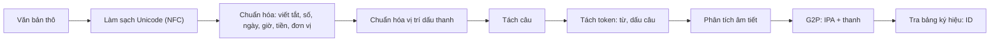

# Dự án 1. Frontend tiếng Việt

!!! abstract "Mục tiêu dự án"
    Sau dự án này, bạn sẽ có một gói Python thuần `code/vn_frontend/` biến văn bản tiếng Việt "thô" thành chuỗi ký hiệu sẵn sàng cho mọi mô hình TTS trong các dự án sau. Cụ thể, bạn sẽ:

    - **cài đặt** chuẩn hóa Unicode và chuẩn hóa vị trí dấu thanh (*hoà* → *hòa*), kèm phép làm sạch các ký tự "trông giống mà khác";
    - **cài đặt** bộ đọc số tiếng Việt chính xác tuyệt đối với các quy tắc *mười/mươi, mốt, tư/bốn, lăm/nhăm, linh/lẻ, không trăm, nghìn/triệu/tỷ*;
    - **xây dựng** bộ chuẩn hóa ngày tháng, giờ, tiền tệ, phần trăm, đơn vị, số điện thoại, viết tắt và từ viết tắt theo nguyên tắc "cụ thể trước, tổng quát sau";
    - **cài đặt** bộ phân tích âm tiết (âm đầu, âm đệm, âm chính, âm cuối, thanh điệu) và bộ G2P giọng Bắc sinh âm vị IPA cùng token thanh điệu;
    - **thiết kế** bảng ký hiệu ổn định làm "hợp đồng" giữa front-end và mô hình;
    - **viết** bộ kiểm thử `pytest` dạng bảng và kiểm thử tính chất (lũy đẳng, khứ hồi), rồi **mở rộng** hệ thống cho giọng Nam và từ mượn tiếng Anh.

!!! info "Kiến thức cần có"
    - [Chương 15. Ngữ âm và âm vị học tiếng Việt](../phan-3-tin-hieu-ngu-am/ch15-ngu-am-tieng-viet.md): cấu trúc âm tiết, hệ thống âm vị, sáu thanh, khác biệt phương ngữ.
    - [Chương 17. Chuẩn hóa văn bản tiếng Việt](../phan-4-frontend/ch17-chuan-hoa-van-ban.md): phân loại từ không chuẩn, các hướng tiếp cận chuẩn hóa.
    - [Chương 18. G2P và biểu diễn đầu vào](../phan-4-frontend/ch18-g2p-bieu-dien-dau-vao.md): lựa chọn đơn vị đầu vào, cách biểu diễn thanh điệu, thiết kế bảng ký hiệu.
    - Python ở mức khá: biểu thức chính quy (`re`), `dataclass`, `pytest`.

Ba chương trên trình bày *lý thuyết* và các đoạn mã minh họa ngắn. Dự án này gom tất cả lại thành một gói phần mềm thật: có cấu trúc mô-đun, có giao diện lập trình (API) ổn định, có giao diện dòng lệnh và gần hai trăm ca kiểm thử. Các dự án sau đều dùng gói này: [Dự án 2](du-an-2-fastspeech2-hifigan.md) lấy chuỗi ID làm đầu vào cho FastSpeech 2, [Dự án 3](du-an-3-vits-tieng-viet.md) dùng bảng ký hiệu cho VITS, [Dự án 4](du-an-4-zero-shot-tts.md) dùng phần chuẩn hóa cho mô hình đầu vào ký tự, và [Dự án 5](du-an-5-tts-service-streaming.md) dùng chuẩn hóa và tách câu trong dịch vụ streaming.

## 1. Bài toán và yêu cầu

### 1.1. Front-end làm gì, và vì sao nó quyết định chất lượng

Một hệ thống TTS hai giai đoạn kinh điển gồm **front-end** (xử lý văn bản) và **back-end** (mô hình âm học cộng vocoder). Người mới thường dồn toàn bộ sức lực vào back-end vì đó là phần "học sâu". Thực tế triển khai lại cho thấy một lượng lớn lỗi mà người nghe nhận ra ngay đến từ front-end: đọc "2/9" thành "hai phần chín" thay vì "hai tháng chín", đọc "VTV" thành một âm tiết vô nghĩa, đọc "1005" thành "một nghìn linh năm" (thiếu "không trăm"), hay đọc sai thanh vì văn bản chứa ký tự tổ hợp dạng NFD mà mô hình chưa từng thấy. Không mô hình âm học nào, dù lớn đến đâu, sửa được những lỗi này nếu chuỗi ký hiệu đưa vào đã sai.

Front-end của chúng ta nhận một chuỗi Unicode bất kỳ và trả về:

1. văn bản đã **chuẩn hóa** sang dạng đọc (mọi chữ số, ký hiệu, viết tắt đã thành chữ);
2. danh sách **câu** (để tổng hợp từng câu, hoặc để streaming);
3. chuỗi **token âm vị + thanh điệu** (đầu ra của G2P);
4. chuỗi **ID số nguyên** theo một bảng ký hiệu cố định — thứ mà lớp `nn.Embedding` của mô hình cần.

### 1.2. Yêu cầu thiết kế

Trước khi viết dòng mã nào, ta chốt các yêu cầu. Mỗi yêu cầu đều xuất phát từ một lỗi thực tế đã gặp trong các dự án TTS.

| Yêu cầu | Lý do |
|---|---|
| **Python thuần**, không phụ thuộc ngoài | Front-end chạy ở mọi nơi: máy huấn luyện, máy chủ suy luận, thiết bị biên. Một phụ thuộc nặng (ví dụ một bộ tách từ cần Java) dễ làm vỡ triển khai. |
| **Tất định** (*deterministic*) | Cùng văn bản phải luôn ra cùng chuỗi ID, nếu không mô hình sẽ thấy dữ liệu "nhiễu" khi huấn luyện và cho kết quả khác nhau khi suy luận. |
| **Lũy đẳng** (*idempotent*) | `normalize_text(normalize_text(x)) == normalize_text(x)`. Văn bản thường đi qua nhiều tầng xử lý; chuẩn hóa hai lần không được làm hỏng gì. |
| **Đầu ra NFC** | Mô hình đầu vào ký tự (Dự án 4) coi "ệ" dựng sẵn và "ệ" tổ hợp là hai chuỗi khác nhau. |
| **Nhất quán huấn luyện ↔ suy luận** | Dùng *đúng một* front-end để tạo dữ liệu huấn luyện và để phục vụ người dùng. Đây là nguồn lỗi "mô hình đọc số sai" phổ biến nhất. |
| **Có kiểm thử** | Quy tắc đọc số và chính tả có rất nhiều ngoại lệ; thiếu kiểm thử thì sửa chỗ này hỏng chỗ khác. |
| **Dễ mở rộng** | Bảng dữ liệu (viết tắt, đơn vị, tên chữ cái, từ mượn) tách khỏi logic, phương ngữ được tham số hóa. |

Ta cũng nói rõ những gì **không** làm trong dự án này: tách từ (*word segmentation*) bằng mô hình thống kê, chuẩn hóa bằng mạng nơ-ron, xử lý trộn mã Việt–Anh đầy đủ. Các chủ đề đó được bàn ở [Chương 17](../phan-4-frontend/ch17-chuan-hoa-van-ban.md), [Chương 18](../phan-4-frontend/ch18-g2p-bieu-dien-dau-vao.md) và [Chương 30](../phan-7-e2e-bieu-cam/ch30-da-ngon-ngu-code-switching.md); gói của chúng ta để sẵn "chỗ cắm" cho chúng.

### 1.3. Hợp đồng API

Các dự án khác phụ thuộc vào đúng sáu tên sau, nên chúng được giữ ổn định:

| Tên | Chữ ký | Ý nghĩa |
|---|---|---|
| `normalize_text` | `(text: str) -> str` | NFC, chuẩn hóa dấu thanh, số/ngày/giờ/tiền/phần trăm/viết tắt → chữ |
| `split_sentences` | `(text: str) -> list[str]` | tách câu theo luật |
| `parse_syllable` | `(syllable: str) -> Syllable` | phân tích âm tiết; `tone` là số nguyên 1..6 |
| `g2p` | `(text: str, dialect: str = "north") -> list[str]` | token âm vị IPA + token thanh + ranh giới từ + dấu câu |
| `text_to_sequence` | `(text: str, dialect: str = "north") -> list[int]` | ID trong `SYMBOLS` |
| `SYMBOLS` | `list[str]` | bảng ký hiệu: đệm, blank, ranh giới, dấu câu, âm vị, thanh |

Quy ước đánh số thanh điệu dùng trong toàn bộ gói (và toàn bộ các dự án):

| Số | Thanh | Dấu | Token | Ví dụ |
|---|---|---|---|---|
| 1 | ngang | không dấu | `T1` | ma |
| 2 | huyền | dấu huyền | `T2` | mà |
| 3 | sắc | dấu sắc | `T3` | má |
| 4 | hỏi | dấu hỏi | `T4` | mả |
| 5 | ngã | dấu ngã | `T5` | mã |
| 6 | nặng | dấu nặng | `T6` | mạ |

!!! warning "Đánh số thanh không có chuẩn chung"
    Thứ tự "ngang, huyền, sắc, hỏi, ngã, nặng" là thứ tự quen thuộc trong sách giáo khoa và nhiều công cụ xử lý tiếng Việt, nhưng không phải công cụ nào cũng dùng. Một số bộ dữ liệu hoặc phần mềm đánh số theo thứ tự khác, hoặc tách sắc/nặng ở âm tiết khép (-p, -t, -c, -ch) thành hai "thanh" riêng (thành tám thanh). Khi ghép dữ liệu từ nhiều nguồn, hãy luôn kiểm tra quy ước đánh số trước khi trộn.

Đoạn mã sau cho thấy toàn bộ API hoạt động cùng nhau (chạy được khi đứng trong thư mục `code/`):

```python
from vn_frontend import (normalize_text, split_sentences, parse_syllable,
                         g2p, text_to_sequence, SYMBOLS)

raw = "Ngày 2/9/1945, Chủ tịch Hồ Chí Minh đọc Tuyên ngôn Độc lập. Hoà bình!"
text = normalize_text(raw)
print(text)
# Ngày hai tháng chín năm một nghìn chín trăm bốn mươi lăm, Chủ tịch Hồ Chí Minh đọc Tuyên ngôn Độc lập. Hòa bình!
print(split_sentences(text))
# ['Ngày hai tháng chín ... Độc lập.', 'Hòa bình!']
print(parse_syllable("hoàng"))
# Syllable(onset='h', glide='o', nucleus='a', coda='ng', tone=2)
print(g2p("Hòa bình!"))
# ['h', 'w', 'a', 'T2', ' ', 'ɓ', 'i', 'ɲ', 'T2', '!']
ids = text_to_sequence("Hòa bình!")
print(ids, len(SYMBOLS))
assert [SYMBOLS[i] for i in ids] == g2p("Hòa bình!")
```

## 2. Kiến trúc tổng thể

### 2.1. Luồng xử lý



Hai điểm đáng chú ý. Thứ nhất, **chuẩn hóa chạy trước tách câu**: văn bản thô chứa nhiều dấu chấm không kết thúc câu ("TP.HCM", "3.5", "PGS.TS."), và sau khi chuẩn hóa thì phần lớn chúng đã biến mất. Bộ tách câu vẫn đủ cẩn thận để chạy được trên văn bản thô, nhưng chạy sau chuẩn hóa thì ít rủi ro hơn hẳn. Thứ hai, **G2P làm việc trên từng âm tiết**: tiếng Việt viết cách theo âm tiết, và chữ quốc ngữ gần như biểu âm, nên một bộ phân tích âm tiết tốt là nền móng của cả G2P lẫn việc chuẩn hóa dấu thanh.

### 2.2. Bố cục mô-đun

| Tệp | Trách nhiệm | Phụ thuộc vào |
|---|---|---|
| `orthography.py` | hằng số thanh điệu, tách/gắn dấu thanh, vị trí dấu, làm sạch Unicode | — |
| `syllable.py` | `Syllable`, `parse_syllable`, kiểm tra chính tả chặt | `orthography` |
| `numbers.py` | đọc số đếm, thập phân, thứ tự, từng chữ số, số La Mã | — |
| `lexicon.py` | **bảng dữ liệu**: viết tắt, tên chữ cái, đơn vị, tiền tệ, từ mượn | — |
| `normalize.py` | `normalize_text`: chuỗi các luật biểu thức chính quy | `numbers`, `lexicon`, `syllable` |
| `sentences.py` | `split_sentences` | `lexicon` |
| `g2p.py` | bảng âm vị, `syllable_to_phones`, `g2p` | `syllable`, `normalize` |
| `symbols.py` | `SYMBOLS`, `text_to_sequence`, `intersperse` | `g2p` |
| `__main__.py` | giao diện dòng lệnh | tất cả |

Nguyên tắc tổ chức là **dữ liệu tách khỏi logic**. Khi người dùng báo "hệ thống đọc sai *ThS.*", việc sửa chỉ là thêm một dòng vào `lexicon.py` cùng một ca kiểm thử, không phải động vào biểu thức chính quy nào. Đồ thị phụ thuộc giữa các mô-đun cũng không có chu trình, nên có thể kiểm thử từng tầng độc lập.

## 3. Chính tả và Unicode

### 3.1. NFC, NFD và dấu thanh tổ hợp

Unicode cho phép biểu diễn chữ "ệ" theo hai cách: một ký tự **dựng sẵn** (U+1EC7) hoặc chuỗi **tổ hợp** gồm "e" + dấu mũ (U+0302) + dấu nặng (U+0323). Hai dạng chuẩn hóa quan trọng là **NFC** (ưu tiên dựng sẵn) và **NFD** (tách hết thành ký tự cơ sở + dấu tổ hợp). Văn bản sao chép từ PDF, từ một số bàn phím trên macOS, hoặc từ các hệ thống cũ (bảng mã Windows-1258) rất hay ở dạng tổ hợp hoặc lẫn lộn.

Với front-end, NFD lại là một **công cụ** hữu ích: sau khi tách NFD, năm dấu thanh của tiếng Việt chính là năm ký tự tổ hợp riêng biệt, còn các dấu phụ chỉ chất lượng nguyên âm (mũ, trăng, móc) là những ký tự khác. Vì vậy tách thanh điệu ra khỏi một từ chỉ là: chuyển sang NFD, lọc bỏ ký tự dấu thanh và ghi nhớ nó, rồi chuyển lại NFC.

| Thanh | Ký tự tổ hợp | Tên Unicode |
|---|---|---|
| huyền | U+0300 | COMBINING GRAVE ACCENT |
| sắc | U+0301 | COMBINING ACUTE ACCENT |
| hỏi | U+0309 | COMBINING HOOK ABOVE |
| ngã | U+0303 | COMBINING TILDE |
| nặng | U+0323 | COMBINING DOT BELOW |

Trích từ `orthography.py`:

```python
def split_tone(word: str) -> tuple[str, int]:
    tone = NGANG
    kept: list[str] = []
    for ch in unicodedata.normalize("NFD", word):
        t = _MARK_TO_TONE.get(ch)
        if t is None:
            kept.append(ch)
            continue
        if tone != NGANG and t != tone:
            raise ValueError(f"từ có nhiều hơn một dấu thanh: {word!r}")
        tone = t
    return unicodedata.normalize("NFC", "".join(kept)), tone
```

Một chi tiết tinh tế: với "ậ", dạng NFD là "a" + U+0323 + U+0302 (dấu nặng đứng *trước* dấu mũ vì Unicode sắp xếp dấu tổ hợp theo "lớp kết hợp", dấu ở dưới có lớp nhỏ hơn dấu ở trên). Thuật toán trên không quan tâm thứ tự này, vì nó chỉ lọc theo *tập* ký tự dấu thanh; phép NFC cuối cùng sẽ dựng lại "â" đúng. Ví dụ chạy được:

```python
import unicodedata
from vn_frontend import split_tone, normalize_tone_marks

s = "hoà"
print([hex(ord(c)) for c in unicodedata.normalize("NFD", s)])
# ['0x68', '0x6f', '0x61', '0x300']   -> h, o, a, dấu huyền tổ hợp
print(split_tone("Việt"), split_tone("người"))
# ('Viêt', 6) ('ngươi', 2)
print(normalize_tone_marks("Hoà bình, khoẻ mạnh, thuỷ thủ, quý vị"))
# Hòa bình, khỏe mạnh, thủy thủ, quý vị
print(normalize_tone_marks("hòa khỏe thủy", style="new"))
# hoà khoẻ thuỷ
nfc, nfd = "Việt", unicodedata.normalize("NFD", "Việt")
print(nfc == nfd, len(nfc), len(nfd))
# False 4 6
```

### 3.2. Vị trí dấu thanh: "hòa" hay "hoà"?

Chữ quốc ngữ có hai thói quen đặt dấu cùng tồn tại. Kiểu "cũ" (truyền thống, cũng là quy ước của giáo trình này) viết *hóa, khỏe, thủy*; kiểu "mới" viết *hoá, khoẻ, thuỷ*. Hai kiểu chỉ khác nhau ở **ba vần mở** *oa, oe, uy*; mọi trường hợp khác đều trùng nhau. Với người đọc, đây là chuyện thẩm mỹ. Với máy, "hòa" và "hoà" là hai chuỗi khác nhau: một mô hình đầu vào ký tự sẽ phải học hai cách viết cho cùng một âm tiết, còn một từ điển tra theo chuỗi sẽ tra trượt một nửa số trường hợp.

Thay vì dùng một bảng ánh xạ "hoà → hòa" (luôn thiếu), ta **đặt lại dấu từ đầu**: tách thanh, phân tích âm tiết để tìm cụm nguyên âm, rồi áp luật đặt dấu. Luật được tóm tắt như sau, với $V$ là cụm nguyên âm của âm tiết (sau khi đã bỏ phần "qu" và "gi" thuộc âm đầu):

1. Nếu $V$ có nguyên âm mang dấu phụ (ă, â, ê, ô, ơ, ư), đặt dấu lên nguyên âm mang dấu phụ **cuối cùng**: *ươ* → ơ (người), *uô* → ô (muốn), *iê/yê* → ê (tiếng, khuyến), *ưa* → ư (mưa), *uâ* → â (xuân).
2. Nếu $V$ chỉ có một nguyên âm: đặt lên nguyên âm đó.
3. Nếu sau $V$ có phụ âm cuối: đặt lên nguyên âm **cuối** của $V$ (*hoàn*, *thuyền* đã thuộc luật 1, *huỳnh*).
4. Nếu $V$ có ba nguyên âm (vần mở): đặt lên nguyên âm **giữa** (*ngoài*, *khuỷu*, *ngoẹo*, *xoáy*).
5. Nếu $V$ có hai nguyên âm (vần mở): đặt lên nguyên âm **đầu** (*mái, cáo, của, mía, túi*); riêng kiểu "mới" đặt lên nguyên âm thứ hai với *oa, oe, uy*.

Vì sao phải bỏ "qu" và "gi" ra trước? Vì trong *quả*, chữ "u" là âm đệm thuộc phần đầu âm tiết, nên cụm nguyên âm chỉ là "a" và dấu đặt trên "a"; nếu coi "ua" là cụm nguyên âm hai chữ thì luật 5 sẽ đặt sai thành "qủa". Tương tự, trong *giữa* thì "gi" là âm đầu và cụm nguyên âm là "ưa". Trường hợp đặc biệt là *gì, gìn*: sau "gi" không còn nguyên âm nào, nên chữ "i" vừa thuộc âm đầu vừa là âm chính. Hàm `split_orthographic` xử lý đúng các trường hợp này và được dùng chung cho cả việc đặt dấu lẫn phân tích âm tiết (mục 4), nhờ vậy hai phần không bao giờ "bất đồng" về cấu trúc âm tiết.

Trích hàm chọn vị trí dấu:

```python
def tone_position(base: str, style: str = "old") -> int:
    low = base.lower()
    _, start, end = split_orthographic(low)
    cluster = low[start:end]
    has_coda = end < len(low)
    marked = [i for i, c in enumerate(cluster) if c in _DIACRITIC_VOWELS]
    if marked:
        idx = marked[-1]  # "ươ" -> đặt trên ơ; "uô" -> ô; "iê" -> ê
    elif len(cluster) == 1:
        idx = 0
    elif has_coda:
        idx = len(cluster) - 1  # "oan" -> a, "uynh" -> y
    elif len(cluster) == 3:
        idx = 1  # "oai" -> a, "uyu" -> y, "oeo" -> e
    elif style == "new" and cluster in ("oa", "oe", "uy"):
        idx = 1
    else:
        idx = 0  # "ai" -> á, "ua" -> ủ (của), "ia" -> í (mía), old: hóa
    return start + idx
```

Để giữ chữ hoa/thường, `apply_tone` đặt dấu trên chữ thường rồi viết hoa lại nếu ký tự gốc là chữ hoa (*HOÀ* → *HÒA*). Từ nào không phân tích được như âm tiết tiếng Việt (tên nước ngoài, lỗi gõ có hai dấu thanh) thì được **giữ nguyên**: front-end không bao giờ được "sửa sai" một cách tự tin khi nó không hiểu đầu vào.

!!! note "Góc tiếng Việt"
    Vị trí dấu thanh không ảnh hưởng đến phát âm, nhưng ảnh hưởng rất lớn đến *thống kê* của dữ liệu. Khi tinh chỉnh một mô hình lớn đầu vào ký tự (Dự án 4) trên dữ liệu thu thập từ Internet, bạn sẽ gặp cả hai kiểu đặt dấu, cả NFC lẫn NFD. Nếu không chuẩn hóa, bảng từ vựng phình ra và mỗi biến thể chỉ có ít dữ liệu hơn. Hãy chọn **một** kiểu (giáo trình chọn kiểu cũ), áp dụng nhất quán cho cả dữ liệu huấn luyện lẫn văn bản lúc suy luận, và ghi lựa chọn đó vào tài liệu mô hình.

### 3.3. Làm sạch "ký tự giống mà khác"

Hàm `clean_unicode` xử lý những thứ mắt thường không thấy nhưng làm hỏng mô hình:

- khoảng trắng không ngắt dòng (U+00A0), ký tự rộng bằng 0 (U+200B), BOM, dấu gạch nối mềm: bỏ hoặc thay bằng khoảng trắng thường;
- gạch ngang (–), dấu trừ toán học (−): thống nhất về "-", để luật "khoảng số" (5–10) và "số âm" nhận ra;
- nháy cong và ngoặc kép kiểu Pháp: thống nhất về nháy thẳng;
- **Ð** (U+00D0, chữ Eth của tiếng Iceland) trông *giống hệt* **Đ** (U+0110) nhưng là ký tự khác — lỗi này có thật trong văn bản gõ bằng một số bảng mã cũ;
- chữ Kirin trông như chữ Latinh (а, е, о, р, с...) chỉ được thay khi chúng **lẫn trong một từ có chữ Latinh**, để không phá văn bản tiếng Nga thật;
- ba dấu chấm "..." thành ký tự "…", để dấu chấm lửng không bị nhầm với ba dấu kết thúc câu.

## 4. Phân tích âm tiết

### 4.1. Cấu trúc và các quyết định chính tả

Theo mô hình cấu trúc âm tiết quen thuộc của ngữ âm học tiếng Việt (xem [Chương 15](../phan-3-tin-hieu-ngu-am/ch15-ngu-am-tieng-viet.md)), một âm tiết gồm:

$$
\text{âm tiết} = [\text{âm đầu}] + \underbrace{[\text{âm đệm}] + \text{âm chính} + [\text{âm cuối}]}_{\text{vần}} + \text{thanh điệu}.
$$

Lớp `Syllable` lưu năm thành phần này ở dạng **chữ viết** (chữ thường, không dấu thanh), còn việc đổi sang âm vị để dành cho G2P. Tách hai bước như vậy có lợi: bộ phân tích thuần túy là bài toán chính tả, kiểm thử được bằng bảng; bộ G2P thuần túy là bảng tra âm vị, thay được theo phương ngữ.

Chữ quốc ngữ gần biểu âm nhưng có một số chỗ "một âm nhiều chữ" hoặc "một chữ hai vai trò". Bộ phân tích phải ra quyết định nhất quán cho từng chỗ:

| Hiện tượng | Ví dụ | Quyết định trong `parse_syllable` |
|---|---|---|
| "qu" | *quốc, quả, quyết* | âm đầu `q`, âm đệm `u` (âm vị /k/ + /w/) |
| "gi" + nguyên âm | *gia, giữa, gió* | âm đầu `gi`, âm chính là phần sau |
| "gi" không có nguyên âm theo sau | *gì, gìn* | âm đầu `gi`, âm chính `i` (dùng chung chữ i) |
| "gi" + ê + âm cuối | *giếng, giết, giễu* | âm chính `iê` (chữ i dùng chung với nguyên âm đôi) |
| âm đệm "o" | *hoa, hoặc, khỏe* | `o` là âm đệm khi đứng trước a, ă, e |
| âm đệm "u" | *thủy, thuế, xuân, thuở* | `u` là âm đệm khi đứng trước y, ê, â, ơ |
| nguyên âm đôi /iə/ | *tiên, yên, mía, khuya* | âm chính `iê`, `yê`, `ia`, `ya` (giữ cách viết) |
| nguyên âm đôi /uə/, /ɨə/ | *muốn, mua; người, mưa* | âm chính `uô`, `ua`, `ươ`, `ưa` |
| bán nguyên âm cuối | *mai, máy, cao, cau, kêu* | âm cuối `i`, `y`, `o`, `u` |
| "oo", "ôô" | *xoong, boong* | âm chính `oo` (nguyên âm dài, hiếm) |

Hai điểm cần giải thích thêm. *Thứ nhất*, vì sao "ua" trong *mua* là nguyên âm đôi còn "ua" trong *qua* thì không? Vì trong *qua*, chữ "u" đã được gán cho âm đệm (đi với "q"), nên phần còn lại chỉ là "a". Bộ phân tích xử lý "qu" **trước** khi xét âm đệm, nhờ đó hai trường hợp tự tách ra. *Thứ hai*, "u" chỉ là âm đệm khi đứng trước y, ê, â, ơ; trước "a" và "ô" thì "ua", "uô" là nguyên âm đôi (*mua, muốn*). Luật này đọc thẳng từ chính tả nên không cần từ điển.

Sau khi tách âm đệm, phần nguyên âm còn lại được chia thành âm chính và (nếu có) bán nguyên âm cuối: nếu có phụ âm cuối thì toàn bộ là âm chính; nếu phần còn lại là một trong bốn nguyên âm đôi mở (*ia, ya, ua, ưa*) thì giữ nguyên; nếu chữ cuối là i, y, o, u và phần trước là một âm chính hợp lệ thì tách chữ cuối làm âm cuối. Ví dụ *người* → ươ + i, *khuỷu* → (đệm u) + y + u, *máy* → a + y.

```python
from vn_frontend import parse_syllable, is_vietnamese_syllable

for w in ["quốc", "giếng", "gì", "khuỷu", "người", "oanh", "xoong", "khuya", "máy"]:
    s = parse_syllable(w)
    print(f"{w:7s} đầu={s.onset!r:5} đệm={s.glide!r:4} chính={s.nucleus!r:5} cuối={s.coda!r:5} thanh={s.tone} ({s.tone_name})")
print(is_vietnamese_syllable("kiến"), is_vietnamese_syllable("ceo"), is_vietnamese_syllable("tàp"))
# True False False
```

Kết quả:

```text
quốc    đầu='q'   đệm='u'  chính='ô'   cuối='c'   thanh=3 (sắc)
giếng   đầu='gi'  đệm=''   chính='iê'  cuối='ng'  thanh=3 (sắc)
gì      đầu='gi'  đệm=''   chính='i'   cuối=''    thanh=2 (huyền)
khuỷu   đầu='kh'  đệm='u'  chính='y'   cuối='u'   thanh=4 (hỏi)
người   đầu='ng'  đệm=''   chính='ươ'  cuối='i'   thanh=2 (huyền)
oanh    đầu=''    đệm='o'  chính='a'   cuối='nh'  thanh=1 (ngang)
xoong   đầu='x'   đệm=''   chính='oo'  cuối='ng'  thanh=1 (ngang)
khuya   đầu='kh'  đệm='u'  chính='ya'  cuối=''    thanh=1 (ngang)
máy     đầu='m'   đệm=''   chính='a'   cuối='y'   thanh=3 (sắc)
```

### 4.2. Chế độ kiểm tra chặt

`parse_syllable(w)` mặc định **khoan dung**: nó chấp nhận mọi chuỗi có cấu trúc "phụ âm đầu + cụm nguyên âm + phụ âm cuối hợp lệ", kể cả những chuỗi không đúng chính tả như *tàp*. Điều này có chủ đích: G2P nên cố gắng đọc được văn bản có lỗi gõ nhỏ hơn là bỏ cuộc. Ngược lại, khi cần biết một chuỗi *có phải* âm tiết tiếng Việt hay không — ví dụ để quyết định "TIN" là chữ viết hoa hay từ viết tắt cần đánh vần (mục 6.6) — ta dùng `strict=True` (hoặc `is_vietnamese_syllable`), kiểm tra thêm:

- quy tắc c/k/q: "k" chỉ đứng trước e, ê, i, y; "c" không đứng trước các nguyên âm đó; âm /kw/ phải viết "qu";
- quy tắc g/gh, ng/ngh: "gh", "ngh" chỉ đứng trước e, ê, i;
- âm tiết khép (kết thúc bằng p, t, c, ch) chỉ mang thanh **sắc** hoặc **nặng** — một ràng buộc âm vị học quan trọng của tiếng Việt;
- nguyên âm đôi viết đúng dạng: *iê, yê, uô, ươ* khi có âm cuối, *ia, ya, ua, ưa* khi không có;
- "ă" cần phụ âm cuối, "â" cần âm cuối; "nh/ch" chỉ đứng sau a, ê, i/y; bán nguyên âm cuối "y" chỉ sau a, â; "o" chỉ sau a, e.

## 5. Đọc số tiếng Việt

### 5.1. Các quy tắc

Đọc số là phần "dễ mà khó" nhất của front-end: ai cũng biết đọc, nhưng hệ quy tắc có nhiều biến thể ngữ cảnh mà một chương trình viết vội rất dễ sai. Ta liệt kê quy tắc trước, sau đó mới viết mã.

| Quy tắc | Đúng | Sai thường gặp |
|---|---|---|
| 10 đọc "mười" (có dấu huyền); 20–90 đọc "... mươi" (không dấu) | hai mươi | hai mười |
| hàng đơn vị 1 sau "mươi" đọc "mốt" | hai mươi mốt | hai mươi một |
| nhưng sau "mười" vẫn là "một" | mười một | mười mốt |
| hàng đơn vị 4 sau "mươi" thường đọc "tư" (cũng có thể "bốn") | hai mươi tư | — |
| nhưng sau "mười" đọc "bốn" | mười bốn | mười tư |
| hàng đơn vị 5 sau "mười/mươi" đọc "lăm" (khẩu ngữ Bắc: "nhăm" sau "mươi") | mười lăm, hai mươi lăm | mười năm |
| nhưng 5 đứng một mình, hoặc sau "linh/lẻ", vẫn là "năm" | một trăm linh năm | một trăm linh lăm |
| hàng chục bằng 0 giữa số: "linh" (Bắc) hoặc "lẻ" (Nam) | một trăm linh một | một trăm một |
| nhóm ba chữ số không đứng đầu luôn đọc đủ ba hàng | một nghìn không trăm linh năm | một nghìn linh năm |
| bỏ qua nhóm toàn số 0 | một triệu không trăm linh một | một triệu không nghìn... |
| bậc lớn: nghìn (ngàn), triệu, tỷ; trên tỷ ghép lại | một nghìn tỷ | — |

Quy tắc "bỏ qua nhóm toàn số 0" và "đọc đủ ba hàng" có thể khác nhau đôi chút giữa các văn bản quy chuẩn và thói quen từng vùng (ví dụ có người đọc 1.000.001 là "một triệu lẻ một"). Gói của chúng ta chọn cách đọc đầy đủ, rõ ràng nhất; nếu dữ liệu ghi âm của bạn đọc khác, hãy sửa cho khớp với **người đọc trong dữ liệu**, vì nhất quán quan trọng hơn "đúng chuẩn".

### 5.2. Hình thức hóa

Viết số nguyên dương $n < 10^9$ theo các nhóm ba chữ số:

$$
n = g_2 \cdot 10^6 + g_1 \cdot 10^3 + g_0, \qquad 0 \le g_k < 1000 .
$$

Gọi $k^\ast$ là chỉ số nhóm khác 0 cao nhất. Cách đọc là ghép, theo thứ tự $k = k^\ast, \ldots, 0$ và bỏ qua mọi $g_k = 0$, chuỗi $\mathrm{R}(g_k, \text{đủ}_k)$ rồi đến tên bậc ("triệu", "nghìn" hoặc rỗng), trong đó $\text{đủ}_k$ đúng khi và chỉ khi đã có nhóm nào đó được đọc trước nhóm $k$. Hàm $\mathrm{R}(g, \text{đủ})$ đọc một nhóm $g = 100h + 10t + u$:

- nếu $\text{đủ}$ hoặc $h > 0$: đọc "$\text{chữ}(h)$ trăm" (kể cả "không trăm");
- nếu $t = 0$ và $u > 0$: thêm "linh" khi trước đó đã có chữ, rồi đọc $\text{chữ}(u)$;
- nếu $t \ge 1$: áp các quy tắc mười/mươi, mốt, tư, lăm của bảng trên.

Với $n \ge 10^9$, tách $n = q \cdot 10^9 + r$ và đọc đệ quy: $\text{đọc}(q)$ + "tỷ" + $\text{đọc}_{\text{đủ}}(r)$. Nhờ đệ quy, $10^{12}$ tự động thành "một nghìn tỷ" và $10^{18}$ thành "một tỷ tỷ" mà không cần thêm tên bậc nào.

### 5.3. Cài đặt

Trích `numbers.py` (tham số `st` là một `NumberStyle` chứa các lựa chọn nghìn/ngàn, linh/lẻ, tư/bốn, lăm/nhăm):

```python
def _two_digits(tens: int, units: int, st: NumberStyle) -> list[str]:
    """Đọc phần chục-đơn vị khi ``tens >= 1``."""
    if tens == 1:
        if units == 0:
            return ["mười"]
        if units == 5:
            return ["mười", "lăm"]
        return ["mười", DIGITS[units]]  # 11 mười một, 14 mười bốn
    words = [DIGITS[tens], "mươi"]
    if units == 0:
        return words
    if units == 1:
        return words + ["mốt"]
    if units == 4:
        return words + [st.four]
    if units == 5:
        return words + [st.five]
    return words + [DIGITS[units]]


def _three_digits(n: int, full: bool, st: NumberStyle) -> list[str]:
    """Đọc một nhóm 0 < n < 1000. ``full``: đọc đủ "không trăm" (nhóm không đứng đầu)."""
    h, t, u = n // 100, (n // 10) % 10, n % 10
    words: list[str] = []
    if full or h > 0:
        words += [DIGITS[h], "trăm"]
    if t == 0:
        if u:
            if words:
                words.append(st.zero_tens)  # 105 = một trăm linh năm
            words.append(DIGITS[u])
        return words
    return words + _two_digits(t, u, st)


def _read(n: int, full: bool, st: NumberStyle) -> list[str]:
    """Đọc số nguyên dương ``n``; ``full=True`` khi ``n`` là phần tiếp sau một bậc lớn hơn."""
    if n >= 10**9:
        high, low = divmod(n, 10**9)
        words = _read(high, full, st) + [st.billion]
        if low:
            words += _read(low, True, st)
        return words
    words: list[str] = []
    groups = ((n // 10**6) % 1000, "triệu"), ((n // 1000) % 1000, st.thousand), (n % 1000, "")
    for value, scale in groups:
        if value == 0:
            continue  # bỏ qua nhóm toàn số 0
        words += _three_digits(value, full or bool(words), st)
        if scale:
            words.append(scale)
    return words
```

Hãy lần theo một ví dụ: $n = 1\,001\,000$. Các nhóm là $(g_2, g_1, g_0) = (1, 1, 0)$. Nhóm $g_2 = 1$ được đọc không đủ (chưa có chữ nào trước nó): "một" + "triệu". Nhóm $g_1 = 1$ được đọc đủ: "không trăm" + "linh" + "một" + "nghìn". Nhóm $g_0 = 0$ bị bỏ qua. Kết quả: "một triệu không trăm linh một nghìn".

```python
from vn_frontend import number_to_words, NumberStyle

for n in [15, 21, 24, 25, 105, 1005, 1_001_000, 2_500_000_000]:
    print(f"{n:>13,}".replace(",", "."), "->", number_to_words(n))
south = NumberStyle(thousand="ngàn", zero_tens="lẻ", four="bốn")
print(number_to_words(1024, south))
# một ngàn không trăm hai mươi bốn
```

```text
           15 -> mười lăm
           21 -> hai mươi mốt
           24 -> hai mươi tư
           25 -> hai mươi lăm
          105 -> một trăm linh năm
        1.005 -> một nghìn không trăm linh năm
    1.001.000 -> một triệu không trăm linh một nghìn
2.500.000.000 -> hai tỷ năm trăm triệu
```

Ngoài số đếm, `numbers.py` còn có: `digits_to_words` (đọc từng chữ số, cho số điện thoại và mã số), `decimal_to_words` (phần thập phân ≤ 3 chữ số và không bắt đầu bằng 0 được đọc như số nguyên: *3,14* → "ba phẩy mười bốn"; ngược lại đọc từng chữ số: *0,05* → "không phẩy không năm"), `ordinal_to_words` (*thứ nhất*, *thứ tư*, các số khác như số đếm), `month_to_words` (*tháng tư*) và `roman_to_int` (kiểm tra hợp lệ bằng biểu thức chính quy rồi mới đổi).

!!! note "Góc tiếng Việt"
    Nhiều cách đọc số mang màu sắc phương ngữ hoặc khẩu ngữ: "ngàn" (Nam) và "nghìn" (Bắc), "lẻ" và "linh", "hai mươi nhăm", "hăm mốt" (21), "băm" (30 trong "băm mốt"), "rưỡi" (một trăm rưỡi = 150). Gói chỉ cài các lựa chọn có tham số trong `NumberStyle`; các dạng khẩu ngữ để dành cho bài tập. Nguyên tắc vàng: cách đọc trong front-end phải **trùng với cách người đọc thực sự đọc trong dữ liệu huấn luyện**. Nếu người đọc nói "hai mươi bốn" mà front-end sinh "hai mươi tư", mô hình sẽ học một ánh xạ sai giữa văn bản và âm thanh.
