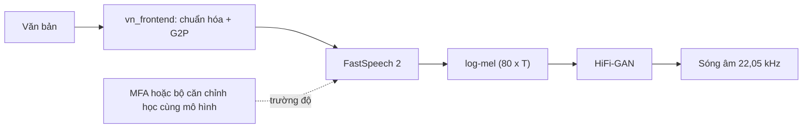

# Dự án 2. FastSpeech 2 + HiFi-GAN

!!! abstract "Mục tiêu dự án"
    Xây dựng trọn vẹn một hệ thống TTS tiếng Việt hai giai đoạn: FastSpeech 2 (văn bản → mel) và HiFi-GAN (mel → sóng âm). Sau dự án, bạn sẽ:

    - **chọn** và kiểm tra một bộ dữ liệu một người nói, có ý thức về giấy phép và phương ngữ;
    - **tiền xử lý** văn bản bằng `vn_frontend` (Dự án 1) và **lấy trường độ** bằng Montreal Forced Aligner hoặc bằng bộ căn chỉnh học cùng mô hình (forward-sum + MAS);
    - **trích** log-mel tương thích HiFi-GAN, log-F0 và năng lượng, và hiểu vì sao "hợp đồng mel" giữa mô hình âm học và vocoder quan trọng;
    - **đọc hiểu và chạy** mã FastSpeech 2 rút gọn trong `code/fastspeech2/` (encoder, variance adaptor, length regulator, decoder, hàm mất mát) với kiểm thử khói trên CPU;
    - **huấn luyện hoặc fine-tune** HiFi-GAN trên mel GTA (*ground-truth aligned*);
    - **đánh giá** hệ thống bằng các phép đo khách quan, chủ quan và bộ kiểm tra thanh điệu tiếng Việt.

!!! info "Kiến thức cần có"
    - [Dự án 1. Frontend tiếng Việt](du-an-1-frontend-tieng-viet.md): gói `vn_frontend`, bảng ký hiệu.
    - [Chương 14](../phan-3-tin-hieu-ngu-am/ch14-xu-ly-tin-hieu-so.md) (mel, F0), [Chương 21](../phan-5-mo-hinh-am-hoc/ch21-alignment.md) (căn chỉnh, MAS, forward-sum), [Chương 22](../phan-5-mo-hinh-am-hoc/ch22-fastspeech.md) (FastSpeech, FastSpeech 2), [Chương 25](../phan-6-vocoder/ch25-gan-vocoder.md) (HiFi-GAN).
    - [Chương 6](../phan-1-nen-tang/ch06-pytorch-cho-tieng-noi.md) (vòng lặp huấn luyện), [Chương 36](../phan-9-thuc-tien/ch36-du-lieu-tts.md)–[Chương 38](../phan-9-thuc-tien/ch38-danh-gia-tts.md) (dữ liệu, gỡ lỗi, đánh giá).

Dự án này **không** lặp lại lý thuyết của các chương trên. Trọng tâm là *công thức thực hành*: các quyết định thiết kế, những chỗ dễ sai, và mã nguồn chạy được. Mã ở `code/fastspeech2/` được viết gọn để đọc trong một buổi, nhưng đủ để huấn luyện thật trên một GPU.

## 1. Tổng quan



Vì sao chọn cặp FastSpeech 2 + HiFi-GAN cho dự án lớn đầu tiên, khi đã có VITS và các mô hình lớn hơn? Vì đây là kiến trúc **minh bạch nhất**: mỗi thành phần có đầu vào/đầu ra nhìn thấy được (trường độ, đường F0, mel), nên khi có lỗi bạn biết lỗi nằm ở đâu. Mô hình không tự hồi quy nên ổn định với câu dài, suy luận nhanh, và cho phép điều khiển tốc độ, cao độ một cách tường minh. Nhược điểm đã biết là mel hơi "mờ" do hàm mất mát hồi quy ([Chương 7](../phan-2-mo-hinh-sinh/ch07-tong-quan-mo-hinh-sinh.md), [Chương 22](../phan-5-mo-hinh-am-hoc/ch22-fastspeech.md)); vocoder fine-tune trên mel GTA bù lại được một phần.

Bố cục gói:

| Tệp | Nội dung |
|---|---|
| `config.py` | `AudioConfig`, `ModelConfig`, `TrainConfig`, đọc/ghi JSON |
| `features.py` | log-mel kiểu HiFi-GAN, năng lượng, F0 (pYIN), đọc TextGrid, TextGrid → trường độ |
| `aligner.py` | bộ căn chỉnh học cùng mô hình: encoder căn chỉnh, forward-sum, tiền nghiệm beta-binomial, MAS |
| `model.py` | khối FFT, variance predictor, length regulator, variance adaptor, PostNet, `FastSpeech2` |
| `loss.py` | `FastSpeech2Loss` |
| `data.py` | `TTSDataset`, `collate`, `random_batch` |
| `preprocess.py` | lệnh `mfa` (tạo corpus + từ điển) và `features` |
| `train.py`, `synthesize.py` | huấn luyện, suy luận, xuất mel GTA |
| `hifigan.py` | bộ sinh HiFi-GAN để suy luận, nạp checkpoint gốc |

Về tài nguyên: kiểm thử khói chạy trên CPU trong vài giây. Huấn luyện thật cần GPU; với cấu hình mặc định (khoảng 25 triệu tham số) và vài chục giờ dữ liệu, một GPU tầm trung là đủ, thời gian từ vài giờ đến một vài ngày tùy phần cứng và số bước — hãy coi đây là ước lượng thô.

## 2. Chọn dữ liệu

FastSpeech 2 hồi quy mel một cách tất định, nên nó **rất nhạy với độ "sạch" và độ nhất quán** của dữ liệu: một người nói, cùng micro, cùng phòng, cùng phong cách đọc. Dữ liệu đa người nói thu từ Internet hợp với các mô hình sinh lớn hơn (Dự án 4).

| Lựa chọn | Mô tả | Lưu ý |
|---|---|---|
| Bộ dữ liệu một người nói do cộng đồng công bố (ví dụ bộ InfoRe được nhiều dự án mã nguồn mở dùng) | đọc văn bản, một giọng | **kiểm tra giấy phép** và nguồn gốc; thời lượng, chất lượng ghi âm theo mô tả của người công bố |
| Dữ liệu các cuộc thi VLSP về TTS | chất lượng tốt, có quy trình | thường chỉ cấp cho mục đích nghiên cứu, cần đăng ký |
| Bộ dữ liệu sách nói / đa người nói lớn | nhiều giờ | chọn ra một người nói có nhiều dữ liệu nhất; giấy phép thường hạn chế |
| Tự thu âm | kiểm soát hoàn toàn | tốn công, nhưng là cách duy nhất có giấy phép rõ ràng cho sản phẩm (xem [Chương 36](../phan-9-thuc-tien/ch36-du-lieu-tts.md), [Chương 40](../phan-9-thuc-tien/ch40-dao-duc-an-toan.md)) |

Thông tin về các bộ dữ liệu tiếng Việt (kích thước, giấy phép, cách truy cập) thay đổi theo thời gian; tính đến thời điểm biên soạn (2026), hãy luôn đọc trang gốc của bộ dữ liệu trước khi dùng, và không dùng dữ liệu "chỉ cho nghiên cứu" trong sản phẩm. Về thời lượng: các thí nghiệm tiếng Anh kinh điển dùng khoảng 24 giờ (LJSpeech); với tiếng Việt, vài giờ dữ liệu sạch đã cho kết quả nghe được, và chất lượng tăng rõ khi lên khoảng mười đến vài chục giờ.

Đưa dữ liệu về định dạng kiểu LJSpeech:

```text
DATA/
  metadata.csv      # mỗi dòng: id|văn bản   (hoặc id|văn bản gốc|văn bản chuẩn hóa)
  wavs/<id>.wav     # mono, tần số lấy mẫu bất kỳ (sẽ được đổi về 22 050 Hz)
```

!!! note "Góc tiếng Việt"
    Hai kiểm tra bắt buộc trước khi huấn luyện. (1) **Phương ngữ**: nghe vài chục câu và xác định người nói giọng gì, rồi chọn `--dialect` tương ứng cho G2P. (2) **Khớp văn bản–âm thanh ở các token đặc biệt**: bản ghi có "25%" thì người đọc đã đọc "hai mươi lăm phần trăm" hay "hai lăm phần trăm"? Lọc ra mọi câu có chữ số hoặc viết tắt trong bản ghi gốc, chạy `normalize_text`, rồi nghe kiểm tra (hoặc dùng ASR để so tự động). Sai lệch ở đây dạy mô hình đọc sai một cách có hệ thống.

## 3. Căn chỉnh: lấy trường độ cho từng token

FastSpeech 2 cần trường độ $d_i$ (số khung mel) của mỗi token để huấn luyện length regulator và duration predictor. Có hai cách, gói hỗ trợ cả hai.

### 3.1. Cách A: Montreal Forced Aligner (MFA)

Bài báo FastSpeech 2 dùng MFA để lấy trường độ (Ren và cộng sự, 2021). Quy trình:

1. **Tạo corpus và từ điển phát âm** từ chính G2P của Dự án 1 — để nhãn âm vị của MFA trùng khớp với token của mô hình:

    ```bash
    python -m fastspeech2.preprocess mfa --data DATA --out mfa_corpus --dictionary vi_dict.txt
    ```

    Lệnh này chép wav, ghi tệp `.lab` (các âm tiết đã chuẩn hóa) và từ điển dạng `âm_tiết<TAB>âm vị...`, ví dụ `chào	c a w`.

2. **Chạy MFA.** Các lệnh dưới đây chỉ mang tính tham khảo (chưa được chạy trong giáo trình); cú pháp thay đổi giữa các phiên bản, hãy đối chiếu tài liệu chính thức của MFA:

    ```bash
    mfa validate mfa_corpus vi_dict.txt
    mfa train mfa_corpus vi_dict.txt vi_acoustic.zip --output_directory textgrids
    ```

    MFA có công bố một số mô hình âm học và từ điển cho tiếng Việt, nhưng bộ âm vị của chúng khác bộ âm vị của chúng ta; huấn luyện một mô hình MFA trên chính corpus của bạn với từ điển tự sinh là cách tránh lệch nhãn đơn giản nhất.

3. **TextGrid → trường độ**: `features.durations_from_intervals` (xem 3.3).

**Vì sao từ điển cho MFA không có token thanh?** Hàm `toneless_phones` bỏ `T1..T6` khỏi phát âm. MFA căn chỉnh *đoạn âm*, còn thanh điệu là đặc tính trải trên cả vần, không phải một đoạn riêng; thêm "âm vị thanh" sẽ buộc MFA cắt ra những đoạn vô nghĩa. Bỏ thanh còn có lợi phụ: các âm tiết *ma, mà, má...* dùng chung mô hình âm vị nên MFA có nhiều dữ liệu hơn cho mỗi âm vị. Đặc trưng MFCC mà MFA dùng cũng mang rất ít thông tin F0.

### 3.2. Cách B: bộ căn chỉnh học cùng mô hình

Cách thứ hai bỏ hẳn công cụ ngoài, theo Badlani và cộng sự (2022), như FastPitch và RAD-TTS. Ý tưởng (lý thuyết đầy đủ ở [Chương 21](../phan-5-mo-hinh-am-hoc/ch21-alignment.md)):

**Căn chỉnh mềm.** Chiếu embedding văn bản $\mathbf{e}_n$ và khung mel $\mathbf{y}_t$ vào cùng một không gian bằng hai mạng tích chập nhỏ $k(\cdot)$, $q(\cdot)$, rồi đặt

$$
\log \tilde{A}_{t,n} = \log\operatorname{softmax}_n\!\left(-\tau \,\lVert q(\mathbf{y})_t - k(\mathbf{e})_n \rVert^2\right) + \log P_{t,n},
$$

trong đó $\tau$ là hệ số nhiệt độ và $P_{t,n}$ là **tiền nghiệm beta-binomial**: hàng $t$ là phân phối Beta-Binomial$(N-1,\ \alpha t,\ \alpha(T+1-t))$ trên chỉ số token, có đỉnh gần $n \approx tN/T$. Tiền nghiệm này đẩy căn chỉnh về gần đường chéo ngay từ đầu, giúp hội tụ nhanh hơn nhiều so với để mô hình tự "dò" từ ma trận ngẫu nhiên.

**Mất mát forward-sum.** Ta muốn cực đại xác suất của *mọi* căn chỉnh đơn điệu hợp lệ (mỗi khung một token, token không lùi, mỗi token ít nhất một khung):

$$
\mathcal{L}_{\text{fs}} = -\log \sum_{\mathbf{a} \in \mathcal{S}(N, T)} \prod_{t=1}^{T} \tilde{A}_{t, a_t}.
$$

Tổng này chính là đại lượng mà CTC tính bằng thuật toán tiến (Graves và cộng sự, 2006) nếu ta coi chuỗi token $1, 2, \ldots, N$ là "nhãn đích" xuất hiện đúng một lần theo thứ tự, và thêm một lớp blank có xác suất cố định. Vì vậy `forward_sum_loss` chỉ là vài dòng quanh `F.ctc_loss`.

**Nhị phân hóa.** Length regulator cần trường độ nguyên, nên ta chạy Monotonic Alignment Search (Kim và cộng sự, 2020) trên $\log \tilde{A}$ để tìm đường đơn điệu có tổng log-xác suất lớn nhất; trường độ $d_n$ là số khung gán cho token $n$. Một mất mát phụ $\mathcal{L}_{\text{bin}} = -\frac{1}{T}\sum_t \log \tilde{A}_{t, a^\ast_t}$ kéo căn chỉnh mềm về gần căn chỉnh cứng; nó chỉ được bật sau vài nghìn bước (`binarization_start_step`) và tăng dần, vì lúc đầu căn chỉnh cứng còn vô nghĩa.

```python
import numpy as np
from fastspeech2 import maximum_path, beta_binomial_prior

rng = np.random.default_rng(0)
log_p = np.log(rng.dirichlet(np.ones(3), size=7))   # (T=7, N=3)
path = maximum_path(log_p)
print(path.argmax(1), path.sum(0))                  # token của từng khung, trường độ từng token
# [0 1 1 1 2 2 2] [1. 3. 3.]
prior = beta_binomial_prior(n_tokens=4, n_frames=8)  # (T, N)
print(prior.argmax(1).tolist())
# [0, 0, 1, 1, 2, 2, 3, 3]
```

Hàm `maximum_path` là quy hoạch động $Q_{t,n} = \log\tilde A_{t,n} + \max(Q_{t-1,n},\ Q_{t-1,n-1})$ với truy vết ngược, viết bằng NumPy cho dễ đọc (độ phức tạp $O(TN)$). Kiểm thử đối chiếu kết quả với phép liệt kê vét cạn mọi căn chỉnh trên ma trận nhỏ. Với dữ liệu lớn, bạn nên thay bằng bản Cython/Numba như các repo Glow-TTS, VITS.

| | MFA | Bộ căn chỉnh học cùng mô hình |
|---|---|---|
| Công cụ ngoài | cần cài MFA (Kaldi) | không |
| Token thanh, ranh giới từ | nhận 0 khung (xem 3.3) | mỗi token ít nhất 1 khung (ràng buộc của MAS) |
| Chất lượng ranh giới | tốt, ổn định nếu từ điển đúng | tốt sau khi hội tụ; cần theo dõi ma trận căn chỉnh |
| Lỗi từ điển / bản ghi sai | báo lỗi rõ ràng (lệch nhãn) | "nuốt" lỗi một cách âm thầm |
| Chi phí | một lần, trước huấn luyện | thêm khoảng 2% tham số và chi phí MAS mỗi bước |

!!! note "Góc tiếng Việt"
    Với bộ căn chỉnh học cùng mô hình, token thanh `T1..T6` và ranh giới từ cũng phải nhận ít nhất một khung (khoảng 11,6 ms ở hop 256). Thực tế mô hình thường gán cho token thanh một vài khung ở cuối vần — nơi đường nét thanh lộ rõ nhất — và điều đó vô hại. Nếu bạn thấy căn chỉnh lộn xộn quanh các token thanh, một thí nghiệm đáng làm là gắn thanh vào nguyên âm (`a_T2`) thay vì dùng token riêng, rồi so sánh.

### 3.3. Từ TextGrid đến trường độ token

Chuỗi token của chúng ta (ví dụ `s i n T1 ␣ c a w T2 , ɓ a T1`) dài hơn chuỗi đoạn của MFA (`s i n c a w sp ɓ a`). Hàm `durations_from_intervals` ghép hai chuỗi theo luật:

- token âm vị nhận đúng đoạn MFA tương ứng; nếu nhãn không khớp thì **báo lỗi** (thường do từ điển và G2P lệch phiên bản);
- token thanh nhận 0 khung;
- ranh giới từ và dấu câu nhận đoạn lặng (`sil`, `sp`) nằm đúng chỗ đó nếu có, ngược lại 0 khung;
- đoạn lặng nằm ở chỗ không có token tương ứng được cộng vào âm vị liền trước;
- lặng đầu và cuối câu bị **cắt khỏi âm thanh** (hàm trả về vị trí mẫu đầu/cuối), vì chuỗi token không có token nào cho chúng.

Biên của từng đoạn được làm tròn sang khung một lần cho mỗi mốc thời gian, rồi lấy hiệu — nhờ vậy tổng trường độ luôn khớp chính xác số khung của âm thanh đã cắt, không tích lũy sai số làm tròn.

Token có trường độ 0 hoàn toàn hợp lệ với length regulator: nó không sinh khung nào, nhưng thông tin của nó vẫn đến decoder qua self-attention trong encoder. Đây là cách token thanh "ảnh hưởng" đến các âm vị trong vần.

## 4. Trích đặc trưng

```bash
# Cách A (đã có TextGrid):
python -m fastspeech2.preprocess features --data DATA --out feats --textgrids textgrids --workers 8
# Cách B (bộ căn chỉnh học cùng mô hình): chỉ cắt lặng hai đầu bằng ngưỡng năng lượng
python -m fastspeech2.preprocess features --data DATA --out feats --workers 8
```

Đầu ra: `feats/{mel,pitch,energy,voiced,duration}/<id>.npy`, `train.jsonl`, `val.jsonl` và `stats.json`.

### 4.1. Hợp đồng mel với vocoder

Mô hình âm học và vocoder phải dùng **đúng cùng một định nghĩa mel**: tần số lấy mẫu, $N_{\text{FFT}}$, độ dài cửa sổ $W$, bước nhảy $H$, số kênh mel $F$, $f_{\min}$, $f_{\max}$, kiểu thang mel (HTK hay Slaney), kiểu chuẩn hóa bộ lọc, cách đệm biên, cơ số log và ngưỡng kẹp. Sai một tham số, vocoder vẫn chạy nhưng âm thanh méo hoặc rè — một lỗi rất khó chẩn đoán ([Chương 14](../phan-3-tin-hieu-ngu-am/ch14-xu-ly-tin-hieu-so.md), [Chương 26](../phan-6-vocoder/ch26-diffusion-vocoder-va-so-sanh.md)).

| Tham số | Giá trị (`AudioConfig`) |
|---|---|
| $f_s$ | 22 050 Hz |
| $N_{\text{FFT}}$ / $W$ / $H$ | 1024 / 1024 / 256 |
| $F$ | 80, thang Slaney (mặc định của librosa), $f_{\min} = 0$, $f_{\max} = 8000$ Hz |
| Biên | đệm phản xạ $(N_{\text{FFT}} - H)/2$ mỗi bên, `center=False` |
| Nén | $\log(\max(\text{mel}, 10^{-5}))$, log tự nhiên |

Đây là cấu hình của bản cài đặt HiFi-GAN gốc (cấu hình V1 cho 22,05 kHz), nên ta dùng lại được checkpoint công khai của nó. `stft_magnitude` sao chép đúng cách đệm của mã gốc; hệ quả là số khung $T = \lfloor L/H \rfloor$, đúng bằng số khung mà vocoder nhân lên $H$ lần để ra $L$ mẫu.

### 4.2. Cao độ và năng lượng

- **F0** lấy bằng pYIN (Mauch và Dixon, 2014) của librosa với dải 60–600 Hz. pYIN chậm nhưng không cần cài thêm gì; WORLD, CREPE hay RMVPE là các lựa chọn nhanh hoặc bền hơn ([Chương 14](../phan-3-tin-hieu-ngu-am/ch14-xu-ly-tin-hieu-so.md)).
- Khung vô thanh được **nội suy tuyến tính** từ các khung hữu thanh lân cận, để mục tiêu cao độ liên tục (cách làm phổ biến trong các bản cài đặt FastSpeech 2).
- Ta dùng **log-F0** rồi chuẩn hóa z-score theo người nói (trung bình, độ lệch chuẩn tính trên khung hữu thanh). Log-F0 tỷ lệ với thang nửa cung, gần với cảm nhận cao độ, và làm cho phép "dịch cao độ" ở mục 6 giữ nguyên hình dạng đường nét thanh.
- **Năng lượng** là chuẩn L2 của biên độ STFT mỗi khung, như trong bài báo FastSpeech 2, cũng chuẩn hóa z-score.

```python
import numpy as np
import torch
from fastspeech2.config import AudioConfig
from fastspeech2.features import mel_spectrogram, energy_from_wav, extract_f0, interpolate_f0

cfg = AudioConfig()  # 22050 Hz, n_fft 1024, hop 256, 80 mel, fmax 8000
sr = cfg.sample_rate
t = np.arange(int(0.5 * sr)) / sr
f0_true = 180 + 80 * t                       # một "thanh sắc" giả: F0 tăng dần
wav = 0.3 * np.sin(2 * np.pi * np.cumsum(f0_true) / sr).astype(np.float32)

mel = mel_spectrogram(torch.from_numpy(wav), cfg)       # (1, F, T)
energy = energy_from_wav(torch.from_numpy(wav), cfg)    # (1, T)
f0, voiced = extract_f0(wav, cfg)                       # (T,), (T,)
print(mel.shape, energy.shape, f0.shape, len(wav) // cfg.hop_length)
# torch.Size([1, 80, 43]) torch.Size([1, 43]) (43,) 43
assert mel.shape[-1] == len(wav) // cfg.hop_length      # T = L // hop
log_f0 = np.log(np.maximum(interpolate_f0(f0, voiced), 1.0))
print(f"F0 đầu ≈ {np.exp(log_f0[5]):.0f} Hz, cuối ≈ {np.exp(log_f0[-5]):.0f} Hz")
# F0 đầu ≈ 185 Hz, cuối ≈ 216 Hz
```

!!! note "Góc tiếng Việt"
    Thanh **ngã** và **nặng** thường đi kèm giọng thanh hầu hóa (*creaky voice*, ngắt quãng thanh môn), và thanh hỏi ở giọng Bắc cũng có thể có đoạn thanh quản hóa ([Chương 15](../phan-3-tin-hieu-ngu-am/ch15-ngu-am-tieng-viet.md)). Ở những đoạn đó, bộ dò F0 hay trả về "vô thanh" hoặc nhảy quãng tám. Hãy vẽ F0 của vài chục câu chứa nhiều thanh ngã/nặng và kiểm tra bằng mắt: nếu thấy nhiều lỗi nhảy quãng tám, thu hẹp dải $[f_{\min}, f_{\max}]$ theo giọng người nói, thử một bộ dò khác, hoặc lọc trung vị trước khi nội suy. Phép nội suy qua đoạn thanh hầu hóa làm mất thông tin "ngắt quãng" — đặc trưng này vẫn còn trong mel, nên decoder có thể học được nó.

## 5. Mô hình

### 5.1. Toàn cảnh và hình dạng tensor

| Thành phần | Đầu vào → đầu ra | Ghi chú |
|---|---|---|
| Embedding | `(B, N)` → `(B, N, C)` | `padding_idx=0` |
| Encoder: 4 khối FFT | `(B, N, C)` → `(B, N, C)` | mã hóa vị trí hình sin, self-attention 2 đầu, FFN Conv1d nhân 9 |
| Variance adaptor | `(B, N, C)` → `(B, T, C)` | dự đoán trường độ, cao độ, năng lượng; length regulator |
| Decoder: 4 khối FFT | `(B, T, C)` → `(B, T, C)` | |
| Linear + PostNet | `(B, T, C)` → `(B, T, F)` | PostNet 5 lớp Conv1d dự đoán phần dư |

Với $C = 256$, mặc định có khoảng 25,6 triệu tham số (đếm bằng mã). Các siêu tham số này gần với cấu hình trong bài báo gốc; PostNet không có trong mô tả kiến trúc của bài báo nhưng có trong nhiều bản cài đặt mã nguồn mở, ta giữ nó làm tùy chọn (`use_postnet`).

**Khối FFT** là khối Transformer trong đó mạng truyền thẳng được thay bằng hai lớp Conv1d (nhân 9 rồi nhân 1): tích chập nắm bắt quan hệ cục bộ giữa các âm vị và khung kề nhau, điều mà FFN theo từng vị trí không làm được. Khối dùng Post-LN như FastSpeech gốc, và sau mỗi lớp chuẩn hóa ta đặt lại vị trí đệm về 0 để giá trị rác không rò qua tích chập.

### 5.2. Length regulator không cần vòng lặp

Length regulator lặp véc-tơ $\mathbf{h}_i$ đúng $d_i$ lần. Cách viết hiển nhiên là `repeat_interleave` từng mẫu trong batch rồi đệm. Gói dùng một cách vector hóa: với tổng tích lũy $c_i = \sum_{j \le i} d_j$, khung $t$ thuộc token $i$ khi và chỉ khi $c_{i-1} \le t < c_i$, tức $i$ là số phần tử $c_j \le t$ — đúng định nghĩa của `searchsorted(c, t, right=True)`. Sau đó `gather` lấy véc-tơ tương ứng; gradient chảy về $\mathbf{h}$ qua `gather` bình thường.

```python
import torch
from fastspeech2 import length_regulate

x = torch.arange(4.0).view(1, 4, 1).repeat(1, 1, 2)   # (B=1, N=4, C=2): token i mang giá trị i
d = torch.tensor([[2, 0, 3, 1]])                     # token 1 có trường độ 0 (ví dụ token thanh)
out, mel_lens = length_regulate(x, d)                # (1, 6, 2)
print(out[0, :, 0].tolist(), mel_lens.tolist())
# [0.0, 0.0, 2.0, 2.0, 2.0, 3.0] [6]
cum = d.cumsum(1)
print(cum.tolist(), torch.searchsorted(cum, torch.arange(6).view(1, -1), right=True).tolist())
# [[2, 2, 5, 6]] [[0, 0, 2, 2, 2, 3]]
```

Token có $d_i = 0$ tự động bị bỏ qua vì $c_{i-1} = c_i$.

### 5.3. Variance adaptor

Ba bộ dự đoán phương sai có cùng cấu trúc (Conv1d → ReLU → LayerNorm → Dropout, hai lần, rồi Linear):

- **Trường độ** được dự đoán trong miền log: mục tiêu $\log(d_i + 1)$, mất mát MSE. Miền log làm phân phối trường độ (lệch phải) cân đối hơn, và "+1" xử lý token có trường độ 0. Khi suy luận: $\hat d_i = \operatorname{round}\big(\alpha\,(e^{\hat\ell_i} - 1)\big)$, với $\alpha$ là `duration_scale` (lớn hơn 1 thì nói chậm hơn).
- **Cao độ, năng lượng** được dự đoán (MSE), rồi **lượng tử hóa** thành 256 khoảng bằng `torch.bucketize` và tra một embedding cộng vào chuỗi ẩn. Lượng tử hóa biến một giá trị vô hướng thành một véc-tơ giàu thông tin, giúp decoder dùng nó dễ hơn là cộng thẳng một số thực. Biên các khoảng lấy từ min/max sau chuẩn hóa trong `stats.json`.
- Khi **huấn luyện**, embedding được tra từ giá trị *thật* (teacher forcing); khi **suy luận**, từ giá trị dự đoán. Đây là lý do mel GTA (mục 7) khác mel suy luận.

Bài báo FastSpeech 2 dự đoán cao độ ở cấp **khung** qua phổ biến đổi wavelet liên tục (CWT); FastPitch (Łańcucki, 2021) dự đoán cao độ **trung bình theo âm vị**, đơn giản và ổn định hơn. Gói hỗ trợ cả hai qua `pitch_level` / `energy_level` (`"phoneme"` hoặc `"frame"`), nhưng không cài CWT. Ở chế độ `"phoneme"`, mục tiêu cấp token được tính *bên trong mô hình* bằng `average_by_duration` (trung bình theo đoạn khung, vector hóa bằng tổng tích lũy), nên dùng được với cả trường độ MFA lẫn trường độ từ bộ căn chỉnh thay đổi trong lúc huấn luyện.

!!! note "Góc tiếng Việt"
    Với tiếng Việt, cao độ trung bình theo âm vị có một hạn chế: thanh hỏi (xuống rồi lên) hay thanh sắc (lên) trên cùng một nguyên âm bị nén thành **một con số**. Đường nét bên trong phải do decoder tự tái tạo từ token thanh và ngữ cảnh. Thực tế điều này thường vẫn chạy tốt vì token thanh mang thông tin đó, nhưng là chỗ đáng nghi đầu tiên khi mô hình đọc sai thanh. Chế độ `pitch_level="frame"` cho decoder đường nét chi tiết, đổi lại bài toán dự đoán khó hơn và dễ "mờ" hơn. So sánh hai chế độ là bài tập 2.

### 5.4. Chạy thử một bước

```python
import torch
from fastspeech2 import FastSpeech2, FastSpeech2Loss, ModelConfig
from fastspeech2.data import random_batch

torch.manual_seed(0)
cfg = ModelConfig(n_symbols=60, d_model=64, ffn_dim=128, vp_channels=64,
                  encoder_layers=2, decoder_layers=2, postnet_channels=64)
model = FastSpeech2(cfg)
batch = random_batch(cfg.n_symbols, cfg.n_mels, batch_size=2, seed=0)
print({k: tuple(v.shape) for k, v in batch.items() if torch.is_tensor(v)})
# {'tokens': (2, 10), 'token_lens': (2,), 'mels': (2, 31, 80), 'mel_lens': (2,), 'pitch': (2, 31), ...}

out = model(batch["tokens"], batch["token_lens"], mels=batch["mels"], mel_lens=batch["mel_lens"],
            durations=batch["durations"], pitch=batch["pitch"], energy=batch["energy"])
print(tuple(out["mel_postnet"].shape), tuple(out["pitch_pred"].shape), tuple(out["log_duration_pred"].shape))
# (2, 31, 80) (2, 10) (2, 10)
loss, logs = FastSpeech2Loss()(out, batch["mels"], batch["token_lens"], batch["mel_lens"])
loss.backward()
print({k: round(v, 3) for k, v in logs.items()})
```

Lưu ý `max_len`: khi huấn luyện, length regulator đệm đầu ra về đúng độ dài của mel mục tiêu đã đệm trong batch, nên hình dạng dự đoán và mục tiêu luôn khớp.

## 6. Hàm mất mát và huấn luyện

Hàm mất mát tổng (mọi số hạng chỉ tính trên vị trí không đệm):

$$
\mathcal{L} = \underbrace{\lVert \hat{\mathbf{Y}} - \mathbf{Y} \rVert_1 + \lVert \hat{\mathbf{Y}}_{\text{post}} - \mathbf{Y} \rVert_1}_{\text{mel (L1)}} + \underbrace{\big(\hat\ell - \log(\mathbf{d}+1)\big)^2}_{\text{trường độ}} + \underbrace{(\hat{p} - p)^2 + (\hat{e} - e)^2}_{\text{cao độ, năng lượng}} \;\big[+\ \mathcal{L}_{\text{fs}} + w(s)\,\mathcal{L}_{\text{bin}}\big],
$$

trong đó các số hạng trong ngoặc vuông chỉ có khi dùng bộ căn chỉnh học cùng mô hình, và $w(s)$ tăng tuyến tính từ 0 đến 1 sau bước `binarization_start_step`. L1 cho mel tương ứng với giả định nhiễu Laplace ([Chương 1](../phan-1-nen-tang/ch01-toan-nen-tang.md)), ít bị kéo bởi giá trị ngoại lai hơn L2.

**Bộ tối ưu và lịch tốc độ học**: AdamW với $\beta = (0{,}9;\ 0{,}98)$, $\epsilon = 10^{-9}$ (cùng tinh thần cấu hình Adam của Transformer và FastSpeech 2), lịch Noam: tăng tuyến tính trong 4000 bước rồi giảm theo $1/\sqrt{s}$; cắt chuẩn gradient ở 1,0. Một cấu hình JSON đầy đủ:

```python
import json
from fastspeech2.config import Config

conf = json.loads("""
{
  "audio": {"sample_rate": 22050, "hop_length": 256, "n_mels": 80, "f_max": 8000},
  "model": {"d_model": 256, "encoder_layers": 4, "decoder_layers": 4,
            "pitch_level": "phoneme", "energy_level": "phoneme", "use_aligner": true},
  "train": {"batch_size": 16, "lr": 0.001, "warmup_steps": 4000, "max_steps": 200000,
            "binarization_start_step": 6000}
}
""")
cfg = Config.from_dict(conf)
print(cfg.model.use_aligner, cfg.train.warmup_steps, cfg.audio.n_fft)
# True 4000 1024
```

`Config.from_dict` từ chối khóa lạ — một lỗi gõ như `"warmup_step"` sẽ báo ngay thay vì bị bỏ qua âm thầm. Các con số trên là điểm khởi đầu, không phải giá trị tối ưu; số bước cần thiết phụ thuộc lượng dữ liệu (thường từ vài chục đến vài trăm nghìn bước).

Trình tự huấn luyện khuyến nghị:

```bash
cd code
# 1) chạy khói trên dữ liệu giả: kiểm tra môi trường, vài giây trên CPU
python -m fastspeech2.train --synthetic --aligner --steps 3 --out runs/smoke
# bước 1 | mel=0.922 postnet=1.383 duration=1.782 pitch=1.198 energy=1.387 forward_sum=1.497 bin=1.162 total=8.169 | ...
# 2) huấn luyện thật (GPU)
python -m fastspeech2.train --data feats --out runs/fs2_vi --config fs2_vi.json
```

Trước khi chạy dài, hãy **overfit một batch** ([Chương 37](../phan-9-thuc-tien/ch37-huan-luyen-va-debug.md)): với vài câu, loss mel phải giảm gần về 0 và mel tổng hợp phải giống hệt mel thật. Trong lúc huấn luyện, theo dõi: các thành phần loss riêng rẽ (không chỉ tổng); chuẩn gradient; với bộ căn chỉnh, ảnh của ma trận `attn_soft` (phải thành một đường chéo đơn điệu sau vài nghìn bước); và nghe mẫu tổng hợp trên tập kiểm định qua vocoder.

## 7. Vocoder HiFi-GAN

### 7.1. Ba mức đầu tư

1. **Dùng ngay checkpoint công khai.** Bản cài đặt gốc của HiFi-GAN (Kong và cộng sự, 2020) công bố các checkpoint bộ sinh, trong đó có một checkpoint "universal" huấn luyện trên nhiều người nói. Vì mel của ta trùng cấu hình (mục 4.1), bạn nghe được kết quả ngay; chất lượng thường chấp nhận được nhưng có thể có nhiễu nhẹ với giọng chưa thấy.
2. **Fine-tune trên mel thật** của người nói: vài chục nghìn bước thường đã cải thiện rõ.
3. **Fine-tune trên mel GTA** — mức nên dùng cho sản phẩm. Mel do FastSpeech 2 sinh ra mờ hơn mel thật; vocoder chỉ thấy mel thật sẽ gặp phân phối đầu vào khác lúc suy luận. Mel GTA (*ground-truth aligned*) là mel dự đoán khi ta **ép** trường độ, cao độ, năng lượng thật vào mô hình: nó mang đúng kiểu "mờ" của mô hình, nhưng vẫn khớp từng khung với wav gốc — điều kiện bắt buộc để huấn luyện GAN có cặp (mel, wav). Kỹ thuật này đã được dùng từ Tacotron 2 (Shen và cộng sự, 2018) và trong bài báo HiFi-GAN.

Huấn luyện từ đầu cũng được, nhưng tốn nhiều bước (bài báo gốc báo cáo hàng triệu bước), không đáng với dữ liệu nhỏ.

### 7.2. Quy trình fine-tune

```bash
cd code
python -m fastspeech2.synthesize --checkpoint runs/fs2_vi/ckpt_0200000.pt \
    --gta --data feats --gta-out ft_dataset
```

Mỗi tệp `ft_dataset/<id>.npy` có hình dạng `(80, T)` với $T$ đúng bằng số khung của mel thật (kiểm thử `test_gta_export` khẳng định điều này). Chú ý: wav dùng cho fine-tune phải là **wav đã cắt lặng** giống hệt lúc trích đặc trưng (cách A cắt theo TextGrid), nếu không mel và wav lệch nhau. Cách đơn giản là ghi lại wav đã cắt ra một thư mục riêng ở bước tiền xử lý (bài tập 5).

Sau đó dùng repo HiFi-GAN gốc ở chế độ fine-tune. Lệnh dưới đây chỉ để tham khảo (chưa được chạy trong giáo trình) — tên tham số và cấu trúc thư mục cần đối chiếu README của repo:

```bash
# trong thư mục repo HiFi-GAN gốc (pseudo-code, kiểm tra README upstream)
python train.py --fine_tuning True --config config_v1.json \
    --input_wavs_dir ../trimmed_wavs --input_mels_dir ../ft_dataset \
    --input_training_file train_list.txt --input_validation_file val_list.txt \
    --checkpoint_path cp_hifigan_vi
```

Đặt checkpoint universal vào thư mục checkpoint trước khi chạy để *fine-tune* thay vì huấn luyện từ đầu; dùng tốc độ học nhỏ hơn lúc huấn luyện gốc. Chi tiết các bộ phân biệt MPD/MSD và các hàm mất mát ở [Chương 25](../phan-6-vocoder/ch25-gan-vocoder.md).

### 7.3. Bộ sinh gọn để suy luận

`hifigan.py` chứa bộ sinh với **đúng tên tham số** của mã gốc (`conv_pre`, `ups`, `resblocks`, `conv_post`), nên nạp được checkpoint gốc mà không cần cả repo. Số tham số với cấu hình V1 là khoảng 13,93 triệu, V2 khoảng 0,93 triệu — khớp với con số trong bài báo, một cách kiểm tra nhanh rằng kiến trúc được chép đúng.

Checkpoint gốc lưu trọng số ở dạng weight normalization: $\mathbf{W} = g\,\mathbf{v}/\lVert\mathbf{v}\rVert$, với chuẩn lấy trên mọi chiều trừ chiều 0. Thay vì giữ cơ chế này lúc suy luận, `merge_weight_norm` gộp $(g, \mathbf{v})$ thành $\mathbf{W}$ một lần khi nạp, hỗ trợ cả khóa kiểu cũ (`weight_g`, `weight_v`) lẫn kiểu `parametrizations` mới của PyTorch. Kiểm thử tạo một bộ sinh có weight norm theo cả hai API, gộp, và so khớp đầu ra.

## 8. Suy luận

```bash
python -m fastspeech2.synthesize --checkpoint runs/fs2_vi/ckpt_0200000.pt \
    --vocoder hifigan/g_02500000 --vocoder-config hifigan/config.json \
    --text "Xin chào, hôm nay là ngày 2/9." --out out.wav --duration-scale 1.1
```

Hàm `synthesize` chuẩn hóa văn bản, tách câu, tổng hợp từng câu và chèn khoảng nghỉ ngắn giữa các câu. Các tham số điều khiển:

- `--duration-scale`: tốc độ nói;
- `--pitch-shift`: dịch log-F0 chuẩn hóa một lượng $\Delta$ (đơn vị độ lệch chuẩn $\sigma$ của người nói). Vì đây là log-F0, phép dịch nhân F0 với một hằng số, tức dịch $12\,\Delta\sigma/\ln 2$ nửa cung, **giữ nguyên hình dạng** đường nét thanh;
- `--pitch-scale`: nhân giá trị cao độ chuẩn hóa — giãn hoặc nén biên độ dao động quanh trung bình;
- `--energy-scale`: tương tự cho năng lượng.

```python
import math
sigma = 0.18   # độ lệch chuẩn log-F0 của người nói (lấy từ stats.json, ví dụ)
semitones = 2.0
shift = semitones * math.log(2) / 12 / sigma
print(f"pitch_shift = {shift:.3f} (đơn vị độ lệch chuẩn) cho +{semitones} nửa cung")
# pitch_shift = 0.642 (đơn vị độ lệch chuẩn) cho +2.0 nửa cung
```

!!! note "Góc tiếng Việt"
    `pitch_scale` khác 1 làm thay đổi **độ rộng** đường nét thanh: hệ số lớn làm giọng "biểu cảm" hơn nhưng có thể làm thanh ngang nghe như thanh sắc hoặc huyền; hệ số nhỏ làm các thanh xích lại gần nhau và khó phân biệt. Với tiếng Việt, ưu tiên `pitch_shift` khi muốn đổi độ cao giọng, và chỉ dùng `pitch_scale` trong khoảng hẹp quanh 1 sau khi đã nghe kiểm tra trên bộ câu cặp tối thiểu (mục 9).

## 9. Đánh giá

Phương pháp chi tiết ở [Chương 38](../phan-9-thuc-tien/ch38-danh-gia-tts.md); dưới đây là bộ tối thiểu cho dự án:

| Khía cạnh | Phép đo | Ghi chú |
|---|---|---|
| Độ tự nhiên | MOS (hoặc CMOS so với hệ khác), khoảng tin cậy 95% | ít nhất vài chục câu, nhiều người nghe; trộn câu ghi âm thật làm mốc |
| Độ dễ hiểu | CER/WER qua ASR tiếng Việt (ví dụ Whisper, PhoWhisper) | chuẩn hóa **cả** tham chiếu lẫn đầu ra ASR bằng `normalize_text` |
| Âm sắc / phổ | MCD có DTW trên tập kiểm định | so mel tổng hợp với mel thật |
| Ngôn điệu | RMSE và tương quan log-F0 (sau khi căn thời gian) | |
| Thanh điệu | độ chính xác nhận dạng thanh trên câu cặp tối thiểu | xem dưới |
| Front-end | tỷ lệ đọc đúng số, ngày, viết tắt | bộ câu khó tự soạn |
| Tốc độ | RTF của FastSpeech 2 + HiFi-GAN trên phần cứng đích | |

**Bộ câu cặp tối thiểu về thanh.** Đặt cùng một âm tiết với sáu thanh vào một câu khung cố định, rồi cho người nghe (hoặc một bộ phân loại thanh) nhận diện thanh của từ đích:

```python
from vn_frontend import parse_syllable
from vn_frontend.orthography import apply_tone

bases = ["ma", "ba", "la", "co", "thu", "mai"]
carrier = "Tôi nói chữ {} một lần nữa."
pairs = []
for b in bases:
    words = [apply_tone(b, t) for t in range(1, 7)]
    assert [parse_syllable(w).tone for w in words] == [1, 2, 3, 4, 5, 6]
    pairs.extend(carrier.format(w) for w in words)
print(len(pairs), pairs[:6])
# 36 ['Tôi nói chữ ma một lần nữa.', 'Tôi nói chữ mà một lần nữa.', ...]
```

Một số câu chứa từ ít gặp hoặc vô nghĩa — đó là chủ đích: chúng kiểm tra mô hình có thật sự dùng token thanh hay chỉ "nhớ" các từ phổ biến. Ma trận nhầm lẫn 6×6 giữa thanh dự định và thanh nghe được cho biết chính xác mô hình yếu ở đâu (thường là hỏi/ngã và sắc/nặng ở âm tiết khép).

## 10. Lỗi thường gặp và mẹo thực hành

| Triệu chứng | Nguyên nhân hay gặp | Cách xử lý |
|---|---|---|
| `lệch nhãn ở token j` khi đọc TextGrid | từ điển MFA sinh từ phiên bản G2P khác; bản ghi đã sửa sau khi chạy MFA | sinh lại từ điển và corpus bằng cùng một phiên bản `vn_frontend`, chạy lại MFA |
| Tổng trường độ khác số khung | cắt wav không nhất quán; đổi `hop_length` sau khi căn chỉnh | dùng đúng `start/end` mà `durations_from_intervals` trả về; tiền xử lý lại toàn bộ khi đổi `AudioConfig` |
| Vocoder cho âm rè, "kim loại" dù mel trông ổn | lệch hợp đồng mel (fmax, Slaney/HTK, cách đệm, log10 thay vì log tự nhiên) | so mel của `mel_spectrogram` với mel của repo vocoder trên cùng một wav: sai số phải gần 0 |
| Giọng đều đều, thanh bị "phẳng" | F0 có nhiều lỗi ở thanh ngã/nặng; pitch quá mịn | kiểm tra F0 bằng mắt, chỉnh dải F0, thử `pitch_level="frame"` |
| Nói lắp, nuốt âm ở một số từ | trường độ sai từ căn chỉnh; bản ghi không khớp âm thanh | nghe các câu có loss cao nhất; lọc câu có CER (qua ASR) cao |
| Bộ căn chỉnh không thành đường chéo | tiền nghiệm chưa bật; tốc độ học quá lớn; lặng dài ở hai đầu chưa cắt | giữ tiền nghiệm beta-binomial, cắt lặng, hạ tốc độ học, bật bin loss muộn hơn |
| Đọc sai số, ngày, viết tắt | front-end lúc suy luận khác lúc huấn luyện | lưu văn bản chuẩn hóa trong manifest; ghi phiên bản front-end vào checkpoint |
| Mất mát NaN | trường độ dự đoán bằng 0 cho cả câu (attention toàn vị trí đệm); fp16 tràn số | mô hình đã ép tối thiểu 1 khung khi suy luận; dùng bf16 hoặc giảm tốc độ học |
| Âm cuối câu bị cắt cụt | lặng cuối bị cắt quá sát, mô hình không học "kết thúc" | để lại vài chục mili-giây lặng, hoặc thêm token dấu chấm cuối câu (G2P đã giữ dấu câu) |

Mẹo chung: **nghe dữ liệu trước, nghe mô hình sau**. Một giờ nghe ngẫu nhiên 100 câu dữ liệu tiết kiệm được nhiều ngày gỡ lỗi mô hình.

## 11. Bài tập và hướng mở rộng

**Bài 1 [Cơ bản].** Với hop 256 ở 22 050 Hz, một khung dài bao nhiêu mili-giây? Một âm tiết dài 200 ms gồm 3 âm vị và 1 token thanh nhận khoảng bao nhiêu khung? Nếu dùng bộ căn chỉnh học cùng mô hình, token thanh "lấy" ít nhất bao nhiêu phần trăm thời lượng âm tiết?

??? success "Lời giải"
    $256 / 22050 \approx 11{,}6$ ms mỗi khung. Âm tiết 200 ms có khoảng $200 / 11{,}6 \approx 17$ khung. Token thanh nhận ít nhất 1 khung, tức khoảng 6% thời lượng âm tiết — không đáng kể, nhưng đủ để thấy vì sao MAS buộc mọi token có ít nhất một khung là một ràng buộc *có thật* cần ý thức.

**Bài 2 [Lập trình].** Huấn luyện hai mô hình giống hệt nhau, chỉ khác `pitch_level` (`"phoneme"` và `"frame"`). Đánh giá bằng bộ câu cặp tối thiểu (mục 9) và RMSE log-F0. Chế độ nào cho thanh hỏi, ngã tốt hơn? Vì sao?

??? tip "Gợi ý"
    Tính RMSE log-F0 trên các khung hữu thanh, *sau* khi dùng trường độ thật (chế độ GTA) để hai đường F0 cùng độ dài. Phân tích riêng theo từng thanh: tách khung theo token thanh của âm tiết chứa nó.

**Bài 3 [Nâng cao].** Chứng minh rằng tổng trong $\mathcal{L}_{\text{fs}}$ có thể tính trong $O(TN)$ bằng quy hoạch động, và giải thích vì sao thêm lớp blank với xác suất cố định rồi gọi CTC cho cùng kết quả (sai khác một hằng số chuẩn hóa) với việc chỉ tính tổng trên các căn chỉnh không blank.

??? tip "Gợi ý"
    Định nghĩa $\alpha_{t,n}$ là tổng xác suất mọi tiền tố căn chỉnh kết thúc tại token $n$ ở khung $t$: $\alpha_{t,n} = \tilde A_{t,n}(\alpha_{t-1,n} + \alpha_{t-1,n-1})$. Với CTC, đường đi có thể đi qua blank, nhưng vì mọi nhãn khác nhau và log-xác suất blank cố định, hãy so sánh đóng góp của các đường có blank với đường không blank; xem lập luận trong Badlani và cộng sự (2022) và [Chương 21](../phan-5-mo-hinh-am-hoc/ch21-alignment.md).

**Bài 4 [Lập trình].** Thêm hỗ trợ đa người nói: đọc `speaker` từ manifest (đã có trường này), đặt `n_speakers`, và so sánh hai cách đưa embedding người nói vào: cộng sau encoder (cách hiện tại) và cộng thêm vào đầu vào của các variance predictor. Xem [Chương 28](../phan-7-e2e-bieu-cam/ch28-da-nguoi-noi-voice-cloning.md).

**Bài 5 [Lập trình].** Sửa `preprocess.py` để ghi thêm wav đã cắt lặng (`trimmed_wavs/<id>.wav`) và các tệp danh sách theo định dạng repo HiFi-GAN, sao cho bước fine-tune GTA chạy được mà không cần sửa tay. Viết kiểm thử khẳng định `len(wav) == T * hop` cho mọi câu.

**Bài 6 [Nâng cao].** Thay decoder FFT bằng một decoder flow matching nhỏ kiểu Matcha-TTS ([Chương 23](../phan-5-mo-hinh-am-hoc/ch23-glow-grad-matcha.md)), giữ nguyên encoder và variance adaptor. Mel có bớt "mờ" không? Vocoder có còn cần fine-tune GTA không?

??? tip "Gợi ý"
    Đầu ra của length regulator đóng vai trò điều kiện $\boldsymbol{\mu}$; huấn luyện mất mát CFM trên mel thật, suy luận bằng vài bước Euler. Vì mel sinh ra gần phân phối mel thật hơn, khoảng cách giữa mel thật và mel suy luận giảm, nên lợi ích của GTA thường nhỏ đi — nhưng hãy kiểm chứng bằng nghe thử.

**Bài 7 [Lập trình].** Huấn luyện FastSpeech 2 và HiFi-GAN *cùng nhau* theo tinh thần JETS (Lim và cộng sự, 2022): decoder sinh mel, một đoạn ngẫu nhiên của mel được đưa vào bộ sinh HiFi-GAN, mất mát GAN tính trên sóng âm. Liên hệ với cách VITS cắt đoạn ngẫu nhiên ([Chương 27](../phan-7-e2e-bieu-cam/ch27-vits.md)).

**Hướng mở rộng khác**: xuất mô hình sang ONNX và đo RTF trên CPU ([Chương 39](../phan-9-thuc-tien/ch39-trien-khai-production.md)); dùng mô hình ngôn ngữ tiếng Việt tiền huấn luyện để dự đoán ngắt nghỉ; mô hình giọng Nam với `--dialect south`; cài phổ CWT cho cao độ như bài báo gốc.

## Tài liệu tham khảo

1. Ren, Y. và cộng sự (2021). *FastSpeech 2: Fast and High-Quality End-to-End Text to Speech*. ICLR 2021.
2. Ren, Y. và cộng sự (2019). *FastSpeech: Fast, Robust and Controllable Text to Speech*. NeurIPS 2019.
3. Kong, J., Kim, J. và Bae, J. (2020). *HiFi-GAN: Generative Adversarial Networks for Efficient and High Fidelity Speech Synthesis*. NeurIPS 2020.
4. Łańcucki, A. (2021). *FastPitch: Parallel Text-to-Speech with Pitch Prediction*. ICASSP 2021.
5. Badlani, R. và cộng sự (2022). *One TTS Alignment To Rule Them All*. ICASSP 2022.
6. McAuliffe, M. và cộng sự (2017). *Montreal Forced Aligner: Trainable Text-Speech Alignment Using Kaldi*. Interspeech 2017.
7. Kim, J. và cộng sự (2020). *Glow-TTS: A Generative Flow for Text-to-Speech via Monotonic Alignment Search*. NeurIPS 2020.
8. Graves, A. và cộng sự (2006). *Connectionist Temporal Classification: Labelling Unsegmented Sequence Data with Recurrent Neural Networks*. ICML 2006.
9. Mauch, M. và Dixon, S. (2014). *pYIN: A Fundamental Frequency Estimator Using Probabilistic Threshold Distributions*. ICASSP 2014.
10. Shen, J. và cộng sự (2018). *Natural TTS Synthesis by Conditioning WaveNet on Mel Spectrogram Predictions*. ICASSP 2018.
11. Vaswani, A. và cộng sự (2017). *Attention Is All You Need*. NeurIPS 2017.
12. Lim, D. và cộng sự (2022). *JETS: Jointly Training FastSpeech2 and HiFi-GAN for End to End Text to Speech*. Interspeech 2022.
13. Radford, A. và cộng sự (2023). *Robust Speech Recognition via Large-Scale Weak Supervision*. ICML 2023.
14. Le, T.-T., Nguyen, L. T. và Nguyen, D. Q. (2024). *PhoWhisper: Automatic Speech Recognition for Vietnamese*. ICLR 2024 (Tiny Papers).
