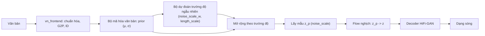

# Dự án 3. VITS tiếng Việt

!!! abstract "Mục tiêu dự án"
    Sau dự án này, bạn có thể:

    - **Lựa chọn** một mã nguồn VITS mở phù hợp với mục tiêu (học tập, nghiên cứu, triển khai trên thiết bị biên) và giải thích ưu nhược điểm của từng lựa chọn.
    - **Chuẩn bị** dữ liệu tiếng Việt đúng định dạng filelist của VITS: chuẩn hóa văn bản và G2P bằng `vn_frontend` (Dự án 1), lọc theo độ dài, đổi tần số lấy mẫu, ghi WAV 16-bit.
    - **Thay** bảng ký hiệu tiếng Anh của VITS bằng bảng ký hiệu âm vị + thanh điệu của Dự án 1, và **kiểm tra** tính nhất quán của cấu hình trước khi tốn hàng ngày GPU.
    - **Huấn luyện**, khởi động từ checkpoint có sẵn (*warm start*), **theo dõi** và **chẩn đoán** một mô hình VITS một người nói, sau đó **mở rộng** sang nhiều người nói.
    - **Xuất** mô hình sang ONNX theo quy ước kiểu Piper, **kiểm chứng** đầu ra so với PyTorch và **đo** RTF trên CPU.
    - **Đánh giá** mô hình bằng các phép đo dành riêng cho tiếng Việt: CER qua ASR, bài nghe cặp tối thiểu về thanh điệu, bài đọc số và chữ viết tắt.

!!! info "Kiến thức cần có"
    - [Chương 27](../phan-7-e2e-bieu-cam/ch27-vits.md): kiến trúc và hàm mất mát của VITS. Dự án này **không** dạy lại lý thuyết, chỉ dùng nó.
    - [Chương 21](../phan-5-mo-hinh-am-hoc/ch21-alignment.md) (Monotonic Alignment Search), [Chương 25](../phan-6-vocoder/ch25-gan-vocoder.md) (HiFi-GAN, bộ phân biệt MPD/MSD).
    - [Chương 36](../phan-9-thuc-tien/ch36-du-lieu-tts.md) (xây dựng dữ liệu), [Chương 37](../phan-9-thuc-tien/ch37-huan-luyen-va-debug.md) (huấn luyện và gỡ lỗi), [Chương 38](../phan-9-thuc-tien/ch38-danh-gia-tts.md) (đánh giá), [Chương 39](../phan-9-thuc-tien/ch39-trien-khai-production.md) (ONNX, triển khai).
    - [Dự án 1](du-an-1-frontend-tieng-viet.md): gói `vn_frontend`. Nên làm [Dự án 2](du-an-2-fastspeech2-hifigan.md) trước để có hệ thống hai tầng làm mốc so sánh.

Dự án này là một **công thức thực hành** (*recipe*): ta không cài đặt lại VITS từ đầu mà dùng một mã nguồn mở đã được kiểm chứng, và tập trung vào những gì *riêng* cho tiếng Việt và cho việc đưa mô hình ra thiết bị biên. Các lệnh của dự án upstream được trích để tham khảo. Giao diện dòng lệnh của các dự án này thay đổi theo thời gian, nên **hãy luôn đối chiếu với README của phiên bản bạn dùng**. Các đoạn mã Python trong trang (chuẩn bị dữ liệu, kiểm tra cấu hình, nạp một phần checkpoint, xuất ONNX trên mô hình đồ chơi, đánh giá thanh điệu) đều đã chạy thử. Các đoạn sửa mã upstream được ghi rõ là phác thảo.

## 1. Vì sao VITS cho tiếng Việt?

VITS (Kim và cộng sự, 2021) gộp mô hình âm học và vocoder thành **một** mạng huấn luyện đầu-cuối: từ chuỗi ký hiệu sinh thẳng ra dạng sóng. [Chương 27](../phan-7-e2e-bieu-cam/ch27-vits.md) đã phân tích mô hình như một VAE có điều kiện với prior được làm giàu bằng normalizing flow, căn chỉnh bằng MAS, bộ dự đoán trường độ ngẫu nhiên và decoder HiFi-GAN huấn luyện đối kháng. Ở đây ta nhìn VITS từ góc độ người làm sản phẩm tiếng Việt:

- **Không cần bộ căn chỉnh ngoài.** Hệ hai tầng như FastSpeech 2 ([Dự án 2](du-an-2-fastspeech2-hifigan.md)) cần trường độ của từng âm vị, thường lấy từ Montreal Forced Aligner hoặc một mô hình thầy. Với tiếng Việt, mô hình căn chỉnh dựng sẵn không phải lúc nào cũng có hoặc khớp bảng âm vị của bạn. VITS tự học căn chỉnh bằng MAS trong lúc huấn luyện, nên bỏ được hẳn bước này.
- **Không có độ lệch huấn luyện–suy luận giữa hai tầng.** Ở hệ hai tầng, vocoder học trên mel thật nhưng lúc suy luận nhận mel do mô hình âm học sinh ra, nên người ta phải fine-tune vocoder trên mel "GTA". VITS huấn luyện chung nên không có khe hở này.
- **Nhỏ và nhanh.** Mô hình cỡ vài chục triệu tham số, suy luận không tự hồi quy, chạy nhanh hơn thời gian thực trên CPU thông thường và xuất ONNX được. Đây là lý do VITS là nền của Piper, một hệ TTS chạy cục bộ được dùng rộng rãi.
- **Đủ tốt với lượng dữ liệu vừa phải** của một người nói thu âm sạch, cỡ vài giờ tới vài chục giờ, nhất là khi khởi động từ một checkpoint có sẵn. Đây là kịch bản điển hình của các nhóm làm TTS tiếng Việt.

Cái giá phải trả:

- **Khó gỡ lỗi hơn.** Hàm mất mát gồm nhiều thành phần cạnh tranh nhau: mel L1, KL, trường độ, đối kháng, feature matching. Khi chất lượng kém, khó biết lỗi do phần nào.
- **Ít điều khiển tường minh.** Không có bộ dự đoán F0 riêng như FastSpeech 2, nên không "sửa" được một thanh điệu sai bằng cách chỉnh đường cao độ.
- **Không zero-shot.** Muốn có giọng mới phải có dữ liệu của giọng đó và huấn luyện hoặc fine-tune. Nhân bản giọng từ vài giây âm thanh là việc của [Dự án 4](du-an-4-zero-shot-tts.md).

Đường suy luận của VITS, với các tham số điều khiển mà ta sẽ gặp lại khi xuất ONNX:



## 2. Chọn mã nguồn

Tính đến thời điểm biên soạn (2026), có mấy lựa chọn phổ biến. Thông tin giấy phép và trạng thái bảo trì dưới đây cần được kiểm tra lại tại kho mã trước khi dùng:

| Mã nguồn | Giấy phép (cần kiểm tra) | Ưu điểm | Nhược điểm |
|---|---|---|---|
| `jaywalnut310/vits` (mã gốc của bài báo) | MIT | Ngắn, khớp từng dòng với bài báo; dễ đọc cùng [Chương 27](../phan-7-e2e-bieu-cam/ch27-vits.md) | Không còn được bảo trì; viết cho PyTorch đời cũ nên cần sửa nhỏ; không có sẵn công cụ xuất ONNX |
| `idiap/coqui-ai-TTS` (gói `coqui-tts`, nhánh cộng đồng tiếp nối Coqui TTS) | MPL-2.0 | Được bảo trì; có công thức VITS, cấu hình ký tự tùy biến, hỗ trợ xuất ONNX cho VITS | Khung lớn, nhiều tầng trừu tượng; khó sửa sâu |
| Piper (đã chuyển từ `rhasspy/piper` sang `OHF-Voice/piper1-gpl`) | Tên kho mới gợi ý GPL (vì nhúng espeak-ng); kho cũ dùng MIT | Thiết kế cho thiết bị biên; xuất ONNX, runtime C++/Python; có checkpoint để fine-tune; đã có giọng tiếng Việt | Mặc định dùng phiên âm espeak-ng; giao diện dòng lệnh đã đổi giữa hai kho |
| Các bản cài đặt VITS2 không chính thức | Tùy kho | Cải tiến của VITS2 (Kong và cộng sự, 2023) | Chất lượng mã và độ ổn định khác nhau nhiều |

Gợi ý của chúng tôi:

- **Để học**, dùng mã gốc. Mỗi tệp (`models.py`, `losses.py`, `train.py`, `data_utils.py`) tương ứng trực tiếp với một mục của [Chương 27](../phan-7-e2e-bieu-cam/ch27-vits.md). Trang này mô tả chi tiết công thức theo mã gốc.
- **Để triển khai trên thiết bị biên**, dùng Piper. Tài liệu huấn luyện của Piper (phiên bản tại thời điểm biên soạn) cho phép đưa vào **chuỗi ID âm vị tự định nghĩa** (`--data.data_type phoneme_ids`, kèm `--data.num_symbols`), nghĩa là dùng được thẳng đầu ra `text_to_sequence` của Dự án 1 thay cho espeak-ng. Mỗi bước dưới đây có ghi chú tương ứng cho Piper.

!!! note "Góc tiếng Việt"
    Tính đến thời điểm biên soạn, kho giọng của Piper trên Hugging Face (`rhasspy/piper-voices`) có một số giọng tiếng Việt (ví dụ `vi_VN-vais1000-medium`, `vi_VN-25hours_single-low`, `vi_VN-vivos-x_low`). Các giọng này phiên âm bằng espeak-ng (giọng `vi`). Model card của `vais1000-medium` ghi rằng nó được fine-tune từ một giọng tiếng Anh và dữ liệu gốc dùng giấy phép CC BY 4.0. Nghe thử các giọng này là cách nhanh để biết một mô hình VITS tiếng Việt cỡ vừa có thể đạt tới đâu, và chúng cũng là các checkpoint ứng viên để fine-tune. Hãy đọc model card và giấy phép dữ liệu của từng giọng trước khi dùng cho mục đích thương mại.

## 3. Bước 1 — Dữ liệu

### 3.1. Yêu cầu

Một mô hình VITS một người nói cần dữ liệu **nhất quán** hơn là **nhiều**: cùng một người, cùng micro, cùng phòng, cùng phong cách đọc. Các tiêu chí cụ thể (xem [Chương 36](../phan-9-thuc-tien/ch36-du-lieu-tts.md) để biết cách thu âm và xử lý dữ liệu "in-the-wild"):

- **Âm thanh**: mono, PCM 16-bit, 22 050 Hz (cấu hình chuẩn của VITS). Im lặng hai đầu được cắt còn khoảng 50 ms; không clip; mức to đều giữa các câu.
- **Độ dài câu**: khoảng 1–11 giây. Câu quá ngắn ("Dạ.") cho ít thông tin căn chỉnh. Câu quá dài làm tốn bộ nhớ, vì bộ mã hóa hậu nghiệm xử lý cả câu dù decoder chỉ học trên đoạn cắt ngẫu nhiên. Ngoài ra, bộ lấy mẫu theo bucket trong `train.py` của mã gốc (tại thời điểm biên soạn) dùng các mốc từ 32 đến 1000 khung, tức khoảng 0,37–11,6 giây ở 22 050 Hz với hop 256. Câu nằm ngoài khoảng này bị bỏ qua âm thầm.
- **Văn bản**: khớp **chính xác** với âm thanh, sau chuẩn hóa. "2/9" phải được viết thành đúng cách người đọc đã đọc ("mùng hai tháng chín" hay "hai tháng chín"). Một tỷ lệ nhỏ bản ghi lời sai đủ để mô hình học phát âm sai một cách nhất quán.
- **Độ phủ**: kịch bản đọc nên phủ đủ các vần và cả sáu thanh, kể cả âm tiết tắc (-p, -t, -c, -ch, chỉ đi với thanh sắc và nặng). Cách chọn câu tham lam theo độ phủ có ở [Chương 36](../phan-9-thuc-tien/ch36-du-lieu-tts.md).

### 3.2. Định dạng filelist

Mã gốc của VITS đọc các tệp văn bản, mỗi dòng một câu, các trường phân cách bằng `|`:

```text
wavs/0001.wav|<văn bản hoặc chuỗi ký hiệu>                (một người nói, train.py)
wavs/0001.wav|<speaker_id>|<văn bản hoặc chuỗi ký hiệu>   (nhiều người nói, train_ms.py)
```

Với bộ dữ liệu tiếng Anh, trường cuối là phiên âm IPA từ espeak, và mã VITS ánh xạ **từng ký tự** của chuỗi đó sang ID. Bảng ký hiệu của `vn_frontend` gồm các âm vị nhiều ký tự (`tʰ`, `iə`, `ɨə`) và token thanh `T1`…`T6`, nên ánh xạ theo từng ký tự không dùng được. Ta ghi thẳng **chuỗi ID cách nhau bằng dấu cách** vào filelist, rồi sửa một hàm nhỏ trong `data_utils.py` (Mục 4.2). Cách này cũng chính là chế độ `phoneme_ids` của Piper.

### 3.3. Mã chuẩn bị dữ liệu

Đầu vào là một manifest JSONL (mỗi dòng có `id`, `audio`, `text`, `speaker`), giống đầu ra của quy trình ở [Chương 36](../phan-9-thuc-tien/ch36-du-lieu-tts.md). Đầu ra là thư mục WAV đã chuẩn hóa, `train.txt`, `val.txt`, bảng người nói và bản sao bảng ký hiệu:

```python
import json
import unicodedata
import zlib
from collections import Counter
from pathlib import Path

import numpy as np
import soundfile as sf
from scipy.signal import resample_poly

import vn_frontend as vnf  # Dự án 1: chạy từ thư mục code/ hoặc thêm nó vào sys.path


def load_mono(path: str, target_sr: int) -> np.ndarray:
    audio, sr = sf.read(path, dtype="float32", always_2d=True)    # (L, kênh)
    audio = audio.mean(axis=1)                                      # trộn về mono, (L,)
    if sr != target_sr:                                             # đổi tần số lấy mẫu
        g = np.gcd(sr, target_sr)
        audio = resample_poly(audio, target_sr // g, sr // g).astype(np.float32)
    return audio


def trim_silence(audio: np.ndarray, sr: int, top_db: float = 40.0,
                 hop: int = 256, margin_s: float = 0.05) -> np.ndarray:
    """Cắt im lặng hai đầu: khung có năng lượng thấp hơn đỉnh quá top_db bị coi là im lặng."""
    n = len(audio) // hop
    if n == 0:
        return audio
    rms = np.sqrt(np.mean(audio[: n * hop].reshape(n, hop) ** 2, axis=1) + 1e-12)  # (n,)
    db = 20 * np.log10(rms / rms.max())
    voiced = np.flatnonzero(db > -top_db)
    margin = int(margin_s * sr)
    start = max(0, voiced[0] * hop - margin)
    end = min(len(audio), (voiced[-1] + 1) * hop + margin)
    return audio[start:end]


def prepare(manifest: str, out_dir: str, sr: int = 22050, min_s: float = 1.0,
            max_s: float = 11.0, val_percent: int = 5, multi_speaker: bool = False) -> Counter:
    out = Path(out_dir)
    (out / "wavs").mkdir(parents=True, exist_ok=True)
    lines = {"train": [], "val": []}
    speakers: dict[str, int] = {}
    stats: Counter = Counter()
    for raw in Path(manifest).read_text(encoding="utf-8").splitlines():
        item = json.loads(raw)
        text = unicodedata.normalize("NFC", item["text"])
        ids = vnf.text_to_sequence(text)                 # chuẩn hóa -> G2P -> ID
        if not ids or vnf.UNK_ID in ids:                 # ký hiệu lạ: sửa front-end, đừng huấn luyện
            stats["reject_text"] += 1
            continue
        audio = trim_silence(load_mono(item["audio"], sr), sr)
        dur = len(audio) / sr
        if not min_s <= dur <= max_s:
            stats["reject_duration"] += 1
            continue
        audio = 0.95 * audio / max(np.abs(audio).max(), 1e-6)  # chuẩn hóa đỉnh
        wav = out / "wavs" / f"{item['id']}.wav"
        sf.write(wav, audio, sr, subtype="PCM_16")       # VITS gốc giả định WAV 16-bit
        split = "val" if zlib.crc32(item["id"].encode()) % 100 < val_percent else "train"
        fields = [str(wav)]
        if multi_speaker:
            fields.append(str(speakers.setdefault(item["speaker"], len(speakers))))
        fields.append(" ".join(map(str, ids)))
        lines[split].append("|".join(fields))
        stats["kept"] += 1
        stats["seconds"] += round(dur, 2)
    for split, rows in lines.items():
        (out / f"{split}.txt").write_text("\n".join(rows) + "\n", encoding="utf-8")
    (out / "speakers.json").write_text(json.dumps(speakers, ensure_ascii=False, indent=1))
    (out / "symbols.txt").write_text("\n".join(vnf.SYMBOLS) + "\n", encoding="utf-8")
    return stats
```

Chúng tôi đã chạy hàm này trên sáu tệp giả (44,1 kHz stereo, có im lặng hai đầu, một câu "Dạ." chỉ dài 0,2 giây) với `multi_speaker=True`. Kết quả: 5 câu được giữ, 1 câu bị loại vì quá ngắn; tệp ra là mono, 22 050 Hz, `PCM_16`. Một dòng filelist trông như sau:

```text
p3_vits_data/wavs/u0.wav|0|26 43 22 54 5 15 38 37 55 5 29 49 27 59 5 22 38 21 54 7
```

Vài lựa chọn trong đoạn mã có lý do riêng:

- **Ghi `PCM_16` tường minh.** Mã VITS gốc đọc WAV bằng `scipy`, rồi chia cho `max_wav_value = 32768`. Nếu bạn lỡ ghi WAV float32, giá trị đã nằm trong $[-1, 1]$ lại bị chia thêm 32 768 lần, và mô hình học trên âm thanh gần như im lặng mà không có lỗi nào được báo. Ngoài ra, bộ chia bucket của mã gốc ước lượng độ dài câu từ **kích thước tệp** với giả định 2 byte mỗi mẫu.
- **Từ chối câu có `UNK_ID`** thay vì lặng lẽ bỏ ký tự lạ. Một ký hiệu lạ là dấu hiệu front-end còn thiếu sót (một chữ viết tắt chưa có trong từ điển, một từ tiếng Anh). Sửa front-end rồi chạy lại, vì mô hình chỉ đọc đúng những gì nó được dạy.
- **Chia train/val theo hàm băm của `id`**, không theo thứ tự hay ngẫu nhiên. Cách chia ổn định qua các lần chạy lại, nên thêm dữ liệu mới không làm câu cũ nhảy từ val sang train. Với nhiều người nói, cần thêm một tập kiểm thử gồm **câu chưa thấy** của cả người nói đã thấy lẫn (nếu cần) người nói chưa thấy.
- **Lưu `symbols.txt`** cạnh dữ liệu. Bảng ký hiệu là hợp đồng giữa dữ liệu, checkpoint và mô hình ONNX sau này.

Trước khi huấn luyện, hãy làm thêm hai kiểm tra rẻ mà hiệu quả. Thứ nhất, **nghe ngẫu nhiên vài chục câu** sau xử lý, kèm văn bản. Thứ hai, tính **tốc độ nói** $r = N_{\text{ký hiệu}} / d$ (ký hiệu mỗi giây) cho từng câu. Câu có $r$ lệch xa trung vị (ví dụ quá 3 lần độ lệch tuyệt đối trung vị) thường là câu có bản ghi lời sai, thiếu hoặc thừa một đoạn, hoặc âm thanh bị cắt nhầm.

!!! note "Góc tiếng Việt"
    - **Phương ngữ của người đọc phải khớp phương ngữ của G2P.** `vn_frontend.g2p` có `dialect="north"` (mặc định) và `dialect="south"` (xấp xỉ giọng Sài Gòn). Nếu người đọc giọng Nam mà bạn phiên âm theo giọng Bắc, mô hình phải học rằng ký hiệu `z` (từ "d", "gi", "r" giọng Bắc) lúc thì đọc [j], lúc thì đọc [ʐ] hay [r] tùy chữ viết. Nó vẫn học được nhưng tốn dữ liệu hơn, và bảng ký hiệu mất ý nghĩa. Với dữ liệu nhiều người nói pha trộn vùng miền, hãy phiên âm từng câu theo phương ngữ của người nói (`text_to_sequence(text, dialect=...)`).
    - **Thanh điệu là token riêng.** Đầu ra G2P của Dự án 1 đặt một token `T1`…`T6` ở cuối mỗi âm tiết. Sáu token này dùng chung cho mọi vần, nên mô hình gặp mỗi thanh hàng nghìn lần dù mỗi tổ hợp vần–thanh cụ thể có thể hiếm. Đây là lợi thế về hiệu quả dữ liệu so với đầu vào ký tự, nơi "ế" và "ê" là hai ký hiệu không liên quan.
    - **NFC và vị trí dấu thanh.** `normalize_text` đưa văn bản về NFC và thống nhất vị trí dấu ("hoà" thành "hòa"), nên hai cách gõ của cùng một âm tiết cho cùng chuỗi ID.

## 4. Bước 2 — Biểu diễn đầu vào và sửa mã VITS

### 4.1. Ký tự hay âm vị?

Có hai lựa chọn hợp lý cho tiếng Việt ([Chương 18](../phan-4-frontend/ch18-g2p-bieu-dien-dau-vao.md)):

| | Ký tự (chữ viết NFC) | Âm vị + token thanh (`vn_frontend`) |
|---|---|---|
| Kích thước bảng ký hiệu | Khoảng 90–100 (các nguyên âm có dấu dựng sẵn, chữ thường) | 60 (tính đến phiên bản lúc biên soạn) |
| Cần G2P | Không (tiếng Việt gần như ghi âm vị) | Có, theo luật |
| Xử lý phương ngữ | Ngầm, do dữ liệu quyết định | Tường minh qua `dialect` |
| Chia sẻ thông tin thanh điệu | Không (mỗi nguyên âm có dấu là một ký hiệu riêng) | Có (6 token thanh dùng chung) |
| Từ mượn, tên riêng nước ngoài | Mô hình tự đoán từ chữ | Phụ thuộc chất lượng G2P và từ điển |

Với vài chục giờ dữ liệu, cả hai đều cho kết quả tốt. Ta chọn âm vị + thanh vì ba lý do: dùng lại Dự án 1, kiểm soát phương ngữ, và tận dụng được việc chia sẻ thông tin thanh điệu khi dữ liệu ít. Ví dụ đầu ra G2P:

```text
g2p("Xin chào Việt Nam.") ->
['s', 'i', 'n', 'T1', ' ', 'c', 'a', 'w', 'T2', ' ', 'v', 'iə', 't', 'T6', ' ', 'n', 'a', 'm', 'T1', '.']
```

**Token trống (*blank*).** Cấu hình `add_blank: true` của VITS chèn một token trống giữa mọi cặp ký hiệu ($[a, b] \to [\varnothing, a, \varnothing, b, \varnothing]$). Bài báo gốc chèn token trống theo cách cài đặt của Glow-TTS, cấu hình chuẩn của mã gốc bật tùy chọn này, và kinh nghiệm thực hành của cộng đồng là nó thường giúp phát âm rõ hơn. Trực giác là nó cho MAS thêm "chỗ" để đặt các khung chuyển tiếp giữa hai âm vị. Mã gốc dùng ID 0 (trùng với ký hiệu đệm) làm blank. `vn_frontend` có token `<blank>` riêng (`BLANK_ID`) và hàm `vnf.intersperse`. Cách nào cũng được, **miễn là lúc huấn luyện, lúc suy luận PyTorch và lúc chạy ONNX dùng cùng một quy ước**.

### 4.2. Sửa mã VITS gốc (phác thảo)

Ba chỗ cần sửa trong mã gốc. Đoạn dưới đây là **phác thảo chưa chạy** (vì cần mã VITS), tên hàm và vị trí lấy theo `jaywalnut310/vits` tại thời điểm biên soạn:

```python
# --- text/symbols.py: thay bảng ký hiệu tiếng Anh ---
from vn_frontend import SYMBOLS as symbols          # 60 ký hiệu; train.py dùng len(symbols) làm n_vocab

# --- data_utils.py, lớp TextAudioLoader (và TextAudioSpeakerLoader) ---
import vn_frontend as vnf

def get_text(self, text):
    ids = [int(t) for t in text.split()]            # filelist chứa sẵn chuỗi ID
    if self.add_blank:
        ids = vnf.intersperse(ids)                   # blank = vnf.BLANK_ID (thay cho intersperse(..., 0))
    return torch.LongTensor(ids)

def _filter(self):
    # Mã gốc lọc bằng len(text), tức số KÝ TỰ của trường văn bản, với max_text_len mặc định 190.
    # Với chuỗi ID kiểu "26 43 22 ...", 190 ký tự chỉ là khoảng 60–70 ID: phần lớn câu bị loại âm thầm.
    # Hoặc nâng max_text_len trong cấu hình (như Mục 5), hoặc đếm token: len(text.split()).
    ...
```

Nếu dùng Piper, bạn không sửa mã. Thay vào đó, truyền tham số dữ liệu kiểu ID (`--data.data_type phoneme_ids`, `--data.num_symbols 60`, theo tài liệu huấn luyện của Piper tại thời điểm biên soạn), và filelist chỉ còn hai hoặc ba cột. Hãy kiểm tra tên tham số chính xác trong tài liệu của phiên bản bạn dùng.

!!! warning "Bộ đệm phổ cũ"
    Mã gốc lưu phổ tuyến tính đã tính vào tệp `*.spec.pt` cạnh mỗi tệp WAV và dùng lại ở các lần chạy sau. Nếu bạn đổi `filter_length`, `hop_length` hay `win_length` mà không xóa các tệp này, mô hình sẽ học trên phổ cũ. Hậu quả có khi là lỗi kích thước, có khi chỉ là chất lượng kém khó hiểu. Hãy xóa `*.spec.pt` mỗi khi đổi cấu hình STFT.

## 5. Bước 3 — Cấu hình và kiểm tra tính nhất quán

Cấu hình của VITS gốc là một tệp JSON ba phần: `train`, `data`, `model`. Ta lấy khuôn `configs/ljs_base.json` và chỉ đổi phần dữ liệu. Ý nghĩa các tham số quan trọng:

| Tham số | Giá trị (khuôn `ljs_base`) | Ý nghĩa và lưu ý |
|---|---|---|
| `sampling_rate`, `filter_length`, `hop_length`, `win_length` | 22050, 1024, 256, 1024 | STFT của phổ tuyến tính (đầu vào bộ mã hóa hậu nghiệm) và mel (cho hàm mất mát) |
| `upsample_rates` | [8, 8, 2, 2] | Hệ số tăng mẫu của decoder; **tích phải bằng `hop_length`** (8·8·2·2 = 256) |
| `segment_size` | 8192 mẫu | Decoder chỉ học trên đoạn cắt ngẫu nhiên dài 32 khung, khoảng 0,37 s ([Chương 27](../phan-7-e2e-bieu-cam/ch27-vits.md)) |
| `add_blank` | true | Chèn token trống (Mục 4.1) |
| `c_mel`, `c_kl` | 45, 1.0 | Trọng số mel L1 và KL trong hàm mất mát của bộ sinh |
| `learning_rate`, `betas`, `eps`, `lr_decay` | 2e-4, [0.8, 0.99], 1e-9, 0.999875 | AdamW; tốc độ học giảm theo hàm mũ sau mỗi epoch |
| `batch_size` | 64 | Điều chỉnh theo bộ nhớ GPU |
| `fp16_run` | true | Huấn luyện độ chính xác hỗn hợp; nếu gặp NaN, hãy tắt trước tiên ([Chương 37](../phan-9-thuc-tien/ch37-huan-luyen-va-debug.md)) |
| `n_speakers`, `gin_channels` | 0, (0) | Nhiều người nói: `n_speakers` > 0 và `gin_channels` (ví dụ 256) |

Mã gốc không tự kiểm tra các ràng buộc giữa những tham số này. Khi một ràng buộc bị vi phạm, lỗi thường hiện ra rất xa nguyên nhân, kiểu "kích thước tensor không khớp" ở hàm mất mát sau vài phút nạp dữ liệu, hoặc tệ hơn là không có lỗi nào. Một hàm kiểm tra vài chục dòng tiết kiệm được nhiều giờ:

```python
import json
import math

import vn_frontend as vnf


def make_config(train_list: str, val_list: str, n_speakers: int = 0) -> dict:
    """Cấu hình theo khuôn configs/ljs_base.json (VITS gốc), đổi phần dữ liệu cho tiếng Việt."""
    return {
        "train": {"log_interval": 200, "eval_interval": 1000, "seed": 1234, "epochs": 10000,
                  "learning_rate": 2e-4, "betas": [0.8, 0.99], "eps": 1e-9, "batch_size": 32,
                  "fp16_run": False, "lr_decay": 0.999875, "segment_size": 8192,
                  "init_lr_ratio": 1, "warmup_epochs": 0, "c_mel": 45, "c_kl": 1.0},
        "data": {"training_files": train_list, "validation_files": val_list,
                 "text_cleaners": [], "cleaned_text": True, "max_wav_value": 32768.0,
                 "sampling_rate": 22050, "filter_length": 1024, "hop_length": 256,
                 "win_length": 1024, "n_mel_channels": 80, "mel_fmin": 0.0, "mel_fmax": None,
                 "add_blank": True, "n_speakers": n_speakers,
                 "min_text_len": 1, "max_text_len": 2000},   # đếm theo KÝ TỰ của dòng filelist!
        "model": {"inter_channels": 192, "hidden_channels": 192, "filter_channels": 768,
                  "n_heads": 2, "n_layers": 6, "kernel_size": 3, "p_dropout": 0.1,
                  "resblock": "1", "resblock_kernel_sizes": [3, 7, 11],
                  "resblock_dilation_sizes": [[1, 3, 5], [1, 3, 5], [1, 3, 5]],
                  "upsample_rates": [8, 8, 2, 2], "upsample_initial_channel": 512,
                  "upsample_kernel_sizes": [16, 16, 4, 4], "n_layers_q": 3,
                  "use_spectral_norm": False, "gin_channels": 256 if n_speakers > 0 else 0},
    }


def check_config(cfg: dict, n_vocab: int) -> list[str]:
    """Các ràng buộc mà mã VITS không tự kiểm tra; vi phạm thường gây lỗi kích thước khó hiểu."""
    d, m, t = cfg["data"], cfg["model"], cfg["train"]
    problems = []
    if math.prod(m["upsample_rates"]) != d["hop_length"]:
        problems.append("tích upsample_rates phải bằng hop_length (mỗi khung -> hop mẫu)")
    if t["segment_size"] % d["hop_length"]:
        problems.append("segment_size phải chia hết cho hop_length")
    if d["win_length"] > d["filter_length"]:
        problems.append("win_length không được lớn hơn filter_length (n_fft)")
    if len(m["upsample_rates"]) != len(m["upsample_kernel_sizes"]):
        problems.append("upsample_rates và upsample_kernel_sizes phải cùng độ dài")
    if any(k < r for k, r in zip(m["upsample_kernel_sizes"], m["upsample_rates"])):
        problems.append("kernel ConvTranspose nên >= stride (thường = 2 x stride)")
    if d["mel_fmax"] is not None and d["mel_fmax"] > d["sampling_rate"] / 2:
        problems.append("mel_fmax vượt tần số Nyquist")
    if d["n_speakers"] > 0 and m["gin_channels"] <= 0:
        problems.append("mô hình nhiều người nói cần gin_channels > 0")
    if n_vocab < 2:
        problems.append("bảng ký hiệu rỗng?")
    return problems


cfg = make_config("filelists/vi_train.txt", "filelists/vi_val.txt", n_speakers=0)
assert check_config(cfg, n_vocab=len(vnf.SYMBOLS)) == []
bad = make_config("a", "b"); bad["data"]["hop_length"] = 300
print(check_config(bad, len(vnf.SYMBOLS)))
json.dump(cfg, open("vi_base.json", "w"), indent=2)
print("n_vocab =", len(vnf.SYMBOLS), "| khung/đoạn huấn luyện =", cfg["train"]["segment_size"] // 256)
```

```text
['tích upsample_rates phải bằng hop_length (mỗi khung -> hop mẫu)', 'segment_size phải chia hết cho hop_length']
n_vocab = 60 | khung/đoạn huấn luyện = 32
```

So với khuôn gốc, ta đổi bốn điểm. `text_cleaners` để rỗng và `cleaned_text: true`, vì văn bản đã được Dự án 1 xử lý. `max_text_len` được nâng lên 2000, vì bộ lọc của mã gốc đếm **ký tự** của chuỗi ID (xem phác thảo ở Mục 4.2). `batch_size` hạ xuống 32 cho GPU phổ thông. Còn `fp16_run` để `false` trong lần chạy đầu: khi mọi thứ đã ổn mới bật độ chính xác hỗn hợp, để không phải gỡ lỗi hai thứ cùng lúc.

## 6. Bước 4 — Huấn luyện

### 6.1. Các lệnh tham khảo

Các lệnh dưới đây lấy theo README của mã gốc tại thời điểm biên soạn. **Hãy kiểm tra README của kho bạn dùng**, vì các fork thường đổi tên tệp và tham số.

```bash
# Cài đặt (trong môi trường ảo), rồi biên dịch MAS bản Cython
git clone https://github.com/jaywalnut310/vits && cd vits
pip install -r requirements.txt          # tệp này ghim phiên bản cũ: xem ghi chú bên dưới
cd monotonic_align && python setup.py build_ext --inplace && cd ..

# Dữ liệu đã chuẩn bị ở Bước 1, cấu hình ở Bước 3
cp /path/to/vits_data/train.txt filelists/vi_train.txt
cp /path/to/vits_data/val.txt   filelists/vi_val.txt
cp /path/to/vi_base.json        configs/vi_base.json

# Một người nói / nhiều người nói
python train.py    -c configs/vi_base.json -m vi_base
python train_ms.py -c configs/vi_ms.json   -m vi_ms

# Theo dõi
tensorboard --logdir logs/vi_base
```

Mã gốc được viết cho PyTorch đời cũ. Với phiên bản mới, có ít nhất hai chỗ thường phải sửa (đã kiểm chứng với mã tại thời điểm biên soạn):

- Lời gọi `torch.stft` trong `mel_processing.py` không truyền `return_complex`. PyTorch mới báo lỗi `stft requires the return_complex parameter be given for real inputs`. Cách sửa giữ nguyên các phép tính phía sau: `torch.view_as_real(torch.stft(..., return_complex=True))`.
- `train.py` đặt `MASTER_PORT = '80000'`, vượt quá dải cổng TCP hợp lệ (0–65535). Hãy đổi sang một cổng hợp lệ, ví dụ `29500`.

Mã gốc tự dùng mọi GPU nhìn thấy được (`mp.spawn` một tiến trình cho mỗi GPU, DDP với backend NCCL). Hãy chọn GPU bằng `CUDA_VISIBLE_DEVICES`. Checkpoint được lưu thành cặp `G_<bước>.pth` (bộ sinh) và `D_<bước>.pth` (bộ phân biệt) trong `logs/<tên>` sau mỗi `eval_interval` bước, và lần chạy sau tự tiếp tục từ cặp mới nhất.

Với Piper, các bước tương ứng là: lệnh `python3 -m piper.train fit` với các tham số `--data.*` và `--model.*`; tham số `--ckpt_path` để fine-tune từ một checkpoint; xuất ONNX bằng `python3 -m piper.train.export_onnx`. Đây là các tên trong tài liệu huấn luyện của kho `OHF-Voice/piper1-gpl` tại thời điểm biên soạn; bản `rhasspy/piper` cũ dùng mô-đun `piper_train` với cú pháp khác.

### 6.2. Khởi động từ checkpoint có sẵn

Huấn luyện VITS từ đầu tốn nhiều ngày GPU. Ta có thể rút ngắn đáng kể bằng cách khởi động từ một checkpoint đã huấn luyện, **kể cả khi checkpoint đó thuộc ngôn ngữ khác**. Tài liệu của Piper khuyến nghị đúng điều này, và giọng `vi_VN-vais1000-medium` được fine-tune từ một giọng tiếng Anh. Lý do nằm ở cấu trúc của VITS. Decoder HiFi-GAN, bộ mã hóa hậu nghiệm và flow chủ yếu học "âm thanh của giọng nói": cách biến một biểu diễn ẩn thành dạng sóng. Phần này gần như không phụ thuộc ngôn ngữ. Chỉ có embedding của bộ mã hóa văn bản là gắn chặt với bảng ký hiệu.

Vì bảng ký hiệu đổi (tiếng Anh sang 60 ký hiệu tiếng Việt), ma trận embedding `enc_p.emb.weight` của checkpoint có hình dạng khác. Hàm `load_checkpoint` của mã gốc không kiểm tra hình dạng, nên sẽ báo lỗi kích thước. Ta cần nạp **một phần**: mọi tham số khớp cả tên lẫn hình dạng, còn lại giữ khởi tạo ngẫu nhiên:

```python
import torch
import torch.nn as nn


def load_partial(model: nn.Module, pretrained: dict[str, torch.Tensor]) -> tuple[list[str], list[str]]:
    """Nạp mọi tham số khớp tên VÀ hình dạng.

    Trả về (bị bỏ qua: có trong checkpoint nhưng không dùng được,
            khởi tạo mới: có trong mô hình nhưng không được nạp).
    """
    own = model.state_dict()
    usable = {k: v for k, v in pretrained.items() if k in own and own[k].shape == v.shape}
    model.load_state_dict(usable, strict=False)
    return sorted(set(pretrained) - set(usable)), sorted(set(own) - set(usable))


class TinyTextEncoder(nn.Module):           # đại diện cho enc_p của VITS
    def __init__(self, n_vocab: int, hidden: int = 16):
        super().__init__()
        self.emb = nn.Embedding(n_vocab, hidden)
        self.proj = nn.Conv1d(hidden, hidden, 1)


english = TinyTextEncoder(n_vocab=178)      # bảng ký hiệu của checkpoint tiếng Anh (giả định)
vietnamese = TinyTextEncoder(n_vocab=60)    # bảng ký hiệu của vn_frontend
skipped, fresh = load_partial(vietnamese, english.state_dict())
print("bỏ qua:", skipped, "| khởi tạo mới:", fresh)
assert torch.equal(vietnamese.proj.weight, english.proj.weight)  # phần dùng chung đã được nạp
```

```text
bỏ qua: ['emb.weight'] | khởi tạo mới: ['emb.weight']
```

Với VITS thật, áp dụng `load_partial` cho `net_g` với `torch.load("G_xxx.pth")["model"]`. Bộ phân biệt `net_d` không phụ thuộc bảng ký hiệu nên nạp được toàn bộ. Nên nạp cả bộ phân biệt: nếu bắt đầu với một bộ phân biệt ngẫu nhiên, những bước đầu nó đưa tín hiệu đối kháng vô nghĩa vào một decoder vốn đã tốt. Bộ đếm bước, trạng thái bộ tối ưu và lịch tốc độ học thì khởi tạo lại. Danh sách "khởi tạo mới" phải đúng như bạn dự đoán (chỉ embedding văn bản, và `emb_g` nếu số người nói đổi). Nếu nó dài bất thường, có thể bạn đang nạp nhầm checkpoint của một kiến trúc khác.

### 6.3. Huấn luyện bao lâu?

Không có con số chung. Bài báo gốc huấn luyện mô hình tới 800 nghìn bước trên 4 GPU V100, batch 64 mỗi GPU, độ chính xác hỗn hợp; đó là mức cho huấn luyện từ đầu trên khoảng 24 giờ LJSpeech. Khi fine-tune từ checkpoint, tài liệu Piper (tại thời điểm biên soạn) gợi ý bắt đầu với khoảng 2 000 epoch cho dưới 5 giờ âm thanh. Con số này chỉ là điểm xuất phát, phụ thuộc kích thước batch và dữ liệu. Tiêu chí dừng tốt nhất không phải là một con số loss, mà là:

1. Chất lượng nghe được trên tập kiểm tra cố định không còn cải thiện qua vài lần đánh giá liên tiếp.
2. CER qua ASR (Mục 10) đã bão hòa.
3. Không còn lỗi thanh điệu có hệ thống trên bộ câu cặp tối thiểu.

Hãy giữ lại vài checkpoint tốt nhất theo các tiêu chí này, không chỉ checkpoint cuối cùng.

## 7. Bước 5 — Theo dõi huấn luyện

Mã gốc ghi lên TensorBoard các đại lượng sau (tên theo `train.py` tại thời điểm biên soạn; fork có thể khác):

| Mục | Ý nghĩa | Diễn biến "khỏe mạnh" (định tính) |
|---|---|---|
| `loss/g/mel` | Mel L1 giữa âm thanh sinh ra và thật (đã nhân `c_mel`) | Giảm đều, chậm dần; là chỉ báo chất lượng đáng tin nhất trong các loss |
| `loss/g/kl` | KL giữa hậu nghiệm và prior qua flow | Giảm trong giai đoạn đầu rồi ổn định |
| `loss/g/dur` | Loss của bộ dự đoán trường độ ngẫu nhiên | Giảm rồi ổn định |
| `loss/g/fm`, `loss/g/total`, `loss/d/total` | Feature matching, tổng của bộ sinh và bộ phân biệt | Dao động quanh một mức; **không** về 0. Bộ phân biệt về gần 0 nghĩa là nó thắng áp đảo |
| `grad_norm_g`, `grad_norm_d` | Chuẩn gradient | Không có đỉnh nhọn kéo dài; đỉnh liên tục báo trước NaN |
| `all/attn` (ảnh) | Căn chỉnh cứng do MAS tìm ra | Một "bậc thang" đơn điệu phủ hết các token, mỗi token có độ dài hợp lý |
| `gen/audio`, `gen/mel` | Mẫu sinh trên tập kiểm tra | **Nghe** sau mỗi lần đánh giá |

Vì MAS luôn trả về một căn chỉnh đơn điệu, ảnh `all/attn` của VITS gần như lúc nào cũng "đẹp", khác với attention mềm của Tacotron ([Chương 20](../phan-5-mo-hinh-am-hoc/ch20-tacotron.md)). Điều cần soi là **độ dài các bậc**. Một token chiếm hàng trăm khung, hay một loạt token chỉ có một khung, thường báo hiệu văn bản và âm thanh không khớp, hoặc im lặng dài chưa được cắt.

Các loss đối kháng không phản ánh chất lượng một cách đơn điệu, nên **tai người là công cụ theo dõi chính**. Ngoài các câu trong tập kiểm tra, hãy định kỳ tổng hợp một bộ câu cố định:

- **Cặp tối thiểu về thanh điệu**: "ma, mà, má, mả, mã, mạ"; "ba, bà, bá, bả, bã, bạ"; và các câu chứa chúng trong ngữ cảnh.
- **Âm tiết tắc với sắc/nặng**: "học tập, bắt đầu, cấp bậc, thích hợp".
- **Số, ngày tháng, chữ viết tắt** (đi qua `normalize_text`).
- **Câu dài** (gần giới hạn độ dài) và **câu rất ngắn** (một hai âm tiết).

Bảng chẩn đoán thu gọn cho các triệu chứng hay gặp (bảng đầy đủ có ở [Chương 37](../phan-9-thuc-tien/ch37-huan-luyen-va-debug.md)):

| Triệu chứng | Nguyên nhân thường gặp | Cách xử lý |
|---|---|---|
| Âm thanh gần như im lặng hoặc toàn nhiễu ngay từ đầu | WAV float32 bị chia cho 32 768; sai tần số lấy mẫu | Ghi lại dữ liệu `PCM_16` đúng tần số; mã gốc báo lỗi nếu tần số lệch, nhưng không báo nếu sai định dạng mẫu |
| Lỗi kích thước tensor khi tính loss | Tích `upsample_rates` khác `hop_length`; cache `*.spec.pt` cũ | Chạy `check_config`; xóa cache phổ |
| `size mismatch for enc_p.emb.weight` khi nạp checkpoint | Bảng ký hiệu đổi | Nạp một phần (Mục 6.2) |
| Tập huấn luyện nhỏ bất thường (log báo ít câu) | Bộ lọc `max_text_len` đếm ký tự; câu ngoài các mốc bucket | Nâng `max_text_len` hoặc sửa `_filter`; giữ câu trong 1–11 s |
| Âm sắc rè, tiếng kim loại kéo dài | Bộ phân biệt áp đảo; tốc độ học quá cao khi fine-tune | Kiểm tra `loss/d/total`; giảm tốc độ học; nghe lại dữ liệu xem có nhiễu nền không |
| Một số âm tiết luôn đọc sai | Lỗi G2P hoặc chuẩn hóa; bản ghi lời không khớp | Tra `g2p()` của từ đó; nghe các câu huấn luyện chứa nó |
| Thanh hỏi/ngã lẫn lộn, thanh "bẹt" | Người đọc giọng Nam nhưng G2P giọng Bắc; dữ liệu ít ngã; noise_scale quá cao | Chọn đúng `dialect`; bổ sung câu chứa thanh yếu; giảm `noise_scale` khi suy luận |
| NaN sau một thời gian | fp16; tốc độ học; câu lỗi (rất ngắn, im lặng hoàn toàn) | Tắt fp16; tìm câu gây lỗi bằng cách ghi lại id của batch |

## 8. Bước 6 — Mở rộng sang nhiều người nói

Chuyển từ một sang nhiều người nói chỉ cần ba thay đổi:

1. Filelist có thêm cột `speaker_id` (hàm `prepare(..., multi_speaker=True)` đã làm việc này và lưu bảng `speakers.json`).
2. Cấu hình có `n_speakers` bằng số người nói và `gin_channels` > 0 (khuôn VCTK của mã gốc dùng 256).
3. Huấn luyện bằng `train_ms.py`.

Trong VITS gốc, embedding người nói $\mathbf{g}$ được đưa vào bộ mã hóa hậu nghiệm, flow, decoder và bộ dự đoán trường độ, nhưng **không** vào bộ mã hóa văn bản. VITS2 bổ sung điều kiện người nói cho cả bộ mã hóa văn bản ([Chương 27](../phan-7-e2e-bieu-cam/ch27-vits.md)). Cách đưa điều kiện người nói vào mô hình và các phương pháp thích nghi giọng được bàn ở [Chương 28](../phan-7-e2e-bieu-cam/ch28-da-nguoi-noi-voice-cloning.md).

Những điểm thực hành:

- **Cân bằng dữ liệu.** Nếu một người nói chiếm 80% dữ liệu, mô hình sẽ "kéo" các giọng khác về phía giọng đó. Hãy lấy mẫu có trọng số theo người nói, hoặc giới hạn số giờ tối đa của mỗi người.
- **Dữ liệu tối thiểu mỗi người.** Người nói chỉ có vài phút dữ liệu thường có giọng tổng hợp kém ổn định. Với họ, fine-tune trên một mô hình nhiều người nói đã huấn luyện thường cho kết quả tốt hơn là trộn ngay từ đầu.
- **Phương ngữ là thuộc tính của người nói.** Phiên âm từng câu theo phương ngữ của người đọc nó (Mục 3.3). Một mô hình như vậy học được ánh xạ âm vị–âm thanh nhất quán, và bạn chọn giọng Bắc hay Nam bằng cách chọn `sid` *và* `dialect` khi suy luận.
- **Thêm người nói mới về sau.** Ma trận `emb_g` có `n_speakers` hàng. Thêm người mới tức là đổi hình dạng, nên dùng lại thủ thuật nạp một phần (khởi tạo hàng mới, ví dụ bằng trung bình các hàng cũ) rồi fine-tune.
- **Đồng ý của người nói.** Mỗi giọng trong mô hình phải có sự đồng ý rõ ràng cho mục đích sử dụng ([Chương 40](../phan-9-thuc-tien/ch40-dao-duc-an-toan.md)).

## 9. Bước 7 — Suy luận

Đường suy luận của mã gốc (phác thảo theo sổ tay suy luận mẫu của kho, chưa chạy tại đây):

```python
# PHÁC THẢO — dựa trên SynthesizerTrn.infer của mã gốc
import vn_frontend as vnf

ids = vnf.intersperse(vnf.text_to_sequence("Xin chào các bạn."))   # phải khớp add_blank lúc huấn luyện
x = torch.LongTensor(ids).unsqueeze(0)                              # (1, N)
x_lengths = torch.LongTensor([x.size(1)])
with torch.no_grad():
    audio = net_g.infer(x, x_lengths, noise_scale=0.667, noise_scale_w=0.8,
                        length_scale=1.0)[0][0, 0].cpu().numpy()     # (L,)
```

Ba tham số điều khiển tương ứng với ba nguồn ngẫu nhiên và một phép co giãn trong mô hình ([Chương 27](../phan-7-e2e-bieu-cam/ch27-vits.md)):

- `noise_scale`: độ lệch chuẩn khi lấy mẫu $\mathbf{z}_p$ từ prior, đóng vai trò "nhiệt độ". Cao hơn thì giọng biểu cảm, đa dạng hơn; thấp quá thì đều đều, phẳng.
- `noise_scale_w`: nhiễu của bộ dự đoán trường độ ngẫu nhiên. Tham số này điều khiển độ đa dạng của nhịp điệu.
- `length_scale`: nhân trường độ, nên lớn hơn 1 là nói chậm hơn.

Các giá trị 0,667 / 0,8 / 1,0 là giá trị dùng trong thí nghiệm của bài báo gốc, mặc định của sổ tay suy luận trong mã gốc và cũng là mặc định trong cấu hình suy luận của các giọng Piper. Đó là điểm khởi đầu tốt, không phải tối ưu cho mọi giọng.

!!! note "Góc tiếng Việt"
    Với ngôn ngữ thanh điệu, `noise_scale` cao có thể làm đường F0 dao động đủ mạnh để một thanh nghe "lệch" sang thanh khác (hỏi sang ngã, sắc yếu nghe như ngang). Đây là một nhận xét kinh nghiệm, không phải kết quả đã công bố. Khi tinh chỉnh tham số suy luận, đừng chỉ nghe câu thường; hãy chạy lại bài cặp tối thiểu ở Mục 10.

Với văn bản dài, hãy tách câu bằng `vnf.split_sentences`, tổng hợp từng câu rồi nối lại với khoảng lặng ngắn. Hoặc tốt hơn, cắm mô hình vào dịch vụ của [Dự án 5](du-an-5-tts-service-streaming.md), nơi việc chia đoạn và streaming đã được giải quyết.

## 10. Bước 8 — Xuất ONNX cho thiết bị biên

### 10.1. Nguyên tắc

Xuất ONNX biến mô hình PyTorch thành một đồ thị tĩnh, chạy được bằng ONNX Runtime trên CPU, di động, trình duyệt mà không cần PyTorch ([Chương 39](../phan-9-thuc-tien/ch39-trien-khai-production.md)). Với VITS, có năm điểm cần làm đúng. Chúng chính là những gì script xuất ONNX của Piper làm (theo mã tại thời điểm biên soạn):

1. **Chỉ xuất đường suy luận.** Bọc `infer` trong một hàm `forward` mới. Bộ mã hóa hậu nghiệm và bộ phân biệt không có mặt trong mô hình xuất ra.
2. **Gỡ weight normalization** khỏi decoder trước khi xuất (`remove_weight_norm`). Weight norm (Salimans và Kingma, 2016) tách trọng số thành hướng và độ lớn để huấn luyện ổn định hơn. Lúc suy luận, gộp lại thành một tensor thì đồ thị gọn và nhanh hơn.
3. **Đưa các tham số điều khiển thành đầu vào tensor.** Piper dùng một tensor `scales` gồm `[noise_scale, length_scale, noise_scale_w]`. Nếu để chúng là hằng số Python, chúng bị "đóng băng" vào đồ thị lúc xuất.
4. **Khai báo trục động**: độ dài chuỗi ký hiệu (`phonemes`) và độ dài âm thanh đầu ra (`time`). Độ dài đầu ra phụ thuộc vào *giá trị* của trường độ dự đoán, nên đây là hình dạng phụ thuộc dữ liệu.
5. **Kiểm chứng** đầu ra ONNX so với PyTorch ở *nhiều* độ dài, với nhiễu tắt để so được.

### 10.2. Thực hành trên một mô hình đồ chơi

Để chạy được ngay mà không cần checkpoint thật, ta dựng một mô hình đồ chơi có **cùng dạng đường suy luận** với VITS: embedding, mã hóa, dự đoán trường độ có nhiễu, mở rộng bằng `generate_path` (sao lại từ `commons.py` của mã gốc), decoder `ConvTranspose1d` có weight norm. Nó đủ để kiểm chứng mọi vấn đề của việc xuất: hình dạng phụ thuộc dữ liệu, nhiễu ngẫu nhiên, weight norm, tham số điều khiển dạng tensor.

```python
import torch
import torch.nn as nn
import torch.nn.functional as F


def sequence_mask(lengths: torch.Tensor, max_len) -> torch.Tensor:
    x = torch.arange(max_len, dtype=lengths.dtype, device=lengths.device)  # (T,)
    return x.unsqueeze(0) < lengths.unsqueeze(1)                             # (B, T)


def generate_path(duration: torch.Tensor, mask: torch.Tensor) -> torch.Tensor:
    """Như commons.generate_path của VITS. duration: (B, 1, N); mask: (B, 1, T, N)."""
    b, _, t_y, t_x = mask.shape
    cum = torch.cumsum(duration, -1).view(b * t_x)                   # (B*N,)
    path = sequence_mask(cum, t_y).to(mask.dtype).view(b, t_x, t_y)
    path = path - F.pad(path, [0, 0, 1, 0, 0, 0])[:, :-1]            # hiệu liên tiếp -> căn chỉnh cứng
    return path.unsqueeze(1).transpose(2, 3) * mask                  # (B, 1, T, N)


class ToyVits(nn.Module):
    """Mô hình đồ chơi có cùng DẠNG đường suy luận với VITS:
    encoder văn bản -> trường độ (có nhiễu) -> mở rộng theo căn chỉnh -> decoder ra dạng sóng."""

    def __init__(self, n_vocab: int, hidden: int = 32, hop: int = 256):
        super().__init__()
        self.emb = nn.Embedding(n_vocab, hidden)
        self.enc = nn.Conv1d(hidden, hidden, 3, padding=1)
        self.dur = nn.Conv1d(hidden, 1, 1)
        self.dec = nn.utils.parametrizations.weight_norm(               # như HiFi-GAN: weight norm
            nn.ConvTranspose1d(hidden, 1, 2 * hop, stride=hop, padding=hop // 2))

    def infer(self, x, x_lengths, noise_scale=0.667, length_scale=1.0, noise_scale_w=0.8):
        x_mask = sequence_mask(x_lengths, x.size(1)).unsqueeze(1).float()           # (B, 1, N)
        h = torch.tanh(self.enc(self.emb(x).transpose(1, 2))) * x_mask              # (B, C, N)
        logw = self.dur(h) + noise_scale_w * torch.randn_like(h[:, :1])             # (B, 1, N)
        w_ceil = torch.ceil(torch.exp(logw) * x_mask * length_scale)                # số khung/token
        y_lengths = torch.clamp_min(w_ceil.sum([1, 2]), 1).long()                   # (B,)
        y_mask = sequence_mask(y_lengths, y_lengths.max()).unsqueeze(1).float()     # (B, 1, T)
        attn = generate_path(w_ceil, x_mask.unsqueeze(2) * y_mask.unsqueeze(-1))    # (B, 1, T, N)
        m = torch.matmul(attn.squeeze(1), h.transpose(1, 2)).transpose(1, 2)        # (B, C, T)
        z = (m + torch.randn_like(m) * noise_scale) * y_mask
        return torch.tanh(self.dec(z))                                              # (B, 1, T*hop)
```

Phần xuất và kiểm chứng (chạy tiếp sau khối trên; cần `onnxruntime`):

```python
import time

import numpy as np
import onnxruntime as ort

torch.manual_seed(0)
model = ToyVits(n_vocab=60).eval()
nn.utils.parametrize.remove_parametrizations(model.dec, "weight")  # 1) gỡ weight norm


def infer_forward(text, text_lengths, scales):                      # 2) giao diện kiểu Piper
    return model.infer(text, text_lengths, noise_scale=scales[0],
                       length_scale=scales[1], noise_scale_w=scales[2])


model.forward = infer_forward
dummy = (torch.randint(0, 60, (1, 20)), torch.tensor([20]), torch.tensor([0.667, 1.0, 0.8]))
torch.onnx.export(                                                  # 3) trục động
    model, dummy, "toy_vits.onnx", opset_version=17, dynamo=False,
    input_names=["input", "input_lengths", "scales"], output_names=["output"],
    dynamic_axes={"input": {0: "batch_size", 1: "phonemes"}, "input_lengths": {0: "batch_size"},
                  "output": {0: "batch_size", 2: "time"}})

sess = ort.InferenceSession("toy_vits.onnx", providers=["CPUExecutionProvider"])
for n in (7, 33):                                                   # 4) so khớp ở nhiều độ dài
    ids = torch.randint(0, 60, (1, n))
    scales = np.array([0.0, 1.0, 0.0], dtype=np.float32)           # tắt nhiễu để so được
    out_ort = sess.run(None, {"input": ids.numpy(), "input_lengths": np.array([n]),
                              "scales": scales})[0]
    with torch.no_grad():
        out_pt = model.infer(ids, torch.tensor([n]), 0.0, 1.0, 0.0).numpy()
    assert out_ort.shape == out_pt.shape and np.abs(out_ort - out_pt).max() < 1e-4
    print(f"N={n}: output {out_ort.shape}, sai khác tối đa {np.abs(out_ort - out_pt).max():.1e}")

ids = np.random.default_rng(0).integers(0, 60, (1, 40))
def run(length_scale: float) -> np.ndarray:
    feeds = {"input": ids, "input_lengths": np.array([40]),
             "scales": np.array([0.0, length_scale, 0.0], dtype=np.float32)}  # tắt nhiễu: tất định
    return sess.run(None, feeds)[0].reshape(-1)                      # (L,)

print("độ dài với length_scale 1 và 2:", len(run(1.0)), len(run(2.0)))
assert len(run(2.0)) > 1.5 * len(run(1.0))                          # 5) length_scale đổi tốc độ nói
t0 = time.perf_counter(); audio = run(1.0); dt = time.perf_counter() - t0
print(f"RTF (CPU, mô hình đồ chơi) = {dt / (len(audio) / 22050):.4f}")
```

```text
N=7: output (1, 1, 2560), sai khác tối đa 8.9e-08
N=33: output (1, 1, 13312), sai khác tối đa 7.5e-08
độ dài với length_scale 1 và 2: 15872 26624
```

Kết quả cho thấy những điều ta cần kiểm chứng. Đồ thị ONNX tạo ra âm thanh có **độ dài khác nhau** cho đầu vào có độ dài khác nhau, nghĩa là trục động hoạt động, kể cả với độ dài đầu ra phụ thuộc dữ liệu. Sai khác so với PyTorch ở mức $10^{-7}$, tức sai số làm tròn float32. Và `length_scale` truyền qua tensor `scales` thực sự đổi tốc độ nói. Tỷ lệ độ dài nhỏ hơn 2 vì phép làm tròn lên (`ceil`) trường độ của từng token.

Hai ghi chú về công cụ, đúng với PyTorch 2.15 dùng khi biên soạn. Thứ nhất, từ PyTorch 2.9, `torch.onnx.export` mặc định dùng bộ xuất mới dựa trên `torch.export` (`dynamo=True`). Bộ xuất cũ dựa trên TorchScript (`dynamo=False`, như Piper dùng) vẫn chạy nhưng in cảnh báo ngừng hỗ trợ. Trên mô hình đồ chơi, chúng tôi đã thử cả hai: bộ xuất mới (với `dynamic_shapes`) cũng cho đầu ra khớp. Với mã VITS thật, hãy thử bộ xuất mới trước, rồi lùi về bộ xuất cũ nếu gặp lỗi. Thứ hai, nhiễu `randn_like` được xuất thành toán tử sinh số ngẫu nhiên của ONNX. Vì vậy hai lần chạy ONNX với nhiễu bật cho kết quả khác nhau, và không trùng với PyTorch. Đó là lý do phép so khớp phải tắt nhiễu.

### 10.3. Với mô hình VITS thật

Script xuất của Piper (tệp `export_onnx.py` tại thời điểm biên soạn) làm đúng các bước trên với `SynthesizerTrn`. Nó gọi `model_g.dec.remove_weight_norm()`, đặt `forward = infer_forward`, dùng tên đầu vào `input`, `input_lengths`, `scales` và tùy chọn `sid`, đầu ra `output` với trục động `phonemes` và `time`, opset 15. Với mã VITS gốc đã sửa theo Mục 4.2, bạn có thể viết một script tương tự (khoảng 40 dòng) theo đúng khung của mô hình đồ chơi. Giữ đúng quy ước tên đầu vào này thì adapter `OnnxVitsSynthesizer` của [Dự án 5](du-an-5-tts-service-streaming.md) dùng được ngay:

```bash
cd code
TTS_SYNTHESIZER=onnx TTS_ONNX_MODEL=/models/vits_vi.onnx TTS_ADD_BLANK=1 \
    uvicorn tts_service.server:create_app --factory --port 8000
```

Hãy lưu kèm mô hình một tệp cấu hình mô tả **mọi thứ cần để tái tạo đầu vào**, theo tinh thần `model.onnx.json` của Piper. Ví dụ (tên trường do ta tự đặt):

```json
{
  "audio": {"sample_rate": 22050},
  "frontend": {"package": "vn_frontend", "version": "0.1.0", "dialect": "north"},
  "symbols": ["<pad>", "<unk>", "<blank>", "..."],
  "add_blank": true,
  "blank_id": 2,
  "inference": {"noise_scale": 0.667, "length_scale": 1.0, "noise_w": 0.8},
  "speakers": {"spk_b": 0, "spk_a": 1}
}
```

Lúc khởi động, dịch vụ nên so `symbols` trong tệp này với `vn_frontend.SYMBOLS` đang cài và từ chối chạy nếu chúng khác nhau. Một kiểm tra ba dòng như vậy chặn được loại lỗi "mô hình đọc sai mà không ai biết vì sao".

### 10.4. Danh sách kiểm tra trước khi đưa ra thiết bị biên

- [ ] Sai khác ONNX so với PyTorch (nhiễu tắt) dưới khoảng $10^{-4}$ ở nhiều độ dài, kể cả chuỗi 1–2 ký hiệu và chuỗi dài nhất bạn hỗ trợ.
- [ ] Nghe so sánh vài câu giữa PyTorch và ONNX, với nhiễu bật, bằng tai.
- [ ] Đo RTF **trên thiết bị đích** với số luồng sẽ dùng thật (`intra_op_num_threads` của ONNX Runtime). Đo trên máy chủ mạnh rồi suy ra cho điện thoại thường sai lệch lớn.
- [ ] Kích thước tệp và bộ nhớ đỉnh lúc chạy.
- [ ] Nếu lượng tử hóa (int8, fp16): đo lại RTF **và nghe lại**. Decoder kiểu HiFi-GAN có thể sinh nhiễu nghe thấy được khi lượng tử hóa mạnh; lợi ích về tốc độ cũng phụ thuộc phần cứng và loại toán tử ([Chương 39](../phan-9-thuc-tien/ch39-trien-khai-production.md)).
- [ ] **Front-end chạy được trên thiết bị đích.** Đây là điểm hay bị quên nhất. Mô hình ONNX chỉ nhận chuỗi ID; chuẩn hóa văn bản và G2P của `vn_frontend` là Python thuần. Trên Android/iOS, bạn cần chuyển front-end sang ngôn ngữ của nền tảng (và kiểm thử chéo để hai bản cho cùng ID trên một bộ câu lớn), hoặc chạy front-end ở máy chủ. Piper giải quyết vấn đề này bằng cách nhúng espeak-ng (C) vào runtime. Các bộ công cụ như sherpa-onnx cũng hỗ trợ mô hình VITS/Piper trên thiết bị biên; hãy kiểm tra xem chúng có cho phép front-end tùy biến hay không.

## 11. Bước 9 — Đánh giá

Kế hoạch đánh giá tối thiểu cho một mô hình VITS tiếng Việt (phương pháp chi tiết ở [Chương 38](../phan-9-thuc-tien/ch38-danh-gia-tts.md)):

| Khía cạnh | Phép đo | Ghi chú |
|---|---|---|
| Độ tự nhiên | MOS hoặc CMOS so với bản ghi thật và với hệ thống của Dự án 2 | Người nghe bản ngữ; báo cáo khoảng tin cậy |
| Độ dễ hiểu | CER qua ASR tiếng Việt (ví dụ PhoWhisper, Whisper) | Chuẩn hóa văn bản **giống nhau** cho tham chiếu và đầu ra ASR trước khi tính |
| Thanh điệu | Bài nghe cặp tối thiểu: người nghe chọn từ họ nghe được trong {ma, mà, má, mả, mã, mạ} | Báo cáo ma trận nhầm lẫn, không chỉ độ chính xác chung |
| Chuẩn hóa văn bản | Bộ câu có số, ngày, giờ, tiền, chữ viết tắt | Thực chất là kiểm thử Dự án 1 + mô hình |
| Tốc độ | RTF trên CPU/thiết bị đích (PyTorch và ONNX) | Ghi rõ phần cứng, số luồng |
| Độ bền | Câu dài, câu một âm tiết, câu toàn số, từ mượn | Nghe để tìm lỗi bỏ chữ, lặp chữ, im lặng |

Bài nghe cặp tối thiểu cho ra ma trận nhầm lẫn thanh điệu. Dưới đây là cách tính, trên dữ liệu **giả lập** (20 lượt nghe mỗi thanh):

```python
import numpy as np

TONES = ["ngang", "huyền", "sắc", "hỏi", "ngã", "nặng"]


def tone_confusion(pairs: list[tuple[str, str]]) -> tuple[np.ndarray, np.ndarray]:
    """pairs: (thanh dự định, thanh người nghe chọn). Trả về ma trận nhầm lẫn và độ chính xác theo thanh."""
    idx = {t: i for i, t in enumerate(TONES)}
    m = np.zeros((6, 6), dtype=int)                  # hàng: dự định, cột: nghe được
    for intended, heard in pairs:
        m[idx[intended], idx[heard]] += 1
    recall = np.diag(m) / np.maximum(m.sum(axis=1), 1)
    return m, recall


# Kết quả GIẢ LẬP của một bài nghe cặp tối thiểu (ma/mà/má/mả/mã/mạ...), 20 lượt mỗi thanh
pairs = ([("ngang", "ngang")] * 19 + [("ngang", "huyền")] * 1
         + [("huyền", "huyền")] * 20
         + [("sắc", "sắc")] * 18 + [("sắc", "ngã")] * 2
         + [("hỏi", "hỏi")] * 14 + [("hỏi", "ngã")] * 5 + [("hỏi", "nặng")] * 1
         + [("ngã", "ngã")] * 15 + [("ngã", "hỏi")] * 4 + [("ngã", "sắc")] * 1
         + [("nặng", "nặng")] * 19 + [("nặng", "huyền")] * 1)
m, recall = tone_confusion(pairs)
print(m)
print({t: round(float(r), 2) for t, r in zip(TONES, recall)})
print("độ chính xác chung:", round(float(np.trace(m) / m.sum()), 3))
```

```text
[[19  1  0  0  0  0]
 [ 0 20  0  0  0  0]
 [ 0  0 18  0  2  0]
 [ 0  0  0 14  5  1]
 [ 0  0  1  4 15  0]
 [ 0  1  0  0  0 19]]
{'ngang': 0.95, 'huyền': 1.0, 'sắc': 0.9, 'hỏi': 0.7, 'ngã': 0.75, 'nặng': 0.95}
độ chính xác chung: 0.875
```

Độ chính xác chung 87,5% nghe có vẻ ổn. Nhưng ma trận chỉ ra ngay vấn đề: phần lớn lỗi nằm ở cặp hỏi–ngã. Một con số tổng hợp sẽ che mất chẩn đoán này.

!!! note "Góc tiếng Việt"
    **Chọn người nghe theo phương ngữ.** Ở phần lớn phương ngữ miền Nam, hai thanh hỏi và ngã đã nhập làm một ([Chương 15](../phan-3-tin-hieu-ngu-am/ch15-ngu-am-tieng-viet.md)). Một người nghe giọng Nam có thể "nhầm" hỏi–ngã ngay cả với bản ghi thật của người đọc giọng Bắc. Đó là đặc điểm của người nghe, không phải lỗi của mô hình. Hãy ghi lại phương ngữ của người nghe, chọn người nghe cùng phương ngữ với giọng đích, và luôn chạy bài nghe trên **bản ghi thật** để có mức trần so sánh.

## Lỗi thường gặp và mẹo thực hành

- **Không kiểm tra bảng ký hiệu ở cả ba nơi** (dữ liệu, checkpoint, ONNX). Lưu `symbols.txt` cạnh dữ liệu và cấu hình cạnh mô hình xuất, và so khớp lúc khởi động.
- **Ghi WAV sai định dạng** (float32, stereo, 44,1 kHz). Mã gốc chỉ báo lỗi khi sai tần số lấy mẫu; sai định dạng mẫu thì nó im lặng học trên âm thanh hỏng.
- **Quên rằng các bộ lọc âm thầm loại dữ liệu**: `max_text_len` (đếm ký tự), các mốc bucket (khoảng 0,37–11,6 s). Hãy in số câu thực sự được dùng ở đầu mỗi lần huấn luyện và so với số câu trong filelist.
- **Đổi cấu hình STFT mà không xóa cache `*.spec.pt`.**
- **Bật fp16 ngay từ đầu.** Khi NaN xuất hiện, bạn sẽ không biết lỗi do dữ liệu, cấu hình hay độ chính xác số.
- **Huấn luyện từ đầu khi có thể khởi động từ checkpoint.** Với dữ liệu vừa phải, khởi động từ một checkpoint (kể cả ngôn ngữ khác) thường hội tụ nhanh hơn nhiều.
- **Chỉ nhìn loss.** Loss đối kháng dao động, loss mel giảm chậm. Hãy nghe định kỳ một bộ câu cố định có cặp tối thiểu thanh điệu và có số.
- **Phiên âm sai phương ngữ** của người đọc, và **chọn người nghe sai phương ngữ** khi đánh giá thanh điệu.
- **Xuất ONNX rồi quên front-end.** Mô hình trên thiết bị biên vô dụng nếu không có chuẩn hóa và G2P giống hệt lúc huấn luyện.
- **So khớp ONNX với PyTorch khi nhiễu đang bật**, rồi kết luận xuất sai. Hãy so với `noise_scale = noise_scale_w = 0`.

## Tóm tắt

- VITS là lựa chọn mạnh cho TTS tiếng Việt một người nói hoặc vài người nói, dữ liệu vừa phải: không cần bộ căn chỉnh ngoài, không cần huấn luyện vocoder riêng, mô hình nhỏ và chạy được trên thiết bị biên.
- Ghi chuỗi ID của `vn_frontend` vào filelist và sửa `get_text`/`_filter` của mã gốc. Với Piper, dùng chế độ ID âm vị tùy biến.
- Chuẩn hóa dữ liệu nghiêm ngặt: mono, 22 050 Hz, `PCM_16`, 1–11 s, từ chối câu có ký hiệu lạ, kiểm tra tốc độ nói để bắt bản ghi lời sai.
- Kiểm tra tính nhất quán cấu hình trước khi huấn luyện (tích `upsample_rates` = `hop_length`...). Sửa các điểm không tương thích với PyTorch mới (`torch.stft`, `MASTER_PORT`).
- Khởi động từ checkpoint có sẵn bằng cách nạp một phần theo tên và hình dạng; chỉ embedding văn bản cần học lại từ đầu.
- Theo dõi bằng tai và bằng bộ câu cố định; ảnh căn chỉnh của MAS luôn đơn điệu, nên hãy soi độ dài các bậc.
- Xuất ONNX: chỉ đường suy luận, gỡ weight norm, `scales` là tensor, trục động, so khớp với nhiễu tắt. Mang theo cấu hình front-end và bảng ký hiệu cùng mô hình.
- Đánh giá bằng CER qua ASR, MOS, và ma trận nhầm lẫn thanh điệu từ bài nghe cặp tối thiểu với người nghe đúng phương ngữ.

## Bài tập

1. **[Cơ bản]** Với `hop_length = 256` và `sampling_rate = 22050`, `segment_size = 8192` tương ứng bao nhiêu khung và bao nhiêu mili-giây? Nếu đổi sang 24 kHz với hop 300, cần đổi `upsample_rates` thế nào để thỏa ràng buộc của `check_config`?

    ??? success "Lời giải"
        8192 / 256 = 32 khung, khoảng 8192 / 22 050 ≈ 0,37 s, tức 371,5 ms. Với hop 300, tích các hệ số tăng mẫu phải bằng 300, ví dụ [5, 5, 4, 3] (kernel tương ứng có thể là [10, 10, 8, 6]). `segment_size` cũng phải chia hết cho 300, ví dụ 9600 (32 khung).

2. **[Cơ bản]** Giải thích vì sao ghi WAV float32 vào filelist của mã VITS gốc không gây lỗi nào nhưng làm hỏng việc huấn luyện. Viết một kiểm tra năm dòng (dùng `soundfile.info`) để phát hiện vấn đề này trên toàn bộ dữ liệu.

3. **[Nâng cao]** So sánh hai biểu diễn đầu vào ở Mục 4.1 bằng một thí nghiệm: huấn luyện hai mô hình (ký tự NFC và âm vị + thanh) trên cùng 5 giờ dữ liệu, cùng số bước. Đánh giá bằng CER qua ASR và ma trận nhầm lẫn thanh điệu. Đặt giả thuyết trước khi chạy: biểu diễn nào nên tốt hơn về thanh điệu khi dữ liệu ít, và vì sao?

    ??? tip "Gợi ý"
        Với đầu vào ký tự, mô hình phải học riêng mỗi tổ hợp nguyên âm–dấu thanh (khoảng 60 ký tự có dấu), mỗi tổ hợp có ít ví dụ hơn. Với token thanh riêng, sáu token được chia sẻ trên mọi vần. Hãy cẩn thận với các yếu tố gây nhiễu, như số bước huấn luyện, độ dài chuỗi đầu vào khác nhau và `add_blank`.

4. **[Nâng cao]** Thêm một người nói mới vào mô hình nhiều người nói đã huấn luyện mà không huấn luyện lại từ đầu. Hãy (a) mở rộng ma trận `emb_g` bằng `load_partial`, khởi tạo hàng mới bằng trung bình các hàng cũ; (b) fine-tune với tốc độ học nhỏ trên dữ liệu người mới trộn với một phần dữ liệu cũ. Đo xem các giọng cũ có bị suy giảm không (quên thảm khốc, *catastrophic forgetting*).

5. **[Lập trình]** Viết `export_vits_onnx.py` cho mã VITS gốc (đã sửa theo Mục 4.2), theo khung của mô hình đồ chơi ở Mục 10.2. Kiểm chứng sai khác so với PyTorch ở năm độ dài khác nhau, rồi cắm mô hình vào dịch vụ của Dự án 5 và đo RTF qua `/metrics`.

6. **[Lập trình]** Viết hàm phát hiện bản ghi lời có vấn đề dựa trên tốc độ nói: với mỗi câu, tính số ký hiệu (không tính blank, ranh giới từ, dấu câu) chia cho thời lượng. Đánh dấu các câu có tốc độ lệch khỏi trung vị quá 3 lần độ lệch tuyệt đối trung vị (MAD). Thử bằng cách cố ý cắt cụt âm thanh của vài câu.

7. **[Lập trình]** Xây bộ đánh giá thanh điệu tự động: tổng hợp 6 × 10 âm tiết cặp tối thiểu, chạy một ASR tiếng Việt, và tính ma trận nhầm lẫn thanh dựa trên dấu thanh trong đầu ra ASR. Thảo luận: phép đo tự động này khác bài nghe của người ở những điểm nào? (Gợi ý: ASR có mô hình ngôn ngữ, nên nó "sửa" âm tiết đứng một mình về từ phổ biến hơn.)

## Tài liệu tham khảo

1. Kim, J., Kong, J. và Son, J. (2021). *Conditional Variational Autoencoder with Adversarial Learning for End-to-End Text-to-Speech*. ICML 2021.
2. Kong, J. và cộng sự (2023). *VITS2: Improving Quality and Efficiency of Single-Stage Text-to-Speech with Adversarial Learning and Architecture Design*. Interspeech 2023.
3. Kim, J., Kim, S., Kong, J. và Yoon, S. (2020). *Glow-TTS: A Generative Flow for Text-to-Speech via Monotonic Alignment Search*. NeurIPS 2020.
4. Kong, J., Kim, J. và Bae, J. (2020). *HiFi-GAN: Generative Adversarial Networks for Efficient and High Fidelity Speech Synthesis*. NeurIPS 2020.
5. Kawamura, M. và cộng sự (2023). *Lightweight and High-Fidelity End-to-End Text-to-Speech with Multi-Band Generation and Inverse Short-Time Fourier Transform*. ICASSP 2023.
6. Salimans, T. và Kingma, D. P. (2016). *Weight Normalization: A Simple Reparameterization to Accelerate Training of Deep Neural Networks*. NeurIPS 2016.
7. Radford, A. và cộng sự (2023). *Robust Speech Recognition via Large-Scale Weak Supervision*. ICML 2023. (Whisper.)
8. Le, T.-T., Nguyen, L. T. và Nguyen, D. Q. (2024). *PhoWhisper: Automatic Speech Recognition for Vietnamese*. ICLR 2024 Tiny Papers.
9. Mã nguồn và tài liệu (tính đến thời điểm biên soạn, 2026; kiểm tra phiên bản mới nhất): `jaywalnut310/vits` (mã gốc của VITS); `idiap/coqui-ai-TTS` (gói `coqui-tts`); Piper: `rhasspy/piper` (đã lưu trữ) và `OHF-Voice/piper1-gpl`, đặc biệt tài liệu huấn luyện `docs/TRAINING.md` và script `export_onnx.py`; kho giọng `rhasspy/piper-voices` trên Hugging Face; tài liệu ONNX Runtime và `torch.onnx`.
