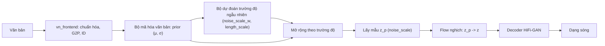

# Dự án 3. VITS tiếng Việt

!!! abstract "Mục tiêu dự án"
    Sau dự án này, bạn có thể:

    - **Lựa chọn** một mã nguồn VITS mở phù hợp với mục tiêu (học tập, nghiên cứu, triển khai trên thiết bị biên) và giải thích ưu nhược điểm của từng lựa chọn.
    - **Chuẩn bị** dữ liệu tiếng Việt đúng định dạng filelist của VITS: chuẩn hóa văn bản và G2P bằng `vn_frontend` (Dự án 1), lọc theo độ dài, đổi tần số lấy mẫu, ghi WAV 16-bit.
    - **Thay** bảng ký hiệu tiếng Anh của VITS bằng bảng ký hiệu âm vị + thanh điệu của Dự án 1, và **kiểm tra** tính nhất quán của cấu hình trước khi tốn hàng ngày GPU.
    - **Huấn luyện**, khởi động từ checkpoint có sẵn (*warm start*), **theo dõi** và **chẩn đoán** một mô hình VITS một người nói, sau đó **mở rộng** sang nhiều người nói.
    - **Xuất** mô hình sang ONNX theo quy ước kiểu Piper, **kiểm chứng** đầu ra so với PyTorch và **đo** RTF trên CPU.
    - **Đánh giá** mô hình bằng các phép đo dành riêng cho tiếng Việt: CER qua ASR, bài nghe cặp tối thiểu về thanh điệu, bài đọc số và chữ viết tắt.

!!! info "Kiến thức cần có"
    - [Chương 27](../phan-7-e2e-bieu-cam/ch27-vits.md): kiến trúc và hàm mất mát của VITS. Dự án này **không** dạy lại lý thuyết, chỉ dùng nó.
    - [Chương 21](../phan-5-mo-hinh-am-hoc/ch21-alignment.md) (Monotonic Alignment Search), [Chương 25](../phan-6-vocoder/ch25-gan-vocoder.md) (HiFi-GAN, bộ phân biệt MPD/MSD).
    - [Chương 36](../phan-9-thuc-tien/ch36-du-lieu-tts.md) (xây dựng dữ liệu), [Chương 37](../phan-9-thuc-tien/ch37-huan-luyen-va-debug.md) (huấn luyện và gỡ lỗi), [Chương 38](../phan-9-thuc-tien/ch38-danh-gia-tts.md) (đánh giá), [Chương 39](../phan-9-thuc-tien/ch39-trien-khai-production.md) (ONNX, triển khai).
    - [Dự án 1](du-an-1-frontend-tieng-viet.md): gói `vn_frontend`. Nên làm [Dự án 2](du-an-2-fastspeech2-hifigan.md) trước để có hệ thống hai tầng làm mốc so sánh.

Dự án này là một **công thức thực hành** (*recipe*): ta không cài đặt lại VITS từ đầu mà dùng một mã nguồn mở đã được kiểm chứng, và tập trung vào những gì *riêng* cho tiếng Việt và cho việc đưa mô hình ra thiết bị biên. Các lệnh của dự án upstream được trích để tham khảo. Giao diện dòng lệnh của các dự án này thay đổi theo thời gian, nên **hãy luôn đối chiếu với README của phiên bản bạn dùng**. Các đoạn mã Python trong trang (chuẩn bị dữ liệu, kiểm tra cấu hình, nạp một phần checkpoint, xuất ONNX trên mô hình đồ chơi, đánh giá thanh điệu) đều đã chạy thử. Các đoạn sửa mã upstream được ghi rõ là phác thảo.

## 1. Vì sao VITS cho tiếng Việt?

VITS (Kim và cộng sự, 2021) gộp mô hình âm học và vocoder thành **một** mạng huấn luyện đầu-cuối: từ chuỗi ký hiệu sinh thẳng ra dạng sóng. [Chương 27](../phan-7-e2e-bieu-cam/ch27-vits.md) đã phân tích mô hình như một VAE có điều kiện với prior được làm giàu bằng normalizing flow, căn chỉnh bằng MAS, bộ dự đoán trường độ ngẫu nhiên và decoder HiFi-GAN huấn luyện đối kháng. Ở đây ta nhìn VITS từ góc độ người làm sản phẩm tiếng Việt:

- **Không cần bộ căn chỉnh ngoài.** Hệ hai tầng như FastSpeech 2 ([Dự án 2](du-an-2-fastspeech2-hifigan.md)) cần trường độ của từng âm vị, thường lấy từ Montreal Forced Aligner hoặc một mô hình thầy. Với tiếng Việt, mô hình căn chỉnh dựng sẵn không phải lúc nào cũng có hoặc khớp bảng âm vị của bạn. VITS tự học căn chỉnh bằng MAS trong lúc huấn luyện, nên bỏ được hẳn bước này.
- **Không có độ lệch huấn luyện–suy luận giữa hai tầng.** Ở hệ hai tầng, vocoder học trên mel thật nhưng lúc suy luận nhận mel do mô hình âm học sinh ra, nên người ta phải fine-tune vocoder trên mel "GTA". VITS huấn luyện chung nên không có khe hở này.
- **Nhỏ và nhanh.** Mô hình cỡ vài chục triệu tham số, suy luận không tự hồi quy, chạy nhanh hơn thời gian thực trên CPU thông thường và xuất ONNX được. Đây là lý do VITS là nền của Piper, một hệ TTS chạy cục bộ được dùng rộng rãi.
- **Đủ tốt với lượng dữ liệu vừa phải** của một người nói thu âm sạch, cỡ vài giờ tới vài chục giờ, nhất là khi khởi động từ một checkpoint có sẵn. Đây là kịch bản điển hình của các nhóm làm TTS tiếng Việt.

Cái giá phải trả:

- **Khó gỡ lỗi hơn.** Hàm mất mát gồm nhiều thành phần cạnh tranh nhau: mel L1, KL, trường độ, đối kháng, feature matching. Khi chất lượng kém, khó biết lỗi do phần nào.
- **Ít điều khiển tường minh.** Không có bộ dự đoán F0 riêng như FastSpeech 2, nên không "sửa" được một thanh điệu sai bằng cách chỉnh đường cao độ.
- **Không zero-shot.** Muốn có giọng mới phải có dữ liệu của giọng đó và huấn luyện hoặc fine-tune. Nhân bản giọng từ vài giây âm thanh là việc của [Dự án 4](du-an-4-zero-shot-tts.md).

Đường suy luận của VITS, với các tham số điều khiển mà ta sẽ gặp lại khi xuất ONNX:



## 2. Chọn mã nguồn

Tính đến thời điểm biên soạn (2026), có mấy lựa chọn phổ biến. Thông tin giấy phép và trạng thái bảo trì dưới đây cần được kiểm tra lại tại kho mã trước khi dùng:

| Mã nguồn | Giấy phép (cần kiểm tra) | Ưu điểm | Nhược điểm |
|---|---|---|---|
| `jaywalnut310/vits` (mã gốc của bài báo) | MIT | Ngắn, khớp từng dòng với bài báo; dễ đọc cùng [Chương 27](../phan-7-e2e-bieu-cam/ch27-vits.md) | Không còn được bảo trì; viết cho PyTorch đời cũ nên cần sửa nhỏ; không có sẵn công cụ xuất ONNX |
| `idiap/coqui-ai-TTS` (gói `coqui-tts`, nhánh cộng đồng tiếp nối Coqui TTS) | MPL-2.0 | Được bảo trì; có công thức VITS, cấu hình ký tự tùy biến, hỗ trợ xuất ONNX cho VITS | Khung lớn, nhiều tầng trừu tượng; khó sửa sâu |
| Piper (đã chuyển từ `rhasspy/piper` sang `OHF-Voice/piper1-gpl`) | Tên kho mới gợi ý GPL (vì nhúng espeak-ng); kho cũ dùng MIT | Thiết kế cho thiết bị biên; xuất ONNX, runtime C++/Python; có checkpoint để fine-tune; đã có giọng tiếng Việt | Mặc định dùng phiên âm espeak-ng; giao diện dòng lệnh đã đổi giữa hai kho |
| Các bản cài đặt VITS2 không chính thức | Tùy kho | Cải tiến của VITS2 (Kong và cộng sự, 2023) | Chất lượng mã và độ ổn định khác nhau nhiều |

Gợi ý của chúng tôi:

- **Để học**, dùng mã gốc. Mỗi tệp (`models.py`, `losses.py`, `train.py`, `data_utils.py`) tương ứng trực tiếp với một mục của [Chương 27](../phan-7-e2e-bieu-cam/ch27-vits.md). Trang này mô tả chi tiết công thức theo mã gốc.
- **Để triển khai trên thiết bị biên**, dùng Piper. Tài liệu huấn luyện của Piper (phiên bản tại thời điểm biên soạn) cho phép đưa vào **chuỗi ID âm vị tự định nghĩa** (`--data.data_type phoneme_ids`, kèm `--data.num_symbols`), nghĩa là dùng được thẳng đầu ra `text_to_sequence` của Dự án 1 thay cho espeak-ng. Mỗi bước dưới đây có ghi chú tương ứng cho Piper.

!!! note "Góc tiếng Việt"
    Tính đến thời điểm biên soạn, kho giọng của Piper trên Hugging Face (`rhasspy/piper-voices`) có một số giọng tiếng Việt (ví dụ `vi_VN-vais1000-medium`, `vi_VN-25hours_single-low`, `vi_VN-vivos-x_low`). Các giọng này phiên âm bằng espeak-ng (giọng `vi`). Model card của `vais1000-medium` ghi rằng nó được fine-tune từ một giọng tiếng Anh và dữ liệu gốc dùng giấy phép CC BY 4.0. Nghe thử các giọng này là cách nhanh để biết một mô hình VITS tiếng Việt cỡ vừa có thể đạt tới đâu, và chúng cũng là các checkpoint ứng viên để fine-tune. Hãy đọc model card và giấy phép dữ liệu của từng giọng trước khi dùng cho mục đích thương mại.

## 3. Bước 1 — Dữ liệu

### 3.1. Yêu cầu

Một mô hình VITS một người nói cần dữ liệu **nhất quán** hơn là **nhiều**: cùng một người, cùng micro, cùng phòng, cùng phong cách đọc. Các tiêu chí cụ thể (xem [Chương 36](../phan-9-thuc-tien/ch36-du-lieu-tts.md) để biết cách thu âm và xử lý dữ liệu "in-the-wild"):

- **Âm thanh**: mono, PCM 16-bit, 22 050 Hz (cấu hình chuẩn của VITS). Im lặng hai đầu được cắt còn khoảng 50 ms; không clip; mức to đều giữa các câu.
- **Độ dài câu**: khoảng 1–12 giây. Câu quá ngắn ("Dạ.") cho ít thông tin căn chỉnh. Câu quá dài làm tốn bộ nhớ, vì bộ mã hóa hậu nghiệm xử lý cả câu dù decoder chỉ học trên đoạn cắt ngẫu nhiên.
- **Văn bản**: khớp **chính xác** với âm thanh, sau chuẩn hóa. "2/9" phải được viết thành đúng cách người đọc đã đọc ("mùng hai tháng chín" hay "hai tháng chín"). Một tỷ lệ nhỏ bản ghi lời sai đủ để mô hình học phát âm sai một cách nhất quán.
- **Độ phủ**: kịch bản đọc nên phủ đủ các vần và cả sáu thanh, kể cả âm tiết tắc (-p, -t, -c, -ch, chỉ đi với thanh sắc và nặng). Cách chọn câu tham lam theo độ phủ có ở [Chương 36](../phan-9-thuc-tien/ch36-du-lieu-tts.md).

### 3.2. Định dạng filelist

Mã gốc của VITS đọc các tệp văn bản, mỗi dòng một câu, các trường phân cách bằng `|`:

```text
wavs/0001.wav|<văn bản hoặc chuỗi ký hiệu>                (một người nói, train.py)
wavs/0001.wav|<speaker_id>|<văn bản hoặc chuỗi ký hiệu>   (nhiều người nói, train_ms.py)
```

Với bộ dữ liệu tiếng Anh, trường cuối là phiên âm IPA từ espeak, và mã VITS ánh xạ **từng ký tự** của chuỗi đó sang ID. Bảng ký hiệu của `vn_frontend` gồm các âm vị nhiều ký tự (`tʰ`, `iə`, `ɨə`) và token thanh `T1`…`T6`, nên ánh xạ theo từng ký tự không dùng được. Ta ghi thẳng **chuỗi ID cách nhau bằng dấu cách** vào filelist, rồi sửa một hàm nhỏ trong `data_utils.py` (Mục 4.2). Cách này cũng chính là chế độ `phoneme_ids` của Piper.

### 3.3. Mã chuẩn bị dữ liệu

Đầu vào là một manifest JSONL (mỗi dòng có `id`, `audio`, `text`, `speaker`), giống đầu ra của quy trình ở [Chương 36](../phan-9-thuc-tien/ch36-du-lieu-tts.md). Đầu ra là thư mục WAV đã chuẩn hóa, `train.txt`, `val.txt`, bảng người nói và bản sao bảng ký hiệu:

```python
import json
import unicodedata
import zlib
from collections import Counter
from pathlib import Path

import numpy as np
import soundfile as sf
from scipy.signal import resample_poly

import vn_frontend as vnf  # Dự án 1: chạy từ thư mục code/ hoặc thêm nó vào sys.path


def load_mono(path: str, target_sr: int) -> np.ndarray:
    audio, sr = sf.read(path, dtype="float32", always_2d=True)    # (L, kênh)
    audio = audio.mean(axis=1)                                      # trộn về mono, (L,)
    if sr != target_sr:                                             # đổi tần số lấy mẫu
        g = np.gcd(sr, target_sr)
        audio = resample_poly(audio, target_sr // g, sr // g).astype(np.float32)
    return audio


def trim_silence(audio: np.ndarray, sr: int, top_db: float = 40.0,
                 hop: int = 256, margin_s: float = 0.05) -> np.ndarray:
    """Cắt im lặng hai đầu: khung có năng lượng thấp hơn đỉnh quá top_db bị coi là im lặng."""
    n = len(audio) // hop
    if n == 0:
        return audio
    rms = np.sqrt(np.mean(audio[: n * hop].reshape(n, hop) ** 2, axis=1) + 1e-12)  # (n,)
    db = 20 * np.log10(rms / rms.max())
    voiced = np.flatnonzero(db > -top_db)
    margin = int(margin_s * sr)
    start = max(0, voiced[0] * hop - margin)
    end = min(len(audio), (voiced[-1] + 1) * hop + margin)
    return audio[start:end]


def prepare(manifest: str, out_dir: str, sr: int = 22050, min_s: float = 1.0,
            max_s: float = 12.0, val_percent: int = 5, multi_speaker: bool = False) -> Counter:
    out = Path(out_dir)
    (out / "wavs").mkdir(parents=True, exist_ok=True)
    lines = {"train": [], "val": []}
    speakers: dict[str, int] = {}
    stats: Counter = Counter()
    for raw in Path(manifest).read_text(encoding="utf-8").splitlines():
        item = json.loads(raw)
        text = unicodedata.normalize("NFC", item["text"])
        ids = vnf.text_to_sequence(text)                 # chuẩn hóa -> G2P -> ID
        if not ids or vnf.UNK_ID in ids:                 # ký hiệu lạ: sửa front-end, đừng huấn luyện
            stats["reject_text"] += 1
            continue
        audio = trim_silence(load_mono(item["audio"], sr), sr)
        dur = len(audio) / sr
        if not min_s <= dur <= max_s:
            stats["reject_duration"] += 1
            continue
        audio = 0.95 * audio / max(np.abs(audio).max(), 1e-6)  # chuẩn hóa đỉnh
        wav = out / "wavs" / f"{item['id']}.wav"
        sf.write(wav, audio, sr, subtype="PCM_16")       # VITS gốc giả định WAV 16-bit
        split = "val" if zlib.crc32(item["id"].encode()) % 100 < val_percent else "train"
        fields = [str(wav)]
        if multi_speaker:
            fields.append(str(speakers.setdefault(item["speaker"], len(speakers))))
        fields.append(" ".join(map(str, ids)))
        lines[split].append("|".join(fields))
        stats["kept"] += 1
        stats["seconds"] += round(dur, 2)
    for split, rows in lines.items():
        (out / f"{split}.txt").write_text("\n".join(rows) + "\n", encoding="utf-8")
    (out / "speakers.json").write_text(json.dumps(speakers, ensure_ascii=False, indent=1))
    (out / "symbols.txt").write_text("\n".join(vnf.SYMBOLS) + "\n", encoding="utf-8")
    return stats
```

Chúng tôi đã chạy hàm này trên sáu tệp giả (44,1 kHz stereo, có im lặng hai đầu, một câu "Dạ." chỉ dài 0,2 giây) với `multi_speaker=True`. Kết quả: 5 câu được giữ, 1 câu bị loại vì quá ngắn; tệp ra là mono, 22 050 Hz, `PCM_16`. Một dòng filelist trông như sau:

```text
p3_vits_data/wavs/u0.wav|0|26 43 22 54 5 15 38 37 55 5 29 49 27 59 5 22 38 21 54 7
```

Vài lựa chọn trong đoạn mã có lý do riêng:

- **Ghi `PCM_16` tường minh.** Mã VITS gốc đọc WAV bằng `scipy`, rồi chia cho `max_wav_value = 32768`. Nếu bạn lỡ ghi WAV float32, giá trị đã nằm trong $[-1, 1]$ lại bị chia thêm 32 768 lần, và mô hình học trên âm thanh gần như im lặng mà không có lỗi nào được báo. Ngoài ra, bộ chia bucket của mã gốc ước lượng độ dài câu từ **kích thước tệp** với giả định 2 byte mỗi mẫu.
- **Từ chối câu có `UNK_ID`** thay vì lặng lẽ bỏ ký tự lạ. Một ký hiệu lạ là dấu hiệu front-end còn thiếu sót (một chữ viết tắt chưa có trong từ điển, một từ tiếng Anh). Sửa front-end rồi chạy lại, vì mô hình chỉ đọc đúng những gì nó được dạy.
- **Chia train/val theo hàm băm của `id`**, không theo thứ tự hay ngẫu nhiên. Cách chia ổn định qua các lần chạy lại, nên thêm dữ liệu mới không làm câu cũ nhảy từ val sang train. Với nhiều người nói, cần thêm một tập kiểm thử gồm **câu chưa thấy** của cả người nói đã thấy lẫn (nếu cần) người nói chưa thấy.
- **Lưu `symbols.txt`** cạnh dữ liệu. Bảng ký hiệu là hợp đồng giữa dữ liệu, checkpoint và mô hình ONNX sau này.

Trước khi huấn luyện, hãy làm thêm hai kiểm tra rẻ mà hiệu quả. Thứ nhất, **nghe ngẫu nhiên vài chục câu** sau xử lý, kèm văn bản. Thứ hai, tính **tốc độ nói** $r = N_{\text{ký hiệu}} / d$ (ký hiệu mỗi giây) cho từng câu. Câu có $r$ lệch xa trung vị (ví dụ quá 3 lần độ lệch tuyệt đối trung vị) thường là câu có bản ghi lời sai, thiếu hoặc thừa một đoạn, hoặc âm thanh bị cắt nhầm.

!!! note "Góc tiếng Việt"
    - **Phương ngữ của người đọc phải khớp phương ngữ của G2P.** `vn_frontend.g2p` có `dialect="north"` (mặc định) và `dialect="south"` (xấp xỉ giọng Sài Gòn). Nếu người đọc giọng Nam mà bạn phiên âm theo giọng Bắc, mô hình phải học rằng ký hiệu `z` (từ "d", "gi", "r" giọng Bắc) lúc thì đọc [j], lúc thì đọc [ʐ] hay [r] tùy chữ viết. Nó vẫn học được nhưng tốn dữ liệu hơn, và bảng ký hiệu mất ý nghĩa. Với dữ liệu nhiều người nói pha trộn vùng miền, hãy phiên âm từng câu theo phương ngữ của người nói (`text_to_sequence(text, dialect=...)`).
    - **Thanh điệu là token riêng.** Đầu ra G2P của Dự án 1 đặt một token `T1`…`T6` ở cuối mỗi âm tiết. Sáu token này dùng chung cho mọi vần, nên mô hình gặp mỗi thanh hàng nghìn lần dù mỗi tổ hợp vần–thanh cụ thể có thể hiếm. Đây là lợi thế về hiệu quả dữ liệu so với đầu vào ký tự, nơi "ế" và "ê" là hai ký hiệu không liên quan.
    - **NFC và vị trí dấu thanh.** `normalize_text` đưa văn bản về NFC và thống nhất vị trí dấu ("hoà" thành "hòa"), nên hai cách gõ của cùng một âm tiết cho cùng chuỗi ID.

## 4. Bước 2 — Biểu diễn đầu vào và sửa mã VITS

### 4.1. Ký tự hay âm vị?

Có hai lựa chọn hợp lý cho tiếng Việt ([Chương 18](../phan-4-frontend/ch18-g2p-bieu-dien-dau-vao.md)):

| | Ký tự (chữ viết NFC) | Âm vị + token thanh (`vn_frontend`) |
|---|---|---|
| Kích thước bảng ký hiệu | Khoảng 90–100 (các nguyên âm có dấu dựng sẵn, chữ thường) | 60 (tính đến phiên bản lúc biên soạn) |
| Cần G2P | Không (tiếng Việt gần như ghi âm vị) | Có, theo luật |
| Xử lý phương ngữ | Ngầm, do dữ liệu quyết định | Tường minh qua `dialect` |
| Chia sẻ thông tin thanh điệu | Không (mỗi nguyên âm có dấu là một ký hiệu riêng) | Có (6 token thanh dùng chung) |
| Từ mượn, tên riêng nước ngoài | Mô hình tự đoán từ chữ | Phụ thuộc chất lượng G2P và từ điển |

Với vài chục giờ dữ liệu, cả hai đều cho kết quả tốt. Ta chọn âm vị + thanh vì ba lý do: dùng lại Dự án 1, kiểm soát phương ngữ, và tận dụng được việc chia sẻ thông tin thanh điệu khi dữ liệu ít. Ví dụ đầu ra G2P:

```text
g2p("Xin chào Việt Nam.") ->
['s', 'i', 'n', 'T1', ' ', 'c', 'a', 'w', 'T2', ' ', 'v', 'iə', 't', 'T6', ' ', 'n', 'a', 'm', 'T1', '.']
```

**Token trống (*blank*).** Cấu hình `add_blank: true` của VITS chèn một token trống giữa mọi cặp ký hiệu ($[a, b] \to [\varnothing, a, \varnothing, b, \varnothing]$). Theo báo cáo gốc, việc này cải thiện chất lượng; trực giác là nó cho MAS thêm "chỗ" để đặt các khung chuyển tiếp giữa hai âm vị. Mã gốc dùng ID 0 (trùng với ký hiệu đệm) làm blank. `vn_frontend` có token `<blank>` riêng (`BLANK_ID`) và hàm `vnf.intersperse`. Cách nào cũng được, **miễn là lúc huấn luyện, lúc suy luận PyTorch và lúc chạy ONNX dùng cùng một quy ước**.

### 4.2. Sửa mã VITS gốc (phác thảo)

Ba chỗ cần sửa trong mã gốc. Đoạn dưới đây là **phác thảo chưa chạy** (vì cần mã VITS), tên hàm và vị trí lấy theo `jaywalnut310/vits` tại thời điểm biên soạn:

```python
# --- text/symbols.py: thay bảng ký hiệu tiếng Anh ---
from vn_frontend import SYMBOLS as symbols          # 60 ký hiệu; train.py dùng len(symbols) làm n_vocab

# --- data_utils.py, lớp TextAudioLoader (và TextAudioSpeakerLoader) ---
import vn_frontend as vnf

def get_text(self, text):
    ids = [int(t) for t in text.split()]            # filelist chứa sẵn chuỗi ID
    if self.add_blank:
        ids = vnf.intersperse(ids)                   # blank = vnf.BLANK_ID (thay cho intersperse(..., 0))
    return torch.LongTensor(ids)

def _filter(self):
    # Mã gốc lọc bằng len(text), tức số KÝ TỰ của trường văn bản, với max_text_len mặc định 190.
    # Với chuỗi ID kiểu "26 43 22 ...", 190 ký tự chỉ là khoảng 60–70 ID: phần lớn câu bị loại âm thầm.
    # Hoặc nâng max_text_len trong cấu hình (như Mục 5), hoặc đếm token: len(text.split()).
    ...
```

Nếu dùng Piper, bạn không sửa mã. Thay vào đó, truyền tham số dữ liệu kiểu ID (`--data.data_type phoneme_ids`, `--data.num_symbols 60`, theo tài liệu huấn luyện của Piper tại thời điểm biên soạn), và filelist chỉ còn hai hoặc ba cột. Hãy kiểm tra tên tham số chính xác trong tài liệu của phiên bản bạn dùng.

!!! warning "Bộ đệm phổ cũ"
    Mã gốc lưu phổ tuyến tính đã tính vào tệp `*.spec.pt` cạnh mỗi tệp WAV và dùng lại ở các lần chạy sau. Nếu bạn đổi `filter_length`, `hop_length` hay `win_length` mà không xóa các tệp này, mô hình sẽ học trên phổ cũ. Hậu quả có khi là lỗi kích thước, có khi chỉ là chất lượng kém khó hiểu. Hãy xóa `*.spec.pt` mỗi khi đổi cấu hình STFT.
