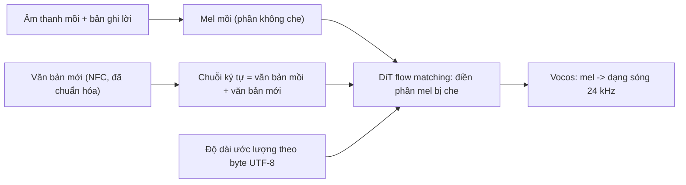

# Dự án 4. Zero-shot TTS tiếng Việt

!!! abstract "Mục tiêu dự án"
    Sau dự án này, bạn có thể:

    - **Giải thích** vì sao một mô hình zero-shot mã nguồn mở (lấy F5-TTS làm ví dụ) chưa nói được tiếng Việt, và cần những thay đổi gì để fine-tune nó.
    - **Xây dựng** bộ dữ liệu fine-tune từ âm thanh "in-the-wild": lọc theo độ dài, ngôn ngữ, chất lượng và độ đồng thuận giữa hai hệ ASR; xuất đúng định dạng của upstream.
    - **Kiểm toán** và **mở rộng** bảng từ vựng ký tự cho tiếng Việt (NFC), đồng thời **mở rộng** ma trận embedding mà không làm hỏng checkpoint.
    - **Thiết lập** cấu hình fine-tune hợp lý và **theo dõi** quá trình huấn luyện bằng đánh giá định kỳ thay vì chỉ nhìn loss.
    - **Đánh giá** mô hình bằng CER, độ tương đồng giọng (SIM) và chỉ số MOS tự động (UTMOS), kèm khoảng tin cậy bootstrap, và **nhận diện** giới hạn của từng chỉ số với tiếng Việt.
    - **Thiết kế** các cơ chế an toàn: hồ sơ đồng ý, chặn âm thanh mồi không được phép, thủy vân âm thanh, và tuân thủ giấy phép dữ liệu/mô hình.

!!! info "Kiến thức cần có"
    - [Chương 12](../phan-2-mo-hinh-sinh/ch12-flow-matching.md) (flow matching) và [Chương 33](../phan-8-mo-hinh-lon/ch33-nar-quy-mo-lon.md) (E2 TTS, F5-TTS): cơ chế của mô hình. Dự án này **không** dạy lại.
    - [Chương 34](../phan-8-mo-hinh-lon/ch34-he-thong-lai-hien-dai.md): bức tranh các hệ zero-shot hiện đại và vấn đề tokenizer với dấu tiếng Việt.
    - [Chương 36](../phan-9-thuc-tien/ch36-du-lieu-tts.md) (dữ liệu in-the-wild), [Chương 38](../phan-9-thuc-tien/ch38-danh-gia-tts.md) (đánh giá), [Chương 40](../phan-9-thuc-tien/ch40-dao-duc-an-toan.md) (đạo đức, an toàn, pháp lý).
    - [Dự án 1](du-an-1-frontend-tieng-viet.md) (`vn_frontend`) và [Dự án 3](du-an-3-vits-tieng-viet.md) (bài nghe thanh điệu).

Ở [Dự án 3](du-an-3-vits-tieng-viet.md), muốn có một giọng mới ta phải có hàng giờ dữ liệu của giọng đó. Mô hình **zero-shot** làm khác: chỉ cần một đoạn âm thanh mồi (*prompt*) vài giây cùng bản ghi lời của nó, mô hình nói văn bản mới bằng giọng, âm sắc và phong cách của đoạn mồi. Khả năng này đến từ huấn luyện trên hàng chục nghìn giờ dữ liệu nhiều người nói. Các mô hình mở mạnh nhất tính đến thời điểm biên soạn chủ yếu được huấn luyện trên tiếng Anh và tiếng Trung. Dự án này là công thức để **dạy tiếng Việt** cho một mô hình như vậy bằng fine-tune.

Ta dùng F5-TTS (Chen và cộng sự, 2024) làm ví dụ vì ba lý do: mã nguồn mở và có sẵn công cụ fine-tune, kiến trúc đơn giản (không có bộ căn chỉnh hay mô hình trường độ riêng), và đã được cộng đồng fine-tune cho nhiều ngôn ngữ. Các nguyên tắc ở đây (dữ liệu, từ vựng, đánh giá, an toàn) áp dụng gần như nguyên vẹn cho các mô hình khác. Mọi lệnh và tên tham số của upstream được trích **để tham khảo, theo mã tại thời điểm biên soạn (11/2026)**. Hãy luôn đối chiếu với README của phiên bản bạn dùng. Các đoạn mã Python trong trang đều đã chạy thử trên dữ liệu nhỏ hoặc giả lập; chỗ nào dùng số liệu giả lập đều được ghi rõ.

## 1. F5-TTS nhìn từ góc độ người fine-tune

[Chương 33](../phan-8-mo-hinh-lon/ch33-nar-quy-mo-lon.md) đã phân tích F5-TTS. Ở đây chỉ nhắc những điểm quyết định cách ta chuẩn bị dữ liệu:

- **Đầu vào văn bản là chuỗi ký tự**, được đệm bằng token lấp đầy cho dài bằng chuỗi khung mel. Không có G2P, không có trường độ từng âm vị. Mô hình tự học căn chỉnh ngầm qua attention của một Transformer khuếch tán (DiT) có các khối ConvNeXt tinh chỉnh biểu diễn văn bản. Hệ quả là **mọi thứ mô hình biết về cách đọc nằm trong chuỗi ký tự**. Ký tự sai thì phát âm sai, ký tự lạ thì mô hình "không thấy".
- **Huấn luyện bằng flow matching có che (*masked infilling*).** Mô hình học điền phần mel bị che, dựa trên phần mel còn lại cùng toàn bộ văn bản. Lúc suy luận, phần "còn lại" là âm thanh mồi, phần bị che là câu mới cần sinh. Vì vậy nó nhân bản giọng mà không cần embedding người nói.
- **Tổng độ dài phải được cho trước.** Mã suy luận tham khảo ước lượng số khung cần sinh bằng tỷ lệ giữa độ dài văn bản mới và văn bản mồi, đo bằng **số byte UTF-8**, nhân với độ dài âm thanh mồi (Mục 5).
- **Âm thanh** là mel 100 kênh ở 24 kHz, hop 256, giải mã bằng vocoder Vocos (Siuzdak, 2024). Vocoder không phụ thuộc ngôn ngữ, nên khi fine-tune ta giữ nguyên nó.



### 1.1. Vì sao checkpoint gốc chưa nói được tiếng Việt?

Checkpoint gốc được huấn luyện trên phần tiếng Anh và tiếng Trung của bộ dữ liệu Emilia (He và cộng sự, 2024). Theo báo cáo gốc, dữ liệu này có quy mô khoảng 95 nghìn giờ. Tiếng Trung được đổi sang pinyin có số thanh, tiếng Anh giữ nguyên chữ cái. Mô hình chưa bao giờ học quy tắc đọc chữ Quốc ngữ. Tệ hơn, **nhiều chữ cái tiếng Việt không có trong bảng từ vựng**.

Chúng tôi đã kiểm tra tệp `vocab.txt` của checkpoint `F5TTS_v1_Base` trên Hugging Face (11/2026). Xét 73 chữ thường tiếng Việt (12 nguyên âm × 6 thanh, cộng "đ"), có **19 chữ vắng mặt**:

```text
ẳ ẵ ặ ẩ ẫ ẹ ỉ ĩ ổ ỗ ỡ ợ ừ ử ự ỳ ỷ ỹ ỵ
```

Với chữ hoa, con số là 54/73. Những chữ còn lại có mặt có lẽ vì chúng xuất hiện rải rác trong dữ liệu gốc (tên riêng, trích dẫn).

Điều gì xảy ra với ký tự vắng mặt? Trong mã tại thời điểm biên soạn, hàm chuyển chuỗi sang chỉ số dùng `vocab_char_map.get(c, 0)`, và chỉ số 0 được dành cho **dấu cách**. Mã còn có một khẳng định (*assert*) ghi rõ rằng 0 được dùng cho ký tự lạ. Nghĩa là "được" trở thành "đư c", "sự" thành "s ", "mặt" thành "m t", **mà không có lỗi hay cảnh báo nào**. Fine-tune trên dữ liệu như vậy, mô hình vẫn hội tụ, loss vẫn giảm, nhưng nó học rằng "dấu cách" đôi khi đọc là "ợ", đôi khi là "ự". Đây là lỗi phổ biến nhất khi fine-tune mô hình mã nguồn mở cho tiếng Việt, và cũng là lý do Bước 2 tồn tại.

### 1.2. Tài nguyên và giấy phép

- **Phần cứng.** Checkpoint `F5TTS_v1_Base` (định dạng safetensors) nặng khoảng 1,35 GB, tương ứng vài trăm triệu tham số. Fine-tune toàn bộ cần GPU có bộ nhớ lớn (cỡ 24 GB trở lên là thoải mái; ít hơn thì giảm batch theo khung và dùng tích lũy gradient). Bộ tối ưu 8-bit (tùy chọn `--bnb_optimizer` của script fine-tune) giúp tiết kiệm bộ nhớ.
- **Dữ liệu.** Để mô hình *zero-shot* thực sự cho tiếng Việt (giọng chưa thấy vẫn tốt), cần dữ liệu nhiều người nói, quy mô hàng trăm tới hàng nghìn giờ. Với vài chục giờ của ít người nói, bạn được một mô hình đọc tốt tiếng Việt *với những giọng gần dữ liệu*, còn khả năng tổng quát sang giọng lạ kém hơn. Đây là nhận xét định tính; không có ngưỡng chung.
- **Giấy phép, tính đến thời điểm biên soạn.** Trọng số F5-TTS được phát hành theo **CC BY-NC 4.0** vì dữ liệu Emilia; mã nguồn dùng giấy phép riêng (hãy đọc tệp LICENSE). Bộ dữ liệu tiếng Việt lớn viVoice (thu từ YouTube) dùng **CC BY-NC-SA 4.0**, yêu cầu đăng ký truy cập và chỉ dành cho nghiên cứu. Nói cách khác, một mô hình fine-tune từ checkpoint này trên dữ liệu này **không được dùng thương mại**. Muốn sản phẩm thương mại, bạn cần dữ liệu và checkpoint có giấy phép phù hợp, hoặc huấn luyện từ đầu trên dữ liệu của mình. Đây không phải tư vấn pháp lý; xem [Chương 40](../phan-9-thuc-tien/ch40-dao-duc-an-toan.md).

## 2. Bước 1 — Dữ liệu in-the-wild

### 2.1. Quy trình

Dữ liệu zero-shot khác dữ liệu của Dự án 3 ở chỗ ta **cần** sự đa dạng: nhiều người nói, nhiều vùng miền, nhiều phong cách, nhiều điều kiện thu âm. Nhưng sự đa dạng đó phải đi cùng **bản ghi lời chính xác**. Quy trình chuẩn ([Chương 36](../phan-9-thuc-tien/ch36-du-lieu-tts.md)) gồm:

```mermaid
flowchart LR
    A["Âm thanh dài (podcast, sách nói, video)"] --> B["Tách giọng khỏi nhạc nền"]
    B --> C["VAD + phân đoạn người nói"]
    C --> D["Cắt đoạn 1–20 s theo khoảng lặng"]
    D --> E["Nhận dạng ngôn ngữ"]
    E --> F["ASR A + ASR B"]
    F --> G["Lọc: độ dài, chất lượng, đồng thuận ASR"]
    G --> H["Chuẩn hóa văn bản (vn_frontend), NFC"]
    H --> I["metadata.csv"]
```



Bảng tiêu chí lọc gợi ý. Các ngưỡng chỉ là điểm xuất phát; hãy hiệu chỉnh bằng cách **nghe** các mẫu nằm sát ngưỡng:

| Tiêu chí | Gợi ý | Lý do |
|---|---|---|
| Độ dài | 1–20 s | Quá ngắn: ít thông tin; quá dài: tốn bộ nhớ (batch tính theo khung) và vượt độ dài mà mã suy luận tham khảo nhắm tới |
| Ngôn ngữ | Tiếng Việt (giữ có chủ đích một tỷ lệ nhỏ câu trộn Anh–Việt) | Câu tiếng Anh thuần làm loãng mục tiêu; câu trộn mã lại cần cho thực tế ([Chương 30](../phan-7-e2e-bieu-cam/ch30-da-ngon-ngu-code-switching.md)) |
| Chất lượng | Điểm DNSMOS hoặc tương đương trên một ngưỡng | Mô hình zero-shot sao chép cả nhiễu và tiếng vang của dữ liệu |
| Đồng thuận ASR | CER giữa hai hệ ASR độc lập dưới khoảng 10% | Bất đồng lớn nghĩa là âm thanh khó nghe, hoặc bản ghi lời gần như chắc chắn sai |
| Người nói | Mỗi đoạn chỉ một người nói; giới hạn số giờ mỗi người | Tránh "pha giọng"; tránh một vài kênh lớn áp đảo |

Tiêu chí đồng thuận ASR đáng được giải thích thêm. Khi không có bản ghi lời do người viết, ta không đo được độ chính xác của bản ghi. Nhưng nếu hai hệ ASR có kiến trúc và dữ liệu huấn luyện khác nhau (ví dụ một mô hình Whisper đa ngôn ngữ và PhoWhisper chuyên tiếng Việt; Le và cộng sự, 2024) cho cùng một kết quả, xác suất cả hai cùng sai *theo cùng một cách* là thấp. Đây là một bộ lọc rẻ và hiệu quả.

### 2.2. Mã lọc và xuất `metadata.csv`

Script `prepare_csv_wavs.py` của F5-TTS (tại thời điểm biên soạn) đọc một tệp CSV phân cách bằng `|`, **bắt buộc** có dòng tiêu đề `audio_file|text`, với **đường dẫn âm thanh tuyệt đối**. Đoạn mã dưới đây áp dụng các tiêu chí lọc lên siêu dữ liệu của các đoạn đã cắt rồi ghi tệp đó. Các trường `lang`, `dnsmos`, `asr_a`, `asr_b` được giả định đã tính ở các bước trước:

```python
import csv
import unicodedata
from pathlib import Path


def cer(ref: str, hyp: str) -> float:
    """Tỷ lệ lỗi ký tự = khoảng cách Levenshtein / độ dài tham chiếu."""
    r, h = list(ref), list(hyp)
    prev = list(range(len(h) + 1))
    for i, rc in enumerate(r, 1):
        cur = [i]
        for j, hc in enumerate(h, 1):
            cur.append(min(prev[j] + 1, cur[j - 1] + 1, prev[j - 1] + (rc != hc)))
        prev = cur
    return prev[-1] / max(len(r), 1)


def norm_for_cer(text: str) -> str:
    """Chuẩn hóa trước khi so: NFC, chữ thường, bỏ dấu câu, gộp khoảng trắng."""
    text = unicodedata.normalize("NFC", text).lower()
    text = "".join(ch if ch.isalnum() or ch.isspace() else " " for ch in text)
    return " ".join(text.split())


def keep(seg: dict, min_s=1.0, max_s=20.0, min_dnsmos=3.0, max_cer=0.1) -> tuple[bool, str]:
    if not min_s <= seg["duration"] <= max_s:
        return False, "duration"
    if seg["lang"] != "vi":
        return False, "lang"
    if seg["dnsmos"] < min_dnsmos:
        return False, "quality"
    # hai hệ ASR độc lập phải đồng ý: bất đồng lớn = âm thanh khó hoặc bản ghi lời sai
    if cer(norm_for_cer(seg["asr_a"]), norm_for_cer(seg["asr_b"])) > max_cer:
        return False, "asr_disagree"
    return True, "ok"


segs = [
    {"audio": "/data/a.wav", "duration": 6.2, "lang": "vi", "dnsmos": 3.4,
     "asr_a": "Hôm nay trời đẹp quá.", "asr_b": "hôm nay trời đẹp quá"},
    {"audio": "/data/b.wav", "duration": 0.6, "lang": "vi", "dnsmos": 3.5, "asr_a": "dạ", "asr_b": "dạ"},
    {"audio": "/data/c.wav", "duration": 8.0, "lang": "vi", "dnsmos": 3.3,
     "asr_a": "anh ấy đi làm về muộn", "asr_b": "anh đấy đi lần về muốn"},
    {"audio": "/data/d.wav", "duration": 9.0, "lang": "en", "dnsmos": 3.6, "asr_a": "hello", "asr_b": "hello"},
]
rows, reasons = [], {}
for s in segs:
    ok, why = keep(s)
    reasons[why] = reasons.get(why, 0) + 1
    if ok:
        rows.append({"audio_file": s["audio"], "text": unicodedata.normalize("NFC", s["asr_a"])})
with open("metadata.csv", "w", encoding="utf-8", newline="") as f:
    w = csv.DictWriter(f, fieldnames=["audio_file", "text"], delimiter="|")
    w.writeheader(); w.writerows(rows)
print(reasons)
print(Path("metadata.csv").read_text(encoding="utf-8"))
```

```text
{'ok': 1, 'duration': 1, 'asr_disagree': 1, 'lang': 1}
audio_file|text
/data/a.wav|Hôm nay trời đẹp quá.
```

Đoạn "c" bị loại vì hai hệ ASR bất đồng ở "ấy/đấy", "làm/lần", "muộn/muốn": CER giữa chúng vượt 10%. Đây đúng là kiểu câu mà ta không muốn mô hình học. Trong thực tế, hàm `cer` thuần Python này chậm với hàng triệu đoạn; hãy dùng một thư viện tính khoảng cách soạn thảo viết bằng C, và tham khảo cách chuẩn hóa văn bản trước khi tính lỗi ở [Chương 38](../phan-9-thuc-tien/ch38-danh-gia-tts.md).

!!! note "Góc tiếng Việt"
    - **ASR viết số bằng chữ số, TTS cần chữ.** Bản ghi lời từ ASR thường chứa "2024", "15%", "TP.HCM". Mô hình ký tự phải học đọc chúng nếu ta để nguyên. Hãy đưa văn bản qua `vn_frontend.normalize_text` **trước khi** ghi `metadata.csv`, và dùng đúng hàm đó lúc suy luận. Lưu ý: chuẩn hóa sau khi tính đồng thuận ASR, vì hai hệ ASR có thể viết số khác nhau dù nghe giống nhau.
    - **Cân bằng vùng miền.** Dữ liệu YouTube tiếng Việt có thể lệch về một vài vùng và một vài thể loại (tin tức, review). Hãy thống kê theo người nói và (nếu ước lượng được) theo vùng miền. Mô hình zero-shot sẽ sao chép giọng mồi, nhưng chất lượng với giọng mồi của vùng ít dữ liệu sẽ kém hơn.
    - **Dấu câu từ ASR.** Nhiều hệ ASR không sinh dấu câu, hoặc sinh không nhất quán. Mô hình học ngắt nghỉ từ dấu câu, nên một bước khôi phục dấu câu, hoặc chọn hệ ASR có dấu câu tốt, ảnh hưởng trực tiếp tới ngôn điệu.

## 3. Bước 2 — Bảng từ vựng tiếng Việt

### 3.1. Quyết định thiết kế

Trước khi viết mã, cần chốt bốn quyết định. Mọi quyết định phải **giống hệt nhau** giữa dữ liệu huấn luyện và lúc suy luận:

1. **NFC, luôn luôn.** Ở dạng NFD, "ế" là ba điểm mã ("e" + dấu mũ + dấu sắc). Một dòng NFD lọt vào dữ liệu tạo ra các token dấu rời mà lúc suy luận (văn bản NFC) không bao giờ xuất hiện. Còn nếu vocab có ký tự NFC mà văn bản suy luận là NFD, các dấu rời sẽ biến thành dấu cách.
2. **Chữ thường hay giữ hoa?** 54/73 chữ hoa có dấu vắng mặt trong vocab gốc. Hạ toàn bộ về chữ thường làm bảng từ vựng nhỏ và dữ liệu cho mỗi ký tự dày hơn. Cái giá là mất tín hiệu về tên riêng, vốn ít ảnh hưởng tới phát âm tiếng Việt. Chữ viết tắt viết hoa (VTV, UBND) nên được `normalize_text` đọc thành chữ trước đó. Chúng tôi khuyên dùng chữ thường.
3. **Chữ dựng sẵn hay tách thanh?** Có thể biểu diễn "ế" như một ký tự, hoặc như "ê" + một token thanh riêng (giống tinh thần token `T1`…`T6` của Dự án 1). Tách thanh giúp chia sẻ thông tin thanh điệu giữa các nguyên âm, nhưng đi ngược thiết kế "chữ viết thô" của F5-TTS và phá tương thích với các bản fine-tune cộng đồng. Với lượng dữ liệu lớn, chữ dựng sẵn là lựa chọn đơn giản và đủ tốt; với dữ liệu ít, tách thanh đáng thử nghiệm (Bài tập 4).
4. **Ký tự hay âm vị?** Có thể đưa chuỗi âm vị của `vn_frontend.g2p` vào thay chữ viết. Cách này giải quyết tường minh phương ngữ, nhưng mất khả năng đọc từ mượn và tên riêng nước ngoài "theo mặt chữ" mà mô hình gốc đã học từ tiếng Anh. Với F5-TTS, chữ viết là lựa chọn tự nhiên hơn.

### 3.2. Kiểm toán và mở rộng bảng từ vựng

```python
import unicodedata
from collections import Counter
from pathlib import Path


def read_vocab(path: str) -> list[str]:
    """Đọc vocab.txt kiểu F5-TTS: mỗi dòng một token, ID = số thứ tự dòng, dòng 0 là dấu cách."""
    tokens = Path(path).read_text(encoding="utf-8").split("\n")
    tokens = tokens[:-1] if tokens and tokens[-1] == "" else tokens
    assert tokens[0] == " ", "token 0 phải là dấu cách (F5-TTS dùng 0 cho ký tự lạ)"
    return tokens


def audit_transcripts(texts: list[str], vocab: list[str]) -> dict:
    vocab_set = set(vocab)
    not_nfc = sum(unicodedata.normalize("NFC", t) != t for t in texts)
    counts = Counter(ch for t in texts for ch in unicodedata.normalize("NFC", t))
    missing = {ch: n for ch, n in counts.most_common() if ch not in vocab_set}
    examples = {ch: next(w for t in texts for w in t.split() if ch in unicodedata.normalize("NFC", w))
                for ch in list(missing)[:5]}
    return {"not_nfc_lines": not_nfc, "n_chars": len(counts), "missing": missing, "examples": examples}


def extend_vocab(vocab: list[str], new_chars) -> list[str]:
    """Nối ký tự mới vào CUỐI: giữ nguyên ID cũ để checkpoint còn dùng được."""
    return vocab + sorted(c for c in set(new_chars) if c not in set(vocab))


# Vocab thu nhỏ để chạy thử: dấu cách, ASCII và một phần khối chữ Việt (giống tình trạng thật)
mini = [" "] + list("abcdefghijklmnopqrstuvwxyz.,?!") + list("àáâãèéêìíòóôõùúýăđũơư") + list("ạảấầậếềểễệịọỏốồộớờởụủứữ")
Path("mini_vocab.txt").write_text("\n".join(mini) + "\n", encoding="utf-8")
texts = ["mọi người được nghỉ lễ.", "sự kiện diễn ra ở rừng quốc gia.",
         unicodedata.normalize("NFD", "kỹ sư mỗi ngày.")]   # một dòng NFD lọt vào
vocab = read_vocab("mini_vocab.txt")
rep = audit_transcripts(texts, vocab)
print(rep["not_nfc_lines"], rep["missing"], rep["examples"])
new_vocab = extend_vocab(vocab, rep["missing"])
assert new_vocab[: len(vocab)] == vocab and len(new_vocab) == len(vocab) + len(rep["missing"])
```

```text
1 {'ợ': 1, 'ỉ': 1, 'ự': 1, 'ừ': 1, 'ỹ': 1, 'ỗ': 1} {'ợ': 'được', 'ỉ': 'nghỉ', 'ự': 'sự', 'ừ': 'rừng', 'ỹ': 'kỹ'}
```

Báo cáo kiểm toán chỉ ra cả hai loại lỗi: một dòng không ở dạng NFC, và sáu ký tự sẽ bị âm thầm biến thành dấu cách. Ví dụ đi kèm ("được", "nghỉ", "sự", "rừng", "kỹ") đều là từ rất thông dụng, nên mức độ nghiêm trọng là rõ ràng. Hãy chạy kiểm toán trên **toàn bộ** bản ghi lời, kể cả tập đánh giá và bộ câu dùng lúc suy luận, với vocab **thật** của checkpoint.

Hai lưu ý về công cụ upstream (theo mã tại thời điểm biên soạn). Thứ nhất, ở chế độ fine-tune, `prepare_csv_wavs.py` **sao chép nguyên** vocab của checkpoint gốc sang thư mục dữ liệu, không thêm ký tự mới. Thứ hai, giao diện fine-tune dạng web của F5-TTS (`finetune_gradio.py`) có chức năng "kiểm tra vocab" và "mở rộng vocab". Chức năng mở rộng nối ký tự mới vào cuối vocab và tạo một checkpoint mới có ma trận embedding văn bản được mở rộng tương ứng. Khi đó bạn fine-tune với `--tokenizer custom --tokenizer_path <vocab mới>` và `--pretrain <checkpoint đã mở rộng>`. Hãy đọc mã của phiên bản bạn dùng để biết chính xác khóa nào trong checkpoint được mở rộng. Ở phiên bản chúng tôi đọc, chỉ khóa embedding của mô hình EMA được mở rộng.

### 3.3. Mở rộng ma trận embedding

Thêm $k$ ký tự vào vocab nghĩa là thêm $k$ hàng vào ma trận embedding văn bản $\mathbf{E} \in \mathbb{R}^{V \times C}$. Các hàng cũ phải giữ nguyên, vì đó là lý do ta nối vào cuối. Câu hỏi còn lại là **khởi tạo hàng mới thế nào**. Mã của upstream (phiên bản chúng tôi đọc) dùng phân phối chuẩn tắc $\mathcal{N}(0, 1)$. Một lựa chọn khác là khởi tạo quanh trung bình các hàng cũ với nhiễu nhỏ, để các ký tự mới bắt đầu ở "vùng quen thuộc" của mô hình:

```python
import torch


def expand_embedding(weight: torch.Tensor, n_new: int, init: str = "mean", seed: int = 0) -> torch.Tensor:
    """Thêm n_new hàng vào ma trận embedding (V, C), giữ nguyên các hàng cũ."""
    g = torch.Generator().manual_seed(seed)
    if init == "mean":   # quanh trung bình các hàng cũ, nhiễu nhỏ theo độ lệch chuẩn của chúng
        new = weight.mean(0, keepdim=True) + 0.1 * weight.std(0, keepdim=True) * torch.randn(n_new, weight.size(1), generator=g)
    else:                # "randn": phân phối chuẩn tắc
        new = torch.randn(n_new, weight.size(1), generator=g)
    return torch.cat([weight, new.to(weight.dtype)], dim=0)   # (V + n_new, C)


old = torch.randn(54, 8) * 0.02                       # (V, C) embedding đã huấn luyện (giả)
new = expand_embedding(old, n_new=19)
assert new.shape == (73, 8) and torch.equal(new[:54], old)
print(f"chuẩn hàng cũ ~{old.norm(dim=1).mean():.3f}, hàng mới (mean) ~{new[54:].norm(dim=1).mean():.3f}, "
      f"hàng mới (randn) ~{expand_embedding(old, 19, 'randn')[54:].norm(dim=1).mean():.3f}")
```

```text
chuẩn hàng cũ ~0.053, hàng mới (mean) ~0.008, hàng mới (randn) ~2.760
```

Ví dụ đồ chơi minh họa vấn đề cần kiểm tra: nếu các hàng đã huấn luyện có chuẩn nhỏ mà hàng mới khởi tạo $\mathcal{N}(0, 1)$, các ký tự mới sẽ "to" hơn hẳn các ký tự cũ, và những bước fine-tune đầu tiên có thể bị nhiễu loạn. Liệu điều này có xảy ra với F5-TTS hay không phụ thuộc vào thang đo thật của embedding trong checkpoint. Hãy **đo chuẩn các hàng cũ trước khi chọn cách khởi tạo**. Với vài chục nghìn bước fine-tune trên dữ liệu đủ lớn, khác biệt thường bị xóa nhòa; với dữ liệu nhỏ, nó có thể đáng kể. Đây là một thí nghiệm rẻ đáng làm (Bài tập 3).

## 4. Bước 3 — Fine-tune

### 4.1. Lệnh tham khảo

Theo README và mã của F5-TTS tại thời điểm biên soạn, quy trình gồm ba lệnh. Tên tham số lấy từ `finetune_cli.py`; **hãy kiểm tra lại với phiên bản của bạn**:

```bash
# 1) Chuyển metadata.csv thành định dạng của F5-TTS (raw.arrow, duration.json, vocab.txt)
python src/f5_tts/train/datasets/prepare_csv_wavs.py /data/vi/metadata.csv data/vi_char

# 2) Thay vocab.txt bằng vocab đã mở rộng, và tạo checkpoint có embedding mở rộng
#    (qua giao diện finetune_gradio hoặc script riêng theo Mục 3.3)

# 3) Fine-tune
f5-tts_finetune-cli --exp_name F5TTS_v1_Base --dataset_name vi \
    --tokenizer custom --tokenizer_path data/vi_char/vocab.txt \
    --finetune --pretrain ckpts/vi/pretrained_model_extended.safetensors \
    --learning_rate 1e-5 --batch_size_per_gpu 3200 --batch_size_type frame \
    --max_samples 64 --grad_accumulation_steps 1 --max_grad_norm 1.0 \
    --epochs 100 --num_warmup_updates 2000 \
    --save_per_updates 10000 --last_per_updates 1000 --logger tensorboard --log_samples
```

### 4.2. Các siêu tham số quan trọng

| Tham số | Giá trị mặc định của script (tham khảo) | Ý nghĩa và gợi ý |
|---|---|---|
| `learning_rate` | 1e-5 | Fine-tune dùng tốc độ học nhỏ hơn nhiều so với huấn luyện gốc. Theo báo cáo gốc, huấn luyện từ đầu dùng đỉnh khoảng 7,5e-5 với warm-up dài. Học một ngôn ngữ mới là thay đổi lớn, nên có thể cần tốc độ học cao hơn mặc định; hãy thử vài giá trị trên một tập con |
| `batch_size_type`, `batch_size_per_gpu` | `frame`, 3200 | Batch tính theo **tổng số khung mel**, không theo số câu: câu dài chiếm nhiều chỗ hơn. 3200 khung ≈ 34 giây âm thanh mỗi GPU (24 kHz, hop 256) |
| `max_samples` | 64 | Trần số câu mỗi batch, tránh batch quá nhiều câu cực ngắn |
| `grad_accumulation_steps` | 1 | Tăng khi GPU nhỏ để giữ batch hiệu dụng |
| `num_warmup_updates` | 20000 | Mặc định dành cho tập dữ liệu lớn; với tập nhỏ hãy giảm, để warm-up không chiếm phần lớn quá trình |
| `save_per_updates`, `last_per_updates` | 50000, 5000 | Tần suất lưu checkpoint đầy đủ và checkpoint "mới nhất" |
| `bnb_optimizer` | tắt | Bộ tối ưu 8-bit, tiết kiệm bộ nhớ |

Theo báo cáo gốc, mô hình gốc được huấn luyện hơn một triệu bước cập nhật trên một cụm 8 GPU A100. Fine-tune không cần quy mô đó, nhưng **học một ngôn ngữ mới không phải là thích nghi giọng**: hãy chuẩn bị cho hàng chục tới hàng trăm nghìn bước tùy lượng dữ liệu, và quyết định dừng dựa trên đánh giá (Mục 4.3), không dựa trên số epoch.

!!! warning "Quên thảm khốc và trộn mã"
    Fine-tune hoàn toàn trên tiếng Việt thường làm mô hình kém đi ở tiếng Anh. Nếu sản phẩm cần đọc câu trộn Anh–Việt ("mở app Grab đặt xe"), hãy giữ một tỷ lệ nhỏ dữ liệu tiếng Anh (có thể lấy lại từ dữ liệu gốc nếu giấy phép cho phép) và đưa câu trộn mã vào bộ đánh giá ([Chương 30](../phan-7-e2e-bieu-cam/ch30-da-ngon-ngu-code-switching.md)).

### 4.3. Theo dõi: đừng tin loss flow matching

Loss flow matching đo sai số dự đoán trường vận tốc tại một thời điểm $t$ ngẫu nhiên trên một vùng bị che ngẫu nhiên. Nó rất nhiễu, giảm nhanh lúc đầu rồi gần như đi ngang, trong khi chất lượng nghe vẫn tiếp tục cải thiện. **Loss không phải là chỉ báo chất lượng đáng tin.** Hãy lập một quy trình đánh giá định kỳ, ví dụ mỗi 10 000 bước, trên một bộ cố định:

- 50–200 cặp (âm thanh mồi, văn bản mới) với **người nói không có trong dữ liệu huấn luyện**, phủ hai giới, ba miền, nhiều độ tuổi.
- Tính CER qua ASR, SIM và UTMOS (Mục 6), và nghe một vài mẫu cố định.
- Lưu bảng kết quả theo bước để chọn checkpoint. Đường CER theo bước thường giảm mạnh khi mô hình "bắt được" cách đọc chữ Quốc ngữ, rồi giảm chậm dần.

Tùy chọn `--log_samples` của script fine-tune sinh mẫu nghe định kỳ. Nó tiện để nghe nhanh, nhưng không thay được bộ đánh giá cố định có số liệu.

## 5. Bước 4 — Suy luận

Các mặc định của mã suy luận tham khảo (`utils_infer.py` tại thời điểm biên soạn): `nfe_step = 32` bước ODE, `cfg_strength = 2.0` cho classifier-free guidance, `sway_sampling_coef = -1.0` (lịch thời gian "sway sampling", [Chương 12](../phan-2-mo-hinh-sinh/ch12-flow-matching.md)), `speed = 1.0`, bộ giải Euler. Ngoài các tham số này, có bốn chi tiết ảnh hưởng trực tiếp tới tiếng Việt:

1. **Âm thanh mồi bị cắt còn tối đa 12 giây** (ưu tiên cắt ở khoảng lặng). Hãy chọn đoạn mồi 5–10 giây, sạch, một người nói, ngắt ở cuối câu.
2. **Bản ghi lời của âm thanh mồi phải đúng.** Mô hình coi văn bản mồi là "lời của phần mel đã biết". Nếu bản ghi sai (ví dụ do ASR tự động), căn chỉnh ngầm bị lệch: âm cuối của đoạn mồi bị đọc lại ở đầu câu mới, hoặc câu mới bị nuốt mất vài âm tiết đầu. Mã tham khảo tự thêm ". " vào cuối văn bản mồi nếu chưa có dấu kết câu.
3. **Độ dài được ước lượng bằng byte UTF-8**: số khung cần sinh bằng độ dài mồi cộng `độ_dài_mồi × byte(văn_bản_mới) / byte(văn_bản_mồi) / speed`. Với tiếng Việt, số byte mỗi âm tiết dao động mạnh: "a" là 1 byte, "ư" là 2 byte, "ợ" là 3 byte. Ước lượng vẫn hợp lý khi văn bản mồi và văn bản mới **cùng là tiếng Việt** và có mật độ dấu tương tự. Nó lệch rõ khi mồi là tiếng Anh, khi văn bản mới toàn chữ không dấu, hay khi văn bản mồi chưa được chuẩn hóa số. Triệu chứng là giọng nói nhanh bất thường hoặc kéo dài, có khoảng lặng thừa. Khi cần, hãy truyền thời lượng cố định (`fix_duration`) hoặc tự ước lượng theo **số âm tiết**, đơn vị tự nhiên của tiếng Việt.
4. **Văn bản dài được chia khúc** theo số byte tối đa, tính từ tốc độ nói của đoạn mồi và phần thời lượng còn lại tới khoảng 22 giây. Các khúc được ghép với cross-fade 0,15 giây. Mỗi khúc là một lần chạy ODE riêng, nên với văn bản dài, nên chia câu trước bằng `vn_frontend.split_sentences`, hoặc dùng dịch vụ của [Dự án 5](du-an-5-tts-service-streaming.md) với `CallableSynthesizer`. Chú ý rằng RTF của F5-TTS lớn hơn VITS nhiều, nên hệ số tăng độ dài đoạn $g$ phải thỏa $g \le 1/\rho$ như đã chứng minh ở Dự án 5.

Luôn đưa cả văn bản mồi và văn bản mới qua **cùng** `normalize_text` của Dự án 1, chuyển về NFC và chữ thường (nếu đã chọn chữ thường ở Bước 2).

## 6. Bước 5 — Đánh giá

### 6.1. Giao thức

Ta theo tinh thần của bộ đánh giá Seed-TTS-eval (Anastassiou và cộng sự, 2024): tập kiểm thử gồm các cặp (âm thanh mồi, bản ghi lời mồi, văn bản đích) với **người nói chưa thấy**. Mỗi mẫu được chấm bằng ba chỉ số tự động, bổ sung bằng nghe chủ quan ([Chương 38](../phan-9-thuc-tien/ch38-danh-gia-tts.md)):

| Chỉ số | Cách tính | Giới hạn với tiếng Việt |
|---|---|---|
| **CER** (độ dễ hiểu) | ASR tiếng Việt trên âm thanh tổng hợp, so với văn bản đích sau cùng một phép chuẩn hóa | ASR có mô hình ngôn ngữ nên "sửa" lỗi; lỗi thanh điệu có thể bị bỏ qua nếu từ sai vẫn hợp lý. Báo cáo kèm CER của ASR trên **bản ghi thật** làm mức sàn |
| **SIM** (giống giọng) | Cosin giữa embedding người nói của âm thanh tổng hợp và âm thanh mồi; Seed-TTS-eval dùng một mô hình WavLM-large đã fine-tune cho xác minh người nói (Chen và cộng sự, 2022) | Mô hình xác minh người nói huấn luyện chủ yếu trên tiếng Anh; dùng để so sánh tương đối giữa các hệ, không đọc như xác suất |
| **UTMOS** (độ tự nhiên ước lượng) | Bộ dự đoán MOS tự động (Saeki và cộng sự, 2022) | Huấn luyện trên dữ liệu nghe tiếng Anh; tương quan với đánh giá của người nghe Việt **chưa được kiểm chứng rộng rãi**. Chỉ dùng làm tín hiệu phụ, hiệu chỉnh bằng MOS thật |

Ngoài ba chỉ số này, hãy chạy lại **bài nghe cặp tối thiểu thanh điệu** của [Dự án 3](du-an-3-vits-tieng-viet.md). Với mô hình ký tự, lỗi thanh điệu (đặc biệt hỏi–ngã, và sắc–nặng ở âm tiết tắc) là lỗi đặc trưng nhất. Lỗi này lại thường bị CER đánh giá thấp.

### 6.2. Khoảng tin cậy và so sánh cặp

Hai checkpoint chênh nhau 0,3 điểm phần trăm CER là khác biệt thật hay nhiễu? Với vài trăm câu, câu trả lời không hiển nhiên. Dùng **bootstrap** theo câu, và quan trọng hơn, **so sánh cặp**: hai hệ được chấm trên cùng các câu, nên ta lấy bootstrap của *hiệu* từng câu. Phương sai giữa các câu (câu khó, câu dễ) bị triệt tiêu, nên khoảng tin cậy hẹp hơn nhiều so với so hai khoảng tin cậy riêng lẻ.

```python
import numpy as np


def bootstrap_ci(x, n_boot=2000, alpha=0.05, seed=0):
    """Khoảng tin cậy bootstrap cho trung bình (lấy mẫu lại theo câu)."""
    rng = np.random.default_rng(seed)
    x = np.asarray(x, dtype=float)
    means = x[rng.integers(0, len(x), (n_boot, len(x)))].mean(axis=1)
    return x.mean(), np.quantile(means, alpha / 2), np.quantile(means, 1 - alpha / 2)


def cosine(a, b):
    return float(np.dot(a, b) / (np.linalg.norm(a) * np.linalg.norm(b)))


rng = np.random.default_rng(1)
# Số liệu GIẢ LẬP cho 200 câu kiểm thử của hai checkpoint
cer_a = np.clip(rng.gamma(2.0, 0.015, 200), 0, 1)
cer_b = np.clip(cer_a + rng.normal(-0.004, 0.01, 200), 0, 1)       # B nhỉnh hơn một chút?
spk = rng.normal(size=(200, 192))                                     # embedding giọng tham chiếu
sim_a = [cosine(s, s + rng.normal(scale=1.0, size=192)) for s in spk]  # embedding giọng tổng hợp
for name, v in [("CER A", cer_a), ("CER B", cer_b), ("SIM A", sim_a)]:
    m, lo, hi = bootstrap_ci(v)
    print(f"{name}: {m:.3f} [{lo:.3f}, {hi:.3f}]")
d, lo, hi = bootstrap_ci(cer_b - cer_a)                             # so sánh CẶP trên cùng câu
print(f"CER B - A: {d:+.4f} [{lo:+.4f}, {hi:+.4f}]")
```

```text
CER A: 0.028 [0.026, 0.031]
CER B: 0.025 [0.023, 0.028]
SIM A: 0.706 [0.701, 0.711]
CER B - A: -0.0029 [-0.0041, -0.0015]
```

Trên số liệu giả lập này, hai khoảng tin cậy riêng của A và B chồng lên nhau. Nhìn riêng chúng, ta có thể kết luận "chưa phân biệt được". Nhưng khoảng tin cậy của hiệu cặp nằm hoàn toàn dưới 0, nên B tốt hơn A một cách nhất quán trên cùng các câu. Khi báo cáo, hãy ghi rõ số câu, hệ ASR, mô hình embedding người nói và phép chuẩn hóa văn bản. Thiếu các thông tin này, con số không so sánh được với nghiên cứu khác.

## 7. Bước 6 — An toàn

Một mô hình nhân bản giọng tiếng Việt chất lượng tốt là công cụ lừa đảo hiệu quả: giả giọng người thân gọi điện vay tiền, giả giọng lãnh đạo ra lệnh chuyển khoản. Trách nhiệm của người xây hệ thống không dừng ở chất lượng. [Chương 40](../phan-9-thuc-tien/ch40-dao-duc-an-toan.md) bàn đầy đủ; ở đây là phần kỹ thuật tối thiểu cho dự án.

### 7.1. Đồng ý và chặn âm thanh mồi

Nguyên tắc: **dịch vụ không nhận âm thanh mồi tùy ý từ người dùng**. Mỗi giọng được phép dùng có một hồ sơ đồng ý: ai đồng ý, cho mục đích gì, đến bao giờ, kèm bằng chứng (văn bản ký, bản ghi lời đồng ý) được lưu và băm. Khi có yêu cầu tổng hợp, hệ thống kiểm tra hồ sơ, và kiểm tra rằng âm thanh mồi thực sự là giọng của người đã đồng ý, bằng cách so embedding người nói:

```python
import hashlib
from datetime import date

import numpy as np

REGISTRY = {  # hồ sơ đồng ý: giọng nào được phép dùng, cho mục đích gì, đến bao giờ
    "giong_lan": {"consent_doc_sha256": hashlib.sha256(b"ban-scan-hop-dong").hexdigest(),
                  "scopes": ["sach_noi", "tro_ly_ao"], "expires": "2027-12-31",
                  "embedding": np.random.default_rng(7).normal(size=192).tolist()},
}


def check_prompt(voice_id: str, purpose: str, prompt_emb: np.ndarray, today: date,
                 min_sim: float = 0.75) -> tuple[bool, str]:
    rec = REGISTRY.get(voice_id)
    if rec is None:
        return False, "không có hồ sơ đồng ý"
    if purpose not in rec["scopes"]:
        return False, f"mục đích '{purpose}' ngoài phạm vi đồng ý"
    if today > date.fromisoformat(rec["expires"]):
        return False, "đồng ý đã hết hạn"
    ref = np.asarray(rec["embedding"])
    sim = float(prompt_emb @ ref / (np.linalg.norm(prompt_emb) * np.linalg.norm(ref)))
    if sim < min_sim:   # âm thanh mồi không phải của người đã đồng ý
        return False, f"âm thanh mồi không khớp giọng đã đăng ký (SIM={sim:.2f})"
    return True, "ok"


ref = np.asarray(REGISTRY["giong_lan"]["embedding"])
rng = np.random.default_rng(0)
same = ref + 0.3 * rng.normal(size=192)
other = rng.normal(size=192)
print(check_prompt("giong_lan", "sach_noi", same, date(2026, 11, 8)))
print(check_prompt("giong_lan", "quang_cao", same, date(2026, 11, 8)))
print(check_prompt("giong_lan", "sach_noi", other, date(2026, 11, 8)))
print(check_prompt("giong_minh", "sach_noi", same, date(2026, 11, 8)))
```

```text
(True, 'ok')
(False, "mục đích 'quang_cao' ngoài phạm vi đồng ý")
(False, 'âm thanh mồi không khớp giọng đã đăng ký (SIM=0.06)')
(False, 'không có hồ sơ đồng ý')
```

Đây là mã minh họa với embedding ngẫu nhiên. Trong hệ thật, embedding lấy từ cùng mô hình xác minh người nói dùng cho SIM, và ngưỡng phải được chọn trên dữ liệu thật bằng cách cân bằng tỷ lệ chấp nhận sai và từ chối sai. Cách đơn giản và an toàn hơn nữa là **lưu sẵn âm thanh mồi đã được đồng ý ở máy chủ**, để người dùng chỉ chọn `voice_id`. Đây là thiết kế mà adapter của Dự án 5 hướng tới.

### 7.2. Thủy vân, minh bạch và giấy phép

- **Thủy vân âm thanh (*watermark*).** Nhúng một tín hiệu khó nghe thấy vào mọi âm thanh sinh ra, để sau này phát hiện được đó là âm thanh tổng hợp từ hệ của bạn. AudioSeal (San Roman và cộng sự, 2024) là một phương pháp mở, có bộ phát hiện định vị tới từng đoạn ngắn. Thủy vân không phải phép màu: nó có thể bị suy yếu bởi nén mạnh, đổi tốc độ hay tái ghi âm qua loa. Hãy kiểm tra độ bền với các biến đổi mà âm thanh của bạn có khả năng gặp, như Opus trên ứng dụng nhắn tin hay ghi lại qua điện thoại. Bản đồ chơi để hiểu nguyên lý có ở [Chương 40](../phan-9-thuc-tien/ch40-dao-duc-an-toan.md).
- **Minh bạch.** Ghi nhãn rõ cho người nghe rằng âm thanh do máy tạo ra. Đây cũng là xu hướng chung của các quy định về nội dung tổng hợp; hãy tìm hiểu quy định hiện hành nơi bạn triển khai.
- **Giấy phép.** Ghi lại trong model card: checkpoint gốc và giấy phép của nó, các bộ dữ liệu và giấy phép, phạm vi sử dụng được phép. Với F5-TTS gốc và viVoice tại thời điểm biên soạn, phạm vi đó là **phi thương mại**.
- **Phát hành có kiểm soát.** Nếu chia sẻ mô hình, cân nhắc truy cập có điều kiện (*gated*) kèm điều khoản sử dụng cấm mạo danh, thay vì công khai hoàn toàn.

## Lỗi thường gặp và mẹo thực hành

- **Ký tự tiếng Việt âm thầm thành dấu cách** vì không có trong vocab. Luôn kiểm toán vocab với toàn bộ bản ghi lời trước khi fine-tune, và thêm một khẳng định trong mã huấn luyện: không ký tự nào của batch được ánh xạ về chỉ số mặc định.
- **Trộn NFC và NFD**, hoặc trộn hai kiểu đặt dấu ("hoà" và "hòa"). Chuẩn hóa một lần bằng `vn_frontend.normalize_text` cho dữ liệu, văn bản mồi và văn bản suy luận.
- **Dùng bản ghi lời ASR cho âm thanh mồi mà không kiểm tra.** Lỗi ở văn bản mồi biến thành lỗi lặp chữ hoặc nuốt chữ ở đầu câu mới.
- **Đường dẫn tương đối trong `metadata.csv`.** Script chuẩn bị của upstream yêu cầu đường dẫn tuyệt đối và báo lỗi theo số dòng.
- **Dữ liệu có nhạc nền, tiếng vang.** Mô hình zero-shot học cả môi trường âm học. Nếu 10% dữ liệu có nhạc nền, mô hình sẽ thỉnh thoảng "tự thêm nhạc".
- **Một vài kênh YouTube chiếm phần lớn dữ liệu.** Mô hình nghiêng về giọng và phong cách của họ. Giới hạn số giờ mỗi người nói.
- **Đánh giá trên người nói đã thấy.** Kết quả đẹp nhưng không đo khả năng zero-shot. Tập kiểm thử phải gồm người nói không có trong dữ liệu huấn luyện, và cẩn thận với rò rỉ: cùng một người xuất hiện ở hai kênh khác nhau.
- **Tin UTMOS cho tiếng Việt.** Dùng làm tín hiệu phụ, kiểm chứng bằng MOS thật.
- **Chọn checkpoint theo loss.** Chọn theo CER/SIM trên bộ đánh giá cố định, và nghe.
- **Bỏ qua giấy phép.** Fine-tune không "rửa" được giấy phép: mô hình phái sinh từ trọng số phi thương mại vẫn chịu ràng buộc phi thương mại.

## Tóm tắt

- Mô hình zero-shot như F5-TTS đọc chuỗi ký tự thô; với tiếng Việt, chất lượng phụ thuộc trước hết vào việc **mọi ký tự đều có trong vocab** và văn bản nhất quán (NFC, chuẩn hóa số, cùng quy ước hoa/thường).
- Vocab của `F5TTS_v1_Base` (kiểm tra 11/2026) thiếu 19/73 chữ thường tiếng Việt, kể cả "ợ" trong "được"; ký tự lạ bị ánh xạ âm thầm về dấu cách. Phải mở rộng vocab (nối vào cuối) và ma trận embedding.
- Dữ liệu in-the-wild cần lọc theo độ dài, ngôn ngữ, chất lượng và **đồng thuận giữa hai hệ ASR**; văn bản được chuẩn hóa bằng Dự án 1 trước khi ghi `metadata.csv`.
- Fine-tune dùng batch theo khung, tốc độ học nhỏ, warm-up phù hợp với lượng dữ liệu; chọn checkpoint bằng đánh giá định kỳ chứ không bằng loss flow matching.
- Lúc suy luận: âm thanh mồi sạch dưới 12 s, bản ghi lời mồi chính xác, chú ý ước lượng độ dài theo byte UTF-8 với văn bản có dấu.
- Đánh giá bằng CER, SIM, UTMOS trên người nói chưa thấy, kèm bài nghe thanh điệu; dùng bootstrap và so sánh cặp để kết luận.
- An toàn là một phần của hệ thống: hồ sơ đồng ý, chặn âm thanh mồi không được phép, thủy vân, minh bạch và tôn trọng giấy phép phi thương mại.

## Bài tập

1. **[Cơ bản]** Giải thích vì sao fine-tune một mô hình trên dữ liệu có ký tự ngoài vocab vẫn cho loss giảm bình thường. Thiết kế một kiểm tra tự động đặt trong `DataLoader` để phát hiện vấn đề này sớm.

    ??? tip "Gợi ý"
        Ký tự lạ được ánh xạ về một chỉ số hợp lệ (dấu cách), nên mô hình vẫn học được một ánh xạ nào đó: nó học rằng "dấu cách" mơ hồ. Kiểm tra: với mỗi câu, so số ký tự không phải dấu cách trong văn bản gốc với số chỉ số khác 0 sau khi ánh xạ.

2. **[Cơ bản]** Tính số byte UTF-8 của "đường", "duong" và "được". Với âm thanh mồi 8 giây có văn bản 120 byte, văn bản mới 60 byte, mã suy luận tham khảo sẽ sinh tổng cộng bao nhiêu giây âm thanh (`speed = 1`)? Phần dành cho câu mới là bao nhiêu?

    ??? success "Lời giải"
        "đường" = đ(2) + ư(2) + ờ(3) + n(1) + g(1) = 9 byte; "duong" = 5 byte; "được" = đ(2) + ư(2) + ợ(3) + c(1) = 8 byte. Thời lượng câu mới ≈ 8 × 60 / 120 = 4 giây, tổng cộng 12 giây (gồm cả 8 giây mồi, phần này bị cắt bỏ khỏi đầu ra).

3. **[Nâng cao]** Trên một tập fine-tune nhỏ (ví dụ 20 giờ), so sánh hai cách khởi tạo hàng embedding mới: $\mathcal{N}(0, 1)$ và quanh trung bình các hàng cũ. Đo CER theo số bước trên cùng bộ đánh giá. Trước khi chạy, đo chuẩn trung bình các hàng embedding trong checkpoint thật và dự đoán cách nào hội tụ nhanh hơn.

4. **[Nâng cao]** Thiết kế thí nghiệm so sánh đầu vào chữ dựng sẵn với đầu vào "nguyên âm + token thanh riêng" cho mô hình ký tự. Bạn sẽ đo những gì để kết luận về thanh điệu? Những yếu tố nào có thể làm sai lệch so sánh (độ dài chuỗi, tương thích với checkpoint gốc...)?

5. **[Lập trình]** Viết script hoàn chỉnh: đọc `vocab.txt` thật của checkpoint, kiểm toán toàn bộ `metadata.csv`, tạo vocab mở rộng, rồi mở rộng khóa embedding văn bản trong checkpoint safetensors cho **cả** mô hình EMA lẫn mô hình thường (nếu có). Kiểm tra lại bằng cách nạp checkpoint mới và so sánh các hàng cũ với checkpoint gốc.

6. **[Lập trình]** Viết một ước lượng thời lượng theo **số âm tiết** thay cho số byte (dùng `vn_frontend` để chuẩn hóa và đếm âm tiết). Trên 100 cặp mồi–đích có thời lượng thật, so sai số tuyệt đối trung bình của hai cách ước lượng, đặc biệt khi văn bản mồi và văn bản đích có mật độ dấu khác nhau.

7. **[Lập trình]** Tích hợp mô hình đã fine-tune vào dịch vụ của [Dự án 5](du-an-5-tts-service-streaming.md) bằng `CallableSynthesizer`, với `speaker` ánh xạ tới các giọng đã có hồ sơ đồng ý. Đo RTF trên GPU của bạn, chọn tham số chia đoạn theo điều kiện $g \le 1/\rho$, và thêm thủy vân vào đầu ra của mỗi đoạn.

## Tài liệu tham khảo

1. Chen, Y. và cộng sự (2024). *F5-TTS: A Fairytaler that Fakes Fluent and Faithful Speech with Flow Matching*. arXiv:2410.06885.
2. Eskimez, S. E. và cộng sự (2024). *E2 TTS: Embarrassingly Easy Fully Non-Autoregressive Zero-Shot TTS*. IEEE SLT 2024.
3. He, H. và cộng sự (2024). *Emilia: An Extensive, Multilingual, and Diverse Speech Dataset for Large-Scale Speech Generation*. IEEE SLT 2024.
4. Siuzdak, H. (2024). *Vocos: Closing the Gap between Time-Domain and Fourier-Based Neural Vocoders for High-Quality Audio Synthesis*. ICLR 2024.
5. Anastassiou, P. và cộng sự (2024). *Seed-TTS: A Family of High-Quality Versatile Speech Generation Models*. arXiv.
6. Chen, S. và cộng sự (2022). *WavLM: Large-Scale Self-Supervised Pre-Training for Full Stack Speech Processing*. IEEE Journal of Selected Topics in Signal Processing.
7. Saeki, T. và cộng sự (2022). *UTMOS: UTokyo-SaruLab System for VoiceMOS Challenge 2022*. Interspeech 2022.
8. Radford, A. và cộng sự (2023). *Robust Speech Recognition via Large-Scale Weak Supervision*. ICML 2023.
9. Le, T.-T., Nguyen, L. T. và Nguyen, D. Q. (2024). *PhoWhisper: Automatic Speech Recognition for Vietnamese*. ICLR 2024 Tiny Papers.
10. San Roman, R. và cộng sự (2024). *Proactive Detection of Voice Cloning with Localized Watermarking*. ICML 2024. (AudioSeal.)
11. Mã nguồn và tài nguyên (tính đến thời điểm biên soạn, 2026; kiểm tra phiên bản mới nhất): kho `SWivid/F5-TTS` (đặc biệt `finetune_cli.py`, `finetune_gradio.py`, `prepare_csv_wavs.py`, `utils_infer.py`, `model/utils.py`); checkpoint `SWivid/F5-TTS` trên Hugging Face (giấy phép CC BY-NC 4.0); bộ dữ liệu `capleaf/viVoice` trên Hugging Face (CC BY-NC-SA 4.0, truy cập có điều kiện).
EOF
cd /home/user/tts-books-2026 && python3 scripts/check_book.py --allow-stubs --stats 2>&1 | grep -E "du-an-[345]|du-an-[345].*:" ; timeout 300 mkdocs build --strict -d /tmp/claude-0/-home-user-tts-books-2026/a743ffee-a51e-57e0-925c-c2576529ca0f/scratchpad/work/a14/site 2>&1 | grep -v "^INFO" | head