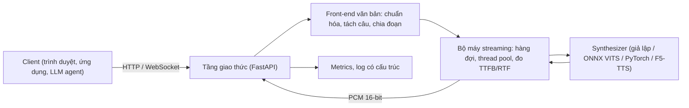

# Dự án 5. Dịch vụ TTS streaming

!!! abstract "Mục tiêu dự án"
    Sau dự án này, bạn có thể:

    - **Thiết kế** một dịch vụ TTS tách bạch ba tầng: giao thức mạng, bộ máy streaming và mô hình. Mô hình cắm vào qua một giao diện `Synthesizer` nên thay được mà không sửa phần còn lại.
    - **Suy ra** điều kiện để âm thanh phát liên tục khi văn bản được chia đoạn, rồi dùng nó để chọn độ dài từng đoạn.
    - **Cài đặt** máy chủ FastAPI có ba kiểu trả kết quả (trọn tệp, HTTP chunked, WebSocket). WebSocket hỗ trợ ngắt lời (*cancel*) và nhận văn bản đến dần từ một LLM.
    - **Đo** đúng TTFB và RTF ở phía máy chủ lẫn phía client, và **giải thích** vì sao hai phía cho số khác nhau.
    - **Thử tải** dịch vụ, đọc các phân vị p50/p95 và ước lượng dung lượng bằng định luật Little.
    - **Đóng gói** dịch vụ bằng Docker và **thiết lập** giám sát (metrics kiểu Prometheus, log có cấu trúc, câu thử định kỳ).

!!! info "Kiến thức cần có"
    - [Chương 35](../phan-8-mo-hinh-lon/ch35-streaming-speech-llm.md): các khái niệm độ trễ, streaming văn bản từ LLM, ghép đoạn âm thanh.
    - [Chương 39](../phan-9-thuc-tien/ch39-trien-khai-production.md): xuất mô hình, lượng tử hóa, phục vụ mô hình, giám sát.
    - [Dự án 1](du-an-1-frontend-tieng-viet.md): gói `vn_frontend` (chuẩn hóa văn bản, tách câu). Dịch vụ vẫn chạy được khi chưa có gói này.
    - [Dự án 3](du-an-3-vits-tieng-viet.md): mô hình VITS xuất ONNX, là mô hình thật đầu tiên ta sẽ cắm vào dịch vụ.
    - Python `asyncio` cơ bản (`async`/`await`, task, hàng đợi) và HTTP ở mức người dùng.

Dự án này không huấn luyện mô hình nào. Ta xây phần "vỏ" để đưa một mô hình TTS tới người dùng thật: nhận văn bản qua mạng, trả âm thanh về **càng sớm càng tốt**, chịu được nhiều người dùng cùng lúc và cho biết mình đang chạy ra sao. Toàn bộ mã nằm trong `code/tts_service/`, còn kiểm thử nằm ở `code/tests/test_tts_service.py`. Các đoạn mã trích trong trang đều lấy từ gói này và đã chạy qua bộ kiểm thử, trừ chỗ được ghi rõ là phác thảo.

## 1. Bài toán: vì sao dịch vụ TTS cần "chảy"

Hãy hình dung một trợ lý ảo đọc bản tin thời tiết dài 30 giây. Mô hình của bạn có hệ số thời gian thực (RTF) bằng 0,2, tức cần khoảng 6 giây để sinh xong 30 giây âm thanh. Nếu dịch vụ chờ sinh xong toàn bộ rồi mới gửi, người dùng phải ngồi im 6 giây trước khi nghe thấy gì. Trong hội thoại, khoảng lặng dài như vậy khiến người dùng nghĩ hệ thống bị treo.

Nhưng người nghe không cần cả 30 giây ngay một lúc. Họ chỉ cần câu đầu tiên. Nếu ta tách văn bản thành nhiều đoạn, sinh đoạn đầu rồi gửi ngay, sau đó vừa phát đoạn trước vừa sinh đoạn sau, thì thời gian chờ chỉ còn bằng thời gian sinh đoạn đầu. Với đoạn đầu dài 1 giây, con số đó là khoảng 0,2 giây. Đó là toàn bộ ý tưởng của streaming ở mức dịch vụ. Phần còn lại của dự án là làm cho ý tưởng này **đúng**, **bền** và **đo được**.

!!! note "Hai mức streaming"
    Dự án này làm *streaming theo đoạn văn bản*: mỗi đoạn (một câu hoặc một cụm) được mô hình sinh trọn vẹn, nhưng các đoạn được gửi nối tiếp nhau. Cách này dùng được với **mọi** mô hình: VITS, FastSpeech 2 + HiFi-GAN, F5-TTS. Mức sâu hơn là *streaming bên trong mô hình*: codec LM tự hồi quy, flow matching chia khối nhân quả, vocoder nhân quả có bộ nhớ trạng thái. Mức này giảm độ trễ xuống dưới độ dài một câu nhưng đòi hỏi kiến trúc đặc thù; xem [Chương 35](../phan-8-mo-hinh-lon/ch35-streaming-speech-llm.md). Giao diện `Synthesizer` ở đây đủ tổng quát để sau này bạn thay bằng một mô hình streaming thực sự.

### 1.1. Các đại lượng đo

Ta dùng ba đại lượng chính. Định nghĩa chúng cẩn thận vì nhiều tranh luận về "hệ thống nhanh hay chậm" thực ra là do hai bên đo hai thứ khác nhau.

**Thời gian tới byte âm thanh đầu tiên** (*time to first byte*, TTFB; còn gọi là *time to first audio*) là khoảng thời gian từ lúc yêu cầu được gửi tới lúc nhận được **mẫu âm thanh** đầu tiên. Lưu ý chữ "âm thanh": 44 byte header WAV không tính.

**Hệ số thời gian thực** (*real-time factor*, RTF) của mô hình là

$$
\rho = \frac{t_{\text{tính}}}{d_{\text{âm thanh}}},
$$

trong đó $t_{\text{tính}}$ là thời gian mô hình thực sự chạy và $d_{\text{âm thanh}}$ là thời lượng âm thanh sinh ra. $\rho < 1$ nghĩa là sinh nhanh hơn thời gian thực. Trong dịch vụ, ta còn đo thêm **RTF "tường"** (*wall-clock*): thay $t_{\text{tính}}$ bằng tổng thời gian phục vụ yêu cầu, gồm cả thời gian chờ đến lượt dùng mô hình. Khi tải thấp, hai con số gần nhau. Khi tải cao, RTF "tường" tăng vọt còn RTF tính toán gần như không đổi. Khoảng cách giữa hai con số chính là dấu hiệu nghẽn hàng đợi.

**Độ trễ đầu-cuối** (*end-to-end latency*) là khoảng thời gian mà người dùng cảm nhận. Với một đoạn đầu dài $a_1$ giây âm thanh, TTFB phía client xấp xỉ bằng

$$
t_{\text{TTFB}} \approx t_{\text{mạng}} + t_{\text{hàng đợi}} + t_{\text{front-end}} + \rho\, a_1 .
$$

Công thức này cho thấy ngay các "nút vặn" có thể chỉnh. Ta có thể giảm $a_1$ bằng cách làm đoạn đầu ngắn, giảm $\rho$ bằng mô hình nhanh hơn hoặc lượng tử hóa ([Chương 39](../phan-9-thuc-tien/ch39-trien-khai-production.md)), và giảm $t_{\text{hàng đợi}}$ bằng cách thêm tài nguyên hoặc lập lịch thông minh hơn. Thành phần $t_{\text{front-end}}$ (chuẩn hóa văn bản, G2P) thường chỉ cỡ mili-giây với bộ quy tắc của Dự án 1. Tuy vậy, nó có thể lớn bất ngờ nếu front-end gọi một mô hình ngôn ngữ.

### 1.2. Điều kiện phát liên tục

Giảm TTFB bằng đoạn đầu ngắn là dễ. Câu hỏi tinh tế hơn là: **các đoạn sau dài bao nhiêu thì người nghe không bị "đứng hình" giữa chừng?** Nếu đoạn thứ hai rất dài, nó có thể chưa sinh xong khi đoạn đầu đã phát hết.

Hãy mô hình hóa đơn giản. Có một bộ sinh duy nhất chạy tuần tự. Đoạn $j$ có thời lượng âm thanh $a_j$ và cần $g_j = \rho\, a_j$ giây để sinh. Ta bỏ qua mạng và front-end. Đặt $A_k = \sum_{j=1}^{k} a_j$ là tổng thời lượng $k$ đoạn đầu.

- Đoạn $k$ sinh xong tại thời điểm $G_k = \sum_{j \le k} g_j = \rho A_k$.
- Người nghe bắt đầu phát khi đoạn 1 tới, tức tại $G_1 = \rho a_1$ (đây chính là TTFB).
- Nếu chưa từng đứng hình, đoạn $k$ được cần đến tại $P_k = \rho a_1 + A_{k-1}$, tức lúc các đoạn trước vừa phát xong.

Âm thanh phát liên tục khi và chỉ khi $G_k \le P_k$ với mọi $k \ge 2$. Biến đổi từng bước:

$$
\rho A_k \le \rho a_1 + A_{k-1}
\;\Longleftrightarrow\;
\rho\,(A_{k-1} + a_k) \le \rho a_1 + A_{k-1}
\;\Longleftrightarrow\;
a_k \le a_1 + \frac{1-\rho}{\rho}\, A_{k-1}.
$$

Bất đẳng thức cuối nói rằng **đoạn tiếp theo được phép dài thêm một lượng tỷ lệ với lượng âm thanh đã phát**, với hệ số $(1-\rho)/\rho$. Mô hình nhanh ($\rho = 0{,}1$) cho hệ số 9, nên các đoạn có thể dài lên rất nhanh. Mô hình chậm ($\rho = 0{,}5$) cho hệ số 1. Khi $\rho \ge 1$, vế phải không bao giờ vượt quá $a_1$ nhiều. Nói cách khác, không cách chia đoạn nào cứu được một mô hình chậm hơn thời gian thực.

Bây giờ giả sử ta chọn độ dài đoạn tăng theo cấp số nhân, $a_k = a_1 g^{k-1}$ với $g \ge 1$. Khi đó $A_{k-1} = a_1 \frac{g^{k-1} - 1}{g - 1}$ (với $g > 1$). Đặt $r = (1-\rho)/\rho$, điều kiện trở thành

$$
g^{k-1} \le 1 + r\,\frac{g^{k-1}-1}{g-1}
\;\Longleftrightarrow\;
\left(g^{k-1} - 1\right)\left(1 - \frac{r}{g-1}\right) \le 0 .
$$

Vì $g^{k-1} - 1 > 0$ với $k \ge 2$, điều kiện đúng với mọi $k$ khi và chỉ khi $r \ge g - 1$, tức là

$$
g \le 1 + \frac{1-\rho}{\rho} = \frac{1}{\rho}.
$$

Kết quả gọn gàng này là cơ sở cho cấu hình chia đoạn của dịch vụ:

1. **TTFB tỷ lệ với $a_1$.** Vì vậy đoạn đầu nên ngắn, cỡ một cụm từ hay một câu ngắn.
2. **Trần độ dài đoạn tăng theo hệ số $g \le 1/\rho$.** Mặc định của ta là $g = 2$ (60, 120, 220 ký tự...), an toàn với mọi mô hình có $\rho \le 0{,}5$. Nếu mô hình chậm hơn (ví dụ F5-TTS trên GPU yếu), hãy giảm $g$.
3. **Khi nhiều luồng dùng chung một bộ sinh không batch**, mỗi luồng chỉ nhận được một phần thời gian của bộ sinh. Với $c$ luồng đồng thời, RTF hiệu dụng của mỗi luồng xấp xỉ $c\rho$, nên số luồng phát liên tục tối đa xấp xỉ $1/\rho$. Ta sẽ kiểm chứng điều này bằng thử tải ở Mục 9.

Mô hình trên bỏ qua jitter mạng và chi phí cố định của mỗi lần gọi mô hình. Trong thực tế, hãy chừa biên an toàn. Đoạn mã dưới đây mô phỏng việc phát và kiểm tra lại điều kiện $g \le 1/\rho$ bằng số:

```python
import numpy as np


def playback_stalls(audio_s: list[float], rtf: float) -> tuple[float, list[float]]:
    """Mô phỏng sinh tuần tự (một bộ sinh) và phát ngay khi có đoạn đầu.

    Trả về (TTFB, danh sách thời gian "đứng hình" trước mỗi đoạn k >= 2).
    """
    a = np.asarray(audio_s, dtype=float)
    ready = rtf * np.cumsum(a)          # G_k: thời điểm đoạn k sinh xong
    t_play = ready[0]                   # bắt đầu phát khi đoạn 1 xong (TTFB)
    stalls = []
    for k in range(1, len(a)):
        t_play += a[k - 1]              # đoạn k-1 phát xong
        stall = max(0.0, ready[k] - t_play)
        stalls.append(stall)
        t_play += stall                 # chờ đoạn k (nếu chưa sẵn sàng)
    return float(ready[0]), stalls


for rtf in (0.1, 0.5):
    for g in (1.5, 2.0, 3.0):
        chunks = [1.0 * g**k for k in range(5)]        # độ dài đoạn tăng theo cấp số nhân
        ttfb, stalls = playback_stalls(chunks, rtf)
        ok = all(s < 1e-9 for s in stalls)
        assert ok == (g <= 1.0 / rtf + 1e-9)          # khớp với điều kiện g <= 1/rtf
        print(f"rtf={rtf} g={g}: TTFB={ttfb:.2f} s, đứng hình={sum(stalls):.2f} s, liên tục={ok}")

# Một đoạn 12 s duy nhất so với chia 1 + 2 + 4 + 5 s (cùng tổng thời lượng), rtf = 0.3
print(round(playback_stalls([12.0], 0.3)[0], 2), playback_stalls([1, 2, 4, 5], 0.3))
```

Với $\rho = 0{,}5$ và $g = 3$, mô phỏng báo có đứng hình, đúng như điều kiện dự đoán. Dòng cuối cho thấy cùng 12 giây âm thanh với $\rho = 0{,}3$: gửi một khối thì TTFB là 3,6 giây; chia đoạn tăng dần thì TTFB chỉ còn 0,3 giây và không đứng hình lần nào.

## 2. Kiến trúc tổng thể



Bốn nguyên tắc chi phối thiết kế:

1. **Tách giao thức khỏi bộ máy.** HTTP và WebSocket chỉ là hai cách "đóng gói" cùng một dòng `AudioChunk`. Nhờ vậy ta kiểm thử bộ máy mà không cần mạng, và thêm gRPC sau này không đụng tới mô hình.
2. **Mô hình là mã đồng bộ, chạy trong thread pool.** Vòng lặp sự kiện (*event loop*) của `asyncio` không bao giờ được chờ mô hình trực tiếp.
3. **Mỗi tiến trình nạp một bản mô hình; giới hạn đồng thời là tường minh.** Giới hạn này là số luồng của thread pool.
4. **Mọi thứ đều hủy được và đều đo được.** Client ngắt kết nối hoặc ngắt lời thì việc sinh dừng lại. Mỗi yêu cầu để lại một dòng log và cập nhật histogram.

Cấu trúc thư mục:

| Tệp | Vai trò |
|---|---|
| `tts_service/synthesizer.py` | Giao diện `Synthesizer`; `ToneSynthesizer` (giả lập, tất định); `CallableSynthesizer`; `OnnxVitsSynthesizer` |
| `tts_service/text.py` | Tích hợp `vn_frontend` kèm phương án dự phòng; `chunk_text`; `IncrementalChunker` |
| `tts_service/audio.py` | PCM 16-bit, header WAV (cả loại "không rõ độ dài"), chia khung, fade |
| `tts_service/engine.py` | `TTSEngine`: thread pool, pipeline sinh–gửi, áp lực ngược, đo đạc |
| `tts_service/server.py` | Ứng dụng FastAPI: `/v1/tts`, `/v1/tts/stream`, `/v1/tts/ws`, `/health`, `/metrics` |
| `tts_service/metrics.py` | `StreamStats` (TTFB, RTF) và registry xuất định dạng Prometheus |
| `tts_service/client.py`, `loadtest.py` | Client bất đồng bộ (WebSocket, HTTP) và công cụ thử tải |
| `tts_service/Dockerfile`, `requirements.txt` | Đóng gói triển khai |

## 3. Giao diện `Synthesizer`

Mọi mô hình cắm vào dịch vụ chỉ cần thỏa một hợp đồng rất nhỏ:

```python
class Synthesizer(ABC):
    """Hợp đồng tối thiểu giữa dịch vụ và một mô hình TTS.

    ``synthesize`` là hàm *đồng bộ* và có thể chậm (chạy mạng nơ-ron); dịch vụ sẽ
    gọi nó trong một luồng (thread) riêng để không chặn vòng lặp sự kiện.
    """

    name: str = "synthesizer"
    sample_rate: int = 22050

    @abstractmethod
    def synthesize(self, text: str, *, speaker: str | None = None,
                   speed: float = 1.0) -> np.ndarray:
        """Trả về dạng sóng float32 mono trong [-1, 1], hình dạng (L,)."""

    def warmup(self) -> None:
        """Chạy thử một lần để nạp trọng số, khởi tạo kernel... trước khi nhận tải thật."""
        self.synthesize("xin chào")

    def close(self) -> None:
        """Giải phóng tài nguyên (bộ nhớ GPU, phiên ONNX...)."""
```

Ba quyết định thiết kế cần giải thích:

- **Vì sao hàm đồng bộ?** Mã suy luận PyTorch hay ONNX Runtime vốn đồng bộ. Ép chúng thành `async` không làm chúng nhanh hơn. Điều quan trọng là *ai* gọi chúng: nếu gọi thẳng trong một hàm `async def`, vòng lặp sự kiện bị chặn suốt thời gian suy luận. Khi đó **mọi** kết nối khác đứng im: không nhận được thông điệp, không gửi được âm thanh, health check quá hạn. Ta gọi mô hình trong thread pool (Mục 6). Cách này hiệu quả vì PyTorch, ONNX Runtime và phần lớn phép toán numpy nhả khóa GIL trong lúc tính toán nặng.
- **Vì sao float32 trong $[-1, 1]$?** Đó là "ngôn ngữ chung" của mọi vocoder. Việc chuyển sang PCM 16-bit, cắt biên, xử lý NaN được làm **một lần** ở dịch vụ thay vì rải trong từng adapter.
- **Vì sao `warmup`?** Lần gọi đầu tiên thường chậm hơn hẳn do cấp phát bộ nhớ, biên dịch kernel, dò thuật toán cuDNN. Nếu không làm nóng, người dùng đầu tiên sau mỗi lần khởi động lại sẽ chịu toàn bộ chi phí này. Ta gọi `warmup` trong `lifespan` của FastAPI, *trước* khi ứng dụng nhận yêu cầu. Nhờ vậy, khi Kubernetes thấy dịch vụ "sẵn sàng" thì nó đã thực sự sẵn sàng.

### 3.1. Bộ tổng hợp giả `ToneSynthesizer`

Để kiểm thử hạ tầng, ta cần một "mô hình" chạy tức thì, không cần trọng số và **tất định** (cùng đầu vào cho cùng đầu ra từng mẫu). Có như vậy thì kiểm thử mới so sánh được kết quả streaming với không streaming theo từng byte. `ToneSynthesizer` sinh cho mỗi âm tiết một âm hài gồm ba họa âm, có đường F0 phác họa thanh điệu của âm tiết đó. Dấu câu được đổi thành khoảng lặng.

```python
# Đường F0 (đơn vị bán cung so với F0 nền) tại các mốc thời gian chuẩn hóa tau in [0, 1].
# Đây là phác họa rất thô theo mô tả giọng Bắc, CHỈ để kiểm thử — xem Chương 15.
TONE_CONTOURS: dict[str, tuple[list[float], list[float]]] = {
    "ngang": ([0.0, 1.0], [0.0, -0.5]),
    "huyen": ([0.0, 1.0], [-2.0, -6.0]),
    "sac": ([0.0, 0.3, 1.0], [-0.5, -1.0, 5.0]),
    "hoi": ([0.0, 0.6, 1.0], [-2.0, -7.0, -4.0]),
    "nga": ([0.0, 0.45, 0.55, 1.0], [-1.0, -2.0, 1.0, 6.0]),
    "nang": ([0.0, 1.0], [-3.0, -9.0]),
}


def syllable_tone(syllable: str) -> str:
    """Nhận diện thanh điệu từ dấu thanh (sau khi tách tổ hợp NFD)."""
    for ch in unicodedata.normalize("NFD", syllable):
        if ch in _TONE_MARKS:
            return _TONE_MARKS[ch]
    return "ngang"
```

Âm tiết được sinh với pha liên tục: pha là tích lũy của tần số tức thời, $\phi[n] = 2\pi \sum_{m \le n} f_0[m]/f_s$. Mỗi âm tiết có đường bao lên/xuống 10 ms. Thanh ngã có thêm một chỗ hạ biên độ ở giữa để gợi tính thanh quản hóa, còn thanh nặng ngắn hơn và rơi nhanh. Tham số `simulated_rtf` khiến hàm "giả vờ" tốn `simulated_rtf × thời lượng` giây. Nhờ đó ta thử được tải, thử ngắt lời và kiểm chứng công thức dung lượng mà không cần GPU.

!!! note "Góc tiếng Việt"
    Bộ tổng hợp giả theo thanh điệu không chỉ để vui tai. Khi chạy dịch vụ với nó và nghe thử, bạn **nghe được** hai loại lỗi rất hay gặp trong dịch vụ TTS tiếng Việt. Loại thứ nhất là ranh giới đoạn đặt sai chỗ, nghe thấy như một khoảng lặng giữa cụm từ. Loại thứ hai là dấu thanh bị mất trên đường đi, ví dụ một proxy hay thư viện nào đó làm hỏng Unicode và mọi âm tiết nghe đều "ngang". Kiểm thử `test_tone_synthesizer_is_deterministic_and_follows_tones` ước lượng F0 bằng tự tương quan và khẳng định thanh sắc đi lên, thanh huyền đi xuống, thanh hỏi có điểm trũng. Đường F0 ở đây chỉ là phác họa; mô tả ngữ âm học chính xác của sáu thanh nằm ở [Chương 15](../phan-3-tin-hieu-ngu-am/ch15-ngu-am-tieng-viet.md).

### 3.2. Bộ chuyển đổi cho mô hình thật

Một mô hình thật được nối vào qua một *adapter* nhỏ. Với VITS đã xuất ONNX theo quy ước của Piper ([Dự án 3](du-an-3-vits-tieng-viet.md)), adapter như sau:

```python
class OnnxVitsSynthesizer(Synthesizer):
    name = "onnx-vits"

    def __init__(self, model_path=None, *, sample_rate=22050, text_to_ids=None,
                 add_blank=False, blank_id=None, noise_scale=0.667, length_scale=1.0,
                 noise_w=0.8, speaker_ids=None, session=None, providers=None):
        if session is None:
            import onnxruntime as ort  # nạp muộn: chỉ cần khi dùng adapter này
            session = ort.InferenceSession(model_path, providers=list(providers or ["CPUExecutionProvider"]))
        self.session = session
        self.input_names = {i.name for i in session.get_inputs()}
        self.sample_rate = sample_rate
        default_blank = 0                                  # quy ước VITS gốc / Piper
        if text_to_ids is None:                            # mặc định: vn_frontend (Dự án 1)
            text_to_ids, default_blank = _default_text_to_ids()  # text_to_sequence, BLANK_ID
        self.text_to_ids = text_to_ids
        self.add_blank = add_blank
        self.blank_id = default_blank if blank_id is None else blank_id
        self.noise_scale, self.length_scale, self.noise_w = noise_scale, length_scale, noise_w
        self.speaker_ids = dict(speaker_ids or {})

    def synthesize(self, text, *, speaker=None, speed=1.0):
        ids = list(self.text_to_ids(text))
        if self.add_blank:
            ids = intersperse(ids, self.blank_id)   # [a, b] -> [blank, a, blank, b, blank]
        if not ids:
            return np.zeros(0, dtype=np.float32)
        feeds = {
            "input": np.asarray([ids], dtype=np.int64),                   # (1, N)
            "input_lengths": np.asarray([len(ids)], dtype=np.int64),      # (1,)
            # length_scale lớn hơn -> nói chậm hơn, nên chia cho speed
            "scales": np.asarray([self.noise_scale, self.length_scale / speed, self.noise_w],
                                 dtype=np.float32),                        # (3,)
        }
        if "sid" in self.input_names:
            feeds["sid"] = np.asarray([self.speaker_ids.get(speaker or "", 0)], dtype=np.int64)
        audio = self.session.run(None, feeds)[0]
        return np.asarray(audio, dtype=np.float32).reshape(-1)          # (L,)
```

(Mã trên đã lược bớt phần kiểm tra lỗi so với tệp gốc.) Có hai điểm cần nhớ:

- **`text_to_ids` phải giống hệt lúc huấn luyện**: cùng bảng ký hiệu, cùng phương ngữ G2P, cùng quy ước chèn blank và cùng ID của blank. VITS gốc và Piper dùng ID 0 (trùng ký hiệu đệm) làm blank, còn `vn_frontend` có token `<blank>` riêng (`BLANK_ID`). Adapter tự chọn `BLANK_ID` khi dùng `vn_frontend.text_to_sequence` mặc định. Đây là nguồn lỗi số một khi đưa mô hình vào phục vụ. Mô hình vẫn "nói" nhưng phát âm sai, và kiểm thử đơn vị không bắt được. Cách phòng là lưu bảng ký hiệu và cấu hình front-end **cùng với** tệp ONNX (như Piper lưu `model.onnx.json`), rồi kiểm tra chúng lúc khởi động.
- Kiểm thử của adapter **không cần mô hình thật**. Một bài dùng phiên ONNX giả để kiểm tra kiểu dữ liệu và thứ tự `scales`. Một bài khác dựng một đồ thị ONNX ba nút bằng `onnx.helper` rồi chạy bằng ONNX Runtime thật.

Với các mô hình khác, `CallableSynthesizer` bọc một hàm bất kỳ. Phác thảo dưới đây (chưa chạy, vì phụ thuộc mã của Dự án 2) cho thấy cách nối FastSpeech 2 + HiFi-GAN:

```python
# PHÁC THẢO — tên hàm load_* là giả định, thay bằng mã thật của Dự án 2
acoustic, vocoder = load_fastspeech2(ckpt_am), load_hifigan(ckpt_voc)


@torch.inference_mode()
def fs2_hifigan(text: str, speaker=None, speed=1.0) -> np.ndarray:
    ids = torch.tensor([vn_frontend.text_to_sequence(text)])          # (1, N)
    mel = acoustic(ids, duration_scale=1.0 / speed)                   # (1, F, T)
    wav = vocoder(mel).squeeze()                                      # (L,)
    return wav.float().cpu().numpy()


synth = CallableSynthesizer(fs2_hifigan, sample_rate=22050, name="fs2-hifigan")
```

Với mô hình zero-shot như F5-TTS ([Dự án 4](du-an-4-zero-shot-tts.md)), tham số `speaker` nên ánh xạ tới một **giọng tham chiếu đã được đồng ý** (cặp âm thanh và bản ghi lời) lưu sẵn ở máy chủ. Tuyệt đối không nhận tệp âm thanh tùy ý từ client; lý do an toàn được bàn ở Dự án 4 và [Chương 40](../phan-9-thuc-tien/ch40-dao-duc-an-toan.md). Mô hình kiểu này thường có RTF lớn hơn VITS nhiều, nên điều kiện $g \le 1/\rho$ ở Mục 1.2 trở nên quan trọng.

## 4. Xử lý văn bản và chia đoạn

### 4.1. Dùng `vn_frontend` khi có, dự phòng khi không

Dịch vụ cần hai thao tác văn bản: **chuẩn hóa** (đổi "3,5 triệu", "TP.HCM", "14:30" thành chữ đọc được) và **tách câu**. Gói `vn_frontend` của [Dự án 1](du-an-1-frontend-tieng-viet.md) cung cấp `normalize_text(text)` và `split_sentences(text)`. Dịch vụ thử nạp gói này. Nếu không được (chưa cài, hoặc gói lỗi khi import), dịch vụ rơi về một bộ tối giản: NFC, gộp khoảng trắng, tách câu bằng biểu thức chính quy.

```python
def load_vn_frontend() -> TextFrontend | None:
    """Thử nạp front-end tiếng Việt của Dự án 1; trả về ``None`` nếu không có."""
    try:
        import vn_frontend
        normalize = vn_frontend.normalize_text
        split = vn_frontend.split_sentences
    except Exception:  # thiếu gói hoặc gói lỗi: đều dùng dự phòng
        return None
    return TextFrontend(
        "vn_frontend",
        _with_fallback(normalize, basic_normalize, "normalize_text"),
        _with_fallback(split, basic_split_sentences, "split_sentences"),
    )
```

`_with_fallback` bọc từng hàm. Nếu `normalize_text` ném ngoại lệ với một đầu vào lạ (một ký hiệu chưa ai nghĩ tới), lỗi được **ghi log** và yêu cầu vẫn được phục vụ bằng bộ dự phòng. Ở ranh giới dịch vụ, một lỗi front-end không nên làm hỏng cả yêu cầu. Nhưng nó cũng không được im lặng: log là tín hiệu để sửa Dự án 1. Endpoint `/health` báo front-end nào đang được dùng (`"frontend": "vn_frontend"` hoặc `"basic"`), để bạn không vô tình chạy bản dự phòng ở môi trường thật.

!!! warning "Front-end lúc phục vụ phải giống lúc huấn luyện"
    Nếu bản ghi lời của dữ liệu huấn luyện được chuẩn hóa bằng `vn_frontend` phiên bản X, dịch vụ cũng phải dùng đúng phiên bản X. Một thay đổi nhỏ, chẳng hạn đọc "2025" là "hai nghìn không trăm hai mươi lăm" thay vì "hai không hai lăm", đủ làm mô hình gặp chuỗi ký hiệu chưa từng thấy. Hãy ghim phiên bản front-end cùng phiên bản mô hình ([Chương 17](../phan-4-frontend/ch17-chuan-hoa-van-ban.md)).

### 4.2. Chia đoạn với trần độ dài tăng dần

`chunk_text` làm bốn việc theo thứ tự. Đầu tiên nó tách câu và chuẩn hóa từng câu, rồi bỏ các "câu" không có chữ hay số nào (chỉ gồm dấu câu). Sau đó, với đoạn thứ $k$, trần độ dài là $\min(\text{max\_chars},\ \text{first\_max\_chars}\cdot g^{k})$, đúng tinh thần của Mục 1.2. Ở đây số ký tự được dùng thay cho thời lượng, vì tốc độ nói gần như không đổi. Câu nào dài hơn trần thì được cắt, **ưu tiên ranh giới cụm** (dấu phẩy, chấm phẩy, hai chấm, gạch ngang); chỉ khi một cụm vẫn quá dài mới cắt theo ranh giới từ. Cuối cùng, các câu ngắn liền nhau được gộp miễn là chưa vượt trần.

```python
def chunk_text(text: str, config: ChunkConfig | None = None,
               frontend: TextFrontend | None = None) -> list[str]:
    """Tách câu, chuẩn hóa rồi gom thành các đoạn có trần độ dài tăng dần."""
    config = config or ChunkConfig()
    fe = frontend or default_frontend()
    sentences = [fe.normalize(s) for s in fe.split_sentences(text)]
    queue = deque(s for s in sentences if s and _has_content(s))
    chunks: list[str] = []
    while queue:
        limit = config.limit(len(chunks))
        s = queue.popleft()
        if len(s) > limit:
            head, *rest = split_long(s, limit)
            queue.extendleft(reversed(rest))  # phần còn lại xử lý ở vòng sau (trần lớn hơn)
            chunks.append(head)
            continue
        while queue and len(s) + 1 + len(queue[0]) <= limit:  # gộp câu ngắn
            s = f"{s} {queue.popleft()}"
        chunks.append(s)
    return chunks
```

Chạy thử với cấu hình `ChunkConfig(first_max_chars=40, max_chars=120)` và bộ front-end tối giản (để kết quả không phụ thuộc phiên bản Dự án 1):

```python
import sys
sys.path.insert(0, "code")  # chạy từ thư mục gốc của kho
from tts_service.text import BASIC_FRONTEND, ChunkConfig, IncrementalChunker, chunk_text

text = ("Chào mừng bạn đến với bản tin sáng nay. Trời Hà Nội nhiều mây, có mưa rào "
        "và dông vài nơi, gió đông nam cấp hai đến cấp ba, nhiệt độ cao nhất khoảng "
        "ba mươi độ. Ra đường nhớ mang áo mưa nhé!")
cfg = ChunkConfig(first_max_chars=40, max_chars=120, growth=2.0)
for k, c in enumerate(chunk_text(text, cfg, BASIC_FRONTEND)):
    print(k, cfg.limit(k), len(c), repr(c))
```

```text
0 40 39 'Chào mừng bạn đến với bản tin sáng nay.'
1 80 50 'Trời Hà Nội nhiều mây, có mưa rào và dông vài nơi,'
2 120 99 'gió đông nam cấp hai đến cấp ba, nhiệt độ cao nhất khoảng ba mươi độ. Ra đường nhớ mang áo mưa nhé!'
```

Đoạn đầu là một câu ngắn trọn vẹn. Câu thứ hai dài 103 ký tự, vượt trần 80, nên bị cắt sau dấu phẩy thứ hai chứ không cắt giữa cụm. Đoạn cuối gộp phần còn lại với câu cuối vì trần đã lên 120. Kiểm thử `test_chunk_text_limits_and_preserves_words` khẳng định hai bất biến quan trọng: mọi đoạn đều nằm dưới trần của nó, và ghép các đoạn lại thì được đúng dãy từ ban đầu (không mất, không đảo, không cắt giữa âm tiết).

!!! note "Góc tiếng Việt"
    - **Dấu chấm và dấu phẩy trong số.** Tiếng Việt dùng dấu chấm phân cách hàng nghìn (1.500.000) và dấu phẩy cho phần thập phân (3,5). Một bộ tách câu ngây thơ cắt sau mọi dấu chấm sẽ chặt đôi "1.500.000". Bộ tách cụm mà cắt sau mọi dấu phẩy sẽ chặt đôi "3,5". Mã của ta chỉ cắt khi sau dấu câu có **khoảng trắng**, và chuẩn hóa số thành chữ trước khi tổng hợp.
    - **Chữ viết tắt có dấu chấm** như "TP.", "PGS.", "ThS." hay chữ cái đầu tên "Nguyễn V. A." không kết thúc câu. Bộ dự phòng có một danh sách nhỏ; `vn_frontend` xử lý đầy đủ hơn bằng từ điển viết tắt.
    - **Tiểu từ cuối câu** (à, ạ, nhé, nhỉ, chứ...) mang ngữ điệu của cả câu ([Chương 16](../phan-3-tin-hieu-ngu-am/ch16-ngon-dieu.md)). Đừng bao giờ cắt đoạn ngay trước chúng. Quy tắc "chỉ cắt ở dấu câu, nếu buộc phải cắt thì ưu tiên dấu phẩy" tự động tránh được điều này trong đa số trường hợp.

### 4.3. Văn bản đến dần: khi đầu vào là một LLM

Trong trợ lý ảo, văn bản cần đọc thường do một LLM sinh ra từng token. Chờ LLM viết xong cả câu trả lời rồi mới đọc sẽ cộng toàn bộ thời gian sinh văn bản vào độ trễ. `IncrementalChunker` nhận từng mảnh văn bản và nhả ra một đoạn ngay khi đoạn đó **chắc chắn** đã xong.

Chữ "chắc chắn" ở đây quan trọng. Khi bộ đệm kết thúc bằng "tăng 1.", ta chưa biết đó là hết câu hay là "1.500.000". Chỉ khi thấy khoảng trắng sau dấu chấm ta mới cắt. Cái giá phải trả là thêm độ trễ bằng đúng một token. Nếu bộ đệm dài quá trần mà vẫn chưa có ranh giới câu, ta cắt ở dấu phẩy gần nhất, không có thì cắt ở ranh giới từ.

```python
inc = IncrementalChunker(cfg)
for delta in ["Giá vàng hôm nay tăng 1.", "500.000 đồng mỗi lượng",
              ", cao nhất từ đầu năm. Nhà đầu", " tư nên thận trọng."]:
    print(repr(delta), "->", inc.push(delta))
print("flush ->", inc.flush())
```

```text
'Giá vàng hôm nay tăng 1.' -> []
'500.000 đồng mỗi lượng' -> ['Giá vàng hôm nay tăng 1.500.000 đồng mỗi']
', cao nhất từ đầu năm. Nhà đầu' -> ['lượng, cao nhất từ đầu năm.']
' tư nên thận trọng.' -> []
flush -> ['Nhà đầu tư nên thận trọng.']
```

Kết quả cho thấy cả ưu lẫn nhược điểm. Ưu điểm: "1." không bị cắt nhầm, và "Nhà đầu" được giữ lại chờ " tư". Nhược điểm: vì trần đoạn đầu chỉ 40 ký tự, bộ chia buộc phải cắt "mỗi | lượng" giữa một cụm danh từ, nghe sẽ không tự nhiên. Đó là cái giá của TTFB thấp. Trong thực tế nên đặt `first_max_chars` cho chế độ này lớn hơn (60–100 ký tự), hoặc yêu cầu LLM viết câu đầu ngắn. Trên WebSocket, client gửi `{"type": "text", ...}` cho từng mảnh và `{"type": "flush"}` khi xong. Cách chia đoạn của chế độ này có thể khác chế độ trọn văn bản, vì nó không nhìn được phía trước. Bàn sâu hơn về streaming văn bản từ LLM có ở [Chương 35](../phan-8-mo-hinh-lon/ch35-streaming-speech-llm.md).

## 5. Âm thanh trên đường truyền: PCM, WAV và biên đoạn

**Định dạng.** Dịch vụ gửi PCM 16-bit có dấu, little-endian, một kênh (`pcm_s16le`). So với float32, cách này nhẹ hơn một nửa và mọi thiết bị phát đều hiểu. Lưu lượng là $f_s \times 16$ bit/s. Ở 22 050 Hz, con số đó là 352,8 kbit/s, quá đủ cho mạng nội bộ nhưng đáng kể với di động. Khi băng thông quan trọng, hãy nén bằng Opus (RFC 6716), một codec được thiết kế cho thoại độ trễ thấp và chỉ cần vài chục kbit/s cho tiếng nói chất lượng tốt. Việc này được để làm bài tập.

!!! warning "Bẫy byte order: `audio/L16`"
    Rất nhiều người gắn nhãn PCM của mình là `audio/L16`. Nhưng theo đặc tả RTP (RFC 3551), L16 là PCM 16-bit theo **thứ tự byte mạng (big-endian)**, ngược với `pcm_s16le` mà numpy, WAV và hầu hết card âm thanh dùng. Client tin vào nhãn sẽ phát ra tiếng rè. Dịch vụ của ta vì vậy dùng `application/octet-stream` và mô tả định dạng tường minh trong header `X-Sample-Rate`, `X-Audio-Encoding` (HTTP) hoặc thông điệp `ready` (WebSocket).

**WAV khi chưa biết độ dài.** Header WAV chứa kích thước dữ liệu. Khi streaming, ta chưa biết con số này. Quy ước phổ biến là đặt các trường kích thước bằng `0xFFFFFFFF`. ffmpeg và trình duyệt chấp nhận quy ước này và đọc tới khi hết luồng. Hàm `wav_header(sample_rate, num_samples=None)` làm đúng như vậy. Client đo TTFB phải bỏ qua 44 byte header này (xem `client.py`).

**Biên đoạn.** Mỗi đoạn được sinh độc lập, nên mẫu cuối của đoạn này và mẫu đầu của đoạn sau hiếm khi khớp nhau. Bước nhảy biên độ tạo ra tiếng "tách" (*click*) rất dễ nghe. Vì ta cắt ở ranh giới câu/cụm, nơi vốn có khoảng lặng, một fade nửa chu kỳ cosin vài mili-giây ở hai đầu đoạn là đủ:

```python
def apply_fade(audio: np.ndarray, sample_rate: int, fade_ms: float = 5.0) -> np.ndarray:
    x = np.asarray(audio, dtype=np.float32).copy()  # (L,)
    n = min(int(sample_rate * fade_ms / 1000.0), len(x) // 2)
    if n <= 0:
        return x
    ramp = 0.5 - 0.5 * np.cos(np.linspace(0.0, np.pi, n, dtype=np.float32))  # 0 -> 1
    x[:n] *= ramp
    x[-n:] *= ramp[::-1]
    return x
```

Nếu sau này bạn cắt đoạn *giữa* một âm thanh liên tục, như khi dùng mô hình streaming theo khối khung, fade không còn đủ. Khi đó cần ghép chồng (*overlap-add*) với cửa sổ chéo ([Chương 35](../phan-8-mo-hinh-lon/ch35-streaming-speech-llm.md)).

**Một khác biệt tinh tế giữa streaming và không streaming.** Chia đoạn làm *thay đổi* âm thanh. Mô hình thật sinh mỗi đoạn với ngữ cảnh hẹp hơn, nên ngôn điệu ở ranh giới đoạn có thể khác so với khi sinh cả văn bản một lần. Trong dịch vụ của ta, endpoint trọn tệp cũng đi qua cùng bộ chia đoạn. Nhờ vậy hai kiểu trả kết quả cho âm thanh **giống nhau từng byte**, và kiểm thử khẳng định điều đó. Đây là một lựa chọn có chủ ý: người dùng không nghe hai giọng đọc khác nhau tùy endpoint.

## 6. Bộ máy streaming

`TTSEngine.stream` là trái tim của dịch vụ. Nó nhận một dãy đoạn văn bản (danh sách, hoặc dãy bất đồng bộ khi văn bản đến dần) và trả về dãy `AudioChunk`:

```python
async def stream(self, chunks, *, speaker=None, speed=1.0, stats=None):
    queue: asyncio.Queue = asyncio.Queue(maxsize=self.prefetch)
    end = object()

    async def producer() -> None:
        try:
            index = 0
            async for text in _as_async(chunks):
                audio, wait_s, compute_s = await self.synthesize_chunk(text, speaker, speed)
                audio = apply_fade(audio, self.sample_rate, self.fade_ms)
                await queue.put(AudioChunk(index, text, float_to_pcm16(audio),
                                           len(audio), compute_s, wait_s))
                index += 1
            await queue.put(end)
        except asyncio.CancelledError:
            raise
        except Exception as exc:          # chuyển lỗi sang phía tiêu thụ
            await queue.put(exc)

    task = asyncio.create_task(producer())
    try:
        while True:
            item = await queue.get()
            if item is end:
                break
            if isinstance(item, Exception):
                raise item
            if stats is not None:         # cập nhật số đoạn, số mẫu, thời gian tính/chờ
                stats.n_chunks += 1
                stats.audio_samples += item.n_samples
                stats.compute_s += item.compute_s
                stats.queue_wait_s += item.queue_wait_s
                if stats.t_first_audio is None and item.n_samples > 0:
                    stats.t_first_audio = time.perf_counter()  # TTFB phía máy chủ
            yield item
    finally:
        task.cancel()
        try:
            await task
        except asyncio.CancelledError:
            pass
```

Đây là mẫu *người sản xuất – người tiêu thụ* (*producer–consumer*) kinh điển. Mỗi chi tiết nhỏ trong đó giải quyết một vấn đề thật:

- **Đường ống (*pipeline*).** Tác vụ `producer` sinh đoạn $k+1$ trong khi phía tiêu thụ đang gửi đoạn $k$. Đây chính là giả thiết "một bộ sinh chạy liên tục" của Mục 1.2. Nếu sinh và gửi tuần tự, thời gian gửi (nhỏ nhưng khác 0) sẽ cộng dồn vào mỗi đoạn.
- **Hàng đợi có giới hạn tạo áp lực ngược (*backpressure*).** `maxsize=prefetch` (mặc định 1) nghĩa là bộ sinh chạy trước tối đa khoảng một–hai đoạn. Nếu client đọc chậm (mạng yếu), lệnh gửi bị chặn bởi bộ đệm TCP, hàng đợi đầy, `producer` dừng lại và **nhường mô hình cho người khác**. Hàng đợi không giới hạn thì ngược lại: một client chậm có thể chiếm mô hình để sinh trước cả bài văn dài, vừa tốn bộ nhớ vừa bất công với người khác.
- **Hủy dây chuyền.** Khối `finally` hủy `producer` khi phía tiêu thụ dừng, dù vì xong việc, vì lỗi hay vì client ngắt kết nối. Muốn khối này chạy *ngay* (chứ không phải lúc bộ dọn rác thu hồi generator), phía gọi phải dùng `contextlib.aclosing`. Mọi endpoint trong `server.py` đều làm vậy: `async with aclosing(engine.stream(...)) as agen: ...`.
- **Lỗi đi theo dữ liệu.** Ngoại lệ trong `producer` được đặt vào hàng đợi và ném lại ở phía tiêu thụ. Nhờ vậy endpoint có thể báo lỗi cho client, thay vì để tác vụ nền chết lặng lẽ.

Phần gọi mô hình:

```python
async def synthesize_chunk(self, text, speaker, speed):
    """Chạy Synthesizer trong thread pool; trả về (audio, thời_gian_chờ, thời_gian_tính)."""
    loop = asyncio.get_running_loop()
    t_submit = time.perf_counter()

    def job():
        t0 = time.perf_counter()
        audio = self.synthesizer.synthesize(text, speaker=speaker, speed=speed)
        return audio, t0 - t_submit, time.perf_counter() - t0

    return await loop.run_in_executor(self._executor, job)
```

trong đó `self._executor = ThreadPoolExecutor(max_workers=max_concurrency)`. Thread pool riêng với số luồng bằng giới hạn đồng thời là một lựa chọn có lý do. Cách "hiển nhiên" là dùng `asyncio.Semaphore` quanh `asyncio.to_thread(...)`, nhưng cách đó có một lỗi tinh vi. Khi yêu cầu bị hủy, `CancelledError` thoát khỏi khối `async with semaphore` và **trả semaphore ngay**, trong khi luồng chạy mô hình vẫn chạy tiếp (Python không thể dừng cưỡng bức một luồng). Yêu cầu kế tiếp lấy được semaphore và bắt đầu chạy song song, nên giới hạn đồng thời bị vượt đúng lúc hệ thống đang chịu tải nhất (người dùng sốt ruột thường hủy rồi gửi lại). Với thread pool riêng, số luồng **là** giới hạn: lời gọi bị hủy chạy nốt trong luồng của nó, nhưng không lời gọi mới nào chen vào được. Bài `test_engine_respects_max_concurrency` kiểm tra rằng tại mọi thời điểm không quá `max_concurrency` lời gọi `synthesize` chạy cùng lúc. Hàm `job` còn đo riêng *thời gian chờ* (từ lúc nộp tới lúc bắt đầu chạy) và *thời gian tính*. Đây là hai con số cần tách bạch khi chẩn đoán chậm.

!!! tip "Bao nhiêu luồng là đủ?"
    Với một GPU và mô hình không batch, `max_concurrency` bằng 1–2 thường cho thông lượng tốt nhất. Hai lời gọi chen nhau trên cùng GPU hiếm khi nhanh hơn chạy lần lượt, mà còn làm TTFB của cả hai tệ đi. Trên CPU, hãy cân đối `max_concurrency × số luồng nội bộ của mô hình` (`OMP_NUM_THREADS`, `torch.set_num_threads`, `intra_op_num_threads` của ONNX Runtime) với số lõi. Nếu vượt số lõi (*oversubscription*), mọi thứ chậm đi đột ngột. Muốn tăng thông lượng thật sự trên GPU thì cần **batching động**: gom đoạn của nhiều yêu cầu vào một lần chạy ([Chương 39](../phan-9-thuc-tien/ch39-trien-khai-production.md)).

## 7. Giao diện lập trình (API)

Dịch vụ cung cấp ba cách lấy âm thanh. Mỗi cách đánh đổi giữa độ đơn giản và độ trễ:

| Endpoint | Kiểu | TTFB | Báo lỗi giữa chừng | Ngắt lời | Khi nào dùng |
|---|---|---|---|---|---|
| `POST /v1/tts` | Trả trọn tệp WAV/PCM | Bằng toàn bộ thời gian tổng hợp | Có (mã HTTP) | Không | Tạo tệp sách nói, xử lý theo lô, tích hợp đơn giản |
| `POST /v1/tts/stream` | HTTP chunked | Bằng thời gian sinh đoạn đầu | Không (chỉ thấy luồng bị cắt) | Đóng kết nối | Phát trong trình duyệt, client HTTP sẵn có |
| `WS /v1/tts/ws` | WebSocket hai chiều | Bằng thời gian sinh đoạn đầu | Có (thông điệp `error`) | Có (`cancel`) | Trợ lý ảo, hội thoại, văn bản đến dần từ LLM |

Ngoài ra có `GET /health` (trạng thái, mô hình và front-end đang dùng) và `GET /metrics` (định dạng Prometheus, Mục 11). Đầu vào HTTP được kiểm tra bằng Pydantic: `text` không rỗng, `speed` trong $[0{,}5;\, 2]$. Văn bản dài hơn `max_text_chars` (mặc định 5 000) bị từ chối với mã 413. Văn bản không có chữ đọc được bị từ chối với mã 422. Giới hạn độ dài không chỉ để chống lạm dụng: nó chặn trước những yêu cầu sẽ chiếm mô hình hàng phút.

### 7.1. HTTP chunked và giới hạn của nó

```python
@app.post("/v1/tts/stream")
async def tts_stream(req: TTSRequest) -> StreamingResponse:
    chunks = plan_or_raise(req.text)              # 413/422 được trả TRƯỚC khi bắt đầu stream
    stats = StreamStats(sr, n_chars=len(req.text))

    async def body():                             # (rút gọn từ server.py)
        status = "cancelled"
        metrics.stream_started()
        try:
            if req.format == "wav":
                yield wav_header(sr, None)        # header "không rõ độ dài"
            async with aclosing(engine.stream(chunks, speaker=req.speaker, speed=req.speed,
                                              stats=stats)) as agen:
                async for chunk in agen:
                    yield chunk.pcm
            status = "ok"
        except Exception:
            status = "error"
            raise
        finally:
            stats.t_end = time.perf_counter()
            metrics.stream_finished("stream", status, stats)

    return StreamingResponse(body(), media_type="audio/wav", headers={
        "X-Sample-Rate": str(sr), "Cache-Control": "no-store", "X-Accel-Buffering": "no"})
```

Hãy để ý hai điều. Thứ nhất, mọi kiểm tra đầu vào chạy **trước** khi trả `StreamingResponse`. Một khi mã 200 và header đã gửi đi, giao thức HTTP không còn cách nào báo "thực ra có lỗi". Lỗi giữa chừng chỉ hiện ra như một luồng bị cắt cụt, và client phải tự đoán. Thứ hai, header `X-Accel-Buffering: no` bảo nginx đừng gom phản hồi vào bộ đệm. Nếu thiếu header này (hoặc thiếu `proxy_buffering off`), proxy sẽ giữ âm thanh lại cho tới khi đủ bộ đệm hoặc hết luồng, và streaming mất tác dụng mà không có lỗi nào xuất hiện.

### 7.2. Giao thức WebSocket

WebSocket (RFC 6455) cho kênh hai chiều trên một kết nối dài hạn. Nhờ vậy client có thể gửi lệnh *trong lúc* đang nhận âm thanh, điều HTTP không làm được. Ta thiết kế giao thức với thông điệp điều khiển là JSON dạng văn bản, còn âm thanh là khung nhị phân:

| Chiều | Thông điệp | Ý nghĩa |
|---|---|---|
| máy chủ → client | `{"type": "ready", "sample_rate", "encoding": "pcm_s16le", "channels": 1}` | Gửi ngay khi kết nối; client cấu hình bộ phát theo đây |
| client → máy chủ | `{"type": "synthesize", "text", "speaker", "speed", "request_id"}` | Tổng hợp trọn một văn bản |
| client → máy chủ | `{"type": "text", "text"}` … `{"type": "flush"}` | Văn bản đến dần (từ LLM); `flush` báo hết |
| máy chủ → client | `{"type": "start", "request_id"}` | Bắt đầu một yêu cầu |
| máy chủ → client | `{"type": "chunk", "index", "text", "samples"}` + các khung nhị phân | Siêu dữ liệu của đoạn, theo sau là PCM của nó (chia khung 200 ms) |
| máy chủ → client | `{"type": "end", "stats": {...}}` | Xong; kèm TTFB, RTF, thời lượng do máy chủ đo |
| client → máy chủ | `{"type": "cancel"}` | Ngắt lời: dừng ngay, máy chủ đáp `{"type": "cancelled"}` |
| máy chủ → client | `{"type": "error", "message"}` | Lỗi; kết nối **vẫn mở** cho yêu cầu sau |

Thông điệp `chunk` mang theo văn bản của đoạn. Client có thể dùng nó để hiện phụ đề đồng bộ, hoặc để biết chính xác người dùng đã nghe tới đâu khi họ ngắt lời. Thông tin này hữu ích cho LLM ở lượt hội thoại sau.

Vòng lặp chính của handler (rút gọn từ `server.py`) nhận thông điệp và điều phối một tác vụ `run` đang hoạt động:

```python
while True:
    msg = json.loads(await ws.receive_text())      # (bản đầy đủ có bắt lỗi JSON)
    kind = msg.get("type")
    busy = active is not None and not active.done()
    if kind == "synthesize":
        if busy:
            await error("Đang xử lý một yêu cầu khác; gửi 'cancel' trước")
            continue
        chunks = engine.plan(str(msg.get("text", "")))
        active = asyncio.create_task(run(request_id, chunks, StreamStats(sr), speaker, speed))
    elif kind == "cancel" and busy:
        active.cancel()                            # CancelledError lan vào run -> engine.stream
        with suppress(asyncio.CancelledError):
            await active
        await send_json({"type": "cancelled", "request_id": request_id})
    # ... "text" / "flush": đẩy đoạn từ IncrementalChunker vào một asyncio.Queue
```

Tác vụ `run` gửi `start`, lặp qua `engine.stream(...)` để gửi `chunk` và các khung nhị phân, rồi gửi `end`. Vì cả `run` lẫn vòng lặp chính đều có thể ghi vào socket (ví dụ một thông điệp `error` "đang bận" chen giữa lúc đang stream), mọi lệnh gửi đi qua một `asyncio.Lock`. Lock này bảo đảm thông điệp `chunk` và các khung nhị phân của nó không bị thông điệp khác xen vào giữa.

**Ngắt lời (*barge-in*)** là tính năng quyết định trải nghiệm hội thoại: người dùng nói chen, trợ lý phải im **ngay**. `active.cancel()` ném `CancelledError` vào `run` ở điểm `await` gần nhất. Lỗi lan vào `engine.stream`, khối `finally` hủy `producer`, và đoạn đang sinh trong thread pool chạy nốt rồi bị bỏ. Phía client còn một việc nữa: xóa bộ đệm phát của chính nó. Âm thanh đã nhận nhưng chưa phát vẫn nằm đó. Kiểm thử `test_websocket_cancel_then_reuse_connection` dùng `simulated_rtf=0.3` để các đoạn sinh chậm. Nó gửi `cancel` sau đoạn đầu, khẳng định còn nhiều đoạn chưa được gửi, rồi dùng lại chính kết nối đó cho yêu cầu mới.

## 8. Chạy thử và kiểm thử

Mọi lệnh dưới đây chạy từ thư mục `code/` của kho. Chúng đã được chạy thử trong môi trường biên soạn, trừ lệnh dùng `ffplay`.

```bash
pip install -r tts_service/requirements.txt pytest
python -m pytest tests/test_tts_service.py -q          # khoảng 25 bài, vài giây, không cần mô hình

# Máy chủ với bộ tổng hợp giả, RTF giả lập 0.1
python -m tts_service --port 8000 --simulated-rtf 0.1

# Ở một cửa sổ khác:
curl -s localhost:8000/health
curl -s -X POST localhost:8000/v1/tts -H 'content-type: application/json' \
     -d '{"text": "Xin chào Việt Nam."}' -o xin_chao.wav
python -m tts_service.client --url ws://localhost:8000/v1/tts/ws \
     --text "Xin chào các bạn. Đây là dịch vụ tổng hợp tiếng nói tiếng Việt." --out out.wav
python -m tts_service.client --url http://localhost:8000 --text "Xin chào." --out out2.wav
# Nghe trực tiếp luồng HTTP (cần ffmpeg; header WAV mang sẵn định dạng):
curl -sN -X POST localhost:8000/v1/tts/stream -H 'content-type: application/json' \
     -d '{"text": "Một hai ba. Bốn năm sáu."}' | ffplay -nodisp -autoexit -
```

Với câu thử dài khoảng 4 giây âm thanh, một lần chạy trên máy biên soạn cho dòng kết quả kiểu `TTFB=124 ms  tổng=0,43 s  âm thanh=4,17 s  RTF(client)=0,102`. Ở đây TTFB gần bằng $\rho\, a_1 = 0{,}1 \times 1{,}2$ giây (đoạn đầu "Xin chào các bạn." dài khoảng 1,2 giây), đúng như công thức ở Mục 1.1.

Bộ kiểm thử được tổ chức theo tầng, từ thuần túy tới tích hợp:

| Nhóm | Bài kiểm thử tiêu biểu | Khẳng định |
|---|---|---|
| Âm thanh | `test_pcm_roundtrip_and_clipping`, `test_wav_header_and_file_are_valid` | PCM khứ hồi đúng tới sai số lượng tử; clip thay vì tràn số; NaN thành im lặng; header WAV đọc được bằng `wave` |
| Văn bản | `test_chunk_text_limits_and_preserves_words`, `test_incremental_chunker_*`, `test_frontend_fallback_*` | Đoạn dưới trần; không mất/đảo từ; "3." chờ khoảng trắng; dự phòng khi thiếu `vn_frontend` |
| Synthesizer | `test_tone_synthesizer_is_deterministic_and_follows_tones`, `test_onnx_adapter_*` | Tất định; F0 theo thanh; tốc độ nói; đầu vào ONNX đúng kiểu, đúng thứ tự |
| HTTP | `test_http_stream_equals_full`, `test_http_validation_errors`, `test_metrics_endpoint_counts_requests` | Streaming và trọn tệp cho cùng byte; mã 413/422; metrics đếm đúng |
| WebSocket | `test_websocket_stream_protocol_and_stats`, `test_websocket_cancel_then_reuse_connection`, `test_websocket_incremental_text_like_llm`, `test_websocket_errors_keep_connection_alive` | Thứ tự thông điệp; tổng số mẫu khớp; $0 \le$ TTFB $\le$ thời gian phục vụ; ngắt lời; văn bản đến dần; lỗi không làm rớt kết nối |
| Bộ máy | `test_engine_respects_max_concurrency` | Không bao giờ quá `max_concurrency` lời gọi mô hình song song |
| Tích hợp | `test_async_clients_and_load_test` | Chạy uvicorn thật trong một luồng; client WebSocket và HTTP nhận cùng âm thanh; thử tải không lỗi |

Kiểm thử HTTP và WebSocket dùng `TestClient` của FastAPI, chạy ứng dụng trong cùng tiến trình mà không mở cổng mạng. Bài tích hợp cuối cùng mới khởi động uvicorn thật, vì client `websockets`/`httpx` cần một cổng thật.

## 9. Thử tải và ước lượng dung lượng

### 9.1. Vòng kín và vòng mở

`loadtest.py` có hai chế độ, và sự khác biệt giữa chúng quan trọng hơn vẻ ngoài:

- **Vòng kín** (`--concurrency c`): $c$ client ảo, mỗi client gửi yêu cầu mới ngay khi yêu cầu cũ xong. Khi máy chủ chậm đi, client tự động gửi ít đi. Vì vậy vòng kín *không bao giờ* đẩy máy chủ vào trạng thái quá tải thật sự, và có xu hướng làm đẹp số liệu độ trễ. Hiện tượng này được gọi là *coordinated omission*, thuật ngữ do Gil Tene phổ biến.
- **Vòng mở** (`--rate λ`): yêu cầu đến theo quá trình Poisson với tốc độ $\lambda$ yêu cầu/giây (khoảng cách giữa hai lần đến tuân theo phân phối mũ), bất kể máy chủ đã trả lời hay chưa. Người dùng thật cư xử như vậy: họ không chờ người khác xong mới bấm nút. Đây là chế độ nên dùng để kiểm tra cam kết độ trễ (SLO).

### 9.2. Một thí nghiệm nhỏ

Ta chạy máy chủ với `ToneSynthesizer(simulated_rtf=0.1)` và `max_concurrency=1`, rồi thử tải vòng kín với số client tăng dần (mỗi client 8 yêu cầu, dùng các câu mẫu trong `loadtest.py`). Một lần chạy trên máy biên soạn cho kết quả:

| Số client $c$ | TTFB p50 (ms) | TTFB p95 (ms) | RTF client trung bình | Giây âm thanh / giây đồng hồ |
|---|---|---|---|---|
| 1 | 259 | 279 | 0,10 | 9,7 |
| 2 | 476 | 531 | 0,19 | 9,96 |
| 4 | 937 | 1 002 | 0,38 | 9,97 |
| 8 | 1 896 | 1 960 | 0,76 | 9,98 |

Số tuyệt đối sẽ khác trên máy của bạn, nhưng ba xu hướng thì không, và cả ba đều khớp lý thuyết ở Mục 1.2:

1. **Thông lượng bão hòa ở $1/\rho$.** Cột cuối dừng ở khoảng 10 giây âm thanh mỗi giây, đúng bằng $1/\rho = 1/0{,}1$. Thêm client không làm máy chủ sinh nhanh hơn; chỉ có thêm bộ sinh (thêm GPU, batching) mới làm được.
2. **RTF mà mỗi client cảm nhận xấp xỉ $c\rho$.** Với 8 client, con số này là 0,76, vẫn nhỏ hơn 1 nên âm thanh vẫn phát liên tục. Khoảng từ 10 client trở lên, RTF cảm nhận vượt 1 và người nghe bắt đầu bị đứng hình.
3. **TTFB tăng tuyến tính theo $c$.** Lý do là thread pool phục vụ theo thứ tự đến (FIFO). Đoạn *đầu tiên* của một yêu cầu mới phải xếp hàng sau các đoạn *thứ năm, thứ sáu* của những yêu cầu đang chạy, dù người nghe của các yêu cầu kia đã có sẵn nhiều giây âm thanh trong bộ đệm. Một bộ lập lịch ưu tiên đoạn đầu (hoặc ưu tiên luồng có ít âm thanh đệm nhất) giảm TTFB đáng kể mà không đổi thông lượng. Đây là Bài tập 6.

### 9.3. Định luật Little và kế hoạch dung lượng

**Định luật Little** (Little, 1961) phát biểu rằng với một hệ thống ổn định,

$$
L = \lambda W,
$$

trong đó $L$ là số yêu cầu trung bình đang ở trong hệ thống, $\lambda$ là tốc độ đến, và $W$ là thời gian trung bình một yêu cầu ở trong hệ thống. Định luật không giả định gì về phân phối, nên dùng được ngay để kiểm tra chéo số liệu. Trong thí nghiệm vòng kín, $L = c$, nên $W = c/\lambda$.

Để lập kế hoạch, gọi $\bar{d}$ là thời lượng âm thanh trung bình mỗi yêu cầu và $n$ là số bộ sinh song song không batch. Mỗi yêu cầu chiếm bộ sinh trong $\rho \bar{d}$ giây, nên **mức sử dụng** là

$$
u = \frac{\lambda\, \rho\, \bar{d}}{n},
$$

và hệ thống chỉ ổn định khi $u < 1$, tức $\lambda < n / (\rho \bar{d})$. Nhưng chạy sát $u = 1$ là sai lầm. Lý thuyết hàng đợi cho thấy thời gian chờ tăng vọt khi $u \to 1$. Với mô hình đơn giản nhất (M/M/1: đến theo Poisson, thời gian phục vụ phân phối mũ, một bộ phục vụ), thời gian chờ trung bình trong hàng là

$$
W_q = \frac{u}{1-u} \cdot \frac{1}{\mu},
$$

với $1/\mu$ là thời gian phục vụ trung bình. Ví dụ: $\rho = 0{,}1$, $\bar{d} = 5$ giây, nên $1/\mu = 0{,}5$ giây. Ở $u = 0{,}5$, $W_q = 0{,}5$ giây; ở $u = 0{,}8$, $W_q = 2$ giây; ở $u = 0{,}95$, $W_q = 9{,}5$ giây. Đó là lý do các hệ thống có cam kết độ trễ thường được định cỡ để chạy ở mức sử dụng khoảng 50–70% vào giờ cao điểm. Đây là con số kinh nghiệm, cần hiệu chỉnh bằng thử tải vòng mở với lưu lượng giống thật. Streaming theo đoạn giúp phần nào: điều người dùng cảm nhận là thời gian chờ *đoạn đầu*, không phải cả yêu cầu. Tuy vậy, hàng đợi vẫn là hàng đợi.

!!! tip "Đo phân vị, đừng chỉ đo trung bình"
    Một dịch vụ có TTFB trung bình 200 ms nhưng p99 là 3 giây sẽ khiến cứ 100 câu trả lời thì có một câu người dùng tưởng hệ thống treo. Với trợ lý ảo, mỗi phiên hội thoại có hàng chục lượt, nên gần như phiên nào cũng gặp ít nhất một lần chậm. Dean và Barroso (2013) phân tích kỹ hiện tượng "đuôi dài" này. Hãy đặt SLO theo p95/p99, và luôn báo cáo kèm số client, chế độ vòng kín/mở, độ dài văn bản.

## 10. Triển khai

### 10.1. Tiến trình, luồng và bộ nhớ mô hình

Câu hỏi đầu tiên khi triển khai là: bao nhiêu tiến trình? Với dịch vụ web thông thường, người ta chạy `uvicorn --workers N` để tận dụng nhiều lõi CPU. Với dịch vụ mô hình, **mỗi worker nạp một bản mô hình riêng**. Bốn worker trên một GPU nghĩa là bốn bản trọng số và bốn vùng bộ nhớ đệm CUDA, rồi cả bốn tranh nhau cùng một GPU. Quy tắc an toàn:

- **Một tiến trình cho mỗi GPU** (hoặc mỗi container), giới hạn đồng thời bên trong bằng `max_concurrency`.
- **Mở rộng theo chiều ngang** bằng cách chạy thêm container sau một bộ cân bằng tải.
- Trên CPU, có thể chạy vài tiến trình nhỏ nếu mô hình nhẹ (VITS ONNX vài chục MB). Khi đó hãy đặt số luồng nội bộ của mỗi tiến trình sao cho tổng không vượt số lõi.

### 10.2. Docker

`code/tts_service/Dockerfile`, build từ thư mục `code/`:

```dockerfile
FROM python:3.12-slim

ENV PYTHONDONTWRITEBYTECODE=1 \
    PYTHONUNBUFFERED=1 \
    OMP_NUM_THREADS=2

WORKDIR /app
COPY tts_service/requirements.txt /app/requirements.txt
RUN pip install --no-cache-dir -r /app/requirements.txt

# Mã nguồn: dịch vụ + front-end tiếng Việt (Dự án 1). Mô hình nên được gắn vào qua volume
# hoặc tải lúc khởi động, không nên "nướng" vào ảnh.
COPY tts_service/ /app/tts_service/
COPY vn_frontend/ /app/vn_frontend/

RUN useradd --create-home --uid 10001 tts
USER tts

EXPOSE 8000
HEALTHCHECK --interval=30s --timeout=3s --start-period=60s \
    CMD python -c "import urllib.request; urllib.request.urlopen('http://127.0.0.1:8000/health', timeout=2)"

CMD ["uvicorn", "tts_service.server:create_app", "--factory", "--host", "0.0.0.0", "--port", "8000", \
     "--workers", "1", "--timeout-graceful-shutdown", "30"]
```

```bash
cd code
docker build -f tts_service/Dockerfile -t tts-service .
docker run --rm -p 8000:8000 -e TTS_SIMULATED_RTF=0.05 tts-service
# Mô hình ONNX từ Dự án 3, gắn vào qua volume:
docker run --rm -p 8000:8000 -v $(pwd)/models:/models:ro \
    -e TTS_SYNTHESIZER=onnx -e TTS_ONNX_MODEL=/models/vits_vi.onnx tts-service
```

(Dockerfile này chưa được build thử trong môi trường biên soạn vì không có Docker daemon; nội dung chỉ dùng các lệnh chuẩn, nhưng bạn hãy kiểm tra lại. Muốn dùng adapter ONNX thì thêm `onnxruntime` vào `requirements.txt`.)

Một số lựa chọn trong Dockerfile có lý do riêng. `create_app` là một *factory* đọc cấu hình từ biến môi trường (`TTS_SYNTHESIZER`, `TTS_MAX_CONCURRENCY`, `TTS_FIRST_CHUNK_CHARS`...), nên một ảnh dùng được cho nhiều cấu hình. Container chạy bằng người dùng không phải root. `--timeout-graceful-shutdown` cho các yêu cầu đang dở thời gian hoàn tất khi container bị dừng. Với GPU, hãy đổi ảnh nền sang một ảnh CUDA chính thức, dùng gói ONNX Runtime/PyTorch bản GPU tương ứng, và chạy với `--gpus all`. Phiên bản CUDA phải khớp giữa ảnh, driver và thư viện; hãy tra bảng tương thích của thư viện bạn dùng tại thời điểm triển khai.

### 10.3. Proxy ngược và cân bằng tải

Đa số triển khai đặt nginx hoặc một bộ cân bằng tải trước dịch vụ. Hai cấu hình dễ quên nhất (phác thảo, chưa chạy thử):

```nginx
location /v1/tts/ws {
    proxy_pass http://tts_backend;
    proxy_http_version 1.1;
    proxy_set_header Upgrade $http_upgrade;     # nâng cấp lên WebSocket
    proxy_set_header Connection "upgrade";
    proxy_read_timeout 3600s;                   # kết nối hội thoại sống lâu
}
location /v1/ {
    proxy_pass http://tts_backend;
    proxy_http_version 1.1;
    proxy_buffering off;                        # nếu không, streaming HTTP bị gom lại
}
```

WebSocket được cân bằng tải **theo kết nối**, không theo yêu cầu. Một kết nối hội thoại có thể sống hàng chục phút và gửi nhiều yêu cầu, nên phân bố tải giữa các bản sao có thể lệch dù số kết nối đều nhau. Khi lệch nhiều, có thể giới hạn số kết nối mỗi bản sao, hoặc cho client kết nối lại định kỳ.

### 10.4. Kubernetes và tự động co giãn

- **Readiness**: dùng `/health`. Vì `warmup` chạy trong `lifespan` trước khi uvicorn nhận yêu cầu, `/health` trả lời được nghĩa là mô hình đã nạp xong. Thời gian khởi động có thể lên tới hàng chục giây với mô hình lớn, nên hãy cấu hình `startupProbe` đủ rộng.
- **Co giãn theo tín hiệu đúng.** Dịch vụ dùng GPU có CPU thấp ngay cả khi quá tải, nên co giãn theo CPU vô nghĩa. Hãy co giãn theo `tts_active_streams` mỗi pod, hoặc theo p95 của `tts_queue_wait_seconds`, thông qua bộ chuyển đổi metric tùy biến.
- **Dừng êm (*graceful shutdown*).** Khi nhận SIGTERM, pod phải ngừng nhận kết nối mới và cho các luồng đang phát hoàn tất. `terminationGracePeriodSeconds` cần lớn hơn thời gian phát dài nhất mà bạn chấp nhận.

### 10.5. Bảo mật và an toàn

- **Xác thực và giới hạn tốc độ.** Mã mẫu không có xác thực. Trong thực tế, hãy kiểm tra token ở header (HTTP) hoặc ở bước bắt tay WebSocket, và giới hạn số yêu cầu, số ký tự mỗi phút cho từng khóa. Dùng TLS (`https`, `wss`).
- **Quyền riêng tư.** Văn bản người dùng gửi có thể chứa dữ liệu cá nhân (tên, số điện thoại, địa chỉ). Log của ta cố ý chỉ ghi số liệu (độ dài, TTFB, RTF), **không ghi văn bản**. Nếu cần lưu văn bản để gỡ lỗi, hãy có chính sách lưu trữ và sự đồng ý phù hợp với quy định về bảo vệ dữ liệu cá nhân (ở Việt Nam là Nghị định 13/2023/NĐ-CP và các văn bản sau đó; xem [Chương 40](../phan-9-thuc-tien/ch40-dao-duc-an-toan.md), và hỏi ý kiến pháp lý vì quy định thay đổi theo thời gian).
- **Giọng nói của người thật.** Nếu dịch vụ phục vụ giọng nhân bản (Dự án 4), chỉ cho phép các giọng có hồ sơ đồng ý, và cân nhắc nhúng thủy vân (*watermark*) vào âm thanh đầu ra ([Chương 40](../phan-9-thuc-tien/ch40-dao-duc-an-toan.md)).

## 11. Giám sát

Theo tinh thần "bốn tín hiệu vàng" (*four golden signals*) của SRE (Beyer và cộng sự, 2016), gồm độ trễ, lưu lượng, lỗi và độ bão hòa, dịch vụ xuất các metric sau tại `/metrics`:

| Metric | Loại | Ý nghĩa | Gợi ý cảnh báo (ví dụ, cần hiệu chỉnh) |
|---|---|---|---|
| `tts_ttfb_seconds` | histogram | TTFB phía máy chủ | p95 vượt SLO (ví dụ 1 s) trong 5 phút |
| `tts_rtf` | histogram | RTF tính toán mỗi yêu cầu | p95 tăng đột ngột: GPU bị chia sẻ, bị hạ xung, hoặc mô hình chạy nhầm trên CPU |
| `tts_queue_wait_seconds` | histogram | Thời gian chờ mô hình | p95 tăng dần: cần thêm bản sao |
| `tts_requests_total{endpoint,status}` | counter | Số yêu cầu theo kết quả | Tỷ lệ `error` vượt 1% |
| `tts_active_streams` | gauge | Số luồng đang phục vụ (độ bão hòa) | Gần ngưỡng $1/\rho$ mỗi bộ sinh |
| `tts_audio_seconds_total`, `tts_compute_seconds_total` | counter | Tổng âm thanh đã sinh, tổng thời gian tính | Tỷ số của chúng là RTF trung bình; dùng để tính chi phí |

Registry trong `metrics.py` được viết tay (khoảng 100 dòng) để không thêm phụ thuộc và để bạn thấy định dạng văn bản của Prometheus đơn giản thế nào. Trong sản phẩm, hãy dùng thư viện `prometheus_client`. Cấu hình thu thập và một luật cảnh báo mẫu (phác thảo, chưa chạy thử):

```yaml
scrape_configs:
  - job_name: tts
    scrape_interval: 15s
    static_configs:
      - targets: ["tts-service:8000"]

# Luật cảnh báo (tệp rules riêng)
groups:
  - name: tts
    rules:
      - alert: TTSHighTTFB
        expr: histogram_quantile(0.95, sum(rate(tts_ttfb_seconds_bucket[5m])) by (le)) > 1
        for: 5m
```

Bên cạnh metric, dịch vụ còn ghi **một dòng log JSON** cho mỗi yêu cầu (`request_id`, kiểu endpoint, trạng thái, TTFB, RTF, thời gian chờ, số đoạn). Header `X-Request-ID` trả về cho client để hai phía tra cứu chéo khi có khiếu nại.

Metric hạ tầng chỉ cho biết dịch vụ *chạy*. Chúng không cho biết dịch vụ *nói đúng*. Một bản cập nhật front-end có thể khiến mọi số điện thoại bị đọc sai mà không metric nào đổi màu. Hãy thêm **giám sát chất lượng**:

- **Câu thử định kỳ (*canary*).** Mỗi vài phút, tổng hợp một bộ câu cố định (có số, ngày tháng, chữ viết tắt, đủ sáu thanh), chạy ASR tiếng Việt và tính CER so với văn bản chuẩn hóa. Cảnh báo khi CER tăng ([Chương 38](../phan-9-thuc-tien/ch38-danh-gia-tts.md)).
- **Kiểm tra tín hiệu rẻ** cho mọi đầu ra: tỷ lệ mẫu bị clip, đoạn im lặng bất thường dài, NaN đã bị thay bằng im lặng, thời lượng âm thanh so với số ký tự (quá ngắn thường là mô hình bỏ chữ, quá dài thường là mô hình lặp).
- **Lấy mẫu để nghe**: định kỳ, một người nghe vài chục mẫu ngẫu nhiên (đã ẩn danh). Không metric tự động nào thay thế được tai người.

## Lỗi thường gặp và mẹo thực hành

- **Gọi mô hình thẳng trong `async def`.** Mọi kết nối đứng hình trong lúc suy luận. Triệu chứng điển hình: TTFB của *mọi* người dùng tăng cùng lúc, health check thỉnh thoảng quá hạn. Luôn chạy mô hình trong thread pool (hoặc tiến trình riêng).
- **Dùng `uvicorn --workers 4` với mô hình GPU.** Bốn bản mô hình, bốn lần bộ nhớ, rồi hết bộ nhớ GPU khi tải lên. Một worker mỗi GPU, giới hạn đồng thời bên trong.
- **Streaming "không chảy" sau proxy.** Thường do bộ đệm của nginx, CDN, hoặc middleware nén gzip gom phản hồi. Kiểm tra bằng `curl -N` đi thẳng vào dịch vụ rồi đi qua proxy và so TTFB.
- **Tiếng rè hoặc giọng "sóc chuột".** Sai byte order (`audio/L16` là big-endian), hoặc client phát sai tần số lấy mẫu. Luôn gửi `sample_rate` tường minh, và kiểm tra rằng `sample_rate` khai báo trong `Synthesizer` đúng bằng tần số mô hình được huấn luyện.
- **Tiếng "tách" giữa các đoạn.** Thiếu fade ở biên đoạn, hoặc cắt đoạn giữa âm thanh liên tục mà không ghép chồng.
- **Đo TTFB sai.** Tính cả 44 byte header WAV là "byte đầu tiên". Đo ở máy chủ rồi báo cáo như độ trễ người dùng (thiếu mạng, thiếu bộ đệm phát phía client). Hoặc dùng thử tải vòng kín để tuyên bố SLO.
- **Ngắt lời không dừng được việc sinh.** Quên `aclosing`, hoặc nuốt `CancelledError` ở đâu đó. Kiểm tra bằng một bài kiểm thử như `test_websocket_cancel_then_reuse_connection` với bộ sinh chậm giả lập.
- **Yêu cầu đầu tiên sau khởi động rất chậm.** Thiếu `warmup`. Với GPU, lần chạy đầu có thể chậm hơn nhiều lần, và kích thước đầu vào mới (văn bản dài hơn) cũng có thể kích hoạt cấp phát mới. Có thể làm nóng với vài độ dài khác nhau.
- **Front-end lúc phục vụ khác lúc huấn luyện** (phiên bản `vn_frontend`, dạng Unicode, quy tắc đọc số). Mô hình không lỗi, chỉ đọc sai một cách "tự tin". Hãy ghim phiên bản và chạy câu thử canary.
- **Quá tải luồng CPU.** `max_concurrency × OMP_NUM_THREADS` vượt số lõi làm mọi yêu cầu chậm đi nhiều lần. Đặt `OMP_NUM_THREADS` tường minh trong container.
- **Văn bản cực dài.** Không giới hạn độ dài thì một yêu cầu "đọc cả cuốn sách" chiếm mô hình hàng giờ. Đặt `max_text_chars`, và với sách nói thì dùng hàng đợi xử lý theo lô riêng.

## Tóm tắt

- Streaming theo đoạn biến TTFB từ "thời gian sinh cả văn bản" thành "thời gian sinh đoạn đầu" và dùng được với mọi mô hình TTS.
- Với một bộ sinh có RTF $\rho$, âm thanh phát liên tục khi $a_k \le a_1 + \frac{1-\rho}{\rho} A_{k-1}$. Nếu độ dài đoạn tăng theo cấp số nhân với hệ số $g$, điều kiện tương đương với $g \le 1/\rho$. Đoạn đầu ngắn, các đoạn sau dài dần.
- Kiến trúc tách ba tầng: giao thức (HTTP, WebSocket), bộ máy streaming (pipeline, hàng đợi có giới hạn, thread pool) và `Synthesizer` cắm được (giả lập tất định, ONNX VITS, PyTorch, F5-TTS).
- Thread pool riêng với số luồng bằng giới hạn đồng thời giữ được giới hạn ngay cả khi yêu cầu bị hủy. Hàng đợi có giới hạn tạo áp lực ngược. `aclosing` bảo đảm hủy dây chuyền.
- WebSocket hơn HTTP chunked ở chỗ báo được lỗi giữa chừng, ngắt lời được và nhận được văn bản đến dần từ LLM.
- Khi không batch, thông lượng bão hòa ở $n/\rho$ giây âm thanh mỗi giây. RTF cảm nhận tăng xấp xỉ $c\rho$ theo số luồng. Định luật Little và lý thuyết hàng đợi giải thích vì sao nên chạy ở mức sử dụng vừa phải.
- Triển khai: một tiến trình mỗi GPU, `warmup` trước khi báo sẵn sàng, tắt bộ đệm ở proxy, co giãn theo metric hàng đợi chứ không theo CPU.
- Giám sát cả hạ tầng (TTFB, RTF, lỗi, độ bão hòa) lẫn chất lượng (câu thử canary với ASR, kiểm tra tín hiệu, nghe mẫu).

## Bài tập

1. **[Cơ bản]** Một mô hình có $\rho = 0{,}25$. Đoạn đầu dài 1,5 giây âm thanh, mạng mất 40 ms, front-end mất 5 ms, không có hàng đợi. Tính TTFB phía client. Nếu dịch vụ trả trọn tệp cho một văn bản 20 giây âm thanh, TTFB là bao nhiêu?

    ??? success "Lời giải"
        Streaming: $0{,}04 + 0{,}005 + 0{,}25 \times 1{,}5 = 0{,}42$ giây. Trọn tệp: $0{,}04 + 0{,}005 + 0{,}25 \times 20 \approx 5{,}05$ giây (chưa kể thời gian truyền tệp).

2. **[Cơ bản]** Giải thích vì sao endpoint `/v1/tts/stream` phải kiểm tra độ dài văn bản và chia đoạn *trước* khi trả `StreamingResponse`. Điều gì xảy ra nếu một ngoại lệ xảy ra ở đoạn thứ ba?

    ??? tip "Gợi ý"
        Mã trạng thái HTTP và header được gửi cùng với byte đầu tiên của thân phản hồi. Sau thời điểm đó, ngoại lệ chỉ có thể làm đóng kết nối. So sánh với thông điệp `error` của WebSocket.

3. **[Nâng cao]** Mở rộng chứng minh ở Mục 1.2 cho trường hợp mỗi lần gọi mô hình tốn thêm một chi phí cố định $c_0$ giây, tức $g_j = c_0 + \rho a_j$. Với độ dài đoạn bằng nhau $a_j = a$, tìm điều kiện để phát liên tục. Từ đó giải thích vì sao không nên chia văn bản thành các đoạn quá ngắn.

    ??? success "Lời giải"
        Đoạn $k$ sinh xong tại $G_k = k c_0 + \rho k a$ và được cần tại $P_k = c_0 + \rho a + (k-1)a$. Điều kiện $G_k \le P_k$ tương đương $(k-1)(c_0 + \rho a) \le (k-1) a$, tức $c_0 \le (1-\rho)\,a$, hay $a \ge c_0/(1-\rho)$. Đoạn quá ngắn thì chi phí cố định (khởi chạy kernel, chép dữ liệu, front-end) chiếm phần lớn, nên RTF hiệu dụng $\rho + c_0/a$ vượt 1. Ngoài ra, đoạn ngắn còn cho mô hình ít ngữ cảnh, khiến ngôn điệu kém tự nhiên.

4. **[Nâng cao]** Dịch vụ có 2 GPU, mỗi GPU một bộ sinh với $\rho = 0{,}08$. Yêu cầu trung bình dài 6 giây âm thanh. (a) Tốc độ đến tối đa (yêu cầu/giây) mà hệ thống còn ổn định là bao nhiêu? (b) Nếu muốn giữ mức sử dụng không quá 60%, hệ thống phục vụ được bao nhiêu yêu cầu mỗi giờ? (c) Dùng định luật Little ước lượng số yêu cầu đang ở trong hệ thống khi $\lambda = 2$ yêu cầu/giây và thời gian phục vụ trung bình (gồm chờ) là 0,9 giây.

    ??? success "Lời giải"
        (a) $\lambda_{\max} = n/(\rho \bar d) = 2/(0{,}08 \times 6) \approx 4{,}17$ yêu cầu/giây. (b) $0{,}6 \times 4{,}17 = 2{,}5$ yêu cầu/giây, tức khoảng 9 000 yêu cầu/giờ. (c) $L = \lambda W = 2 \times 0{,}9 = 1{,}8$ yêu cầu.

5. **[Lập trình]** Viết một client trình duyệt (HTML + JavaScript) kết nối `/v1/tts/ws`, đổi các khung PCM 16-bit thành `Float32Array` và phát liên tục bằng Web Audio API (`AudioContext`, lên lịch `AudioBufferSourceNode` nối tiếp nhau). Hiển thị văn bản của đoạn đang phát (từ thông điệp `chunk`), và thêm nút "Ngắt lời" gửi `cancel` và xóa bộ đệm phát.

6. **[Lập trình]** Thay thread pool FIFO bằng một bộ lập lịch ưu tiên: đoạn đầu của mỗi yêu cầu được ưu tiên cao nhất; các đoạn sau ưu tiên theo "lượng âm thanh còn trong bộ đệm của client" (ước lượng bằng thời lượng đã gửi trừ thời gian đã trôi qua kể từ đoạn đầu). Lặp lại thí nghiệm ở Mục 9.2 và so sánh TTFB p50/p95 cùng thông lượng.

    ??? tip "Gợi ý"
        Dùng một `asyncio.PriorityQueue` các công việc chờ, cộng với $n$ "worker" coroutine, mỗi worker lấy công việc có ưu tiên cao nhất rồi chạy nó bằng `run_in_executor`. Thông lượng gần như không đổi (vẫn bị chặn bởi $n/\rho$), nhưng TTFB p50 phải giảm rõ rệt.

7. **[Lập trình]** Thêm tùy chọn `encoding: "opus"` cho WebSocket: nén mỗi đoạn bằng Opus (qua một thư viện Python bọc `libopus`, hoặc gọi `ffmpeg`) trước khi gửi. Đo băng thông và TTFB so với PCM. Thảo luận: tại sao Opus phù hợp cho thoại hơn MP3 trong bối cảnh độ trễ thấp?

8. **[Lập trình]** Cắm mô hình VITS ONNX của [Dự án 3](du-an-3-vits-tieng-viet.md) vào dịch vụ (`TTS_SYNTHESIZER=onnx`). Đo $\rho$ thực tế trên CPU của bạn bằng `/metrics`, rồi chọn `first_max_chars` và hệ số tăng $g$ theo Mục 1.2. Viết kiểm thử canary: tổng hợp 20 câu có số và chữ viết tắt, chạy ASR, tính CER.

## Tài liệu tham khảo

1. Fette, I. và Melnikov, A. (2011). *The WebSocket Protocol*. RFC 6455, IETF.
2. Fielding, R., Nottingham, M. và Reschke, J. (2022). *HTTP/1.1*. RFC 9112, IETF. (Mục về mã hóa truyền *chunked*.)
3. Schulzrinne, H. và Casner, S. (2003). *RTP Profile for Audio and Video Conferences with Minimal Control*. RFC 3551, IETF. (Định nghĩa định dạng L16 theo thứ tự byte mạng.)
4. Valin, J.-M., Vos, K. và Terriberry, T. (2012). *Definition of the Opus Audio Codec*. RFC 6716, IETF.
5. Little, J. D. C. (1961). *A Proof for the Queuing Formula: L = λW*. Operations Research, 9(3).
6. Dean, J. và Barroso, L. A. (2013). *The Tail at Scale*. Communications of the ACM, 56(2).
7. Beyer, B., Jones, C., Petoff, J. và Murphy, N. R. (chủ biên) (2016). *Site Reliability Engineering: How Google Runs Production Systems*. O'Reilly Media.
8. Kim, J., Kong, J. và Son, J. (2021). *Conditional Variational Autoencoder with Adversarial Learning for End-to-End Text-to-Speech*. ICML 2021. (Mô hình VITS dùng trong adapter ONNX.)
9. Tài liệu FastAPI (WebSockets, `StreamingResponse`, lifespan), Starlette, Uvicorn, ONNX Runtime và Prometheus (định dạng văn bản xuất metric). Tra cứu phiên bản tương ứng với môi trường của bạn; mã trong dự án đã chạy với FastAPI 0.16x, Starlette 1.x, Uvicorn 0.5x, websockets 17 (tính đến thời điểm biên soạn, 2026).
