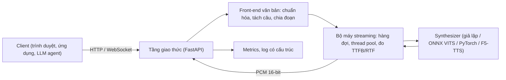

# Dự án 5. Dịch vụ TTS streaming

!!! abstract "Mục tiêu dự án"
    Sau dự án này, bạn có thể:

    - **Thiết kế** một dịch vụ TTS tách bạch ba tầng: giao thức mạng, bộ máy streaming và mô hình. Mô hình cắm vào qua một giao diện `Synthesizer` nên thay được mà không sửa phần còn lại.
    - **Suy ra** điều kiện để âm thanh phát liên tục khi văn bản được chia đoạn, rồi dùng nó để chọn độ dài từng đoạn.
    - **Cài đặt** máy chủ FastAPI có ba kiểu trả kết quả (trọn tệp, HTTP chunked, WebSocket). WebSocket hỗ trợ ngắt lời (*cancel*) và nhận văn bản đến dần từ một LLM.
    - **Đo** đúng TTFB và RTF ở phía máy chủ lẫn phía client, và **giải thích** vì sao hai phía cho số khác nhau.
    - **Thử tải** dịch vụ, đọc các phân vị p50/p95 và ước lượng dung lượng bằng định luật Little.
    - **Đóng gói** dịch vụ bằng Docker và **thiết lập** giám sát (metrics kiểu Prometheus, log có cấu trúc, câu thử định kỳ).

!!! info "Kiến thức cần có"
    - [Chương 35](../phan-8-mo-hinh-lon/ch35-streaming-speech-llm.md): các khái niệm độ trễ, streaming văn bản từ LLM, ghép đoạn âm thanh.
    - [Chương 39](../phan-9-thuc-tien/ch39-trien-khai-production.md): xuất mô hình, lượng tử hóa, phục vụ mô hình, giám sát.
    - [Dự án 1](du-an-1-frontend-tieng-viet.md): gói `vn_frontend` (chuẩn hóa văn bản, tách câu). Dịch vụ vẫn chạy được khi chưa có gói này.
    - [Dự án 3](du-an-3-vits-tieng-viet.md): mô hình VITS xuất ONNX, là mô hình thật đầu tiên ta sẽ cắm vào dịch vụ.
    - Python `asyncio` cơ bản (`async`/`await`, task, hàng đợi) và HTTP ở mức người dùng.

Dự án này không huấn luyện mô hình nào. Ta xây phần "vỏ" để đưa một mô hình TTS tới người dùng thật: nhận văn bản qua mạng, trả âm thanh về **càng sớm càng tốt**, chịu được nhiều người dùng cùng lúc và cho biết mình đang chạy ra sao. Toàn bộ mã nằm trong `code/tts_service/`, còn kiểm thử nằm ở `code/tests/test_tts_service.py`. Các đoạn mã trích trong trang đều lấy từ gói này và đã chạy qua bộ kiểm thử, trừ chỗ được ghi rõ là phác thảo.

## 1. Bài toán: vì sao dịch vụ TTS cần "chảy"

Hãy hình dung một trợ lý ảo đọc bản tin thời tiết dài 30 giây. Mô hình của bạn có hệ số thời gian thực (RTF) bằng 0,2, tức cần khoảng 6 giây để sinh xong 30 giây âm thanh. Nếu dịch vụ chờ sinh xong toàn bộ rồi mới gửi, người dùng phải ngồi im 6 giây trước khi nghe thấy gì. Trong hội thoại, khoảng lặng dài như vậy khiến người dùng nghĩ hệ thống bị treo.

Nhưng người nghe không cần cả 30 giây ngay một lúc. Họ chỉ cần câu đầu tiên. Nếu ta tách văn bản thành nhiều đoạn, sinh đoạn đầu rồi gửi ngay, sau đó vừa phát đoạn trước vừa sinh đoạn sau, thì thời gian chờ chỉ còn bằng thời gian sinh đoạn đầu. Với đoạn đầu dài 1 giây, con số đó là khoảng 0,2 giây. Đó là toàn bộ ý tưởng của streaming ở mức dịch vụ. Phần còn lại của dự án là làm cho ý tưởng này **đúng**, **bền** và **đo được**.

!!! note "Hai mức streaming"
    Dự án này làm *streaming theo đoạn văn bản*: mỗi đoạn (một câu hoặc một cụm) được mô hình sinh trọn vẹn, nhưng các đoạn được gửi nối tiếp nhau. Cách này dùng được với **mọi** mô hình: VITS, FastSpeech 2 + HiFi-GAN, F5-TTS. Mức sâu hơn là *streaming bên trong mô hình*: codec LM tự hồi quy, flow matching chia khối nhân quả, vocoder nhân quả có bộ nhớ trạng thái. Mức này giảm độ trễ xuống dưới độ dài một câu nhưng đòi hỏi kiến trúc đặc thù; xem [Chương 35](../phan-8-mo-hinh-lon/ch35-streaming-speech-llm.md). Giao diện `Synthesizer` ở đây đủ tổng quát để sau này bạn thay bằng một mô hình streaming thực sự.

### 1.1. Các đại lượng đo

Ta dùng ba đại lượng chính. Định nghĩa chúng cẩn thận vì nhiều tranh luận về "hệ thống nhanh hay chậm" thực ra là do hai bên đo hai thứ khác nhau.

**Thời gian tới byte âm thanh đầu tiên** (*time to first byte*, TTFB; còn gọi là *time to first audio*) là khoảng thời gian từ lúc yêu cầu được gửi tới lúc nhận được **mẫu âm thanh** đầu tiên. Lưu ý chữ "âm thanh": 44 byte header WAV không tính.

**Hệ số thời gian thực** (*real-time factor*, RTF) của mô hình là

$$
\rho = \frac{t_{\text{tính}}}{d_{\text{âm thanh}}},
$$

trong đó $t_{\text{tính}}$ là thời gian mô hình thực sự chạy và $d_{\text{âm thanh}}$ là thời lượng âm thanh sinh ra. $\rho < 1$ nghĩa là sinh nhanh hơn thời gian thực. Trong dịch vụ, ta còn đo thêm **RTF "tường"** (*wall-clock*): thay $t_{\text{tính}}$ bằng tổng thời gian phục vụ yêu cầu, gồm cả thời gian chờ đến lượt dùng mô hình. Khi tải thấp, hai con số gần nhau. Khi tải cao, RTF "tường" tăng vọt còn RTF tính toán gần như không đổi. Khoảng cách giữa hai con số chính là dấu hiệu nghẽn hàng đợi.

**Độ trễ đầu-cuối** (*end-to-end latency*) là khoảng thời gian mà người dùng cảm nhận. Với một đoạn đầu dài $a_1$ giây âm thanh, TTFB phía client xấp xỉ bằng

$$
t_{\text{TTFB}} \approx t_{\text{mạng}} + t_{\text{hàng đợi}} + t_{\text{front-end}} + \rho\, a_1 .
$$

Công thức này cho thấy ngay các "nút vặn" có thể chỉnh. Ta có thể giảm $a_1$ bằng cách làm đoạn đầu ngắn, giảm $\rho$ bằng mô hình nhanh hơn hoặc lượng tử hóa ([Chương 39](../phan-9-thuc-tien/ch39-trien-khai-production.md)), và giảm $t_{\text{hàng đợi}}$ bằng cách thêm tài nguyên hoặc lập lịch thông minh hơn. Thành phần $t_{\text{front-end}}$ (chuẩn hóa văn bản, G2P) thường chỉ cỡ mili-giây với bộ quy tắc của Dự án 1. Tuy vậy, nó có thể lớn bất ngờ nếu front-end gọi một mô hình ngôn ngữ.

### 1.2. Điều kiện phát liên tục

Giảm TTFB bằng đoạn đầu ngắn là dễ. Câu hỏi tinh tế hơn là: **các đoạn sau dài bao nhiêu thì người nghe không bị "đứng hình" giữa chừng?** Nếu đoạn thứ hai rất dài, nó có thể chưa sinh xong khi đoạn đầu đã phát hết.

Hãy mô hình hóa đơn giản. Có một bộ sinh duy nhất chạy tuần tự. Đoạn $j$ có thời lượng âm thanh $a_j$ và cần $g_j = \rho\, a_j$ giây để sinh. Ta bỏ qua mạng và front-end. Đặt $A_k = \sum_{j=1}^{k} a_j$ là tổng thời lượng $k$ đoạn đầu.

- Đoạn $k$ sinh xong tại thời điểm $G_k = \sum_{j \le k} g_j = \rho A_k$.
- Người nghe bắt đầu phát khi đoạn 1 tới, tức tại $G_1 = \rho a_1$ (đây chính là TTFB).
- Nếu chưa từng đứng hình, đoạn $k$ được cần đến tại $P_k = \rho a_1 + A_{k-1}$, tức lúc các đoạn trước vừa phát xong.

Âm thanh phát liên tục khi và chỉ khi $G_k \le P_k$ với mọi $k \ge 2$. Biến đổi từng bước:

$$
\rho A_k \le \rho a_1 + A_{k-1}
\;\Longleftrightarrow\;
\rho\,(A_{k-1} + a_k) \le \rho a_1 + A_{k-1}
\;\Longleftrightarrow\;
a_k \le a_1 + \frac{1-\rho}{\rho}\, A_{k-1}.
$$

Bất đẳng thức cuối nói rằng **đoạn tiếp theo được phép dài thêm một lượng tỷ lệ với lượng âm thanh đã phát**, với hệ số $(1-\rho)/\rho$. Mô hình nhanh ($\rho = 0{,}1$) cho hệ số 9, nên các đoạn có thể dài lên rất nhanh. Mô hình chậm ($\rho = 0{,}5$) cho hệ số 1. Khi $\rho \ge 1$, vế phải không bao giờ vượt quá $a_1$ nhiều. Nói cách khác, không cách chia đoạn nào cứu được một mô hình chậm hơn thời gian thực.

Bây giờ giả sử ta chọn độ dài đoạn tăng theo cấp số nhân, $a_k = a_1 g^{k-1}$ với $g \ge 1$. Khi đó $A_{k-1} = a_1 \frac{g^{k-1} - 1}{g - 1}$ (với $g > 1$). Đặt $r = (1-\rho)/\rho$, điều kiện trở thành

$$
g^{k-1} \le 1 + r\,\frac{g^{k-1}-1}{g-1}
\;\Longleftrightarrow\;
\left(g^{k-1} - 1\right)\left(1 - \frac{r}{g-1}\right) \le 0 .
$$

Vì $g^{k-1} - 1 > 0$ với $k \ge 2$, điều kiện đúng với mọi $k$ khi và chỉ khi $r \ge g - 1$, tức là

$$
g \le 1 + \frac{1-\rho}{\rho} = \frac{1}{\rho}.
$$

Kết quả gọn gàng này là cơ sở cho cấu hình chia đoạn của dịch vụ:

1. **TTFB tỷ lệ với $a_1$.** Vì vậy đoạn đầu nên ngắn, cỡ một cụm từ hay một câu ngắn.
2. **Trần độ dài đoạn tăng theo hệ số $g \le 1/\rho$.** Mặc định của ta là $g = 2$ (60, 120, 220 ký tự...), an toàn với mọi mô hình có $\rho \le 0{,}5$. Nếu mô hình chậm hơn (ví dụ F5-TTS trên GPU yếu), hãy giảm $g$.
3. **Khi nhiều luồng dùng chung một bộ sinh không batch**, mỗi luồng chỉ nhận được một phần thời gian của bộ sinh. Với $c$ luồng đồng thời, RTF hiệu dụng của mỗi luồng xấp xỉ $c\rho$, nên số luồng phát liên tục tối đa xấp xỉ $1/\rho$. Ta sẽ kiểm chứng điều này bằng thử tải ở Mục 9.

Mô hình trên bỏ qua jitter mạng và chi phí cố định của mỗi lần gọi mô hình. Trong thực tế, hãy chừa biên an toàn. Đoạn mã dưới đây mô phỏng việc phát và kiểm tra lại điều kiện $g \le 1/\rho$ bằng số:

```python
import numpy as np


def playback_stalls(audio_s: list[float], rtf: float) -> tuple[float, list[float]]:
    """Mô phỏng sinh tuần tự (một bộ sinh) và phát ngay khi có đoạn đầu.

    Trả về (TTFB, danh sách thời gian "đứng hình" trước mỗi đoạn k >= 2).
    """
    a = np.asarray(audio_s, dtype=float)
    ready = rtf * np.cumsum(a)          # G_k: thời điểm đoạn k sinh xong
    t_play = ready[0]                   # bắt đầu phát khi đoạn 1 xong (TTFB)
    stalls = []
    for k in range(1, len(a)):
        t_play += a[k - 1]              # đoạn k-1 phát xong
        stall = max(0.0, ready[k] - t_play)
        stalls.append(stall)
        t_play += stall                 # chờ đoạn k (nếu chưa sẵn sàng)
    return float(ready[0]), stalls


for rtf in (0.1, 0.5):
    for g in (1.5, 2.0, 3.0):
        chunks = [1.0 * g**k for k in range(5)]        # độ dài đoạn tăng theo cấp số nhân
        ttfb, stalls = playback_stalls(chunks, rtf)
        ok = all(s < 1e-9 for s in stalls)
        assert ok == (g <= 1.0 / rtf + 1e-9)          # khớp với điều kiện g <= 1/rtf
        print(f"rtf={rtf} g={g}: TTFB={ttfb:.2f} s, đứng hình={sum(stalls):.2f} s, liên tục={ok}")

# Một đoạn 12 s duy nhất so với chia 1 + 2 + 4 + 5 s (cùng tổng thời lượng), rtf = 0.3
print(round(playback_stalls([12.0], 0.3)[0], 2), playback_stalls([1, 2, 4, 5], 0.3))
```

Với $\rho = 0{,}5$ và $g = 3$, mô phỏng báo có đứng hình, đúng như điều kiện dự đoán. Dòng cuối cho thấy cùng 12 giây âm thanh với $\rho = 0{,}3$: gửi một khối thì TTFB là 3,6 giây; chia đoạn tăng dần thì TTFB chỉ còn 0,3 giây và không đứng hình lần nào.

## 2. Kiến trúc tổng thể



Bốn nguyên tắc chi phối thiết kế:

1. **Tách giao thức khỏi bộ máy.** HTTP và WebSocket chỉ là hai cách "đóng gói" cùng một dòng `AudioChunk`. Nhờ vậy ta kiểm thử bộ máy mà không cần mạng, và thêm gRPC sau này không đụng tới mô hình.
2. **Mô hình là mã đồng bộ, chạy trong thread pool.** Vòng lặp sự kiện (*event loop*) của `asyncio` không bao giờ được chờ mô hình trực tiếp.
3. **Mỗi tiến trình nạp một bản mô hình; giới hạn đồng thời là tường minh.** Giới hạn này là số luồng của thread pool.
4. **Mọi thứ đều hủy được và đều đo được.** Client ngắt kết nối hoặc ngắt lời thì việc sinh dừng lại. Mỗi yêu cầu để lại một dòng log và cập nhật histogram.

Cấu trúc thư mục:

| Tệp | Vai trò |
|---|---|
| `tts_service/synthesizer.py` | Giao diện `Synthesizer`; `ToneSynthesizer` (giả lập, tất định); `CallableSynthesizer`; `OnnxVitsSynthesizer` |
| `tts_service/text.py` | Tích hợp `vn_frontend` kèm phương án dự phòng; `chunk_text`; `IncrementalChunker` |
| `tts_service/audio.py` | PCM 16-bit, header WAV (cả loại "không rõ độ dài"), chia khung, fade |
| `tts_service/engine.py` | `TTSEngine`: thread pool, pipeline sinh–gửi, áp lực ngược, đo đạc |
| `tts_service/server.py` | Ứng dụng FastAPI: `/v1/tts`, `/v1/tts/stream`, `/v1/tts/ws`, `/health`, `/metrics` |
| `tts_service/metrics.py` | `StreamStats` (TTFB, RTF) và registry xuất định dạng Prometheus |
| `tts_service/client.py`, `loadtest.py` | Client bất đồng bộ (WebSocket, HTTP) và công cụ thử tải |
| `tts_service/Dockerfile`, `requirements.txt` | Đóng gói triển khai |

## 3. Giao diện `Synthesizer`

Mọi mô hình cắm vào dịch vụ chỉ cần thỏa một hợp đồng rất nhỏ:

```python
class Synthesizer(ABC):
    """Hợp đồng tối thiểu giữa dịch vụ và một mô hình TTS.

    ``synthesize`` là hàm *đồng bộ* và có thể chậm (chạy mạng nơ-ron); dịch vụ sẽ
    gọi nó trong một luồng (thread) riêng để không chặn vòng lặp sự kiện.
    """

    name: str = "synthesizer"
    sample_rate: int = 22050

    @abstractmethod
    def synthesize(self, text: str, *, speaker: str | None = None,
                   speed: float = 1.0) -> np.ndarray:
        """Trả về dạng sóng float32 mono trong [-1, 1], hình dạng (L,)."""

    def warmup(self) -> None:
        """Chạy thử một lần để nạp trọng số, khởi tạo kernel... trước khi nhận tải thật."""
        self.synthesize("xin chào")

    def close(self) -> None:
        """Giải phóng tài nguyên (bộ nhớ GPU, phiên ONNX...)."""
```

Ba quyết định thiết kế cần giải thích:

- **Vì sao hàm đồng bộ?** Mã suy luận PyTorch hay ONNX Runtime vốn đồng bộ. Ép chúng thành `async` không làm chúng nhanh hơn. Điều quan trọng là *ai* gọi chúng: nếu gọi thẳng trong một hàm `async def`, vòng lặp sự kiện bị chặn suốt thời gian suy luận. Khi đó **mọi** kết nối khác đứng im: không nhận được thông điệp, không gửi được âm thanh, health check quá hạn. Ta gọi mô hình trong thread pool (Mục 6). Cách này hiệu quả vì PyTorch, ONNX Runtime và phần lớn phép toán numpy nhả khóa GIL trong lúc tính toán nặng.
- **Vì sao float32 trong $[-1, 1]$?** Đó là "ngôn ngữ chung" của mọi vocoder. Việc chuyển sang PCM 16-bit, cắt biên, xử lý NaN được làm **một lần** ở dịch vụ thay vì rải trong từng adapter.
- **Vì sao `warmup`?** Lần gọi đầu tiên thường chậm hơn hẳn do cấp phát bộ nhớ, biên dịch kernel, dò thuật toán cuDNN. Nếu không làm nóng, người dùng đầu tiên sau mỗi lần khởi động lại sẽ chịu toàn bộ chi phí này. Ta gọi `warmup` trong `lifespan` của FastAPI, *trước* khi ứng dụng nhận yêu cầu. Nhờ vậy, khi Kubernetes thấy dịch vụ "sẵn sàng" thì nó đã thực sự sẵn sàng.

### 3.1. Bộ tổng hợp giả `ToneSynthesizer`

Để kiểm thử hạ tầng, ta cần một "mô hình" chạy tức thì, không cần trọng số và **tất định** (cùng đầu vào cho cùng đầu ra từng mẫu). Có như vậy thì kiểm thử mới so sánh được kết quả streaming với không streaming theo từng byte. `ToneSynthesizer` sinh cho mỗi âm tiết một âm hài gồm ba họa âm, có đường F0 phác họa thanh điệu của âm tiết đó. Dấu câu được đổi thành khoảng lặng.

```python
# Đường F0 (đơn vị bán cung so với F0 nền) tại các mốc thời gian chuẩn hóa tau in [0, 1].
# Đây là phác họa rất thô theo mô tả giọng Bắc, CHỈ để kiểm thử — xem Chương 15.
TONE_CONTOURS: dict[str, tuple[list[float], list[float]]] = {
    "ngang": ([0.0, 1.0], [0.0, -0.5]),
    "huyen": ([0.0, 1.0], [-2.0, -6.0]),
    "sac": ([0.0, 0.3, 1.0], [-0.5, -1.0, 5.0]),
    "hoi": ([0.0, 0.6, 1.0], [-2.0, -7.0, -4.0]),
    "nga": ([0.0, 0.45, 0.55, 1.0], [-1.0, -2.0, 1.0, 6.0]),
    "nang": ([0.0, 1.0], [-3.0, -9.0]),
}


def syllable_tone(syllable: str) -> str:
    """Nhận diện thanh điệu từ dấu thanh (sau khi tách tổ hợp NFD)."""
    for ch in unicodedata.normalize("NFD", syllable):
        if ch in _TONE_MARKS:
            return _TONE_MARKS[ch]
    return "ngang"
```

Âm tiết được sinh với pha liên tục: pha là tích lũy của tần số tức thời, $\phi[n] = 2\pi \sum_{m \le n} f_0[m]/f_s$. Mỗi âm tiết có đường bao lên/xuống 10 ms. Thanh ngã có thêm một chỗ hạ biên độ ở giữa để gợi tính thanh quản hóa, còn thanh nặng ngắn hơn và rơi nhanh. Tham số `simulated_rtf` khiến hàm "giả vờ" tốn `simulated_rtf × thời lượng` giây. Nhờ đó ta thử được tải, thử ngắt lời và kiểm chứng công thức dung lượng mà không cần GPU.

!!! note "Góc tiếng Việt"
    Bộ tổng hợp giả theo thanh điệu không chỉ để vui tai. Khi chạy dịch vụ với nó và nghe thử, bạn **nghe được** hai loại lỗi rất hay gặp trong dịch vụ TTS tiếng Việt. Loại thứ nhất là ranh giới đoạn đặt sai chỗ, nghe thấy như một khoảng lặng giữa cụm từ. Loại thứ hai là dấu thanh bị mất trên đường đi, ví dụ một proxy hay thư viện nào đó làm hỏng Unicode và mọi âm tiết nghe đều "ngang". Kiểm thử `test_tone_synthesizer_is_deterministic_and_follows_tones` ước lượng F0 bằng tự tương quan và khẳng định thanh sắc đi lên, thanh huyền đi xuống, thanh hỏi có điểm trũng. Đường F0 ở đây chỉ là phác họa; mô tả ngữ âm học chính xác của sáu thanh nằm ở [Chương 15](../phan-3-tin-hieu-ngu-am/ch15-ngu-am-tieng-viet.md).

### 3.2. Bộ chuyển đổi cho mô hình thật

Một mô hình thật được nối vào qua một *adapter* nhỏ. Với VITS đã xuất ONNX theo quy ước của Piper ([Dự án 3](du-an-3-vits-tieng-viet.md)), adapter như sau:

```python
class OnnxVitsSynthesizer(Synthesizer):
    name = "onnx-vits"

    def __init__(self, model_path=None, *, sample_rate=22050, text_to_ids=None,
                 add_blank=False, noise_scale=0.667, length_scale=1.0, noise_w=0.8,
                 speaker_ids=None, session=None, providers=None):
        if session is None:
            import onnxruntime as ort  # nạp muộn: chỉ cần khi dùng adapter này
            session = ort.InferenceSession(model_path, providers=list(providers or ["CPUExecutionProvider"]))
        self.session = session
        self.input_names = {i.name for i in session.get_inputs()}
        self.sample_rate = sample_rate
        self.text_to_ids = text_to_ids or _default_text_to_ids()  # mặc định: vn_frontend.text_to_sequence
        self.add_blank = add_blank
        self.noise_scale, self.length_scale, self.noise_w = noise_scale, length_scale, noise_w
        self.speaker_ids = dict(speaker_ids or {})

    def synthesize(self, text, *, speaker=None, speed=1.0):
        ids = list(self.text_to_ids(text))
        if self.add_blank:
            ids = intersperse(ids)             # [a, b] -> [0, a, 0, b, 0]
        if not ids:
            return np.zeros(0, dtype=np.float32)
        feeds = {
            "input": np.asarray([ids], dtype=np.int64),                   # (1, N)
            "input_lengths": np.asarray([len(ids)], dtype=np.int64),      # (1,)
            # length_scale lớn hơn -> nói chậm hơn, nên chia cho speed
            "scales": np.asarray([self.noise_scale, self.length_scale / speed, self.noise_w],
                                 dtype=np.float32),                        # (3,)
        }
        if "sid" in self.input_names:
            feeds["sid"] = np.asarray([self.speaker_ids.get(speaker or "", 0)], dtype=np.int64)
        audio = self.session.run(None, feeds)[0]
        return np.asarray(audio, dtype=np.float32).reshape(-1)          # (L,)
```

(Mã trên đã lược bớt phần kiểm tra lỗi so với tệp gốc.) Có hai điểm cần nhớ:

- **`text_to_ids` phải giống hệt lúc huấn luyện**: cùng bảng ký hiệu, cùng phương ngữ G2P, cùng quy ước chèn blank. Đây là nguồn lỗi số một khi đưa mô hình vào phục vụ. Mô hình vẫn "nói" nhưng phát âm sai, và kiểm thử đơn vị không bắt được. Cách phòng là lưu bảng ký hiệu và cấu hình front-end **cùng với** tệp ONNX (như Piper lưu `model.onnx.json`), rồi kiểm tra chúng lúc khởi động.
- Kiểm thử của adapter **không cần mô hình thật**. Một bài dùng phiên ONNX giả để kiểm tra kiểu dữ liệu và thứ tự `scales`. Một bài khác dựng một đồ thị ONNX ba nút bằng `onnx.helper` rồi chạy bằng ONNX Runtime thật.

Với các mô hình khác, `CallableSynthesizer` bọc một hàm bất kỳ. Phác thảo dưới đây (chưa chạy, vì phụ thuộc mã của Dự án 2) cho thấy cách nối FastSpeech 2 + HiFi-GAN:

```python
# PHÁC THẢO — tên hàm load_* là giả định, thay bằng mã thật của Dự án 2
acoustic, vocoder = load_fastspeech2(ckpt_am), load_hifigan(ckpt_voc)


@torch.inference_mode()
def fs2_hifigan(text: str, speaker=None, speed=1.0) -> np.ndarray:
    ids = torch.tensor([vn_frontend.text_to_sequence(text)])          # (1, N)
    mel = acoustic(ids, duration_scale=1.0 / speed)                   # (1, F, T)
    wav = vocoder(mel).squeeze()                                      # (L,)
    return wav.float().cpu().numpy()


synth = CallableSynthesizer(fs2_hifigan, sample_rate=22050, name="fs2-hifigan")
```

Với mô hình zero-shot như F5-TTS ([Dự án 4](du-an-4-zero-shot-tts.md)), tham số `speaker` nên ánh xạ tới một **giọng tham chiếu đã được đồng ý** (cặp âm thanh và bản ghi lời) lưu sẵn ở máy chủ. Tuyệt đối không nhận tệp âm thanh tùy ý từ client; lý do an toàn được bàn ở Dự án 4 và [Chương 40](../phan-9-thuc-tien/ch40-dao-duc-an-toan.md). Mô hình kiểu này thường có RTF lớn hơn VITS nhiều, nên điều kiện $g \le 1/\rho$ ở Mục 1.2 trở nên quan trọng.

## 4. Xử lý văn bản và chia đoạn

### 4.1. Dùng `vn_frontend` khi có, dự phòng khi không

Dịch vụ cần hai thao tác văn bản: **chuẩn hóa** (đổi "3,5 triệu", "TP.HCM", "14:30" thành chữ đọc được) và **tách câu**. Gói `vn_frontend` của [Dự án 1](du-an-1-frontend-tieng-viet.md) cung cấp `normalize_text(text)` và `split_sentences(text)`. Dịch vụ thử nạp gói này. Nếu không được (chưa cài, hoặc gói lỗi khi import), dịch vụ rơi về một bộ tối giản: NFC, gộp khoảng trắng, tách câu bằng biểu thức chính quy.

```python
def load_vn_frontend() -> TextFrontend | None:
    """Thử nạp front-end tiếng Việt của Dự án 1; trả về ``None`` nếu không có."""
    try:
        import vn_frontend
        normalize = vn_frontend.normalize_text
        split = vn_frontend.split_sentences
    except Exception:  # thiếu gói hoặc gói lỗi: đều dùng dự phòng
        return None
    return TextFrontend(
        "vn_frontend",
        _with_fallback(normalize, basic_normalize, "normalize_text"),
        _with_fallback(split, basic_split_sentences, "split_sentences"),
    )
```

`_with_fallback` bọc từng hàm. Nếu `normalize_text` ném ngoại lệ với một đầu vào lạ (một ký hiệu chưa ai nghĩ tới), lỗi được **ghi log** và yêu cầu vẫn được phục vụ bằng bộ dự phòng. Ở ranh giới dịch vụ, một lỗi front-end không nên làm hỏng cả yêu cầu. Nhưng nó cũng không được im lặng: log là tín hiệu để sửa Dự án 1. Endpoint `/health` báo front-end nào đang được dùng (`"frontend": "vn_frontend"` hoặc `"basic"`), để bạn không vô tình chạy bản dự phòng ở môi trường thật.

!!! warning "Front-end lúc phục vụ phải giống lúc huấn luyện"
    Nếu bản ghi lời của dữ liệu huấn luyện được chuẩn hóa bằng `vn_frontend` phiên bản X, dịch vụ cũng phải dùng đúng phiên bản X. Một thay đổi nhỏ, chẳng hạn đọc "2025" là "hai nghìn không trăm hai mươi lăm" thay vì "hai không hai lăm", đủ làm mô hình gặp chuỗi ký hiệu chưa từng thấy. Hãy ghim phiên bản front-end cùng phiên bản mô hình ([Chương 17](../phan-4-frontend/ch17-chuan-hoa-van-ban.md)).
