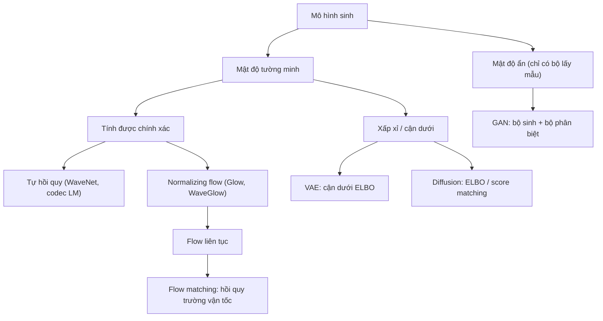
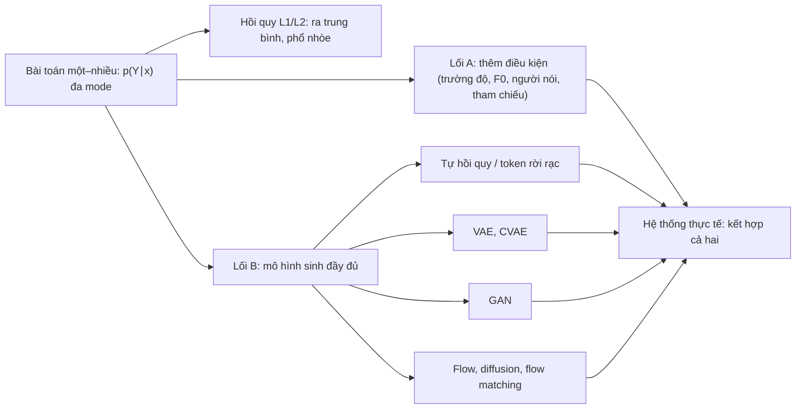

# Chương 7. Tổng quan mô hình sinh

!!! abstract "Mục tiêu học tập"
    Sau chương này, bạn có thể:

    - **Phân biệt** mô hình phân biệt với mô hình sinh, và hai nhiệm vụ cốt lõi của mô hình sinh: ước lượng mật độ và lấy mẫu.
    - **Phân loại** các họ mô hình sinh (tự hồi quy, VAE, GAN, flow, diffusion, flow matching, mô hình ngôn ngữ trên token rời rạc) theo cách chúng xử lý hàm hợp lý.
    - **Suy ra** sự tương đương giữa ước lượng hợp lý cực đại và cực tiểu hóa phân kỳ KL thuận, và giải thích hành vi "phủ mode" của nó.
    - **Chứng minh** rằng hồi quy L2 (L1) hội tụ về trung bình (trung vị) có điều kiện, rồi dùng kết quả đó để giải thích vì sao mel-spectrogram dự đoán bằng hồi quy bị "trơn quá mức" (*over-smoothing*).
    - **Cài đặt** một mô hình tự hồi quy nhân quả có kiểm tra rò rỉ thông tin, và một mạng mật độ hỗn hợp (MDN).
    - **Đánh giá** ưu nhược điểm của các thước đo cho mô hình sinh (log-likelihood, FID/FAD, precision/recall, MOS).
    - **Định vị** mỗi hệ thống TTS nổi tiếng vào họ mô hình sinh tương ứng và vào các chương sau của giáo trình.

!!! info "Kiến thức cần có"
    - [Chương 1](../phan-1-nen-tang/ch01-toan-nen-tang.md): phân phối Gauss và Laplace, kỳ vọng và phương sai, entropy, phân kỳ KL, ước lượng Monte Carlo.
    - [Chương 2](../phan-1-nen-tang/ch02-hoc-may-va-mang-no-ron.md): cách nhìn hàm mất mát MSE/L1/CE như ước lượng hợp lý cực đại.
    - [Chương 4](../phan-1-nen-tang/ch04-cnn-rnn-mo-hinh-chuoi.md): tích chập nhân quả, seq2seq, teacher forcing.
    - [Chương 5](../phan-1-nen-tang/ch05-transformer.md): Transformer decoder, mặt nạ nhân quả, các chiến lược lấy mẫu.
    - Biết sơ lược mel-spectrogram là gì (chi tiết ở [Chương 14](../phan-3-tin-hieu-ngu-am/ch14-xu-ly-tin-hieu-so.md)).

Phần I trang bị cho bạn bộ công cụ để huấn luyện mạng nơ-ron ánh xạ đầu vào sang đầu ra. Phần II đặt ra một câu hỏi khó hơn: khi đầu ra không phải là *một* đáp án đúng mà là *cả một phân phối* các đáp án hợp lệ, ta học và lấy mẫu từ phân phối đó như thế nào? Tổng hợp tiếng nói chính là một bài toán như vậy. Chương này xây dựng khung khái niệm chung cho toàn bộ Phần II, và chứng minh một kết quả mà giáo trình sẽ nhắc lại nhiều lần ở các Phần V–VIII: **vì sao hồi quy L1/L2 thuần túy làm mel-spectrogram bị nhòe**, và vì sao điều đó đẩy cộng đồng TTS sang các mô hình sinh ngày càng mạnh.

## 7.1. Mô hình sinh là gì?

### 7.1.1. Mô hình phân biệt và mô hình sinh

Một **mô hình phân biệt** (*discriminative model*) học một ánh xạ từ dữ liệu sang nhãn, hay tổng quát hơn là phân phối $p(y \mid \mathbf{x})$ trên một nhãn $y$ ít chiều: ảnh này là mèo hay chó, câu nói này thuộc người nói nào. Không gian đầu ra nhỏ, và thường chỉ có một đáp án đúng.

Một **mô hình sinh** (*generative model*) học phân phối của chính dữ liệu, $p_\theta(\mathbf{x})$, hoặc phân phối có điều kiện $p_\theta(\mathbf{x} \mid \mathbf{c})$ khi có thông tin điều kiện $\mathbf{c}$. Ở đây $\mathbf{x}$ là một đối tượng nhiều chiều và có cấu trúc: một bức ảnh, một đoạn dạng sóng, một mel-spectrogram. Mục tiêu là $p_\theta$ đủ gần với phân phối dữ liệu thật $p_{\text{data}}$, phân phối mà ta không biết công thức nhưng có một tập mẫu $\mathcal{D} = \{\mathbf{x}^{(1)}, \ldots, \mathbf{x}^{(n)}\}$ rút độc lập từ nó.

!!! note "Quy ước ký hiệu trong Phần II"
    Trong các mục tổng quát của Phần II, $\mathbf{x}$ chỉ **một điểm dữ liệu bất kỳ** (theo thông lệ của tài liệu học máy và theo [bảng ký hiệu](../gioi-thieu/ky-hieu.md)). Khi áp dụng vào TTS, ta quay về ký hiệu của sách: $\mathbf{x}$ là chuỗi văn bản đầu vào và $\mathbf{Y} \in \mathbb{R}^{T \times F}$ là chuỗi đặc trưng âm học cần sinh; mô hình khi đó là $p_\theta(\mathbf{Y} \mid \mathbf{x})$. Mỗi khi chuyển ngữ cảnh, văn bản sẽ nhắc lại.

Sự khác biệt giữa hai loại mô hình thể hiện rõ khi so sánh nhận dạng tiếng nói (ASR) với tổng hợp tiếng nói (TTS). ASR là ánh xạ **nhiều–một**: vô số cách đọc khác nhau của câu "xin chào" (giọng nam, giọng nữ, nhanh, chậm, ở phòng thu hay ngoài đường) đều phải cho ra cùng một chuỗi chữ. TTS là ánh xạ **một–nhiều**: cùng câu "xin chào" có vô số cách đọc đều đúng. Mô hình ASR có thể "vứt bỏ" mọi biến thiên không liên quan; mô hình TTS phải **tạo ra** những biến thiên đó một cách hợp lý. Đây là lý do tuy TTS có dạng "đầu vào → đầu ra" như một bài toán học có giám sát, bản chất của nó là một bài toán **sinh có điều kiện**.

### 7.1.2. Ba việc ta muốn làm với một mô hình sinh

1. **Ước lượng mật độ** (*density estimation*): với một $\mathbf{x}$ cho trước, tính được $p_\theta(\mathbf{x})$ (hoặc $\log p_\theta(\mathbf{x})$). Khả năng này cho phép huấn luyện bằng hợp lý cực đại, so sánh mô hình bằng log-likelihood trên tập kiểm tra, phát hiện mẫu bất thường, nén dữ liệu.
2. **Lấy mẫu** (*sampling*): sinh ra $\mathbf{x} \sim p_\theta$ mới, chưa từng có trong dữ liệu. Với TTS, đây là việc quan trọng nhất: ta cần *nghe* được tiếng nói.
3. **Học biểu diễn và điều khiển**: tìm biến ẩn $\mathbf{z}$ giải thích dữ liệu (phong cách, ngữ điệu, người nói), hoặc thực hiện các thao tác có điều kiện như điền vào chỗ trống (*infilling*), chỉnh sửa một đoạn tiếng nói, chuyển phong cách.

Không có họ mô hình nào giỏi đều cả ba việc. Một số họ tính được $p_\theta(\mathbf{x})$ chính xác nhưng lấy mẫu chậm (tự hồi quy); một số lấy mẫu rất nhanh nhưng không cho biết mật độ (GAN). Người ta hay tóm gọn sự đánh đổi này thành "bộ ba bất khả" (*generative learning trilemma*) giữa **chất lượng mẫu**, **độ đa dạng (phủ mode)** và **tốc độ lấy mẫu** (Xiao và cộng sự, 2022). Lịch sử TTS mười năm qua, ở một mức độ đáng kể, là lịch sử tìm cách thoát khỏi bộ ba này.

### 7.1.3. Phân loại các họ mô hình sinh

Cách phân loại hữu ích nhất dựa vào câu hỏi: **mô hình đối xử với hàm hợp lý $p_\theta(\mathbf{x})$ như thế nào?** (Goodfellow, 2016).



- **Mật độ tường minh, tính được chính xác.** Mô hình *tự hồi quy* (mục 7.3) phân rã $p_\theta(\mathbf{x})$ thành tích các xác suất có điều kiện; *normalizing flow* ([Chương 10](ch10-normalizing-flows.md)) biến đổi khả nghịch một phân phối đơn giản và dùng công thức đổi biến. Cả hai cho phép huấn luyện bằng hợp lý cực đại đúng nghĩa.
- **Mật độ tường minh nhưng xấp xỉ.** *VAE* ([Chương 8](ch08-vae.md)) có $p_\theta(\mathbf{x}) = \int p_\theta(\mathbf{x} \mid \mathbf{z}) p(\mathbf{z})\, d\mathbf{z}$ không tính được, nên tối ưu một cận dưới. *Mô hình khuếch tán* ([Chương 11](ch11-diffusion.md)) cũng có thể được huấn luyện qua một cận dưới, hoặc tương đương qua khớp hàm score. Các mô hình dựa trên năng lượng (*energy-based*) có mật độ chưa chuẩn hóa; giáo trình chỉ nhắc đến chúng khi cần.
- **Mật độ ẩn.** *GAN* ([Chương 9](ch09-gan.md)) chỉ định nghĩa một quy trình lấy mẫu $\mathbf{x} = G(\mathbf{z})$ và không bao giờ tính $p_\theta(\mathbf{x})$; nó được huấn luyện bằng một bộ phân biệt đóng vai "thước đo khoảng cách" được học.
- **Flow matching** ([Chương 12](ch12-flow-matching.md)) là trường hợp lai thú vị: mô hình là một flow liên tục (về nguyên tắc tính được mật độ bằng cách giải một phương trình vi phân), nhưng được huấn luyện bằng một bài toán *hồi quy* trường vận tốc, không dùng đến likelihood.

Mô hình ngôn ngữ trên **token âm thanh rời rạc** (VALL-E và các hậu duệ, [Chương 32](../phan-8-mo-hinh-lon/ch32-codec-language-model.md)) thực chất là mô hình tự hồi quy với đầu ra softmax; nhưng vì vai trò nổi bật của nó trong TTS hiện đại, ta sẽ xếp nó thành một họ riêng trong bản đồ ở mục 7.7.

## 7.2. Ước lượng hợp lý cực đại và phân kỳ KL

### 7.2.1. Từ trung bình mẫu đến phân kỳ KL

Nguyên lý huấn luyện phổ biến nhất là **ước lượng hợp lý cực đại** (*maximum likelihood estimation*, MLE): chọn tham số làm cho dữ liệu quan sát được "có khả năng xảy ra nhất",

$$
\hat{\theta} = \arg\max_\theta \frac{1}{n} \sum_{i=1}^{n} \log p_\theta\big(\mathbf{x}^{(i)}\big).
$$

Theo luật số lớn, khi $n \to \infty$ trung bình mẫu hội tụ về kỳ vọng $\mathbb{E}_{p_{\text{data}}}[\log p_\theta(\mathbf{x})]$. Viết phân kỳ KL thuận từ dữ liệu đến mô hình ra:

$$
D_{\mathrm{KL}}(p_{\text{data}} \,\Vert\, p_\theta)
= \mathbb{E}_{p_{\text{data}}}\big[\log p_{\text{data}}(\mathbf{x})\big] - \mathbb{E}_{p_{\text{data}}}\big[\log p_\theta(\mathbf{x})\big]
= -H(p_{\text{data}}) - \mathbb{E}_{p_{\text{data}}}\big[\log p_\theta(\mathbf{x})\big].
$$

Số hạng entropy $H(p_{\text{data}})$ không phụ thuộc $\theta$. Do đó

$$
\arg\max_\theta \; \mathbb{E}_{p_{\text{data}}}\big[\log p_\theta(\mathbf{x})\big] = \arg\min_\theta \; D_{\mathrm{KL}}(p_{\text{data}} \,\Vert\, p_\theta).
$$

Nói bằng lời: **MLE chính là cực tiểu hóa KL thuận**. Một hệ quả nhỏ nhưng hữu ích: giá trị log-likelihood tuyệt đối không có nghĩa tự thân, vì nó bị dịch đi một hằng số $H(p_{\text{data}})$ mà ta không biết. Chỉ *hiệu* log-likelihood giữa hai mô hình trên cùng một tập dữ liệu, cùng một cách tiền xử lý, mới so sánh được. (Với dữ liệu liên tục, $H$ là entropy vi phân và có thể âm; lập luận trên không thay đổi.)

### 7.2.2. KL thuận "phủ mode", KL ngược "tìm mode"

Phân kỳ KL không đối xứng, và hai chiều của nó trừng phạt những lỗi khác nhau:

- **KL thuận** $D_{\mathrm{KL}}(p_{\text{data}} \Vert p_\theta) = \mathbb{E}_{p_{\text{data}}}[\log p_{\text{data}} - \log p_\theta]$ lấy kỳ vọng theo *dữ liệu*. Nếu ở đâu đó dữ liệu có mật độ đáng kể mà mô hình gán mật độ gần 0, số hạng $-\log p_\theta$ bùng nổ. Vì vậy mô hình bị ép **phủ mọi vùng có dữ liệu** (*mode-covering*, hay *zero-avoiding*), kể cả khi phải trải mật độ sang những vùng không có dữ liệu.
- **KL ngược** $D_{\mathrm{KL}}(p_\theta \Vert p_{\text{data}})$ lấy kỳ vọng theo *mô hình*. Mô hình bị phạt nặng nếu đặt mật độ ở nơi dữ liệu hiếm, nhưng không bị phạt nếu bỏ sót một mode. Kết quả là nó **chọn một mode và bám chặt vào đó** (*mode-seeking*, *zero-forcing*).

Thí nghiệm sau khớp một phân phối Gauss đơn lẻ vào dữ liệu có hai mode, theo cả hai chiều KL, bằng tìm kiếm lưới:

```python
import numpy as np

# Lưới 1-D để tính tích phân bằng tổng Riemann
y = np.linspace(-6.0, 6.0, 4001)
dy = y[1] - y[0]

def normal_pdf(y, mu, sigma):
    return np.exp(-0.5 * ((y - mu) / sigma) ** 2) / (sigma * np.sqrt(2 * np.pi))

# "Dữ liệu": hỗn hợp hai mode cách xa nhau (ví dụ: hai cách ngắt nhịp của cùng một câu)
p = 0.5 * normal_pdf(y, -2.0, 0.5) + 0.5 * normal_pdf(y, 2.0, 0.5)

def kl(a, b):
    """D_KL(a || b) bằng tích phân số; eps tránh log(0)."""
    eps = 1e-300
    return np.sum(a * (np.log(a + eps) - np.log(b + eps))) * dy

best_fwd, best_rev = None, None
for mu in np.linspace(-3, 3, 121):
    for sigma in np.linspace(0.2, 3.0, 57):
        q = normal_pdf(y, mu, sigma)
        f, r = kl(p, q), kl(q, p)          # forward KL (= MLE) và reverse KL
        if best_fwd is None or f < best_fwd[0]:
            best_fwd = (f, mu, sigma)
        if best_rev is None or r < best_rev[0]:
            best_rev = (r, mu, sigma)

print(f"Forward KL (MLE): mu={best_fwd[1]:+.2f}, sigma={best_fwd[2]:.2f}")
print(f"Reverse KL      : mu={best_rev[1]:+.2f}, sigma={best_rev[2]:.2f}")
# MLE với một Gaussian khớp đúng trung bình và phương sai của dữ liệu:
# mean = 0, var = 0.5^2 + 2^2 = 4.25 -> sigma ≈ 2.06
assert abs(best_fwd[1]) < 0.06 and abs(best_fwd[2] - np.sqrt(4.25)) < 0.06
assert abs(abs(best_rev[1]) - 2.0) < 0.06 and abs(best_rev[2] - 0.5) < 0.06
```

Kết quả: KL thuận cho $\mu \approx 0$, $\sigma \approx 2{,}05$, một Gauss rộng đặt **giữa** hai mode, đúng chỗ dữ liệu gần như không có; KL ngược cho $\mu \approx \pm 2$, $\sigma \approx 0{,}5$, khớp hoàn hảo **một** mode và bỏ quên mode còn lại. (Việc KL thuận cho đúng trung bình và phương sai của dữ liệu không phải ngẫu nhiên: với họ phân phối mũ, MLE tương đương *khớp mô-men*, xem Bài tập 3.)

Hai bài học rút ra từ thí nghiệm nhỏ này sẽ theo chúng ta suốt Phần II:

1. **Vấn đề không nằm ở MLE mà ở họ mô hình quá nghèo.** Nếu họ mô hình đủ biểu đạt (ví dụ một hỗn hợp hai Gauss), MLE sẽ khớp đúng cả hai mode. Toàn bộ nỗ lực của Chương 8–12 có thể hiểu là: xây dựng những họ $p_\theta$ đủ giàu cho dữ liệu cực kỳ nhiều chiều như tiếng nói, mà vẫn huấn luyện và lấy mẫu được.
2. **Hai kiểu thất bại khác nhau.** Mô hình MLE nghèo cho mẫu *đa dạng nhưng sai* (nhiều mẫu rơi vào vùng không có dữ liệu, nghe như nhiễu hoặc lơ lớ); mô hình tìm mode cho mẫu *đẹp nhưng đơn điệu* (mất đa dạng, hiện tượng sụp mode ở GAN, [Chương 9](ch09-gan.md)). Trong thực tế, người ta thường "hạ nhiệt độ" (*temperature*) khi lấy mẫu từ các mô hình MLE (Glow-TTS, codec LM) chính là để đổi một ít đa dạng lấy chất lượng.

## 7.3. Mô hình tự hồi quy

### 7.3.1. Phân rã theo quy tắc chuỗi

Với một chuỗi $\mathbf{s} = (s_1, \ldots, s_L)$, quy tắc chuỗi của xác suất cho phép viết **chính xác**, không cần giả định gì:

$$
p_\theta(\mathbf{s}) = \prod_{t=1}^{L} p_\theta(s_t \mid s_1, \ldots, s_{t-1}) = \prod_{t=1}^{L} p_\theta(s_t \mid \mathbf{s}_{<t}),
\qquad
\log p_\theta(\mathbf{s}) = \sum_{t=1}^{L} \log p_\theta(s_t \mid \mathbf{s}_{<t}).
$$

Bài toán mô hình hóa một phân phối $L$ chiều trở thành bài toán mô hình hóa $L$ phân phối **một chiều** (hoặc ít chiều), mỗi phân phối có điều kiện trên quá khứ. Một mạng nơ-ron dùng chung tham số $\theta$ đảm nhận mọi bước. Với mỗi điều kiện ta chọn một họ phân phối đơn giản:

- Dữ liệu **rời rạc**: softmax trên $V$ lớp. WaveNet bản gốc lượng tử hóa mỗi mẫu âm thanh về 256 mức bằng nén $\mu$-law rồi dùng softmax 256 lớp (van den Oord và cộng sự, 2016a); codec LM dùng softmax trên sổ mã token.
- Dữ liệu **liên tục**: Gauss, Laplace, hoặc hỗn hợp phân phối logistic như PixelCNN++ (Salimans và cộng sự, 2017). Tacotron 2 dùng một WaveNet với đầu ra là hỗn hợp 10 phân phối logistic theo báo cáo gốc (Shen và cộng sự, 2018).

Chú ý điểm mấu chốt: **softmax trên $V$ lớp có thể biểu diễn bất kỳ phân phối nào trên $V$ giá trị**, kể cả đa mode. Chính vì vậy, khi bài toán được rời rạc hóa thành token, vấn đề "trung bình hóa" mà ta sẽ phân tích ở mục 7.4 biến mất ở cấp độ từng bước. Đây là một lý do sâu xa khiến các mô hình codec LM cho ngôn điệu tự nhiên.

### 7.3.2. Huấn luyện song song, suy luận tuần tự

Khi huấn luyện, toàn bộ chuỗi thật $\mathbf{s}$ đã có sẵn. Ta đưa chuỗi **dịch phải một bước** vào mạng và tính *đồng thời* mọi điều kiện $p_\theta(s_t \mid \mathbf{s}_{<t})$ trong một lượt truyền xuôi, miễn là mạng **nhân quả**: đầu ra tại $t$ không được phụ thuộc vào $s_t, s_{t+1}, \ldots$ Có hai cách thực hiện phổ biến: tích chập nhân quả với đệm một phía (WaveNet, PixelCNN dùng tích chập có mặt nạ), và self-attention với mặt nạ tam giác (Transformer decoder, [Chương 5](../phan-1-nen-tang/ch05-transformer.md)). Cách huấn luyện "cho mạng thấy tiền tố thật" này chính là **teacher forcing**.

Khi suy luận, không có chuỗi thật. Ta phải sinh $s_1$, đưa nó vào để sinh $s_2$, và cứ thế: **$L$ lượt gọi mạng tuần tự**. Đoạn mã sau cài đặt một mô hình tự hồi quy Gauss bằng tích chập nhân quả, đồng thời *kiểm chứng* tính nhân quả bằng cách so log-likelihood tính song song với log-likelihood tính lại từng bước. Kiểu kiểm tra này đáng đưa vào bộ test của mọi dự án có mô hình tự hồi quy: một lỗi đệm sai phía có thể làm mô hình "nhìn trộm" tương lai, cho loss rất thấp khi huấn luyện và rác hoàn toàn khi suy luận.

```python
import math
import torch
import torch.nn as nn
import torch.nn.functional as Fn

class CausalConvAR(nn.Module):
    """Mô hình tự hồi quy nhỏ: p(s_t | s_<t) = N(mu_t, sigma_t^2), dùng tích chập nhân quả."""
    def __init__(self, channels=16, kernel=3, n_layers=3):
        super().__init__()
        self.kernel = kernel
        self.inp = nn.Conv1d(1, channels, 1)
        self.convs = nn.ModuleList(
            [nn.Conv1d(channels, channels, kernel, dilation=2 ** i) for i in range(n_layers)])
        self.out = nn.Conv1d(channels, 2, 1)                  # (mu, log_sigma)

    def forward(self, s_prev):                                # s_prev: (B, 1, L)
        h = self.inp(s_prev)
        for conv in self.convs:
            pad = (self.kernel - 1) * conv.dilation[0]        # chỉ đệm bên trái -> nhân quả
            h = h + torch.tanh(conv(Fn.pad(h, (pad, 0))))
        mu, log_sigma = self.out(h).chunk(2, dim=1)           # mỗi cái (B, 1, L)
        return mu, log_sigma

def log_likelihood(model, s):                                 # s: (B, 1, L)
    """Teacher forcing: dịch phải một bước, tính MỌI điều kiện trong MỘT lượt song song."""
    s_prev = Fn.pad(s, (1, 0))[..., :-1]                      # (B, 1, L): s_prev[t] = s[t-1]
    mu, log_sigma = model(s_prev)
    log_n = -0.5 * ((s - mu) / log_sigma.exp()) ** 2 - log_sigma - 0.5 * math.log(2 * math.pi)
    return log_n.sum(dim=(1, 2))                              # (B,): log p(s) theo quy tắc chuỗi

torch.manual_seed(0)
model = CausalConvAR().eval()
s = torch.randn(2, 1, 50)                                     # (B=2, 1, L=50)

with torch.no_grad():
    lp_parallel = log_likelihood(model, s)
    # Kiểm tra tính nhân quả: tính lại từng điều kiện p(s_t | s_<t) một cách tuần tự
    lp_seq = torch.zeros(2)
    for t in range(s.shape[-1]):
        prefix = Fn.pad(s[..., :t], (1, 0))                   # (B, 1, t+1): [0, s_0..s_{t-1}]
        mu, log_sigma = model(prefix)
        mu_t, ls_t = mu[..., -1], log_sigma[..., -1]          # (B, 1)
        lp_seq += (-0.5 * ((s[..., t] - mu_t) / ls_t.exp()) ** 2 - ls_t
                   - 0.5 * math.log(2 * math.pi)).squeeze(1)
    assert torch.allclose(lp_parallel, lp_seq, atol=1e-4), "mô hình rò rỉ thông tin tương lai!"

    # Lấy mẫu: bắt buộc tuần tự, L lượt gọi mạng; đầu vào là CHÍNH mẫu mô hình vừa sinh
    gen = torch.zeros(1, 1, 1)
    for t in range(50):
        mu, log_sigma = model(gen)
        nxt = mu[..., -1:] + log_sigma[..., -1:].exp() * torch.randn(1, 1, 1)
        gen = torch.cat([gen, nxt], dim=-1)
    print("log p song song:", lp_parallel.tolist(), "| độ dài mẫu sinh:", gen.shape[-1] - 1)
```

Sự bất đối xứng "huấn luyện song song, suy luận tuần tự" có giá rất đắt với âm thanh. Một giây âm thanh ở 24 kHz cần 24 000 lượt gọi mạng nối tiếp nhau; dù mỗi lượt chỉ mất vài chục micro giây trên GPU thì cũng khó đạt thời gian thực nếu không có kỹ thuật đặc biệt. Đây chính là động lực cho WaveRNN, LPCNet, Parallel WaveNet và cuối cùng là các vocoder GAN không tự hồi quy ([Chương 24](../phan-6-vocoder/ch24-vocoder-tu-hoi-quy-va-flow.md), [Chương 25](../phan-6-vocoder/ch25-gan-vocoder.md)). Với mel-spectrogram (vài chục đến khoảng một trăm khung mỗi giây) hay token codec (cỡ vài chục đến vài trăm token mỗi giây tùy codec), chi phí tuần tự chấp nhận được hơn nhiều; vì vậy tự hồi quy vẫn sống khỏe ở tầng mô hình âm học và mô hình ngôn ngữ.

### 7.3.3. Exposure bias

Teacher forcing tạo ra một độ lệch tinh vi. Khi huấn luyện, mạng luôn thấy tiền tố **thật** $\mathbf{s}_{<t} \sim p_{\text{data}}$; khi suy luận, nó thấy tiền tố **do chính nó sinh ra**, $\hat{\mathbf{s}}_{<t} \sim p_\theta$. Nếu một bước sinh hơi lệch, các bước sau nhận một đầu vào chưa từng gặp trong huấn luyện, có thể lệch thêm, và sai số **tích lũy** theo thời gian. Hiện tượng này được gọi là **exposure bias** (Ranzato và cộng sự, 2016). Trong TTS tự hồi quy dựa trên attention, nó biểu hiện thành lặp từ, bỏ từ, lảm nhảm hoặc không chịu dừng ([Chương 20](../phan-5-mo-hinh-am-hoc/ch20-tacotron.md)), và nặng hơn với câu dài.

Các biện pháp giảm nhẹ gồm:

- **Scheduled sampling** (Bengio và cộng sự, 2015): trong huấn luyện, thỉnh thoảng thay tiền tố thật bằng mẫu của mô hình, với xác suất tăng dần. Cách này cải thiện thực nghiệm trong nhiều tác vụ, nhưng Huszár (2015) chỉ ra rằng nó không phải là một mục tiêu huấn luyện nhất quán theo nghĩa thống kê; hãy coi nó là một mẹo, không phải lời giải.
- **Làm nhiễu tiền tố**: Tacotron giữ dropout ở pre-net ngay cả khi suy luận và dự đoán nhiều khung mỗi bước (hệ số rút gọn), khiến mạng bớt phụ thuộc vào chi tiết của khung trước ([Chương 20](../phan-5-mo-hinh-am-hoc/ch20-tacotron.md)).
- **Mục tiêu cấp chuỗi** như huấn luyện đối kháng hoặc học tăng cường, đánh giá cả chuỗi sinh ra thay vì từng bước.
- **Bỏ hẳn tự hồi quy**: các mô hình không tự hồi quy (FastSpeech, Glow-TTS, VITS, flow matching) không có exposure bias theo thời gian, đổi lại phải giải bài toán căn chỉnh và trường độ một cách tường minh ([Chương 21](../phan-5-mo-hinh-am-hoc/ch21-alignment.md), [Chương 22](../phan-5-mo-hinh-am-hoc/ch22-fastspeech.md)).

## 7.4. TTS là bài toán sinh có điều kiện một–nhiều

Đây là mục quan trọng nhất của chương. Từ đây đến hết mục, ta dùng ký hiệu TTS: $\mathbf{x}$ là văn bản (chuỗi âm vị hoặc ký tự), $\mathbf{Y} \in \mathbb{R}^{T \times F}$ là mel-spectrogram. Để các phép tính gọn, ta coi $\mathbf{Y}$ như một véc-tơ dài $TF$ chiều, chuẩn $\lVert \cdot \rVert$ là chuẩn Euclid của véc-tơ đó (tức chuẩn Frobenius của ma trận), và tạm giả định số khung $T$ đã được cố định (ví dụ biết trước trường độ). Ta sẽ quay lại giả định này ở cuối mục.

### 7.4.1. Văn bản không quyết định tiếng nói

Hãy nghĩ về những gì một bản ghi âm chứa mà văn bản **không** nói ra:

- **Trường độ và nhịp**: mỗi âm tiết dài bao nhiêu khung, ngắt hơi ở đâu, ngắt bao lâu.
- **Cao độ và ngữ điệu**: đường F0 cụ thể, độ rộng quãng cao độ, cách lên giọng cuối câu hỏi.
- **Năng lượng và nhấn mạnh**: từ nào được nhấn, nói to hay nhỏ.
- **Người nói và chất giọng**: nếu mô hình không được cho biết người nói.
- **Cảm xúc, phong cách**: đọc tin tức, kể chuyện, trò chuyện.
- **Kênh thu**: micro, phòng, nhiễu nền, tiếng vang.
- **Pha** của tín hiệu, nếu đầu ra là dạng sóng.

Về mặt lý thuyết thông tin, entropy của tiếng nói tách thành hai phần:

$$
H(\mathbf{Y}) = I(\mathbf{Y}; \mathbf{x}) + H(\mathbf{Y} \mid \mathbf{x}).
$$

Văn bản chỉ giải thích được phần thông tin tương hỗ $I(\mathbf{Y}; \mathbf{x})$. Phần còn lại, entropy có điều kiện $H(\mathbf{Y} \mid \mathbf{x})$, là "lượng tự do" của tiếng nói khi đã biết văn bản, và nó rất lớn. Đối tượng đúng mà mô hình TTS cần học vì thế không phải một hàm $f(\mathbf{x})$ mà là **phân phối có điều kiện $p(\mathbf{Y} \mid \mathbf{x})$**, và phân phối này **đa mode**: "ngắt hơi sau chữ thứ ba" và "không ngắt hơi" là hai mode tách biệt, không có cách đọc hợp lệ nào nằm "nửa chừng" giữa chúng. Một mô hình TTS tốt phải *lấy mẫu* trong lượng tự do đó, không được *lấy trung bình* qua nó. FastSpeech 2 gọi đây là **bài toán ánh xạ một–nhiều** (*one-to-many mapping problem*) của TTS (Ren và cộng sự, 2021).

### 7.4.2. Định lý: hồi quy L2 học trung bình có điều kiện

Giả sử ta làm điều tự nhiên nhất: huấn luyện một mạng $f_\theta(\mathbf{x})$ dự đoán $\mathbf{Y}$ bằng sai số bình phương. Rủi ro (*risk*) trên toàn phân phối là

$$
\mathcal{R}(f) = \mathbb{E}_{(\mathbf{x}, \mathbf{Y}) \sim p_{\text{data}}} \big[ \lVert \mathbf{Y} - f(\mathbf{x}) \rVert^2 \big].
$$

**Mệnh đề 7.1.** Gọi $\mathbf{m}(\mathbf{x}) = \mathbb{E}[\mathbf{Y} \mid \mathbf{x}]$ là trung bình có điều kiện. Với mọi hàm $f$,

$$
\mathcal{R}(f) = \underbrace{\mathbb{E}_{\mathbf{x}}\Big[ \operatorname{tr} \operatorname{Cov}(\mathbf{Y} \mid \mathbf{x}) \Big]}_{\text{không thể giảm}} + \underbrace{\mathbb{E}_{\mathbf{x}} \big[ \lVert \mathbf{m}(\mathbf{x}) - f(\mathbf{x}) \rVert^2 \big]}_{\text{sai số của } f},
$$

do đó hàm tối ưu là $f^\ast(\mathbf{x}) = \mathbf{m}(\mathbf{x}) = \mathbb{E}[\mathbf{Y} \mid \mathbf{x}]$.

*Chứng minh.* Cố định một $\mathbf{x}$ và đặt $\mathbf{c} = f(\mathbf{x})$. Thêm bớt $\mathbf{m}(\mathbf{x})$ trong chuẩn:

$$
\lVert \mathbf{Y} - \mathbf{c} \rVert^2
= \lVert \mathbf{Y} - \mathbf{m} \rVert^2 + 2 (\mathbf{Y} - \mathbf{m})^\top (\mathbf{m} - \mathbf{c}) + \lVert \mathbf{m} - \mathbf{c} \rVert^2 .
$$

Lấy kỳ vọng theo $p(\mathbf{Y} \mid \mathbf{x})$. Vì $\mathbf{m} - \mathbf{c}$ không phụ thuộc $\mathbf{Y}$ và $\mathbb{E}[\mathbf{Y} - \mathbf{m} \mid \mathbf{x}] = \mathbf{0}$, số hạng chéo triệt tiêu. Số hạng đầu là $\mathbb{E}[\lVert \mathbf{Y} - \mathbf{m} \rVert^2 \mid \mathbf{x}] = \sum_j \operatorname{Var}(Y_j \mid \mathbf{x}) = \operatorname{tr}\operatorname{Cov}(\mathbf{Y} \mid \mathbf{x})$. Vậy

$$
\mathbb{E}\big[\lVert \mathbf{Y} - \mathbf{c} \rVert^2 \,\big\vert\, \mathbf{x}\big] = \operatorname{tr}\operatorname{Cov}(\mathbf{Y} \mid \mathbf{x}) + \lVert \mathbf{m}(\mathbf{x}) - \mathbf{c} \rVert^2 .
$$

Lấy tiếp kỳ vọng theo $\mathbf{x}$ được đẳng thức cần chứng minh. Vì $f$ được chọn tự do tại từng $\mathbf{x}$, cực tiểu đạt được khi $\mathbf{c} = \mathbf{m}(\mathbf{x})$ với mọi $\mathbf{x}$. $\square$

Mệnh đề nói hai điều. Thứ nhất, **mạng hồi quy L2 hoàn hảo nhất cũng chỉ xuất ra trung bình của mọi cách đọc**. Thứ hai, ngay cả mạng hoàn hảo đó vẫn có loss bằng $\mathbb{E}_{\mathbf{x}}[\operatorname{tr}\operatorname{Cov}(\mathbf{Y} \mid \mathbf{x})]$: tổng phương sai có điều kiện, chính là "độ một–nhiều" của dữ liệu. Đường cong loss mel L2 của bạn chạm một cái sàn không phải vì mô hình yếu mà vì dữ liệu *vốn dĩ* không xác định.

**Mệnh đề 7.2 (L1 học trung vị).** Với một chiều $Y_j$ có phân phối có điều kiện liên tục, hàm $c \mapsto \mathbb{E}[\,\lvert Y_j - c \rvert \mid \mathbf{x}]$ đạt cực tiểu tại trung vị có điều kiện của $Y_j$.

*Chứng minh.* Viết $\mathbb{E}\lvert Y - c\rvert = \int_{-\infty}^{c} (c - y)\, p(y)\, dy + \int_{c}^{\infty} (y - c)\, p(y)\, dy$. Đạo hàm theo $c$ (quy tắc Leibniz, các số hạng biên bằng 0) cho $P(Y < c) - P(Y > c)$. Đạo hàm bằng 0 khi và chỉ khi $P(Y < c) = P(Y > c) = 1/2$, tức $c$ là trung vị. $\square$

Hai mệnh đề trên có một cách đọc xác suất mà [Chương 2](../phan-1-nen-tang/ch02-hoc-may-va-mang-no-ron.md) đã giới thiệu: cực tiểu L2 tương đương MLE với mô hình $p_\theta(\mathbf{Y} \mid \mathbf{x}) = \mathcal{N}(f_\theta(\mathbf{x}), \sigma^2 \mathbf{I})$, cực tiểu L1 tương đương MLE với phân phối Laplace. Như vậy "hồi quy mel bằng L1/L2" thực chất là **MLE với một họ mô hình có ba giả định ngầm**:

1. **Đơn mode**: mỗi văn bản chỉ có một "cách đọc trung tâm".
2. **Độc lập giữa các chiều**: $TF$ ô của mel-spectrogram độc lập với nhau khi biết $\mathbf{x}$ (hiệp phương sai đường chéo).
3. **Phương sai cố định**: mọi ô, mọi văn bản đều có cùng mức bất định.

Tiếng nói vi phạm cả ba. Ta đã gặp đúng tình huống này ở mục 7.2.2: MLE với họ quá nghèo đặt điểm trung tâm vào giữa các mode.

### 7.4.3. Ba biểu hiện của hiện tượng trơn quá mức

**(a) Trung bình rơi vào vùng mật độ thấp.** Trung bình của "ngắt hơi" và "không ngắt hơi" là một khoảng "nửa im lặng" mà không người thật nào tạo ra. Trung bình của một câu lên giọng và một câu xuống giọng là một câu đều đều. Vì $p(\mathbf{Y} \mid \mathbf{x})$ đa mode, $\mathbb{E}[\mathbf{Y} \mid \mathbf{x}]$ có thể có mật độ rất thấp dưới chính phân phối dữ liệu: nó là một điểm "không có thật".

**(b) Lệch thời gian và tần số làm nhòe cấu trúc.** Phổ của một khung hữu thanh có các đỉnh hài tại bội số của F0. Khi các cách đọc khác nhau có F0 khác nhau, đỉnh hài thứ $h$ nằm ở vị trí $h \cdot f_0$, và độ phân tán của vị trí này **tăng tỉ lệ với $h$**: nếu $f_0$ có độ lệch chuẩn $s$ thì hài thứ $h$ có độ lệch chuẩn $hs$. Lấy trung bình, các hài thấp còn lờ mờ, các hài cao nhòe hẳn thành một dải phẳng (Bài tập 4 tính chính xác điều này). Âm thanh tổng hợp từ phổ như vậy nghe "đục", "rè", thiếu độ trong của giọng thật. Hiện tượng tương tự xảy ra theo trục thời gian: các ranh giới âm vị lệch nhau vài khung giữa các lần đọc, nên trung bình làm chuyển tiếp bị mềm nhũn.

**(c) Co rút phương sai.** Áp dụng định luật phương sai toàn phần cho từng chiều $j$:

$$
\operatorname{Var}(Y_j) = \underbrace{\mathbb{E}_{\mathbf{x}}\big[\operatorname{Var}(Y_j \mid \mathbf{x})\big]}_{\text{phần mô hình L2 bỏ mất}} + \underbrace{\operatorname{Var}_{\mathbf{x}}\big(\mathbb{E}[Y_j \mid \mathbf{x}]\big)}_{\text{phần mô hình L2 giữ được}} .
$$

Đầu ra của bộ hồi quy tối ưu, $\mathbb{E}[Y_j \mid \mathbf{x}]$, chỉ có phần phương sai thứ hai. Do đó **phương sai của đặc trưng sinh ra luôn nhỏ hơn phương sai của đặc trưng thật**, một cách có hệ thống. Cộng đồng tổng hợp tiếng nói thống kê đã nhận ra điều này từ thời mô hình HMM, gọi đại lượng liên quan là *phương sai toàn cục* (*global variance*, GV) và đề xuất thuật toán sinh tham số có bù GV (Toda và Tokuda, 2007). Với F0, co rút phương sai nghe như giọng đều đều, "robot"; với phổ, nó làm mất độ tương phản giữa đỉnh và thung lũng formant.

**Trường hợp cực đoan: pha.** Nếu đầu ra là dạng sóng và các bản ghi chỉ khác nhau ở pha, trung bình của chúng triệt tiêu gần như hoàn toàn:

```python
import numpy as np

rng = np.random.default_rng(0)
fs, f, n = 16000, 220.0, 400                         # 400 mẫu = 25 ms
t = np.arange(n) / fs
# 1000 "bản ghi" cùng một nội dung (cùng tần số, cùng biên độ) nhưng pha ngẫu nhiên
phases = rng.uniform(0, 2 * np.pi, size=(1000, 1))
waves = np.sin(2 * np.pi * f * t[None, :] + phases)    # (1000, L)
mean_wave = waves.mean(0)                              # nghiệm tối ưu của hồi quy L2

rms = lambda s: np.sqrt(np.mean(s ** 2))
print(f"RMS một bản ghi: {rms(waves[0]):.3f}   RMS trung bình L2: {rms(mean_wave):.3f}")
assert rms(mean_wave) < 0.1 * rms(waves[0])            # tín hiệu "trung bình" gần như im lặng
```

RMS của tín hiệu "trung bình" chỉ còn khoảng 0,03 so với 0,71 của một bản ghi. Đây là lý do không vocoder hiện đại nào hồi quy dạng sóng bằng L2 thuần: chúng dùng mô hình likelihood (WaveNet), flow (WaveGlow), diffusion (DiffWave) hoặc loss đối kháng (HiFi-GAN), còn các loss phụ trợ thì đặt trên **biên độ** phổ, đại lượng bất biến với pha ([Chương 25](../phan-6-vocoder/ch25-gan-vocoder.md)).

### 7.4.4. Thí nghiệm: hồi quy một–nhiều trên "mel" giả

Thí nghiệm dưới đây dựng một tập dữ liệu giả lập đúng cấu trúc vấn đề. Mỗi "token" $\mathbf{x}$ quyết định đường bao phổ; F0 thì có hai mode (tượng trưng cho hai cách đọc của cùng một nội dung). Ta huấn luyện cùng một mạng với L2 và L1 rồi đo: (i) dự đoán L2 có đúng là trung bình có điều kiện không, (ii) độ "sắc nét" của phổ, (iii) tỉ lệ phương sai mà mô hình tái tạo được.

```python
import torch
import torch.nn as nn

torch.manual_seed(0)
F, n_tok, n_per_tok = 64, 4, 512          # F kênh "mel", 4 token, 512 mẫu/token
k = torch.arange(F, dtype=torch.float32)  # chỉ số bin tần số

def frame(f0, tilt):
    """Một khung log-phổ giả: các đỉnh hài tại bội số của f0 (đơn vị: bin)."""
    h = torch.arange(1, 12, dtype=torch.float32)                 # 11 hài
    peaks = torch.exp(-0.5 * ((k[None, :] - h[:, None] * f0) / 0.6) ** 2)
    env = torch.exp(-k / tilt)                                   # đường bao phổ
    return torch.log(1e-3 + env * peaks.sum(0))                  # (F,)

# Dữ liệu một-nhiều: cùng một token, F0 có hai "mode" (ví dụ hai cách đọc)
X, Y = [], []
for tok in range(n_tok):
    tilt = 6.0 * 2 ** tok                                         # token quyết định đường bao
    for _ in range(n_per_tok):
        f0 = (5.0 if torch.rand(()) < 0.5 else 7.0) + 0.2 * torch.randn(())
        X.append(tok)
        Y.append(frame(f0, tilt))
X = nn.functional.one_hot(torch.tensor(X), n_tok).float()       # (n, 4)
Y = torch.stack(Y)                                               # (n, F)

def fit(loss_fn, steps=600):
    net = nn.Sequential(nn.Linear(n_tok, 128), nn.ReLU(), nn.Linear(128, F))
    opt = torch.optim.Adam(net.parameters(), lr=1e-2)
    for _ in range(steps):
        opt.zero_grad()
        loss_fn(net(X), Y).backward()
        opt.step()
    return net(X).detach()                                       # (n, F)

pred_l2 = fit(nn.functional.mse_loss)
pred_l1 = fit(nn.functional.l1_loss)

# Kiểm chứng: dự đoán L2 hội tụ về trung bình có điều kiện E[Y | x]
cond_mean = torch.stack([Y[X[:, t] == 1].mean(0) for t in range(n_tok)])  # (4, F)
gap = (pred_l2 - cond_mean[X.argmax(1)]).abs().max().item()
print(f"max |f_L2(x) - E[Y|x]| = {gap:.3f}")

def contrast(Z):
    """Độ 'sắc nét' của phổ: độ lệch chuẩn theo trục tần số, lấy trung bình."""
    return Z.std(dim=1).mean().item()

print(f"độ tương phản phổ  dữ liệu: {contrast(Y):.2f}  L2: {contrast(pred_l2):.2f}"
      f"  L1: {contrast(pred_l1):.2f}")

# Định luật phương sai toàn phần: Var(Y) = E[Var(Y|x)] + Var(E[Y|x])
total = Y.var(0, unbiased=False).sum()
explained = pred_l2.var(0, unbiased=False).sum()
print(f"tỉ lệ phương sai mà hồi quy L2 tái tạo được: {(explained / total).item():.2%}")
assert gap < 0.1 and contrast(pred_l2) < contrast(Y)
```

Trên máy của người biên soạn, kết quả là: dự đoán L2 trùng với trung bình có điều kiện đến ba chữ số thập phân; độ tương phản phổ giảm từ khoảng 2,0 (dữ liệu) xuống khoảng 1,2 (L2) và 1,65 (L1); và mô hình L2 chỉ tái tạo được khoảng 20% tổng phương sai của dữ liệu. Phần 80% còn lại chính là $\mathbb{E}_{\mathbf{x}}[\operatorname{Var}(\mathbf{Y} \mid \mathbf{x})]$, phần mà văn bản (token) không quyết định. Con số cụ thể có thể dao động nhẹ theo phiên bản thư viện, nhưng các quan hệ thứ tự thì không.

### 7.4.5. Vì sao L1 không cứu được

Thực tế nhiều hệ thống dùng L1 cho mel và thấy kết quả bớt nhòe hơn L2, như thí nghiệm trên cũng cho thấy. Lý do là trung vị bền vững hơn trung bình với các mẫu ngoại lai, và với phân phối lệch, trung vị nằm gần phần "đông dân" hơn. Nhưng L1 không giải quyết tận gốc:

- Trung vị được chọn **độc lập cho từng chiều**. Ghép trung vị của 80 kênh mel lại không cho một khung phổ nào có thật: kênh 10 có thể lấy giá trị từ "mode F0 thấp", kênh 11 từ "mode F0 cao".
- Với phân phối hai mode đối xứng, trung vị có thể là **bất kỳ điểm nào** trong khoảng trống giữa hai mode, vẫn là vùng không có dữ liệu.
- L1 vẫn là MLE với một họ đơn mode, độc lập giữa các chiều. Ba giả định ở mục 7.4.2 vẫn nguyên đó.

### 7.4.6. Hai lối thoát

Phân tích của Ren và cộng sự (2022) về hiện tượng trơn quá mức trong TTS đi đến một kết luận tương tự với phân tích trên: có hai hướng bổ sung cho nhau, *đơn giản hóa phân phối dữ liệu* và *tăng sức biểu đạt của mô hình*.

**Lối A: giảm bất định bằng cách bổ sung điều kiện.** Điều kiện hóa không bao giờ làm tăng entropy: $H(\mathbf{Y} \mid \mathbf{x}, \mathbf{c}) \le H(\mathbf{Y} \mid \mathbf{x})$, và tương tự phần phương sai không thể giảm trong Mệnh đề 7.1 cũng không tăng khi thêm điều kiện (Bài tập 6). Nếu ta cung cấp thêm $\mathbf{c}$ chứa đúng những thông tin văn bản còn thiếu, phân phối $p(\mathbf{Y} \mid \mathbf{x}, \mathbf{c})$ hẹp lại và gần đơn mode, khi đó hồi quy bớt có hại. Đây là triết lý của:

- **Trường độ, cao độ, năng lượng tường minh** trong FastSpeech 2 (bộ thích nghi phương sai, *variance adaptor*), lấy giá trị thật khi huấn luyện ([Chương 22](../phan-5-mo-hinh-am-hoc/ch22-fastspeech.md)).
- **Embedding người nói** và **embedding phong cách/tham chiếu** ([Chương 28](../phan-7-e2e-bieu-cam/ch28-da-nguoi-noi-voice-cloning.md), [Chương 29](../phan-7-e2e-bieu-cam/ch29-prosody-cam-xuc-phong-cach.md)).
- **Các khung trước đó** trong mô hình tự hồi quy như Tacotron: biết $\mathbf{y}_{<t}$ thì khung $\mathbf{y}_t$ bớt bất định đi rất nhiều. Đó là một lý do Tacotron 2 cho chất lượng tốt dù vẫn dùng loss hồi quy cho từng khung.

Nhưng lối A có một cái giá: khi suy luận, ta phải *dự đoán* $\mathbf{c}$ từ văn bản, và bộ dự đoán $\mathbf{c}$ (ví dụ bộ dự đoán cao độ) lại đối mặt với chính bài toán một–nhiều. Nếu nó cũng được huấn luyện bằng hồi quy, ngôn điệu lại bị "trung bình hóa": câu đọc rõ ràng, phổ sắc nét hơn, nhưng ngữ điệu đều đều. Vấn đề chỉ bị đẩy sang chỗ khác, dù sang một không gian ít chiều hơn và dễ xử lý hơn.

**Lối B: mô hình hóa toàn bộ phân phối có điều kiện.** Thay họ "Gauss đơn mode, đường chéo, phương sai cố định" bằng một họ đủ giàu, rồi **lấy mẫu** từ nó. Đó là nội dung của Chương 8–12, và là cách hầu hết hệ thống TTS hiện đại vận hành:



Trên thực tế, các hệ thống tốt kết hợp cả hai lối. VITS dùng biến ẩn (lối B) cùng bộ dự đoán trường độ ngẫu nhiên; Matcha-TTS dùng trường độ tường minh (lối A) cùng bộ giải mã flow matching (lối B); các hệ thống codec LM điều kiện hóa trên đoạn âm thanh mẫu (lối A) và lấy mẫu token (lối B).

**Về giả định $T$ cố định.** Thực tế độ dài $T$ cũng là một biến ngẫu nhiên: cùng câu có thể dài 2,1 giây hoặc 2,6 giây. Khi $T$ khác nhau, sai số L2 giữa hai chuỗi thậm chí *không xác định* nếu không có căn chỉnh. Đây là lý do các mô hình không tự hồi quy phải xử lý trường độ riêng (trường độ thật khi huấn luyện, bộ dự đoán khi suy luận), và là lý do bài toán căn chỉnh xứng đáng có hẳn một chương ([Chương 21](../phan-5-mo-hinh-am-hoc/ch21-alignment.md)). Phân tích trong mục này áp dụng *sau khi* đã cố định căn chỉnh; trường độ chỉ là thêm một tầng một–nhiều nữa.

!!! note "Góc tiếng Việt"
    - **Thanh điệu là "phần chắc chắn", cách thể hiện thanh điệu thì không.** Chữ viết tiếng Việt ghi rõ thanh điệu, nên *loại* thanh gần như được văn bản quyết định. Nhưng đường F0 cụ thể của thanh hỏi (vị trí điểm trũng, độ sâu), hiện tượng thanh quản hóa của thanh ngã và thanh nặng, độ rộng quãng của thanh sắc khi ở cuối câu hỏi đều thay đổi theo người nói, tốc độ và ngữ điệu câu ([Chương 15](../phan-3-tin-hieu-ngu-am/ch15-ngu-am-tieng-viet.md), [Chương 16](../phan-3-tin-hieu-ngu-am/ch16-ngon-dieu.md)). Hồi quy làm trung bình hóa thời điểm của điểm trũng, khiến đường hỏi bị "là" phẳng ra, dễ nghe nhầm với thanh khác; trung bình hóa các xung thanh môn không đều của giọng thanh quản hóa sinh ra một phổ nhòe không giống giọng thật nào.
    - **Dữ liệu trộn phương ngữ làm bài toán một–nhiều nặng thêm.** Nếu tập dữ liệu trộn giọng Bắc và giọng Nam mà không có nhãn, cùng một chữ có thể có hai cách phát âm (ví dụ thanh hỏi và thanh ngã nhập làm một ở nhiều giọng miền Nam). Bộ hồi quy sẽ sinh ra một giọng "lai" không thuộc vùng nào. Cách chữa thuộc lối A: thêm nhãn phương ngữ hoặc người nói, hoặc chọn một phương ngữ mục tiêu ngay từ khâu dữ liệu ([Chương 36](../phan-9-thuc-tien/ch36-du-lieu-tts.md)).
    - **Dữ liệu ít.** Với tiếng Việt, tập dữ liệu một người nói chất lượng phòng thu thường chỉ vài giờ đến vài chục giờ. Khi đó việc cung cấp điều kiện tường minh (trường độ, F0) giúp mô hình học nhanh và ổn định hơn; nhưng nếu muốn ngôn điệu tự nhiên, vẫn cần một thành phần sinh thực sự cho các đại lượng đó.

## 7.5. Mạng mật độ hỗn hợp (MDN)

### 7.5.1. Trực giác

Cách sửa trực tiếp nhất cho giả định "đơn mode" là cho mạng xuất ra **một hỗn hợp** các phân phối thay vì một điểm. Đây là ý tưởng của **mạng mật độ hỗn hợp** (*mixture density network*, MDN) do Bishop (1994) đề xuất: một mạng nơ-ron bình thường, nhưng lớp đầu ra dự đoán *tham số của một mô hình hỗn hợp Gauss* có điều kiện trên đầu vào.

### 7.5.2. Hình thức hóa

Với $K$ thành phần và đầu ra $\mathbf{y} \in \mathbb{R}^d$:

$$
p_\theta(\mathbf{y} \mid \mathbf{x}) = \sum_{k=1}^{K} \pi_k(\mathbf{x})\, \mathcal{N}\big(\mathbf{y};\, \boldsymbol{\mu}_k(\mathbf{x}),\, \operatorname{diag}(\boldsymbol{\sigma}_k^2(\mathbf{x}))\big),
$$

trong đó mạng xuất ra $K$ logit $\to$ softmax để có trọng số $\pi_k \ge 0$, $\sum_k \pi_k = 1$; $K$ véc-tơ trung bình $\boldsymbol{\mu}_k$; và $K$ véc-tơ $\log \boldsymbol{\sigma}_k$ (dự đoán log để bảo đảm dương). Hàm mất mát là log-likelihood âm:

$$
\mathcal{L}(\theta) = -\log \sum_{k=1}^{K} \exp\Big( \log \pi_k(\mathbf{x}) + \log \mathcal{N}\big(\mathbf{y};\, \boldsymbol{\mu}_k, \boldsymbol{\sigma}_k^2\big) \Big),
$$

viết dưới dạng $-\operatorname{logsumexp}$ để ổn định số học. Gradient của $\mathcal{L}$ theo $\boldsymbol{\mu}_k$ có trọng số là **độ trách nhiệm** (*responsibility*) $\gamma_k = \pi_k \mathcal{N}_k / \sum_j \pi_j \mathcal{N}_j$, xác suất hậu nghiệm rằng $\mathbf{y}$ đến từ thành phần $k$. Mỗi thành phần vì thế chỉ "kéo" về phía những mẫu nó chịu trách nhiệm, thay vì mọi thành phần cùng bị kéo về trung bình chung. Để lấy mẫu: chọn $k \sim \operatorname{Categorical}(\boldsymbol{\pi})$, rồi lấy $\mathbf{y} \sim \mathcal{N}(\boldsymbol{\mu}_k, \boldsymbol{\sigma}_k^2)$.

### 7.5.3. Mã minh họa

Ví dụ kinh điển của Bishop là một **bài toán ngược**: biến $y$ sinh ra $x = y + 0{,}3 \sin(2\pi y) + \text{nhiễu}$; ta cần dự đoán $y$ từ $x$. Với một số giá trị $x$, có tới ba giá trị $y$ hợp lệ. Đây là một phiên bản thu nhỏ của TTS: từ "kết quả" (văn bản) suy ngược ra "nguyên nhân" (tiếng nói) không duy nhất.

```python
import math
import torch
import torch.nn as nn

torch.manual_seed(0)

# Bài toán ngược kinh điển (Bishop, 1994): ánh xạ x -> y đa trị
y = torch.rand(2000, 1)                                       # (n, 1)
x = y + 0.3 * torch.sin(2 * math.pi * y) + 0.1 * (2 * torch.rand_like(y) - 1)

class MDN(nn.Module):
    """Mạng mật độ hỗn hợp: x -> (pi_k, mu_k, sigma_k), k = 1..K."""
    def __init__(self, n_comp=3, hidden=64):
        super().__init__()
        self.body = nn.Sequential(nn.Linear(1, hidden), nn.Tanh(),
                                  nn.Linear(hidden, hidden), nn.Tanh())
        self.head = nn.Linear(hidden, 3 * n_comp)

    def forward(self, x):                                     # x: (B, 1)
        logit_pi, mu, log_sigma = self.head(self.body(x)).chunk(3, dim=-1)  # mỗi cái (B, K)
        return logit_pi, mu, log_sigma.clamp(-7.0, 3.0)

def mdn_nll(logit_pi, mu, log_sigma, y):
    """-log sum_k pi_k N(y; mu_k, sigma_k^2), tính ổn định bằng logsumexp."""
    log_pi = torch.log_softmax(logit_pi, dim=-1)                          # (B, K)
    log_n = (-0.5 * ((y - mu) / log_sigma.exp()) ** 2
             - log_sigma - 0.5 * math.log(2 * math.pi))                   # (B, K)
    return -torch.logsumexp(log_pi + log_n, dim=-1).mean()

mdn = MDN()
reg = nn.Sequential(nn.Linear(1, 64), nn.Tanh(), nn.Linear(64, 64), nn.Tanh(), nn.Linear(64, 1))
opt = torch.optim.Adam(list(mdn.parameters()) + list(reg.parameters()), lr=3e-3)
for step in range(3000):
    opt.zero_grad()
    loss_mdn = mdn_nll(*mdn(x), y)
    loss_reg = nn.functional.mse_loss(reg(x), y)
    (loss_mdn + loss_reg).backward()
    opt.step()

x0 = torch.tensor([[0.5]])                     # tại x = 0.5 có ba nhánh y hợp lệ
with torch.no_grad():
    logit_pi, mu, log_sigma = mdn(x0)
    pi = torch.softmax(logit_pi, -1)
    print("hồi quy L2  :", f"{reg(x0).item():.3f}")
    for p_k, m_k, s_k in zip(pi[0], mu[0], log_sigma[0].exp()):
        print(f"thành phần  : pi={p_k:.2f}  mu={m_k:.3f}  sigma={s_k:.3f}")
    # Lấy mẫu từ MDN: chọn thành phần theo pi rồi lấy mẫu Gauss
    comp = torch.multinomial(pi.expand(5, -1), 1)                       # (5, 1)
    samples = mu[0][comp] + log_sigma[0].exp()[comp] * torch.randn(5, 1)
    print("mẫu MDN     :", [round(v, 3) for v in samples.squeeze(1).tolist()])
print(f"NLL MDN cuối: {loss_mdn.item():.3f}")
```

Tại $x = 0{,}5$, phương trình $y + 0{,}3\sin(2\pi y) = 0{,}5$ có ba nghiệm xấp xỉ $0{,}22$, $0{,}5$ và $0{,}78$. Bộ hồi quy L2 trả về một con số gần $0{,}48$, xấp xỉ trung bình có trọng số của ba nhánh. MDN học được ba thành phần với trung bình gần $0{,}22$, $0{,}49$, $0{,}77$; trọng số của chúng phản ánh mật độ dữ liệu trên từng nhánh (nhánh giữa có độ dốc nhỏ nên "dày" hơn), và mẫu lấy từ MDN rơi vào cả ba nhánh.

### 7.5.4. MDN trong TTS và giới hạn của nó

MDN và các biến thể hỗn hợp từng là lựa chọn hấp dẫn cho tổng hợp tiếng nói. Zen và Senior (2014) dùng MDN sâu làm mô hình âm học trong tổng hợp tham số thống kê; các vocoder họ WaveNet về sau dùng hỗn hợp logistic rời rạc hóa cho từng mẫu âm thanh. Nhưng MDN không mở rộng tốt lên một khung mel 80 chiều, chứ chưa nói cả mel-spectrogram:

- Với các thành phần có hiệp phương sai đường chéo, một hỗn hợp $K$ thành phần chỉ biểu diễn được $K$ "khung nguyên mẫu" cộng nhiễu độc lập. Số mode thực của không gian tiếng nói tăng **tổ hợp** theo số yếu tố biến thiên (F0 × trường độ × năng lượng × chất giọng...), nên cần $K$ lớn theo cấp số mũ.
- Mẫu lấy từ một thành phần đường chéo có nhiễu **độc lập giữa các kênh**, nghe như tiếng xì chồng lên phổ; trong khi biến thiên thật của tiếng nói có tương quan mạnh giữa các kênh và các khung.
- Huấn luyện dễ gặp sự cố: một thành phần co $\sigma \to 0$ quanh một điểm dữ liệu làm likelihood tiến tới vô cùng; một số thành phần "chết" (trọng số $\pi_k \approx 0$).

MDN vì vậy hợp với đầu ra **ít chiều** (một mẫu âm thanh, một giá trị F0, một trường độ). Để mô hình hóa các đối tượng nhiều chiều có tương quan phức tạp, ta cần những ý tưởng mạnh hơn: biến ẩn liên tục ([Chương 8](ch08-vae.md)), biến đổi nhiễu bằng mạng ([Chương 9](ch09-gan.md), [Chương 10](ch10-normalizing-flows.md)), hoặc khử nhiễu lặp ([Chương 11](ch11-diffusion.md), [Chương 12](ch12-flow-matching.md)).
