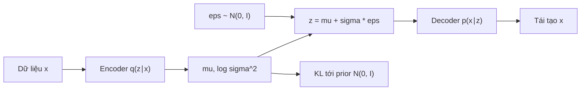
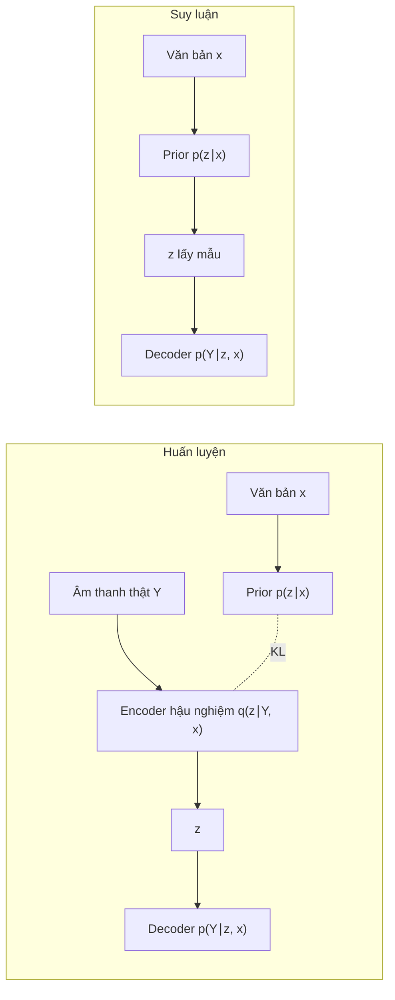

# Chương 8. Variational Autoencoder

!!! abstract "Mục tiêu học tập"
    Sau chương này, bạn có thể:

    - **Giải thích** vì sao mô hình biến ẩn là một lời giải tự nhiên cho bài toán một–nhiều, và vì sao hàm hợp lý cùng hậu nghiệm của nó không tính được.
    - **Suy ra** cận dưới ELBO theo hai cách (bất đẳng thức Jensen và khoảng hở KL) và diễn giải từng số hạng.
    - **Suy ra** công thức KL dạng đóng giữa hai phân phối Gauss (tổng quát và đường chéo) và kiểm chứng bằng mã.
    - **Cài đặt** VAE với mẹo tái tham số hóa, KL annealing và free bits; **so sánh** phương sai của ước lượng tái tham số hóa với ước lượng hàm score.
    - **Chẩn đoán** hiện tượng sụp hậu nghiệm và lựa chọn biện pháp khắc phục phù hợp.
    - **Phân tích** β-VAE theo góc nhìn tốc độ–méo và phân rã ELBO qua thông tin tương hỗ.
    - **Xây dựng** CVAE cho TTS và liên hệ với VITS, bộ mã hóa tham chiếu; **cài đặt** lớp VQ với straight-through, commitment loss và cập nhật EMA.

!!! info "Kiến thức cần có"
    - [Chương 1](../phan-1-nen-tang/ch01-toan-nen-tang.md): Gauss nhiều chiều, kỳ vọng, vết ma trận, entropy, phân kỳ KL, thông tin tương hỗ.
    - [Chương 2](../phan-1-nen-tang/ch02-hoc-may-va-mang-no-ron.md) và [Chương 3](../phan-1-nen-tang/ch03-toi-uu-va-ky-thuat-huan-luyen.md): MLP, lan truyền ngược, Adam.
    - [Chương 7](ch07-tong-quan-mo-hinh-sinh.md): MLE và KL, bài toán một–nhiều, hiện tượng trơn quá mức, mạng mật độ hỗn hợp.

[Chương 7](ch07-tong-quan-mo-hinh-sinh.md) kết luận rằng tiếng nói chứa một lượng lớn thông tin mà văn bản không quyết định, và một mô hình hồi quy sẽ "trung bình hóa" qua lượng thông tin đó. Chương này đi theo một ý tưởng rất trực tiếp: **đặt tên** cho phần thông tin còn thiếu bằng một biến ẩn $\mathbf{z}$, rồi học cách suy ra nó từ dữ liệu. Công cụ toán học để làm điều đó là suy diễn biến phân (*variational inference*), và mô hình kết quả là Variational Autoencoder (VAE) (Kingma và Welling, 2014; Rezende và cộng sự, 2014). VAE và các biến thể của nó có mặt ở rất nhiều nơi trong TTS: VITS là một VAE có điều kiện, các bộ mã hóa tham chiếu cho ngôn điệu là VAE, và VQ-VAE là tổ tiên trực tiếp của các neural audio codec.

Trong các mục tổng quát, $\mathbf{x}$ là một điểm dữ liệu (theo [bảng ký hiệu](../gioi-thieu/ky-hieu.md)); khi áp dụng vào TTS ở mục 8.8, dữ liệu là $\mathbf{Y}$ và điều kiện là văn bản $\mathbf{x}$.

## 8.1. Mô hình biến ẩn

### 8.1.1. Trực giác

Hãy tưởng tượng ta biết thêm về mỗi câu nói một véc-tơ $\mathbf{z}$ mô tả "người này đọc nhanh hay chậm, giọng cao hay thấp, hào hứng hay đều đều". Khi đã biết cả văn bản và $\mathbf{z}$, tiếng nói gần như được xác định: phân phối $p(\mathbf{Y} \mid \mathbf{x}, \mathbf{z})$ hẹp và gần đơn mode, nên một bộ giải mã đơn giản là đủ. Còn toàn bộ tính đa mode được dồn vào $\mathbf{z}$:

$$
p(\mathbf{Y} \mid \mathbf{x}) = \int p(\mathbf{Y} \mid \mathbf{x}, \mathbf{z})\, p(\mathbf{z} \mid \mathbf{x})\, d\mathbf{z}.
$$

Đây là một **hỗn hợp vô hạn** các phân phối đơn giản, mỗi giá trị $\mathbf{z}$ ứng với một "thành phần". So với MDN ở [Chương 7](ch07-tong-quan-mo-hinh-sinh.md) (hỗn hợp $K$ thành phần rời rạc), cách này mạnh hơn ở hai điểm: số thành phần là vô hạn và liên tục, và các thành phần được sinh ra bởi *cùng một* mạng nơ-ron từ $\mathbf{z}$, nên chúng chia sẻ cấu trúc. Một biến ẩn vài chiều có thể điều khiển những thay đổi có tương quan trên cả nghìn ô của mel-spectrogram, điều mà MDN với các thành phần đường chéo không làm được.

Vấn đề là ta **không quan sát** được $\mathbf{z}$. Không ai gán nhãn "độ hào hứng = 0,7" cho từng câu. Ta phải học đồng thời cách sinh dữ liệu từ $\mathbf{z}$ và cách suy ra $\mathbf{z}$ từ dữ liệu.

### 8.1.2. Hình thức hóa và hai cái khó

Một mô hình biến ẩn gồm một **phân phối tiên nghiệm** (*prior*) $p(\mathbf{z})$, thường là $\mathcal{N}(\mathbf{0}, \mathbf{I})$, và một **bộ giải mã** (*decoder*) $p_\theta(\mathbf{x} \mid \mathbf{z})$, ví dụ $\mathcal{N}(g_\theta(\mathbf{z}), \sigma_x^2 \mathbf{I})$ với $g_\theta$ là một mạng nơ-ron. Hàm hợp lý biên (*marginal likelihood*, còn gọi là *evidence*) là

$$
p_\theta(\mathbf{x}) = \int p_\theta(\mathbf{x} \mid \mathbf{z})\, p(\mathbf{z})\, d\mathbf{z}.
$$

Có hai cái khó liên quan chặt chẽ với nhau:

1. **Tích phân không tính được.** Với $g_\theta$ phi tuyến và $\mathbf{z}$ nhiều chiều, không có công thức đóng. Ước lượng Monte Carlo ngây thơ $p_\theta(\mathbf{x}) \approx \frac{1}{S}\sum_s p_\theta(\mathbf{x} \mid \mathbf{z}_s)$ với $\mathbf{z}_s \sim p(\mathbf{z})$ có phương sai khổng lồ: gần như mọi $\mathbf{z}$ rút ngẫu nhiên từ prior đều giải thích $\mathbf{x}$ rất tệ, chỉ một vùng nhỏ của không gian $\mathbf{z}$ thực sự đóng góp.
2. **Hậu nghiệm không tính được.** Vùng $\mathbf{z}$ "đúng" cho một $\mathbf{x}$ chính là hậu nghiệm $p_\theta(\mathbf{z} \mid \mathbf{x}) = p_\theta(\mathbf{x} \mid \mathbf{z})\, p(\mathbf{z}) / p_\theta(\mathbf{x})$. Nhưng mẫu số lại là chính tích phân ở trên.

Với những mô hình đơn giản như hỗn hợp Gauss, hậu nghiệm tính được (độ trách nhiệm) và thuật toán EM (Dempster và cộng sự, 1977) xen kẽ giữa tính hậu nghiệm và cập nhật tham số. VAE có thể xem là sự tổng quát hóa của EM cho trường hợp hậu nghiệm không tính được: ta **xấp xỉ** hậu nghiệm bằng một phân phối đơn giản $q_\phi(\mathbf{z} \mid \mathbf{x})$ do một mạng nơ-ron (bộ mã hóa, *encoder*) xuất ra, và tối ưu đồng thời $\theta$ và $\phi$.

## 8.2. Cận dưới ELBO

### 8.2.1. Suy ra bằng bất đẳng thức Jensen

Với bất kỳ phân phối $q_\phi(\mathbf{z} \mid \mathbf{x})$ nào dương ở những nơi $p_\theta(\mathbf{x}, \mathbf{z})$ dương, nhân và chia cho $q_\phi$ bên trong tích phân:

$$
\log p_\theta(\mathbf{x})
= \log \int q_\phi(\mathbf{z} \mid \mathbf{x})\, \frac{p_\theta(\mathbf{x}, \mathbf{z})}{q_\phi(\mathbf{z} \mid \mathbf{x})}\, d\mathbf{z}
= \log \mathbb{E}_{q_\phi(\mathbf{z} \mid \mathbf{x})}\!\left[ \frac{p_\theta(\mathbf{x}, \mathbf{z})}{q_\phi(\mathbf{z} \mid \mathbf{x})} \right].
$$

Hàm $\log$ lõm, nên theo bất đẳng thức Jensen $\log \mathbb{E}[W] \ge \mathbb{E}[\log W]$:

$$
\log p_\theta(\mathbf{x}) \;\ge\; \mathbb{E}_{q_\phi(\mathbf{z} \mid \mathbf{x})}\big[ \log p_\theta(\mathbf{x}, \mathbf{z}) - \log q_\phi(\mathbf{z} \mid \mathbf{x}) \big] \;=:\; \mathcal{L}_{\text{ELBO}}(\theta, \phi; \mathbf{x}).
$$

Đại lượng bên phải được gọi là **cận dưới bằng chứng** (*evidence lower bound*, ELBO). Nó chỉ chứa các kỳ vọng theo $q_\phi$, mà ta lấy mẫu được, và các mật độ $p_\theta(\mathbf{x}, \mathbf{z}) = p_\theta(\mathbf{x} \mid \mathbf{z}) p(\mathbf{z})$ và $q_\phi$, mà ta tính được.

### 8.2.2. Suy ra qua khoảng hở KL

Cách suy ra thứ hai cho biết **cận dưới hở bao nhiêu**. Bắt đầu từ phân kỳ KL giữa hậu nghiệm xấp xỉ và hậu nghiệm thật, rồi thay $p_\theta(\mathbf{z} \mid \mathbf{x}) = p_\theta(\mathbf{x}, \mathbf{z}) / p_\theta(\mathbf{x})$:

$$
\begin{aligned}
D_{\mathrm{KL}}\big(q_\phi(\mathbf{z} \mid \mathbf{x}) \,\Vert\, p_\theta(\mathbf{z} \mid \mathbf{x})\big)
&= \mathbb{E}_{q_\phi}\big[ \log q_\phi(\mathbf{z} \mid \mathbf{x}) - \log p_\theta(\mathbf{z} \mid \mathbf{x}) \big] \\
&= \mathbb{E}_{q_\phi}\big[ \log q_\phi(\mathbf{z} \mid \mathbf{x}) - \log p_\theta(\mathbf{x}, \mathbf{z}) + \log p_\theta(\mathbf{x}) \big] \\
&= -\mathcal{L}_{\text{ELBO}}(\theta, \phi; \mathbf{x}) + \log p_\theta(\mathbf{x}),
\end{aligned}
$$

trong đó bước cuối dùng việc $\log p_\theta(\mathbf{x})$ không phụ thuộc $\mathbf{z}$ nên đi ra ngoài kỳ vọng. Sắp xếp lại:

$$
\log p_\theta(\mathbf{x}) = \mathcal{L}_{\text{ELBO}}(\theta, \phi; \mathbf{x}) + D_{\mathrm{KL}}\big(q_\phi(\mathbf{z} \mid \mathbf{x}) \,\Vert\, p_\theta(\mathbf{z} \mid \mathbf{x})\big).
$$

Đẳng thức này đáng nhớ hơn bất đẳng thức Jensen vì nó nói ba điều cùng lúc:

- Vì KL không âm, ELBO là cận dưới của $\log p_\theta(\mathbf{x})$; khoảng hở **chính xác bằng** KL từ $q_\phi$ đến hậu nghiệm thật. Cận chặt khi và chỉ khi $q_\phi(\mathbf{z} \mid \mathbf{x}) = p_\theta(\mathbf{z} \mid \mathbf{x})$.
- Cố định $\theta$, vế trái không đổi. Vậy **tăng ELBO theo $\phi$ tương đương giảm KL** đến hậu nghiệm thật: bộ mã hóa đang học suy diễn.
- Tăng ELBO theo $\theta$ đẩy $\log p_\theta(\mathbf{x})$ lên (gần đúng): bộ giải mã đang học theo hợp lý cực đại.

Lấy trung bình trên dữ liệu, $\mathbb{E}_{p_{\text{data}}}[\mathcal{L}_{\text{ELBO}}] \le \mathbb{E}_{p_{\text{data}}}[\log p_\theta(\mathbf{x})]$, nên cực đại ELBO trung bình là một đại diện (*surrogate*) cho MLE, tức là cho việc cực tiểu $D_{\mathrm{KL}}(p_{\text{data}} \Vert p_\theta)$ như ở [Chương 7](ch07-tong-quan-mo-hinh-sinh.md).

### 8.2.3. Tái tạo cộng điều chuẩn

Tách $\log p_\theta(\mathbf{x}, \mathbf{z}) = \log p_\theta(\mathbf{x} \mid \mathbf{z}) + \log p(\mathbf{z})$ trong định nghĩa ELBO:

$$
\mathcal{L}_{\text{ELBO}} = \underbrace{\mathbb{E}_{q_\phi(\mathbf{z} \mid \mathbf{x})}\big[\log p_\theta(\mathbf{x} \mid \mathbf{z})\big]}_{\text{tái tạo}} \;-\; \underbrace{D_{\mathrm{KL}}\big(q_\phi(\mathbf{z} \mid \mathbf{x}) \,\Vert\, p(\mathbf{z})\big)}_{\text{điều chuẩn}}.
$$

Đây là dạng dùng trong cài đặt. Số hạng thứ nhất là một **autoencoder ngẫu nhiên**: mã hóa $\mathbf{x}$ thành một phân phối trên $\mathbf{z}$, lấy mẫu, giải mã, và đo độ khớp với $\mathbf{x}$. Số hạng thứ hai giữ cho hậu nghiệm của từng điểm dữ liệu không đi quá xa prior. Không có số hạng này, bộ mã hóa sẽ co phương sai về 0 và đặt các điểm dữ liệu ở những vị trí tùy ý; khi đó lấy $\mathbf{z} \sim p(\mathbf{z})$ để sinh mẫu sẽ rơi vào những vùng bộ giải mã chưa từng thấy. Nhờ số hạng KL, các mã của dữ liệu "lấp đầy" prior và việc sinh mẫu bằng cách rút $\mathbf{z}$ từ prior trở nên có nghĩa.



### 8.2.4. Suy diễn khấu hao

Suy diễn biến phân cổ điển (Blei và cộng sự, 2017) tối ưu một bộ tham số biến phân **riêng** cho từng điểm dữ liệu. VAE thay bằng một mạng nơ-ron duy nhất $\phi$ nhận $\mathbf{x}$ và xuất tham số của $q_\phi(\mathbf{z} \mid \mathbf{x})$: chi phí suy diễn được "khấu hao" (*amortized*) qua toàn bộ tập dữ liệu, và suy diễn cho một điểm mới chỉ tốn một lượt truyền xuôi. Cái giá là một khoảng hở bổ sung: ngay cả khi họ $q$ đủ tốt, mạng chung có thể không tìm được tham số tối ưu cho từng điểm. Cremer và cộng sự (2018) tách khoảng hở suy diễn thành *khoảng hở xấp xỉ* (do họ phân phối $q$ quá hẹp) và *khoảng hở khấu hao* (do dùng mạng chung).

## 8.3. Tối ưu ELBO: mẹo tái tham số hóa

### 8.3.1. Gradient của một kỳ vọng

Gradient của ELBO theo $\theta$ dễ: $\theta$ không nằm trong phân phối lấy kỳ vọng, nên $\nabla_\theta \mathbb{E}_{q_\phi}[\log p_\theta(\mathbf{x} \mid \mathbf{z})] = \mathbb{E}_{q_\phi}[\nabla_\theta \log p_\theta(\mathbf{x} \mid \mathbf{z})]$, ước lượng bằng vài mẫu. Gradient theo $\phi$ thì khó hơn, vì chính phân phối lấy kỳ vọng phụ thuộc $\phi$. Xét bài toán tổng quát $\nabla_\phi \mathbb{E}_{q_\phi(\mathbf{z})}[f(\mathbf{z})]$.

**Ước lượng hàm score** (*score function*, còn gọi là REINFORCE; Williams, 1992). Dùng đẳng thức $\nabla_\phi q_\phi = q_\phi \nabla_\phi \log q_\phi$:

$$
\nabla_\phi \int q_\phi(\mathbf{z}) f(\mathbf{z})\, d\mathbf{z} = \int f(\mathbf{z})\, \nabla_\phi q_\phi(\mathbf{z})\, d\mathbf{z} = \mathbb{E}_{q_\phi}\big[ f(\mathbf{z})\, \nabla_\phi \log q_\phi(\mathbf{z}) \big].
$$

Ước lượng này không chệch và áp dụng được cho mọi phân phối, kể cả rời rạc, nhưng chỉ dùng **giá trị** của $f$, không dùng gradient của nó. Phương sai của nó thường rất lớn.

### 8.3.2. Tái tham số hóa

Nếu có thể viết mẫu $\mathbf{z} \sim q_\phi$ như một **hàm khả vi** của $\phi$ và một nhiễu không phụ thuộc $\phi$, thì ta chuyển được sự phụ thuộc vào $\phi$ từ phân phối sang hàm. Với Gauss đường chéo:

$$
\mathbf{z} = \boldsymbol{\mu}_\phi(\mathbf{x}) + \boldsymbol{\sigma}_\phi(\mathbf{x}) \odot \boldsymbol{\epsilon}, \qquad \boldsymbol{\epsilon} \sim \mathcal{N}(\mathbf{0}, \mathbf{I}).
$$

Khi đó $\mathbb{E}_{q_\phi}[f(\mathbf{z})] = \mathbb{E}_{\boldsymbol{\epsilon}}[f(\boldsymbol{\mu}_\phi + \boldsymbol{\sigma}_\phi \odot \boldsymbol{\epsilon})]$, và vì phân phối của $\boldsymbol{\epsilon}$ cố định, ta đưa gradient vào trong:

$$
\nabla_\phi \mathbb{E}_{q_\phi}[f(\mathbf{z})] = \mathbb{E}_{\boldsymbol{\epsilon}}\big[ \nabla_\phi f(\boldsymbol{\mu}_\phi + \boldsymbol{\sigma}_\phi \odot \boldsymbol{\epsilon}) \big].
$$

Đây là **mẹo tái tham số hóa** (*reparameterization trick*). Trong PyTorch, nó chỉ là một dòng `z = mu + std * torch.randn_like(std)`; autograd tự lan truyền ngược "xuyên qua" mẫu về $\boldsymbol{\mu}$ và $\boldsymbol{\sigma}$. Ước lượng dùng cả thông tin gradient của $f$, nên phương sai thường thấp hơn nhiều. Thí nghiệm sau so sánh hai ước lượng cho $\nabla_\mu \mathbb{E}_{z \sim \mathcal{N}(\mu, \sigma^2)}[z^2]$, có giá trị đúng là $2\mu$:

```python
import torch

torch.manual_seed(0)
mu, sigma, n = torch.tensor(1.0), 0.5, 100_000
f = lambda z: z ** 2                         # mục tiêu: E_{z~N(mu, sigma^2)}[z^2], gradient đúng = 2*mu

# (1) Ước lượng hàm score (REINFORCE): f(z) * d/dmu log N(z; mu, sigma^2)
z = mu + sigma * torch.randn(n)
g_score = f(z) * (z - mu) / sigma ** 2       # (n,) mỗi phần tử là một ước lượng 1 mẫu

# (2) Tái tham số hóa: z = mu + sigma * eps, lan truyền ngược "xuyên qua" mẫu
mu_r = mu.clone().requires_grad_(True)
eps = torch.randn(n)
z_r = mu_r + sigma * eps
g_rep, = torch.autograd.grad(f(z_r).sum(), mu_r, retain_graph=False)  # tổng gradient
g_rep_each = 2 * (mu + sigma * eps)          # gradient của từng ước lượng 1 mẫu (giải tích)
assert torch.allclose(g_rep, g_rep_each.sum(), rtol=1e-4)

print(f"gradient đúng      : {2 * mu.item():.3f}")
print(f"score function     : mean={g_score.mean():.3f}  var={g_score.var():.3f}")
print(f"tái tham số hóa    : mean={g_rep_each.mean():.3f}  var={g_rep_each.var():.3f}")
```

Cả hai ước lượng đều cho trung bình xấp xỉ 2, nhưng phương sai của ước lượng hàm score vào khoảng 22, gấp hơn hai mươi lần ước lượng tái tham số hóa (khoảng 1). Trong một mạng nơ-ron với hàng nghìn chiều ẩn, chênh lệch này còn lớn hơn nhiều và quyết định việc huấn luyện có hội tụ hay không.

Mẹo tái tham số hóa áp dụng cho các họ "vị trí–tỉ lệ" (Gauss, Laplace, logistic) và mọi phân phối có bộ lấy mẫu khả vi (ví dụ đẩy nhiễu qua một normalizing flow, [Chương 10](ch10-normalizing-flows.md)). Nó **không** áp dụng trực tiếp cho biến rời rạc; khi đó người ta dùng ước lượng straight-through (mục 8.10) hoặc nới lỏng liên tục kiểu Gumbel-softmax.

### 8.3.3. Thuật toán huấn luyện

Với mỗi minibatch $\{\mathbf{x}^{(i)}\}$:

1. Encoder tính $\boldsymbol{\mu}^{(i)}, \log \boldsymbol{\sigma}^{2(i)}$.
2. Lấy $\boldsymbol{\epsilon}^{(i)} \sim \mathcal{N}(\mathbf{0}, \mathbf{I})$, đặt $\mathbf{z}^{(i)} = \boldsymbol{\mu}^{(i)} + \boldsymbol{\sigma}^{(i)} \odot \boldsymbol{\epsilon}^{(i)}$ (thường một mẫu cho mỗi điểm dữ liệu là đủ).
3. Decoder tính $\log p_\theta(\mathbf{x}^{(i)} \mid \mathbf{z}^{(i)})$.
4. Tính KL **dạng đóng** (mục 8.4), không cần lấy mẫu.
5. Hàm mất mát $= -\frac{1}{B}\sum_i \big[\log p_\theta(\mathbf{x}^{(i)} \mid \mathbf{z}^{(i)}) - D_{\mathrm{KL}}^{(i)}\big]$; lan truyền ngược và cập nhật cả $\theta$ lẫn $\phi$.

## 8.4. Encoder, decoder Gauss và KL dạng đóng

### 8.4.1. Encoder Gauss đường chéo

Encoder xuất $2d_z$ số: $\boldsymbol{\mu}$ và $\log \boldsymbol{\sigma}^2$ (log-phương sai). Dự đoán log-phương sai thay vì $\boldsymbol{\sigma}$ có hai lợi ích: đầu ra không bị ràng buộc dấu, và các phép tính KL dùng trực tiếp $\log \sigma^2$. Trong thực tế nên kẹp (*clamp*) log-phương sai trong một khoảng như $[-10, 10]$ để tránh tràn số khi lấy $\exp$.

### 8.4.2. Decoder: chọn hàm hợp lý

- **Gauss phương sai cố định** $\mathcal{N}(g_\theta(\mathbf{z}), \sigma_x^2 \mathbf{I})$ với $\mathbf{x} \in \mathbb{R}^D$: $-\log p_\theta(\mathbf{x} \mid \mathbf{z}) = \lVert \mathbf{x} - g_\theta(\mathbf{z}) \rVert^2 / (2\sigma_x^2) + \tfrac{D}{2}\log(2\pi\sigma_x^2)$. Số hạng tái tạo là MSE nhân với $1/(2\sigma_x^2)$. **Chọn $\sigma_x$ chính là chọn trọng số tương đối giữa tái tạo và KL** (mục 8.7).
- **Laplace** cho số hạng L1, phổ biến cho mel-spectrogram.
- **Bernoulli** cho dữ liệu nhị phân (binary cross-entropy), phổ biến với ảnh đen trắng, ít dùng trong tiếng nói.
- **Phương sai học được**: có thể cho decoder xuất cả $\sigma_x$. Cách này tự cân bằng hai số hạng, nhưng nếu decoder tái tạo quá tốt, $\sigma_x \to 0$ và loss tiến tới $-\infty$; cần kẹp dưới (xem Bài tập 6).

Một nhận xét quan trọng nối với [Chương 7](ch07-tong-quan-mo-hinh-sinh.md): với decoder Gauss, khi đã cố định $\mathbf{z}$, phần tái tạo vẫn là **hồi quy L2** và $g_\theta(\mathbf{z})$ học $\mathbb{E}[\mathbf{x} \mid \mathbf{z}]$. Nếu $\mathbf{z}$ chưa nắm hết phần biến thiên của $\mathbf{x}$, đầu ra của decoder vẫn bị nhòe. Đó là lý do mẫu của VAE "thuần" nổi tiếng là mờ, và là lý do VITS gắn thêm một bộ phân biệt GAN lên đầu ra của decoder ([Chương 9](ch09-gan.md), [Chương 27](../phan-7-e2e-bieu-cam/ch27-vits.md)).

### 8.4.3. Suy ra KL giữa hai phân phối Gauss

Cho $q = \mathcal{N}(\boldsymbol{\mu}_1, \boldsymbol{\Sigma}_1)$ và $p = \mathcal{N}(\boldsymbol{\mu}_2, \boldsymbol{\Sigma}_2)$ trên $\mathbb{R}^d$. Log-mật độ của chúng là

$$
\log q(\mathbf{z}) = -\tfrac12\Big[ d\log 2\pi + \log\det\boldsymbol{\Sigma}_1 + (\mathbf{z} - \boldsymbol{\mu}_1)^\top \boldsymbol{\Sigma}_1^{-1} (\mathbf{z} - \boldsymbol{\mu}_1) \Big],
$$

và tương tự cho $p$. Do đó

$$
D_{\mathrm{KL}}(q \,\Vert\, p) = \mathbb{E}_q[\log q - \log p]
= \tfrac12\Big[ \log\frac{\det\boldsymbol{\Sigma}_2}{\det\boldsymbol{\Sigma}_1}
+ \mathbb{E}_q\big[(\mathbf{z} - \boldsymbol{\mu}_2)^\top \boldsymbol{\Sigma}_2^{-1} (\mathbf{z} - \boldsymbol{\mu}_2)\big]
- \mathbb{E}_q\big[(\mathbf{z} - \boldsymbol{\mu}_1)^\top \boldsymbol{\Sigma}_1^{-1} (\mathbf{z} - \boldsymbol{\mu}_1)\big] \Big].
$$

**Bổ đề.** Nếu $\mathbf{z}$ có trung bình $\mathbf{m}$ và hiệp phương sai $\mathbf{S}$, thì với mọi ma trận đối xứng $\mathbf{A}$ và véc-tơ $\mathbf{a}$: $\mathbb{E}[(\mathbf{z} - \mathbf{a})^\top \mathbf{A} (\mathbf{z} - \mathbf{a})] = \operatorname{tr}(\mathbf{A}\mathbf{S}) + (\mathbf{m} - \mathbf{a})^\top \mathbf{A} (\mathbf{m} - \mathbf{a})$.

*Chứng minh.* Viết $\mathbf{z} - \mathbf{a} = (\mathbf{z} - \mathbf{m}) + (\mathbf{m} - \mathbf{a})$ và khai triển. Số hạng chéo $2(\mathbf{m} - \mathbf{a})^\top \mathbf{A}\, \mathbb{E}[\mathbf{z} - \mathbf{m}]$ bằng 0. Số hạng bậc hai: một số vô hướng bằng vết của chính nó, và vết bất biến với hoán vị vòng, nên $\mathbb{E}[(\mathbf{z} - \mathbf{m})^\top \mathbf{A} (\mathbf{z} - \mathbf{m})] = \mathbb{E}[\operatorname{tr}(\mathbf{A} (\mathbf{z} - \mathbf{m})(\mathbf{z} - \mathbf{m})^\top)] = \operatorname{tr}(\mathbf{A}\mathbf{S})$. $\square$

Áp dụng bổ đề với $\mathbf{m} = \boldsymbol{\mu}_1$, $\mathbf{S} = \boldsymbol{\Sigma}_1$: kỳ vọng thứ hai bằng $\operatorname{tr}(\boldsymbol{\Sigma}_1^{-1}\boldsymbol{\Sigma}_1) = d$; kỳ vọng thứ nhất bằng $\operatorname{tr}(\boldsymbol{\Sigma}_2^{-1}\boldsymbol{\Sigma}_1) + (\boldsymbol{\mu}_1 - \boldsymbol{\mu}_2)^\top \boldsymbol{\Sigma}_2^{-1} (\boldsymbol{\mu}_1 - \boldsymbol{\mu}_2)$. Vậy:

$$
D_{\mathrm{KL}}\big(\mathcal{N}(\boldsymbol{\mu}_1, \boldsymbol{\Sigma}_1) \,\Vert\, \mathcal{N}(\boldsymbol{\mu}_2, \boldsymbol{\Sigma}_2)\big)
= \tfrac12\Big[ \operatorname{tr}\big(\boldsymbol{\Sigma}_2^{-1}\boldsymbol{\Sigma}_1\big) + (\boldsymbol{\mu}_2 - \boldsymbol{\mu}_1)^\top \boldsymbol{\Sigma}_2^{-1} (\boldsymbol{\mu}_2 - \boldsymbol{\mu}_1) - d + \log\frac{\det\boldsymbol{\Sigma}_2}{\det\boldsymbol{\Sigma}_1} \Big].
$$

**Trường hợp đường chéo.** Với $\boldsymbol{\Sigma}_1 = \operatorname{diag}(\boldsymbol{\sigma}_1^2)$, $\boldsymbol{\Sigma}_2 = \operatorname{diag}(\boldsymbol{\sigma}_2^2)$, mọi thứ tách theo từng chiều:

$$
D_{\mathrm{KL}} = \frac12 \sum_{j=1}^{d} \left[ \frac{\sigma_{1j}^2 + (\mu_{1j} - \mu_{2j})^2}{\sigma_{2j}^2} - 1 + \log \sigma_{2j}^2 - \log \sigma_{1j}^2 \right].
$$

**Trường hợp prior chuẩn** $p = \mathcal{N}(\mathbf{0}, \mathbf{I})$, công thức dùng trong hầu hết các cài đặt VAE:

$$
D_{\mathrm{KL}}\big(q_\phi(\mathbf{z} \mid \mathbf{x}) \,\Vert\, \mathcal{N}(\mathbf{0}, \mathbf{I})\big) = \frac12 \sum_{j=1}^{d} \Big( \mu_j^2 + \sigma_j^2 - 1 - \log \sigma_j^2 \Big).
$$

Mỗi số hạng đều không âm: $\mu_j^2 \ge 0$ kéo trung bình về 0, và $\sigma_j^2 - 1 - \log\sigma_j^2 \ge 0$ (Bài tập 3) phạt phương sai lệch khỏi 1 theo cả hai hướng: quá nhỏ (hậu nghiệm "quá tự tin") hay quá lớn. KL của một chiều bằng 0 khi và chỉ khi $\mu_j = 0$ và $\sigma_j = 1$, tức là chiều đó **không mang thông tin gì về $\mathbf{x}$**. Ta sẽ dùng đúng nhận xét này để đếm số chiều ẩn "hoạt động".

Đoạn mã sau cài đặt hai công thức và kiểm chứng chúng với `torch.distributions` và với ước lượng Monte Carlo:

```python
import torch
from torch.distributions import Normal, MultivariateNormal, kl_divergence

def kl_diag_gauss(mu_q, logvar_q, mu_p, logvar_p):
    """KL( N(mu_q, diag e^{logvar_q}) || N(mu_p, diag e^{logvar_p}) ), cộng theo chiều cuối."""
    return 0.5 * (logvar_p - logvar_q
                  + (logvar_q.exp() + (mu_q - mu_p) ** 2) / logvar_p.exp()
                  - 1.0).sum(-1)

def kl_std_normal(mu, logvar):
    """Trường hợp riêng p = N(0, I): 0.5 * sum(mu^2 + sigma^2 - 1 - log sigma^2)."""
    return 0.5 * (mu ** 2 + logvar.exp() - 1.0 - logvar).sum(-1)

torch.manual_seed(0)
B, d = 4, 8
mu_q, logvar_q = torch.randn(B, d), torch.randn(B, d)
mu_p, logvar_p = torch.randn(B, d), torch.randn(B, d)

# So với torch.distributions
ref = kl_divergence(Normal(mu_q, (0.5 * logvar_q).exp()),
                    Normal(mu_p, (0.5 * logvar_p).exp())).sum(-1)           # (B,)
assert torch.allclose(kl_diag_gauss(mu_q, logvar_q, mu_p, logvar_p), ref, atol=1e-5)
zeros = torch.zeros(B, d)
assert torch.allclose(kl_std_normal(mu_q, logvar_q), kl_diag_gauss(mu_q, logvar_q, zeros, zeros))

# So với ước lượng Monte Carlo: E_q[log q(z) - log p(z)]
q = Normal(mu_q[0], (0.5 * logvar_q[0]).exp())
p = Normal(mu_p[0], (0.5 * logvar_p[0]).exp())
z = q.sample((200_000,))                                                   # (S, d)
mc = (q.log_prob(z) - p.log_prob(z)).sum(-1).mean()
print(f"công thức đóng: {ref[0]:.4f}   Monte Carlo: {mc:.4f}")

# Trường hợp hiệp phương sai đầy đủ (công thức tổng quát suy ra trong bài)
A, Bm = torch.randn(3, 3), torch.randn(3, 3)
S1, S2 = A @ A.T + 0.5 * torch.eye(3), Bm @ Bm.T + 0.5 * torch.eye(3)
m1, m2 = torch.randn(3), torch.randn(3)
S2_inv = torch.linalg.inv(S2)
kl_full = 0.5 * (torch.trace(S2_inv @ S1) + (m2 - m1) @ S2_inv @ (m2 - m1) - 3
                 + torch.logdet(S2) - torch.logdet(S1))
assert torch.allclose(kl_full, kl_divergence(MultivariateNormal(m1, S1), MultivariateNormal(m2, S2)),
                      atol=1e-4)
```

Công thức đường chéo với prior *không chuẩn* $\mathcal{N}(\boldsymbol{\mu}_p, \operatorname{diag}\boldsymbol{\sigma}_p^2)$ là dạng xuất hiện khi prior được dự đoán từ văn bản (mục 8.8). VITS đi xa hơn một bước: prior được biến đổi bởi một normalizing flow, và KL được ước lượng bằng mẫu cùng với log-định thức Jacobian; ta sẽ suy ra chi tiết ở [Chương 27](../phan-7-e2e-bieu-cam/ch27-vits.md).

## 8.5. Ví dụ hoàn chỉnh: VAE trên "phổ" giả với KL annealing

Ta huấn luyện một VAE nhỏ trên các khung log-phổ 32 kênh được sinh ra bởi **hai** yếu tố ẩn: vị trí đỉnh formant và độ to. Mô hình có 4 chiều ẩn, nhiều hơn số yếu tố thật, để ta quan sát cách số hạng KL "tắt" những chiều không cần thiết. Hệ số $\beta$ của số hạng KL được tăng tuyến tính từ 0 lên 1 trong 600 bước đầu (*KL annealing*, mục 8.6).

```python
import torch
import torch.nn as nn

torch.manual_seed(0)
F_BINS, LATENT = 32, 4
k = torch.arange(F_BINS, dtype=torch.float32)

def make_frames(n):
    """Khung log-phổ giả do HAI yếu tố sinh ra: vị trí formant (bin) và độ to."""
    center = 8.0 + 16.0 * torch.rand(n, 1)                         # (n, 1) vị trí đỉnh formant
    loud = 2.0 * torch.rand(n, 1) - 1.0                            # (n, 1) độ to tương đối
    x = torch.log(0.05 + torch.exp(-0.5 * ((k - center) / 3.0) ** 2)) + loud   # (n, F)
    return x + 0.05 * torch.randn_like(x), center.squeeze(1), loud.squeeze(1)

class VAE(nn.Module):
    def __init__(self, d_in=F_BINS, d_z=LATENT, hidden=128):
        super().__init__()
        self.enc = nn.Sequential(nn.Linear(d_in, hidden), nn.SiLU(),
                                 nn.Linear(hidden, hidden), nn.SiLU(), nn.Linear(hidden, 2 * d_z))
        self.dec = nn.Sequential(nn.Linear(d_z, hidden), nn.SiLU(),
                                 nn.Linear(hidden, hidden), nn.SiLU(), nn.Linear(hidden, d_in))

    def forward(self, x):                                          # x: (B, F)
        mu, logvar = self.enc(x).chunk(2, dim=-1)                  # (B, d_z) mỗi cái
        logvar = logvar.clamp(-10.0, 10.0)
        z = mu + (0.5 * logvar).exp() * torch.randn_like(mu)       # mẹo tái tham số hóa
        return self.dec(z), mu, logvar

def vae_loss(x, x_hat, mu, logvar, beta, sigma_x=0.3, free_bits=0.0):
    """-ELBO (mỗi mẫu): tái tạo Gauss phương sai cố định + beta * KL (có tùy chọn free bits)."""
    rec = ((x - x_hat) ** 2).sum(-1).mean() / (2 * sigma_x ** 2)    # bỏ hằng số log(2*pi*sigma^2)
    kl_dim = 0.5 * (mu ** 2 + logvar.exp() - 1.0 - logvar).mean(0)  # (d_z,) KL mỗi chiều
    kl = torch.clamp(kl_dim, min=free_bits).sum()                   # free bits theo từng chiều
    return rec + beta * kl, rec, kl_dim

model = VAE()
opt = torch.optim.Adam(model.parameters(), lr=2e-3)
steps, warmup = 2000, 600
for step in range(steps):
    x, _, _ = make_frames(256)
    beta = min(1.0, step / warmup)                                  # KL annealing tuyến tính
    x_hat, mu, logvar = model(x)
    loss, rec, kl_dim = vae_loss(x, x_hat, mu, logvar, beta)
    opt.zero_grad(); loss.backward(); opt.step()
    if step % 500 == 0 or step == steps - 1:
        print(f"step {step:4d}  beta={beta:.2f}  rec={rec.item():7.1f}  KL/chiều={kl_dim.detach().numpy().round(2)}")

# Phân tích: chiều ẩn nào "hoạt động" và mã hóa yếu tố nào?
with torch.no_grad():
    x, fc, loud = make_frames(2000)
    _, mu, _ = model(x)
    active = mu.var(0) > 0.01                                       # tiêu chí "active units"
    corr = lambda a, b: torch.corrcoef(torch.stack([a, b]))[0, 1].abs().item()
    for j in range(LATENT):
        info = (f"|corr(formant)|={corr(mu[:, j], fc):.2f}  |corr(loud)|={corr(mu[:, j], loud):.2f}"
                if active[j] else "không hoạt động (KL ~ 0)")
        print(f"z[{j}]: {info}")
    x_new = model.dec(torch.randn(5, LATENT))                       # (5, F) sinh mẫu từ prior
    assert x_new.shape == (5, F_BINS) and int(active.sum()) >= 2
```

Khi người biên soạn chạy đoạn mã, ba chiều ẩn hoạt động với KL khoảng 2 nat mỗi chiều, chiều thứ tư có KL xấp xỉ 0: số hạng KL đã "tỉa" chiều thừa. Một chiều tương quan mạnh với độ to ($\lvert\rho\rvert \approx 0.9$), hai chiều cùng tương quan với vị trí formant. Kết quả cụ thể phụ thuộc hạt giống ngẫu nhiên, nhưng hai bài học thì ổn định:

- **Đếm chiều hoạt động.** Theo Burda và cộng sự (2016), một chiều ẩn được coi là *hoạt động* (*active unit*) nếu phương sai theo dữ liệu của trung bình hậu nghiệm, $\operatorname{Var}_{\mathbf{x}}(\mathbb{E}_{q}[z_j])$, vượt một ngưỡng nhỏ như $0.01$. Theo dõi KL theo từng chiều và số chiều hoạt động là cách chẩn đoán rẻ nhất cho mọi mô hình có biến ẩn.
- **Không có gì bảo đảm một yếu tố vật lý ứng với một chiều ẩn.** Vị trí formant là một yếu tố một chiều nhưng tạo ra một đường cong rất cong trong không gian phổ, và VAE thường dùng hai chiều để "duỗi" nó ra. Locatello và cộng sự (2019) chứng minh rằng nếu không có thiên kiến quy nạp hoặc giám sát, việc học biểu diễn "tách rời" (*disentangled*) không được bảo đảm về mặt lý thuyết.

## 8.6. Sụp hậu nghiệm và cách chữa

### 8.6.1. Hiện tượng

**Sụp hậu nghiệm** (*posterior collapse*) xảy ra khi $q_\phi(\mathbf{z} \mid \mathbf{x}) \approx p(\mathbf{z})$ với mọi $\mathbf{x}$: KL về 0, encoder không truyền thông tin gì, và decoder học cách phớt lờ $\mathbf{z}$. Mô hình khi đó thoái hóa thành một mô hình không có biến ẩn, và mọi nỗ lực điều khiển phong cách qua $\mathbf{z}$ đều vô ích.

Có hai nguyên nhân chính:

1. **Decoder quá mạnh.** Nếu decoder tự mô hình hóa được $p(\mathbf{x})$ mà không cần $\mathbf{z}$, ví dụ một decoder tự hồi quy nhìn được các bước trước, thì việc dùng $\mathbf{z}$ chỉ tốn chi phí KL mà không đem lại gì. Thật vậy, nếu $p_\theta(\mathbf{x} \mid \mathbf{z}) = p_\theta(\mathbf{x})$ không phụ thuộc $\mathbf{z}$, ELBO trở thành $\log p_\theta(\mathbf{x}) - D_{\mathrm{KL}}(q_\phi(\mathbf{z} \mid \mathbf{x}) \Vert p(\mathbf{z}))$, đạt cực đại khi $q_\phi = p$: sụp hậu nghiệm là **nghiệm tối ưu** của ELBO trong trường hợp này (Bài tập 4). Hiện tượng này được ghi nhận rõ với mô hình ngôn ngữ dùng decoder LSTM (Bowman và cộng sự, 2016) và được phân tích kỹ bởi Chen và cộng sự (2017).
2. **Động lực học lúc đầu huấn luyện.** Khi decoder còn kém, $\mathbf{z}$ chưa giúp được gì cho tái tạo, nhưng số hạng KL thì phạt ngay. Encoder nhanh chóng co về prior, và khi decoder đã tốt lên thì không còn tín hiệu nào kéo encoder ra khỏi đó. He và cộng sự (2019) gọi đây là hiện tượng mạng suy diễn bị "tụt hậu" (*lagging inference network*).

Trong TTS, nguyên nhân thứ nhất rất thường gặp: một decoder tự hồi quy kiểu Tacotron nhìn thấy văn bản và các khung trước, đủ để dự đoán khá tốt mà không cần $\mathbf{z}$ từ bộ mã hóa tham chiếu. Dấu hiệu: KL tiến về 0, và thay $\mathbf{z}$ của câu này bằng $\mathbf{z}$ của câu khác không làm thay đổi đầu ra.

### 8.6.2. KL annealing

Nhân số hạng KL với một hệ số $\beta_t$ tăng dần từ 0 lên 1 (Bowman và cộng sự, 2016), như trong đoạn mã ở mục 8.5. Lúc đầu mô hình gần như một autoencoder thường, encoder kịp học cách mã hóa thông tin hữu ích; sau đó KL được "bật" dần. Biến thể **lịch tuần hoàn** (*cyclical annealing*) lặp lại chu kỳ tăng $\beta$ nhiều lần trong quá trình huấn luyện (Fu và cộng sự, 2019). Lưu ý: khi $\beta_t < 1$, hàm mục tiêu không còn là cận dưới của $\log p_\theta(\mathbf{x})$; điều đó chấp nhận được vì đây chỉ là giai đoạn khởi động.

### 8.6.3. Free bits

Kingma và cộng sự (2016) đề xuất cho mỗi nhóm chiều ẩn một khoản "miễn phí" $\lambda$ nat: thay số hạng KL bằng

$$
\sum_{j} \max\Big(\lambda,\; \mathbb{E}_{\mathbf{x} \sim \text{minibatch}}\big[ D_{\mathrm{KL}}(q_\phi(z_j \mid \mathbf{x}) \,\Vert\, p(z_j)) \big]\Big).
$$

Khi KL trung bình của một chiều dưới $\lambda$, hàm $\max$ trả về hằng số và gradient đẩy KL xuống bằng 0: mô hình được dùng tới $\lambda$ nat thông tin trên mỗi chiều mà không bị phạt. Hàm `vae_loss` ở mục 8.5 đã có tham số `free_bits` cài đặt đúng công thức này (trung bình trên minibatch rồi mới kẹp). Hai lưu ý: kẹp *sau khi* lấy trung bình trên minibatch, vì kẹp từng mẫu sẽ cho một mục tiêu khác; và $\lambda$ quá lớn có thể khiến mô hình mã hóa nhiễu để "tiêu" hết phần miễn phí.

### 8.6.4. Các biện pháp khác

- **Làm yếu decoder**: trong mô hình ngôn ngữ, Bowman và cộng sự (2016) thay ngẫu nhiên một phần từ đầu vào của decoder bằng token rỗng (*word dropout*); trong TTS tự hồi quy, dropout mạnh ở pre-net và hệ số rút gọn lớn có tác dụng tương tự.
- **Ràng buộc họ hậu nghiệm** để KL không thể bằng 0, như δ-VAE (Razavi và cộng sự, 2019).
- **Huấn luyện encoder tích cực hơn** ở giai đoạn đầu (He và cộng sự, 2019).
- **Thiết kế nút cổ chai hợp lý**: biến ẩn cấp câu, ít chiều, thường ổn định hơn biến ẩn cấp khung nhiều chiều.

## 8.7. β-VAE và góc nhìn tốc độ–méo

### 8.7.1. β-VAE

Higgins và cộng sự (2017) đề xuất đặt một hệ số $\beta$ cố định trước số hạng KL:

$$
\mathcal{L}_\beta = \mathbb{E}_{q_\phi(\mathbf{z} \mid \mathbf{x})}\big[\log p_\theta(\mathbf{x} \mid \mathbf{z})\big] - \beta\, D_{\mathrm{KL}}\big(q_\phi(\mathbf{z} \mid \mathbf{x}) \,\Vert\, p(\mathbf{z})\big).
$$

$\beta > 1$ siết nút cổ chai thông tin: ít chiều hoạt động hơn, biểu diễn có xu hướng tách rời hơn (với những cảnh báo của Locatello và cộng sự, 2019), tái tạo mờ hơn. $\beta < 1$ cho tái tạo tốt hơn nhưng các mã của dữ liệu "phủ" prior kém hơn, nên mẫu sinh từ prior kém đi.

Với decoder Gauss, $\beta$ và $\sigma_x$ là **cùng một núm vặn**. Nhân $-\mathcal{L}_\beta$ với hằng số dương $2\sigma_x^2$ (không đổi nghiệm tối ưu, bỏ qua hằng số):

$$
2\sigma_x^2 \cdot (-\mathcal{L}_\beta) = \mathbb{E}_q\big[\lVert \mathbf{x} - g_\theta(\mathbf{z}) \rVert^2\big] + 2\sigma_x^2 \beta\, D_{\mathrm{KL}} + \text{hằng số}.
$$

Vậy "MSE + $\beta'$·KL" trong nhiều cài đặt tương đương VAE chuẩn với $\sigma_x^2 = \beta'/2$. Khi đọc mã nguồn TTS, những trọng số như "mel L1 nhân 45, KL nhân 1" (cấu hình mặc định của VITS theo báo cáo gốc) thực chất đang đặt độ rộng giả định của likelihood tái tạo. Cách chuẩn hóa (cộng hay lấy trung bình theo số kênh mel, số khung, số chiều ẩn) làm thay đổi $\beta$ hiệu dụng; đây là nguồn lỗi kinh điển (xem mục "Lỗi thường gặp").

### 8.7.2. Tốc độ và méo

Alemi và cộng sự (2018) đặt **méo** (*distortion*) $\mathcal{D} = -\mathbb{E}_{p_{\text{data}}}\mathbb{E}_{q_\phi}[\log p_\theta(\mathbf{x} \mid \mathbf{z})]$ và **tốc độ** (*rate*) $\mathcal{R} = \mathbb{E}_{p_{\text{data}}}\big[D_{\mathrm{KL}}(q_\phi(\mathbf{z} \mid \mathbf{x}) \Vert p(\mathbf{z}))\big]$. Khi đó $-\mathbb{E}[\mathcal{L}_{\text{ELBO}}] = \mathcal{D} + \mathcal{R}$ và β-VAE cực tiểu $\mathcal{D} + \beta\mathcal{R}$, đúng dạng bài toán tốc độ–méo trong lý thuyết nén. Hai mô hình có **cùng ELBO** có thể nằm ở hai đầu rất khác nhau của đường cong: một mô hình phớt lờ $\mathbf{z}$ ($\mathcal{R} = 0$, decoder mạnh) và một mô hình dùng $\mathbf{z}$ rất nhiều. ELBO một mình không cho biết biến ẩn có được dùng hay không, nên ta luôn phải báo cáo riêng $\mathcal{R}$ và $\mathcal{D}$.

### 8.7.3. Phân rã số hạng tốc độ

Định nghĩa **hậu nghiệm gộp** (*aggregate posterior*) $q_\phi(\mathbf{z}) = \mathbb{E}_{p_{\text{data}}(\mathbf{x})}[q_\phi(\mathbf{z} \mid \mathbf{x})]$, tức phân phối của mã khi $\mathbf{x}$ chạy trên toàn bộ dữ liệu. Thêm bớt $\log q_\phi(\mathbf{z})$ trong số hạng tốc độ:

$$
\begin{aligned}
\mathcal{R} &= \mathbb{E}_{p_{\text{data}}(\mathbf{x})}\mathbb{E}_{q_\phi(\mathbf{z} \mid \mathbf{x})}\big[\log q_\phi(\mathbf{z} \mid \mathbf{x}) - \log q_\phi(\mathbf{z})\big] + \mathbb{E}_{p_{\text{data}}(\mathbf{x})}\mathbb{E}_{q_\phi(\mathbf{z} \mid \mathbf{x})}\big[\log q_\phi(\mathbf{z}) - \log p(\mathbf{z})\big] \\
&= I_q(\mathbf{x}; \mathbf{z}) + D_{\mathrm{KL}}\big(q_\phi(\mathbf{z}) \,\Vert\, p(\mathbf{z})\big).
\end{aligned}
$$

Số hạng đầu là thông tin tương hỗ giữa $\mathbf{x}$ và $\mathbf{z}$ dưới phân phối đồng thời $p_{\text{data}}(\mathbf{x})q_\phi(\mathbf{z} \mid \mathbf{x})$. Ở số hạng thứ hai, biểu thức trong kỳ vọng chỉ phụ thuộc $\mathbf{z}$, và lấy kỳ vọng kép theo $p_{\text{data}}(\mathbf{x}) q_\phi(\mathbf{z} \mid \mathbf{x})$ cũng chính là lấy kỳ vọng theo $q_\phi(\mathbf{z})$. Phân rã này (Hoffman và Johnson, 2016) giải thích hai hiện tượng:

- **Mâu thuẫn nội tại của ELBO.** Số hạng tốc độ phạt chính thông tin tương hỗ $I_q(\mathbf{x}; \mathbf{z})$, tức chính cái mà ta muốn $\mathbf{z}$ mang. Sụp hậu nghiệm là hệ quả tự nhiên khi decoder không "cần" thông tin đó.
- **"Lỗ" trong prior** (*prior holes*). Nếu $q_\phi(\mathbf{z})$ không khớp $p(\mathbf{z})$, sẽ có những vùng có mật độ prior cao nhưng không có mã dữ liệu nào. Rút $\mathbf{z}$ từ prior rơi vào đó cho ra mẫu kỳ quặc. Trong TTS, đây là lý do lấy mẫu "phong cách" ngẫu nhiên từ $\mathcal{N}(\mathbf{0}, \mathbf{I})$ đôi khi cho ngôn điệu thiếu tự nhiên, và người ta hay dùng một prior được học có điều kiện trên văn bản, hoặc lấy $\mathbf{z}$ từ một đoạn âm thanh tham chiếu.

## 8.8. VAE có điều kiện (CVAE) và TTS

### 8.8.1. Hình thức hóa

Trong TTS ta không muốn sinh tiếng nói bất kỳ mà sinh tiếng nói **của một văn bản**. Chuyển sang ký hiệu TTS: dữ liệu là $\mathbf{Y}$, điều kiện là văn bản $\mathbf{x}$ (có thể kèm điều kiện toàn cục $\mathbf{g}$ như người nói). **VAE có điều kiện** (CVAE; Sohn và cộng sự, 2015) đặt mọi phân phối có điều kiện trên $\mathbf{x}$. Lặp lại đúng lập luận ở mục 8.2.2 với mọi mật độ được điều kiện hóa thêm trên $\mathbf{x}$, ta được:

$$
\log p_\theta(\mathbf{Y} \mid \mathbf{x}) \;\ge\; \mathbb{E}_{q_\phi(\mathbf{z} \mid \mathbf{Y}, \mathbf{x})}\big[\log p_\theta(\mathbf{Y} \mid \mathbf{z}, \mathbf{x})\big] - D_{\mathrm{KL}}\big(q_\phi(\mathbf{z} \mid \mathbf{Y}, \mathbf{x}) \,\Vert\, p_\psi(\mathbf{z} \mid \mathbf{x})\big).
$$

Ba thành phần:

- **Encoder hậu nghiệm** $q_\phi(\mathbf{z} \mid \mathbf{Y}, \mathbf{x})$ nhìn thấy **âm thanh thật**. Nó chỉ dùng khi huấn luyện (hoặc khi có âm thanh tham chiếu).
- **Prior có điều kiện** $p_\psi(\mathbf{z} \mid \mathbf{x})$ chỉ nhìn văn bản. Nó có thể cố định ($\mathcal{N}(\mathbf{0}, \mathbf{I})$) hoặc được học, và KL giữa hai Gauss đường chéo ở mục 8.4.3 cho phép tính trực tiếp.
- **Decoder** $p_\theta(\mathbf{Y} \mid \mathbf{z}, \mathbf{x})$ sinh tiếng nói từ văn bản và biến ẩn.



### 8.8.2. CVAE giải bài toán một–nhiều như thế nào

Nhớ lại phân rã $H(\mathbf{Y}) = I(\mathbf{Y}; \mathbf{x}) + H(\mathbf{Y} \mid \mathbf{x})$ ở [Chương 7](ch07-tong-quan-mo-hinh-sinh.md). Trong CVAE, decoder đã có $\mathbf{x}$, nên $\mathbf{z}$ chỉ có ích nếu mang thông tin **mà $\mathbf{x}$ chưa có**: đúng phần $H(\mathbf{Y} \mid \mathbf{x})$ gồm ngôn điệu, nhịp, phong cách. Số hạng KL ép $\mathbf{z}$ không mang thừa. Khi biết cả $\mathbf{x}$ lẫn $\mathbf{z}$, phân phối của $\mathbf{Y}$ hẹp lại và decoder có thể "hồi quy" mà ít bị nhòe hơn. Khi suy luận, lấy các mẫu $\mathbf{z}$ khác nhau từ prior cho ra các cách đọc khác nhau của cùng một câu. Bài tập 8 cho bạn kiểm chứng điều này trên ví dụ của mục 8.5: khi đưa độ to vào làm điều kiện, các chiều ẩn thôi mã hóa độ to.

### 8.8.3. Trong các hệ thống TTS

- **VITS** (Kim và cộng sự, 2021) là một CVAE: encoder hậu nghiệm đọc phổ tuyến tính của âm thanh thật, prior là bộ mã hóa văn bản cộng một normalizing flow (một prior giàu biểu đạt hơn Gauss đường chéo nhiều), decoder là bộ sinh của HiFi-GAN được huấn luyện thêm bằng loss đối kháng để khắc phục độ mờ của decoder Gauss. Căn chỉnh giữa văn bản và biến ẩn được tìm bằng Monotonic Alignment Search. Chi tiết ở [Chương 27](../phan-7-e2e-bieu-cam/ch27-vits.md).
- **Bộ mã hóa tham chiếu dạng VAE** cho ngôn điệu và phong cách: một encoder nén mel-spectrogram tham chiếu thành $\mathbf{z}$ cấp câu, được điều chuẩn bởi KL (Zhang và cộng sự, 2019); Hsu và cộng sự (2019) dùng prior hỗn hợp Gauss và cấu trúc phân cấp để tách các thuộc tính như người nói và điều kiện thu âm. Xem [Chương 29](../phan-7-e2e-bieu-cam/ch29-prosody-cam-xuc-phong-cach.md).
- **Rò rỉ nội dung** (*content leakage*): nếu $\mathbf{z}$ có quá nhiều chiều hoặc được trích ở cấp khung, encoder có thể "chép" luôn nội dung ngôn ngữ của âm thanh tham chiếu vào $\mathbf{z}$. Khi huấn luyện, văn bản và tham chiếu là cùng một câu nên không thấy vấn đề; khi suy luận với tham chiếu là một câu *khác*, mô hình đọc lẫn nội dung của tham chiếu. Nút cổ chai hẹp, KL và kiểm tra chéo (tham chiếu khác câu) là những biện pháp phòng ngừa.

!!! note "Góc tiếng Việt"
    - **Biến ẩn không nên "lấy mất" thanh điệu.** Thanh điệu tiếng Việt được văn bản quyết định, nên về nguyên tắc nó thuộc phần $I(\mathbf{Y}; \mathbf{x})$, không thuộc $\mathbf{z}$. Nhưng nếu $\mathbf{z}$ được trích ở cấp khung và có nhiều chiều, encoder có thể mã hóa luôn đường F0 chi tiết, kể cả hình dạng thanh điệu. Khi suy luận với $\mathbf{z}$ lấy từ prior hoặc từ một câu tham chiếu khác, thanh điệu có thể bị méo (ví dụ thanh hỏi nghe như thanh nặng). Biến ẩn cấp câu, ít chiều, mô tả *quãng giọng* và *tốc độ* tổng thể thường an toàn hơn.
    - **Kiểm tra bằng cặp tối thiểu.** Sau khi huấn luyện, hãy sinh các âm tiết khác nhau chỉ ở thanh điệu (ví dụ chuỗi "ma, má, mà, mả, mã, mạ") với nhiều giá trị $\mathbf{z}$ khác nhau, rồi kiểm tra bằng tai hoặc bằng một bộ nhận dạng thanh điệu. Thanh điệu phải giữ nguyên khi $\mathbf{z}$ thay đổi; chỉ cao độ trung bình, tốc độ, sắc thái được phép thay đổi.
    - **Dữ liệu ít.** Với vài giờ dữ liệu một người nói, encoder hậu nghiệm lớn dễ học thuộc từng câu. Nên giữ $\mathbf{z}$ nhỏ, dùng dropout, và theo dõi KL trên tập validation.

## 8.9. VAE phân cấp (giới thiệu)

Một biến ẩn duy nhất với prior Gauss chuẩn là giả định khá thô. **VAE phân cấp** dùng nhiều tầng biến ẩn, $p(\mathbf{z}_1, \ldots, \mathbf{z}_L) = p(\mathbf{z}_L)\prod_{l<L} p_\theta(\mathbf{z}_l \mid \mathbf{z}_{>l})$, trong đó các tầng trên mô tả cấu trúc thô và các tầng dưới mô tả chi tiết. Hậu nghiệm xấp xỉ thường được tham số hóa theo chiều "từ trên xuống" dùng chung đường đi với bộ sinh, như Ladder VAE (Sønderby và cộng sự, 2016). NVAE (Vahdat và Kautz, 2020) và VDVAE (Child, 2021) cho thấy VAE phân cấp rất sâu có thể cạnh tranh về likelihood với các mô hình tự hồi quy trên ảnh. Trong TTS, ý tưởng phân cấp xuất hiện dưới dạng biến ẩn ngôn điệu nhiều cấp (câu, từ, âm vị); chi tiết ở [Chương 29](../phan-7-e2e-bieu-cam/ch29-prosody-cam-xuc-phong-cach.md). Các mô hình khuếch tán ([Chương 11](ch11-diffusion.md)) cũng có thể được nhìn như một VAE phân cấp đặc biệt với encoder cố định.

## 8.10. VQ-VAE: biến ẩn rời rạc

### 8.10.1. Ý tưởng

Tiếng nói có nhiều cấu trúc tự nhiên mang tính rời rạc: âm vị, âm tiết, thanh điệu. **VQ-VAE** (van den Oord và cộng sự, 2017) dùng biến ẩn **rời rạc**: encoder xuất một chuỗi véc-tơ liên tục $\mathbf{z}_e(\mathbf{x}) \in \mathbb{R}^{T' \times C}$, mỗi véc-tơ được thay bằng phần tử gần nhất trong một **sổ mã** (*codebook*) gồm $V$ véc-tơ $\{\mathbf{e}_1, \ldots, \mathbf{e}_V\} \subset \mathbb{R}^C$:

$$
k^\ast = \arg\min_{k} \lVert \mathbf{z}_e - \mathbf{e}_k \rVert_2, \qquad \mathbf{z}_q = \mathbf{e}_{k^\ast}.
$$

Hậu nghiệm là một phân phối "one-hot" tất định, $q(z = k \mid \mathbf{x}) = \mathbb{1}[k = k^\ast]$. Với prior đều trên $V$ mã, KL bằng hằng số $\log V$ và có thể bỏ khỏi hàm mục tiêu. Đầu ra của encoder sau lượng tử hóa là một chuỗi **chỉ số nguyên**, tức là các **token**.

### 8.10.2. Hàm mất mát

Phép $\arg\min$ không khả vi, nên VQ-VAE dùng ba số hạng với toán tử dừng gradient $\operatorname{sg}[\cdot]$ (đồng nhất khi tính xuôi, gradient bằng 0 khi lan truyền ngược):

$$
\mathcal{L} = -\log p_\theta(\mathbf{x} \mid \mathbf{z}_q) + \big\lVert \operatorname{sg}[\mathbf{z}_e] - \mathbf{e}_{k^\ast} \big\rVert_2^2 + \beta\, \big\lVert \mathbf{z}_e - \operatorname{sg}[\mathbf{e}_{k^\ast}] \big\rVert_2^2 .
$$

- **Tái tạo**: huấn luyện decoder, và huấn luyện encoder thông qua ước lượng straight-through.
- **Loss sổ mã** (*codebook loss*): kéo véc-tơ mã được chọn về phía đầu ra của encoder. Đây chính là một bước của thuật toán k-means.
- **Loss cam kết** (*commitment loss*): kéo đầu ra của encoder về phía mã đã chọn, để encoder không "trôi" xa sổ mã và không tăng độ lớn vô hạn. Bài báo gốc dùng $\beta = 0.25$ và báo cáo rằng kết quả không quá nhạy với giá trị này.

### 8.10.3. Ước lượng straight-through

Để gradient của số hạng tái tạo đến được encoder, ta **giả vờ** phép lượng tử hóa là hàm đồng nhất khi lan truyền ngược (Bengio và cộng sự, 2013):

$$
\mathbf{z}_q^{\text{ST}} = \mathbf{z}_e + \operatorname{sg}[\mathbf{z}_q - \mathbf{z}_e].
$$

Khi tính xuôi, $\mathbf{z}_q^{\text{ST}} = \mathbf{z}_q$; khi lan truyền ngược, $\partial \mathbf{z}_q^{\text{ST}} / \partial \mathbf{z}_e = \mathbf{I}$, nên gradient theo $\mathbf{z}_q$ được chép nguyên về $\mathbf{z}_e$. Đây là một ước lượng chệch, nhưng chấp nhận được khi $\mathbf{z}_e$ ở gần $\mathbf{z}_q$, điều mà loss cam kết bảo đảm.

### 8.10.4. Cập nhật sổ mã bằng trung bình trượt (EMA)

Phụ lục của bài báo VQ-VAE đề xuất thay loss sổ mã bằng cập nhật **trung bình trượt mũ** (EMA), thường hội tụ nhanh và ổn định hơn. Gọi $n_k$ là số véc-tơ encoder được gán cho mã $k$ trong minibatch và $\mathbf{s}_k$ là tổng của chúng; với hệ số suy giảm $\gamma$ (thường 0,99):

$$
N_k \leftarrow \gamma N_k + (1 - \gamma)\, n_k, \qquad
\mathbf{m}_k \leftarrow \gamma\, \mathbf{m}_k + (1 - \gamma)\, \mathbf{s}_k, \qquad
\mathbf{e}_k \leftarrow \mathbf{m}_k / N_k .
$$

Đây là phiên bản trực tuyến của k-means: mỗi mã trôi về trung bình (có trọng số thời gian) của các véc-tơ được gán cho nó. Cài đặt thực tế thêm làm trơn Laplace cho $N_k$ để tránh chia cho 0 khi một mã không được dùng.

```python
import torch
import torch.nn as nn
import torch.nn.functional as Fn

class VectorQuantizer(nn.Module):
    """Lớp VQ của VQ-VAE: lượng tử hóa về véc-tơ gần nhất trong sổ mã, STE, commitment, tùy chọn EMA."""
    def __init__(self, n_codes=64, dim=16, beta=0.25, ema=False, decay=0.99, eps=1e-5):
        super().__init__()
        self.beta, self.ema, self.decay, self.eps = beta, ema, decay, eps
        self.codebook = nn.Parameter(torch.randn(n_codes, dim), requires_grad=not ema)  # (V, C)
        if ema:
            self.register_buffer("ema_count", torch.ones(n_codes))
            self.register_buffer("ema_sum", self.codebook.data.clone())

    def forward(self, z_e):                                   # z_e: (B, T, C) đầu ra encoder
        flat = z_e.reshape(-1, z_e.shape[-1])                 # (B*T, C)
        dist = torch.cdist(flat, self.codebook)               # (B*T, V) khoảng cách Euclid
        idx = dist.argmin(dim=1)                              # (B*T,) chỉ số mã gần nhất
        z_q = self.codebook[idx].view_as(z_e)                 # (B, T, C)

        commit = Fn.mse_loss(z_e, z_q.detach())               # kéo encoder về phía mã
        if self.ema:
            if self.training:
                self._ema_update(flat.detach(), idx)
            loss = self.beta * commit
        else:
            codebook_loss = Fn.mse_loss(z_q, z_e.detach())    # kéo mã về phía encoder
            loss = codebook_loss + self.beta * commit

        z_q_st = z_e + (z_q - z_e).detach()                   # straight-through: tiến = z_q, lùi = đồng nhất
        usage = torch.bincount(idx, minlength=self.codebook.shape[0]).float()
        probs = usage / usage.sum()
        perplexity = torch.exp(-(probs * torch.log(probs + 1e-10)).sum())
        return z_q_st, loss, idx.view(z_e.shape[:-1]), perplexity

    @torch.no_grad()
    def _ema_update(self, flat, idx):
        onehot = Fn.one_hot(idx, self.codebook.shape[0]).type(flat.dtype)   # (B*T, V)
        self.ema_count.mul_(self.decay).add_(onehot.sum(0), alpha=1 - self.decay)
        self.ema_sum.mul_(self.decay).add_(onehot.T @ flat, alpha=1 - self.decay)
        n = self.ema_count.sum()                              # làm trơn Laplace tránh chia cho 0
        count = (self.ema_count + self.eps) / (n + self.codebook.shape[0] * self.eps) * n
        self.codebook.data.copy_(self.ema_sum / count[:, None])

torch.manual_seed(0)
z_e = torch.randn(2, 50, 16, requires_grad=True)              # (B, T, C)
for use_ema in (False, True):
    vq = VectorQuantizer(ema=use_ema)
    before = vq.codebook.detach().clone()
    z_q, loss, idx, ppl = vq(z_e)
    assert z_q.shape == z_e.shape and idx.shape == (2, 50)
    assert torch.allclose(z_q, before[idx], atol=1e-6)        # chiều tiến: đúng véc-tơ mã đã chọn
    (z_q.sum() + loss).backward()
    assert z_e.grad is not None and z_e.grad.abs().sum() > 0  # STE: gradient về tới encoder
    if use_ema:
        assert not torch.equal(before, vq.codebook.detach())  # EMA đã cập nhật sổ mã
    else:
        assert vq.codebook.grad is not None                   # sổ mã học bằng gradient
    print(f"ema={use_ema}: loss={loss.item():.3f}  perplexity={ppl.item():.1f}/64")
    z_e.grad = None
```

Đại lượng **perplexity** $\exp\big(-\sum_k \hat{p}_k \log \hat{p}_k\big)$, với $\hat{p}_k$ là tần suất dùng mã $k$, cho biết "số mã được dùng hiệu quả". Nếu perplexity nhỏ hơn nhiều so với $V$, phần lớn sổ mã đang bị bỏ phí.

Thí nghiệm sau (tiếp nối đoạn mã trên) cho thấy một cái bẫy thực tế: dữ liệu gồm 4 cụm tách biệt, sổ mã có 8 mã; ta so sánh khởi tạo sổ mã ngẫu nhiên với khởi tạo từ dữ liệu.

```python
# Tiếp nối đoạn mã trên: thí nghiệm EMA trên dữ liệu gồm 4 cụm tách biệt
torch.manual_seed(1)
centers = 3.0 * torch.randn(4, 16)                            # (4, C) tâm cụm

def sample_batch(n=256):
    return centers[torch.randint(0, 4, (n,))] + 0.1 * torch.randn(n, 16)   # (n, C)

@torch.no_grad()
def farthest_first_init(vq, data):
    """Khởi tạo sổ mã từ dữ liệu theo kiểu 'xa nhất trước' (tinh thần k-means++)."""
    chosen = [data[0]]
    for _ in range(vq.codebook.shape[0] - 1):
        d = torch.cdist(data, torch.stack(chosen)).min(dim=1).values      # (n,)
        chosen.append(data[d.argmax()])
    vq.codebook.data.copy_(torch.stack(chosen))
    vq.ema_sum.copy_(vq.codebook.data)

for init in ("ngẫu nhiên", "từ dữ liệu"):
    vq = VectorQuantizer(n_codes=8, ema=True, decay=0.9)
    if init == "từ dữ liệu":
        farthest_first_init(vq, sample_batch())
    for _ in range(200):
        vq(sample_batch()[None])                              # (1, 256, C)
    gap = torch.cdist(centers, vq.codebook.detach()).min(dim=1).values  # (4,)
    print(f"khởi tạo {init:10s}: khoảng cách tâm cụm -> mã gần nhất = {gap.numpy().round(2)}")
assert (gap < 0.3).all()                                  # nhỏ so với khoảng cách giữa các cụm
```

Với khởi tạo ngẫu nhiên, trong lần chạy của người biên soạn, hai cụm có mã nằm đúng tâm, còn hai cụm kia **dùng chung một mã** nằm ở trung điểm của chúng, cách mỗi tâm khoảng 7,5 đơn vị. Đây lại chính là hiện tượng "trung bình của hai mode" ở [Chương 7](ch07-tong-quan-mo-hinh-sinh.md), lần này xảy ra bên trong sổ mã, trong khi vẫn còn những mã "chết" không bao giờ được chọn. Khởi tạo từ dữ liệu khắc phục được vấn đề. Các kỹ thuật chống sụp sổ mã khác (khởi động lại mã chết, khởi tạo bằng k-means, mã chuẩn hóa chiều thấp) được trình bày ở [Chương 31](../phan-8-mo-hinh-lon/ch31-audio-codec-speech-token.md).

### 8.10.5. Prior trên token và mối nối với TTS hiện đại

Sau khi huấn luyện VQ-VAE, người ta huấn luyện **một mô hình tự hồi quy riêng** (PixelCNN cho ảnh, WaveNet hoặc Transformer cho âm thanh) làm prior trên chuỗi chỉ số mã; sinh mẫu bằng cách lấy mẫu token từ prior rồi giải mã. Công thức hai giai đoạn "học một bộ mã hóa rời rạc, rồi học một mô hình ngôn ngữ trên token" chính là khung sườn của TTS dựa trên codec language model ([Chương 32](../phan-8-mo-hinh-lon/ch32-codec-language-model.md)). Ngay trong bài báo gốc, các tác giả đã thử VQ-VAE trên tiếng nói và báo cáo rằng các mã học được không giám sát có liên hệ chặt với âm vị, và có thể đổi giọng bằng cách thay điều kiện người nói của decoder. Các codec hiện đại thay một sổ mã bằng nhiều tầng lượng tử hóa dư (RVQ) hoặc lượng tử hóa vô hướng hữu hạn (FSQ); xem [Chương 31](../phan-8-mo-hinh-lon/ch31-audio-codec-speech-token.md).
