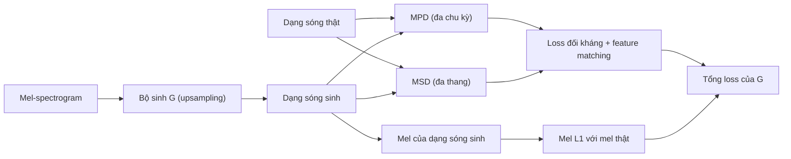

# Chương 9. Mạng đối sinh (GAN)

!!! abstract "Mục tiêu học tập"
    Sau chương này, bạn có thể:

    - **Giải thích** vì sao học một bộ phân biệt làm "thước đo" giúp tránh hiện tượng trung bình hóa của hồi quy L1/L2.
    - **Suy ra** bộ phân biệt tối ưu $D^\ast = p_{\text{data}} / (p_{\text{data}} + p_g)$ và chứng minh trò chơi minimax tương đương cực tiểu hóa phân kỳ Jensen–Shannon.
    - **Phân tích** hiện tượng bão hòa gradient và lý do dùng mục tiêu không bão hòa; giải thích sụp mode và tính không hội tụ của động lực học trò chơi.
    - **So sánh** các biến thể hàm mất mát: GAN gốc, LSGAN, hinge, WGAN/WGAN-GP; suy ra bộ phân biệt tối ưu của LSGAN.
    - **Cài đặt** các kỹ thuật ổn định hóa: chuẩn hóa phổ, phạt gradient R1, cập nhật hai thang thời gian, feature matching.
    - **Thiết kế** GAN có điều kiện theo công thức "loss tái tạo + loss đối kháng" và giải thích vì sao vocoder GAN cần bộ phân biệt đa thang/đa chu kỳ và loss phổ phụ trợ.

!!! info "Kiến thức cần có"
    - [Chương 1](../phan-1-nen-tang/ch01-toan-nen-tang.md): phân kỳ KL, kỳ vọng, đổi biến trong kỳ vọng.
    - [Chương 3](../phan-1-nen-tang/ch03-toi-uu-va-ky-thuat-huan-luyen.md): Adam, weight normalization, spectral normalization.
    - [Chương 4](../phan-1-nen-tang/ch04-cnn-rnn-mo-hinh-chuoi.md): Conv1d, tích chập chuyển vị.
    - [Chương 7](ch07-tong-quan-mo-hinh-sinh.md): bài toán một–nhiều, KL thuận và KL ngược, FID/FAD.
    - [Chương 8](ch08-vae.md): mô hình biến ẩn, vì sao decoder Gauss cho mẫu mờ.

[Chương 7](ch07-tong-quan-mo-hinh-sinh.md) chỉ ra rằng mọi hàm mất mát dạng "khoảng cách tới mục tiêu" đều bị kéo về trung bình khi bài toán là một–nhiều. [Chương 8](ch08-vae.md) đưa vào biến ẩn để giảm bất định, nhưng decoder Gauss vẫn hồi quy trung bình nên mẫu còn mờ. Mạng đối sinh (*generative adversarial network*, GAN) của Goodfellow và cộng sự (2014) tấn công vấn đề từ một hướng khác hẳn: **thay vì chọn sẵn một hàm mất mát, hãy học nó**. Một mạng thứ hai, bộ phân biệt, được huấn luyện để phân biệt mẫu thật với mẫu giả; bộ sinh được huấn luyện để đánh lừa nó. Câu hỏi mà bộ sinh phải trả lời không còn là "mẫu của tôi có gần đáp án không?" mà là "mẫu của tôi có giống thật không?". Một phổ bị nhòe, một dạng sóng gần như im lặng do trung bình hóa pha, đều trông rất "giả" dưới con mắt của một bộ phân biệt tốt.

Trong TTS, GAN là xương sống của gần như mọi vocoder nhanh hiện đại (MelGAN, Parallel WaveGAN, HiFi-GAN, BigVGAN, Vocos) và là một thành phần của nhiều hệ thống end-to-end (VITS, StyleTTS 2). Chương này xây dựng nền tảng lý thuyết và kỹ thuật; kiến trúc vocoder cụ thể được trình bày ở [Chương 25](../phan-6-vocoder/ch25-gan-vocoder.md).

## 9.1. Ý tưởng: học một thước đo thay vì chọn sẵn

### 9.1.1. Bộ sinh ngầm định

GAN định nghĩa phân phối mô hình **một cách ngầm định** qua một quy trình lấy mẫu: rút nhiễu $\mathbf{z} \sim p(\mathbf{z})$ (thường là Gauss chuẩn hoặc phân phối đều), rồi đưa qua **bộ sinh** (*generator*) $G_\theta$:

$$
\mathbf{x} = G_\theta(\mathbf{z}), \qquad \mathbf{z} \sim p(\mathbf{z}).
$$

Phân phối của $\mathbf{x}$ thu được, ký hiệu $p_g$, là "đẩy tiến" (*pushforward*) của $p(\mathbf{z})$ qua $G_\theta$. Ta không có công thức cho $p_g(\mathbf{x})$: nếu $G_\theta$ không khả nghịch hoặc $\mathbf{z}$ ít chiều hơn $\mathbf{x}$, mật độ này thậm chí không tồn tại theo nghĩa thông thường. Đổi lại, lấy mẫu chỉ tốn **một lượt truyền xuôi**, nhanh hơn rất nhiều so với mô hình tự hồi quy hay khuếch tán.

### 9.1.2. Bộ phân biệt như một hàm mất mát được học

Vì không có $p_g(\mathbf{x})$, ta không thể dùng hợp lý cực đại. GAN thay vào đó dùng một **bộ phân biệt** (*discriminator*) $D_\psi$, một mạng nhận $\mathbf{x}$ và xuất ra điểm số "mức độ thật". Hai mạng chơi một trò chơi: $D$ cố phân biệt, $G$ cố đánh lừa. Hình ảnh quen thuộc là kẻ làm tiền giả và cảnh sát: cảnh sát càng giỏi, kẻ làm giả càng phải tinh vi.

Hãy nghĩ về điều $D$ "nhìn thấy" trong bài toán một–nhiều. Giả sử dữ liệu có hai mode (ngắt hơi và không ngắt hơi). Một bộ sinh xuất ra trung bình của hai mode sẽ cho những mẫu nằm ở vùng không có dữ liệu thật, và $D$ dễ dàng nhận ra chúng là giả. Để đánh lừa $D$, bộ sinh buộc phải đặt mẫu **vào bên trong** các mode. Chính cơ chế này cho phép GAN sinh ra phổ sắc nét và dạng sóng có pha hợp lý. Trước khi trở thành vocoder, GAN đã được dùng trong tổng hợp tham số thống kê với đúng mục đích khắc phục hiện tượng trơn quá mức, ví dụ như một bộ hậu lọc (*postfilter*) cho đặc trưng phổ (Kaneko và cộng sự, 2017) hoặc như một loss phụ trợ cho mô hình âm học (Saito và cộng sự, 2018).

## 9.2. Trò chơi minimax

Trong công thức gốc, $D(\mathbf{x}) \in (0, 1)$ là xác suất $\mathbf{x}$ là thật (đầu ra sigmoid của một logit). Hàm giá trị của trò chơi là

$$
V(D, G) = \mathbb{E}_{\mathbf{x} \sim p_{\text{data}}}\big[\log D(\mathbf{x})\big] + \mathbb{E}_{\mathbf{z} \sim p(\mathbf{z})}\big[\log\big(1 - D(G(\mathbf{z}))\big)\big],
$$

và bài toán là

$$
\min_G \max_D V(D, G).
$$

Với $G$ cố định, $\max_D V$ chính là bài toán **phân loại nhị phân** bằng entropy chéo: nhãn 1 cho mẫu thật, nhãn 0 cho mẫu giả. $G$ thì muốn giảm $V$, tức làm cho $D(G(\mathbf{z}))$ lớn. Trong thực tế, hai mạng được cập nhật **luân phiên** bằng gradient ngẫu nhiên:

1. Lấy một minibatch dữ liệu thật và một minibatch nhiễu; sinh mẫu giả $G(\mathbf{z})$ và **ngắt gradient** về $G$.
2. Cập nhật $D$ theo hướng tăng $V$ (giảm loss phân loại).
3. Lấy minibatch nhiễu (có thể dùng lại), cập nhật $G$ theo hướng giảm loss của bộ sinh, với gradient đi xuyên qua $D$ (nhưng chỉ tham số của $G$ được cập nhật).

Bài báo gốc cho phép $k$ bước cập nhật $D$ cho mỗi bước $G$, nhưng chính các tác giả dùng $k = 1$; đó cũng là lựa chọn phổ biến nhất hiện nay.

## 9.3. Bộ phân biệt tối ưu và góc nhìn Jensen–Shannon

### 9.3.1. Bộ phân biệt tối ưu

Cố định $G$. Đổi biến trong kỳ vọng thứ hai: vì $\mathbf{x} = G(\mathbf{z})$ có phân phối $p_g$, ta có $\mathbb{E}_{\mathbf{z}}[f(G(\mathbf{z}))] = \mathbb{E}_{\mathbf{x} \sim p_g}[f(\mathbf{x})]$ với mọi hàm $f$. Do đó

$$
V(D, G) = \int \Big[ p_{\text{data}}(\mathbf{x}) \log D(\mathbf{x}) + p_g(\mathbf{x}) \log\big(1 - D(\mathbf{x})\big) \Big]\, d\mathbf{x}.
$$

(Ở đây ta giả định $p_g$ có mật độ; phân tích là một lý tưởng hóa.) Vì $D$ được chọn tự do tại từng điểm, ta cực đại hóa hàm dưới dấu tích phân **tại từng $\mathbf{x}$**. Với $a = p_{\text{data}}(\mathbf{x}) \ge 0$, $b = p_g(\mathbf{x}) \ge 0$ không đồng thời bằng 0, xét $h(y) = a \log y + b \log(1-y)$ trên $(0, 1)$:

$$
h'(y) = \frac{a}{y} - \frac{b}{1-y} = 0 \;\Longleftrightarrow\; y = \frac{a}{a + b}, \qquad h''(y) = -\frac{a}{y^2} - \frac{b}{(1-y)^2} < 0 .
$$

Vậy **bộ phân biệt tối ưu** là

$$
D^\ast_G(\mathbf{x}) = \frac{p_{\text{data}}(\mathbf{x})}{p_{\text{data}}(\mathbf{x}) + p_g(\mathbf{x})}.
$$

Ngoài hợp của hai giá (*support*), giá trị của $D$ không ảnh hưởng đến $V$ và có thể tùy ý. Một cách đọc hữu ích: logit của bộ phân biệt tối ưu là $\log D^\ast/(1 - D^\ast) = \log p_{\text{data}}(\mathbf{x}) - \log p_g(\mathbf{x})$. Bộ phân biệt đang **ước lượng tỉ số mật độ** giữa dữ liệu và mô hình, đúng thứ ta cần để so sánh hai phân phối mà không phải tính từng mật độ.

### 9.3.2. Trò chơi tối ưu hóa phân kỳ Jensen–Shannon

Thay $D^\ast$ vào $V$:

$$
C(G) := V(D^\ast_G, G) = \mathbb{E}_{p_{\text{data}}}\!\left[\log \frac{p_{\text{data}}}{p_{\text{data}} + p_g}\right] + \mathbb{E}_{p_g}\!\left[\log \frac{p_g}{p_{\text{data}} + p_g}\right].
$$

Đặt $m = \tfrac12(p_{\text{data}} + p_g)$, tức $p_{\text{data}} + p_g = 2m$. Mỗi số hạng tách thành một KL trừ $\log 2$:

$$
\mathbb{E}_{p_{\text{data}}}\!\left[\log \frac{p_{\text{data}}}{2m}\right] = D_{\mathrm{KL}}(p_{\text{data}} \,\Vert\, m) - \log 2,
\qquad
\mathbb{E}_{p_g}\!\left[\log \frac{p_g}{2m}\right] = D_{\mathrm{KL}}(p_g \,\Vert\, m) - \log 2 .
$$

Do đó

$$
C(G) = D_{\mathrm{KL}}(p_{\text{data}} \,\Vert\, m) + D_{\mathrm{KL}}(p_g \,\Vert\, m) - \log 4 = 2\, \mathrm{JSD}(p_{\text{data}} \,\Vert\, p_g) - \log 4,
$$

trong đó **phân kỳ Jensen–Shannon** được định nghĩa là $\mathrm{JSD}(p \Vert q) = \tfrac12 D_{\mathrm{KL}}(p \Vert m) + \tfrac12 D_{\mathrm{KL}}(q \Vert m)$ với $m = \tfrac12(p+q)$. JSD đối xứng, luôn nằm trong $[0, \log 2]$, và bằng 0 khi và chỉ khi $p = q$. Kết luận (Goodfellow và cộng sự, 2014): **nếu $D$ luôn tối ưu, cực tiểu hóa $V$ theo $G$ tương đương cực tiểu hóa JSD**, và cực tiểu toàn cục $C = -\log 4$ đạt được duy nhất khi $p_g = p_{\text{data}}$; khi đó $D^\ast \equiv \tfrac12$.

Đoạn mã sau kiểm chứng cả hai kết quả trên hai phân phối Gauss một chiều đã biết: huấn luyện một bộ phân biệt logistic (họ này chứa đúng $D^\ast$, vì log-tỉ số của hai Gauss là đa thức bậc hai), rồi so với công thức; sau đó tính $V(D^\ast, G)$ và $-\log 4 + 2\,\mathrm{JSD}$ bằng tích phân số.

```python
import math
import torch
import torch.nn.functional as Fn

torch.manual_seed(0)
# Hai phân phối 1-D đã biết: p_data = N(1, 0.5^2), p_g = N(-0.5, 1)
p_data = torch.distributions.Normal(1.0, 0.5)
p_g = torch.distributions.Normal(-0.5, 1.0)

# Bộ phân biệt: hồi quy logistic trên đặc trưng (1, x, x^2). Log-odds của hai Gauss
# là một đa thức bậc hai, nên họ này chứa đúng D* = p_data / (p_data + p_g).
w = torch.zeros(3, requires_grad=True)
feats = lambda x: torch.stack([torch.ones_like(x), x, x ** 2], dim=-1)   # (n, 3)
opt = torch.optim.Adam([w], lr=0.05)
sched = torch.optim.lr_scheduler.CosineAnnealingLR(opt, T_max=3000)
for _ in range(3000):
    xr, xf = p_data.sample((4096,)), p_g.sample((4096,))
    # Cực đại V(D, G) = E_data[log D] + E_g[log(1 - D)]  <=>  cực tiểu BCE với nhãn 1/0
    loss = -(Fn.logsigmoid(feats(xr) @ w).mean() + Fn.logsigmoid(-(feats(xf) @ w)).mean())
    opt.zero_grad(); loss.backward(); opt.step(); sched.step()

x = torch.linspace(-3, 3, 601)
log_pd, log_pg = p_data.log_prob(x), p_g.log_prob(x)
d_star = torch.sigmoid(log_pd - log_pg)                  # = p_data / (p_data + p_g)
with torch.no_grad():
    d_learned = torch.sigmoid(feats(x) @ w)
print(f"max |D_học - D*| trên [-3, 3]: {(d_learned - d_star).abs().max():.3f}")

# Kiểm tra V(D*, G) = -log 4 + 2 * JSD(p_data || p_g) bằng tích phân số (float64)
xx = torch.linspace(-8, 8, 20001, dtype=torch.float64); dx = xx[1] - xx[0]
pd = torch.exp(-0.5 * ((xx - 1.0) / 0.5) ** 2) / (0.5 * math.sqrt(2 * math.pi))
pg = torch.exp(-0.5 * (xx + 0.5) ** 2) / math.sqrt(2 * math.pi)
m = 0.5 * (pd + pg)
v_star = ((torch.xlogy(pd, pd / (pd + pg)) + torch.xlogy(pg, pg / (pd + pg))) * dx).sum()
jsd = 0.5 * (torch.xlogy(pd, pd / m) * dx).sum() + 0.5 * (torch.xlogy(pg, pg / m) * dx).sum()
print(f"V(D*, G) = {v_star:.4f}   -log 4 + 2 JSD = {-math.log(4) + 2 * jsd:.4f}   JSD = {jsd:.4f}")
assert abs(v_star - (-math.log(4) + 2 * jsd)) < 1e-6
assert (d_learned - d_star).abs().max() < 0.05
```

Bộ phân biệt học được khớp $D^\ast$ với sai số cỡ $10^{-3}$, và hai vế của đẳng thức JSD trùng nhau đến bốn chữ số thập phân.

### 9.3.3. Giới hạn của phân tích lý tưởng

Kết quả trên đẹp nhưng dựa trên ba giả định hiếm khi đúng:

1. **$D$ luôn tối ưu.** Thực tế $D$ chỉ được cập nhật vài bước gradient cho mỗi bước của $G$.
2. **Tối ưu trong không gian hàm.** Lập luận "$C(G)$ lồi theo $p_g$" nói về không gian phân phối; tối ưu theo tham số $\theta$ của một mạng nơ-ron là bài toán không lồi.
3. **Hai phân phối có mật độ chồng lấn.** Dữ liệu thật như tiếng nói nằm gần một đa tạp (*manifold*) ít chiều trong không gian rất nhiều chiều; mẫu của $G$ nằm trên ảnh của một không gian nhiễu ít chiều. Arjovsky và Bottou (2017) chỉ ra rằng trong tình huống này, hai giá thường gần như không giao nhau. Khi đó tồn tại một bộ phân biệt **hoàn hảo**, JSD đứng yên ở giá trị $\log 2$ bất kể $G$ ở gần hay xa dữ liệu, và gradient mang thông tin hữu ích về $G$ biến mất.

Ví dụ đơn giản nhất: $p_{\text{data}} = \delta_0$ (một khối lượng điểm tại 0) và $p_\theta = \delta_\theta$. Với mọi $\theta \ne 0$, $\mathrm{JSD} = \log 2$: hằng số, gradient bằng 0, không cho biết nên dịch $\theta$ về phía nào. Ta sẽ quay lại ví dụ này với khoảng cách Wasserstein ở mục 9.6.3.

## 9.4. Mục tiêu không bão hòa

Ngay cả khi bỏ qua vấn đề giá không giao nhau, mục tiêu minimax của $G$ có một khuyết điểm thực tế. Viết $D = \sigma(\ell)$ với $\ell$ là logit của bộ phân biệt tại một mẫu giả. Mục tiêu gốc của $G$ là **cực tiểu** $\log(1 - \sigma(\ell))$, có đạo hàm theo logit

$$
\frac{\partial}{\partial \ell} \log\big(1 - \sigma(\ell)\big) = -\sigma(\ell).
$$

Đầu quá trình huấn luyện, mẫu giả rất tệ và $D$ dễ dàng từ chối chúng: $\sigma(\ell) \approx 0$. Khi đó gradient cũng $\approx 0$: **bộ sinh không học được gì đúng vào lúc nó cần học nhất**. Đây là hiện tượng bão hòa (*saturation*).

Goodfellow và cộng sự (2014) đề xuất **mục tiêu không bão hòa** (*non-saturating*, NS): thay vì cực tiểu $\log(1 - D(G(\mathbf{z})))$, $G$ cực tiểu $-\log D(G(\mathbf{z}))$. Đạo hàm theo logit:

$$
\frac{\partial}{\partial \ell}\big[-\log \sigma(\ell)\big] = -\big(1 - \sigma(\ell)\big),
$$

gần $-1$ khi $\sigma(\ell) \approx 0$. Ví dụ với $D(G(\mathbf{z})) = 0.01$: độ lớn gradient theo logit là $0.01$ với mục tiêu gốc và $0.99$ với mục tiêu NS, gấp gần trăm lần. Hai mục tiêu có cùng điểm dừng (đều đẩy $D(G(\mathbf{z}))$ lên), nhưng động lực học khác hẳn. Trong cài đặt, mục tiêu NS chính là entropy chéo với nhãn "thật" cho mẫu giả, viết ổn định bằng `logsigmoid`.

Cái giá của mục tiêu NS là nó không còn tương ứng với JSD. Arjovsky và Bottou (2017) chỉ ra rằng khi $D = D^\ast$ được giữ cố định, kỳ vọng gradient của mục tiêu NS bằng gradient của $D_{\mathrm{KL}}(p_g \Vert p_{\text{data}}) - 2\,\mathrm{JSD}(p_{\text{data}} \Vert p_g)$. Thành phần $D_{\mathrm{KL}}(p_g \Vert p_{\text{data}})$ là **KL ngược**, loại phân kỳ "tìm mode" mà ta đã gặp ở [Chương 7](ch07-tong-quan-mo-hinh-sinh.md): nó phạt nặng mẫu nằm ngoài dữ liệu, nhưng phạt nhẹ việc bỏ sót mode. Điều này giải thích vì sao GAN thường cho **mẫu sắc nét nhưng có xu hướng mất đa dạng**, trái ngược với các mô hình huấn luyện bằng MLE (KL thuận).

## 9.5. Sụp mode và bất ổn định khi huấn luyện

### 9.5.1. Sụp mode

**Sụp mode** (*mode collapse*) là khi bộ sinh ánh xạ nhiều giá trị $\mathbf{z}$ khác nhau về cùng một hoặc vài mẫu, bỏ qua phần lớn các mode của dữ liệu. Một lý do đơn giản: với $D$ cố định, phản ứng tốt nhất của $G$ là đặt **toàn bộ** khối lượng xác suất vào điểm $\arg\max_{\mathbf{x}} D(\mathbf{x})$, tức một phân phối Dirac. Nếu $G$ cập nhật nhanh hơn $D$ "theo kịp", nó sẽ trượt về những điểm $D$ đang ưa thích; $D$ học cách từ chối những điểm đó; $G$ nhảy sang chỗ khác. Kết quả có thể là sụp hoàn toàn, sụp một phần, hoặc dao động giữa các mode (Goodfellow, 2016).

Ở mục 9.7.2 bạn sẽ thấy hiện tượng này xảy ra ngay trên một bài toán một chiều có hai mode. Các biện pháp đã được đề xuất gồm: cho $D$ nhìn thống kê của cả minibatch (*minibatch discrimination*, Salimans và cộng sự, 2016) hoặc nhìn nhiều mẫu cùng lúc (PacGAN, Lin và cộng sự, 2018); "trải" vài bước tối ưu của $D$ khi tính gradient cho $G$ (Metz và cộng sự, 2017); và các phép điều chuẩn bộ phân biệt như phạt gradient (mục 9.7). Trong vocoder GAN có điều kiện, sụp mode ít nghiêm trọng hơn vì mel-spectrogram điều kiện đã quyết định gần hết đầu ra (mục 9.8).

### 9.5.2. Trò chơi không hội tụ

Huấn luyện GAN là tìm **điểm cân bằng** của một trò chơi, không phải cực tiểu của một hàm. Gradient descent làm việc tốt với bài toán cực tiểu, nhưng có thể thất bại với trò chơi ngay cả trong trường hợp đơn giản nhất. Xét trò chơi song tuyến tính $\min_x \max_y f(x, y) = xy$, có cân bằng duy nhất tại $(0, 0)$:

```python
import numpy as np

# Trò chơi song tuyến tính min_x max_y f(x, y) = x * y; cân bằng Nash duy nhất tại (0, 0)
eta, steps = 0.1, 200
x, y = 1.0, 1.0
for _ in range(steps):                       # cập nhật ĐỒNG THỜI
    x, y = x - eta * y, y + eta * x          # x giảm theo df/dx = y, y tăng theo df/dy = x
r_sim = np.hypot(x, y)

x, y = 1.0, 1.0
for _ in range(steps):                       # cập nhật LUÂN PHIÊN (y dùng x mới)
    x = x - eta * y
    y = y + eta * x
r_alt = np.hypot(x, y)

print(f"bán kính ban đầu: {np.hypot(1, 1):.3f}")
print(f"đồng thời : {r_sim:.3f}  (lý thuyết: {np.hypot(1, 1) * (1 + eta**2) ** (steps / 2):.3f})")
print(f"luân phiên: {r_alt:.3f}  (bị chặn, quay vòng quanh cân bằng)")
assert r_sim > 2 * np.hypot(1, 1) and r_alt < 2 * np.hypot(1, 1)
```

Với cập nhật đồng thời, mỗi bước nhân véc-tơ $(x, y)$ với ma trận $\begin{pmatrix} 1 & -\eta \\ \eta & 1 \end{pmatrix}$ có trị riêng $1 \pm i\eta$, mô-đun $\sqrt{1 + \eta^2} > 1$: quỹ đạo **xoắn ốc ra xa** cân bằng. Với cập nhật luân phiên, quỹ đạo bị chặn nhưng **quay vòng mãi** quanh cân bằng mà không hội tụ (Bài tập 6). Phân tích của Mescheder và cộng sự (2018) trên một GAN tối giản ("Dirac-GAN") cho thấy đúng hành vi này xuất hiện ở GAN thực, và các phép điều chuẩn như phạt gradient làm hệ hội tụ cục bộ.

Hệ quả thực tế: **đường cong loss của GAN không phải là thước đo tiến độ**. Loss của $D$ và $G$ dao động, có thể đi lên trong khi chất lượng mẫu đi lên. Hãy theo dõi chất lượng bằng mẫu (nghe thử, FAD, các loss phụ trợ như mel L1 ở vocoder) thay vì nhìn loss đối kháng.

### 9.5.3. Cân bằng giữa hai người chơi

Nếu $D$ quá mạnh so với $G$, nó phân biệt hoàn hảo và gradient cho $G$ trở nên vô dụng (đặc biệt với mục tiêu minimax gốc). Nếu $D$ quá yếu, nó không cung cấp tín hiệu gì có ích. Phần lớn các kỹ thuật ở mục 9.6 và 9.7 có thể hiểu là những cách giữ cho $D$ **mượt** và **có thông tin** ở mọi nơi, kể cả xa dữ liệu thật.

## 9.6. Các biến thể hàm mất mát

### 9.6.1. LSGAN

Mao và cộng sự (2017) thay entropy chéo bằng **bình phương sai số**: $D$ xuất ra một số thực (không sigmoid), được hồi quy về nhãn $b$ cho mẫu thật và $a$ cho mẫu giả, còn $G$ muốn $D$ cho mẫu giả giá trị $c$:

$$
\min_D \tfrac12 \mathbb{E}_{p_{\text{data}}}\big[(D(\mathbf{x}) - b)^2\big] + \tfrac12 \mathbb{E}_{p_g}\big[(D(\mathbf{x}) - a)^2\big],
\qquad
\min_G \tfrac12 \mathbb{E}_{p_g}\big[(D(\mathbf{x}) - c)^2\big].
$$

**Bộ phân biệt tối ưu.** Cực tiểu tại từng điểm $p_{\text{data}}(y - b)^2 + p_g(y - a)^2$ theo $y$ cho

$$
D^\ast(\mathbf{x}) = \frac{b\, p_{\text{data}}(\mathbf{x}) + a\, p_g(\mathbf{x})}{p_{\text{data}}(\mathbf{x}) + p_g(\mathbf{x})}.
$$

**Phân kỳ được tối ưu.** Theo Mao và cộng sự (2017), thêm vào mục tiêu của $G$ số hạng $\tfrac12 \mathbb{E}_{p_{\text{data}}}[(D(\mathbf{x}) - c)^2]$; khi $D$ được giữ cố định trong bước cập nhật $G$, số hạng này không chứa tham số của $G$ nên không làm thay đổi gradient của $G$. Thay $D^\ast$ vào:

$$
2C(G) = \int \frac{\big( (b - c)\, p_{\text{data}} + (a - c)\, p_g \big)^2}{p_{\text{data}} + p_g}\, d\mathbf{x}.
$$

Nếu chọn $b - c = 1$ và $b - a = 2$ (ví dụ $a = -1, b = 1, c = 0$) thì $a - c = -1$ và tử số là $(p_{\text{data}} - p_g)^2 = \big(2p_g - (p_{\text{data}} + p_g)\big)^2$, nên

$$
2C(G) = \int \frac{\big(2p_g(\mathbf{x}) - (p_{\text{data}}(\mathbf{x}) + p_g(\mathbf{x}))\big)^2}{p_{\text{data}}(\mathbf{x}) + p_g(\mathbf{x})}\, d\mathbf{x},
$$

là phân kỳ **Pearson $\chi^2$** giữa $p_{\text{data}} + p_g$ và $2p_g$. Phân kỳ này bằng 0 khi và chỉ khi $p_g = p_{\text{data}}$. Trong thực hành, cách mã hóa phổ biến hơn là $a = 0$, $b = 1$, $c = 1$ (không thỏa điều kiện trên nhưng hoạt động tốt); HiFi-GAN dùng đúng cách mã hóa này (Kong và cộng sự, 2020).

Vì sao LSGAN ổn định hơn GAN gốc? Hàm sigmoid kết hợp log bão hòa với những mẫu bị phân loại đúng một cách "tự tin", kể cả khi chúng nằm rất xa dữ liệu thật. Hàm bình phương thì không: một mẫu giả có $D(\mathbf{x})$ ở xa $c$ vẫn nhận gradient tỉ lệ với khoảng cách, nên được kéo về phía ranh giới quyết định và về phía dữ liệu.

### 9.6.2. Hinge loss

Mất mát hinge (Lim và Ye, 2017) dùng một lề (*margin*):

$$
\mathcal{L}_D = \mathbb{E}_{p_{\text{data}}}\big[\max(0, 1 - D(\mathbf{x}))\big] + \mathbb{E}_{p_g}\big[\max(0, 1 + D(\mathbf{x}))\big],
\qquad
\mathcal{L}_G = -\mathbb{E}_{p_g}\big[D(\mathbf{x})\big].
$$

$D$ ngừng bị phạt khi mẫu thật có điểm vượt 1 và mẫu giả có điểm dưới $-1$, nên nó không bị thúc đẩy đến mức tự tin cực đoan. Hinge loss được dùng rộng rãi trong GAN ảnh quy mô lớn (Brock và cộng sự, 2019) và trong MelGAN (Kumar và cộng sự, 2019).

### 9.6.3. WGAN và WGAN-GP

Arjovsky, Chintala và Bottou (2017) đề xuất thay JSD bằng **khoảng cách Wasserstein-1** (khoảng cách "di chuyển đất", *earth mover's distance*):

$$
W(p, q) = \inf_{\gamma \in \Pi(p, q)} \mathbb{E}_{(\mathbf{x}, \mathbf{y}) \sim \gamma}\big[\lVert \mathbf{x} - \mathbf{y} \rVert\big],
$$

trong đó $\Pi(p, q)$ là tập mọi phân phối đồng thời có biên là $p$ và $q$: chi phí nhỏ nhất để "vận chuyển" khối lượng xác suất từ $p$ sang $q$. Quay lại ví dụ $\delta_0$ và $\delta_\theta$: $W = \lvert\theta\rvert$, có gradient $\operatorname{sign}(\theta)$ ở mọi nơi, luôn chỉ đúng hướng, trong khi JSD đứng yên ở $\log 2$. Khoảng cách Wasserstein phản ánh "xa bao nhiêu" ngay cả khi hai giá không giao nhau.

Tính trực tiếp infimum trên là bất khả thi, nhưng **đối ngẫu Kantorovich–Rubinstein** (Villani, 2008) cho

$$
W(p_{\text{data}}, p_g) = \sup_{\lVert f \rVert_L \le 1} \mathbb{E}_{p_{\text{data}}}[f(\mathbf{x})] - \mathbb{E}_{p_g}[f(\mathbf{x})],
$$

với supremum trên mọi hàm 1-Lipschitz. Bộ phân biệt, nay gọi là **critic**, đóng vai $f$ (không có sigmoid) và cực đại $\mathbb{E}_{p_{\text{data}}}[D] - \mathbb{E}_{p_g}[D]$; bộ sinh cực tiểu $-\mathbb{E}_{p_g}[D]$. Cái khó là ràng buộc Lipschitz. Bài báo gốc **cắt trọng số** (*weight clipping*) vào một khoảng nhỏ, một cách thô và dễ làm critic quá đơn giản. **WGAN-GP** (Gulrajani và cộng sự, 2017) thay bằng một phạt mềm: chuẩn gradient của một critic 1-Lipschitz tối ưu bằng 1 hầu khắp nơi trên các đoạn nối mẫu thật và mẫu giả, nên ta phạt

$$
\lambda\, \mathbb{E}_{\hat{\mathbf{x}}}\Big[ \big( \lVert \nabla_{\hat{\mathbf{x}}} D(\hat{\mathbf{x}}) \rVert_2 - 1 \big)^2 \Big], \qquad \hat{\mathbf{x}} = \epsilon\, \mathbf{x}_{\text{thật}} + (1 - \epsilon)\, \mathbf{x}_{\text{giả}},\; \epsilon \sim \mathcal{U}[0, 1],
$$

với $\lambda = 10$ theo bài báo gốc. Lưu ý: giá trị loss của critic chỉ là ước lượng của $W$ khi critic gần tối ưu; và phạt gradient đòi hỏi lan truyền ngược hai lần, tốn thêm tính toán.

**Góc nhìn tổng quát.** Nowozin và cộng sự (2016) chỉ ra rằng có thể xây dựng GAN cho **bất kỳ $f$-phân kỳ nào** qua biểu diễn biến phân của nó (f-GAN); GAN gốc, KL, KL ngược, Pearson $\chi^2$ đều là trường hợp riêng. WGAN thì thuộc một họ khác (khoảng cách vận chuyển tối ưu). Không có phân kỳ nào "đúng nhất"; trong thực tế, độ ổn định của động lực học quan trọng hơn lựa chọn phân kỳ.

### 9.6.4. Bảng tổng kết và mã cài đặt

Ký hiệu $\ell_r = D(\mathbf{x}_{\text{thật}})$, $\ell_f = D(G(\mathbf{z}))$ là điểm số thô (logit) của bộ phân biệt.

| Biến thể | Loss của $D$ | Loss của $G$ | Dùng trong TTS |
|---|---|---|---|
| GAN gốc (NS) | $-\log\sigma(\ell_r) - \log(1 - \sigma(\ell_f))$ | $-\log\sigma(\ell_f)$ | Công thức nền tảng, dùng trong nhiều nghiên cứu |
| LSGAN (0/1/1) | $(\ell_r - 1)^2 + \ell_f^2$ | $(\ell_f - 1)^2$ | Parallel WaveGAN, HiFi-GAN, VITS |
| Hinge | $\max(0, 1 - \ell_r) + \max(0, 1 + \ell_f)$ | $-\ell_f$ | MelGAN |
| WGAN-GP | $\ell_f - \ell_r + \lambda\,\text{GP}$ | $-\ell_f$ | Ít dùng cho vocoder |

Đoạn mã dưới đây gom các hàm mất mát, hai phép phạt gradient, loss feature matching (mục 9.7.4) và minh họa chuẩn hóa phổ (mục 9.7.1) vào một chỗ, kèm kiểm thử: với một bộ phân biệt tuyến tính $D(\mathbf{x}) = \mathbf{w}^\top\mathbf{x} + b$, gradient theo $\mathbf{x}$ là $\mathbf{w}$, nên giá trị của hai phép phạt biết trước.

```python
import torch
import torch.nn as nn
import torch.nn.functional as Fn

# ---- Các cặp hàm mất mát (D, G); đầu vào là điểm số thô (logit) của bộ phân biệt ----
def d_loss_fn(kind, d_real, d_fake):
    if kind == "ns":        # GAN gốc: BCE, ổn định số học nhờ logsigmoid
        return -(Fn.logsigmoid(d_real).mean() + Fn.logsigmoid(-d_fake).mean())
    if kind == "lsgan":     # a = 0 (giả), b = 1 (thật)
        return ((d_real - 1) ** 2).mean() + (d_fake ** 2).mean()
    if kind == "hinge":
        return Fn.relu(1 - d_real).mean() + Fn.relu(1 + d_fake).mean()
    if kind == "wgan":      # critic: cực đại E[D(x)] - E[D(G(z))]
        return d_fake.mean() - d_real.mean()
    raise ValueError(kind)

def g_loss_fn(kind, d_fake):
    if kind == "ns":        # không bão hòa: -log D(G(z))
        return -Fn.logsigmoid(d_fake).mean()
    if kind == "lsgan":     # c = 1
        return ((d_fake - 1) ** 2).mean()
    if kind in ("hinge", "wgan"):
        return -d_fake.mean()
    raise ValueError(kind)

def r1_penalty(D, x_real, gamma=10.0):
    """R1 (Mescheder và cộng sự, 2018): (gamma/2) E ||grad_x D(x)||^2 trên dữ liệu thật."""
    x_real = x_real.detach().requires_grad_(True)
    grad, = torch.autograd.grad(D(x_real).sum(), x_real, create_graph=True)
    return 0.5 * gamma * grad.flatten(1).pow(2).sum(1).mean()

def gradient_penalty(D, x_real, x_fake, lam=10.0):
    """WGAN-GP (Gulrajani và cộng sự, 2017): lam * E (||grad D(x_hat)|| - 1)^2, x_hat nội suy."""
    eps = torch.rand(x_real.shape[0], *([1] * (x_real.dim() - 1)))
    x_hat = (eps * x_real + (1 - eps) * x_fake.detach()).requires_grad_(True)
    grad, = torch.autograd.grad(D(x_hat).sum(), x_hat, create_graph=True)
    return lam * (grad.flatten(1).norm(dim=1) - 1).pow(2).mean()

def feature_matching_loss(feats_real, feats_fake):
    """Feature matching kiểu MelGAN/HiFi-GAN: L1 giữa feature map thật và giả theo từng lớp của D."""
    return sum(Fn.l1_loss(f_fake, f_real.detach()) for f_real, f_fake in zip(feats_real, feats_fake))

# ---- Kiểm thử nhanh ----
torch.manual_seed(0)
d_real, d_fake = torch.randn(8, 1) + 1, torch.randn(8, 1) - 1    # D đang khá "tự tin"
for kind in ("ns", "lsgan", "hinge", "wgan"):
    print(f"{kind:6s} L_D={d_loss_fn(kind, d_real, d_fake).item():+.3f}"
          f"  L_G={g_loss_fn(kind, d_fake).item():+.3f}")

lin = nn.Linear(4, 1)                                    # D tuyến tính: grad_x D = w, ||w|| biết trước
x_r, x_f = torch.randn(16, 4), torch.randn(16, 4)
w_norm2 = lin.weight.pow(2).sum()
assert torch.allclose(r1_penalty(lin, x_r, gamma=2.0), w_norm2, atol=1e-6)
assert torch.allclose(gradient_penalty(lin, x_r, x_f, lam=1.0), (w_norm2.sqrt() - 1) ** 2, atol=1e-6)

# Feature matching: lấy feature map trung gian của một D tích chập nhỏ, bố cục (B, C, L)
convs = nn.ModuleList([nn.Conv1d(1, 8, 15, padding=7), nn.Conv1d(8, 8, 15, stride=4, padding=7)])
def d_with_feats(wav):                                   # wav: (B, 1, L)
    feats, h = [], wav
    for conv in convs:
        h = Fn.leaky_relu(conv(h), 0.1)
        feats.append(h)                                  # (B, 8, L), (B, 8, L/4)
    return feats
wav_real, wav_fake = torch.randn(2, 1, 256), torch.randn(2, 1, 256, requires_grad=True)
fm = feature_matching_loss(d_with_feats(wav_real), d_with_feats(wav_fake))
fm.backward()
assert wav_fake.grad is not None and fm.item() > 0
print(f"feature matching = {fm.item():.4f}")

# Chuẩn hóa phổ: sau vài lượt power iteration, chuẩn phổ của trọng số hiệu dụng xấp xỉ 1
sn = nn.utils.parametrizations.spectral_norm(nn.Linear(64, 64))
for _ in range(20):
    sn(torch.randn(1, 64))                               # mỗi lần forward ở chế độ train cập nhật u, v
print(f"chuẩn phổ của W/sigma(W): {torch.linalg.matrix_norm(sn.weight.detach(), ord=2):.3f}")
```

## 9.7. Các kỹ thuật ổn định hóa

### 9.7.1. Chuẩn hóa phổ

Ý tưởng chung của WGAN, phạt gradient và nhiều kỹ thuật khác là **giữ cho bộ phân biệt mượt**: một bộ phân biệt thay đổi quá đột ngột cho gradient vô nghĩa hoặc bùng nổ. Một cách đo độ mượt là hằng số Lipschitz. Với một mạng là hợp của các lớp tuyến tính và các hàm kích hoạt 1-Lipschitz (ReLU, LeakyReLU), hằng số Lipschitz của cả mạng bị chặn trên bởi **tích** các chuẩn phổ $\sigma(\mathbf{W}_l)$, tức giá trị kỳ dị lớn nhất của từng ma trận trọng số. **Chuẩn hóa phổ** (*spectral normalization*, SN; Miyato và cộng sự, 2018) chia mỗi ma trận cho chuẩn phổ của nó:

$$
\bar{\mathbf{W}} = \mathbf{W} / \sigma(\mathbf{W}),
$$

để mỗi lớp có hằng số Lipschitz không quá 1. Tính chính xác $\sigma(\mathbf{W})$ bằng SVD ở mỗi bước là quá đắt, nên SN dùng **phép lặp lũy thừa** (*power iteration*): giữ hai véc-tơ $\mathbf{u}, \mathbf{v}$ qua các bước huấn luyện, mỗi bước cập nhật $\mathbf{v} \leftarrow \mathbf{W}^\top\mathbf{u} / \lVert \mathbf{W}^\top\mathbf{u} \rVert$, $\mathbf{u} \leftarrow \mathbf{W}\mathbf{v} / \lVert \mathbf{W}\mathbf{v} \rVert$, rồi ước lượng $\sigma(\mathbf{W}) \approx \mathbf{u}^\top\mathbf{W}\mathbf{v}$. Vì $\mathbf{W}$ thay đổi chậm giữa các bước, một lần lặp mỗi bước là đủ. Trong PyTorch, dùng `torch.nn.utils.parametrizations.spectral_norm`, như ở cuối đoạn mã mục 9.6.4.

Hai lưu ý thực tế. Với lớp tích chập, PyTorch áp SN lên kernel được "duỗi" thành ma trận kích thước $C_{\text{out}} \times (C_{\text{in}} \cdot k)$; đại lượng này không đúng bằng chuẩn của toán tử tích chập, nên SN ở đây là một xấp xỉ hữu ích chứ không phải bảo đảm chặt. Và các véc-tơ $\mathbf{u}$ được lưu như buffer trong `state_dict`, nên checkpoint phải lưu cả chúng. Trong vocoder, SN và weight normalization ([Chương 3](../phan-1-nen-tang/ch03-toi-uu-va-ky-thuat-huan-luyen.md)) thường được dùng thay cho BatchNorm trong bộ phân biệt; HiFi-GAN, theo báo cáo gốc, dùng SN cho bộ phân biệt con đầu tiên của bộ phân biệt đa thang và weight normalization cho các bộ còn lại ([Chương 25](../phan-6-vocoder/ch25-gan-vocoder.md)).

### 9.7.2. Phạt gradient R1

Mescheder và cộng sự (2018) đề xuất phạt chuẩn gradient của bộ phân biệt **chỉ trên dữ liệu thật**:

$$
R_1(\psi) = \frac{\gamma}{2}\, \mathbb{E}_{\mathbf{x} \sim p_{\text{data}}}\Big[ \big\lVert \nabla_{\mathbf{x}} D_\psi(\mathbf{x}) \big\rVert_2^2 \Big].
$$

Trực giác: tại điểm cân bằng $p_g = p_{\text{data}}$, ta muốn bộ phân biệt **phẳng** trên dữ liệu, để không có gradient nào đẩy bộ sinh ra khỏi dữ liệu thật. Không có điều chuẩn, bộ phân biệt có thể duy trì độ dốc lớn quanh dữ liệu và làm hệ dao động mãi như trò chơi song tuyến tính ở mục 9.5.2; các tác giả chứng minh rằng với R1 (và biến thể R2 trên dữ liệu giả), động lực học trở nên hội tụ cục bộ. R1 được dùng rộng rãi trong các GAN ảnh hiện đại; StyleGAN2 chỉ tính nó mỗi vài bước (*lazy regularization*) để giảm chi phí lan truyền ngược hai lần (Karras và cộng sự, 2020).

Thí nghiệm sau huấn luyện một LSGAN trên dữ liệu một chiều có hai mode tại $\pm 2$, so sánh không phạt và phạt R1 với $\gamma = 2$:

```python
import torch
import torch.nn as nn

def sample_real(n):
    """Dữ liệu thật: hỗn hợp hai mode tại -2 và +2, độ lệch chuẩn 0.25."""
    sign = torch.where(torch.rand(n, 1) < 0.5, -1.0, 1.0)
    return 2.0 * sign + 0.25 * torch.randn(n, 1)                      # (n, 1)

def mlp(d_in, d_out):
    return nn.Sequential(nn.Linear(d_in, 64), nn.LeakyReLU(0.2),
                         nn.Linear(64, 64), nn.LeakyReLU(0.2), nn.Linear(64, d_out))

def train_lsgan(r1_gamma=0.0, steps=2000, seed=0):
    torch.manual_seed(seed)
    G, D = mlp(4, 1), mlp(1, 1)                       # G: z (4 chiều) -> x; D: x -> điểm số (không sigmoid)
    opt_g = torch.optim.Adam(G.parameters(), lr=1e-3, betas=(0.5, 0.9))
    opt_d = torch.optim.Adam(D.parameters(), lr=1e-3, betas=(0.5, 0.9))
    for _ in range(steps):
        x_real = sample_real(256).requires_grad_(r1_gamma > 0)
        x_fake = G(torch.randn(256, 4))
        # --- Bước D: LSGAN, nhãn thật = 1, giả = 0 (quy ước của HiFi-GAN) ---
        d_real = D(x_real)
        d_loss = ((d_real - 1) ** 2).mean() + (D(x_fake.detach()) ** 2).mean()
        if r1_gamma > 0:                              # phạt R1: (gamma/2) * E ||grad_x D(x_real)||^2
            grad, = torch.autograd.grad(d_real.sum(), x_real, create_graph=True)
            d_loss = d_loss + 0.5 * r1_gamma * grad.pow(2).sum(dim=1).mean()
        opt_d.zero_grad(); d_loss.backward(); opt_d.step()
        # --- Bước G: muốn D(G(z)) tiến về 1 ---
        g_loss = ((D(x_fake) - 1) ** 2).mean()
        opt_g.zero_grad(); g_loss.backward(); opt_g.step()
    with torch.no_grad():
        x = G(torch.randn(10_000, 4)).squeeze(1)
    return {"mode -2": ((x + 2).abs() < 0.75).float().mean().item(),
            "mode +2": ((x - 2).abs() < 0.75).float().mean().item(),
            "vùng giữa": (x.abs() < 1.0).float().mean().item()}

for gamma in (0.0, 2.0):
    stats = train_lsgan(r1_gamma=gamma)
    print(f"R1 gamma={gamma}: " + "  ".join(f"{k}={v:.3f}" for k, v in stats.items()))
```

Với hạt giống 0, LSGAN không phạt **sụp mode** hoàn toàn: gần 100% mẫu nằm ở mode $-2$, mode $+2$ bị bỏ quên. Có R1, mẫu chia đều cho hai mode. Đây không phải may rủi của một hạt giống: khi người biên soạn lặp lại với 8 hạt giống, bản không phạt sụp mode ở 7/8 lần, bản có R1 phủ cả hai mode ở cả 8 lần. (Cũng trong thử nghiệm đó, chỉ đổi sang tốc độ học kiểu TTUR ở mục 9.7.3 không đủ để tránh sụp mode, còn cho bộ phân biệt nhìn từng cặp mẫu theo kiểu PacGAN thì có tác dụng.) Con số cụ thể có thể khác trên máy của bạn, nhưng xu hướng thì rõ ràng.

Chú ý cột "vùng giữa": bản có R1 vẫn đặt vài phần trăm mẫu vào khoảng $(-1, 1)$, nơi dữ liệu thật gần như không có. Lý do mang tính tô-pô: $G$ là một hàm liên tục từ không gian nhiễu **liên thông** sang trục số, nên ảnh của nó cũng liên thông và không thể tách làm hai mảnh rời nhau; một ít khối lượng xác suất buộc phải "bắc cầu" qua khoảng trống. Với dữ liệu thật có nhiều cụm tách biệt, đây là một giới hạn cố hữu của bộ sinh liên tục.

### 9.7.3. Cập nhật hai thang thời gian (TTUR)

Heusel và cộng sự (2017) chứng minh, dưới một số giả định, rằng huấn luyện GAN hội tụ về một cân bằng Nash cục bộ nếu $D$ và $G$ dùng **tốc độ học khác nhau** sao cho $D$ "theo kịp" $G$ (cập nhật hai thang thời gian, TTUR). Cùng bài báo đó giới thiệu thước đo FID ([Chương 7](ch07-tong-quan-mo-hinh-sinh.md)). Trong thực hành, nhiều GAN ảnh đặt tốc độ học của $D$ lớn hơn của $G$ (ví dụ SAGAN, theo báo cáo gốc, dùng $4 \times 10^{-4}$ cho $D$ và $10^{-4}$ cho $G$; Zhang và cộng sự, 2019). Như thí nghiệm ở mục trên gợi ý, TTUR một mình không phải thuốc chữa bách bệnh; nó thường được kết hợp với các điều chuẩn khác.

### 9.7.4. Feature matching

Salimans và cộng sự (2016) đề xuất cho $G$ một mục tiêu phụ: khớp **thống kê** của các đặc trưng trung gian $\mathbf{f}(\cdot)$ của bộ phân biệt giữa dữ liệu thật và dữ liệu giả, $\lVert \mathbb{E}_{p_{\text{data}}}\mathbf{f}(\mathbf{x}) - \mathbb{E}_{\mathbf{z}}\mathbf{f}(G(\mathbf{z})) \rVert_2^2$. Thay vì "đánh lừa $D$ ở đầu ra", $G$ được yêu cầu tạo ra mẫu có biểu diễn bên trong $D$ giống dữ liệu thật.

Các vocoder GAN dùng một **biến thể có cặp**: vì mỗi mel-spectrogram có đúng một dạng sóng thật tương ứng, ta so sánh feature map của dạng sóng thật $\mathbf{s}$ và dạng sóng sinh $G(\mathbf{m})$ (với $\mathbf{m}$ là mel điều kiện) **theo từng lớp**, bằng khoảng cách L1:

$$
\mathcal{L}_{\text{FM}}(G; D) = \mathbb{E}\Big[ \sum_{i=1}^{L_D} \frac{1}{N_i} \big\lVert D^{(i)}(\mathbf{s}) - D^{(i)}(G(\mathbf{m})) \big\rVert_1 \Big],
$$

trong đó $D^{(i)}$ là feature map ở lớp thứ $i$ của bộ phân biệt và $N_i$ là số phần tử của nó (Kumar và cộng sự, 2019; Kong và cộng sự, 2020). Loss này hoạt động như một **khoảng cách cảm nhận được học**: bộ phân biệt học ra những đặc trưng phân biệt thật–giả, và bộ sinh được yêu cầu khớp chính những đặc trưng đó. Nó cung cấp gradient dày đặc và ổn định hơn loss đối kháng thuần. Hàm `feature_matching_loss` ở mục 9.6.4 cài đặt đúng công thức này; lưu ý feature map của mẫu thật được `detach()` vì loss chỉ dùng để cập nhật $G$. Ý tưởng dùng đặc trưng của bộ phân biệt làm thước đo tương đồng cũng xuất hiện sớm trong VAE-GAN (Larsen và cộng sự, 2016).

### 9.7.5. Các mẹo khác

- **Adam với $\beta_1$ nhỏ**: $\beta_1 = 0.9$ mặc định có thể làm dao động mạnh hơn trong trò chơi; các lựa chọn như $0.5$ (DCGAN; Radford và cộng sự, 2016) hoặc $0.8$ (HiFi-GAN, theo báo cáo gốc) phổ biến hơn.
- **Không dùng BatchNorm trong bộ phân biệt** khi mẫu thật và mẫu giả được đưa vào thành các batch riêng: thống kê batch "tố cáo" batch đó là thật hay giả. Ưu tiên SN, weight normalization hoặc không chuẩn hóa.
- **EMA của trọng số bộ sinh** ([Chương 3](../phan-1-nen-tang/ch03-toi-uu-va-ky-thuat-huan-luyen.md)) thường cho mẫu ổn định hơn so với trọng số tại bước cuối, vì nó làm trơn dao động của trò chơi.
- **Cẩn thận với mixed precision**: loss đối kháng và phạt gradient dễ tràn số trong fp16; dùng bf16 nếu phần cứng hỗ trợ, hoặc GradScaler riêng cho mỗi bộ tối ưu.

## 9.8. GAN có điều kiện

### 9.8.1. Đưa điều kiện vào cả hai mạng

**GAN có điều kiện** (cGAN; Mirza và Osindero, 2014) cho cả hai mạng nhìn thấy điều kiện $\mathbf{c}$: bộ sinh $G(\mathbf{z}, \mathbf{c})$ và bộ phân biệt $D(\mathbf{x}, \mathbf{c})$. Bộ phân biệt giờ không chỉ hỏi "mẫu này có thật không" mà hỏi "mẫu này có thật **và khớp với điều kiện** không". Cách đưa $\mathbf{c}$ vào $D$ ảnh hưởng đáng kể đến chất lượng: ghép (*concatenate*) $\mathbf{c}$ vào đầu vào là cách đơn giản nhất; **bộ phân biệt chiếu** (*projection discriminator*; Miyato và Koyama, 2018) cộng thêm vào đầu ra một số hạng tích vô hướng $\mathbf{e}(\mathbf{c})^\top \boldsymbol{\phi}(\mathbf{x})$ giữa embedding của điều kiện và đặc trưng của mẫu, được thúc đẩy bởi dạng của log-tỉ số mật độ có điều kiện.

### 9.8.2. Loss tái tạo cộng loss đối kháng

Khi dữ liệu có cặp (điều kiện, đáp án), như ảnh–ảnh trong pix2pix (Isola và cộng sự, 2017) hay mel–dạng sóng trong vocoder, công thức hiệu quả nhất là **kết hợp** một loss tái tạo với loss đối kháng:

$$
\mathcal{L}_G = \mathcal{L}_{\text{adv}}(G; D) + \lambda_{\text{FM}}\, \mathcal{L}_{\text{FM}}(G; D) + \lambda_{\text{rec}}\, \mathcal{L}_{\text{rec}}(G).
$$

Hai loại loss chia nhau công việc rất rõ ràng, và sự phân công này nối thẳng về [Chương 7](ch07-tong-quan-mo-hinh-sinh.md):

- **Loss tái tạo** (L1 trên mel, hay loss STFT đa độ phân giải) bảo đảm phần **được điều kiện quyết định**: đường bao phổ, nội dung, cấu trúc tần số thấp. Đây là phần gần như một–một, nơi hồi quy không gây hại. Đặt loss trên **biên độ** phổ thay vì trên dạng sóng giúp nó bất biến với pha, nên không rơi vào bẫy "trung bình pha bằng im lặng".
- **Loss đối kháng** (và feature matching) xử lý phần **một–nhiều còn lại**: pha, cấu trúc hài tinh, các chi tiết tần số cao mà bất kỳ loss khoảng cách nào cũng sẽ làm nhòe.

Một quan sát thú vị: bộ sinh của MelGAN và HiFi-GAN **không nhận nhiễu đầu vào**; với cùng một mel, chúng luôn cho cùng một dạng sóng. Các tác giả MelGAN báo cáo rằng thêm nhiễu vào bộ sinh hầu như không tạo ra khác biệt cảm nhận được (Kumar và cộng sự, 2019). Ở đây loss đối kháng **không** được dùng để tạo đa dạng, mà như một **hàm mất mát được học** không trung bình hóa: trong vô số dạng sóng tương thích với một mel (khác nhau ở pha), bộ sinh chỉ cần chọn ra *một* dạng sóng nghe thật, thay vì trung bình của tất cả.

### 9.8.3. GAN trong mô hình âm học và hệ thống end-to-end

Ngoài vocoder, loss đối kháng xuất hiện ở nhiều chỗ khác trong TTS: làm bộ hậu lọc chống trơn quá mức cho đặc trưng phổ trong tổng hợp tham số (Kaneko và cộng sự, 2017; Saito và cộng sự, 2018); làm thành phần giải mã của VITS, nơi bộ sinh HiFi-GAN được huấn luyện trực tiếp từ biến ẩn ([Chương 27](../phan-7-e2e-bieu-cam/ch27-vits.md)); và trong StyleTTS 2, nơi các mô hình tiếng nói tiền huấn luyện lớn được dùng làm bộ phân biệt ([Chương 29](../phan-7-e2e-bieu-cam/ch29-prosody-cam-xuc-phong-cach.md)).

## 9.9. GAN cho âm thanh: vì sao cần nhiều bộ phân biệt và loss phổ

Áp dụng GAN trực tiếp lên dạng sóng gặp những khó khăn riêng mà ảnh không có. Phần này chỉ phác thảo lý do; kiến trúc cụ thể ở [Chương 25](../phan-6-vocoder/ch25-gan-vocoder.md).

- **Chuỗi rất dài.** Một giây âm thanh ở 22 050 Hz có hơn 22 nghìn mẫu. Một bộ phân biệt với trường tiếp nhận hữu hạn ([Chương 4](../phan-1-nen-tang/ch04-cnn-rnn-mo-hinh-chuoi.md)) chỉ "nhìn" được một cửa sổ nhỏ.
- **Cấu trúc ở nhiều thang thời gian.** Chu kỳ cao độ (vài mili giây), đường bao formant (hàng chục mili giây), năng lượng của âm tiết và cụm từ (hàng trăm mili giây) đều quan trọng với tai người. Một bộ phân biệt đơn lẻ khó nhạy với tất cả.
- **Tính tuần hoàn.** Giọng hữu thanh là tín hiệu gần tuần hoàn; lỗi chu kỳ nhỏ nghe rất rõ thành tiếng rè, tiếng "kim loại".
- **Pha.** Hai dạng sóng nghe giống hệt nhau có thể khác nhau hoàn toàn về giá trị từng mẫu.

Các giải pháp đã thành chuẩn:

1. **Bộ phân biệt đa thang** (*multi-scale discriminator*, MSD; MelGAN): cùng một kiến trúc áp lên dạng sóng gốc và các phiên bản lấy mẫu xuống ×2, ×4, mỗi bộ chuyên về một dải thời gian–tần số.
2. **Bộ phân biệt đa chu kỳ** (*multi-period discriminator*, MPD; HiFi-GAN): xếp lại dạng sóng một chiều thành mảng hai chiều theo các chu kỳ $p$ (theo bài báo gốc là các số nguyên tố 2, 3, 5, 7, 11) rồi dùng tích chập hai chiều, để bắt cấu trúc tuần hoàn ở nhiều chu kỳ khác nhau.
3. **Bộ phân biệt trên phổ** ở nhiều độ phân giải (UnivNet và các hậu duệ), nhìn tín hiệu trong miền thời gian–tần số.
4. **Loss phổ phụ trợ**: loss STFT đa độ phân giải (Parallel WaveGAN; Yamamoto và cộng sự, 2020) hoặc mel L1 (HiFi-GAN). Chúng cung cấp tín hiệu dày đặc, ổn định ngay từ đầu, khớp với cảm nhận của tai người, giúp hội tụ nhanh hơn nhiều so với chỉ dùng loss đối kháng.



Lịch sử các thử nghiệm GAN cho âm thanh cũng phản ánh những khó khăn này: WaveGAN (Donahue và cộng sự, 2019) sinh dạng sóng ngắn không điều kiện; GANSynth (Engel và cộng sự, 2019) sinh biểu diễn phổ cho âm nhạc; GAN-TTS (Bińkowski và cộng sự, 2020) dùng một tập các bộ phân biệt trên các cửa sổ ngẫu nhiên. Công thức "nhiều bộ phân biệt + loss phổ" của MelGAN, Parallel WaveGAN và HiFi-GAN là bước đột phá đưa vocoder GAN thành lựa chọn mặc định của các hệ thống TTS hai giai đoạn.

!!! note "Góc tiếng Việt"
    - **Vocoder phải giữ nguyên đường F0.** Thanh điệu tiếng Việt được mang chủ yếu bởi đường F0 và chất giọng. Một vocoder GAN tái tạo F0 lệch chút ít có thể làm thanh sắc nghe như thanh ngang, hoặc làm mất điểm trũng của thanh hỏi. Khi đánh giá vocoder cho tiếng Việt, ngoài MOS hãy đo sai số F0 và thử các cặp tối thiểu thanh điệu ([Chương 38](../phan-9-thuc-tien/ch38-danh-gia-tts.md)).
    - **Giọng thanh quản hóa là "ca khó".** Thanh ngã và thanh nặng (đặc biệt ở giọng Bắc) thường đi kèm hiện tượng thanh quản hóa, với các xung thanh môn không đều. Bộ phân biệt đa chu kỳ được thiết kế để thưởng cho tính tuần hoàn; trên những đoạn chủ ý *không* tuần hoàn, vocoder có thể sinh tiếng rè hoặc "làm đều" xung thanh môn. Hãy bảo đảm dữ liệu fine-tune có đủ những âm tiết này, và nghe kỹ chúng khi kiểm tra.
    - **Vocoder "phổ quát" và dữ liệu tiếng Việt.** Các vocoder tiền huấn luyện trên dữ liệu đa ngôn ngữ lớn thường dùng tốt ngay cho tiếng Việt, nhưng quãng F0 rộng và các đường cong cao độ dốc của một số thanh có thể nằm ở rìa phân phối huấn luyện. Fine-tune vocoder trên mel do chính mô hình âm học của bạn sinh ra (*ground-truth-aligned*, [Chương 25](../phan-6-vocoder/ch25-gan-vocoder.md)) với dữ liệu tiếng Việt thường là bước cải thiện rẻ và hiệu quả.

## Lỗi thường gặp và mẹo thực hành

- **Quên `detach()` mẫu giả ở bước cập nhật $D$.** Gradient của loss $D$ sẽ chảy vào $G$, vừa tốn tính toán vừa làm sai cập nhật nếu bộ tối ưu của $G$ vô tình được gọi. Luôn dùng `D(x_fake.detach())` ở bước $D$, và `D(x_fake)` (không detach) ở bước $G$.
- **Gradient của $D$ tích lũy từ bước $G$.** Lan truyền ngược loss của $G$ đi xuyên qua $D$ và ghi gradient vào tham số của $D$. Nếu không gọi `opt_d.zero_grad()` trước bước $D$ kế tiếp, các gradient này bị cộng dồn. Có thể tạm đặt `requires_grad_(False)` cho tham số của $D$ trong bước $G$ để tiết kiệm bộ nhớ.
- **Dùng `sigmoid` + `BCELoss`.** Không ổn định số học khi logit lớn. Dùng `BCEWithLogitsLoss` hoặc `logsigmoid` như trong mã ở mục 9.6.4.
- **Đọc loss như đọc loss của bài toán cực tiểu.** Loss của $D$ tiến về 0 nghĩa là $D$ đã thắng hoàn toàn, thường là dấu hiệu xấu; loss của $G$ tăng chưa chắc là xấu. Đánh giá bằng mẫu và các loss phụ trợ.
- **Không phát hiện sụp mode.** Với GAN không điều kiện, sinh nhiều mẫu và đo độ đa dạng; với vocoder, sụp mode thường hiện ra dưới dạng âm sắc "đồng phục" hoặc tiếng ù lặp lại ở mọi câu.
- **Bộ phân biệt học thuộc dữ liệu nhỏ.** Với vài giờ dữ liệu, $D$ có thể học thuộc tập huấn luyện: điểm số của $D$ trên dữ liệu thật ở tập validation giảm dần so với tập huấn luyện. Biện pháp: tăng cường dữ liệu, điều chuẩn mạnh hơn (R1, SN), hoặc khởi đầu từ một vocoder đã tiền huấn luyện.
- **Cân bằng trọng số các loss.** Trọng số của loss tái tạo quá lớn làm mẫu trở về nhòe; quá nhỏ làm huấn luyện bất ổn và chậm. Bắt đầu từ trọng số của một công thức đã được kiểm chứng (ví dụ của HiFi-GAN, [Chương 25](../phan-6-vocoder/ch25-gan-vocoder.md)) rồi mới điều chỉnh.
- **Tạo tác bàn cờ** (*checkerboard*) do tích chập chuyển vị với kernel không chia hết cho stride ([Chương 4](../phan-1-nen-tang/ch04-cnn-rnn-mo-hinh-chuoi.md)) nghe thành tiếng rít ở một tần số cố định; bộ phân biệt có thể không đủ mạnh để loại bỏ hoàn toàn.

## Tóm tắt

- GAN học một bộ sinh ngầm định $\mathbf{x} = G(\mathbf{z})$ bằng cách đối kháng với một bộ phân biệt; lấy mẫu chỉ cần một lượt truyền xuôi, nhưng không có mật độ $p_g(\mathbf{x})$.
- Bộ phân biệt tối ưu là $D^\ast = p_{\text{data}}/(p_{\text{data}} + p_g)$, tức một bộ ước lượng tỉ số mật độ; với $D$ tối ưu, trò chơi minimax tương đương cực tiểu $2\,\mathrm{JSD} - \log 4$.
- Mục tiêu minimax gốc bão hòa khi $D$ từ chối mẫu giả một cách tự tin; mục tiêu không bão hòa sửa điều đó nhưng tương ứng với một tổ hợp chứa KL ngược, giải thích xu hướng "sắc nét nhưng thiếu đa dạng".
- Sụp mode và dao động là hai bệnh cố hữu: phản ứng tốt nhất của $G$ với một $D$ cố định là một Dirac, và gradient descent trên trò chơi có thể xoắn ốc hoặc quay vòng thay vì hội tụ.
- LSGAN, hinge và WGAN(-GP) thay đổi phân kỳ được tối ưu và tính chất gradient; LSGAN với mã hóa 0/1/1 là lựa chọn của nhiều vocoder.
- Chuẩn hóa phổ, phạt R1, TTUR và feature matching giữ cho bộ phân biệt mượt và có thông tin; trong thí nghiệm đồ chơi, R1 ngăn sụp mode một cách nhất quán.
- Với dữ liệu có cặp, công thức "loss tái tạo trên biên độ phổ + loss đối kháng + feature matching" phân công rõ: phần được điều kiện quyết định cho loss tái tạo, phần một–nhiều (pha, chi tiết tinh) cho loss đối kháng.
- Vocoder GAN cần bộ phân biệt đa thang, đa chu kỳ hoặc trên phổ, cùng loss phổ phụ trợ, để xử lý chuỗi dài, cấu trúc nhiều thang và tính tuần hoàn của tiếng nói.

## Bài tập

**Bài 1 [Cơ bản].** Chứng minh lại $D^\ast_G(\mathbf{x}) = p_{\text{data}}(\mathbf{x}) / (p_{\text{data}}(\mathbf{x}) + p_g(\mathbf{x}))$ và chỉ ra rằng tại điểm cân bằng $p_g = p_{\text{data}}$ ta có $D^\ast \equiv 1/2$, $V = -\log 4$. Điều gì xảy ra với $D^\ast$ tại những điểm $\mathbf{x}$ có $p_{\text{data}}(\mathbf{x}) > 0$ nhưng $p_g(\mathbf{x}) = 0$?

??? success "Lời giải"
    Xem mục 9.3.1. Khi $p_g = p_{\text{data}}$: $D^\ast = p/(2p) = 1/2$, và $V = \mathbb{E}_p[\log \tfrac12] + \mathbb{E}_p[\log \tfrac12] = -2\log 2 = -\log 4$. Tại điểm có $p_g = 0 < p_{\text{data}}$: $D^\ast = 1$, bộ phân biệt chắc chắn đó là mẫu thật. Nếu phần lớn giá của dữ liệu nằm ngoài giá của $p_g$ (và ngược lại), $D^\ast$ chỉ nhận giá trị 0 hoặc 1: bộ phân biệt hoàn hảo, nguồn gốc của hiện tượng gradient biến mất ở mục 9.3.3.

**Bài 2 [Cơ bản].** Với $D(G(\mathbf{z})) = 0.001$, tính đạo hàm theo logit của (a) mục tiêu minimax gốc $\log(1 - D)$, (b) mục tiêu không bão hòa $-\log D$, (c) mục tiêu LSGAN của $G$ $(\ell - 1)^2$ nếu $D$ là LSGAN với logit $\ell = -2$. Nhận xét.

??? success "Lời giải"
    (a) $-\sigma(\ell) = -0.001$. (b) $-(1 - \sigma(\ell)) = -0.999$. (c) $2(\ell - 1) = -6$. Mục tiêu gốc gần như không có gradient; NS và LSGAN cho gradient lớn, với LSGAN tỉ lệ với khoảng cách từ $\ell$ tới nhãn mục tiêu, nên mẫu càng "tệ" càng bị kéo mạnh.

**Bài 3 [Cơ bản].** Chứng minh $0 \le \mathrm{JSD}(p \Vert q) \le \log 2$ và JSD đạt $\log 2$ khi $p$ và $q$ có giá rời nhau.

??? success "Lời giải"
    JSD là trung bình của hai KL không âm nên không âm. Với cận trên: $\mathrm{JSD} = \tfrac12\mathbb{E}_p[\log \tfrac{2p}{p+q}] + \tfrac12\mathbb{E}_q[\log \tfrac{2q}{p+q}]$, và vì $\tfrac{p}{p+q} \le 1$, $\tfrac{q}{p+q} \le 1$, mỗi số hạng không vượt quá $\tfrac12\log 2$. Khi giá rời nhau, tại nơi $p > 0$ thì $q = 0$, nên $\tfrac{2p}{p+q} = 2$; tương tự cho $q$. Do đó JSD $= \tfrac12\log 2 + \tfrac12\log 2 = \log 2$.

**Bài 4 [Nâng cao].** Với LSGAN tổng quát (nhãn $a, b, c$): (a) suy ra $D^\ast$; (b) suy ra biểu thức $2C(G)$ ở mục 9.6.1; (c) chứng minh rằng với mã hóa $a = 0, b = 1, c = 1$, giá trị $C(G)$ vẫn đạt cực tiểu khi $p_g = p_{\text{data}}$, dù nó không còn là một phân kỳ $\chi^2$ theo đúng nghĩa của bài báo.

??? tip "Gợi ý"
    (c) Với $a = 0, b = c = 1$: tử số là $(0 \cdot p_{\text{data}} - p_g)^2 = p_g^2$, nên $2C(G) = \int p_g^2/(p_{\text{data}} + p_g)\, d\mathbf{x}$. Đặt $r = p_g / (p_{\text{data}} + p_g)$ và dùng bất đẳng thức Cauchy–Schwarz với ràng buộc $\int p_g = 1$, $\int (p_{\text{data}} + p_g) = 2$ để chứng minh $2C(G) \ge 1/2$, dấu bằng khi $r$ là hằng số, tức $p_g = p_{\text{data}}$.

**Bài 5 [Nâng cao].** Cho $p_{\text{data}} = \delta_0$ và $p_\theta = \delta_\theta$ trên $\mathbb{R}$. Tính $D_{\mathrm{KL}}(p_{\text{data}} \Vert p_\theta)$, $\mathrm{JSD}(p_{\text{data}} \Vert p_\theta)$ và $W(p_{\text{data}}, p_\theta)$ theo $\theta$. Hàm nào cho gradient hữu ích để đưa $\theta$ về 0? Liên hệ với tình huống mel-spectrogram thật và sinh ra nằm trên hai đa tạp ít chiều khác nhau.

??? success "Lời giải"
    Với $\theta \ne 0$: KL $= +\infty$ (dữ liệu có khối lượng ở nơi mô hình bằng 0); JSD $= \log 2$ (giá rời nhau, Bài 3); $W = \lvert\theta\rvert$ (phải dời khối lượng một đoạn $\lvert\theta\rvert$). Với $\theta = 0$ cả ba bằng 0. Chỉ $W$ có gradient $\operatorname{sign}(\theta)$ khác 0 và chỉ đúng hướng. Khi hai phân phối nằm trên những đa tạp ít chiều gần như không giao nhau, tình huống tương tự xảy ra trên quy mô lớn: JSD không phân biệt "gần" với "xa", là động lực của WGAN và của các phép điều chuẩn làm $D$ mượt.

**Bài 6 [Nâng cao].** Với trò chơi $\min_x\max_y xy$: (a) viết ma trận cập nhật của gradient descent–ascent đồng thời và luân phiên với tốc độ học $\eta$; (b) tính định thức và vết, suy ra mô-đun các trị riêng; (c) giải thích vì sao cập nhật luân phiên không phân kỳ nhưng cũng không hội tụ khi $\eta < 2$.

??? success "Lời giải"
    (a) Đồng thời: $\mathbf{M}_s = \begin{pmatrix} 1 & -\eta \\ \eta & 1 \end{pmatrix}$. Luân phiên: $x' = x - \eta y$, $y' = y + \eta x' = \eta x + (1 - \eta^2) y$, nên $\mathbf{M}_a = \begin{pmatrix} 1 & -\eta \\ \eta & 1 - \eta^2 \end{pmatrix}$. (b) $\det \mathbf{M}_s = 1 + \eta^2$, trị riêng $1 \pm i\eta$ có mô-đun $\sqrt{1 + \eta^2} > 1$: phân kỳ. $\det \mathbf{M}_a = 1$, $\operatorname{tr}\mathbf{M}_a = 2 - \eta^2$. (c) Với $\eta < 2$, $\lvert \operatorname{tr} \rvert < 2$ nên hai trị riêng là cặp phức liên hợp có tích bằng 1, tức mô-đun đúng bằng 1: quỹ đạo quay quanh gốc trên một đường cong kín, không phân kỳ cũng không hội tụ. Cần thêm một cơ chế "giảm chấn" (điều chuẩn, phương pháp optimistic, phạt gradient) để hội tụ.

**Bài 7 [Lập trình].** Mở rộng thí nghiệm ở mục 9.7.2: dùng các hàm `d_loss_fn`, `g_loss_fn` ở mục 9.6.4 để so sánh bốn biến thể (NS, LSGAN, hinge, WGAN-GP), mỗi biến thể có và không có R1, trên 4 hạt giống. Đếm số lần phủ đủ hai mode (ví dụ mỗi mode nhận ít nhất 30% mẫu). Ghi lại thời gian chạy của mỗi cấu hình.

??? tip "Gợi ý"
    Với WGAN-GP, dùng `gradient_penalty` thay cho R1 và có thể cập nhật critic vài bước cho mỗi bước của bộ sinh. Để so sánh công bằng, giữ nguyên kiến trúc, số bước và tốc độ học. Báo cáo kết quả dưới dạng bảng "số lần phủ đủ / 4".

**Bài 8 [Lập trình].** Cài đặt ý tưởng PacGAN cho thí nghiệm ở mục 9.7.2: bộ phân biệt nhận $k = 2$ mẫu cùng lúc (đầu vào 2 chiều), cả thật lẫn giả đều được "đóng gói" theo cặp bằng `x.view(-1, 2)`. So sánh tỉ lệ sụp mode với bản gốc trên vài hạt giống và giải thích trực giác: vì sao nhìn hai mẫu một lúc giúp $D$ phát hiện sụp mode?

??? tip "Gợi ý"
    Nếu $G$ sụp về một mode, mọi cặp mẫu giả đều có hai phần tử gần nhau, trong khi cặp mẫu thật có xác suất 1/2 gồm hai phần tử ở hai mode khác nhau. Bộ phân biệt nhìn cặp nên phát hiện được sự khác biệt về **phân phối đồng thời** này, điều mà bộ phân biệt nhìn từng mẫu riêng lẻ không thể làm.

**Bài 9 [Lập trình].** Viết lớp `MultiScaleDiscriminator` cho dạng sóng (đầu vào `(B, 1, L)`): ba bộ phân biệt con giống nhau (vài lớp `Conv1d` có stride, LeakyReLU, bọc weight normalization), lần lượt nhận dạng sóng gốc và dạng sóng đã qua `AvgPool1d(4, 2, padding=2)` một và hai lần. Mỗi bộ trả về điểm số và danh sách feature map. Viết hàm tính tổng loss LSGAN của $D$, của $G$ và loss feature matching trên cả ba thang, kèm kiểm thử hình dạng với `L = 8192`.

## Tài liệu tham khảo

1. Goodfellow, I. và cộng sự (2014). *Generative Adversarial Nets*. NeurIPS.
2. Goodfellow, I. (2016). *NIPS 2016 Tutorial: Generative Adversarial Networks*. arXiv.
3. Arjovsky, M., Bottou, L. (2017). *Towards Principled Methods for Training Generative Adversarial Networks*. ICLR.
4. Arjovsky, M., Chintala, S., Bottou, L. (2017). *Wasserstein Generative Adversarial Networks*. ICML.
5. Gulrajani, I. và cộng sự (2017). *Improved Training of Wasserstein GANs*. NeurIPS.
6. Villani, C. (2008). *Optimal Transport: Old and New*. Springer.
7. Nowozin, S., Cseke, B., Tomioka, R. (2016). *f-GAN: Training Generative Neural Samplers using Variational Divergence Minimization*. NeurIPS.
8. Mao, X. và cộng sự (2017). *Least Squares Generative Adversarial Networks*. ICCV.
9. Lim, J. H., Ye, J. C. (2017). *Geometric GAN*. arXiv.
10. Brock, A., Donahue, J., Simonyan, K. (2019). *Large Scale GAN Training for High Fidelity Natural Image Synthesis*. ICLR.
11. Miyato, T., Kataoka, T., Koyama, M., Yoshida, Y. (2018). *Spectral Normalization for Generative Adversarial Networks*. ICLR.
12. Miyato, T., Koyama, M. (2018). *cGANs with Projection Discriminator*. ICLR.
13. Mescheder, L., Geiger, A., Nowozin, S. (2018). *Which Training Methods for GANs do actually Converge?* ICML.
14. Karras, T. và cộng sự (2020). *Analyzing and Improving the Image Quality of StyleGAN*. CVPR.
15. Heusel, M. và cộng sự (2017). *GANs Trained by a Two Time-Scale Update Rule Converge to a Local Nash Equilibrium*. NeurIPS.
16. Zhang, H., Goodfellow, I., Metaxas, D., Odena, A. (2019). *Self-Attention Generative Adversarial Networks*. ICML.
17. Salimans, T. và cộng sự (2016). *Improved Techniques for Training GANs*. NeurIPS.
18. Lin, Z., Khetan, A., Fanti, G., Oh, S. (2018). *PacGAN: The Power of Two Samples in Generative Adversarial Networks*. NeurIPS.
19. Metz, L., Poole, B., Pfau, D., Sohl-Dickstein, J. (2017). *Unrolled Generative Adversarial Networks*. ICLR.
20. Radford, A., Metz, L., Chintala, S. (2016). *Unsupervised Representation Learning with Deep Convolutional Generative Adversarial Networks*. ICLR.
21. Larsen, A. B. L. và cộng sự (2016). *Autoencoding beyond Pixels using a Learned Similarity Metric*. ICML.
22. Mirza, M., Osindero, S. (2014). *Conditional Generative Adversarial Nets*. arXiv.
23. Isola, P., Zhu, J.-Y., Zhou, T., Efros, A. A. (2017). *Image-to-Image Translation with Conditional Adversarial Networks*. CVPR.
24. Kaneko, T. và cộng sự (2017). *Generative Adversarial Network-Based Postfilter for Statistical Parametric Speech Synthesis*. ICASSP.
25. Saito, Y., Takamichi, S., Saruwatari, H. (2018). *Statistical Parametric Speech Synthesis Incorporating Generative Adversarial Networks*. IEEE/ACM Transactions on Audio, Speech, and Language Processing.
26. Donahue, C., McAuley, J., Puckette, M. (2019). *Adversarial Audio Synthesis*. ICLR.
27. Engel, J. và cộng sự (2019). *GANSynth: Adversarial Neural Audio Synthesis*. ICLR.
28. Bińkowski, M. và cộng sự (2020). *High Fidelity Speech Synthesis with Adversarial Networks*. ICLR.
29. Kumar, K. và cộng sự (2019). *MelGAN: Generative Adversarial Networks for Conditional Waveform Synthesis*. NeurIPS.
30. Yamamoto, R., Song, E., Kim, J.-M. (2020). *Parallel WaveGAN: A Fast Waveform Generation Model Based on Generative Adversarial Networks with Multi-Resolution Spectrogram*. ICASSP.
31. Kong, J., Kim, J., Bae, J. (2020). *HiFi-GAN: Generative Adversarial Networks for Efficient and High Fidelity Speech Synthesis*. NeurIPS.
32. Kim, J., Kong, J., Son, J. (2021). *Conditional Variational Autoencoder with Adversarial Learning for End-to-End Text-to-Speech*. ICML.
