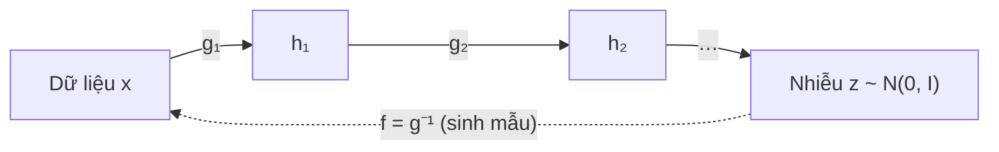

# Chương 10. Normalizing Flows

Ở [Chương 8](../phan-2-mo-hinh-sinh/ch08-vae.md) và [Chương 9](../phan-2-mo-hinh-sinh/ch09-gan.md), chúng ta đã gặp hai cách "biến nhiễu thành dữ liệu": VAE học một bộ giải mã nhưng chỉ tối ưu được một *cận dưới* của log-likelihood, còn GAN sinh mẫu rất sắc nét nhưng hoàn toàn không cho biết mật độ xác suất của mẫu. Normalizing flow (luồng chuẩn hóa) chọn con đường thứ ba: dùng một **phép biến đổi khả nghịch** giữa nhiễu và dữ liệu, nhờ đó tính được log-likelihood **chính xác** và huấn luyện thẳng bằng hợp lý cực đại (MLE). Cái giá phải trả là kiến trúc bị ràng buộc chặt: mỗi lớp phải khả nghịch và có định thức Jacobian dễ tính.

Chương này xây dựng flow từ công thức đổi biến, qua các thiết kế kinh điển (NICE, RealNVP, Glow, MAF, IAF), tới flow liên tục (CNF) — cây cầu dẫn sang flow matching ở [Chương 12](../phan-2-mo-hinh-sinh/ch12-flow-matching.md). Đây là nền toán học trực tiếp của Glow-TTS, WaveGlow, Parallel WaveNet và khối flow trong VITS.

!!! abstract "Mục tiêu học tập"
    Sau chương này, bạn có thể:

    - **Suy ra** công thức đổi biến cho mật độ xác suất (một chiều và nhiều chiều) và giải thích ý nghĩa hình học của định thức Jacobian.
    - **Giải thích** ba yêu cầu thiết kế của một flow (khả nghịch, nghịch đảo rẻ, log-det rẻ) và vì sao Jacobian tam giác đáp ứng được cả ba.
    - **Cài đặt** lớp ghép affine (RealNVP), ActNorm và tích chập khả nghịch 1×1 (Glow), rồi **kiểm thử** tính khả nghịch và log-det bằng autograd.
    - **So sánh** MAF và IAF về chi phí đánh giá mật độ và lấy mẫu, từ đó giải thích thiết kế chưng cất của Parallel WaveNet.
    - **Huấn luyện** một flow hai chiều bằng MLE và đánh giá NLL so với mô hình Gaussian.
    - **Giải thích** dequantization và nhiệt độ lấy mẫu, cùng hệ quả thực tế của chúng trong Glow-TTS, VITS và WaveGlow.
    - **Suy ra** công thức đổi biến tức thời của flow liên tục và chỉ ra vì sao chi phí huấn luyện của nó dẫn tới flow matching.

!!! info "Kiến thức cần có"
    - [Chương 1](../phan-1-nen-tang/ch01-toan-nen-tang.md): Jacobian, định thức, quy tắc dây chuyền, đổi biến mật độ (bản ngắn), phân kỳ KL.
    - [Chương 2](../phan-1-nen-tang/ch02-hoc-may-va-mang-no-ron.md) và [Chương 3](../phan-1-nen-tang/ch03-toi-uu-va-ky-thuat-huan-luyen.md): MLP, MLE, bộ tối ưu Adam.
    - [Chương 4](../phan-1-nen-tang/ch04-cnn-rnn-mo-hinh-chuoi.md): `Conv1d`, tích chập giãn (*dilated*) — cần cho phần WaveGlow.
    - [Chương 7](../phan-2-mo-hinh-sinh/ch07-tong-quan-mo-hinh-sinh.md): MLE và KL, bài toán một-nhiều trong TTS.
    - [Chương 8](../phan-2-mo-hinh-sinh/ch08-vae.md): ELBO (để so sánh với likelihood chính xác của flow).

!!! note "Ký hiệu trong chương"
    Trong chương này $\mathbf{x} \in \mathbb{R}^D$ là **một mẫu dữ liệu tổng quát** (một điểm 2 chiều, một khung mel, hay cả mel-spectrogram $\mathbf{Y}$ làm phẳng thành véc-tơ), **không** phải chuỗi văn bản như ở bảng ký hiệu chung; $\mathbf{z} \in \mathbb{R}^D$ là biến ẩn cùng số chiều. Ta gọi $f_\theta: \mathbf{z} \mapsto \mathbf{x}$ là **hướng sinh** và $g_\theta = f_\theta^{-1}: \mathbf{x} \mapsto \mathbf{z}$ là **hướng chuẩn hóa**. Khi quay về TTS cụ thể, chúng ta dùng lại $\mathbf{Y}$ cho mel và $\mathbf{x}$ cho văn bản.

## 10.1 Ý tưởng: uốn nắn một phân phối đơn giản

Hãy tưởng tượng một khối đất sét hình cầu, mật độ đều. Bạn có thể kéo, nén, xoắn nó thành bất kỳ hình dạng nào — miễn là không xé rách và không dán hai phần lại với nhau. Khối lượng đất sét được bảo toàn: chỗ nào bị kéo giãn thì mật độ giảm, chỗ nào bị nén thì mật độ tăng. Normalizing flow làm đúng như vậy với phân phối xác suất: bắt đầu từ một phân phối đơn giản $p_Z(\mathbf{z}) = \mathcal{N}(\mathbf{0}, \mathbf{I})$, áp một chuỗi phép biến đổi khả nghịch, trơn để "nặn" nó thành phân phối dữ liệu.

Tên gọi *normalizing* xuất phát từ chiều ngược lại: phép $g_\theta$ biến dữ liệu phức tạp thành nhiễu "chuẩn" (*normal*). Chuỗi biến đổi $g = g_M \circ \cdots \circ g_1$ là một "luồng" (*flow*) các bước nhỏ:



So với các họ mô hình khác ở [Chương 7](../phan-2-mo-hinh-sinh/ch07-tong-quan-mo-hinh-sinh.md), flow có ba ưu điểm hiếm khi đi cùng nhau:

1. **Likelihood chính xác** — không phải cận dưới như VAE, nên có thể so sánh mô hình bằng NLL và huấn luyện bằng một hàm mất mát duy nhất.
2. **Suy luận biến ẩn chính xác** — mỗi $\mathbf{x}$ ứng với đúng một $\mathbf{z} = g_\theta(\mathbf{x})$, không cần bộ mã hóa xấp xỉ.
3. **Lấy mẫu có thể song song** — nếu $f_\theta$ tính được trong một lượt (khác với mô hình tự hồi quy phải sinh từng bước).

Cái giá: $\mathbf{z}$ phải **cùng số chiều** với $\mathbf{x}$ (không có "cổ chai" nén thông tin), và mọi lớp phải được thiết kế đặc biệt để khả nghịch và có log-định thức Jacobian rẻ. Phần lớn chương này là câu chuyện về cách các nhà nghiên cứu xoay xở với ràng buộc đó.

## 10.2 Công thức đổi biến

### 10.2.1 Trường hợp một chiều

Giả sử $Z$ có mật độ $p_Z$ và $X = f(Z)$ với $f$ khả vi, **đơn điệu tăng ngặt**; gọi $g = f^{-1}$. Ta suy ra mật độ của $X$ qua hàm phân phối tích lũy (CDF):

$$
F_X(x) = P(X \le x) = P\big(f(Z) \le x\big) = P\big(Z \le g(x)\big) = F_Z\big(g(x)\big).
$$

Bước thứ ba dùng tính đơn điệu tăng: $f(Z) \le x \iff Z \le g(x)$. Lấy đạo hàm hai vế theo $x$ và dùng quy tắc dây chuyền:

$$
p_X(x) = \frac{d}{dx} F_Z\big(g(x)\big) = p_Z\big(g(x)\big) \, g'(x).
$$

Nếu $f$ đơn điệu **giảm**, bất đẳng thức đổi chiều: $F_X(x) = 1 - F_Z(g(x))$, nên $p_X(x) = -p_Z(g(x))\, g'(x)$, với $g'(x) < 0$. Gộp hai trường hợp:

$$
p_X(x) = p_Z\big(g(x)\big)\,\left| g'(x) \right| = p_Z(z)\,\left| f'(z) \right|^{-1}, \qquad z = g(x).
$$

Đẳng thức thứ hai dùng định lý hàm ngược $g'(x) = 1 / f'(z)$. Ý nghĩa bằng lời: khi $f$ **kéo giãn** một lân cận của $z$ (tức $\lvert f'(z) \rvert > 1$), cùng một lượng xác suất bị trải ra trên đoạn dài hơn nên mật độ **giảm** đúng bằng hệ số giãn đó.

!!! example "Ví dụ: Gaussian affine và phân phối log-chuẩn"
    - $x = \mu + \sigma z$ với $\sigma > 0$: $g(x) = (x - \mu)/\sigma$, $g'(x) = 1/\sigma$, nên $p_X(x) = \mathcal{N}\big((x-\mu)/\sigma; 0, 1\big)/\sigma = \mathcal{N}(x; \mu, \sigma^2)$ — đúng như mong đợi.
    - $x = e^{z}$: $g(x) = \ln x$, $g'(x) = 1/x$, nên $p_X(x) = \mathcal{N}(\ln x; 0, 1)/x$ với $x > 0$ — phân phối log-chuẩn. Số hạng $1/x$ chính là "chi phí thể tích" của phép mũ.

Kiểm tra bằng số cả hai ví dụ:

```python
import math
import torch

torch.manual_seed(0)

def log_prob_affine(x, mu, sigma):
    """log p_X(x) với x = mu + sigma * z, z ~ N(0, 1), tính bằng công thức đổi biến."""
    z = (x - mu) / sigma                                   # z = g(x)
    log_pz = -0.5 * z ** 2 - 0.5 * math.log(2 * math.pi)  # log N(z; 0, 1)
    return log_pz + math.log(1.0 / sigma)                 # + log |g'(x)|

x = torch.linspace(-3.0, 5.0, 7)
ref = torch.distributions.Normal(1.0, 2.0).log_prob(x)
assert torch.allclose(log_prob_affine(x, 1.0, 2.0), ref, atol=1e-6)

# Phân phối log-chuẩn: so sánh histogram của exp(z) với công thức p_Z(ln x) / x
xs = torch.exp(torch.randn(200_000))
lo, hi, bins = 0.1, 3.0, 50
width = (hi - lo) / bins
centers = lo + width * (torch.arange(bins) + 0.5)
empirical = torch.histc(xs, bins=bins, min=lo, max=hi) / (len(xs) * width)
formula = torch.exp(-0.5 * torch.log(centers) ** 2) / (math.sqrt(2 * math.pi) * centers)
print(f"sai lệch lớn nhất histogram vs công thức: {(empirical - formula).abs().max():.4f}")
```

Sai lệch in ra cỡ $10^{-2}$, đúng bằng mức nhiễu thống kê của một histogram 200 000 mẫu.

### 10.2.2 Trường hợp nhiều chiều

Với $\mathbf{x} = f(\mathbf{z})$, $f: \mathbb{R}^D \to \mathbb{R}^D$ khả nghịch và khả vi liên tục (một *vi phôi* — *diffeomorphism*), lập luận "bảo toàn khối lượng" vẫn đúng nhưng "độ dài" được thay bằng "thể tích". Quanh một điểm $\mathbf{z}$, $f$ xấp xỉ tuyến tính: $f(\mathbf{z} + \boldsymbol{\delta}) \approx f(\mathbf{z}) + \mathbf{J}_f(\mathbf{z})\,\boldsymbol{\delta}$, với $\mathbf{J}_f = \partial f / \partial \mathbf{z} \in \mathbb{R}^{D \times D}$ là ma trận Jacobian. Một hình hộp nhỏ thể tích $\Delta V$ quanh $\mathbf{z}$ bị biến thành một hình hộp xiên có thể tích $\lvert \det \mathbf{J}_f(\mathbf{z}) \rvert \, \Delta V$. Xác suất chứa trong hai vùng phải bằng nhau:

$$
p_X(\mathbf{x}) \, \lvert \det \mathbf{J}_f(\mathbf{z}) \rvert \, \Delta V \approx p_Z(\mathbf{z}) \, \Delta V .
$$

Cho $\Delta V \to 0$ ta được **công thức đổi biến**:

$$
p_X(\mathbf{x}) = p_Z\big(g(\mathbf{x})\big) \, \big\lvert \det \mathbf{J}_g(\mathbf{x}) \big\rvert = p_Z(\mathbf{z}) \, \big\lvert \det \mathbf{J}_f(\mathbf{z}) \big\rvert^{-1}, \qquad \mathbf{z} = g(\mathbf{x}).
$$

Đẳng thức thứ hai dùng định lý hàm ngược: $\mathbf{J}_g(\mathbf{x}) = \mathbf{J}_f(\mathbf{z})^{-1}$ và $\det(\mathbf{A}^{-1}) = 1/\det \mathbf{A}$. (Chứng minh chặt chẽ dùng định lý đổi biến trong tích phân bội; lập luận thể tích ở trên là trực giác đúng của định lý đó.) Lấy log:

$$
\log p_X(\mathbf{x}) = \log p_Z\big(g(\mathbf{x})\big) + \log \big\lvert \det \mathbf{J}_g(\mathbf{x}) \big\rvert .
$$

Số hạng thứ nhất thưởng cho việc đưa $\mathbf{x}$ về vùng mật độ cao của nhiễu (gần gốc tọa độ); số hạng thứ hai — **log-det** — phạt việc "ép" quá nhiều thể tích. Nếu không có log-det, mô hình sẽ gian lận bằng cách co mọi điểm về $\mathbf{0}$; log-det chính là thứ ngăn điều đó.

### 10.2.3 Ghép nhiều phép biến đổi

Một phép biến đổi đơn lẻ dễ tính thường kém biểu đạt, nên ta ghép $M$ lớp: $g = g_M \circ \cdots \circ g_1$, đặt $\mathbf{h}_0 = \mathbf{x}$, $\mathbf{h}_m = g_m(\mathbf{h}_{m-1})$, $\mathbf{z} = \mathbf{h}_M$. Theo quy tắc dây chuyền, Jacobian của hàm hợp là tích các Jacobian, và định thức của tích bằng tích các định thức:

$$
\log p_X(\mathbf{x}) = \log p_Z(\mathbf{h}_M) + \sum_{m=1}^{M} \log \big\lvert \det \mathbf{J}_{g_m}(\mathbf{h}_{m-1}) \big\rvert .
$$

Đây là công thức mọi cài đặt flow đều dùng: mỗi lớp trả về đầu ra **và** log-det của nó; ta cộng dồn log-det qua các lớp.

!!! warning "Quy ước chiều trong mã nguồn"
    Mã của Glow, WaveGlow, Glow-TTS và VITS (và mã trong chương này) đặt `forward` là **hướng chuẩn hóa** $\mathbf{x} \to \mathbf{z}$ (trả về log-det, dùng khi huấn luyện), còn `inverse`/`reverse` là **hướng sinh** $\mathbf{z} \to \mathbf{x}$ (dùng khi suy luận). Một số thư viện làm ngược lại. Khi đọc mã người khác, hãy xác định chiều trước khi đọc dấu của log-det — đây là nguồn lỗi dấu phổ biến nhất.

### 10.2.4 Huấn luyện bằng hợp lý cực đại

Với tập dữ liệu $\{\mathbf{x}^{(i)}\}$, ta cực tiểu NLL trung bình:

$$
\mathcal{L}(\theta) = -\frac{1}{n}\sum_{i=1}^{n} \Big[ \log p_Z\big(g_\theta(\mathbf{x}^{(i)})\big) + \log \big\lvert \det \mathbf{J}_{g_\theta}(\mathbf{x}^{(i)}) \big\rvert \Big].
$$

Như đã thấy ở [Chương 7](../phan-2-mo-hinh-sinh/ch07-tong-quan-mo-hinh-sinh.md), kỳ vọng của hàm này theo $p_{\text{data}}$ bằng $D_{\mathrm{KL}}(p_{\text{data}} \,\Vert\, p_\theta) + H(p_{\text{data}})$, nên MLE tương đương cực tiểu **KL thuận** (*forward KL*). KL thuận "phủ khối" (*mass-covering*): mô hình bị phạt nặng nếu gán mật độ gần 0 cho nơi có dữ liệu. Ngược lại, **KL nghịch** $D_{\mathrm{KL}}(p_\theta \,\Vert\, p_{\text{target}})$ "tìm mode" (*mode-seeking*) và đòi hỏi lấy mẫu từ chính mô hình — đó là thứ Parallel WaveNet dùng (mục 10.6.4).

### 10.2.5 Ba yêu cầu thiết kế

Công thức trên áp đặt ba yêu cầu lên mỗi lớp $g_m$:

1. **Khả nghịch** — để công thức đổi biến có nghĩa.
2. **Nghịch đảo rẻ** — để sinh mẫu $\mathbf{x} = f(\mathbf{z})$ nhanh.
3. **Log-det rẻ** — tính $\det$ của ma trận $D \times D$ tổng quát tốn $O(D^3)$. Với một mel-spectrogram 80 kênh × 500 khung, $D = 40\,000$: một lần phân rã LU tốn cỡ $10^{13}$ phép tính, cho **mỗi** mẫu, **mỗi** bước huấn luyện. Hoàn toàn bất khả thi.

Ngoài ra còn một giới hạn tô-pô ít được nhắc tới: phép biến đổi liên tục khả nghịch không thể "xé" một phân phối liên thông thành nhiều mảnh rời nhau. Để mô hình hóa hai cụm tách biệt từ một Gaussian, flow buộc phải kéo một "cầu nối" mật độ thấp giữa hai cụm. Bạn sẽ thấy hiện tượng này trong thí nghiệm ở mục 10.9.

## 10.3 Jacobian tam giác và phép biến đổi tự hồi quy

Lời giải chung cho yêu cầu thứ ba là làm cho Jacobian **tam giác**. Định thức của ma trận tam giác là tích các phần tử đường chéo, nên log-det chỉ tốn $O(D)$:

$$
\log \lvert \det \mathbf{J} \rvert = \sum_{i=1}^{D} \log \lvert J_{ii} \rvert .
$$

Jacobian tam giác dưới xuất hiện tự nhiên khi thành phần thứ $i$ của đầu ra chỉ phụ thuộc vào các thành phần $\le i$ của đầu vào. Dạng tổng quát là **phép biến đổi tự hồi quy**:

$$
z_i = \tau\big(x_i;\, \mathbf{h}_i\big), \qquad \mathbf{h}_i = c_i(x_1, \ldots, x_{i-1}),
$$

trong đó $\tau(\cdot\,; \mathbf{h})$ là một hàm vô hướng khả nghịch (ví dụ affine $\tau(x; \mu, \alpha) = (x - \mu)e^{-\alpha}$) có tham số $\mathbf{h}$ do một "bộ điều kiện" $c_i$ tùy ý sinh ra. Vì $\partial z_i / \partial x_j = 0$ với $j > i$, Jacobian tam giác dưới, và $J_{ii} = \partial \tau / \partial x_i$. Điểm mấu chốt: **$c_i$ có thể là mạng nơ-ron phức tạp bất kỳ** — ta không bao giờ phải nghịch đảo nó, cũng không phải tính đạo hàm của nó trong log-det.

Hai họ flow lớn đều là trường hợp riêng của ý tưởng này:

- **Lớp ghép (*coupling*)**: chia véc-tơ làm hai khối; khối đầu giữ nguyên, khối sau được biến đổi với tham số phụ thuộc khối đầu. Đây là phép tự hồi quy chỉ có "hai bước".
- **Flow tự hồi quy (*autoregressive flow*)**: mỗi chiều phụ thuộc tất cả các chiều trước — biểu đạt mạnh hơn nhưng một trong hai chiều tính toán phải chạy tuần tự (mục 10.6).

## 10.4 Lớp ghép: NICE và RealNVP

### 10.4.1 Ghép cộng (NICE)

NICE (Dinh và cộng sự, 2014) chia $\mathbf{x} = [\mathbf{x}_A; \mathbf{x}_B]$ và định nghĩa:

$$
\mathbf{z}_A = \mathbf{x}_A, \qquad \mathbf{z}_B = \mathbf{x}_B + \mathbf{b}(\mathbf{x}_A),
$$

với $\mathbf{b}$ là một MLP tùy ý. Nghịch đảo hiển nhiên: $\mathbf{x}_B = \mathbf{z}_B - \mathbf{b}(\mathbf{z}_A)$. Jacobian là ma trận tam giác khối với đường chéo toàn số 1, nên $\det = 1$: phép biến đổi **bảo toàn thể tích** (*volume-preserving*). Để mô hình vẫn co giãn được, NICE thêm một lớp nhân đường chéo ở cuối.

### 10.4.2 Ghép affine (RealNVP)

RealNVP (Dinh và cộng sự, 2017) cho phép co giãn ngay trong lớp ghép:

$$
\mathbf{z}_A = \mathbf{x}_A, \qquad \mathbf{z}_B = \mathbf{x}_B \odot \exp\big(\mathbf{s}(\mathbf{x}_A)\big) + \mathbf{b}(\mathbf{x}_A).
$$

Ở đây $\mathbf{s}$ (log-tỉ lệ) và $\mathbf{b}$ (độ dịch) là đầu ra của cùng một mạng nơ-ron nhận $\mathbf{x}_A$. (Chúng ta dùng $\mathbf{b}$ thay cho $\mathbf{t}$ của bài báo gốc để tránh trùng với biến thời gian $t$ ở các chương sau.) Jacobian có dạng khối:

$$
\mathbf{J}_g = \frac{\partial \mathbf{z}}{\partial \mathbf{x}} =
\begin{pmatrix}
\mathbf{I} & \mathbf{0} \\
\dfrac{\partial \mathbf{z}_B}{\partial \mathbf{x}_A} & \operatorname{diag}\big(\exp \mathbf{s}(\mathbf{x}_A)\big)
\end{pmatrix}.
$$

Khối trên phải bằng $\mathbf{0}$ vì $\mathbf{z}_A$ không phụ thuộc $\mathbf{x}_B$. Khối dưới trái $\partial \mathbf{z}_B / \partial \mathbf{x}_A$ chứa đạo hàm của cả mạng nơ-ron — phức tạp, nhưng **không ảnh hưởng tới định thức** của ma trận tam giác khối. Do đó:

$$
\log \lvert \det \mathbf{J}_g \rvert = \sum_{j \in B} s_j(\mathbf{x}_A).
$$

Nghịch đảo cũng chỉ cần chạy mạng theo chiều thuận một lần:

$$
\mathbf{x}_A = \mathbf{z}_A, \qquad \mathbf{x}_B = \big(\mathbf{z}_B - \mathbf{b}(\mathbf{z}_A)\big) \odot \exp\big(-\mathbf{s}(\mathbf{z}_A)\big).
$$

Ba yêu cầu ở mục 10.2.5 được thỏa mãn trọn vẹn, và mạng $(\mathbf{s}, \mathbf{b})$ được tự do chọn kiến trúc: MLP, CNN, hay khối WaveNet như trong WaveGlow và VITS.

### 10.4.3 Mặt nạ và hoán vị

Một lớp ghép để nguyên khối $A$, nên phải xen kẽ vai trò của hai khối giữa các lớp liên tiếp — nếu không, $\mathbf{x}_A$ sẽ không bao giờ được biến đổi. Có ba cách phổ biến:

- **Mặt nạ nhị phân** $\mathbf{m} \in \{0,1\}^D$: viết gọn $\mathbf{z} = \mathbf{m} \odot \mathbf{x} + (1 - \mathbf{m}) \odot \big(\mathbf{x} \odot e^{\mathbf{s}} + \mathbf{b}\big)$, với $\mathbf{s}, \mathbf{b}$ tính từ $\mathbf{m} \odot \mathbf{x}$. RealNVP dùng mặt nạ bàn cờ (theo không gian) và mặt nạ theo kênh cho ảnh.
- **Chia đôi kênh** rồi đảo thứ tự kênh giữa các lớp — cách phổ biến cho dữ liệu chuỗi dạng `(B, C, T)` như mel hay biến ẩn của VITS.
- **Hoán vị học được** bằng tích chập 1×1 khả nghịch (Glow, mục 10.5.2).

### 10.4.4 Ổn định số học

Hai mẹo gần như bắt buộc trong thực tế:

- **Khởi tạo bằng 0 lớp cuối** của mạng $(\mathbf{s}, \mathbf{b})$: khi đó $\mathbf{s} = \mathbf{b} = \mathbf{0}$, mỗi lớp ghép là phép đồng nhất lúc bắt đầu huấn luyện, và cả flow sâu hàng chục lớp vẫn ổn định ở những bước đầu (Glow dùng đúng mẹo này).
- **Chặn biên độ $\mathbf{s}$**: $\exp(\mathbf{s})$ có thể nổ khi $\mathbf{s}$ lớn. Các cài đặt thường dùng $\tanh$, "soft clamp" $\mathbf{s} = c \tanh(\mathbf{s}_{\text{raw}}/c)$, hoặc thay $\exp(\mathbf{s})$ bằng $\operatorname{sigmoid}(\mathbf{s}_{\text{raw}} + 2)$ như mã Glow.

Cài đặt và kiểm thử một lớp ghép affine dùng mặt nạ:

```python
import math
import torch
import torch.nn as nn


class AffineCoupling(nn.Module):
    """Lớp ghép affine kiểu RealNVP cho dữ liệu (B, D), dùng mặt nạ nhị phân.
    forward: hướng chuẩn hóa x -> z (trả về log-det); inverse: hướng sinh z -> x."""

    def __init__(self, mask: torch.Tensor, hidden: int = 64):
        super().__init__()
        dim = mask.numel()
        self.register_buffer("mask", mask.float())            # 1 = giữ nguyên (khối A)
        self.net = nn.Sequential(
            nn.Linear(dim, hidden), nn.SiLU(),
            nn.Linear(hidden, hidden), nn.SiLU(),
            nn.Linear(hidden, 2 * dim),                       # xuất (s, b)
        )
        nn.init.zeros_(self.net[-1].weight)                   # khởi tạo = phép đồng nhất
        nn.init.zeros_(self.net[-1].bias)

    def _scale_shift(self, x_keep):
        s, b = self.net(x_keep).chunk(2, dim=-1)              # mỗi cái (B, D)
        inv = 1.0 - self.mask                                 # chỉ khối B được biến đổi
        return torch.tanh(s) * inv, b * inv                   # tanh: chặn biên độ log-tỉ lệ

    def forward(self, x):
        x_keep = x * self.mask
        s, b = self._scale_shift(x_keep)
        z = x_keep + (1.0 - self.mask) * (x * torch.exp(s) + b)
        return z, s.sum(dim=-1)                               # log|det J| = tổng s, (B,)

    def inverse(self, z):
        z_keep = z * self.mask                                # z_A = x_A
        s, b = self._scale_shift(z_keep)
        return z_keep + (1.0 - self.mask) * ((z - b) * torch.exp(-s))


# --- Kiểm thử: khả nghịch và log-det khớp với Jacobian tính bằng autograd ---
torch.manual_seed(0)
layer = AffineCoupling(torch.tensor([1, 0, 1, 0, 1]))
with torch.no_grad():                                         # phá phép đồng nhất để kiểm thử có ý nghĩa
    layer.net[-1].weight.normal_(0, 0.5)
    layer.net[-1].bias.normal_(0, 0.5)

x = torch.randn(4, 5)                                         # (B, D)
z, logdet = layer(x)
assert torch.allclose(layer.inverse(z), x, atol=1e-5)        # f(g(x)) = x

for i in range(x.shape[0]):
    J = torch.autograd.functional.jacobian(lambda v: layer(v[None])[0][0], x[i])  # (D, D)
    sign, logabsdet = torch.linalg.slogdet(J)
    assert torch.allclose(logabsdet, logdet[i], atol=1e-5)
print("AffineCoupling: khả nghịch và log-det đều đúng")
```

Phép thử thứ hai đáng để bạn ghi nhớ như một thói quen: với mỗi lớp flow mới, so log-det tự tính với `slogdet` của Jacobian đầy đủ trên một đầu vào nhỏ. Phép thử này bắt được gần như mọi lỗi dấu và lỗi quên số hạng.

## 10.5 Glow: ActNorm và tích chập khả nghịch 1×1

Glow (Kingma và Dhariwal, 2018) tổ chức flow thành các **bước** (*step of flow*), mỗi bước gồm ba lớp: ActNorm → tích chập khả nghịch 1×1 → lớp ghép affine. Cả Glow-TTS và WaveGlow đều thừa hưởng trực tiếp cấu trúc này.

### 10.5.1 ActNorm

BatchNorm giúp huấn luyện mạng sâu ổn định, nhưng phụ thuộc thống kê của batch — rất nhiễu khi batch nhỏ (thường gặp với flow vì tốn bộ nhớ) và khiến hàm biến đổi lúc huấn luyện khác lúc suy luận. **ActNorm** thay bằng một phép affine theo kênh với tham số học được:

$$
\mathbf{z}_{:,c} = \big(\mathbf{x}_{:,c} + \ell_c\big)\, e^{a_c}, \qquad c = 1, \ldots, C,
$$

được **khởi tạo phụ thuộc dữ liệu**: ở batch đầu tiên, chọn $\ell_c$ và $a_c$ sao cho đầu ra mỗi kênh có trung bình 0 và phương sai 1; sau đó chúng là tham số bình thường. Với đầu vào dạng `(B, C, T)`, cùng một phép affine áp cho cả $T$ khung, nên Jacobian (theo toàn bộ $C \times T$ phần tử) là ma trận đường chéo với mỗi $e^{a_c}$ lặp $T$ lần:

$$
\log \lvert \det \mathbf{J} \rvert = T \sum_{c=1}^{C} a_c .
$$

### 10.5.2 Tích chập khả nghịch 1×1

Đảo thứ tự kênh cố định giữa các lớp ghép là một hoán vị — một trường hợp riêng của phép nhân ma trận. Glow tổng quát hóa thành phép nhân với ma trận $\mathbf{W} \in \mathbb{R}^{C \times C}$ học được, áp **độc lập tại mỗi khung** (tức một `Conv1d` kernel 1):

$$
\mathbf{z}_{:,\tau} = \mathbf{W}\, \mathbf{x}_{:,\tau}, \qquad \tau = 1, \ldots, T.
$$

Jacobian theo toàn bộ tensor là ma trận khối đường chéo gồm $T$ bản sao của $\mathbf{W}$, nên $\log \lvert \det \mathbf{J} \rvert = T \log \lvert \det \mathbf{W} \rvert$. Tính $\det \mathbf{W}$ tốn $O(C^3)$ — chấp nhận được vì $C$ nhỏ (vài chục đến vài trăm), nhưng vẫn có thể rẻ hơn nhờ **tham số hóa LU**:

$$
\mathbf{W} = \mathbf{P}\, \mathbf{L}\, \big(\mathbf{U} + \operatorname{diag}(\mathbf{u})\big),
$$

với $\mathbf{P}$ là hoán vị cố định, $\mathbf{L}$ tam giác dưới có đường chéo bằng 1, $\mathbf{U}$ tam giác trên ngặt, và $\mathbf{u}$ là véc-tơ đường chéo. Khi đó $\log \lvert \det \mathbf{W} \rvert = \sum_c \log \lvert u_c \rvert$ — chỉ $O(C)$ — và ta học trực tiếp $\log \lvert u_c \rvert$ để $\mathbf{W}$ không bao giờ suy biến.

### 10.5.3 Kiến trúc đa tỉ lệ và "squeeze"

Để lớp ghép nhìn thấy ngữ cảnh rộng hơn mà không cần mạng quá sâu, các flow dùng phép **squeeze**: gộp các phần tử lân cận vào chiều kênh. Với chuỗi `(B, C, T)`, squeeze hệ số 2 cho `(B, 2C, T/2)`. WaveGlow gộp 8 mẫu âm thanh liên tiếp thành một véc-tơ 8 chiều; Glow-TTS squeeze mel theo thời gian với hệ số 2. Glow (và RealNVP) còn dùng **tách sớm** (*split / early output*): sau một số bước, một nửa số kênh được "rút ra" và mô hình hóa trực tiếp bằng Gaussian, nửa còn lại đi tiếp — giảm chi phí tính toán và tạo cấu trúc phân cấp.

Cài đặt ActNorm và tích chập 1×1 có tham số hóa LU cho dữ liệu `(B, C, T)`, kèm kiểm thử log-det trên Jacobian đầy đủ của tensor làm phẳng:

```python
class ActNorm(nn.Module):
    """Affine theo kênh, khởi tạo phụ thuộc dữ liệu. Đầu vào (B, C, T)."""

    def __init__(self, C: int):
        super().__init__()
        self.loc = nn.Parameter(torch.zeros(1, C, 1))
        self.log_scale = nn.Parameter(torch.zeros(1, C, 1))
        self.register_buffer("initialized", torch.tensor(False))

    def forward(self, x):                                     # x: (B, C, T)
        if not self.initialized:                              # batch đầu: chuẩn hóa về TB 0, phương sai 1
            with torch.no_grad():
                self.loc.copy_(-x.mean(dim=(0, 2), keepdim=True))
                self.log_scale.copy_(-torch.log(x.std(dim=(0, 2), keepdim=True) + 1e-6))
                self.initialized.fill_(True)
        z = (x + self.loc) * torch.exp(self.log_scale)
        logdet = x.shape[-1] * self.log_scale.sum()           # T * sum_c a_c
        return z, logdet.expand(x.shape[0])                   # (B,)

    def inverse(self, z):
        return z * torch.exp(-self.log_scale) - self.loc


class InvConv1x1(nn.Module):
    """Tích chập 1x1 khả nghịch, tham số hóa W = P L (U + diag(u)). Đầu vào (B, C, T)."""

    def __init__(self, C: int):
        super().__init__()
        W0 = torch.linalg.qr(torch.randn(C, C))[0]            # khởi tạo: ma trận trực giao ngẫu nhiên
        P, L, U = torch.linalg.lu(W0)
        u = torch.diagonal(U)
        self.register_buffer("P", P)
        self.register_buffer("sign_u", torch.sign(u))
        self.L = nn.Parameter(L)
        self.U = nn.Parameter(U)
        self.log_abs_u = nn.Parameter(torch.log(u.abs()))

    def weight(self):
        C = self.log_abs_u.numel()
        L = torch.tril(self.L, -1) + torch.eye(C)             # đường chéo bằng 1
        U = torch.triu(self.U, 1) + torch.diag(self.sign_u * torch.exp(self.log_abs_u))
        return self.P @ L @ U                                 # (C, C)

    def forward(self, x):                                     # x: (B, C, T)
        z = torch.einsum("ij,bjt->bit", self.weight(), x)
        logdet = x.shape[-1] * self.log_abs_u.sum()           # T * log|det W|
        return z, logdet.expand(x.shape[0])

    def inverse(self, z):
        return torch.einsum("ij,bjt->bit", torch.linalg.inv(self.weight()), z)


torch.manual_seed(0)
B, C, T = 3, 4, 5
x = 3.0 * torch.randn(B, C, T) + 1.0
for module in (ActNorm(C), InvConv1x1(C)):
    z, logdet = module(x)                                     # lần gọi đầu cũng khởi tạo ActNorm
    assert torch.allclose(module.inverse(z), x, atol=1e-4)
    flat = lambda v: module(v.view(1, C, T))[0].flatten()     # R^{C*T} -> R^{C*T}
    J = torch.autograd.functional.jacobian(flat, x[0].flatten())   # (C*T, C*T)
    assert torch.allclose(torch.linalg.slogdet(J)[1], logdet[0], atol=1e-4)
    print(f"{type(module).__name__}: log-det = {logdet[0].item():.4f} (khớp slogdet)")
```

!!! tip "Chuỗi có độ dài thay đổi"
    Trong TTS, các câu trong batch có số khung khác nhau và được đệm (*padding*). Hệ số $T$ trong log-det phải được thay bằng **số khung thực** của từng câu, tức $\sum_\tau m_\tau$ với $\mathbf{m}$ là mặt nạ độ dài; đồng thời đầu ra ở vùng đệm phải được nhân với mặt nạ. Glow-TTS và VITS đều làm như vậy. Quên điều này khiến log-likelihood phụ thuộc vào lượng padding — một lỗi âm thầm, không gây crash nhưng làm hỏng mục tiêu huấn luyện.
