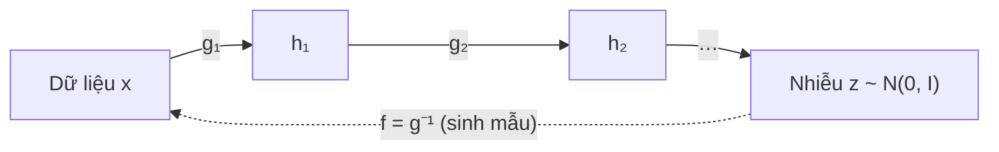

# Chương 10. Normalizing Flows

Ở [Chương 8](../phan-2-mo-hinh-sinh/ch08-vae.md) và [Chương 9](../phan-2-mo-hinh-sinh/ch09-gan.md), chúng ta đã gặp hai cách "biến nhiễu thành dữ liệu": VAE học một bộ giải mã nhưng chỉ tối ưu được một *cận dưới* của log-likelihood, còn GAN sinh mẫu rất sắc nét nhưng hoàn toàn không cho biết mật độ xác suất của mẫu. Normalizing flow (luồng chuẩn hóa) chọn con đường thứ ba: dùng một **phép biến đổi khả nghịch** giữa nhiễu và dữ liệu, nhờ đó tính được log-likelihood **chính xác** và huấn luyện thẳng bằng hợp lý cực đại (MLE). Cái giá phải trả là kiến trúc bị ràng buộc chặt: mỗi lớp phải khả nghịch và có định thức Jacobian dễ tính.

Chương này xây dựng flow từ công thức đổi biến, qua các thiết kế kinh điển (NICE, RealNVP, Glow, MAF, IAF), tới flow liên tục (CNF) — cây cầu dẫn sang flow matching ở [Chương 12](../phan-2-mo-hinh-sinh/ch12-flow-matching.md). Đây là nền toán học trực tiếp của Glow-TTS, WaveGlow, Parallel WaveNet và khối flow trong VITS.

!!! abstract "Mục tiêu học tập"
    Sau chương này, bạn có thể:

    - **Suy ra** công thức đổi biến cho mật độ xác suất (một chiều và nhiều chiều) và giải thích ý nghĩa hình học của định thức Jacobian.
    - **Giải thích** ba yêu cầu thiết kế của một flow (khả nghịch, nghịch đảo rẻ, log-det rẻ) và vì sao Jacobian tam giác đáp ứng được cả ba.
    - **Cài đặt** lớp ghép affine (RealNVP), ActNorm và tích chập khả nghịch 1×1 (Glow), rồi **kiểm thử** tính khả nghịch và log-det bằng autograd.
    - **So sánh** MAF và IAF về chi phí đánh giá mật độ và lấy mẫu, từ đó giải thích thiết kế chưng cất của Parallel WaveNet.
    - **Huấn luyện** một flow hai chiều bằng MLE và đánh giá NLL so với mô hình Gaussian.
    - **Giải thích** dequantization và nhiệt độ lấy mẫu, cùng hệ quả thực tế của chúng trong Glow-TTS, VITS và WaveGlow.
    - **Suy ra** công thức đổi biến tức thời của flow liên tục và chỉ ra vì sao chi phí huấn luyện của nó dẫn tới flow matching.

!!! info "Kiến thức cần có"
    - [Chương 1](../phan-1-nen-tang/ch01-toan-nen-tang.md): Jacobian, định thức, quy tắc dây chuyền, đổi biến mật độ (bản ngắn), phân kỳ KL.
    - [Chương 2](../phan-1-nen-tang/ch02-hoc-may-va-mang-no-ron.md) và [Chương 3](../phan-1-nen-tang/ch03-toi-uu-va-ky-thuat-huan-luyen.md): MLP, MLE, bộ tối ưu Adam.
    - [Chương 4](../phan-1-nen-tang/ch04-cnn-rnn-mo-hinh-chuoi.md): `Conv1d`, tích chập giãn (*dilated*) — cần cho phần WaveGlow.
    - [Chương 7](../phan-2-mo-hinh-sinh/ch07-tong-quan-mo-hinh-sinh.md): MLE và KL, bài toán một-nhiều trong TTS.
    - [Chương 8](../phan-2-mo-hinh-sinh/ch08-vae.md): ELBO (để so sánh với likelihood chính xác của flow).

!!! note "Ký hiệu trong chương"
    Trong chương này $\mathbf{x} \in \mathbb{R}^D$ là **một mẫu dữ liệu tổng quát** (một điểm 2 chiều, một khung mel, hay cả mel-spectrogram $\mathbf{Y}$ làm phẳng thành véc-tơ), **không** phải chuỗi văn bản như ở bảng ký hiệu chung; $\mathbf{z} \in \mathbb{R}^D$ là biến ẩn cùng số chiều. Ta gọi $f_\theta: \mathbf{z} \mapsto \mathbf{x}$ là **hướng sinh** và $g_\theta = f_\theta^{-1}: \mathbf{x} \mapsto \mathbf{z}$ là **hướng chuẩn hóa**. Khi quay về TTS cụ thể, chúng ta dùng lại $\mathbf{Y}$ cho mel và $\mathbf{x}$ cho văn bản.

## 10.1 Ý tưởng: uốn nắn một phân phối đơn giản

Hãy tưởng tượng một khối đất sét hình cầu, mật độ đều. Bạn có thể kéo, nén, xoắn nó thành bất kỳ hình dạng nào — miễn là không xé rách và không dán hai phần lại với nhau. Khối lượng đất sét được bảo toàn: chỗ nào bị kéo giãn thì mật độ giảm, chỗ nào bị nén thì mật độ tăng. Normalizing flow làm đúng như vậy với phân phối xác suất: bắt đầu từ một phân phối đơn giản $p_Z(\mathbf{z}) = \mathcal{N}(\mathbf{0}, \mathbf{I})$, áp một chuỗi phép biến đổi khả nghịch, trơn để "nặn" nó thành phân phối dữ liệu.

Tên gọi *normalizing* xuất phát từ chiều ngược lại: phép $g_\theta$ biến dữ liệu phức tạp thành nhiễu "chuẩn" (*normal*). Chuỗi biến đổi $g = g_M \circ \cdots \circ g_1$ là một "luồng" (*flow*) các bước nhỏ:



So với các họ mô hình khác ở [Chương 7](../phan-2-mo-hinh-sinh/ch07-tong-quan-mo-hinh-sinh.md), flow có ba ưu điểm hiếm khi đi cùng nhau:

1. **Likelihood chính xác** — không phải cận dưới như VAE, nên có thể so sánh mô hình bằng NLL và huấn luyện bằng một hàm mất mát duy nhất.
2. **Suy luận biến ẩn chính xác** — mỗi $\mathbf{x}$ ứng với đúng một $\mathbf{z} = g_\theta(\mathbf{x})$, không cần bộ mã hóa xấp xỉ.
3. **Lấy mẫu có thể song song** — nếu $f_\theta$ tính được trong một lượt (khác với mô hình tự hồi quy phải sinh từng bước).

Cái giá: $\mathbf{z}$ phải **cùng số chiều** với $\mathbf{x}$ (không có "cổ chai" nén thông tin), và mọi lớp phải được thiết kế đặc biệt để khả nghịch và có log-định thức Jacobian rẻ. Phần lớn chương này là câu chuyện về cách các nhà nghiên cứu xoay xở với ràng buộc đó.

## 10.2 Công thức đổi biến

### 10.2.1 Trường hợp một chiều

Giả sử $Z$ có mật độ $p_Z$ và $X = f(Z)$ với $f$ khả vi, **đơn điệu tăng ngặt**; gọi $g = f^{-1}$. Ta suy ra mật độ của $X$ qua hàm phân phối tích lũy (CDF):

$$
F_X(x) = P(X \le x) = P\big(f(Z) \le x\big) = P\big(Z \le g(x)\big) = F_Z\big(g(x)\big).
$$

Bước thứ ba dùng tính đơn điệu tăng: $f(Z) \le x \iff Z \le g(x)$. Lấy đạo hàm hai vế theo $x$ và dùng quy tắc dây chuyền:

$$
p_X(x) = \frac{d}{dx} F_Z\big(g(x)\big) = p_Z\big(g(x)\big) \, g'(x).
$$

Nếu $f$ đơn điệu **giảm**, bất đẳng thức đổi chiều: $F_X(x) = 1 - F_Z(g(x))$, nên $p_X(x) = -p_Z(g(x))\, g'(x)$, với $g'(x) < 0$. Gộp hai trường hợp:

$$
p_X(x) = p_Z\big(g(x)\big)\,\left| g'(x) \right| = p_Z(z)\,\left| f'(z) \right|^{-1}, \qquad z = g(x).
$$

Đẳng thức thứ hai dùng định lý hàm ngược $g'(x) = 1 / f'(z)$. Ý nghĩa bằng lời: khi $f$ **kéo giãn** một lân cận của $z$ (tức $\lvert f'(z) \rvert > 1$), cùng một lượng xác suất bị trải ra trên đoạn dài hơn nên mật độ **giảm** đúng bằng hệ số giãn đó.

!!! example "Ví dụ: Gaussian affine và phân phối log-chuẩn"
    - $x = \mu + \sigma z$ với $\sigma > 0$: $g(x) = (x - \mu)/\sigma$, $g'(x) = 1/\sigma$, nên $p_X(x) = \mathcal{N}\big((x-\mu)/\sigma; 0, 1\big)/\sigma = \mathcal{N}(x; \mu, \sigma^2)$ — đúng như mong đợi.
    - $x = e^{z}$: $g(x) = \ln x$, $g'(x) = 1/x$, nên $p_X(x) = \mathcal{N}(\ln x; 0, 1)/x$ với $x > 0$ — phân phối log-chuẩn. Số hạng $1/x$ chính là "chi phí thể tích" của phép mũ.

Kiểm tra bằng số cả hai ví dụ:

```python
import math
import torch

torch.manual_seed(0)

def log_prob_affine(x, mu, sigma):
    """log p_X(x) với x = mu + sigma * z, z ~ N(0, 1), tính bằng công thức đổi biến."""
    z = (x - mu) / sigma                                   # z = g(x)
    log_pz = -0.5 * z ** 2 - 0.5 * math.log(2 * math.pi)  # log N(z; 0, 1)
    return log_pz + math.log(1.0 / sigma)                 # + log |g'(x)|

x = torch.linspace(-3.0, 5.0, 7)
ref = torch.distributions.Normal(1.0, 2.0).log_prob(x)
assert torch.allclose(log_prob_affine(x, 1.0, 2.0), ref, atol=1e-6)

# Phân phối log-chuẩn: so sánh histogram của exp(z) với công thức p_Z(ln x) / x
xs = torch.exp(torch.randn(200_000))
lo, hi, bins = 0.1, 3.0, 50
width = (hi - lo) / bins
centers = lo + width * (torch.arange(bins) + 0.5)
empirical = torch.histc(xs, bins=bins, min=lo, max=hi) / (len(xs) * width)
formula = torch.exp(-0.5 * torch.log(centers) ** 2) / (math.sqrt(2 * math.pi) * centers)
print(f"sai lệch lớn nhất histogram vs công thức: {(empirical - formula).abs().max():.4f}")
```

Sai lệch in ra cỡ $10^{-2}$, đúng bằng mức nhiễu thống kê của một histogram 200 000 mẫu.

### 10.2.2 Trường hợp nhiều chiều

Với $\mathbf{x} = f(\mathbf{z})$, $f: \mathbb{R}^D \to \mathbb{R}^D$ khả nghịch và khả vi liên tục (một *vi phôi* — *diffeomorphism*), lập luận "bảo toàn khối lượng" vẫn đúng nhưng "độ dài" được thay bằng "thể tích". Quanh một điểm $\mathbf{z}$, $f$ xấp xỉ tuyến tính: $f(\mathbf{z} + \boldsymbol{\delta}) \approx f(\mathbf{z}) + \mathbf{J}_f(\mathbf{z})\,\boldsymbol{\delta}$, với $\mathbf{J}_f = \partial f / \partial \mathbf{z} \in \mathbb{R}^{D \times D}$ là ma trận Jacobian. Một hình hộp nhỏ thể tích $\Delta V$ quanh $\mathbf{z}$ bị biến thành một hình hộp xiên có thể tích $\lvert \det \mathbf{J}_f(\mathbf{z}) \rvert \, \Delta V$. Xác suất chứa trong hai vùng phải bằng nhau:

$$
p_X(\mathbf{x}) \, \lvert \det \mathbf{J}_f(\mathbf{z}) \rvert \, \Delta V \approx p_Z(\mathbf{z}) \, \Delta V .
$$

Cho $\Delta V \to 0$ ta được **công thức đổi biến**:

$$
p_X(\mathbf{x}) = p_Z\big(g(\mathbf{x})\big) \, \big\lvert \det \mathbf{J}_g(\mathbf{x}) \big\rvert = p_Z(\mathbf{z}) \, \big\lvert \det \mathbf{J}_f(\mathbf{z}) \big\rvert^{-1}, \qquad \mathbf{z} = g(\mathbf{x}).
$$

Đẳng thức thứ hai dùng định lý hàm ngược: $\mathbf{J}_g(\mathbf{x}) = \mathbf{J}_f(\mathbf{z})^{-1}$ và $\det(\mathbf{A}^{-1}) = 1/\det \mathbf{A}$. (Chứng minh chặt chẽ dùng định lý đổi biến trong tích phân bội; lập luận thể tích ở trên là trực giác đúng của định lý đó.) Lấy log:

$$
\log p_X(\mathbf{x}) = \log p_Z\big(g(\mathbf{x})\big) + \log \big\lvert \det \mathbf{J}_g(\mathbf{x}) \big\rvert .
$$

Số hạng thứ nhất thưởng cho việc đưa $\mathbf{x}$ về vùng mật độ cao của nhiễu (gần gốc tọa độ); số hạng thứ hai — **log-det** — phạt việc "ép" quá nhiều thể tích. Nếu không có log-det, mô hình sẽ gian lận bằng cách co mọi điểm về $\mathbf{0}$; log-det chính là thứ ngăn điều đó.

### 10.2.3 Ghép nhiều phép biến đổi

Một phép biến đổi đơn lẻ dễ tính thường kém biểu đạt, nên ta ghép $M$ lớp: $g = g_M \circ \cdots \circ g_1$, đặt $\mathbf{h}_0 = \mathbf{x}$, $\mathbf{h}_m = g_m(\mathbf{h}_{m-1})$, $\mathbf{z} = \mathbf{h}_M$. Theo quy tắc dây chuyền, Jacobian của hàm hợp là tích các Jacobian, và định thức của tích bằng tích các định thức:

$$
\log p_X(\mathbf{x}) = \log p_Z(\mathbf{h}_M) + \sum_{m=1}^{M} \log \big\lvert \det \mathbf{J}_{g_m}(\mathbf{h}_{m-1}) \big\rvert .
$$

Đây là công thức mọi cài đặt flow đều dùng: mỗi lớp trả về đầu ra **và** log-det của nó; ta cộng dồn log-det qua các lớp.

!!! warning "Quy ước chiều trong mã nguồn"
    Mã của Glow, WaveGlow, Glow-TTS và VITS (và mã trong chương này) đặt `forward` là **hướng chuẩn hóa** $\mathbf{x} \to \mathbf{z}$ (trả về log-det, dùng khi huấn luyện), còn `inverse`/`reverse` là **hướng sinh** $\mathbf{z} \to \mathbf{x}$ (dùng khi suy luận). Một số thư viện làm ngược lại. Khi đọc mã người khác, hãy xác định chiều trước khi đọc dấu của log-det — đây là nguồn lỗi dấu phổ biến nhất.

### 10.2.4 Huấn luyện bằng hợp lý cực đại

Với tập dữ liệu $\{\mathbf{x}^{(i)}\}$, ta cực tiểu NLL trung bình:

$$
\mathcal{L}(\theta) = -\frac{1}{n}\sum_{i=1}^{n} \Big[ \log p_Z\big(g_\theta(\mathbf{x}^{(i)})\big) + \log \big\lvert \det \mathbf{J}_{g_\theta}(\mathbf{x}^{(i)}) \big\rvert \Big].
$$

Như đã thấy ở [Chương 7](../phan-2-mo-hinh-sinh/ch07-tong-quan-mo-hinh-sinh.md), kỳ vọng của hàm này theo $p_{\text{data}}$ bằng $D_{\mathrm{KL}}(p_{\text{data}} \,\Vert\, p_\theta) + H(p_{\text{data}})$, nên MLE tương đương cực tiểu **KL thuận** (*forward KL*). KL thuận "phủ khối" (*mass-covering*): mô hình bị phạt nặng nếu gán mật độ gần 0 cho nơi có dữ liệu. Ngược lại, **KL nghịch** $D_{\mathrm{KL}}(p_\theta \,\Vert\, p_{\text{target}})$ "tìm mode" (*mode-seeking*) và đòi hỏi lấy mẫu từ chính mô hình — đó là thứ Parallel WaveNet dùng (mục 10.6.4).

### 10.2.5 Ba yêu cầu thiết kế

Công thức trên áp đặt ba yêu cầu lên mỗi lớp $g_m$:

1. **Khả nghịch** — để công thức đổi biến có nghĩa.
2. **Nghịch đảo rẻ** — để sinh mẫu $\mathbf{x} = f(\mathbf{z})$ nhanh.
3. **Log-det rẻ** — tính $\det$ của ma trận $D \times D$ tổng quát tốn $O(D^3)$. Với một mel-spectrogram 80 kênh × 500 khung, $D = 40\,000$: một lần phân rã LU tốn cỡ $10^{13}$ phép tính, cho **mỗi** mẫu, **mỗi** bước huấn luyện. Hoàn toàn bất khả thi.

Ngoài ra còn một giới hạn tô-pô ít được nhắc tới: phép biến đổi liên tục khả nghịch không thể "xé" một phân phối liên thông thành nhiều mảnh rời nhau. Để mô hình hóa hai cụm tách biệt từ một Gaussian, flow buộc phải kéo một "cầu nối" mật độ thấp giữa hai cụm. Bạn sẽ thấy hiện tượng này trong thí nghiệm ở mục 10.10.

## 10.3 Jacobian tam giác và phép biến đổi tự hồi quy

Lời giải chung cho yêu cầu thứ ba là làm cho Jacobian **tam giác**. Định thức của ma trận tam giác là tích các phần tử đường chéo, nên log-det chỉ tốn $O(D)$:

$$
\log \lvert \det \mathbf{J} \rvert = \sum_{i=1}^{D} \log \lvert J_{ii} \rvert .
$$

Jacobian tam giác dưới xuất hiện tự nhiên khi thành phần thứ $i$ của đầu ra chỉ phụ thuộc vào các thành phần $\le i$ của đầu vào. Dạng tổng quát là **phép biến đổi tự hồi quy**:

$$
z_i = \tau\big(x_i;\, \mathbf{h}_i\big), \qquad \mathbf{h}_i = c_i(x_1, \ldots, x_{i-1}),
$$

trong đó $\tau(\cdot\,; \mathbf{h})$ là một hàm vô hướng khả nghịch (ví dụ affine $\tau(x; \mu, \alpha) = (x - \mu)e^{-\alpha}$) có tham số $\mathbf{h}$ do một "bộ điều kiện" $c_i$ tùy ý sinh ra. Vì $\partial z_i / \partial x_j = 0$ với $j > i$, Jacobian tam giác dưới, và $J_{ii} = \partial \tau / \partial x_i$. Điểm mấu chốt: **$c_i$ có thể là mạng nơ-ron phức tạp bất kỳ** — ta không bao giờ phải nghịch đảo nó, cũng không phải tính đạo hàm của nó trong log-det.

Hai họ flow lớn đều là trường hợp riêng của ý tưởng này:

- **Lớp ghép (*coupling*)**: chia véc-tơ làm hai khối; khối đầu giữ nguyên, khối sau được biến đổi với tham số phụ thuộc khối đầu. Đây là phép tự hồi quy chỉ có "hai bước".
- **Flow tự hồi quy (*autoregressive flow*)**: mỗi chiều phụ thuộc tất cả các chiều trước — biểu đạt mạnh hơn nhưng một trong hai chiều tính toán phải chạy tuần tự (mục 10.6).

## 10.4 Lớp ghép: NICE và RealNVP

### 10.4.1 Ghép cộng (NICE)

NICE (Dinh và cộng sự, 2014) chia $\mathbf{x} = [\mathbf{x}_A; \mathbf{x}_B]$ và định nghĩa:

$$
\mathbf{z}_A = \mathbf{x}_A, \qquad \mathbf{z}_B = \mathbf{x}_B + \mathbf{b}(\mathbf{x}_A),
$$

với $\mathbf{b}$ là một MLP tùy ý. Nghịch đảo hiển nhiên: $\mathbf{x}_B = \mathbf{z}_B - \mathbf{b}(\mathbf{z}_A)$. Jacobian là ma trận tam giác khối với đường chéo toàn số 1, nên $\det = 1$: phép biến đổi **bảo toàn thể tích** (*volume-preserving*). Để mô hình vẫn co giãn được, NICE thêm một lớp nhân đường chéo ở cuối.

### 10.4.2 Ghép affine (RealNVP)

RealNVP (Dinh và cộng sự, 2017) cho phép co giãn ngay trong lớp ghép:

$$
\mathbf{z}_A = \mathbf{x}_A, \qquad \mathbf{z}_B = \mathbf{x}_B \odot \exp\big(\mathbf{s}(\mathbf{x}_A)\big) + \mathbf{b}(\mathbf{x}_A).
$$

Ở đây $\mathbf{s}$ (log-tỉ lệ) và $\mathbf{b}$ (độ dịch) là đầu ra của cùng một mạng nơ-ron nhận $\mathbf{x}_A$. (Chúng ta dùng $\mathbf{b}$ thay cho $\mathbf{t}$ của bài báo gốc để tránh trùng với biến thời gian $t$ ở các chương sau.) Jacobian có dạng khối:

$$
\mathbf{J}_g = \frac{\partial \mathbf{z}}{\partial \mathbf{x}} =
\begin{pmatrix}
\mathbf{I} & \mathbf{0} \\
\dfrac{\partial \mathbf{z}_B}{\partial \mathbf{x}_A} & \operatorname{diag}\big(\exp \mathbf{s}(\mathbf{x}_A)\big)
\end{pmatrix}.
$$

Khối trên phải bằng $\mathbf{0}$ vì $\mathbf{z}_A$ không phụ thuộc $\mathbf{x}_B$. Khối dưới trái $\partial \mathbf{z}_B / \partial \mathbf{x}_A$ chứa đạo hàm của cả mạng nơ-ron — phức tạp, nhưng **không ảnh hưởng tới định thức** của ma trận tam giác khối. Do đó:

$$
\log \lvert \det \mathbf{J}_g \rvert = \sum_{j \in B} s_j(\mathbf{x}_A).
$$

Nghịch đảo cũng chỉ cần chạy mạng theo chiều thuận một lần:

$$
\mathbf{x}_A = \mathbf{z}_A, \qquad \mathbf{x}_B = \big(\mathbf{z}_B - \mathbf{b}(\mathbf{z}_A)\big) \odot \exp\big(-\mathbf{s}(\mathbf{z}_A)\big).
$$

Ba yêu cầu ở mục 10.2.5 được thỏa mãn trọn vẹn, và mạng $(\mathbf{s}, \mathbf{b})$ được tự do chọn kiến trúc: MLP, CNN, hay khối WaveNet như trong WaveGlow và VITS.

### 10.4.3 Mặt nạ và hoán vị

Một lớp ghép để nguyên khối $A$, nên phải xen kẽ vai trò của hai khối giữa các lớp liên tiếp — nếu không, $\mathbf{x}_A$ sẽ không bao giờ được biến đổi. Có ba cách phổ biến:

- **Mặt nạ nhị phân** $\mathbf{m} \in \{0,1\}^D$: viết gọn $\mathbf{z} = \mathbf{m} \odot \mathbf{x} + (1 - \mathbf{m}) \odot \big(\mathbf{x} \odot e^{\mathbf{s}} + \mathbf{b}\big)$, với $\mathbf{s}, \mathbf{b}$ tính từ $\mathbf{m} \odot \mathbf{x}$. RealNVP dùng mặt nạ bàn cờ (theo không gian) và mặt nạ theo kênh cho ảnh.
- **Chia đôi kênh** rồi đảo thứ tự kênh giữa các lớp — cách phổ biến cho dữ liệu chuỗi dạng `(B, C, T)` như mel hay biến ẩn của VITS.
- **Hoán vị học được** bằng tích chập 1×1 khả nghịch (Glow, mục 10.5.2).

### 10.4.4 Ổn định số học

Hai mẹo gần như bắt buộc trong thực tế:

- **Khởi tạo bằng 0 lớp cuối** của mạng $(\mathbf{s}, \mathbf{b})$: khi đó $\mathbf{s} = \mathbf{b} = \mathbf{0}$, mỗi lớp ghép là phép đồng nhất lúc bắt đầu huấn luyện, và cả flow sâu hàng chục lớp vẫn ổn định ở những bước đầu (Glow dùng đúng mẹo này).
- **Chặn biên độ $\mathbf{s}$**: $\exp(\mathbf{s})$ có thể nổ khi $\mathbf{s}$ lớn. Các cài đặt thường dùng $\tanh$, "soft clamp" $\mathbf{s} = c \tanh(\mathbf{s}_{\text{raw}}/c)$, hoặc thay $\exp(\mathbf{s})$ bằng $\operatorname{sigmoid}(\mathbf{s}_{\text{raw}} + 2)$ như mã Glow.

Cài đặt và kiểm thử một lớp ghép affine dùng mặt nạ:

```python
import math
import torch
import torch.nn as nn


class AffineCoupling(nn.Module):
    """Lớp ghép affine kiểu RealNVP cho dữ liệu (B, D), dùng mặt nạ nhị phân.
    forward: hướng chuẩn hóa x -> z (trả về log-det); inverse: hướng sinh z -> x."""

    def __init__(self, mask: torch.Tensor, hidden: int = 64):
        super().__init__()
        dim = mask.numel()
        self.register_buffer("mask", mask.float())            # 1 = giữ nguyên (khối A)
        self.net = nn.Sequential(
            nn.Linear(dim, hidden), nn.SiLU(),
            nn.Linear(hidden, hidden), nn.SiLU(),
            nn.Linear(hidden, 2 * dim),                       # xuất (s, b)
        )
        nn.init.zeros_(self.net[-1].weight)                   # khởi tạo = phép đồng nhất
        nn.init.zeros_(self.net[-1].bias)

    def _scale_shift(self, x_keep):
        s, b = self.net(x_keep).chunk(2, dim=-1)              # mỗi cái (B, D)
        inv = 1.0 - self.mask                                 # chỉ khối B được biến đổi
        return torch.tanh(s) * inv, b * inv                   # tanh: chặn biên độ log-tỉ lệ

    def forward(self, x):
        x_keep = x * self.mask
        s, b = self._scale_shift(x_keep)
        z = x_keep + (1.0 - self.mask) * (x * torch.exp(s) + b)
        return z, s.sum(dim=-1)                               # log|det J| = tổng s, (B,)

    def inverse(self, z):
        z_keep = z * self.mask                                # z_A = x_A
        s, b = self._scale_shift(z_keep)
        return z_keep + (1.0 - self.mask) * ((z - b) * torch.exp(-s))


# --- Kiểm thử: khả nghịch và log-det khớp với Jacobian tính bằng autograd ---
torch.manual_seed(0)
layer = AffineCoupling(torch.tensor([1, 0, 1, 0, 1]))
with torch.no_grad():                                         # phá phép đồng nhất để kiểm thử có ý nghĩa
    layer.net[-1].weight.normal_(0, 0.5)
    layer.net[-1].bias.normal_(0, 0.5)

x = torch.randn(4, 5)                                         # (B, D)
z, logdet = layer(x)
assert torch.allclose(layer.inverse(z), x, atol=1e-5)        # f(g(x)) = x

for i in range(x.shape[0]):
    J = torch.autograd.functional.jacobian(lambda v: layer(v[None])[0][0], x[i])  # (D, D)
    sign, logabsdet = torch.linalg.slogdet(J)
    assert torch.allclose(logabsdet, logdet[i], atol=1e-5)
print("AffineCoupling: khả nghịch và log-det đều đúng")
```

Phép thử thứ hai đáng để bạn ghi nhớ như một thói quen: với mỗi lớp flow mới, so log-det tự tính với `slogdet` của Jacobian đầy đủ trên một đầu vào nhỏ. Phép thử này bắt được gần như mọi lỗi dấu và lỗi quên số hạng.

## 10.5 Glow: ActNorm và tích chập khả nghịch 1×1

Glow (Kingma và Dhariwal, 2018) tổ chức flow thành các **bước** (*step of flow*), mỗi bước gồm ba lớp: ActNorm → tích chập khả nghịch 1×1 → lớp ghép affine. Cả Glow-TTS và WaveGlow đều thừa hưởng trực tiếp cấu trúc này.

### 10.5.1 ActNorm

BatchNorm giúp huấn luyện mạng sâu ổn định, nhưng phụ thuộc thống kê của batch — rất nhiễu khi batch nhỏ (thường gặp với flow vì tốn bộ nhớ) và khiến hàm biến đổi lúc huấn luyện khác lúc suy luận. **ActNorm** thay bằng một phép affine theo kênh với tham số học được:

$$
\mathbf{z}_{:,c} = \big(\mathbf{x}_{:,c} + \ell_c\big)\, e^{a_c}, \qquad c = 1, \ldots, C,
$$

được **khởi tạo phụ thuộc dữ liệu**: ở batch đầu tiên, chọn $\ell_c$ và $a_c$ sao cho đầu ra mỗi kênh có trung bình 0 và phương sai 1; sau đó chúng là tham số bình thường. Với đầu vào dạng `(B, C, T)`, cùng một phép affine áp cho cả $T$ khung, nên Jacobian (theo toàn bộ $C \times T$ phần tử) là ma trận đường chéo với mỗi $e^{a_c}$ lặp $T$ lần:

$$
\log \lvert \det \mathbf{J} \rvert = T \sum_{c=1}^{C} a_c .
$$

### 10.5.2 Tích chập khả nghịch 1×1

Đảo thứ tự kênh cố định giữa các lớp ghép là một hoán vị — một trường hợp riêng của phép nhân ma trận. Glow tổng quát hóa thành phép nhân với ma trận $\mathbf{W} \in \mathbb{R}^{C \times C}$ học được, áp **độc lập tại mỗi khung** (tức một `Conv1d` kernel 1):

$$
\mathbf{z}_{:,\tau} = \mathbf{W}\, \mathbf{x}_{:,\tau}, \qquad \tau = 1, \ldots, T.
$$

Jacobian theo toàn bộ tensor là ma trận khối đường chéo gồm $T$ bản sao của $\mathbf{W}$, nên $\log \lvert \det \mathbf{J} \rvert = T \log \lvert \det \mathbf{W} \rvert$. Tính $\det \mathbf{W}$ tốn $O(C^3)$ — chấp nhận được vì $C$ nhỏ (vài chục đến vài trăm), nhưng vẫn có thể rẻ hơn nhờ **tham số hóa LU**:

$$
\mathbf{W} = \mathbf{P}\, \mathbf{L}\, \big(\mathbf{U} + \operatorname{diag}(\mathbf{u})\big),
$$

với $\mathbf{P}$ là hoán vị cố định, $\mathbf{L}$ tam giác dưới có đường chéo bằng 1, $\mathbf{U}$ tam giác trên ngặt, và $\mathbf{u}$ là véc-tơ đường chéo. Khi đó $\log \lvert \det \mathbf{W} \rvert = \sum_c \log \lvert u_c \rvert$ — chỉ $O(C)$ — và ta học trực tiếp $\log \lvert u_c \rvert$ để $\mathbf{W}$ không bao giờ suy biến.

### 10.5.3 Kiến trúc đa tỉ lệ và "squeeze"

Để lớp ghép nhìn thấy ngữ cảnh rộng hơn mà không cần mạng quá sâu, các flow dùng phép **squeeze**: gộp các phần tử lân cận vào chiều kênh. Với chuỗi `(B, C, T)`, squeeze hệ số 2 cho `(B, 2C, T/2)`. WaveGlow gộp 8 mẫu âm thanh liên tiếp thành một véc-tơ 8 chiều; Glow-TTS squeeze mel theo thời gian với hệ số 2. Glow (và RealNVP) còn dùng **tách sớm** (*split / early output*): sau một số bước, một nửa số kênh được "rút ra" và mô hình hóa trực tiếp bằng Gaussian, nửa còn lại đi tiếp — giảm chi phí tính toán và tạo cấu trúc phân cấp.

Cài đặt ActNorm và tích chập 1×1 có tham số hóa LU cho dữ liệu `(B, C, T)`, kèm kiểm thử log-det trên Jacobian đầy đủ của tensor làm phẳng:

```python
class ActNorm(nn.Module):
    """Affine theo kênh, khởi tạo phụ thuộc dữ liệu. Đầu vào (B, C, T)."""

    def __init__(self, C: int):
        super().__init__()
        self.loc = nn.Parameter(torch.zeros(1, C, 1))
        self.log_scale = nn.Parameter(torch.zeros(1, C, 1))
        self.register_buffer("initialized", torch.tensor(False))

    def forward(self, x):                                     # x: (B, C, T)
        if not self.initialized:                              # batch đầu: chuẩn hóa về TB 0, phương sai 1
            with torch.no_grad():
                self.loc.copy_(-x.mean(dim=(0, 2), keepdim=True))
                self.log_scale.copy_(-torch.log(x.std(dim=(0, 2), keepdim=True) + 1e-6))
                self.initialized.fill_(True)
        z = (x + self.loc) * torch.exp(self.log_scale)
        logdet = x.shape[-1] * self.log_scale.sum()           # T * sum_c a_c
        return z, logdet.expand(x.shape[0])                   # (B,)

    def inverse(self, z):
        return z * torch.exp(-self.log_scale) - self.loc


class InvConv1x1(nn.Module):
    """Tích chập 1x1 khả nghịch, tham số hóa W = P L (U + diag(u)). Đầu vào (B, C, T)."""

    def __init__(self, C: int):
        super().__init__()
        W0 = torch.linalg.qr(torch.randn(C, C))[0]            # khởi tạo: ma trận trực giao ngẫu nhiên
        P, L, U = torch.linalg.lu(W0)
        u = torch.diagonal(U)
        self.register_buffer("P", P)
        self.register_buffer("sign_u", torch.sign(u))
        self.L = nn.Parameter(L)
        self.U = nn.Parameter(U)
        self.log_abs_u = nn.Parameter(torch.log(u.abs()))

    def weight(self):
        C = self.log_abs_u.numel()
        L = torch.tril(self.L, -1) + torch.eye(C)             # đường chéo bằng 1
        U = torch.triu(self.U, 1) + torch.diag(self.sign_u * torch.exp(self.log_abs_u))
        return self.P @ L @ U                                 # (C, C)

    def forward(self, x):                                     # x: (B, C, T)
        z = torch.einsum("ij,bjt->bit", self.weight(), x)
        logdet = x.shape[-1] * self.log_abs_u.sum()           # T * log|det W|
        return z, logdet.expand(x.shape[0])

    def inverse(self, z):
        return torch.einsum("ij,bjt->bit", torch.linalg.inv(self.weight()), z)


torch.manual_seed(0)
B, C, T = 3, 4, 5
x = 3.0 * torch.randn(B, C, T) + 1.0
for module in (ActNorm(C), InvConv1x1(C)):
    z, logdet = module(x)                                     # lần gọi đầu cũng khởi tạo ActNorm
    assert torch.allclose(module.inverse(z), x, atol=1e-4)
    flat = lambda v: module(v.view(1, C, T))[0].flatten()     # R^{C*T} -> R^{C*T}
    J = torch.autograd.functional.jacobian(flat, x[0].flatten())   # (C*T, C*T)
    assert torch.allclose(torch.linalg.slogdet(J)[1], logdet[0], atol=1e-4)
    print(f"{type(module).__name__}: log-det = {logdet[0].item():.4f} (khớp slogdet)")
```

!!! tip "Chuỗi có độ dài thay đổi"
    Trong TTS, các câu trong batch có số khung khác nhau và được đệm (*padding*). Hệ số $T$ trong log-det phải được thay bằng **số khung thực** của từng câu, tức $\sum_\tau m_\tau$ với $\mathbf{m}$ là mặt nạ độ dài; đồng thời đầu ra ở vùng đệm phải được nhân với mặt nạ. Glow-TTS và VITS đều làm như vậy. Quên điều này khiến log-likelihood phụ thuộc vào lượng padding — một lỗi âm thầm, không gây crash nhưng làm hỏng mục tiêu huấn luyện.

## 10.6 Flow tự hồi quy: MAF và IAF

Lớp ghép chỉ cho khối $B$ phụ thuộc vào khối $A$. Nếu để **mỗi chiều phụ thuộc vào tất cả các chiều trước nó**, ta được một Jacobian tam giác "đầy đủ" hơn, biểu đạt mạnh hơn trong một lớp. Có hai cách đặt sự phụ thuộc đó, và chúng có tính chất tính toán đối xứng nhau một cách thú vị.

### 10.6.1 MAF: phụ thuộc vào dữ liệu

*Masked Autoregressive Flow* (Papamakarios và cộng sự, 2017) định nghĩa hướng sinh:

$$
x_i = \mu_i(\mathbf{x}_{<i}) + \exp\big(\alpha_i(\mathbf{x}_{<i})\big)\, z_i, \qquad i = 1, \ldots, D,
$$

và do đó hướng chuẩn hóa $z_i = \big(x_i - \mu_i(\mathbf{x}_{<i})\big)\exp\big(-\alpha_i(\mathbf{x}_{<i})\big)$, với $\log \lvert \det \mathbf{J}_g \rvert = -\sum_i \alpha_i(\mathbf{x}_{<i})$.

- **Đánh giá mật độ nhanh**: khi đã có $\mathbf{x}$, mọi $\mu_i, \alpha_i$ đều tính được **trong một lượt** bằng một mạng có mặt nạ tự hồi quy như MADE (Germain và cộng sự, 2015) — cũng giống như *teacher forcing* ở mô hình tự hồi quy.
- **Lấy mẫu chậm**: muốn có $x_2$ phải biết $x_1$, muốn có $x_3$ phải biết $x_1, x_2$… tổng cộng $D$ lượt tuần tự.

Một quan sát đẹp: **mọi mô hình tự hồi quy có phân phối điều kiện Gaussian chính là một MAF một lớp.** Một WaveNet xuất trung bình và độ lệch chuẩn cho mẫu tiếp theo chính là phương trình trên với $D$ = số mẫu âm thanh. MAF xếp chồng nhiều lớp như vậy (đảo thứ tự giữa các lớp) để vượt qua giới hạn "Gaussian có điều kiện".

### 10.6.2 IAF: phụ thuộc vào nhiễu

*Inverse Autoregressive Flow* (Kingma và cộng sự, 2016) đảo vai trò:

$$
x_i = \mu_i(\mathbf{z}_{<i}) + \exp\big(\alpha_i(\mathbf{z}_{<i})\big)\, z_i .
$$

- **Lấy mẫu nhanh**: toàn bộ $\mathbf{z}$ có sẵn từ đầu, nên mọi $\mu_i, \alpha_i$ tính trong một lượt và $\mathbf{x}$ ra trong một lượt.
- **Đánh giá mật độ của một $\mathbf{x}$ bất kỳ chậm**: phải khôi phục $z_i = (x_i - \mu_i(\mathbf{z}_{<i}))e^{-\alpha_i}$ tuần tự từng chiều.
- **Nhưng mật độ của chính mẫu nó sinh ra lại rẻ**: khi sinh mẫu ta đã biết $\mathbf{z}$, nên $\log p(\mathbf{x}) = \log p_Z(\mathbf{z}) - \sum_i \alpha_i(\mathbf{z}_{<i})$ tính ngay trong cùng lượt đó.

### 10.6.3 So sánh

| | MAF | IAF |
|---|---|---|
| Tham số affine của chiều $i$ phụ thuộc | $\mathbf{x}_{<i}$ (dữ liệu) | $\mathbf{z}_{<i}$ (nhiễu) |
| Đánh giá $p(\mathbf{x})$ với $\mathbf{x}$ cho trước | 1 lượt (song song) | $D$ lượt (tuần tự) |
| Lấy mẫu | $D$ lượt (tuần tự) | 1 lượt (song song) |
| Mật độ của mẫu do chính mô hình sinh | — | 1 lượt (đã biết $\mathbf{z}$) |
| Hợp với | ước lượng mật độ, huấn luyện MLE | sinh nhanh, mô hình học sinh khi chưng cất, hậu nghiệm của VAE |

Lớp ghép nằm ở giữa: cả hai chiều đều một lượt, nhưng mỗi lớp chỉ biến đổi một nửa số chiều với sự phụ thuộc "thô" hơn, nên cần nhiều lớp hơn. Đây là đánh đổi cốt lõi của flow: **biểu đạt mỗi lớp** đổi lấy **tốc độ của một trong hai chiều tính toán**.

### 10.6.4 Parallel WaveNet và ClariNet: ghép đôi hai thế mạnh

WaveNet tự hồi quy cho chất lượng rất cao nhưng sinh từng mẫu một — với 24 000 mẫu mỗi giây, quá chậm cho sản phẩm thời gian thực (chi tiết ở [Chương 24](../phan-6-vocoder/ch24-vocoder-tu-hoi-quy-va-flow.md)). Parallel WaveNet (van den Oord và cộng sự, 2018) giải quyết bằng **chưng cất mật độ xác suất** (*probability density distillation*): huấn luyện một học sinh IAF $p_S$ bắt chước thầy WaveNet $p_T$ đã huấn luyện xong, bằng KL nghịch:

$$
D_{\mathrm{KL}}(p_S \,\Vert\, p_T) = \mathbb{E}_{\mathbf{x} \sim p_S}\big[\log p_S(\mathbf{x}) - \log p_T(\mathbf{x})\big] = H(p_S, p_T) - H(p_S).
$$

Hãy xem vì sao mọi thành phần đều tính **song song**:

1. Lấy mẫu $\mathbf{x} \sim p_S$: IAF sinh trong một lượt.
2. Tính $\log p_S(\mathbf{x})$: mẫu do chính IAF sinh nên đã biết $\mathbf{z}$ — một lượt.
3. Tính $\log p_T(\mathbf{x})$: thầy tự hồi quy đánh giá mật độ của một chuỗi cho trước bằng teacher forcing — một lượt (thầy "là" một MAF).

Mỗi mô hình được dùng đúng ở thao tác nó làm nhanh. Theo báo cáo gốc, chỉ dùng KL thì học sinh có xu hướng sinh giọng "thì thầm", nên cần thêm các hàm mất mát phụ, đặc biệt là *power loss* (khớp năng lượng theo dải tần với âm thanh thật). ClariNet (Ping và cộng sự, 2019) đơn giản hóa bằng cách dùng thầy và trò đều có phân phối Gaussian, nhờ đó KL giữa từng cặp phân phối điều kiện có **dạng đóng**, ổn định hơn ước lượng Monte Carlo.

!!! note "Flow tự hồi quy trên khung mel"
    Flowtron (Valle và cộng sự, 2021) áp ý tưởng flow tự hồi quy cho mô hình âm học: tham số affine của khung mel thứ $\tau$ phụ thuộc vào các khung trước đó và văn bản (qua attention). Vì phụ thuộc vào **dữ liệu**, nó cùng kiểu với MAF: huấn luyện song song, sinh tuần tự theo khung.

## 10.7 WaveGlow: flow cho dạng sóng

WaveGlow (Prenger và cộng sự, 2019) — như tên gọi — ghép Glow với WaveNet thành một vocoder flow **không tự hồi quy**, huấn luyện bằng **một hàm mất mát duy nhất** (NLL), không cần thầy, không cần bộ phân biệt:

- Dạng sóng được squeeze: gộp 8 mẫu liên tiếp thành véc-tơ 8 chiều, tạo tensor `(B, 8, L/8)`.
- Mỗi bước flow gồm tích chập khả nghịch 1×1 và lớp ghép affine. Mạng $(\mathbf{s}, \mathbf{b})$ trong lớp ghép là một chồng tích chập giãn kiểu WaveNet (không cần nhân quả vì không sinh tự hồi quy), nhận thêm mel-spectrogram đã được upsample lên tần số mẫu làm điều kiện.
- Dùng tách sớm: sau một số lớp ghép, vài kênh được xuất thẳng ra $\mathbf{z}$.
- Suy luận: lấy $\mathbf{z} \sim \mathcal{N}(\mathbf{0}, \sigma^2 \mathbf{I})$ với $\sigma$ nhỏ hơn lúc huấn luyện (theo bài báo gốc, cỡ 0,6) rồi chạy hướng sinh một lượt.

WaveGlow chứng minh rằng một vocoder chất lượng cao có thể song song hoàn toàn và huấn luyện đơn giản. Nhược điểm là để đủ biểu đạt dưới ràng buộc khả nghịch, mạng phải rất lớn (nhiều tham số hơn hẳn các vocoder GAN ra đời sau), tốn bộ nhớ khi huấn luyện và chậm trên CPU. Các vocoder GAN như HiFi-GAN ([Chương 25](../phan-6-vocoder/ch25-gan-vocoder.md)) sau đó chiếm ưu thế về tỉ lệ chất lượng/chi phí. Các biến thể như FloWaveNet và WaveFlow (lai giữa tự hồi quy và flow) được bàn ở [Chương 24](../phan-6-vocoder/ch24-vocoder-tu-hoi-quy-va-flow.md).

## 10.8 Dữ liệu rời rạc và dequantization

Âm thanh PCM 16-bit là số nguyên, ảnh 8-bit cũng vậy. Nếu khớp một mật độ **liên tục** lên dữ liệu **rời rạc**, mô hình có thể gian lận: dồn toàn bộ khối xác suất vào các điểm nguyên với mật độ tiến tới vô cùng, khiến log-likelihood tăng không giới hạn mà không học được gì. Cách chữa chuẩn là **dequantization đều** (Uria và cộng sự, 2013; Theis và cộng sự, 2016): thay vì mô hình hóa $\mathbf{x} \in \mathbb{Z}^D$, ta mô hình hóa $\mathbf{y} = \mathbf{x} + \mathbf{u}$ với $\mathbf{u} \sim \mathcal{U}[0, 1)^D$, và định nghĩa xác suất rời rạc

$$
P(\mathbf{x}) = \int_{[0,1)^D} p(\mathbf{x} + \mathbf{u})\, d\mathbf{u} .
$$

Vì $\mathcal{U}[0,1)^D$ có mật độ bằng 1 trên khối lập phương đơn vị, tích phân trên là một kỳ vọng, và bất đẳng thức Jensen (log là hàm lõm) cho:

$$
\log P(\mathbf{x}) = \log \mathbb{E}_{\mathbf{u}}\big[p(\mathbf{x} + \mathbf{u})\big] \ge \mathbb{E}_{\mathbf{u}}\big[\log p(\mathbf{x} + \mathbf{u})\big].
$$

Vậy huấn luyện flow liên tục trên dữ liệu đã cộng nhiễu đều chính là cực đại hóa một **cận dưới** của log-likelihood rời rạc. Gian lận cũng bị chặn: các khối lập phương quanh những điểm nguyên khác nhau không chồng lên nhau, nên tổng $\sum_{\mathbf{x}} P(\mathbf{x}) \le 1$ — mô hình không thể "đẩy" mật độ lên vô hạn mà không trả giá.

**Dequantization biến phân** (Ho và cộng sự, 2019, trong Flow++) thay nhiễu đều bằng một phân phối học được $q_\phi(\mathbf{u} \mid \mathbf{x})$ trên $[0,1)^D$ (thường cũng là một flow có điều kiện):

$$
\log P(\mathbf{x}) \ge \mathbb{E}_{q_\phi(\mathbf{u} \mid \mathbf{x})}\big[\log p(\mathbf{x} + \mathbf{u}) - \log q_\phi(\mathbf{u} \mid \mathbf{x})\big].
$$

Đây đúng là một ELBO như ở [Chương 8](../phan-2-mo-hinh-sinh/ch08-vae.md), với $\mathbf{u}$ đóng vai biến ẩn; nó chặt hơn vì $q_\phi$ có thể "đặt nhiễu" vào những chỗ mà $p$ gán mật độ cao. Hiệu năng thường được báo cáo bằng **bit trên chiều** (*bits per dimension*): $-\log_2 P(\mathbf{x}) / D$.

Trong TTS, mel-spectrogram là liên tục nên vấn đề này ít gặp ở bộ giải mã, nhưng nó xuất hiện ở chỗ bất ngờ: **trường độ** $d_i$ là số nguyên (số khung). Bộ dự đoán trường độ ngẫu nhiên (*stochastic duration predictor*) của VITS là một flow trên trường độ, và nó dùng chính dequantization biến phân để biến $d_i$ thành biến liên tục trước khi khớp mật độ — chi tiết ở [Chương 27](../phan-7-e2e-bieu-cam/ch27-vits.md).

## 10.9 Nhiệt độ khi lấy mẫu

Ở bước suy luận, hầu hết các hệ thống flow không lấy $\mathbf{z} \sim \mathcal{N}(\mathbf{0}, \mathbf{I})$ mà lấy $\mathbf{z} \sim \mathcal{N}(\mathbf{0}, \tau^2 \mathbf{I})$ với **nhiệt độ** $\tau < 1$. Trực giác: các mẫu $\mathbf{z}$ có chuẩn lớn rơi vào "đuôi" của phân phối, nơi mô hình học kém nhất và dễ sinh âm thanh lỗi; thu nhỏ $\tau$ kéo mẫu về vùng mật độ cao.

Với flow **bảo toàn thể tích** ($\lvert \det \mathbf{J}_g \rvert = c$ không đổi), phép này có ý nghĩa chính xác. Mật độ khi lấy mẫu ở nhiệt độ $\tau$ là

$$
p_\tau(\mathbf{x}) = \mathcal{N}\big(g(\mathbf{x}); \mathbf{0}, \tau^2 \mathbf{I}\big)\, c \;\propto\; \exp\!\Big(-\frac{\lVert g(\mathbf{x}) \rVert^2}{2\tau^2}\Big) = \Big[\exp\!\Big(-\frac{\lVert g(\mathbf{x}) \rVert^2}{2}\Big)\Big]^{1/\tau^2} \;\propto\; p_1(\mathbf{x})^{1/\tau^2},
$$

trong đó bước cuối dùng $p_1(\mathbf{x}) = c\,(2\pi)^{-D/2}\exp(-\lVert g(\mathbf{x}) \rVert^2/2)$. Vậy lấy mẫu ở nhiệt độ $\tau$ tương đương lấy mẫu từ phân phối dữ liệu đã được "làm sắc" bởi lũy thừa $1/\tau^2 > 1$: vùng mật độ cao được khuếch đại, vùng mật độ thấp bị nén. Với flow tổng quát, log-det thay đổi theo $\mathbf{x}$ và không bị nhân với $1/\tau^2$, nên phép co $\mathbf{z}$ chỉ là một **xấp xỉ heuristic** của việc làm sắc — nhưng trong thực tế vẫn hiệu quả.

Một số giá trị thường gặp (nên coi là điểm khởi đầu để tinh chỉnh, không phải hằng số): Glow-TTS lấy mẫu prior với nhiệt độ cỡ 0,333 theo bài báo gốc; mã nguồn công khai của VITS dùng hệ số nhiễu 0,667 cho biến ẩn và 0,8 cho bộ dự đoán trường độ; WaveGlow dùng $\sigma$ cỡ 0,6. Lưu ý các con số này thuộc các không gian khác nhau nên không so sánh trực tiếp được.

!!! note "Góc tiếng Việt"
    Nhiệt độ điều khiển lượng biến thiên ngẫu nhiên quanh "đường trung bình" do bộ mã hóa văn bản dự đoán. Với tiếng Việt, thanh điệu là thông tin **từ vựng**: đường F0 của thanh hỏi hay thanh ngã phải giữ đúng hình dạng thì người nghe mới nhận đúng từ. Theo kinh nghiệm thực hành, nhiệt độ quá cao có thể làm méo đường nét F0 trong từng âm tiết (dễ nghe nhầm hỏi/ngã, sắc/ngang khi nói nhanh), còn nhiệt độ quá thấp khiến ngữ điệu câu phẳng, giọng "đều đều như robot" dù từng thanh vẫn đúng. Vì vậy, khi tinh chỉnh $\tau$, hãy đánh giá trên một bộ câu có các cặp tối thiểu về thanh điệu ([Chương 38](../phan-9-thuc-tien/ch38-danh-gia-tts.md)) chứ không chỉ dựa vào MOS tổng thể.

## 10.10 Thí nghiệm: huấn luyện một flow hai chiều

Bây giờ ta ghép các lớp ghép affine ở mục 10.4 thành một RealNVP nhỏ cho dữ liệu 2 chiều dạng "hai vầng trăng", huấn luyện bằng MLE và so sánh với một Gaussian đầy đủ hiệp phương sai (mô hình tốt nhất trong họ Gaussian, có lời giải dạng đóng). Khối mã dưới đây dùng lại lớp `AffineCoupling` đã định nghĩa.

```python
torch.manual_seed(0)


def sample_moons(n: int, noise: float = 0.08) -> torch.Tensor:
    """Hai nửa vầng trăng lồng nhau, chuẩn hóa về trung bình ~0, độ lệch chuẩn ~1."""
    th = torch.rand(n) * math.pi
    upper = torch.rand(n) < 0.5
    x = torch.where(upper, torch.cos(th), 1.0 - torch.cos(th))
    y = torch.where(upper, torch.sin(th), 0.5 - torch.sin(th))
    pts = torch.stack([x, y], dim=1) + noise * torch.randn(n, 2)
    return (pts - torch.tensor([0.5, 0.25])) / torch.tensor([0.87, 0.5])   # (n, 2)


class RealNVP2D(nn.Module):
    def __init__(self, n_layers: int = 8, hidden: int = 64):
        super().__init__()
        masks = [torch.tensor([1, 0]) if i % 2 == 0 else torch.tensor([0, 1]) for i in range(n_layers)]
        self.layers = nn.ModuleList([AffineCoupling(m, hidden) for m in masks])

    def log_prob(self, x):                                    # x: (B, 2)
        logdet = torch.zeros(x.shape[0])
        for layer in self.layers:                             # hướng chuẩn hóa x -> z
            x, ld = layer(x)
            logdet = logdet + ld
        log_pz = -0.5 * (x ** 2).sum(dim=-1) - math.log(2 * math.pi)   # log N(z; 0, I), D = 2
        return log_pz + logdet                                # (B,)

    @torch.no_grad()
    def sample(self, n: int, temperature: float = 1.0):
        z = torch.randn(n, 2) * temperature
        for layer in reversed(self.layers):                   # hướng sinh z -> x
            z = layer.inverse(z)
        return z


x_train, x_test = sample_moons(20_000), sample_moons(5_000)
gauss = torch.distributions.MultivariateNormal(x_train.mean(0), torch.cov(x_train.T))
nll_gauss = -gauss.log_prob(x_test).mean().item()
print(f"Gaussian đầy đủ: NLL test = {nll_gauss:.3f} nats/mẫu")

flow = RealNVP2D()
opt = torch.optim.Adam(flow.parameters(), lr=2e-3)
for step in range(1, 2001):
    batch = x_train[torch.randint(0, len(x_train), (256,))]
    loss = -flow.log_prob(batch).mean()                       # NLL trung bình
    opt.zero_grad()
    loss.backward()
    opt.step()
    if step % 500 == 0:
        with torch.no_grad():
            nll_flow = -flow.log_prob(x_test).mean().item()
        print(f"bước {step}: NLL train = {loss.item():.3f}, NLL test = {nll_flow:.3f}")

assert nll_flow < nll_gauss                                   # flow phải tốt hơn Gaussian
with torch.no_grad():                                         # flow đã huấn luyện vẫn khả nghịch
    z = x_test[:100]
    for layer in flow.layers:
        z, _ = layer(z)
    x_rec = z
    for layer in reversed(flow.layers):
        x_rec = layer.inverse(x_rec)
assert torch.allclose(x_rec, x_test[:100], atol=1e-4)

for tau in (1.0, 0.7):
    samples = flow.sample(5_000, temperature=tau)             # (5000, 2)
    dist = torch.cdist(samples, x_test).min(dim=1).values     # khoảng cách tới điểm thật gần nhất
    print(f"tau = {tau}: tỉ lệ mẫu cách dữ liệu thật > 0.3 = {(dist > 0.3).float().mean():.4f}")
```

Khi chạy trên CPU (khoảng mười giây), chúng tôi thu được NLL test của Gaussian cỡ 2,72 nats/mẫu, còn của flow giảm xuống cỡ 1,7 nats/mẫu sau 2 000 bước; con số trên máy bạn có thể lệch đôi chút. Hiệu số khoảng 1 nat/mẫu nghĩa là flow gán cho dữ liệu kiểm tra mật độ trung bình cao gấp khoảng $e^{1} \approx 2{,}7$ lần. Ở nhiệt độ $\tau = 1$, một tỉ lệ rất nhỏ mẫu (cỡ 0,1%) rơi vào khoảng trống giữa hai vầng trăng — đó chính là "cầu nối" tô-pô đã nói ở mục 10.2.5; với $\tau = 0{,}7$ các mẫu lạc này gần như biến mất, đổi lại phân phối mẫu co hẹp hơn dữ liệu thật một chút.

## 10.11 Flow liên tục: cầu nối sang flow matching

### 10.11.1 Từ chồng lớp rời rạc đến phương trình vi phân

Một flow gồm nhiều lớp dạng $\mathbf{h}_{m} = \mathbf{h}_{m-1} + \Delta \cdot \mathbf{v}(\mathbf{h}_{m-1})$ (cập nhật kiểu residual với bước nhỏ $\Delta$) gợi ý một giới hạn liên tục: khi số lớp tiến tới vô cùng và bước tiến tới 0, ta được một **phương trình vi phân thường** (ODE). *Neural ODE* (Chen và cộng sự, 2018) định nghĩa trực tiếp:

$$
\frac{d\mathbf{x}(t)}{dt} = \mathbf{v}_\theta\big(\mathbf{x}(t), t\big), \qquad t \in [0, 1],
$$

trong đó $\mathbf{v}_\theta$ là **trường véc-tơ vận tốc** (một mạng nơ-ron tùy ý). Ta đặt $\mathbf{x}(0) = \mathbf{z} \sim p_0 = \mathcal{N}(\mathbf{0}, \mathbf{I})$ và coi $\mathbf{x}(1)$ là dữ liệu; đây cũng là quy ước của [Chương 12](../phan-2-mo-hinh-sinh/ch12-flow-matching.md) (lưu ý: chương diffusion dùng chiều thời gian ngược lại). Mô hình như vậy gọi là **flow chuẩn hóa liên tục** (*continuous normalizing flow*, CNF).

Điểm hấp dẫn: nếu $\mathbf{v}_\theta$ liên tục Lipschitz theo $\mathbf{x}$, định lý tồn tại và duy nhất nghiệm (Picard–Lindelöf) bảo đảm các quỹ đạo **không bao giờ cắt nhau**, nên ánh xạ $\mathbf{x}(0) \mapsto \mathbf{x}(1)$ tự động khả nghịch — nghịch đảo chỉ là giải ODE ngược thời gian. **Không còn ràng buộc tam giác hay chia khối**: kiến trúc của $\mathbf{v}_\theta$ hoàn toàn tự do.

### 10.11.2 Công thức đổi biến tức thời

Mật độ thay đổi thế nào dọc theo một quỹ đạo? Ta suy ra theo hai cách.

**Cách 1 — giới hạn của công thức rời rạc.** Xét một bước nhỏ $h$: $\mathbf{x}(t+h) = \mathbf{x}(t) + h\, \mathbf{v}(\mathbf{x}(t), t) + O(h^2)$. Jacobian của ánh xạ này là $\mathbf{I} + h\,\mathbf{J}_{\mathbf{v}} + O(h^2)$ với $\mathbf{J}_{\mathbf{v}} = \partial \mathbf{v} / \partial \mathbf{x}$. Khai triển định thức quanh ma trận đơn vị (các số hạng bậc cao hơn đều chứa $h^2$):

$$
\det\big(\mathbf{I} + h\,\mathbf{J}_{\mathbf{v}}\big) = 1 + h \operatorname{tr}(\mathbf{J}_{\mathbf{v}}) + O(h^2)
\quad\Rightarrow\quad
\log \det\big(\mathbf{I} + h\,\mathbf{J}_{\mathbf{v}}\big) = h \operatorname{tr}(\mathbf{J}_{\mathbf{v}}) + O(h^2).
$$

Áp công thức đổi biến cho bước này (hướng sinh, nên trừ log-det):

$$
\log p_{t+h}\big(\mathbf{x}(t+h)\big) = \log p_t\big(\mathbf{x}(t)\big) - h \operatorname{tr}\big(\mathbf{J}_{\mathbf{v}}\big) + O(h^2).
$$

Chia cho $h$ và cho $h \to 0$:

$$
\frac{d}{dt} \log p_t\big(\mathbf{x}(t)\big) = -\operatorname{tr}\Big(\frac{\partial \mathbf{v}}{\partial \mathbf{x}}\Big) = -\nabla \cdot \mathbf{v}\big(\mathbf{x}(t), t\big).
$$

**Cách 2 — phương trình liên tục.** Xác suất được bảo toàn khi các "hạt" di chuyển theo $\mathbf{v}$, nên mật độ $p_t(\mathbf{x})$ thỏa **phương trình liên tục** (*continuity equation*) quen thuộc trong cơ học chất lưu:

$$
\frac{\partial p_t}{\partial t} + \nabla \cdot \big(p_t\, \mathbf{v}\big) = 0 .
$$

Khai triển $\nabla \cdot (p_t \mathbf{v}) = \nabla p_t \cdot \mathbf{v} + p_t\, \nabla \cdot \mathbf{v}$ rồi chia cho $p_t$: $\partial_t \log p_t = -\nabla \log p_t \cdot \mathbf{v} - \nabla \cdot \mathbf{v}$. Đạo hàm toàn phần dọc quỹ đạo $\dot{\mathbf{x}} = \mathbf{v}$ là

$$
\frac{d}{dt}\log p_t\big(\mathbf{x}(t)\big) = \partial_t \log p_t + \nabla \log p_t \cdot \mathbf{v} = -\nabla \cdot \mathbf{v},
$$

khớp với cách 1. Phương trình liên tục sẽ là công cụ trung tâm của [Chương 12](../phan-2-mo-hinh-sinh/ch12-flow-matching.md). Tích phân từ 0 tới 1:

$$
\log p_1\big(\mathbf{x}(1)\big) = \log p_0\big(\mathbf{x}(0)\big) - \int_0^1 \nabla \cdot \mathbf{v}_\theta\big(\mathbf{x}(t), t\big)\, dt .
$$

Để tính likelihood của một điểm dữ liệu, ta giải ngược ODE từ $t = 1$ về $t = 0$, đồng thời tích phân số hạng divergence (một ODE "tăng cường" cho cặp $[\mathbf{x}; \log p]$). Log-det rời rạc $O(D^3)$ đã được thay bằng **vết** của Jacobian — chỉ cần các phần tử đường chéo.

### 10.11.3 FFJORD và ước lượng vết Hutchinson

Tính chính xác $\nabla \cdot \mathbf{v} = \sum_i \partial v_i / \partial x_i$ vẫn cần $D$ lượt lan truyền ngược. FFJORD (Grathwohl và cộng sự, 2019) dùng **ước lượng vết Hutchinson**: với véc-tơ ngẫu nhiên $\boldsymbol{\epsilon}$ có $\mathbb{E}[\boldsymbol{\epsilon}] = \mathbf{0}$, $\mathbb{E}[\boldsymbol{\epsilon}\boldsymbol{\epsilon}^\top] = \mathbf{I}$ (Gaussian chuẩn hoặc Rademacher $\pm 1$),

$$
\mathbb{E}_{\boldsymbol{\epsilon}}\big[\boldsymbol{\epsilon}^\top \mathbf{J}\, \boldsymbol{\epsilon}\big] = \mathbb{E}\big[\operatorname{tr}(\mathbf{J}\,\boldsymbol{\epsilon}\boldsymbol{\epsilon}^\top)\big] = \operatorname{tr}\big(\mathbf{J}\, \mathbb{E}[\boldsymbol{\epsilon}\boldsymbol{\epsilon}^\top]\big) = \operatorname{tr}(\mathbf{J}).
$$

Bước đầu dùng $\mathbf{a}^\top \mathbf{B} \mathbf{a} = \operatorname{tr}(\mathbf{B}\mathbf{a}\mathbf{a}^\top)$, bước hai dùng tính tuyến tính của vết và kỳ vọng. Mỗi mẫu $\boldsymbol{\epsilon}$ chỉ cần **một** tích véc-tơ–Jacobian $\boldsymbol{\epsilon}^\top \mathbf{J}$, tức một lượt lan truyền ngược, bất kể $D$:

```python
torch.manual_seed(0)
D = 6
v_net = nn.Sequential(nn.Linear(D, 32), nn.Tanh(), nn.Linear(32, D))   # trường v(x), bỏ qua t cho gọn
x0 = torch.randn(D)

exact = torch.trace(torch.autograd.functional.jacobian(v_net, x0))      # cần D lượt lan truyền ngược


def hutchinson_div(v_net, x, n_probes: int) -> torch.Tensor:
    """Các ước lượng không chệch eps^T J eps của divergence, mỗi ước lượng tốn 1 VJP."""
    x = x.detach().requires_grad_(True)
    out = v_net(x)
    estimates = []
    for _ in range(n_probes):
        eps = torch.randint(0, 2, x.shape).float() * 2 - 1              # Rademacher ±1
        vjp = torch.autograd.grad(out, x, eps, retain_graph=True)[0]    # eps^T J
        estimates.append((vjp * eps).sum())
    return torch.stack(estimates)


est = hutchinson_div(v_net, x0, 2000)
stderr = est.std() / len(est) ** 0.5
print(f"divergence chính xác = {exact:.4f}; Hutchinson = {est.mean():.4f} ± {stderr:.4f}")
assert abs(est.mean() - exact) < 5 * stderr
```

### 10.11.4 Vì sao CNF chưa đủ — và lối ra

CNF tự do về kiến trúc, nhưng **huấn luyện đắt**: mỗi bước tối ưu phải giải ODE (thường với bộ giải thích nghi, hàng chục tới hàng trăm lần gọi mạng), rồi lan truyền ngược qua bộ giải hoặc dùng phương pháp liên hợp (*adjoint method*) để tiết kiệm bộ nhớ. Chi phí đó tỉ lệ với độ "cong" và độ phức tạp của quỹ đạo mà mô hình tự học ra, và khó kiểm soát.

Câu hỏi tự nhiên: nếu ta **biết trước** một trường vận tốc mục tiêu đưa nhiễu thành dữ liệu, liệu có thể học $\mathbf{v}_\theta$ bằng **hồi quy** đơn thuần, không cần giải ODE khi huấn luyện? Câu trả lời là có, và đó chính là **flow matching** ([Chương 12](../phan-2-mo-hinh-sinh/ch12-flow-matching.md)). Song song đó, [Chương 11](../phan-2-mo-hinh-sinh/ch11-diffusion.md) sẽ cho thấy mô hình khuếch tán cũng ngầm định nghĩa một CNF — *ODE dòng xác suất* — dù được huấn luyện theo một con đường khác.

## 10.12 Normalizing flow trong TTS

| Hệ thống | Flow làm gì | Mục tiêu huấn luyện | Suy luận |
|---|---|---|---|
| Glow-TTS | Bộ giải mã: mel $\leftrightarrow$ $\mathbf{z}$; prior Gaussian theo từng token từ bộ mã hóa văn bản | NLL chính xác của mel, căn chỉnh bằng MAS | $\mathbf{z}$ từ prior (nhiệt độ thấp) qua hướng sinh |
| WaveGlow | Vocoder: dạng sóng $\leftrightarrow$ $\mathbf{z}$, điều kiện mel | NLL | $\mathbf{z} \sim \mathcal{N}(\mathbf{0}, \sigma^2\mathbf{I})$, một lượt |
| Parallel WaveNet, ClariNet | Học sinh IAF sinh dạng sóng song song | KL nghịch tới thầy WaveNet + loss phụ | Một lượt |
| VITS | Flow bảo toàn thể tích nối hậu nghiệm và prior văn bản; flow cho trường độ | Số hạng KL trong ELBO; NLL biến phân của trường độ | Hướng sinh của flow trên mẫu prior |
| Flowtron | Flow tự hồi quy trên khung mel | NLL | Tuần tự theo khung |

**Glow-TTS** (Kim và cộng sự, 2020) là ví dụ trọn vẹn nhất của chương này trong TTS. Bộ mã hóa văn bản sinh $(\boldsymbol{\mu}_i, \boldsymbol{\sigma}_i)$ cho mỗi token; một căn chỉnh đơn điệu $\mathbf{A}$ gán mỗi khung mel cho một token. Log-likelihood của mel $\mathbf{Y}$ tính chính xác bằng công thức đổi biến:

$$
\log p(\mathbf{Y} \mid \mathbf{x}) = \sum_{\tau=1}^{T} \log \mathcal{N}\big(\mathbf{z}_\tau;\, \boldsymbol{\mu}_{a(\tau)}, \operatorname{diag}(\boldsymbol{\sigma}_{a(\tau)}^2)\big) + \log \big\lvert \det \mathbf{J}_{g}(\mathbf{Y}) \big\rvert, \qquad \mathbf{Z} = g(\mathbf{Y}),
$$

với $a(\tau)$ là chỉ số token được gán cho khung $\tau$. Chính vì likelihood tính được chính xác, Glow-TTS có thể tìm căn chỉnh tốt nhất bằng quy hoạch động (*Monotonic Alignment Search* — [Chương 21](../phan-5-mo-hinh-am-hoc/ch21-alignment.md)) thay vì dùng attention. Bộ giải mã gồm các bước ActNorm → tích chập 1×1 (chia kênh thành nhóm nhỏ để tiết kiệm) → lớp ghép affine với mạng kiểu WaveNet, đúng như mục 10.5. Chi tiết kiến trúc và huấn luyện ở [Chương 23](../phan-5-mo-hinh-am-hoc/ch23-glow-grad-matcha.md).

**VITS** (Kim và cộng sự, 2021) dùng flow ở vị trí khác: giữa biến ẩn hậu nghiệm (mã hóa từ phổ tuyến tính) và prior văn bản. Flow làm cho prior Gaussian theo token trở nên biểu đạt hơn. VITS chọn các lớp ghép **chỉ dịch** (không co giãn) nên flow bảo toàn thể tích, log-det bằng 0 và số hạng KL rất gọn — chi tiết ở [Chương 27](../phan-7-e2e-bieu-cam/ch27-vits.md).

Vì sao flow dần nhường chỗ cho diffusion và flow matching ở vai trò bộ giải mã? Ràng buộc khả nghịch và giữ nguyên số chiều buộc mạng phải sâu và nhiều tham số để đạt cùng chất lượng, trong khi diffusion và flow matching dùng mạng tự do hoàn toàn. Tuy vậy, flow vẫn sống tốt ở những chỗ cần likelihood chính xác hoặc nghịch đảo rẻ (prior của VITS, bộ dự đoán trường độ), và tư tưởng CNF chính là nền của flow matching — họ mô hình chủ đạo trong TTS hiện đại (Matcha-TTS, F5-TTS, bộ giải mã của CosyVoice).

## Lỗi thường gặp và mẹo thực hành

- **Sai dấu log-det do nhầm chiều.** Hướng chuẩn hóa thì **cộng** log-det của $g$; hướng sinh thì **trừ** log-det của $f$. Luôn kiểm thử mỗi lớp mới bằng `slogdet` trên Jacobian đầy đủ của đầu vào nhỏ, như mã ở mục 10.4 và 10.5.
- **Quên nhân log-det với số khung, hoặc tính cả vùng padding.** Log-det của ActNorm và tích chập 1×1 tỉ lệ với số khung thực; với batch có độ dài khác nhau phải dùng mặt nạ độ dài.
- **NLL âm "tốt bất thường".** Thường là dấu hiệu dữ liệu có chiều suy biến: một kênh mel bị kẹp ở giá trị sàn (ví dụ log của số rất nhỏ) trên toàn bộ đoạn im lặng, hoặc dữ liệu rời rạc chưa dequantize. Flow sẽ co chiều đó về một điểm và log-likelihood tăng vô hạn. Hãy thêm nhiễu nhỏ hoặc loại bỏ chiều hằng.
- **NaN do $\exp(\mathbf{s})$ nổ.** Dùng $\tanh$/soft clamp cho log-tỉ lệ, khởi tạo 0 lớp cuối, cắt gradient theo chuẩn ([Chương 3](../phan-1-nen-tang/ch03-toi-uu-va-ky-thuat-huan-luyen.md)), và giảm tốc độ học.
- **Sai số nghịch đảo tích lũy.** Qua hàng chục lớp, sai số float32 có thể tích lũy; hãy theo dõi lỗi tái tạo $\lVert f(g(\mathbf{x})) - \mathbf{x} \rVert$ trên dữ liệu thật. Tính nghịch đảo ma trận $\mathbf{W}$ của tích chập 1×1 ở float32 ngay cả khi phần còn lại chạy fp16.
- **ActNorm khởi tạo từ một batch không đại diện** (toàn câu ngắn hoặc nhiều im lặng) khiến thang đo lệch ngay từ đầu. Khởi tạo bằng một batch lớn, đa dạng.
- **Mặt nạ không xen kẽ.** Nếu mọi lớp ghép dùng cùng mặt nạ, một nửa số chiều không bao giờ được biến đổi (bài tập 7). Kiểm tra bằng cách in Jacobian của cả flow: các khối phải đều khác 0.
- **So sánh NLL sai đơn vị.** Ghi rõ nats hay bits, theo mẫu hay theo chiều; nếu dữ liệu được chuẩn hóa (trừ trung bình, chia độ lệch chuẩn), phải cộng log-det của phép chuẩn hóa trước khi so sánh với mô hình khác.
- **Tiết kiệm bộ nhớ nhờ khả nghịch.** Vì đầu vào mỗi lớp tính lại được từ đầu ra, có thể không lưu kích hoạt trung gian và tái tính toán khi lan truyền ngược — hữu ích khi flow rất sâu, đổi bộ nhớ lấy thời gian.

## Tóm tắt

- Công thức đổi biến $\log p_X(\mathbf{x}) = \log p_Z(g(\mathbf{x})) + \log \lvert \det \mathbf{J}_g(\mathbf{x}) \rvert$ cho phép tính likelihood **chính xác** của mô hình sinh dạng biến đổi khả nghịch; log-det đo mức co giãn thể tích.
- Ba yêu cầu thiết kế: khả nghịch, nghịch đảo rẻ, log-det rẻ. Jacobian tam giác (phép biến đổi tự hồi quy) giải quyết log-det với chi phí $O(D)$.
- Lớp ghép affine (RealNVP) có log-det $= \sum_j s_j$ và nghịch đảo một lượt; mạng $(\mathbf{s}, \mathbf{b})$ tùy ý. Glow bổ sung ActNorm và tích chập khả nghịch 1×1 (tham số hóa LU).
- MAF đánh giá mật độ nhanh, sinh chậm; IAF sinh nhanh, đánh giá mật độ của dữ liệu ngoài chậm. Parallel WaveNet ghép thầy tự hồi quy (đánh giá nhanh) với học sinh IAF (sinh nhanh) qua KL nghịch.
- Dữ liệu rời rạc cần dequantization; huấn luyện trên dữ liệu cộng nhiễu đều là cực đại hóa cận dưới của log-likelihood rời rạc.
- Nhiệt độ $\tau < 1$ khi lấy mẫu là làm sắc phân phối chính xác với flow bảo toàn thể tích và là heuristic với flow tổng quát; nó điều khiển đánh đổi ổn định–biểu cảm trong Glow-TTS, VITS, WaveGlow.
- CNF thay chồng lớp bằng ODE: log-mật độ thay đổi theo $-\nabla \cdot \mathbf{v}$; Hutchinson ước lượng divergence bằng một VJP. Chi phí giải ODE khi huấn luyện là động lực trực tiếp cho flow matching.

## Bài tập

1. **[Cơ bản]** Cho $z \sim \mathcal{N}(0, 1)$. (a) Tìm mật độ của $x = 2z + 3$ và của $x = e^{z}$ bằng công thức đổi biến. (b) Vì sao $x = z^3$ tuy là song ánh nhưng vẫn gây rắc rối cho công thức đổi biến tại $z = 0$? (c) Vì sao $x = z^2$ không dùng được làm một lớp flow?

    ??? success "Lời giải"
        (a) $p(x) = \mathcal{N}(x; 3, 4)$; $p(x) = \mathcal{N}(\ln x; 0, 1)/x$ với $x > 0$. (b) $f'(0) = 0$ nên $g = f^{-1}$ không khả vi tại $x = 0$ và $\lvert g'(x) \rvert = 1/(3 x^{2/3}) \to \infty$: mật độ $p_X$ có kỳ dị tại 0 — vẫn khả tích, nhưng log-det không bị chặn nên huấn luyện không ổn định. Flow cần **vi phôi** (khả nghịch và nghịch đảo cũng khả vi). (c) $z^2$ không đơn ánh ($z$ và $-z$ cho cùng $x$), nên không có nghịch đảo và công thức đổi biến một nhánh không áp dụng được.

2. **[Cơ bản]** Một lớp ghép affine với $D = 4$, mặt nạ $\mathbf{m} = (1, 1, 0, 0)$, tại một điểm $\mathbf{x}$ mạng cho $\mathbf{s} = (\cdot, \cdot, 0{,}3, -0{,}5)$. Tính $\log \lvert \det \mathbf{J}_g \rvert$. Nếu thay bằng lớp ghép cộng (NICE) thì kết quả là bao nhiêu? Vì sao giá trị của $\mathbf{b}$ không xuất hiện?

    ??? success "Lời giải"
        Chỉ các chiều có $m_j = 0$ đóng góp: $0{,}3 + (-0{,}5) = -0{,}2$. Với NICE, log-det bằng 0 (bảo toàn thể tích). $\mathbf{b}$ chỉ nằm ở khối dưới trái của Jacobian tam giác khối (qua $\partial \mathbf{b}/\partial \mathbf{x}_A$) và ở phần cộng hằng theo $\mathbf{x}_B$, nên không ảnh hưởng tới đường chéo.

3. **[Nâng cao]** Chứng minh cận dưới dequantization $\log P(\mathbf{x}) \ge \mathbb{E}_{\mathbf{u}}[\log p(\mathbf{x}+\mathbf{u})]$ và giải thích vì sao với dequantization, tổng xác suất rời rạc $\sum_{\mathbf{x}} P(\mathbf{x})$ không vượt quá 1. Mở rộng cho dequantization biến phân.

    ??? tip "Gợi ý"
        Viết $P(\mathbf{x})$ thành kỳ vọng theo $\mathcal{U}[0,1)^D$ rồi dùng Jensen. Cho phần thứ hai: các khối $\mathbf{x} + [0,1)^D$ với $\mathbf{x} \in \mathbb{Z}^D$ rời nhau và phủ $\mathbb{R}^D$, nên $\sum_{\mathbf{x}} P(\mathbf{x}) = \int_{\mathbb{R}^D} p = 1$. Với $q_\phi$: nhân và chia cho $q_\phi(\mathbf{u} \mid \mathbf{x})$ trong tích phân rồi lại dùng Jensen.

4. **[Nâng cao]** Chứng minh rằng với flow bảo toàn thể tích, lấy mẫu $\mathbf{z} \sim \mathcal{N}(\mathbf{0}, \tau^2\mathbf{I})$ cho đúng phân phối $\propto p_1(\mathbf{x})^{1/\tau^2}$. Với một lớp ghép affine tổng quát, số hạng nào làm đẳng thức này sai? VITS dùng flow bảo toàn thể tích — điều đó có ý nghĩa gì cho tham số `noise_scale`?

    ??? success "Lời giải"
        Xem suy luận ở mục 10.9. Với flow tổng quát, $p_\tau(\mathbf{x}) \propto \exp(-\lVert g(\mathbf{x}) \rVert^2/2\tau^2)\,\lvert \det \mathbf{J}_g(\mathbf{x}) \rvert$, còn $p_1(\mathbf{x})^{1/\tau^2} \propto \exp(-\lVert g(\mathbf{x}) \rVert^2/2\tau^2)\,\lvert \det \mathbf{J}_g(\mathbf{x}) \rvert^{1/\tau^2}$: log-det bị lũy thừa khác nhau. Trong VITS, flow bảo toàn thể tích nhưng nhiễu được co trong không gian prior **có điều kiện** theo văn bản (nhân với $\boldsymbol{\sigma}$ của prior), nên `noise_scale` làm sắc chính xác phân phối có điều kiện của biến ẩn — trước khi đi qua bộ giải mã HiFi-GAN (vốn không khả nghịch).

5. **[Nâng cao]** (a) Chứng minh rằng một mô hình tự hồi quy với phân phối điều kiện $p(x_i \mid \mathbf{x}_{<i}) = \mathcal{N}(\mu_i, e^{2\alpha_i})$ chính là một MAF một lớp. (b) Giải thích vì sao Parallel WaveNet **không** huấn luyện IAF trực tiếp bằng MLE trên dữ liệu thật.

    ??? success "Lời giải"
        (a) Tham số hóa lại $x_i = \mu_i(\mathbf{x}_{<i}) + e^{\alpha_i(\mathbf{x}_{<i})} z_i$ với $z_i \sim \mathcal{N}(0,1)$ độc lập: đúng phương trình MAF; Jacobian $\partial \mathbf{z}/\partial \mathbf{x}$ tam giác dưới với đường chéo $e^{-\alpha_i}$, nên log-likelihood theo công thức flow trùng với tổng log-mật độ Gaussian điều kiện. (b) MLE cần $\log p_S(\mathbf{x})$ của **dữ liệu thật**, mà IAF phải khôi phục $\mathbf{z}$ tuần tự qua $L$ mẫu âm thanh (hàng chục nghìn bước mỗi giây âm thanh) — quá chậm. KL nghịch chỉ cần mật độ của mẫu do chính IAF sinh ra, vốn rẻ.

6. **[Nâng cao]** Xét CNF tuyến tính $\mathbf{v}(\mathbf{x}) = \mathbf{A}\mathbf{x}$. Dùng công thức đổi biến tức thời để tính $\log p_1(\mathbf{x}(1)) - \log p_0(\mathbf{x}(0))$, rồi kiểm tra lại bằng công thức rời rạc với $\mathbf{x}(1) = e^{\mathbf{A}}\mathbf{x}(0)$.

    ??? success "Lời giải"
        $\nabla \cdot \mathbf{v} = \operatorname{tr}\mathbf{A}$ không đổi, nên hiệu bằng $-\operatorname{tr}\mathbf{A}$. Theo công thức rời rạc, hiệu bằng $-\log\lvert\det e^{\mathbf{A}}\rvert$, và công thức Jacobi $\det e^{\mathbf{A}} = e^{\operatorname{tr}\mathbf{A}}$ cho cùng kết quả.

7. **[Lập trình]** Hãy cho mọi lớp trong `RealNVP2D` dùng cùng mặt nạ `[1, 0]`, huấn luyện lại và so sánh NLL test. Giải thích kết quả bằng cách mô tả họ phân phối mà mô hình "lỗi" này biểu diễn được.

    ??? success "Lời giải"
        Mã dưới đây dùng lại `sample_moons`, `x_train`, `x_test` và `AffineCoupling` ở trên.

        ```python
        torch.manual_seed(0)
        same_mask = RealNVP2D()
        same_mask.layers = nn.ModuleList([AffineCoupling(torch.tensor([1, 0])) for _ in range(8)])
        opt = torch.optim.Adam(same_mask.parameters(), lr=2e-3)
        for step in range(1500):
            batch = x_train[torch.randint(0, len(x_train), (256,))]
            loss = -same_mask.log_prob(batch).mean()
            opt.zero_grad()
            loss.backward()
            opt.step()
        with torch.no_grad():
            nll_same = -same_mask.log_prob(x_test).mean().item()
        print(f"cùng một mặt nạ: NLL test = {nll_same:.3f} (Gaussian {nll_gauss:.3f}, flow đúng {nll_flow:.3f})")
        ```

        NLL nằm giữa Gaussian và flow đúng. Lý do: $x_1$ không bao giờ bị biến đổi nên $z_1 = x_1$, buộc phân phối biên của $x_1$ là $\mathcal{N}(0, 1)$; còn $x_2$ đi qua một chuỗi phép affine mà tham số chỉ phụ thuộc $x_1$, và hợp của các phép affine là affine, nên $p(x_2 \mid x_1)$ luôn là Gaussian. Tám lớp tương đương **một** lớp.

8. **[Lập trình]** So sánh phương sai của ước lượng Hutchinson với nhiễu Gaussian và nhiễu Rademacher cho một ma trận $6 \times 6$ ngẫu nhiên. Đối chiếu với công thức lý thuyết: với $\mathbf{S} = (\mathbf{J} + \mathbf{J}^\top)/2$, phương sai là $2\lVert \mathbf{S} \rVert_F^2$ (Gaussian) và $2\big(\lVert \mathbf{S} \rVert_F^2 - \sum_i S_{ii}^2\big)$ (Rademacher).

    ??? success "Lời giải"
        ```python
        torch.manual_seed(0)
        J = torch.randn(6, 6)
        S = (J + J.T) / 2
        for kind in ("gauss", "rademacher"):
            if kind == "gauss":
                eps = torch.randn(200_000, 6)
            else:
                eps = torch.randint(0, 2, (200_000, 6)).float() * 2 - 1
            est = torch.einsum("ni,ij,nj->n", eps, J, eps)            # (n,) các ước lượng eps^T J eps
            print(f"{kind:10s}: trung bình {est.mean():.3f} (vết = {torch.trace(J):.3f}), phương sai {est.var():.2f}")
        print(f"lý thuyết: Gauss {2 * (S ** 2).sum():.2f}, Rademacher {2 * ((S ** 2).sum() - (S.diagonal() ** 2).sum()):.2f}")
        ```

        Nhiễu Rademacher luôn có phương sai không lớn hơn vì $\epsilon_i^2 = 1$ khử hẳn đóng góp của đường chéo — lý do FFJORD và nhiều cài đặt sau dùng nó.

## Tài liệu tham khảo

1. Dinh, L., Krueger, D., Bengio, Y. (2014). *NICE: Non-linear Independent Components Estimation*. arXiv:1410.8516 (ICLR 2015 Workshop).
2. Dinh, L., Sohl-Dickstein, J., Bengio, S. (2017). *Density Estimation using Real NVP*. ICLR 2017. arXiv:1605.08803.
3. Kingma, D. P., Dhariwal, P. (2018). *Glow: Generative Flow with Invertible 1×1 Convolutions*. NeurIPS 2018. arXiv:1807.03039.
4. Rezende, D. J., Mohamed, S. (2015). *Variational Inference with Normalizing Flows*. ICML 2015. arXiv:1505.05770.
5. Papamakarios, G., Pavlakou, T., Murray, I. (2017). *Masked Autoregressive Flow for Density Estimation*. NeurIPS 2017. arXiv:1705.07057.
6. Kingma, D. P., Salimans, T., Jozefowicz, R., Chen, X., Sutskever, I., Welling, M. (2016). *Improved Variational Inference with Inverse Autoregressive Flow*. NeurIPS 2016. arXiv:1606.04934.
7. Germain, M., Gregor, K., Murray, I., Larochelle, H. (2015). *MADE: Masked Autoencoder for Distribution Estimation*. ICML 2015. arXiv:1502.03509.
8. van den Oord, A. và cộng sự (2018). *Parallel WaveNet: Fast High-Fidelity Speech Synthesis*. ICML 2018. arXiv:1711.10433.
9. Ping, W., Peng, K., Chen, J. (2019). *ClariNet: Parallel Wave Generation in End-to-End Text-to-Speech*. ICLR 2019. arXiv:1807.07281.
10. Prenger, R., Valle, R., Catanzaro, B. (2019). *WaveGlow: A Flow-based Generative Network for Speech Synthesis*. ICASSP 2019. arXiv:1811.00002.
11. Valle, R., Shih, K., Prenger, R., Catanzaro, B. (2021). *Flowtron: an Autoregressive Flow-based Generative Network for Text-to-Speech Synthesis*. ICLR 2021.
12. Kim, J., Kim, S., Kong, J., Yoon, S. (2020). *Glow-TTS: A Generative Flow for Text-to-Speech via Monotonic Alignment Search*. NeurIPS 2020. arXiv:2005.11129.
13. Kim, J., Kong, J., Son, J. (2021). *Conditional Variational Autoencoder with Adversarial Learning for End-to-End Text-to-Speech* (VITS). ICML 2021. arXiv:2106.06103.
14. Uria, B., Murray, I., Larochelle, H. (2013). *RNADE: The Real-valued Neural Autoregressive Density-Estimator*. NeurIPS 2013.
15. Theis, L., van den Oord, A., Bethge, M. (2016). *A Note on the Evaluation of Generative Models*. ICLR 2016. arXiv:1511.01844.
16. Ho, J., Chen, X., Srinivas, A., Duan, Y., Abbeel, P. (2019). *Flow++: Improving Flow-Based Generative Models with Variational Dequantization and Architecture Design*. ICML 2019. arXiv:1902.00275.
17. Chen, R. T. Q., Rubanova, Y., Bettencourt, J., Duvenaud, D. (2018). *Neural Ordinary Differential Equations*. NeurIPS 2018. arXiv:1806.07366.
18. Grathwohl, W., Chen, R. T. Q., Bettencourt, J., Sutskever, I., Duvenaud, D. (2019). *FFJORD: Free-form Continuous Dynamics for Scalable Reversible Generative Models*. ICLR 2019. arXiv:1810.01367.
19. Hutchinson, M. F. (1989). *A Stochastic Estimator of the Trace of the Influence Matrix for Laplacian Smoothing Splines*. Communications in Statistics — Simulation and Computation.
20. Papamakarios, G., Nalisnick, E., Rezende, D. J., Mohamed, S., Lakshminarayanan, B. (2021). *Normalizing Flows for Probabilistic Modeling and Inference*. Journal of Machine Learning Research. arXiv:1912.02762.
21. Kobyzev, I., Prince, S. J. D., Brubaker, M. A. (2021). *Normalizing Flows: An Introduction and Review of Current Methods*. IEEE Transactions on Pattern Analysis and Machine Intelligence. arXiv:1908.09257.
