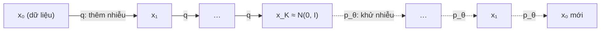

# Chương 11. Mô hình khuếch tán (Diffusion)

Nhỏ một giọt mực vào cốc nước: mực loang dần cho tới khi cả cốc chỉ còn một màu xám đều. Quá trình ấy dễ mô tả — mỗi phân tử mực bị va đập ngẫu nhiên — nhưng đảo ngược nó để thu lại giọt mực ban đầu dường như là bất khả thi. Mô hình khuếch tán (*diffusion model*) khai thác một điều bất ngờ: nếu mỗi bước "loang" đủ nhỏ, thì **từng bước** đảo ngược lại rất đơn giản, và một mạng nơ-ron có thể học được nó. Xếp hàng trăm bước đảo ngược nhỏ lại với nhau, ta biến nhiễu thuần túy thành dữ liệu.

Từ 2020, mô hình khuếch tán đã thay đổi bộ mặt của mô hình sinh: ảnh (DALL·E 2, Stable Diffusion), âm thanh (DiffWave, WaveGrad) và tiếng nói (Grad-TTS, NaturalSpeech 2). Chương này trình bày đầy đủ ba góc nhìn tương đương của diffusion — **biến ẩn rời rạc (DDPM)**, **điểm số (score)** và **phương trình vi phân ngẫu nhiên (SDE)** — vì mỗi hệ thống TTS lại được viết bằng một "ngôn ngữ" khác nhau, và bạn cần đọc được cả ba. Ta sẽ suy ra hàm mất mát dự đoán nhiễu từ ELBO từng bước một, rồi đi qua DDIM, các cách tham số hóa, classifier-free guidance và các kỹ thuật tăng tốc.

!!! abstract "Mục tiêu học tập"
    Sau chương này, bạn có thể:

    - **Suy ra** dạng đóng $q(\mathbf{x}_k \mid \mathbf{x}_0)$ và hậu nghiệm $q(\mathbf{x}_{k-1} \mid \mathbf{x}_k, \mathbf{x}_0)$ của quá trình thuận.
    - **Suy ra** từng bước từ ELBO tới hàm mất mát dự đoán nhiễu $\lVert \boldsymbol{\epsilon} - \boldsymbol{\epsilon}_\theta \rVert^2$, và giải thích vai trò của các trọng số bị bỏ đi.
    - **Cài đặt** huấn luyện và lấy mẫu DDPM, bộ lấy mẫu DDIM trên dữ liệu 2 chiều, rồi **đo** ảnh hưởng của số bước lấy mẫu.
    - **Giải thích** mối liên hệ giữa dự đoán nhiễu, điểm số $\nabla \log p$, khử nhiễu ghép điểm số (DSM) và động lực học Langevin.
    - **Suy ra** ODE dòng xác suất từ SDE thuận qua phương trình Fokker–Planck, và nhận ra DDIM là một cách rời rạc hóa của nó.
    - **Chuyển đổi** giữa các cách tham số hóa $\boldsymbol{\epsilon}$, $\mathbf{x}_0$, $\mathbf{v}$ và score; **chọn** lịch nhiễu phù hợp.
    - **Cài đặt** classifier-free guidance và **phân tích** đánh đổi giữa độ bám điều kiện và độ đa dạng.
    - **Liên hệ** các thành phần trên với Grad-TTS, DiffSinger, DiffWave/WaveGrad và NaturalSpeech 2.

!!! info "Kiến thức cần có"
    - [Chương 1](../phan-1-nen-tang/ch01-toan-nen-tang.md): Gaussian nhiều chiều, Bayes, KL; [Chương 3](../phan-1-nen-tang/ch03-toi-uu-va-ky-thuat-huan-luyen.md): Adam, lịch tốc độ học, EMA.
    - [Chương 5](../phan-1-nen-tang/ch05-transformer.md): positional encoding hình sin, cross-attention, AdaLN (cơ chế đưa điều kiện vào mạng).
    - [Chương 7](../phan-2-mo-hinh-sinh/ch07-tong-quan-mo-hinh-sinh.md): bài toán một-nhiều và hiện tượng mel bị làm mượt quá mức khi hồi quy L1/L2.
    - [Chương 8](../phan-2-mo-hinh-sinh/ch08-vae.md): ELBO và KL dạng đóng giữa hai Gaussian — diffusion là một "VAE phân cấp" đặc biệt.
    - [Chương 10](../phan-2-mo-hinh-sinh/ch10-normalizing-flows.md): flow liên tục (CNF) và phương trình liên tục.

!!! note "Ký hiệu trong chương"
    - $\mathbf{x}_0 \in \mathbb{R}^D$: một mẫu dữ liệu sạch (ví dụ mel-spectrogram $\mathbf{Y}$ làm phẳng); ở chương này $\mathbf{x}$ **không** phải chuỗi văn bản. Điều kiện (văn bản, người nói…) được ký hiệu chung là $\mathbf{c}$.
    - **Thời gian rời rạc**: $k = 0, 1, \ldots, K$ với $K$ là tổng số bước khuếch tán (sách dùng $K$ để không trùng với số khung $T$). $\mathbf{x}_k$ là dữ liệu đã nhiễu hóa $k$ bước.
    - **Thời gian liên tục**: $t \in [0, 1]$, với **$t = 0$ là dữ liệu, $t = 1$ là nhiễu** — quy ước của tài liệu diffusion/SDE.

!!! warning "Hai quy ước thời gian ngược nhau"
    Tài liệu flow matching (Lipman và cộng sự, 2023) và các hệ thống Matcha-TTS, F5-TTS dùng quy ước **ngược lại**: $t = 0$ là nhiễu, $t = 1$ là dữ liệu. [Chương 12](../phan-2-mo-hinh-sinh/ch12-flow-matching.md) theo quy ước đó. Khi chuyển mã hoặc công thức giữa hai họ, đây là lỗi số một cần kiểm tra.

## 11.1 Trực giác: phá hủy có kiểm soát, rồi học cách đảo ngược

Mô hình khuếch tán gồm hai quá trình:

- **Quá trình thuận** (*forward process*) $q$: cố định, **không có tham số**. Nó cộng dần nhiễu Gaussian vào dữ liệu qua $K$ bước nhỏ cho tới khi $\mathbf{x}_K$ gần như là nhiễu chuẩn thuần túy.
- **Quá trình ngược** (*reverse process*) $p_\theta$: học được. Bắt đầu từ $\mathbf{x}_K \sim \mathcal{N}(\mathbf{0}, \mathbf{I})$, mỗi bước khử một chút nhiễu để đi từ $\mathbf{x}_k$ về $\mathbf{x}_{k-1}$.



Vì sao cách tiếp cận vòng vèo này lại thành công?

1. **Mỗi bước ngược là một bài toán dễ.** Khi nhiễu thêm vào ở mỗi bước rất nhỏ, phân phối $q(\mathbf{x}_{k-1} \mid \mathbf{x}_k)$ xấp xỉ Gaussian (một kết quả kinh điển của lý thuyết quá trình khuếch tán, được Sohl-Dickstein và cộng sự, 2015 khai thác). Ta chỉ cần học **trung bình** của nó — một bài toán hồi quy.
2. **Huấn luyện ổn định.** Hàm mất mát cuối cùng là sai số bình phương trung bình, không có trò chơi minimax như GAN ([Chương 9](../phan-2-mo-hinh-sinh/ch09-gan.md)) và không cần kiến trúc khả nghịch như flow ([Chương 10](../phan-2-mo-hinh-sinh/ch10-normalizing-flows.md)): mạng khử nhiễu có kiến trúc tùy ý (U-Net, Transformer, WaveNet).
3. **Phủ mode tốt.** Mục tiêu bắt nguồn từ likelihood (KL thuận), nên mô hình không bỏ rơi các mode như GAN.

Cái giá: lấy mẫu cần **nhiều lần gọi mạng** (hàng chục đến hàng nghìn). Phần lớn nghiên cứu sau DDPM — DDIM, bộ giải ODE bậc cao, chưng cất, và cả flow matching — đều nhằm giảm con số này.

## 11.2 Quá trình thuận

### 11.2.1 Một bước nhiễu

Chọn một **lịch nhiễu** (*noise schedule*) $0 < \beta_1 < \beta_2 < \cdots < \beta_K < 1$ và đặt $\alpha_k = 1 - \beta_k$. Mỗi bước thuận là

$$
q(\mathbf{x}_k \mid \mathbf{x}_{k-1}) = \mathcal{N}\big(\mathbf{x}_k;\, \sqrt{\alpha_k}\, \mathbf{x}_{k-1},\, \beta_k \mathbf{I}\big)
\quad\Longleftrightarrow\quad
\mathbf{x}_k = \sqrt{\alpha_k}\, \mathbf{x}_{k-1} + \sqrt{\beta_k}\, \boldsymbol{\epsilon}_k, \quad \boldsymbol{\epsilon}_k \sim \mathcal{N}(\mathbf{0}, \mathbf{I}).
$$

Vì sao lại co tín hiệu bởi $\sqrt{1 - \beta_k}$ thay vì chỉ cộng nhiễu? Giả sử $\mathbf{x}_{k-1}$ có hiệp phương sai $\mathbf{I}$. Do $\boldsymbol{\epsilon}_k$ độc lập với $\mathbf{x}_{k-1}$:

$$
\operatorname{Cov}(\mathbf{x}_k) = \alpha_k \operatorname{Cov}(\mathbf{x}_{k-1}) + \beta_k \mathbf{I} = (\alpha_k + \beta_k)\, \mathbf{I} = \mathbf{I}.
$$

Phương sai được **bảo toàn** qua mọi bước — đây là lý do quá trình này được gọi là *variance preserving* (VP). Nếu ta chuẩn hóa dữ liệu về phương sai đơn vị, mọi $\mathbf{x}_k$ đều có thang đo tương đương nhau, rất thuận lợi cho mạng nơ-ron.

### 11.2.2 Dạng đóng $q(\mathbf{x}_k \mid \mathbf{x}_0)$

Muốn huấn luyện ở bước $k$, ta có phải chạy tuần tự $k$ bước nhiễu không? Không. Xét hai bước liên tiếp:

$$
\mathbf{x}_k = \sqrt{\alpha_k}\big(\sqrt{\alpha_{k-1}}\, \mathbf{x}_{k-2} + \sqrt{\beta_{k-1}}\, \boldsymbol{\epsilon}_{k-1}\big) + \sqrt{\beta_k}\, \boldsymbol{\epsilon}_k
= \sqrt{\alpha_k \alpha_{k-1}}\, \mathbf{x}_{k-2} + \underbrace{\sqrt{\alpha_k \beta_{k-1}}\, \boldsymbol{\epsilon}_{k-1} + \sqrt{\beta_k}\, \boldsymbol{\epsilon}_k}_{\text{tổng hai Gaussian độc lập}} .
$$

Tổng hai Gaussian độc lập trung bình 0 là Gaussian trung bình 0 với phương sai bằng tổng: $\alpha_k(1 - \alpha_{k-1}) + (1 - \alpha_k) = 1 - \alpha_k \alpha_{k-1}$. Đặt

$$
\bar{\alpha}_k = \prod_{i=1}^{k} \alpha_i, \qquad \bar{\alpha}_0 = 1,
$$

và lặp lại lập luận bằng quy nạp (giả sử $\mathbf{x}_{k-1} = \sqrt{\bar\alpha_{k-1}}\,\mathbf{x}_0 + \sqrt{1 - \bar\alpha_{k-1}}\,\boldsymbol{\epsilon}'$, thì phương sai nhiễu ở bước $k$ là $\alpha_k(1 - \bar\alpha_{k-1}) + \beta_k = 1 - \bar\alpha_k$), ta được:

$$
q(\mathbf{x}_k \mid \mathbf{x}_0) = \mathcal{N}\big(\mathbf{x}_k;\, \sqrt{\bar{\alpha}_k}\, \mathbf{x}_0,\, (1 - \bar{\alpha}_k)\, \mathbf{I}\big)
\quad\Longleftrightarrow\quad
\mathbf{x}_k = \sqrt{\bar{\alpha}_k}\, \mathbf{x}_0 + \sqrt{1 - \bar{\alpha}_k}\, \boldsymbol{\epsilon}, \quad \boldsymbol{\epsilon} \sim \mathcal{N}(\mathbf{0}, \mathbf{I}).
$$

Đây là công thức quan trọng nhất của chương về mặt thực hành: **lấy mẫu $\mathbf{x}_k$ ở bất kỳ bước nào chỉ tốn một phép nhân-cộng**. Khi huấn luyện, ta chọn ngẫu nhiên $k$ cho mỗi mẫu trong batch và nhiễu hóa trực tiếp.

### 11.2.3 Tỉ số tín hiệu trên nhiễu

Đại lượng hữu ích để so sánh các lịch nhiễu là **tỉ số tín hiệu trên nhiễu** (SNR):

$$
\operatorname{SNR}(k) = \frac{\bar{\alpha}_k}{1 - \bar{\alpha}_k}.
$$

$\operatorname{SNR}$ giảm đơn điệu theo $k$: từ $+\infty$ ở $k = 0$ về gần 0 ở $k = K$. Lịch nhiễu phải đủ mạnh để $\bar{\alpha}_K \approx 0$, khi đó $q(\mathbf{x}_K \mid \mathbf{x}_0) \approx \mathcal{N}(\mathbf{0}, \mathbf{I})$ **bất kể** $\mathbf{x}_0$ — điều kiện để có thể bắt đầu sinh mẫu từ nhiễu chuẩn. Lịch gốc của DDPM (Ho và cộng sự, 2020) dùng $K = 1000$ và $\beta_k$ tăng tuyến tính từ $10^{-4}$ tới $0{,}02$, cho $\bar\alpha_K \approx 4 \times 10^{-5}$.

### 11.2.4 Hậu nghiệm của quá trình thuận

Bản thân $q(\mathbf{x}_{k-1} \mid \mathbf{x}_k)$ không tính được (nó phụ thuộc vào toàn bộ phân phối dữ liệu). Nhưng nếu **biết thêm $\mathbf{x}_0$**, hậu nghiệm có dạng đóng — và đây chính là "đáp án" mà quá trình ngược sẽ học theo. Theo Bayes và tính Markov ($q(\mathbf{x}_k \mid \mathbf{x}_{k-1}, \mathbf{x}_0) = q(\mathbf{x}_k \mid \mathbf{x}_{k-1})$):

$$
q(\mathbf{x}_{k-1} \mid \mathbf{x}_k, \mathbf{x}_0) = \frac{q(\mathbf{x}_k \mid \mathbf{x}_{k-1})\, q(\mathbf{x}_{k-1} \mid \mathbf{x}_0)}{q(\mathbf{x}_k \mid \mathbf{x}_0)} .
$$

Mẫu số không phụ thuộc $\mathbf{x}_{k-1}$. Gọi $\mathbf{y} = \mathbf{x}_{k-1}$; số mũ của tử số (bỏ hằng số) là

$$
-\frac{1}{2}\Big[\frac{\lVert \mathbf{x}_k - \sqrt{\alpha_k}\,\mathbf{y} \rVert^2}{\beta_k} + \frac{\lVert \mathbf{y} - \sqrt{\bar\alpha_{k-1}}\,\mathbf{x}_0 \rVert^2}{1 - \bar\alpha_{k-1}}\Big]
= -\frac{1}{2}\Big[\Big(\frac{\alpha_k}{\beta_k} + \frac{1}{1 - \bar\alpha_{k-1}}\Big)\lVert \mathbf{y} \rVert^2 - 2\Big\langle \mathbf{y},\, \frac{\sqrt{\alpha_k}}{\beta_k}\mathbf{x}_k + \frac{\sqrt{\bar\alpha_{k-1}}}{1 - \bar\alpha_{k-1}}\mathbf{x}_0 \Big\rangle\Big] + \text{const}.
$$

Đây là một dạng toàn phương theo $\mathbf{y}$, nên hậu nghiệm là Gaussian. Hệ số của $\lVert \mathbf{y} \rVert^2$ là nghịch đảo phương sai:

$$
\frac{\alpha_k}{\beta_k} + \frac{1}{1 - \bar\alpha_{k-1}} = \frac{\alpha_k(1 - \bar\alpha_{k-1}) + \beta_k}{\beta_k(1 - \bar\alpha_{k-1})} = \frac{1 - \bar\alpha_k}{\beta_k(1 - \bar\alpha_{k-1})},
$$

(dùng $\alpha_k + \beta_k = 1$ và $\alpha_k \bar\alpha_{k-1} = \bar\alpha_k$). Trung bình bằng phương sai nhân với hệ số của số hạng tuyến tính. "Hoàn thành bình phương" cho:

$$
q(\mathbf{x}_{k-1} \mid \mathbf{x}_k, \mathbf{x}_0) = \mathcal{N}\big(\mathbf{x}_{k-1};\, \tilde{\boldsymbol{\mu}}_k(\mathbf{x}_k, \mathbf{x}_0),\, \tilde{\beta}_k \mathbf{I}\big),
$$

$$
\tilde{\boldsymbol{\mu}}_k(\mathbf{x}_k, \mathbf{x}_0) = \frac{\sqrt{\bar\alpha_{k-1}}\,\beta_k}{1 - \bar\alpha_k}\,\mathbf{x}_0 + \frac{\sqrt{\alpha_k}\,(1 - \bar\alpha_{k-1})}{1 - \bar\alpha_k}\,\mathbf{x}_k,
\qquad
\tilde{\beta}_k = \frac{1 - \bar\alpha_{k-1}}{1 - \bar\alpha_k}\,\beta_k .
$$

Trung bình hậu nghiệm là một **trung bình có trọng số** giữa dữ liệu sạch và điểm nhiễu hiện tại. Kiểm tra nhanh dạng đóng của quá trình thuận bằng mô phỏng:

```python
import math
import torch
import torch.nn as nn

torch.manual_seed(0)
K = 1000
# Đệm phần tử 0 để chỉ số khớp công thức: betas[k] = beta_k (k = 1..K), alpha_bars[0] = 1
betas = torch.cat([torch.zeros(1), torch.linspace(1e-4, 0.02, K)])     # (K+1,)
alphas = 1.0 - betas
alpha_bars = torch.cumprod(alphas, dim=0)                              # alpha_bars[k] = tích alpha_1..alpha_k
print(f"alpha_bar_K = {alpha_bars[K]:.2e}")

# Chạy tuần tự 300 bước thuận rồi so với dạng đóng N(sqrt(ab) x0, (1 - ab) I)
x = torch.full((200_000,), 1.5)                                        # x_0 = 1.5 cho mọi mẫu
for k in range(1, 301):
    x = alphas[k].sqrt() * x + betas[k].sqrt() * torch.randn_like(x)
ab = alpha_bars[300]
print(f"mô phỏng: TB = {x.mean():.4f}, phương sai = {x.var():.4f}")
print(f"dạng đóng: TB = {ab.sqrt() * 1.5:.4f}, phương sai = {1 - ab:.4f}")
assert abs(x.mean() - ab.sqrt() * 1.5) < 0.01 and abs(x.var() - (1 - ab)) < 0.01
```

## 11.3 Quá trình ngược và ELBO

### 11.3.1 Mô hình ngược

Ta mô hình hóa quá trình ngược bằng một chuỗi Markov Gaussian:

$$
p_\theta(\mathbf{x}_{0:K}) = p(\mathbf{x}_K) \prod_{k=1}^{K} p_\theta(\mathbf{x}_{k-1} \mid \mathbf{x}_k),
\qquad
p(\mathbf{x}_K) = \mathcal{N}(\mathbf{0}, \mathbf{I}),
\qquad
p_\theta(\mathbf{x}_{k-1} \mid \mathbf{x}_k) = \mathcal{N}\big(\boldsymbol{\mu}_\theta(\mathbf{x}_k, k),\, \sigma_k^2 \mathbf{I}\big).
$$

Phương sai $\sigma_k^2$ được cố định (không học), còn trung bình $\boldsymbol{\mu}_\theta$ do mạng nơ-ron dự đoán. Mô hình sinh $p_\theta(\mathbf{x}_0) = \int p_\theta(\mathbf{x}_{0:K})\, d\mathbf{x}_{1:K}$ là một mô hình biến ẩn với $K$ tầng biến ẩn $\mathbf{x}_1, \ldots, \mathbf{x}_K$ cùng số chiều với dữ liệu — một "VAE phân cấp" mà bộ mã hóa $q$ **cố định**.

### 11.3.2 Suy ra ELBO

Như ở [Chương 8](../phan-2-mo-hinh-sinh/ch08-vae.md), dùng $q(\mathbf{x}_{1:K} \mid \mathbf{x}_0) = \prod_{k=1}^K q(\mathbf{x}_k \mid \mathbf{x}_{k-1})$ làm phân phối đề xuất và bất đẳng thức Jensen:

$$
\log p_\theta(\mathbf{x}_0) = \log \mathbb{E}_{q(\mathbf{x}_{1:K} \mid \mathbf{x}_0)}\Big[\frac{p_\theta(\mathbf{x}_{0:K})}{q(\mathbf{x}_{1:K} \mid \mathbf{x}_0)}\Big] \ge \mathbb{E}_{q}\Big[\log \frac{p_\theta(\mathbf{x}_{0:K})}{q(\mathbf{x}_{1:K} \mid \mathbf{x}_0)}\Big].
$$

Gọi $\mathcal{L} = -\text{ELBO}$ (để cực tiểu hóa). Thay các tích vào:

$$
\mathcal{L} = \mathbb{E}_q\Big[-\log p(\mathbf{x}_K) - \sum_{k=1}^{K} \log \frac{p_\theta(\mathbf{x}_{k-1} \mid \mathbf{x}_k)}{q(\mathbf{x}_k \mid \mathbf{x}_{k-1})}\Big].
$$

Dạng này đúng nhưng có phương sai cao khi ước lượng (mỗi số hạng phụ thuộc hai biến ngẫu nhiên). Mẹo then chốt: với $k \ge 2$, viết lại mẫu số bằng hậu nghiệm có điều kiện $\mathbf{x}_0$ ở mục 11.2.4:

$$
q(\mathbf{x}_k \mid \mathbf{x}_{k-1}) = \frac{q(\mathbf{x}_{k-1} \mid \mathbf{x}_k, \mathbf{x}_0)\, q(\mathbf{x}_k \mid \mathbf{x}_0)}{q(\mathbf{x}_{k-1} \mid \mathbf{x}_0)} .
$$

Tách số hạng $k = 1$ ra riêng và thay vào tổng từ $k = 2$:

$$
\sum_{k=2}^{K} \log \frac{p_\theta(\mathbf{x}_{k-1} \mid \mathbf{x}_k)}{q(\mathbf{x}_k \mid \mathbf{x}_{k-1})}
= \sum_{k=2}^{K} \log \frac{p_\theta(\mathbf{x}_{k-1} \mid \mathbf{x}_k)}{q(\mathbf{x}_{k-1} \mid \mathbf{x}_k, \mathbf{x}_0)} + \sum_{k=2}^{K} \log \frac{q(\mathbf{x}_{k-1} \mid \mathbf{x}_0)}{q(\mathbf{x}_k \mid \mathbf{x}_0)} .
$$

Tổng thứ hai **triệt tiêu dây chuyền** (*telescoping*): chỉ còn $\log q(\mathbf{x}_1 \mid \mathbf{x}_0) - \log q(\mathbf{x}_K \mid \mathbf{x}_0)$. Số hạng $k = 1$ là $\log p_\theta(\mathbf{x}_0 \mid \mathbf{x}_1) - \log q(\mathbf{x}_1 \mid \mathbf{x}_0)$, và $\log q(\mathbf{x}_1 \mid \mathbf{x}_0)$ triệt tiêu với số hạng vừa còn lại. Gom các số hạng thành KL:

$$
\mathcal{L} =
\underbrace{D_{\mathrm{KL}}\big(q(\mathbf{x}_K \mid \mathbf{x}_0) \,\Vert\, p(\mathbf{x}_K)\big)}_{\mathcal{L}_K}
+ \sum_{k=2}^{K} \underbrace{\mathbb{E}_{q(\mathbf{x}_k \mid \mathbf{x}_0)}\Big[D_{\mathrm{KL}}\big(q(\mathbf{x}_{k-1} \mid \mathbf{x}_k, \mathbf{x}_0) \,\Vert\, p_\theta(\mathbf{x}_{k-1} \mid \mathbf{x}_k)\big)\Big]}_{\mathcal{L}_{k-1}}
\underbrace{- \mathbb{E}_{q(\mathbf{x}_1 \mid \mathbf{x}_0)}\big[\log p_\theta(\mathbf{x}_0 \mid \mathbf{x}_1)\big]}_{\mathcal{L}_0} .
$$

Đọc từng số hạng:

- $\mathcal{L}_K$: nhiễu cuối của quá trình thuận khớp với prior tới đâu. **Không có tham số** — chỉ phụ thuộc lịch nhiễu, và gần 0 khi $\bar\alpha_K \approx 0$.
- $\mathcal{L}_{k-1}$: mỗi bước ngược của mô hình phải khớp với hậu nghiệm "biết đáp án" $q(\mathbf{x}_{k-1} \mid \mathbf{x}_k, \mathbf{x}_0)$. Cả hai đều Gaussian nên KL có dạng đóng.
- $\mathcal{L}_0$: số hạng tái tạo, giống VAE.

### 11.3.3 Từ KL tới khớp trung bình

KL giữa hai Gaussian đẳng hướng $\mathcal{N}(\boldsymbol{\mu}_1, s_1^2\mathbf{I})$ và $\mathcal{N}(\boldsymbol{\mu}_2, s_2^2\mathbf{I})$ trong $\mathbb{R}^D$ là (xem [Chương 8](../phan-2-mo-hinh-sinh/ch08-vae.md)):

$$
D_{\mathrm{KL}} = \frac{D}{2}\Big(\frac{s_1^2}{s_2^2} - 1 - \log\frac{s_1^2}{s_2^2}\Big) + \frac{\lVert \boldsymbol{\mu}_1 - \boldsymbol{\mu}_2 \rVert^2}{2 s_2^2}.
$$

Với $s_1^2 = \tilde\beta_k$, $s_2^2 = \sigma_k^2$ cố định, phần đầu là hằng số theo $\theta$, nên

$$
\mathcal{L}_{k-1} = \mathbb{E}_{q}\Big[\frac{1}{2\sigma_k^2}\big\lVert \tilde{\boldsymbol{\mu}}_k(\mathbf{x}_k, \mathbf{x}_0) - \boldsymbol{\mu}_\theta(\mathbf{x}_k, k) \big\rVert^2\Big] + C .
$$

Mạng chỉ cần dự đoán **trung bình hậu nghiệm** — một bài toán hồi quy.

### 11.3.4 Tham số hóa bằng nhiễu

Dự đoán trực tiếp $\tilde{\boldsymbol{\mu}}_k$ là được, nhưng Ho và cộng sự (2020) phát hiện một cách tham số hóa tốt hơn nhiều. Từ dạng đóng, $\mathbf{x}_0 = \big(\mathbf{x}_k - \sqrt{1 - \bar\alpha_k}\,\boldsymbol{\epsilon}\big)/\sqrt{\bar\alpha_k}$. Thay vào số hạng $\mathbf{x}_0$ của $\tilde{\boldsymbol{\mu}}_k$ và dùng $\sqrt{\bar\alpha_{k-1}}/\sqrt{\bar\alpha_k} = 1/\sqrt{\alpha_k}$:

$$
\frac{\sqrt{\bar\alpha_{k-1}}\,\beta_k}{1 - \bar\alpha_k}\,\mathbf{x}_0 = \frac{\beta_k}{(1 - \bar\alpha_k)\sqrt{\alpha_k}}\big(\mathbf{x}_k - \sqrt{1 - \bar\alpha_k}\,\boldsymbol{\epsilon}\big).
$$

Hệ số của $\mathbf{x}_k$ trong $\tilde{\boldsymbol{\mu}}_k$ khi đó là

$$
\frac{\beta_k}{(1 - \bar\alpha_k)\sqrt{\alpha_k}} + \frac{\sqrt{\alpha_k}(1 - \bar\alpha_{k-1})}{1 - \bar\alpha_k}
= \frac{\beta_k + \alpha_k - \bar\alpha_k}{(1 - \bar\alpha_k)\sqrt{\alpha_k}}
= \frac{1}{\sqrt{\alpha_k}},
$$

còn hệ số của $\boldsymbol{\epsilon}$ là $-\beta_k / \big(\sqrt{\alpha_k}\sqrt{1 - \bar\alpha_k}\big)$. Vậy

$$
\tilde{\boldsymbol{\mu}}_k = \frac{1}{\sqrt{\alpha_k}}\Big(\mathbf{x}_k - \frac{\beta_k}{\sqrt{1 - \bar\alpha_k}}\,\boldsymbol{\epsilon}\Big).
$$

Vì $\mathbf{x}_k$ là đầu vào đã biết, cách tự nhiên là cho mạng dự đoán **nhiễu** $\boldsymbol{\epsilon}$ đã được thêm vào:

$$
\boldsymbol{\mu}_\theta(\mathbf{x}_k, k) = \frac{1}{\sqrt{\alpha_k}}\Big(\mathbf{x}_k - \frac{\beta_k}{\sqrt{1 - \bar\alpha_k}}\,\boldsymbol{\epsilon}_\theta(\mathbf{x}_k, k)\Big).
$$

Hiệu hai trung bình chỉ còn hiệu hai nhiễu: $\tilde{\boldsymbol{\mu}}_k - \boldsymbol{\mu}_\theta = -\frac{\beta_k}{\sqrt{\alpha_k}\sqrt{1 - \bar\alpha_k}}\big(\boldsymbol{\epsilon} - \boldsymbol{\epsilon}_\theta\big)$. Do đó

$$
\mathcal{L}_{k-1} = \mathbb{E}_{\mathbf{x}_0, \boldsymbol{\epsilon}}\Big[\underbrace{\frac{\beta_k^2}{2\sigma_k^2\,\alpha_k\,(1 - \bar\alpha_k)}}_{\lambda_k}\big\lVert \boldsymbol{\epsilon} - \boldsymbol{\epsilon}_\theta\big(\sqrt{\bar\alpha_k}\,\mathbf{x}_0 + \sqrt{1 - \bar\alpha_k}\,\boldsymbol{\epsilon},\; k\big)\big\rVert^2\Big] + C .
$$

### 11.3.5 Hàm mất mát đơn giản hóa

Ho và cộng sự (2020) đề xuất **bỏ trọng số** $\lambda_k$ và lấy $k$ đều trên $\{1, \ldots, K\}$ (số hạng $\mathcal{L}_0$ cũng được xử lý như $k = 1$ khi dữ liệu liên tục):

$$
\mathcal{L}_{\text{simple}}(\theta) = \mathbb{E}_{k \sim \mathcal{U}\{1, \ldots, K\},\; \mathbf{x}_0 \sim p_{\text{data}},\; \boldsymbol{\epsilon} \sim \mathcal{N}(\mathbf{0}, \mathbf{I})}\Big[\big\lVert \boldsymbol{\epsilon} - \boldsymbol{\epsilon}_\theta\big(\sqrt{\bar\alpha_k}\,\mathbf{x}_0 + \sqrt{1 - \bar\alpha_k}\,\boldsymbol{\epsilon},\; k\big)\big\rVert^2\Big].
$$

Bỏ trọng số không phải là cẩu thả mà là một lựa chọn có chủ đích. Với $\sigma_k^2 = \beta_k$ và lịch tuyến tính, $\lambda_k = \beta_k / \big(2\alpha_k(1 - \bar\alpha_k)\big)$ xấp xỉ $0{,}5$ ở $k = 1$ nhưng chỉ cỡ $0{,}005$ ở giữa chuỗi: ELBO thật dồn trọng số vào các bước nhiễu rất nhỏ — những bước khử nhiễu "dễ", ảnh hưởng ít tới chất lượng cảm nhận. $\mathcal{L}_{\text{simple}}$ tái phân bổ sức học sang các mức nhiễu lớn, nơi mô hình phải "tưởng tượng" cấu trúc thô. Kết quả thực nghiệm: mẫu đẹp hơn rõ rệt, dù log-likelihood kém hơn một chút. Đây là chủ đề lặp lại trong mọi chương sau: **trọng số theo mức nhiễu là một siêu tham số thiết kế**, không phải hằng số trời cho.

Về phương sai ngược $\sigma_k^2$, Ho và cộng sự thử $\sigma_k^2 = \beta_k$ và $\sigma_k^2 = \tilde\beta_k$ — hai cận trên và dưới hợp lý — và thấy chất lượng tương đương khi $K$ lớn. Nichol và Dhariwal (2021) cho mạng học nội suy giữa hai giá trị này, giúp lấy mẫu tốt hơn khi dùng ít bước.

## 11.4 Huấn luyện và lấy mẫu DDPM

Hai thuật toán của DDPM ngắn gọn đến bất ngờ:

!!! example "Thuật toán DDPM"
    **Huấn luyện** — lặp tới khi hội tụ:

    1. Lấy $\mathbf{x}_0 \sim p_{\text{data}}$, $k \sim \mathcal{U}\{1, \ldots, K\}$, $\boldsymbol{\epsilon} \sim \mathcal{N}(\mathbf{0}, \mathbf{I})$.
    2. Bước gradient trên $\lVert \boldsymbol{\epsilon} - \boldsymbol{\epsilon}_\theta(\sqrt{\bar\alpha_k}\,\mathbf{x}_0 + \sqrt{1 - \bar\alpha_k}\,\boldsymbol{\epsilon}, k) \rVert^2$.

    **Lấy mẫu**:

    1. $\mathbf{x}_K \sim \mathcal{N}(\mathbf{0}, \mathbf{I})$.
    2. Với $k = K, \ldots, 1$: lấy $\mathbf{z} \sim \mathcal{N}(\mathbf{0}, \mathbf{I})$ nếu $k > 1$, ngược lại $\mathbf{z} = \mathbf{0}$; tính
       $\mathbf{x}_{k-1} = \frac{1}{\sqrt{\alpha_k}}\big(\mathbf{x}_k - \frac{\beta_k}{\sqrt{1 - \bar\alpha_k}}\boldsymbol{\epsilon}_\theta(\mathbf{x}_k, k)\big) + \sigma_k \mathbf{z}$.
    3. Trả về $\mathbf{x}_0$.

Hãy cài đặt trên dữ liệu đồ chơi: 8 cụm Gaussian nhỏ (độ lệch chuẩn 0,1) đặt đều trên đường tròn bán kính 2. Dữ liệu này đa mode rõ rệt, nên ta đo được hai lỗi điển hình của mô hình sinh: **mất mode** (một số cụm vắng mẫu) và **mẫu nhòe** (mẫu rơi vào giữa các cụm). Mạng $\boldsymbol{\epsilon}_\theta$ là một MLP nhận điểm 2 chiều và embedding hình sin của $k$ (giống positional encoding ở [Chương 5](../phan-1-nen-tang/ch05-transformer.md)).

```python
CENTERS = 2.0 * torch.stack([torch.cos(2 * math.pi * torch.arange(8) / 8),
                             torch.sin(2 * math.pi * torch.arange(8) / 8)], dim=1)   # (8, 2)


def sample_ring(n: int, std: float = 0.1):
    """8 cụm Gaussian trên đường tròn bán kính 2; trả về điểm (n, 2) và nhãn cụm (n,)."""
    c = torch.randint(0, 8, (n,))
    return CENTERS[c] + std * torch.randn(n, 2), c


def timestep_embedding(k: torch.Tensor, dim: int = 32) -> torch.Tensor:
    """Embedding hình sin của chỉ số bước k."""
    half = dim // 2
    freqs = torch.exp(-math.log(10_000.0) * torch.arange(half) / half)
    ang = k.float()[:, None] * freqs[None]                             # (B, half)
    return torch.cat([torch.sin(ang), torch.cos(ang)], dim=-1)         # (B, dim)


class EpsNet(nn.Module):
    """epsilon_theta(x_k, k): MLP nhỏ nhận điểm 2-D và embedding của k."""

    def __init__(self, hidden: int = 128):
        super().__init__()
        self.net = nn.Sequential(nn.Linear(2 + 32, hidden), nn.SiLU(),
                                 nn.Linear(hidden, hidden), nn.SiLU(),
                                 nn.Linear(hidden, hidden), nn.SiLU(),
                                 nn.Linear(hidden, 2))

    def forward(self, x, k):                                           # x: (B, 2), k: (B,)
        return self.net(torch.cat([x, timestep_embedding(k)], dim=-1))


def q_sample(x0, k, eps):
    """x_k ~ q(x_k | x_0) bằng dạng đóng."""
    ab = alpha_bars[k][:, None]                                        # (B, 1)
    return ab.sqrt() * x0 + (1 - ab).sqrt() * eps


model = EpsNet()
n_iters = 4000
opt = torch.optim.Adam(model.parameters(), lr=2e-3)
sched = torch.optim.lr_scheduler.CosineAnnealingLR(opt, n_iters)
for it in range(1, n_iters + 1):
    x0, _ = sample_ring(256)
    k = torch.randint(1, K + 1, (256,))                                # k ~ U{1, ..., K}
    eps = torch.randn_like(x0)
    loss = ((model(q_sample(x0, k, eps), k) - eps) ** 2).mean()        # L_simple
    opt.zero_grad()
    loss.backward()
    opt.step()
    sched.step()
    if it % 1000 == 0:
        print(f"vòng {it}: L_simple = {loss.item():.4f}")
```

Lấy mẫu theo đúng thuật toán trên (dùng $\sigma_k^2 = \beta_k$), rồi đo **precision** — tỉ lệ mẫu nằm trong bán kính 0,3 (ba độ lệch chuẩn) quanh tâm cụm gần nhất — và số mẫu rơi vào mỗi cụm:

```python
@torch.no_grad()
def ddpm_sample(model, n: int) -> torch.Tensor:
    x = torch.randn(n, 2)                                              # x_K ~ N(0, I)
    for k in range(K, 0, -1):
        eps = model(x, torch.full((n,), k))
        mean = (x - betas[k] / (1 - alpha_bars[k]).sqrt() * eps) / alphas[k].sqrt()
        if k > 1:
            x = mean + betas[k].sqrt() * torch.randn_like(x)           # sigma_k^2 = beta_k
        else:
            x = mean                                                   # bước cuối: không thêm nhiễu
    return x


def mode_report(xs: torch.Tensor, name: str) -> float:
    dist, idx = torch.cdist(xs, CENTERS).min(dim=1)                    # khoảng cách tới tâm gần nhất
    precision = (dist < 0.3).float().mean().item()
    counts = torch.bincount(idx, minlength=8).tolist()
    print(f"{name:20s} precision = {precision:.3f}, số mẫu mỗi cụm = {counts}")
    return precision


mode_report(sample_ring(2000)[0], "dữ liệu thật")
prec_ddpm = mode_report(ddpm_sample(model, 2000), "DDPM, 1000 bước")
assert prec_ddpm > 0.7
```

Trong lần chạy của chúng tôi (khoảng mười giây huấn luyện trên CPU), dữ liệu thật có precision cỡ 0,99 (đúng bằng xác suất một Gaussian 2 chiều nằm trong ba độ lệch chuẩn), còn DDPM đạt cỡ 0,9 với cả 8 cụm đều có số mẫu xấp xỉ nhau — **không mất mode**. Phần mẫu còn lại hơi "nhòe" ra ngoài cụm; một mạng lớn hơn, huấn luyện lâu hơn và dùng EMA trọng số sẽ thu hẹp khoảng cách này.
