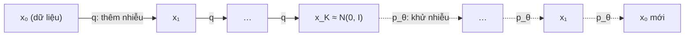

# Chương 11. Mô hình khuếch tán (Diffusion)

Nhỏ một giọt mực vào cốc nước: mực loang dần cho tới khi cả cốc chỉ còn một màu xám đều. Quá trình ấy dễ mô tả — mỗi phân tử mực bị va đập ngẫu nhiên — nhưng đảo ngược nó để thu lại giọt mực ban đầu dường như là bất khả thi. Mô hình khuếch tán (*diffusion model*) khai thác một điều bất ngờ: nếu mỗi bước "loang" đủ nhỏ, thì **từng bước** đảo ngược lại rất đơn giản, và một mạng nơ-ron có thể học được nó. Xếp hàng trăm bước đảo ngược nhỏ lại với nhau, ta biến nhiễu thuần túy thành dữ liệu.

Từ 2020, mô hình khuếch tán đã thay đổi bộ mặt của mô hình sinh: ảnh (DALL·E 2, Stable Diffusion), âm thanh (DiffWave, WaveGrad) và tiếng nói (Grad-TTS, NaturalSpeech 2). Chương này trình bày đầy đủ ba góc nhìn tương đương của diffusion — **biến ẩn rời rạc (DDPM)**, **điểm số (score)** và **phương trình vi phân ngẫu nhiên (SDE)** — vì mỗi hệ thống TTS lại được viết bằng một "ngôn ngữ" khác nhau, và bạn cần đọc được cả ba. Ta sẽ suy ra hàm mất mát dự đoán nhiễu từ ELBO từng bước một, rồi đi qua DDIM, các cách tham số hóa, classifier-free guidance và các kỹ thuật tăng tốc.

!!! abstract "Mục tiêu học tập"
    Sau chương này, bạn có thể:

    - **Suy ra** dạng đóng $q(\mathbf{x}_k \mid \mathbf{x}_0)$ và hậu nghiệm $q(\mathbf{x}_{k-1} \mid \mathbf{x}_k, \mathbf{x}_0)$ của quá trình thuận.
    - **Suy ra** từng bước từ ELBO tới hàm mất mát dự đoán nhiễu $\lVert \boldsymbol{\epsilon} - \boldsymbol{\epsilon}_\theta \rVert^2$, và giải thích vai trò của các trọng số bị bỏ đi.
    - **Cài đặt** huấn luyện và lấy mẫu DDPM, bộ lấy mẫu DDIM trên dữ liệu 2 chiều, rồi **đo** ảnh hưởng của số bước lấy mẫu.
    - **Giải thích** mối liên hệ giữa dự đoán nhiễu, điểm số $\nabla \log p$, khử nhiễu ghép điểm số (DSM) và động lực học Langevin.
    - **Suy ra** ODE dòng xác suất từ SDE thuận qua phương trình Fokker–Planck, và nhận ra DDIM là một cách rời rạc hóa của nó.
    - **Chuyển đổi** giữa các cách tham số hóa $\boldsymbol{\epsilon}$, $\mathbf{x}_0$, $\mathbf{v}$ và score; **chọn** lịch nhiễu phù hợp.
    - **Cài đặt** classifier-free guidance và **phân tích** đánh đổi giữa độ bám điều kiện và độ đa dạng.
    - **Liên hệ** các thành phần trên với Grad-TTS, DiffSinger, DiffWave/WaveGrad và NaturalSpeech 2.

!!! info "Kiến thức cần có"
    - [Chương 1](../phan-1-nen-tang/ch01-toan-nen-tang.md): Gaussian nhiều chiều, Bayes, KL; [Chương 3](../phan-1-nen-tang/ch03-toi-uu-va-ky-thuat-huan-luyen.md): Adam, lịch tốc độ học, EMA.
    - [Chương 5](../phan-1-nen-tang/ch05-transformer.md): positional encoding hình sin, cross-attention, AdaLN (cơ chế đưa điều kiện vào mạng).
    - [Chương 7](../phan-2-mo-hinh-sinh/ch07-tong-quan-mo-hinh-sinh.md): bài toán một-nhiều và hiện tượng mel bị làm mượt quá mức khi hồi quy L1/L2.
    - [Chương 8](../phan-2-mo-hinh-sinh/ch08-vae.md): ELBO và KL dạng đóng giữa hai Gaussian — diffusion là một "VAE phân cấp" đặc biệt.
    - [Chương 10](../phan-2-mo-hinh-sinh/ch10-normalizing-flows.md): flow liên tục (CNF) và phương trình liên tục.

!!! note "Ký hiệu trong chương"
    - $\mathbf{x}_0 \in \mathbb{R}^D$: một mẫu dữ liệu sạch (ví dụ mel-spectrogram $\mathbf{Y}$ làm phẳng); ở chương này $\mathbf{x}$ **không** phải chuỗi văn bản. Điều kiện (văn bản, người nói…) được ký hiệu chung là $\mathbf{c}$.
    - **Thời gian rời rạc**: $k = 0, 1, \ldots, K$ với $K$ là tổng số bước khuếch tán (sách dùng $K$ để không trùng với số khung $T$). $\mathbf{x}_k$ là dữ liệu đã nhiễu hóa $k$ bước.
    - **Thời gian liên tục**: $t \in [0, 1]$, với **$t = 0$ là dữ liệu, $t = 1$ là nhiễu** — quy ước của tài liệu diffusion/SDE.

!!! warning "Hai quy ước thời gian ngược nhau"
    Tài liệu flow matching (Lipman và cộng sự, 2023) và các hệ thống Matcha-TTS, F5-TTS dùng quy ước **ngược lại**: $t = 0$ là nhiễu, $t = 1$ là dữ liệu. [Chương 12](../phan-2-mo-hinh-sinh/ch12-flow-matching.md) theo quy ước đó. Khi chuyển mã hoặc công thức giữa hai họ, đây là lỗi số một cần kiểm tra.

## 11.1 Trực giác: phá hủy có kiểm soát, rồi học cách đảo ngược

Mô hình khuếch tán gồm hai quá trình:

- **Quá trình thuận** (*forward process*) $q$: cố định, **không có tham số**. Nó cộng dần nhiễu Gaussian vào dữ liệu qua $K$ bước nhỏ cho tới khi $\mathbf{x}_K$ gần như là nhiễu chuẩn thuần túy.
- **Quá trình ngược** (*reverse process*) $p_\theta$: học được. Bắt đầu từ $\mathbf{x}_K \sim \mathcal{N}(\mathbf{0}, \mathbf{I})$, mỗi bước khử một chút nhiễu để đi từ $\mathbf{x}_k$ về $\mathbf{x}_{k-1}$.



Vì sao cách tiếp cận vòng vèo này lại thành công?

1. **Mỗi bước ngược là một bài toán dễ.** Khi nhiễu thêm vào ở mỗi bước rất nhỏ, phân phối $q(\mathbf{x}_{k-1} \mid \mathbf{x}_k)$ xấp xỉ Gaussian (một kết quả kinh điển của lý thuyết quá trình khuếch tán, được Sohl-Dickstein và cộng sự, 2015 khai thác). Ta chỉ cần học **trung bình** của nó — một bài toán hồi quy.
2. **Huấn luyện ổn định.** Hàm mất mát cuối cùng là sai số bình phương trung bình, không có trò chơi minimax như GAN ([Chương 9](../phan-2-mo-hinh-sinh/ch09-gan.md)) và không cần kiến trúc khả nghịch như flow ([Chương 10](../phan-2-mo-hinh-sinh/ch10-normalizing-flows.md)): mạng khử nhiễu có kiến trúc tùy ý (U-Net, Transformer, WaveNet).
3. **Phủ mode tốt.** Mục tiêu bắt nguồn từ likelihood (KL thuận), nên mô hình không bỏ rơi các mode như GAN.

Cái giá: lấy mẫu cần **nhiều lần gọi mạng** (hàng chục đến hàng nghìn). Phần lớn nghiên cứu sau DDPM — DDIM, bộ giải ODE bậc cao, chưng cất, và cả flow matching — đều nhằm giảm con số này.

## 11.2 Quá trình thuận

### 11.2.1 Một bước nhiễu

Chọn một **lịch nhiễu** (*noise schedule*) $0 < \beta_1 < \beta_2 < \cdots < \beta_K < 1$ và đặt $\alpha_k = 1 - \beta_k$. Mỗi bước thuận là

$$
q(\mathbf{x}_k \mid \mathbf{x}_{k-1}) = \mathcal{N}\big(\mathbf{x}_k;\, \sqrt{\alpha_k}\, \mathbf{x}_{k-1},\, \beta_k \mathbf{I}\big)
\quad\Longleftrightarrow\quad
\mathbf{x}_k = \sqrt{\alpha_k}\, \mathbf{x}_{k-1} + \sqrt{\beta_k}\, \boldsymbol{\epsilon}_k, \quad \boldsymbol{\epsilon}_k \sim \mathcal{N}(\mathbf{0}, \mathbf{I}).
$$

Vì sao lại co tín hiệu bởi $\sqrt{1 - \beta_k}$ thay vì chỉ cộng nhiễu? Giả sử $\mathbf{x}_{k-1}$ có hiệp phương sai $\mathbf{I}$. Do $\boldsymbol{\epsilon}_k$ độc lập với $\mathbf{x}_{k-1}$:

$$
\operatorname{Cov}(\mathbf{x}_k) = \alpha_k \operatorname{Cov}(\mathbf{x}_{k-1}) + \beta_k \mathbf{I} = (\alpha_k + \beta_k)\, \mathbf{I} = \mathbf{I}.
$$

Phương sai được **bảo toàn** qua mọi bước — đây là lý do quá trình này được gọi là *variance preserving* (VP). Nếu ta chuẩn hóa dữ liệu về phương sai đơn vị, mọi $\mathbf{x}_k$ đều có thang đo tương đương nhau, rất thuận lợi cho mạng nơ-ron.

### 11.2.2 Dạng đóng $q(\mathbf{x}_k \mid \mathbf{x}_0)$

Muốn huấn luyện ở bước $k$, ta có phải chạy tuần tự $k$ bước nhiễu không? Không. Xét hai bước liên tiếp:

$$
\mathbf{x}_k = \sqrt{\alpha_k}\big(\sqrt{\alpha_{k-1}}\, \mathbf{x}_{k-2} + \sqrt{\beta_{k-1}}\, \boldsymbol{\epsilon}_{k-1}\big) + \sqrt{\beta_k}\, \boldsymbol{\epsilon}_k
= \sqrt{\alpha_k \alpha_{k-1}}\, \mathbf{x}_{k-2} + \underbrace{\sqrt{\alpha_k \beta_{k-1}}\, \boldsymbol{\epsilon}_{k-1} + \sqrt{\beta_k}\, \boldsymbol{\epsilon}_k}_{\text{tổng hai Gaussian độc lập}} .
$$

Tổng hai Gaussian độc lập trung bình 0 là Gaussian trung bình 0 với phương sai bằng tổng: $\alpha_k(1 - \alpha_{k-1}) + (1 - \alpha_k) = 1 - \alpha_k \alpha_{k-1}$. Đặt

$$
\bar{\alpha}_k = \prod_{i=1}^{k} \alpha_i, \qquad \bar{\alpha}_0 = 1,
$$

và lặp lại lập luận bằng quy nạp (giả sử $\mathbf{x}_{k-1} = \sqrt{\bar\alpha_{k-1}}\,\mathbf{x}_0 + \sqrt{1 - \bar\alpha_{k-1}}\,\boldsymbol{\epsilon}'$, thì phương sai nhiễu ở bước $k$ là $\alpha_k(1 - \bar\alpha_{k-1}) + \beta_k = 1 - \bar\alpha_k$), ta được:

$$
q(\mathbf{x}_k \mid \mathbf{x}_0) = \mathcal{N}\big(\mathbf{x}_k;\, \sqrt{\bar{\alpha}_k}\, \mathbf{x}_0,\, (1 - \bar{\alpha}_k)\, \mathbf{I}\big)
\quad\Longleftrightarrow\quad
\mathbf{x}_k = \sqrt{\bar{\alpha}_k}\, \mathbf{x}_0 + \sqrt{1 - \bar{\alpha}_k}\, \boldsymbol{\epsilon}, \quad \boldsymbol{\epsilon} \sim \mathcal{N}(\mathbf{0}, \mathbf{I}).
$$

Đây là công thức quan trọng nhất của chương về mặt thực hành: **lấy mẫu $\mathbf{x}_k$ ở bất kỳ bước nào chỉ tốn một phép nhân-cộng**. Khi huấn luyện, ta chọn ngẫu nhiên $k$ cho mỗi mẫu trong batch và nhiễu hóa trực tiếp.

### 11.2.3 Tỉ số tín hiệu trên nhiễu

Đại lượng hữu ích để so sánh các lịch nhiễu là **tỉ số tín hiệu trên nhiễu** (SNR):

$$
\operatorname{SNR}(k) = \frac{\bar{\alpha}_k}{1 - \bar{\alpha}_k}.
$$

$\operatorname{SNR}$ giảm đơn điệu theo $k$: từ $+\infty$ ở $k = 0$ về gần 0 ở $k = K$. Lịch nhiễu phải đủ mạnh để $\bar{\alpha}_K \approx 0$, khi đó $q(\mathbf{x}_K \mid \mathbf{x}_0) \approx \mathcal{N}(\mathbf{0}, \mathbf{I})$ **bất kể** $\mathbf{x}_0$ — điều kiện để có thể bắt đầu sinh mẫu từ nhiễu chuẩn. Lịch gốc của DDPM (Ho và cộng sự, 2020) dùng $K = 1000$ và $\beta_k$ tăng tuyến tính từ $10^{-4}$ tới $0{,}02$, cho $\bar\alpha_K \approx 4 \times 10^{-5}$.

### 11.2.4 Hậu nghiệm của quá trình thuận

Bản thân $q(\mathbf{x}_{k-1} \mid \mathbf{x}_k)$ không tính được (nó phụ thuộc vào toàn bộ phân phối dữ liệu). Nhưng nếu **biết thêm $\mathbf{x}_0$**, hậu nghiệm có dạng đóng — và đây chính là "đáp án" mà quá trình ngược sẽ học theo. Theo Bayes và tính Markov ($q(\mathbf{x}_k \mid \mathbf{x}_{k-1}, \mathbf{x}_0) = q(\mathbf{x}_k \mid \mathbf{x}_{k-1})$):

$$
q(\mathbf{x}_{k-1} \mid \mathbf{x}_k, \mathbf{x}_0) = \frac{q(\mathbf{x}_k \mid \mathbf{x}_{k-1})\, q(\mathbf{x}_{k-1} \mid \mathbf{x}_0)}{q(\mathbf{x}_k \mid \mathbf{x}_0)} .
$$

Mẫu số không phụ thuộc $\mathbf{x}_{k-1}$. Gọi $\mathbf{y} = \mathbf{x}_{k-1}$; số mũ của tử số (bỏ hằng số) là

$$
-\frac{1}{2}\Big[\frac{\lVert \mathbf{x}_k - \sqrt{\alpha_k}\,\mathbf{y} \rVert^2}{\beta_k} + \frac{\lVert \mathbf{y} - \sqrt{\bar\alpha_{k-1}}\,\mathbf{x}_0 \rVert^2}{1 - \bar\alpha_{k-1}}\Big]
= -\frac{1}{2}\Big[\Big(\frac{\alpha_k}{\beta_k} + \frac{1}{1 - \bar\alpha_{k-1}}\Big)\lVert \mathbf{y} \rVert^2 - 2\Big\langle \mathbf{y},\, \frac{\sqrt{\alpha_k}}{\beta_k}\mathbf{x}_k + \frac{\sqrt{\bar\alpha_{k-1}}}{1 - \bar\alpha_{k-1}}\mathbf{x}_0 \Big\rangle\Big] + \text{const}.
$$

Đây là một dạng toàn phương theo $\mathbf{y}$, nên hậu nghiệm là Gaussian. Hệ số của $\lVert \mathbf{y} \rVert^2$ là nghịch đảo phương sai:

$$
\frac{\alpha_k}{\beta_k} + \frac{1}{1 - \bar\alpha_{k-1}} = \frac{\alpha_k(1 - \bar\alpha_{k-1}) + \beta_k}{\beta_k(1 - \bar\alpha_{k-1})} = \frac{1 - \bar\alpha_k}{\beta_k(1 - \bar\alpha_{k-1})},
$$

(dùng $\alpha_k + \beta_k = 1$ và $\alpha_k \bar\alpha_{k-1} = \bar\alpha_k$). Trung bình bằng phương sai nhân với hệ số của số hạng tuyến tính. "Hoàn thành bình phương" cho:

$$
q(\mathbf{x}_{k-1} \mid \mathbf{x}_k, \mathbf{x}_0) = \mathcal{N}\big(\mathbf{x}_{k-1};\, \tilde{\boldsymbol{\mu}}_k(\mathbf{x}_k, \mathbf{x}_0),\, \tilde{\beta}_k \mathbf{I}\big),
$$

$$
\tilde{\boldsymbol{\mu}}_k(\mathbf{x}_k, \mathbf{x}_0) = \frac{\sqrt{\bar\alpha_{k-1}}\,\beta_k}{1 - \bar\alpha_k}\,\mathbf{x}_0 + \frac{\sqrt{\alpha_k}\,(1 - \bar\alpha_{k-1})}{1 - \bar\alpha_k}\,\mathbf{x}_k,
\qquad
\tilde{\beta}_k = \frac{1 - \bar\alpha_{k-1}}{1 - \bar\alpha_k}\,\beta_k .
$$

Trung bình hậu nghiệm là một **trung bình có trọng số** giữa dữ liệu sạch và điểm nhiễu hiện tại. Kiểm tra nhanh dạng đóng của quá trình thuận bằng mô phỏng:

```python
import math
import torch
import torch.nn as nn

torch.manual_seed(0)
K = 1000
# Đệm phần tử 0 để chỉ số khớp công thức: betas[k] = beta_k (k = 1..K), alpha_bars[0] = 1
betas = torch.cat([torch.zeros(1), torch.linspace(1e-4, 0.02, K)])     # (K+1,)
alphas = 1.0 - betas
alpha_bars = torch.cumprod(alphas, dim=0)                              # alpha_bars[k] = tích alpha_1..alpha_k
print(f"alpha_bar_K = {alpha_bars[K]:.2e}")

# Chạy tuần tự 300 bước thuận rồi so với dạng đóng N(sqrt(ab) x0, (1 - ab) I)
x = torch.full((200_000,), 1.5)                                        # x_0 = 1.5 cho mọi mẫu
for k in range(1, 301):
    x = alphas[k].sqrt() * x + betas[k].sqrt() * torch.randn_like(x)
ab = alpha_bars[300]
print(f"mô phỏng: TB = {x.mean():.4f}, phương sai = {x.var():.4f}")
print(f"dạng đóng: TB = {ab.sqrt() * 1.5:.4f}, phương sai = {1 - ab:.4f}")
assert abs(x.mean() - ab.sqrt() * 1.5) < 0.01 and abs(x.var() - (1 - ab)) < 0.01
```

## 11.3 Quá trình ngược và ELBO

### 11.3.1 Mô hình ngược

Ta mô hình hóa quá trình ngược bằng một chuỗi Markov Gaussian:

$$
p_\theta(\mathbf{x}_{0:K}) = p(\mathbf{x}_K) \prod_{k=1}^{K} p_\theta(\mathbf{x}_{k-1} \mid \mathbf{x}_k),
\qquad
p(\mathbf{x}_K) = \mathcal{N}(\mathbf{0}, \mathbf{I}),
\qquad
p_\theta(\mathbf{x}_{k-1} \mid \mathbf{x}_k) = \mathcal{N}\big(\boldsymbol{\mu}_\theta(\mathbf{x}_k, k),\, \sigma_k^2 \mathbf{I}\big).
$$

Phương sai $\sigma_k^2$ được cố định (không học), còn trung bình $\boldsymbol{\mu}_\theta$ do mạng nơ-ron dự đoán. Mô hình sinh $p_\theta(\mathbf{x}_0) = \int p_\theta(\mathbf{x}_{0:K})\, d\mathbf{x}_{1:K}$ là một mô hình biến ẩn với $K$ tầng biến ẩn $\mathbf{x}_1, \ldots, \mathbf{x}_K$ cùng số chiều với dữ liệu — một "VAE phân cấp" mà bộ mã hóa $q$ **cố định**.

### 11.3.2 Suy ra ELBO

Như ở [Chương 8](../phan-2-mo-hinh-sinh/ch08-vae.md), dùng $q(\mathbf{x}_{1:K} \mid \mathbf{x}_0) = \prod_{k=1}^K q(\mathbf{x}_k \mid \mathbf{x}_{k-1})$ làm phân phối đề xuất và bất đẳng thức Jensen:

$$
\log p_\theta(\mathbf{x}_0) = \log \mathbb{E}_{q(\mathbf{x}_{1:K} \mid \mathbf{x}_0)}\Big[\frac{p_\theta(\mathbf{x}_{0:K})}{q(\mathbf{x}_{1:K} \mid \mathbf{x}_0)}\Big] \ge \mathbb{E}_{q}\Big[\log \frac{p_\theta(\mathbf{x}_{0:K})}{q(\mathbf{x}_{1:K} \mid \mathbf{x}_0)}\Big].
$$

Gọi $\mathcal{L} = -\text{ELBO}$ (để cực tiểu hóa). Thay các tích vào:

$$
\mathcal{L} = \mathbb{E}_q\Big[-\log p(\mathbf{x}_K) - \sum_{k=1}^{K} \log \frac{p_\theta(\mathbf{x}_{k-1} \mid \mathbf{x}_k)}{q(\mathbf{x}_k \mid \mathbf{x}_{k-1})}\Big].
$$

Dạng này đúng nhưng có phương sai cao khi ước lượng (mỗi số hạng phụ thuộc hai biến ngẫu nhiên). Mẹo then chốt: với $k \ge 2$, viết lại mẫu số bằng hậu nghiệm có điều kiện $\mathbf{x}_0$ ở mục 11.2.4:

$$
q(\mathbf{x}_k \mid \mathbf{x}_{k-1}) = \frac{q(\mathbf{x}_{k-1} \mid \mathbf{x}_k, \mathbf{x}_0)\, q(\mathbf{x}_k \mid \mathbf{x}_0)}{q(\mathbf{x}_{k-1} \mid \mathbf{x}_0)} .
$$

Tách số hạng $k = 1$ ra riêng và thay vào tổng từ $k = 2$:

$$
\sum_{k=2}^{K} \log \frac{p_\theta(\mathbf{x}_{k-1} \mid \mathbf{x}_k)}{q(\mathbf{x}_k \mid \mathbf{x}_{k-1})}
= \sum_{k=2}^{K} \log \frac{p_\theta(\mathbf{x}_{k-1} \mid \mathbf{x}_k)}{q(\mathbf{x}_{k-1} \mid \mathbf{x}_k, \mathbf{x}_0)} + \sum_{k=2}^{K} \log \frac{q(\mathbf{x}_{k-1} \mid \mathbf{x}_0)}{q(\mathbf{x}_k \mid \mathbf{x}_0)} .
$$

Tổng thứ hai **triệt tiêu dây chuyền** (*telescoping*): chỉ còn $\log q(\mathbf{x}_1 \mid \mathbf{x}_0) - \log q(\mathbf{x}_K \mid \mathbf{x}_0)$. Số hạng $k = 1$ là $\log p_\theta(\mathbf{x}_0 \mid \mathbf{x}_1) - \log q(\mathbf{x}_1 \mid \mathbf{x}_0)$, và $\log q(\mathbf{x}_1 \mid \mathbf{x}_0)$ triệt tiêu với số hạng vừa còn lại. Gom các số hạng thành KL:

$$
\mathcal{L} =
\underbrace{D_{\mathrm{KL}}\big(q(\mathbf{x}_K \mid \mathbf{x}_0) \,\Vert\, p(\mathbf{x}_K)\big)}_{\mathcal{L}_K}
+ \sum_{k=2}^{K} \underbrace{\mathbb{E}_{q(\mathbf{x}_k \mid \mathbf{x}_0)}\Big[D_{\mathrm{KL}}\big(q(\mathbf{x}_{k-1} \mid \mathbf{x}_k, \mathbf{x}_0) \,\Vert\, p_\theta(\mathbf{x}_{k-1} \mid \mathbf{x}_k)\big)\Big]}_{\mathcal{L}_{k-1}}
\underbrace{- \mathbb{E}_{q(\mathbf{x}_1 \mid \mathbf{x}_0)}\big[\log p_\theta(\mathbf{x}_0 \mid \mathbf{x}_1)\big]}_{\mathcal{L}_0} .
$$

Đọc từng số hạng:

- $\mathcal{L}_K$: nhiễu cuối của quá trình thuận khớp với prior tới đâu. **Không có tham số** — chỉ phụ thuộc lịch nhiễu, và gần 0 khi $\bar\alpha_K \approx 0$.
- $\mathcal{L}_{k-1}$: mỗi bước ngược của mô hình phải khớp với hậu nghiệm "biết đáp án" $q(\mathbf{x}_{k-1} \mid \mathbf{x}_k, \mathbf{x}_0)$. Cả hai đều Gaussian nên KL có dạng đóng.
- $\mathcal{L}_0$: số hạng tái tạo, giống VAE.

### 11.3.3 Từ KL tới khớp trung bình

KL giữa hai Gaussian đẳng hướng $\mathcal{N}(\boldsymbol{\mu}_1, s_1^2\mathbf{I})$ và $\mathcal{N}(\boldsymbol{\mu}_2, s_2^2\mathbf{I})$ trong $\mathbb{R}^D$ là (xem [Chương 8](../phan-2-mo-hinh-sinh/ch08-vae.md)):

$$
D_{\mathrm{KL}} = \frac{D}{2}\Big(\frac{s_1^2}{s_2^2} - 1 - \log\frac{s_1^2}{s_2^2}\Big) + \frac{\lVert \boldsymbol{\mu}_1 - \boldsymbol{\mu}_2 \rVert^2}{2 s_2^2}.
$$

Với $s_1^2 = \tilde\beta_k$, $s_2^2 = \sigma_k^2$ cố định, phần đầu là hằng số theo $\theta$, nên

$$
\mathcal{L}_{k-1} = \mathbb{E}_{q}\Big[\frac{1}{2\sigma_k^2}\big\lVert \tilde{\boldsymbol{\mu}}_k(\mathbf{x}_k, \mathbf{x}_0) - \boldsymbol{\mu}_\theta(\mathbf{x}_k, k) \big\rVert^2\Big] + C .
$$

Mạng chỉ cần dự đoán **trung bình hậu nghiệm** — một bài toán hồi quy.

### 11.3.4 Tham số hóa bằng nhiễu

Dự đoán trực tiếp $\tilde{\boldsymbol{\mu}}_k$ là được, nhưng Ho và cộng sự (2020) phát hiện một cách tham số hóa tốt hơn nhiều. Từ dạng đóng, $\mathbf{x}_0 = \big(\mathbf{x}_k - \sqrt{1 - \bar\alpha_k}\,\boldsymbol{\epsilon}\big)/\sqrt{\bar\alpha_k}$. Thay vào số hạng $\mathbf{x}_0$ của $\tilde{\boldsymbol{\mu}}_k$ và dùng $\sqrt{\bar\alpha_{k-1}}/\sqrt{\bar\alpha_k} = 1/\sqrt{\alpha_k}$:

$$
\frac{\sqrt{\bar\alpha_{k-1}}\,\beta_k}{1 - \bar\alpha_k}\,\mathbf{x}_0 = \frac{\beta_k}{(1 - \bar\alpha_k)\sqrt{\alpha_k}}\big(\mathbf{x}_k - \sqrt{1 - \bar\alpha_k}\,\boldsymbol{\epsilon}\big).
$$

Hệ số của $\mathbf{x}_k$ trong $\tilde{\boldsymbol{\mu}}_k$ khi đó là

$$
\frac{\beta_k}{(1 - \bar\alpha_k)\sqrt{\alpha_k}} + \frac{\sqrt{\alpha_k}(1 - \bar\alpha_{k-1})}{1 - \bar\alpha_k}
= \frac{\beta_k + \alpha_k - \bar\alpha_k}{(1 - \bar\alpha_k)\sqrt{\alpha_k}}
= \frac{1}{\sqrt{\alpha_k}},
$$

còn hệ số của $\boldsymbol{\epsilon}$ là $-\beta_k / \big(\sqrt{\alpha_k}\sqrt{1 - \bar\alpha_k}\big)$. Vậy

$$
\tilde{\boldsymbol{\mu}}_k = \frac{1}{\sqrt{\alpha_k}}\Big(\mathbf{x}_k - \frac{\beta_k}{\sqrt{1 - \bar\alpha_k}}\,\boldsymbol{\epsilon}\Big).
$$

Vì $\mathbf{x}_k$ là đầu vào đã biết, cách tự nhiên là cho mạng dự đoán **nhiễu** $\boldsymbol{\epsilon}$ đã được thêm vào:

$$
\boldsymbol{\mu}_\theta(\mathbf{x}_k, k) = \frac{1}{\sqrt{\alpha_k}}\Big(\mathbf{x}_k - \frac{\beta_k}{\sqrt{1 - \bar\alpha_k}}\,\boldsymbol{\epsilon}_\theta(\mathbf{x}_k, k)\Big).
$$

Hiệu hai trung bình chỉ còn hiệu hai nhiễu: $\tilde{\boldsymbol{\mu}}_k - \boldsymbol{\mu}_\theta = -\frac{\beta_k}{\sqrt{\alpha_k}\sqrt{1 - \bar\alpha_k}}\big(\boldsymbol{\epsilon} - \boldsymbol{\epsilon}_\theta\big)$. Do đó

$$
\mathcal{L}_{k-1} = \mathbb{E}_{\mathbf{x}_0, \boldsymbol{\epsilon}}\Big[\underbrace{\frac{\beta_k^2}{2\sigma_k^2\,\alpha_k\,(1 - \bar\alpha_k)}}_{\lambda_k}\big\lVert \boldsymbol{\epsilon} - \boldsymbol{\epsilon}_\theta\big(\sqrt{\bar\alpha_k}\,\mathbf{x}_0 + \sqrt{1 - \bar\alpha_k}\,\boldsymbol{\epsilon},\; k\big)\big\rVert^2\Big] + C .
$$

### 11.3.5 Hàm mất mát đơn giản hóa

Ho và cộng sự (2020) đề xuất **bỏ trọng số** $\lambda_k$ và lấy $k$ đều trên $\{1, \ldots, K\}$ (số hạng $\mathcal{L}_0$ cũng được xử lý như $k = 1$ khi dữ liệu liên tục):

$$
\mathcal{L}_{\text{simple}}(\theta) = \mathbb{E}_{k \sim \mathcal{U}\{1, \ldots, K\},\; \mathbf{x}_0 \sim p_{\text{data}},\; \boldsymbol{\epsilon} \sim \mathcal{N}(\mathbf{0}, \mathbf{I})}\Big[\big\lVert \boldsymbol{\epsilon} - \boldsymbol{\epsilon}_\theta\big(\sqrt{\bar\alpha_k}\,\mathbf{x}_0 + \sqrt{1 - \bar\alpha_k}\,\boldsymbol{\epsilon},\; k\big)\big\rVert^2\Big].
$$

Bỏ trọng số không phải là cẩu thả mà là một lựa chọn có chủ đích. Với $\sigma_k^2 = \beta_k$ và lịch tuyến tính, $\lambda_k = \beta_k / \big(2\alpha_k(1 - \bar\alpha_k)\big)$ xấp xỉ $0{,}5$ ở $k = 1$ nhưng chỉ cỡ $0{,}005$ ở giữa chuỗi: ELBO thật dồn trọng số vào các bước nhiễu rất nhỏ — những bước khử nhiễu "dễ", ảnh hưởng ít tới chất lượng cảm nhận. $\mathcal{L}_{\text{simple}}$ tái phân bổ sức học sang các mức nhiễu lớn, nơi mô hình phải "tưởng tượng" cấu trúc thô. Kết quả thực nghiệm: mẫu đẹp hơn rõ rệt, dù log-likelihood kém hơn một chút. Đây là chủ đề lặp lại trong mọi chương sau: **trọng số theo mức nhiễu là một siêu tham số thiết kế**, không phải hằng số trời cho.

Về phương sai ngược $\sigma_k^2$, Ho và cộng sự thử $\sigma_k^2 = \beta_k$ và $\sigma_k^2 = \tilde\beta_k$ — hai cận trên và dưới hợp lý — và thấy chất lượng tương đương khi $K$ lớn. Nichol và Dhariwal (2021) cho mạng học nội suy giữa hai giá trị này, giúp lấy mẫu tốt hơn khi dùng ít bước.

## 11.4 Huấn luyện và lấy mẫu DDPM

Hai thuật toán của DDPM ngắn gọn đến bất ngờ:

!!! example "Thuật toán DDPM"
    **Huấn luyện** — lặp tới khi hội tụ:

    1. Lấy $\mathbf{x}_0 \sim p_{\text{data}}$, $k \sim \mathcal{U}\{1, \ldots, K\}$, $\boldsymbol{\epsilon} \sim \mathcal{N}(\mathbf{0}, \mathbf{I})$.
    2. Bước gradient trên $\lVert \boldsymbol{\epsilon} - \boldsymbol{\epsilon}_\theta(\sqrt{\bar\alpha_k}\,\mathbf{x}_0 + \sqrt{1 - \bar\alpha_k}\,\boldsymbol{\epsilon}, k) \rVert^2$.

    **Lấy mẫu**:

    1. $\mathbf{x}_K \sim \mathcal{N}(\mathbf{0}, \mathbf{I})$.
    2. Với $k = K, \ldots, 1$: lấy $\mathbf{z} \sim \mathcal{N}(\mathbf{0}, \mathbf{I})$ nếu $k > 1$, ngược lại $\mathbf{z} = \mathbf{0}$; tính
       $\mathbf{x}_{k-1} = \frac{1}{\sqrt{\alpha_k}}\big(\mathbf{x}_k - \frac{\beta_k}{\sqrt{1 - \bar\alpha_k}}\boldsymbol{\epsilon}_\theta(\mathbf{x}_k, k)\big) + \sigma_k \mathbf{z}$.
    3. Trả về $\mathbf{x}_0$.

Hãy cài đặt trên dữ liệu đồ chơi: 8 cụm Gaussian nhỏ (độ lệch chuẩn 0,1) đặt đều trên đường tròn bán kính 2. Dữ liệu này đa mode rõ rệt, nên ta đo được hai lỗi điển hình của mô hình sinh: **mất mode** (một số cụm vắng mẫu) và **mẫu nhòe** (mẫu rơi vào giữa các cụm). Mạng $\boldsymbol{\epsilon}_\theta$ là một MLP nhận điểm 2 chiều và embedding hình sin của $k$ (giống positional encoding ở [Chương 5](../phan-1-nen-tang/ch05-transformer.md)).

```python
CENTERS = 2.0 * torch.stack([torch.cos(2 * math.pi * torch.arange(8) / 8),
                             torch.sin(2 * math.pi * torch.arange(8) / 8)], dim=1)   # (8, 2)


def sample_ring(n: int, std: float = 0.1):
    """8 cụm Gaussian trên đường tròn bán kính 2; trả về điểm (n, 2) và nhãn cụm (n,)."""
    c = torch.randint(0, 8, (n,))
    return CENTERS[c] + std * torch.randn(n, 2), c


def timestep_embedding(k: torch.Tensor, dim: int = 32) -> torch.Tensor:
    """Embedding hình sin của chỉ số bước k."""
    half = dim // 2
    freqs = torch.exp(-math.log(10_000.0) * torch.arange(half) / half)
    ang = k.float()[:, None] * freqs[None]                             # (B, half)
    return torch.cat([torch.sin(ang), torch.cos(ang)], dim=-1)         # (B, dim)


class EpsNet(nn.Module):
    """epsilon_theta(x_k, k): MLP nhỏ nhận điểm 2-D và embedding của k."""

    def __init__(self, hidden: int = 128):
        super().__init__()
        self.net = nn.Sequential(nn.Linear(2 + 32, hidden), nn.SiLU(),
                                 nn.Linear(hidden, hidden), nn.SiLU(),
                                 nn.Linear(hidden, hidden), nn.SiLU(),
                                 nn.Linear(hidden, 2))

    def forward(self, x, k):                                           # x: (B, 2), k: (B,)
        return self.net(torch.cat([x, timestep_embedding(k)], dim=-1))


def q_sample(x0, k, eps):
    """x_k ~ q(x_k | x_0) bằng dạng đóng."""
    ab = alpha_bars[k][:, None]                                        # (B, 1)
    return ab.sqrt() * x0 + (1 - ab).sqrt() * eps


model = EpsNet()
n_iters = 4000
opt = torch.optim.Adam(model.parameters(), lr=2e-3)
sched = torch.optim.lr_scheduler.CosineAnnealingLR(opt, n_iters)
for it in range(1, n_iters + 1):
    x0, _ = sample_ring(256)
    k = torch.randint(1, K + 1, (256,))                                # k ~ U{1, ..., K}
    eps = torch.randn_like(x0)
    loss = ((model(q_sample(x0, k, eps), k) - eps) ** 2).mean()        # L_simple
    opt.zero_grad()
    loss.backward()
    opt.step()
    sched.step()
    if it % 1000 == 0:
        print(f"vòng {it}: L_simple = {loss.item():.4f}")
```

Lấy mẫu theo đúng thuật toán trên (dùng $\sigma_k^2 = \beta_k$), rồi đo **precision** — tỉ lệ mẫu nằm trong bán kính 0,3 (ba độ lệch chuẩn) quanh tâm cụm gần nhất — và số mẫu rơi vào mỗi cụm:

```python
@torch.no_grad()
def ddpm_sample(model, n: int) -> torch.Tensor:
    x = torch.randn(n, 2)                                              # x_K ~ N(0, I)
    for k in range(K, 0, -1):
        eps = model(x, torch.full((n,), k))
        mean = (x - betas[k] / (1 - alpha_bars[k]).sqrt() * eps) / alphas[k].sqrt()
        if k > 1:
            x = mean + betas[k].sqrt() * torch.randn_like(x)           # sigma_k^2 = beta_k
        else:
            x = mean                                                   # bước cuối: không thêm nhiễu
    return x


def mode_report(xs: torch.Tensor, name: str) -> float:
    dist, idx = torch.cdist(xs, CENTERS).min(dim=1)                    # khoảng cách tới tâm gần nhất
    precision = (dist < 0.3).float().mean().item()
    counts = torch.bincount(idx, minlength=8).tolist()
    print(f"{name:20s} precision = {precision:.3f}, số mẫu mỗi cụm = {counts}")
    return precision


mode_report(sample_ring(2000)[0], "dữ liệu thật")
prec_ddpm = mode_report(ddpm_sample(model, 2000), "DDPM, 1000 bước")
assert prec_ddpm > 0.7
```

Trong lần chạy của chúng tôi (khoảng mười giây huấn luyện trên CPU), dữ liệu thật có precision cỡ 0,99 (đúng bằng xác suất một Gaussian 2 chiều nằm trong ba độ lệch chuẩn), còn DDPM đạt cỡ 0,85 với cả 8 cụm đều có số mẫu xấp xỉ nhau — **không mất mode**. Phần mẫu còn lại hơi "nhòe" ra ngoài cụm; một mạng lớn hơn, huấn luyện lâu hơn và dùng EMA trọng số sẽ thu hẹp khoảng cách này.

## 11.5 Lịch nhiễu

Lịch nhiễu quyết định mô hình dành bao nhiêu "bước" cho mỗi mức SNR. Hai lịch kinh điển:

- **Tuyến tính** (Ho và cộng sự, 2020): $\beta_k$ tăng tuyến tính từ $10^{-4}$ tới $0{,}02$ với $K = 1000$.
- **Cosine** (Nichol và Dhariwal, 2021): định nghĩa trực tiếp $\bar\alpha_k = h(k)/h(0)$ với $h(k) = \cos^2\!\big(\frac{k/K + s}{1 + s}\cdot\frac{\pi}{2}\big)$, $s = 0{,}008$, rồi suy ra $\beta_k = 1 - \bar\alpha_k/\bar\alpha_{k-1}$ và chặn $\beta_k \le 0{,}999$ để tránh kỳ dị ở cuối.

So sánh bằng số:

```python
def cosine_alpha_bars(K: int, s: float = 0.008) -> torch.Tensor:
    """Lịch cosine (Nichol & Dhariwal, 2021); trả về alpha_bar_k với k = 0..K."""
    k = torch.arange(K + 1, dtype=torch.float64)
    h = torch.cos((k / K + s) / (1 + s) * math.pi / 2) ** 2
    ab = h / h[0]
    beta = (1 - ab[1:] / ab[:-1]).clamp(max=0.999)                     # chặn beta như bài báo
    return torch.cat([torch.ones(1, dtype=torch.float64), torch.cumprod(1 - beta, 0)]).float()


ab_cos = cosine_alpha_bars(K)
log_snr = lambda ab: torch.log(ab / (1 - ab))
for frac in (0.1, 0.25, 0.5, 0.75, 0.9):
    k = int(frac * K)
    print(f"k/K = {frac:4}: tuyến tính alpha_bar = {alpha_bars[k]:.4f} (log-SNR {log_snr(alpha_bars[k]):6.2f})"
          f" | cosine alpha_bar = {ab_cos[k]:.4f} (log-SNR {log_snr(ab_cos[k]):6.2f})")
```

Kết quả cho thấy lịch tuyến tính phá hủy tín hiệu rất nhanh: ở $k/K = 0{,}5$ chỉ còn $\bar\alpha \approx 0{,}08$, và khoảng một phần tư cuối chuỗi có $\bar\alpha < 0{,}004$ — gần như nhiễu thuần, các bước ở đó gần như "lãng phí". Lịch cosine giảm $\bar\alpha$ từ từ (log-SNR gần như tuyến tính theo $k$ ở đoạn giữa), dành nhiều bước hơn cho vùng SNR trung bình nơi cấu trúc dữ liệu hình thành. Nichol và Dhariwal báo cáo lịch cosine đặc biệt có lợi cho dữ liệu độ phân giải thấp.

Hai lưu ý thực hành:

- **SNR cuối không bằng 0.** Với hầu hết lịch phổ biến, $\bar\alpha_K$ nhỏ nhưng khác 0: khi huấn luyện, $\mathbf{x}_K$ vẫn chứa một chút tín hiệu, nhưng khi suy luận ta bắt đầu từ nhiễu thuần. Lin và cộng sự (2024) chỉ ra độ lệch này gây lỗi hệ thống (với ảnh: không sinh được ảnh quá sáng hoặc quá tối) và đề xuất chỉnh lịch về SNR cuối bằng 0, kết hợp tham số hóa $\mathbf{v}$ (mục 11.9).
- **Âm thanh dùng lịch riêng.** Các vocoder khuếch tán như DiffWave, WaveGrad thường dùng số bước nhỏ hơn nhiều so với 1000 cùng lịch được tinh chỉnh riêng ([Chương 26](../phan-6-vocoder/ch26-diffusion-vocoder-va-so-sanh.md)). Lịch tốt phụ thuộc vào thang đo dữ liệu: cùng một lịch nhưng mel chưa chuẩn hóa (giá trị log-mel thường nằm trong khoảng âm vài đơn vị tới âm hơn mười) sẽ cho SNR thực tế hoàn toàn khác.

## 11.6 Góc nhìn điểm số (score)

### 11.6.1 Điểm số và động lực học Langevin

**Điểm số** (*score*) của một phân phối là gradient của log-mật độ theo dữ liệu:

$$
\mathbf{s}(\mathbf{x}) = \nabla_{\mathbf{x}} \log p(\mathbf{x}).
$$

Score có một tính chất quý giá: nếu $p = \tilde{p}/Z$ với hằng số chuẩn hóa $Z$ không tính được, thì $\nabla \log p = \nabla \log \tilde{p}$ — **hằng số chuẩn hóa biến mất**. Score là một trường véc-tơ chỉ về phía mật độ tăng nhanh nhất.

Biết score, ta lấy mẫu được bằng **động lực học Langevin**:

$$
\mathbf{x}_{i+1} = \mathbf{x}_i + \frac{\eta}{2}\,\nabla_{\mathbf{x}}\log p(\mathbf{x}_i) + \sqrt{\eta}\,\mathbf{z}_i, \qquad \mathbf{z}_i \sim \mathcal{N}(\mathbf{0}, \mathbf{I}).
$$

Đây là leo dốc log-mật độ cộng thêm nhiễu: số hạng gradient kéo mẫu về vùng mật độ cao, số hạng nhiễu ngăn mọi mẫu dồn vào một mode. Dưới các điều kiện chính quy, khi $\eta \to 0$ và số vòng lặp đủ lớn, phân phối của $\mathbf{x}_i$ hội tụ về $p$ (Welling và Teh, 2011 dùng ý tưởng này cho học Bayes).

### 11.6.2 Score matching và khử nhiễu ghép điểm số

Muốn học $\mathbf{s}_\theta \approx \nabla \log p_{\text{data}}$, cách ngây thơ là cực tiểu $\mathbb{E}_{p_{\text{data}}}\lVert \mathbf{s}_\theta(\mathbf{x}) - \nabla \log p_{\text{data}}(\mathbf{x}) \rVert^2$, nhưng ta không biết mục tiêu. Hyvärinen (2005) dùng tích phân từng phần để viết lại thành $\mathbb{E}\big[\operatorname{tr}(\nabla_{\mathbf{x}} \mathbf{s}_\theta) + \frac{1}{2}\lVert \mathbf{s}_\theta \rVert^2\big] + C$ — không cần mục tiêu, nhưng lại cần **vết của Jacobian**, đắt y như vấn đề của CNF ở [Chương 10](../phan-2-mo-hinh-sinh/ch10-normalizing-flows.md).

**Khử nhiễu ghép điểm số** (*denoising score matching*, DSM — Vincent, 2011) lách qua bằng cách làm nhiễu dữ liệu với một hạt nhân đã biết $q_\sigma(\tilde{\mathbf{x}} \mid \mathbf{x})$ và học score của phân phối nhiễu $q_\sigma(\tilde{\mathbf{x}}) = \int q_\sigma(\tilde{\mathbf{x}} \mid \mathbf{x})\, p_{\text{data}}(\mathbf{x})\, d\mathbf{x}$. Xét hai mục tiêu:

$$
J_{\text{ESM}}(\theta) = \mathbb{E}_{q_\sigma(\tilde{\mathbf{x}})}\big\lVert \mathbf{s}_\theta(\tilde{\mathbf{x}}) - \nabla \log q_\sigma(\tilde{\mathbf{x}}) \big\rVert^2,
\qquad
J_{\text{DSM}}(\theta) = \mathbb{E}_{p_{\text{data}}(\mathbf{x})\, q_\sigma(\tilde{\mathbf{x}} \mid \mathbf{x})}\big\lVert \mathbf{s}_\theta(\tilde{\mathbf{x}}) - \nabla_{\tilde{\mathbf{x}}} \log q_\sigma(\tilde{\mathbf{x}} \mid \mathbf{x}) \big\rVert^2 .
$$

$J_{\text{ESM}}$ là thứ ta muốn nhưng không tính được; $J_{\text{DSM}}$ có mục tiêu tường minh. **Mệnh đề**: $J_{\text{ESM}}(\theta) = J_{\text{DSM}}(\theta) + C$ với $C$ không phụ thuộc $\theta$.

*Chứng minh.* Khai triển bình phương. Số hạng $\lVert \mathbf{s}_\theta \rVert^2$ có cùng kỳ vọng ở hai vế (đều lấy theo phân phối biên của $\tilde{\mathbf{x}}$). Số hạng bình phương của mục tiêu không phụ thuộc $\theta$. Chỉ còn số hạng chéo của $J_{\text{ESM}}$:

$$
\mathbb{E}_{q_\sigma(\tilde{\mathbf{x}})}\big\langle \mathbf{s}_\theta, \nabla \log q_\sigma(\tilde{\mathbf{x}}) \big\rangle
= \int \big\langle \mathbf{s}_\theta(\tilde{\mathbf{x}}), \nabla q_\sigma(\tilde{\mathbf{x}}) \big\rangle d\tilde{\mathbf{x}}
= \int \Big\langle \mathbf{s}_\theta(\tilde{\mathbf{x}}), \int p_{\text{data}}(\mathbf{x})\, \nabla_{\tilde{\mathbf{x}}} q_\sigma(\tilde{\mathbf{x}} \mid \mathbf{x})\, d\mathbf{x} \Big\rangle d\tilde{\mathbf{x}}
$$

$$
= \iint p_{\text{data}}(\mathbf{x})\, q_\sigma(\tilde{\mathbf{x}} \mid \mathbf{x}) \big\langle \mathbf{s}_\theta(\tilde{\mathbf{x}}), \nabla_{\tilde{\mathbf{x}}} \log q_\sigma(\tilde{\mathbf{x}} \mid \mathbf{x}) \big\rangle\, d\mathbf{x}\, d\tilde{\mathbf{x}},
$$

đúng bằng số hạng chéo của $J_{\text{DSM}}$. (Bước đầu dùng $q\nabla \log q = \nabla q$; bước hai đưa gradient vào trong tích phân; bước ba lại dùng $\nabla q = q \nabla \log q$.) $\square$

Hãy ghi nhớ mẹo chứng minh này — "số hạng chéo theo phân phối biên bằng số hạng chéo theo phân phối có điều kiện" — vì nó sẽ xuất hiện lại y hệt trong chứng minh flow matching có điều kiện ở [Chương 12](../phan-2-mo-hinh-sinh/ch12-flow-matching.md).

Với hạt nhân Gaussian $\tilde{\mathbf{x}} = \mathbf{x} + \sigma\boldsymbol{\epsilon}$, ta có $\nabla_{\tilde{\mathbf{x}}} \log q_\sigma(\tilde{\mathbf{x}} \mid \mathbf{x}) = -(\tilde{\mathbf{x}} - \mathbf{x})/\sigma^2 = -\boldsymbol{\epsilon}/\sigma$: mục tiêu của DSM đơn giản là **nhiễu đã thêm vào, đổi dấu và chia tỉ lệ**.

### 11.6.3 Dự đoán nhiễu chính là ước lượng score

Áp DSM cho hạt nhân của DDPM, $q(\mathbf{x}_k \mid \mathbf{x}_0) = \mathcal{N}(\sqrt{\bar\alpha_k}\,\mathbf{x}_0, (1 - \bar\alpha_k)\mathbf{I})$:

$$
\nabla_{\mathbf{x}_k} \log q(\mathbf{x}_k \mid \mathbf{x}_0) = -\frac{\mathbf{x}_k - \sqrt{\bar\alpha_k}\,\mathbf{x}_0}{1 - \bar\alpha_k} = -\frac{\boldsymbol{\epsilon}}{\sqrt{1 - \bar\alpha_k}} .
$$

Nếu đặt $\mathbf{s}_\theta(\mathbf{x}_k, k) = -\boldsymbol{\epsilon}_\theta(\mathbf{x}_k, k)/\sqrt{1 - \bar\alpha_k}$ thì $\lVert \mathbf{s}_\theta - \nabla \log q(\mathbf{x}_k \mid \mathbf{x}_0) \rVert^2 = \lVert \boldsymbol{\epsilon}_\theta - \boldsymbol{\epsilon} \rVert^2 / (1 - \bar\alpha_k)$. Vậy **$\mathcal{L}_{\text{simple}}$ chính là DSM ở nhiều mức nhiễu**, với trọng số $1 - \bar\alpha_k$ cho mức $k$. Mạng dự đoán nhiễu đã học, một cách ngầm định, score của phân phối nhiễu $q_k$:

$$
\nabla_{\mathbf{x}_k} \log q_k(\mathbf{x}_k) \approx -\frac{\boldsymbol{\epsilon}_\theta(\mathbf{x}_k, k)}{\sqrt{1 - \bar\alpha_k}} .
$$

Có một hệ quả sâu hơn. Lấy gradient của $q_k(\mathbf{x}_k) = \int q(\mathbf{x}_k \mid \mathbf{x}_0)\, p_{\text{data}}(\mathbf{x}_0)\, d\mathbf{x}_0$ rồi chia cho $q_k(\mathbf{x}_k)$:

$$
\nabla \log q_k(\mathbf{x}_k) = \int \frac{q(\mathbf{x}_k \mid \mathbf{x}_0)\, p_{\text{data}}(\mathbf{x}_0)}{q_k(\mathbf{x}_k)}\, \nabla \log q(\mathbf{x}_k \mid \mathbf{x}_0)\, d\mathbf{x}_0 = \mathbb{E}\big[\nabla \log q(\mathbf{x}_k \mid \mathbf{x}_0) \,\big\vert\, \mathbf{x}_k\big].
$$

Score của phân phối biên là **kỳ vọng hậu nghiệm** của score có điều kiện. Thay biểu thức Gaussian vào và giải cho $\mathbb{E}[\mathbf{x}_0 \mid \mathbf{x}_k]$, ta được **công thức Tweedie**:

$$
\mathbb{E}[\mathbf{x}_0 \mid \mathbf{x}_k] = \frac{\mathbf{x}_k + (1 - \bar\alpha_k)\,\nabla \log q_k(\mathbf{x}_k)}{\sqrt{\bar\alpha_k}} .
$$

Bộ khử nhiễu tối ưu theo MSE chính là score. Và điều này giải thích một hiện tượng bạn sẽ thấy khi gỡ lỗi: ước lượng một bước $\hat{\mathbf{x}}_0$ từ $\mathbf{x}_k$ ở mức nhiễu lớn luôn **mờ** — nó là trung bình của mọi $\mathbf{x}_0$ hợp lý, giống hệt hiện tượng mel bị làm mượt khi hồi quy L2 ở [Chương 7](../phan-2-mo-hinh-sinh/ch07-tong-quan-mo-hinh-sinh.md). Diffusion không tránh được phép lấy trung bình; nó chỉ lấy trung bình **cục bộ**, qua nhiều bước nhỏ, và bơm thêm nhiễu ở mỗi bước, nên mẫu cuối cùng vẫn sắc nét.

### 11.6.4 Nhiều mức nhiễu

Song và Ermon (2019) chỉ ra vì sao cần **nhiều** mức nhiễu (mô hình NCSN). Dữ liệu thật tập trung gần các đa tạp chiều thấp, nơi score của $p_{\text{data}}$ thậm chí không xác định; và ở vùng mật độ thấp, gần như không có mẫu huấn luyện nên score học được rất sai — Langevin khởi đầu từ đó sẽ lạc lối. Nhiễu lớn "lấp đầy" không gian và cho score đáng tin ở khắp nơi; nhiễu nhỏ cho độ chính xác gần dữ liệu. NCSN lấy mẫu bằng **Langevin ủ** (*annealed*): chạy Langevin ở mức nhiễu lớn nhất, rồi giảm dần. $K$ mức của DDPM đóng đúng vai trò đó, và góc nhìn SDE dưới đây hợp nhất hai họ.

## 11.7 Góc nhìn phương trình vi phân ngẫu nhiên

### 11.7.1 Giới hạn liên tục của quá trình thuận

Đặt $\Delta t = 1/K$, $t = k/K$ và $\beta_k = \beta(t)\,\Delta t$ với một hàm $\beta(t)$ liên tục. Một bước thuận trở thành

$$
\mathbf{x}_{t + \Delta t} = \sqrt{1 - \beta(t)\Delta t}\;\mathbf{x}_t + \sqrt{\beta(t)\Delta t}\;\boldsymbol{\epsilon} \approx \mathbf{x}_t - \tfrac{1}{2}\beta(t)\,\mathbf{x}_t\,\Delta t + \sqrt{\beta(t)}\,\sqrt{\Delta t}\,\boldsymbol{\epsilon},
$$

(khai triển $\sqrt{1 - u} \approx 1 - u/2$). Khi $\Delta t \to 0$, số hạng $\sqrt{\Delta t}\,\boldsymbol{\epsilon}$ là số gia của chuyển động Brown $d\mathbf{w}$, và ta được **SDE bảo toàn phương sai** (VP-SDE) (Song và cộng sự, 2021):

$$
d\mathbf{x} = -\tfrac{1}{2}\beta(t)\,\mathbf{x}\, dt + \sqrt{\beta(t)}\; d\mathbf{w}, \qquad t \in [0, 1].
$$

Dạng tổng quát là $d\mathbf{x} = \mathbf{f}(\mathbf{x}, t)\,dt + g(t)\,d\mathbf{w}$, với **hệ số trôi** (*drift*) $\mathbf{f}$ và **hệ số khuếch tán** $g$. VP-SDE có hạt nhân $q(\mathbf{x}_t \mid \mathbf{x}_0) = \mathcal{N}\big(\sqrt{\bar\alpha(t)}\,\mathbf{x}_0, (1 - \bar\alpha(t))\mathbf{I}\big)$ với $\bar\alpha(t) = \exp\big(-\int_0^t \beta(s)\, ds\big)$ — phiên bản liên tục của tích $\prod \alpha_i$. Họ NCSN tương ứng với **VE-SDE** (*variance exploding*) $d\mathbf{x} = \sqrt{d[\sigma^2(t)]/dt}\; d\mathbf{w}$, tức $\mathbf{x}_t = \mathbf{x}_0 + \sigma(t)\,\boldsymbol{\epsilon}$: không co tín hiệu, chỉ cộng nhiễu với phương sai tăng dần.

### 11.7.2 SDE ngược

Một kết quả kinh điển (Anderson, 1982): quá trình thuận trên có một quá trình **ngược thời gian** với cùng các phân phối biên $p_t$, cho bởi

$$
d\mathbf{x} = \big[\mathbf{f}(\mathbf{x}, t) - g(t)^2\, \nabla_{\mathbf{x}} \log p_t(\mathbf{x})\big]\, dt + g(t)\, d\bar{\mathbf{w}},
$$

trong đó $dt$ âm (chạy từ $t = 1$ về $t = 0$) và $\bar{\mathbf{w}}$ là chuyển động Brown ngược thời gian. Đại lượng duy nhất chưa biết là **score** $\nabla \log p_t$ — đúng thứ mạng $\boldsymbol{\epsilon}_\theta$ (hay $\mathbf{s}_\theta$) đã học. Rời rạc hóa SDE ngược bằng Euler–Maruyama cho một bộ lấy mẫu rất giống DDPM; Song và cộng sự (2021) chỉ ra cách lấy mẫu của DDPM tương ứng với một cách rời rạc hóa như vậy.

### 11.7.3 ODE dòng xác suất

Đây là kết quả đẹp nhất của góc nhìn SDE. Phân phối biên $p_t$ của SDE thuận thỏa **phương trình Fokker–Planck** (ta thừa nhận, không chứng minh):

$$
\frac{\partial p_t}{\partial t} = -\nabla \cdot \big(\mathbf{f}\, p_t\big) + \frac{1}{2} g(t)^2\, \Delta p_t ,
$$

với $\Delta$ là toán tử Laplace. Dùng đồng nhất thức $\Delta p_t = \nabla \cdot \nabla p_t = \nabla \cdot \big(p_t \nabla \log p_t\big)$, gom hai số hạng:

$$
\frac{\partial p_t}{\partial t} = -\nabla \cdot \Big[\Big(\mathbf{f} - \frac{1}{2} g(t)^2\, \nabla \log p_t\Big)\, p_t\Big].
$$

Đây đúng là **phương trình liên tục** ở [Chương 10](../phan-2-mo-hinh-sinh/ch10-normalizing-flows.md) với trường vận tốc $\tilde{\mathbf{v}}(\mathbf{x}, t) = \mathbf{f}(\mathbf{x}, t) - \frac{1}{2}g(t)^2 \nabla \log p_t(\mathbf{x})$. Do đó ODE tất định

$$
\frac{d\mathbf{x}}{dt} = \mathbf{f}(\mathbf{x}, t) - \frac{1}{2} g(t)^2\, \nabla_{\mathbf{x}} \log p_t(\mathbf{x})
$$

vận chuyển các hạt sao cho phân phối biên tại mọi $t$ **trùng** với của SDE. Nó được gọi là **ODE dòng xác suất** (*probability flow ODE*). Với VP-SDE và score lấy từ mạng dự đoán nhiễu:

$$
\frac{d\mathbf{x}}{dt} = -\frac{1}{2}\beta(t)\Big[\mathbf{x} - \frac{\boldsymbol{\epsilon}_\theta(\mathbf{x}, t)}{\sqrt{1 - \bar\alpha(t)}}\Big].
$$

Ba hệ quả thực tế:

1. Mô hình khuếch tán **là** một CNF: có thể tính likelihood chính xác qua công thức đổi biến tức thời (Chương 10), dùng bộ giải ODE thích nghi, và có ánh xạ tất định nhiễu ↔ dữ liệu (dùng để mã hóa, nội suy, chỉnh sửa).
2. Bộ lấy mẫu ngẫu nhiên (SDE) và tất định (ODE) dùng **chung một mạng** — chỉ khác thuật toán suy luận.
3. Ta có thể tự hỏi: nếu điều cuối cùng ta cần là một trường vận tốc vận chuyển nhiễu thành dữ liệu, tại sao không học trực tiếp trường đó, và chọn nó "thẳng" nhất có thể? Đó là điểm xuất phát của [Chương 12](../phan-2-mo-hinh-sinh/ch12-flow-matching.md).

### 11.7.4 Grad-TTS: SDE kết thúc tại prior phụ thuộc văn bản

Grad-TTS (Popov và cộng sự, 2021) là ví dụ tiêu biểu của góc nhìn SDE trong TTS. Thay vì đưa mel về $\mathcal{N}(\mathbf{0}, \mathbf{I})$, nó dùng SDE thuận

$$
d\mathbf{x}_t = \frac{1}{2}\big(\boldsymbol{\mu} - \mathbf{x}_t\big)\beta(t)\, dt + \sqrt{\beta(t)}\, d\mathbf{w}_t,
$$

(dạng của bài báo với ma trận hiệp phương sai được chọn là $\mathbf{I}$), trong đó $\boldsymbol{\mu}$ là đầu ra của bộ mã hóa văn bản đã được kéo giãn theo trường độ tới số khung mel. Hệ số trôi kéo $\mathbf{x}_t$ về $\boldsymbol{\mu}$ thay vì về 0, nên phân phối cuối là $\mathcal{N}(\boldsymbol{\mu}, \mathbf{I})$: quá trình sinh xuất phát từ một "bản phác thảo" mel phụ thuộc văn bản cộng nhiễu, thay vì từ nhiễu thuần. Mạng score $\mathbf{s}_\theta(\mathbf{x}_t, \boldsymbol{\mu}, t)$ là một U-Net nhận cả $\mathbf{x}_t$ và $\boldsymbol{\mu}$. Khi suy luận, Grad-TTS giải ngược quá trình với số bước do người dùng chọn — ít bước thì nhanh nhưng chất lượng giảm. Chi tiết kiến trúc và huấn luyện ở [Chương 23](../phan-5-mo-hinh-am-hoc/ch23-glow-grad-matcha.md).

## 11.8 DDIM: lấy mẫu nhanh và tất định

DDPM cần $K = 1000$ lần gọi mạng cho mỗi mẫu — với mel 10 giây và một U-Net cỡ vừa, con số này quá đắt cho TTS. DDIM (Song, Meng và Ermon, 2021) dựa trên một quan sát đơn giản: **$\mathcal{L}_{\text{simple}}$ chỉ phụ thuộc vào các phân phối biên $q(\mathbf{x}_k \mid \mathbf{x}_0)$**, không phụ thuộc vào cách các bước được nối với nhau. Vậy mọi quá trình có cùng phân phối biên đều dùng lại được mạng $\boldsymbol{\epsilon}_\theta$ đã huấn luyện.

DDIM định nghĩa một họ hậu nghiệm có tham số $\sigma_k \ge 0$:

$$
q_\sigma(\mathbf{x}_{k-1} \mid \mathbf{x}_k, \mathbf{x}_0) = \mathcal{N}\Big(\sqrt{\bar\alpha_{k-1}}\,\mathbf{x}_0 + \sqrt{1 - \bar\alpha_{k-1} - \sigma_k^2}\;\frac{\mathbf{x}_k - \sqrt{\bar\alpha_k}\,\mathbf{x}_0}{\sqrt{1 - \bar\alpha_k}},\; \sigma_k^2 \mathbf{I}\Big).
$$

**Phân phối biên được bảo toàn.** Giả sử $\mathbf{x}_k \sim \mathcal{N}(\sqrt{\bar\alpha_k}\,\mathbf{x}_0, (1 - \bar\alpha_k)\mathbf{I})$. Khi đó $\boldsymbol{\epsilon} := (\mathbf{x}_k - \sqrt{\bar\alpha_k}\,\mathbf{x}_0)/\sqrt{1 - \bar\alpha_k} \sim \mathcal{N}(\mathbf{0}, \mathbf{I})$, và

$$
\mathbf{x}_{k-1} = \sqrt{\bar\alpha_{k-1}}\,\mathbf{x}_0 + \sqrt{1 - \bar\alpha_{k-1} - \sigma_k^2}\;\boldsymbol{\epsilon} + \sigma_k\,\mathbf{z}
$$

là $\sqrt{\bar\alpha_{k-1}}\,\mathbf{x}_0$ cộng tổng hai Gaussian độc lập có tổng phương sai $(1 - \bar\alpha_{k-1} - \sigma_k^2) + \sigma_k^2 = 1 - \bar\alpha_{k-1}$. Vậy $\mathbf{x}_{k-1} \sim \mathcal{N}(\sqrt{\bar\alpha_{k-1}}\,\mathbf{x}_0, (1 - \bar\alpha_{k-1})\mathbf{I})$ — đúng phân phối biên của DDPM. Quy nạp ngược từ $k = K$ cho mọi bước.

Khi lấy mẫu, ta không biết $\mathbf{x}_0$ nên thay bằng ước lượng $\hat{\mathbf{x}}_0 = (\mathbf{x}_k - \sqrt{1 - \bar\alpha_k}\,\boldsymbol{\epsilon}_\theta)/\sqrt{\bar\alpha_k}$, và thay $\boldsymbol{\epsilon}$ bằng $\boldsymbol{\epsilon}_\theta$:

$$
\mathbf{x}_{k-1} = \sqrt{\bar\alpha_{k-1}}\;\hat{\mathbf{x}}_0 + \sqrt{1 - \bar\alpha_{k-1} - \sigma_k^2}\;\boldsymbol{\epsilon}_\theta(\mathbf{x}_k, k) + \sigma_k\,\mathbf{z}.
$$

Đọc bằng lời: "đoán dữ liệu sạch, rồi nhiễu hóa lại nó tới mức $k - 1$, dùng lại chính nhiễu vừa đoán". Tham số hóa $\sigma_k = \eta\sqrt{\tilde\beta_k}$:

- $\eta = 1$: $\sigma_k^2 = \tilde\beta_k$ và (bài tập 3) hậu nghiệm trùng với DDPM.
- $\eta = 0$: **hoàn toàn tất định** — mỗi nhiễu ban đầu $\mathbf{x}_K$ cho đúng một mẫu.

**Bỏ bước.** Vì chỉ phân phối biên là quan trọng, ta có thể chọn một dãy con $K = k_S > k_{S-1} > \cdots > k_0 = 0$ với $S \ll K$ và áp công thức trên giữa hai phần tử liên tiếp (thay $k - 1$ bằng $k_{\text{prev}}$). Với $\eta = 0$ và $S = 50$, ta giảm số lần gọi mạng 20 lần mà không cần huấn luyện lại.

**DDIM là bộ giải Euler của ODE dòng xác suất.** Chia cập nhật ($\eta = 0$) cho $\sqrt{\bar\alpha_{k-1}}$ và đặt $\bar{\mathbf{x}} = \mathbf{x}/\sqrt{\bar\alpha}$, $\bar\sigma = \sqrt{(1 - \bar\alpha)/\bar\alpha}$ (nghịch đảo căn SNR):

$$
\bar{\mathbf{x}}_{k-1} = \bar{\mathbf{x}}_k + \big(\bar\sigma_{k-1} - \bar\sigma_k\big)\, \boldsymbol{\epsilon}_\theta(\mathbf{x}_k, k).
$$

Đây đúng là một bước Euler của ODE $d\bar{\mathbf{x}}/d\bar\sigma = \boldsymbol{\epsilon}_\theta$ — ODE dòng xác suất viết trong hệ tọa độ đã đổi biến. Hệ tọa độ này làm quỹ đạo "thẳng" hơn so với hệ gốc, giải thích vì sao Euler ở đây hiệu quả bất ngờ.

Cài đặt và so sánh với DDPM trên cùng mô hình đã huấn luyện ở mục 11.4:

```python
@torch.no_grad()
def ddim_sample(model, n: int, n_steps: int, eta: float = 0.0) -> torch.Tensor:
    ks = torch.linspace(K, 0, n_steps + 1).round().long()             # K = k_S > ... > k_0 = 0
    x = torch.randn(n, 2)
    for k, k_prev in zip(ks[:-1], ks[1:]):
        ab, ab_prev = alpha_bars[k], alpha_bars[k_prev]
        eps = model(x, torch.full((n,), int(k)))
        x0_hat = (x - (1 - ab).sqrt() * eps) / ab.sqrt()               # đoán dữ liệu sạch
        sigma = eta * ((1 - ab_prev) / (1 - ab) * (1 - ab / ab_prev)).sqrt()
        x = ab_prev.sqrt() * x0_hat + (1 - ab_prev - sigma ** 2).sqrt() * eps + sigma * torch.randn_like(x)
    return x                                                           # ở bước cuối ab_prev = 1 nên x = x0_hat


torch.manual_seed(1)
for S in (100, 50, 20, 10, 5):
    mode_report(ddim_sample(model, 2000, S), f"DDIM, {S} bước")
```

Trong lần chạy của chúng tôi, chất lượng giữ nguyên ở 50–100 bước (precision ngang, thậm chí nhỉnh hơn DDPM 1000 bước trên ví dụ này), giảm nhẹ ở 20 bước, giảm rõ ở 10 bước và sụt mạnh ở 5 bước (precision chỉ còn cỡ 0,3): khi bước quá lớn, sai số rời rạc hóa của Euler làm mẫu lệch khỏi các cụm, dù số mẫu mỗi cụm vẫn khá cân bằng. Đây là đánh đổi số bước/chất lượng mà mọi hệ thống TTS dựa trên diffusion phải cân nhắc.

## 11.9 Các cách tham số hóa: $\boldsymbol{\epsilon}$, $\mathbf{x}_0$, $\mathbf{v}$ và score

Viết gọn $a_k = \sqrt{\bar\alpha_k}$, $b_k = \sqrt{1 - \bar\alpha_k}$, sao cho $a_k^2 + b_k^2 = 1$ và $\mathbf{x}_k = a_k\mathbf{x}_0 + b_k\boldsymbol{\epsilon}$. Biết $\mathbf{x}_k$, bất kỳ đại lượng nào trong bốn đại lượng sau cũng xác định ba đại lượng còn lại:

| Mạng dự đoán | Mục tiêu | Chuyển về $\hat{\mathbf{x}}_0$ | Hay gặp ở |
|---|---|---|---|
| Nhiễu $\boldsymbol{\epsilon}$ | $\boldsymbol{\epsilon}$ | $(\mathbf{x}_k - b_k\hat{\boldsymbol{\epsilon}})/a_k$ | DDPM, DiffWave, DiffSinger |
| Dữ liệu $\mathbf{x}_0$ | $\mathbf{x}_0$ | chính nó | NaturalSpeech 2 (theo báo cáo gốc), ProDiff |
| Vận tốc $\mathbf{v}$ | $a_k\boldsymbol{\epsilon} - b_k\mathbf{x}_0$ | $a_k\mathbf{x}_k - b_k\hat{\mathbf{v}}$ | chưng cất lũy tiến, nhiều mô hình ảnh gần đây |
| Score $\mathbf{s}$ | $-\boldsymbol{\epsilon}/b_k$ | $(\mathbf{x}_k + b_k^2\hat{\mathbf{s}})/a_k$ | NCSN, Grad-TTS |

Công thức của $\mathbf{v}$ (Salimans và Ho, 2022) kiểm tra được trực tiếp: $a_k\mathbf{x}_k - b_k\mathbf{v} = a_k^2\mathbf{x}_0 + a_kb_k\boldsymbol{\epsilon} - a_kb_k\boldsymbol{\epsilon} + b_k^2\mathbf{x}_0 = \mathbf{x}_0$. Nếu đặt $a_k = \cos\phi$, $b_k = \sin\phi$, thì $\mathbf{x}_\phi = \cos\phi\,\mathbf{x}_0 + \sin\phi\,\boldsymbol{\epsilon}$ và $d\mathbf{x}_\phi/d\phi = -\sin\phi\,\mathbf{x}_0 + \cos\phi\,\boldsymbol{\epsilon} = \mathbf{v}$: **$\mathbf{v}$ là vận tốc góc** trên cung tròn nối dữ liệu với nhiễu — một tiền đề tự nhiên cho flow matching.

Về mặt toán học, các tham số hóa tương đương; khác biệt nằm ở **trọng số ngầm theo mức nhiễu** và **độ ổn định số**. Từ $\hat{\mathbf{x}}_0 - \mathbf{x}_0 = (b_k/a_k)(\boldsymbol{\epsilon} - \hat{\boldsymbol{\epsilon}})$ ta có:

$$
\lVert \mathbf{x}_0 - \hat{\mathbf{x}}_0 \rVert^2 = \frac{1}{\operatorname{SNR}(k)}\,\lVert \boldsymbol{\epsilon} - \hat{\boldsymbol{\epsilon}} \rVert^2,
\qquad
\lVert \mathbf{v} - \hat{\mathbf{v}} \rVert^2 = \Big(1 + \frac{1}{\operatorname{SNR}(k)}\Big)\lVert \boldsymbol{\epsilon} - \hat{\boldsymbol{\epsilon}} \rVert^2 .
$$

Ở mức nhiễu rất lớn ($\operatorname{SNR} \to 0$), dự đoán $\boldsymbol{\epsilon}$ gần như tầm thường ($\mathbf{x}_k \approx \boldsymbol{\epsilon}$) nhưng chuyển về $\hat{\mathbf{x}}_0$ thì chia cho $a_k \to 0$, khuếch đại sai số — đó là lý do $\mathbf{x}_0$ hoặc $\mathbf{v}$ ổn định hơn ở vùng này. Ở mức nhiễu rất nhỏ, dự đoán $\mathbf{x}_0$ lại tầm thường ($\mathbf{x}_k \approx \mathbf{x}_0$). Tham số hóa $\mathbf{v}$ cân bằng giữa hai đầu, và là lựa chọn mặc định khi chưng cất về ít bước (mục 11.11).

## 11.10 Điều kiện hóa và classifier-free guidance

### 11.10.1 Đưa điều kiện vào mạng khử nhiễu

TTS là sinh **có điều kiện**: ta cần $p(\mathbf{Y} \mid \mathbf{c})$ với $\mathbf{c}$ gồm văn bản, người nói, phong cách. Mạng trở thành $\boldsymbol{\epsilon}_\theta(\mathbf{x}_k, k, \mathbf{c})$, và có vài cách đưa $\mathbf{c}$ vào:

- **Ghép kênh** với $\mathbf{x}_k$ khi điều kiện đã căn chỉnh theo khung (ví dụ $\boldsymbol{\mu}$ của Grad-TTS, cùng hình dạng với mel).
- **Cộng / FiLM / AdaLN** cho điều kiện toàn cục (embedding người nói, bước $k$) — xem [Chương 5](../phan-1-nen-tang/ch05-transformer.md).
- **Cross-attention** tới chuỗi văn bản khi chưa có căn chỉnh tường minh.

### 11.10.2 Classifier guidance

Theo Bayes, $\nabla \log p(\mathbf{x}_k \mid \mathbf{c}) = \nabla \log p(\mathbf{x}_k) + \nabla \log p(\mathbf{c} \mid \mathbf{x}_k)$. Dhariwal và Nichol (2021) huấn luyện thêm một bộ phân loại trên **dữ liệu nhiễu** $\mathbf{x}_k$ và nhân gradient của nó với hệ số $w > 1$ để mẫu "bám" điều kiện mạnh hơn. Cách này hiệu quả nhưng cồng kềnh: cần một bộ phân loại riêng, huấn luyện trên mọi mức nhiễu.

### 11.10.3 Classifier-free guidance

Ho và Salimans (2022) nhận xét: bộ phân loại có thể được thay bằng hiệu của hai score, vì $\nabla \log p(\mathbf{c} \mid \mathbf{x}) = \nabla \log p(\mathbf{x} \mid \mathbf{c}) - \nabla \log p(\mathbf{x})$. Nhắm tới phân phối "nghiêng" $\tilde{p}(\mathbf{x} \mid \mathbf{c}) \propto p(\mathbf{x} \mid \mathbf{c})\, p(\mathbf{c} \mid \mathbf{x})^{w}$, score của nó là

$$
\nabla \log \tilde{p}(\mathbf{x} \mid \mathbf{c}) = \nabla \log p(\mathbf{x} \mid \mathbf{c}) + w\big(\nabla \log p(\mathbf{x} \mid \mathbf{c}) - \nabla \log p(\mathbf{x})\big) = (1 + w)\nabla \log p(\mathbf{x} \mid \mathbf{c}) - w\,\nabla \log p(\mathbf{x}).
$$

Vì $\boldsymbol{\epsilon}_\theta = -b_k\,\mathbf{s}_\theta$ với cùng hệ số $b_k$ cho cả hai số hạng, công thức chuyển nguyên sang nhiễu:

$$
\tilde{\boldsymbol{\epsilon}}_\theta(\mathbf{x}_k, k, \mathbf{c}) = (1 + w)\,\boldsymbol{\epsilon}_\theta(\mathbf{x}_k, k, \mathbf{c}) - w\,\boldsymbol{\epsilon}_\theta(\mathbf{x}_k, k, \varnothing).
$$

Hai score — có điều kiện và không điều kiện — được học bởi **cùng một mạng**: khi huấn luyện, thay $\mathbf{c}$ bằng một token rỗng $\varnothing$ với xác suất $p_{\text{uncond}}$ (thường 10–20%). Một số tài liệu viết dưới dạng $\tilde{\boldsymbol{\epsilon}} = \boldsymbol{\epsilon}_\varnothing + \gamma(\boldsymbol{\epsilon}_{\mathbf{c}} - \boldsymbol{\epsilon}_\varnothing)$ với $\gamma = 1 + w$; khi đọc mã, hãy kiểm tra quy ước nào đang được dùng ($\gamma = 1$ tương ứng $w = 0$, không guidance).

Những điểm cần nhớ:

- **Chi phí gấp đôi** mỗi bước (hai lượt gọi mạng, thường gộp chung một batch).
- **Đánh đổi**: $w$ lớn làm mẫu bám điều kiện hơn và "điển hình" hơn nhưng giảm đa dạng; $w$ quá lớn đẩy mẫu ra khỏi phân phối dữ liệu, gây méo (bài tập 7 cho thấy rõ điều này trên dữ liệu đồ chơi).
- **Không phải lấy mẫu chính xác**: score của $\tilde{p}$ ở các mức nhiễu trung gian nói chung không bằng tổ hợp tuyến tính ở trên, nên CFG là một heuristic — rất hiệu quả, nhưng đừng diễn giải mẫu sinh ra như mẫu chính xác của $\tilde{p}$.

Trong TTS, CFG được dùng rộng rãi ở các mô hình zero-shot để tăng độ bám văn bản (giảm WER) và độ giống giọng của prompt; phiên bản cho flow matching được trình bày ở [Chương 12](../phan-2-mo-hinh-sinh/ch12-flow-matching.md).

## 11.11 Tăng tốc lấy mẫu và chưng cất

Có ba hướng chính để giảm số lần gọi mạng (*number of function evaluations*, NFE):

1. **Bộ giải tốt hơn, không huấn luyện lại.** DDIM là bậc một. DPM-Solver (Lu và cộng sự, 2022) khai thác cấu trúc "bán tuyến tính" của ODE dòng xác suất để có các bộ giải bậc cao, cho chất lượng tốt với khoảng 10–20 NFE theo báo cáo. Karras và cộng sự (2022, EDM) phân tích có hệ thống không gian thiết kế (lưới mức nhiễu, bộ giải Heun bậc hai, tiền điều kiện mạng) và là tài liệu tham khảo nên đọc.
2. **Chưng cất lũy tiến** (*progressive distillation* — Salimans và Ho, 2022). Một mô hình học sinh (khởi tạo từ thầy) học cách đi **một** bước tất định bằng **hai** bước DDIM của thầy. Sau mỗi vòng, học sinh thành thầy và số bước giảm một nửa: 1024 → 512 → … → 4. Mỗi vòng tốn một lượt huấn luyện ngắn.
3. **Consistency models** (Song và cộng sự, 2023). Học trực tiếp hàm $\mathbf{f}_\theta(\mathbf{x}_t, t)$ ánh xạ **mọi điểm trên cùng một quỹ đạo** của ODE dòng xác suất về điểm đầu $\mathbf{x}_0$, với ràng buộc tự nhất quán $\mathbf{f}_\theta(\mathbf{x}_t, t) = \mathbf{f}_\theta(\mathbf{x}_{t'}, t')$. Có thể chưng cất từ một mô hình khuếch tán có sẵn hoặc huấn luyện độc lập; cho phép sinh mẫu trong một hoặc vài bước.

Trong TTS, các ý tưởng này có đại diện riêng: ProDiff (Huang và cộng sự, 2022) dùng chưng cất lũy tiến và dự đoán dữ liệu sạch; CoMoSpeech (Ye và cộng sự, 2023) chưng cất kiểu consistency để sinh mel trong một bước. Một mẹo khác đặc thù cho TTS là **khuếch tán nông** (*shallow diffusion*) của DiffSinger (Liu và cộng sự, 2022): một bộ giải mã đơn giản (huấn luyện bằng L1) sinh ra mel "mờ" $\hat{\mathbf{Y}}$; thay vì bắt đầu từ nhiễu thuần, quá trình ngược bắt đầu từ $\mathbf{x}_{k^\ast} \sim q(\mathbf{x}_{k^\ast} \mid \hat{\mathbf{Y}})$ ở một bước trung gian $k^\ast$. Ý tưởng: ở mức nhiễu đủ lớn, phân phối nhiễu hóa của mel mờ và mel thật gần như trùng nhau, nên chỉ cần chạy phần "nông" của chuỗi ngược để bổ sung chi tiết.

## 11.12 Diffusion trong TTS

| Hệ thống | Khuếch tán trên | Điều kiện chính | Điểm đáng chú ý |
|---|---|---|---|
| WaveGrad (Chen và cộng sự, 2021) | Dạng sóng | Mel | Điều kiện theo mức nhiễu liên tục, ít bước |
| DiffWave (Kong và cộng sự, 2021) | Dạng sóng | Mel (hoặc không điều kiện) | Dự đoán $\boldsymbol{\epsilon}$, mạng kiểu WaveNet không nhân quả |
| Grad-TTS (Popov và cộng sự, 2021) | Mel | $\boldsymbol{\mu}$ từ bộ mã hóa văn bản (căn chỉnh MAS) | SDE kết thúc tại $\mathcal{N}(\boldsymbol{\mu}, \mathbf{I})$ |
| DiffSinger (Liu và cộng sự, 2022) | Mel (giọng hát) | Lời, nốt nhạc | Khuếch tán nông |
| NaturalSpeech 2 (Shen và cộng sự, 2024) | Biến ẩn liên tục của codec | Âm vị, trường độ, cao độ, prompt giọng | Khuếch tán trong không gian ẩn |
| StyleTTS 2 (Li và cộng sự, 2023) | Véc-tơ phong cách | Văn bản | Khuếch tán phong cách ([Chương 29](../phan-7-e2e-bieu-cam/ch29-prosody-cam-xuc-phong-cach.md)) |

Lý do cốt lõi để đưa diffusion vào mô hình âm học là **bài toán một-nhiều** ([Chương 7](../phan-2-mo-hinh-sinh/ch07-tong-quan-mo-hinh-sinh.md)): một câu văn có vô số cách đọc hợp lệ, và hồi quy L1/L2 trả về "trung bình" của chúng — mel mờ, hài âm nhòe, giọng thiếu sức sống. Bộ giải mã khuếch tán **lấy mẫu** từ $p(\mathbf{Y} \mid \mathbf{c})$ nên giữ được chi tiết phổ. Cái giá là nhiều lần gọi mạng; vocoder và mô hình âm học khuếch tán vì thế luôn đi kèm các kỹ thuật ở mục 11.8 và 11.11. Từ khoảng 2023, flow matching với quỹ đạo thẳng hơn dần thay thế diffusion trong nhiều hệ thống mới ([Chương 12](../phan-2-mo-hinh-sinh/ch12-flow-matching.md)), nhưng toàn bộ bộ công cụ của chương này — điều kiện hóa, CFG, tham số hóa, chưng cất — vẫn được dùng nguyên vẹn.

!!! note "Góc tiếng Việt"
    - **Thanh điệu và chi tiết phát âm.** Đường nét F0 tổng thể của thanh điệu là cấu trúc "thô", hồi quy L2 vẫn nắm bắt khá tốt. Nhưng các đặc điểm phát âm như giọng thanh quản hóa (*creaky voice*) thường đi kèm thanh ngã, thanh nặng ở phương ngữ Bắc là những chi tiết bất định, khác nhau giữa các lần đọc — về nguyên lý, đây đúng là loại chi tiết mà hồi quy làm mượt mất còn mô hình sinh như diffusion có thể tái tạo.
    - **Lỗi thanh điệu ít khi do bộ giải mã.** Khi nghe thấy sai thanh, hãy kiểm tra trước chuẩn hóa văn bản, G2P và trường độ ([Chương 17](../phan-4-frontend/ch17-chuan-hoa-van-ban.md), [Chương 18](../phan-4-frontend/ch18-g2p-bieu-dien-dau-vao.md)); bộ giải mã khuếch tán chỉ "vẽ" lại những gì điều kiện $\mathbf{c}$ cho phép.
    - **Dữ liệu ít.** Với kho dữ liệu đơn giọng vài giờ đến vài chục giờ — quy mô phổ biến của tiếng Việt — bộ giải mã khuếch tán hoặc flow matching điều kiện theo văn bản đã căn chỉnh là khả thi; CFG và mô hình zero-shot lớn thì đòi hỏi dữ liệu đa người nói nhiều hơn hẳn.

## Lỗi thường gặp và mẹo thực hành

- **Lệch chỉ số một bước.** Công thức đánh số $k = 1..K$ với $\bar\alpha_0 = 1$, còn mảng Python bắt đầu từ 0. Cách an toàn là đệm phần tử 0 như mã ở mục 11.2. Lệch một bước giữa huấn luyện và lấy mẫu không làm crash, chỉ làm mẫu kém đi một cách khó hiểu.
- **Quên bỏ nhiễu ở bước cuối** của DDPM, hoặc dùng sai $\sigma_k$ khi chuyển từ DDPM sang DDIM.
- **Không chuẩn hóa dữ liệu.** Log-mel thô có trung bình âm và phương sai lớn hơn 1 nhiều; lịch nhiễu được thiết kế cho dữ liệu cỡ phương sai đơn vị. Hãy chuẩn hóa mel (trung bình và độ lệch chuẩn theo kênh, tính trên tập huấn luyện) và nhớ đảo chuẩn hóa trước khi đưa vào vocoder.
- **Diễn giải sai đường cong loss.** $\mathcal{L}_{\text{simple}}$ không về 0 và giảm rất chậm sau giai đoạn đầu; hai mô hình có loss gần nhau có thể cho chất lượng khác xa. Theo dõi loss **theo nhóm mức nhiễu** và nghe mẫu định kỳ, đừng chỉ nhìn một con số.
- **Không dùng EMA trọng số.** Với diffusion, mẫu từ trọng số EMA (hệ số cỡ 0,999–0,9999) thường tốt hơn hẳn trọng số thô ([Chương 3](../phan-1-nen-tang/ch03-toi-uu-va-ky-thuat-huan-luyen.md)).
- **Mặt nạ độ dài.** Với mel có độ dài khác nhau trong batch, loss phải tính trên khung thật; nhiễu ở vùng padding không được ảnh hưởng tới gradient.
- **Số học fp16.** Tính $\bar\alpha_k$, căn bậc hai và phép chia cho $\sqrt{\bar\alpha_k}$ ở float32; ở cuối chuỗi $\sqrt{\bar\alpha_k}$ rất nhỏ và $\hat{\mathbf{x}}_0$ có thể nổ.
- **Guidance quá tay.** Tinh chỉnh $w$ trên tập kiểm định bằng các thước đo khách quan (WER, độ giống giọng — [Chương 38](../phan-9-thuc-tien/ch38-danh-gia-tts.md)) thay vì chỉ nghe vài câu; giá trị tốt cho mô hình này có thể tệ cho mô hình khác.
- **Lưới bước khi suy luận phải tương thích với lúc huấn luyện.** Với mô hình huấn luyện ở $K$ bước rời rạc, các bước DDIM phải là tập con của lưới đó (hoặc chuyển sang mô hình thời gian liên tục).

## Tóm tắt

- Quá trình thuận có dạng đóng $\mathbf{x}_k = \sqrt{\bar\alpha_k}\,\mathbf{x}_0 + \sqrt{1 - \bar\alpha_k}\,\boldsymbol{\epsilon}$, cho phép huấn luyện ở mọi mức nhiễu mà không mô phỏng chuỗi; hậu nghiệm $q(\mathbf{x}_{k-1} \mid \mathbf{x}_k, \mathbf{x}_0)$ là Gaussian có dạng đóng.
- ELBO phân rã thành tổng các KL giữa Gaussian; tham số hóa bằng nhiễu biến mỗi số hạng thành $\lambda_k\lVert \boldsymbol{\epsilon} - \boldsymbol{\epsilon}_\theta \rVert^2$, và $\mathcal{L}_{\text{simple}}$ bỏ trọng số để ưu tiên các mức nhiễu lớn.
- Dự đoán nhiễu tương đương ước lượng score: $\nabla \log q_k \approx -\boldsymbol{\epsilon}_\theta/\sqrt{1 - \bar\alpha_k}$ (DSM nhiều mức nhiễu); công thức Tweedie nối score với bộ khử nhiễu tối ưu.
- Góc nhìn SDE hợp nhất DDPM (VP) và NCSN (VE); ODE dòng xác suất, suy ra từ Fokker–Planck, là một CNF có cùng phân phối biên.
- DDIM tái dùng mạng đã huấn luyện cho lấy mẫu tất định với ít bước; nó là bộ giải Euler của ODE dòng xác suất trong hệ tọa độ đổi biến.
- Các tham số hóa $\boldsymbol{\epsilon}$, $\mathbf{x}_0$, $\mathbf{v}$, score tương đương về toán nhưng khác trọng số ngầm và độ ổn định; $\mathbf{v}$ là vận tốc góc.
- CFG dùng một mạng cho cả hai score, tăng độ bám điều kiện với chi phí gấp đôi và đánh đổi đa dạng; giá trị $w$ cần được tinh chỉnh.
- Chưng cất lũy tiến, consistency models và khuếch tán nông giảm số bước; trong TTS, diffusion giải bài toán một-nhiều ở Grad-TTS, DiffSinger, DiffWave, WaveGrad, NaturalSpeech 2.

## Bài tập

1. **[Cơ bản]** Với lịch tuyến tính $\beta_k$ từ $10^{-4}$ tới $0{,}02$, $K = 1000$, ước lượng bước $k$ đầu tiên mà $\operatorname{SNR}(k) < 1$ (tức $\bar\alpha_k < 0{,}5$). Dùng xấp xỉ $\log \bar\alpha_k = \sum_i \log(1 - \beta_i) \approx -\sum_i \beta_i$, rồi kiểm tra bằng mảng `alpha_bars`.

    ??? success "Lời giải"
        $\beta_i \approx 10^{-4} + (i - 1)\,\delta$ với $\delta = 0{,}0199/999 \approx 1{,}99 \times 10^{-5}$, nên $\sum_{i \le k}\beta_i \approx 10^{-4}k + \delta k^2/2$. Giải $10^{-4}k + 10^{-5}k^2 \approx \ln 2 \approx 0{,}693$ được $k \approx 258$. Lệnh `int((alpha_bars < 0.5).nonzero()[0])` cho kết quả rất gần. Nhận xét: chỉ khoảng một phần tư chuỗi có SNR > 1.

2. **[Cơ bản]** Cho $\mathbf{x}_k$ và dự đoán nhiễu $\hat{\boldsymbol{\epsilon}}$, viết công thức cho $\hat{\mathbf{x}}_0$, $\hat{\mathbf{s}}$ và $\hat{\mathbf{v}}$. Chứng minh $\boldsymbol{\epsilon} = b_k\mathbf{x}_k + a_k\mathbf{v}$.

    ??? success "Lời giải"
        $\hat{\mathbf{x}}_0 = (\mathbf{x}_k - b_k\hat{\boldsymbol{\epsilon}})/a_k$, $\hat{\mathbf{s}} = -\hat{\boldsymbol{\epsilon}}/b_k$, $\hat{\mathbf{v}} = a_k\hat{\boldsymbol{\epsilon}} - b_k\hat{\mathbf{x}}_0$. Kiểm tra: $b_k\mathbf{x}_k + a_k\mathbf{v} = a_kb_k\mathbf{x}_0 + b_k^2\boldsymbol{\epsilon} + a_k^2\boldsymbol{\epsilon} - a_kb_k\mathbf{x}_0 = \boldsymbol{\epsilon}$.

3. **[Nâng cao]** Chứng minh rằng với $\sigma_k^2 = \tilde\beta_k$, hậu nghiệm DDIM $q_\sigma(\mathbf{x}_{k-1} \mid \mathbf{x}_k, \mathbf{x}_0)$ trùng với hậu nghiệm DDPM $q(\mathbf{x}_{k-1} \mid \mathbf{x}_k, \mathbf{x}_0)$ (cả trung bình lẫn phương sai).

    ??? tip "Gợi ý"
        Tính $1 - \bar\alpha_{k-1} - \tilde\beta_k = (1 - \bar\alpha_{k-1})(\alpha_k - \bar\alpha_k)/(1 - \bar\alpha_k) = \alpha_k(1 - \bar\alpha_{k-1})^2/(1 - \bar\alpha_k)$. Khi đó hệ số của $\mathbf{x}_k$ trong trung bình DDIM là $\sqrt{\alpha_k}(1 - \bar\alpha_{k-1})/(1 - \bar\alpha_k)$; hệ số của $\mathbf{x}_0$ rút gọn về $\sqrt{\bar\alpha_{k-1}}\,\beta_k/(1 - \bar\alpha_k)$ nhờ $\sqrt{\alpha_k}\sqrt{\bar\alpha_k} = \alpha_k\sqrt{\bar\alpha_{k-1}}$. So với $\tilde{\boldsymbol{\mu}}_k$ ở mục 11.2.4.

4. **[Nâng cao]** (a) Chứng minh $\nabla \log q_k(\mathbf{x}_k) = \mathbb{E}[\nabla \log q(\mathbf{x}_k \mid \mathbf{x}_0) \mid \mathbf{x}_k]$ và suy ra công thức Tweedie. (b) Giả sử dữ liệu chỉ gồm hai điểm $\pm\mathbf{m}$ với xác suất bằng nhau. Tính $\mathbb{E}[\mathbf{x}_0 \mid \mathbf{x}_k]$ và giải thích vì sao ở $k$ lớn, ước lượng một bước $\hat{\mathbf{x}}_0$ gần $\mathbf{0}$ — một điểm **không** thuộc dữ liệu.

    ??? success "Lời giải"
        (a) Xem mục 11.6.3. (b) Hậu nghiệm trên hai điểm có trọng số tỉ lệ với $\exp(-\lVert \mathbf{x}_k \mp a_k\mathbf{m} \rVert^2 / 2b_k^2)$, cho $\mathbb{E}[\mathbf{x}_0 \mid \mathbf{x}_k] = \mathbf{m}\tanh\big(a_k\langle \mathbf{x}_k, \mathbf{m}\rangle / b_k^2\big)$. Khi $k$ lớn, $a_k \to 0$ nên $\tanh(\cdot) \to 0$: bộ khử nhiễu tối ưu trả về trung bình của hai mode. Đây là phiên bản thu nhỏ của hiện tượng mel bị làm mượt; quá trình lấy mẫu nhiều bước tránh được nó vì mỗi bước chỉ đi một đoạn ngắn về phía trung bình rồi thêm nhiễu, và dần "chọn phe" khi SNR tăng.

5. **[Nâng cao]** Suy ra công thức CFG cho score từ $\tilde{p}(\mathbf{x} \mid \mathbf{c}) \propto p(\mathbf{x} \mid \mathbf{c})\, p(\mathbf{c} \mid \mathbf{x})^{w}$. Với $w = -1$ ta được phân phối nào? Vì sao không thể đơn giản huấn luyện một mô hình có điều kiện rồi "nhân score với $1 + w$"?

    ??? success "Lời giải"
        Xem mục 11.10.3. Với $w = -1$: $\tilde{p} \propto p(\mathbf{x} \mid \mathbf{c})/p(\mathbf{c} \mid \mathbf{x}) \propto p(\mathbf{x})$, tức mô hình không điều kiện. Nhân score có điều kiện với $1 + w$ tương ứng $p(\mathbf{x} \mid \mathbf{c})^{1+w}$ — chỉ làm sắc phân phối có điều kiện (giống nhiệt độ thấp), không khuếch đại phần **phân biệt** giữa có và không có điều kiện; thông tin "điều gì làm $\mathbf{c}$ khác biệt" nằm ở hiệu $\nabla \log p(\mathbf{x} \mid \mathbf{c}) - \nabla \log p(\mathbf{x})$.

6. **[Nâng cao]** Chứng minh $\lVert \mathbf{v} - \hat{\mathbf{v}} \rVert^2 = (1 + 1/\operatorname{SNR})\lVert \boldsymbol{\epsilon} - \hat{\boldsymbol{\epsilon}} \rVert^2$ khi $\hat{\mathbf{v}}$ và $\hat{\boldsymbol{\epsilon}}$ là hai cách biểu diễn của cùng một dự đoán. Từ đó so sánh trọng số ngầm theo mức nhiễu của ba hàm mất mát $\boldsymbol{\epsilon}$, $\mathbf{x}_0$, $\mathbf{v}$.

    ??? tip "Gợi ý"
        Dùng $\mathbf{x}_0 - \hat{\mathbf{x}}_0 = -(b_k/a_k)(\boldsymbol{\epsilon} - \hat{\boldsymbol{\epsilon}})$, suy ra $\mathbf{v} - \hat{\mathbf{v}} = (a_k + b_k^2/a_k)(\boldsymbol{\epsilon} - \hat{\boldsymbol{\epsilon}}) = (\boldsymbol{\epsilon} - \hat{\boldsymbol{\epsilon}})/a_k$, và $1/a_k^2 = 1 + 1/\operatorname{SNR}$.

7. **[Lập trình]** Huấn luyện một mô hình **có điều kiện theo nhãn cụm** trên dữ liệu 8 cụm, với xác suất bỏ nhãn 20%, rồi lấy mẫu DDIM (50 bước) cho cụm số 3 với $w \in \{0, 1, 3\}$. Đo tỉ lệ mẫu rơi đúng cụm, precision, độ phân tán và khoảng cách trung bình tới tâm đường tròn. Giải thích kết quả.

    ??? success "Lời giải"
        Mã dùng lại `sample_ring`, `timestep_embedding`, `q_sample`, `alpha_bars`, `CENTERS` ở trên.

        ```python
        torch.manual_seed(0)
        NULL = 8                                                       # nhãn rỗng cho nhánh không điều kiện


        class CondEpsNet(nn.Module):
            def __init__(self, hidden: int = 128):
                super().__init__()
                self.label_emb = nn.Embedding(9, 32)                   # 8 cụm + 1 nhãn rỗng
                self.net = nn.Sequential(nn.Linear(2 + 32 + 32, hidden), nn.SiLU(),
                                         nn.Linear(hidden, hidden), nn.SiLU(),
                                         nn.Linear(hidden, hidden), nn.SiLU(),
                                         nn.Linear(hidden, 2))

            def forward(self, x, k, c):
                return self.net(torch.cat([x, timestep_embedding(k), self.label_emb(c)], dim=-1))


        cmodel = CondEpsNet()
        opt = torch.optim.Adam(cmodel.parameters(), lr=2e-3)
        sched = torch.optim.lr_scheduler.CosineAnnealingLR(opt, 4000)
        for it in range(4000):
            x0, c = sample_ring(256)
            c = torch.where(torch.rand(256) < 0.2, torch.full_like(c, NULL), c)   # bỏ nhãn 20%
            k = torch.randint(1, K + 1, (256,))
            eps = torch.randn_like(x0)
            loss = ((cmodel(q_sample(x0, k, eps), k, c) - eps) ** 2).mean()
            opt.zero_grad()
            loss.backward()
            opt.step()
            sched.step()


        @torch.no_grad()
        def ddim_cfg(n: int, label: int, w: float, n_steps: int = 50) -> torch.Tensor:
            ks = torch.linspace(K, 0, n_steps + 1).round().long()
            x = torch.randn(n, 2)
            c, u = torch.full((n,), label), torch.full((n,), NULL)
            for k, k_prev in zip(ks[:-1], ks[1:]):
                ab, ab_prev = alpha_bars[k], alpha_bars[k_prev]
                kk = torch.full((n,), int(k))
                eps = (1 + w) * cmodel(x, kk, c) - w * cmodel(x, kk, u)   # CFG
                x0_hat = (x - (1 - ab).sqrt() * eps) / ab.sqrt()
                x = ab_prev.sqrt() * x0_hat + (1 - ab_prev).sqrt() * eps  # DDIM, eta = 0
            return x


        for w in (0.0, 1.0, 3.0):
            xs = ddim_cfg(2000, label=3, w=w)
            dist, idx = torch.cdist(xs, CENTERS).min(dim=1)
            print(f"w = {w}: đúng cụm {(idx == 3).float().mean():.3f}, precision {(dist < 0.3).float().mean():.3f}, "
                  f"độ lệch chuẩn {xs.std(0).mean():.3f}, bán kính TB {xs.norm(dim=1).mean():.3f}")
        ```

        Trên bài toán dễ này, mô hình có điều kiện đã đặt gần như mọi mẫu vào đúng cụm ngay từ $w = 0$. Với $w = 1$, độ phân tán giảm rõ (mẫu co lại quanh tâm cụm — mất đa dạng) và cả cụm dịch nhẹ ra xa tâm đường tròn, tức xa các cụm khác: đúng tác dụng "khuếch đại phần phân biệt". Với $w = 3$, mẫu bị đẩy quá tay ra ngoài đường tròn, precision giảm hẳn. Bài học: CFG có ích khi mô hình có điều kiện **chưa** bám điều kiện đủ tốt (trường hợp thường gặp ở TTS zero-shot), còn khi đã bám tốt thì guidance lớn chỉ gây hại.

8. **[Lập trình]** Với mô hình không điều kiện ở mục 11.4, so sánh DDIM 50 bước với $\eta \in \{0;\ 0{,}5;\ 1\}$ và DDPM 1000 bước. Ở số bước nhỏ (10 bước), $\eta$ lớn giúp hay hại? Giải thích bằng góc nhìn ODE và SDE.

    ??? tip "Gợi ý"
        Với ít bước, nhiễu bơm thêm ($\eta > 0$) phải được khử bởi các bước sau, nhưng không còn đủ bước để làm việc đó, nên thường hại. Với nhiều bước, thành phần ngẫu nhiên của SDE có tác dụng "tự sửa" sai số tích lũy, nên DDPM nhiều bước có thể nhỉnh hơn ODE tất định.

## Tài liệu tham khảo

1. Sohl-Dickstein, J., Weiss, E., Maheswaranathan, N., Ganguli, S. (2015). *Deep Unsupervised Learning using Nonequilibrium Thermodynamics*. ICML 2015. arXiv:1503.03585.
2. Ho, J., Jain, A., Abbeel, P. (2020). *Denoising Diffusion Probabilistic Models*. NeurIPS 2020. arXiv:2006.11239.
3. Nichol, A., Dhariwal, P. (2021). *Improved Denoising Diffusion Probabilistic Models*. ICML 2021. arXiv:2102.09672.
4. Song, Y., Ermon, S. (2019). *Generative Modeling by Estimating Gradients of the Data Distribution*. NeurIPS 2019. arXiv:1907.05600.
5. Song, Y., Sohl-Dickstein, J., Kingma, D. P., Kumar, A., Ermon, S., Poole, B. (2021). *Score-Based Generative Modeling through Stochastic Differential Equations*. ICLR 2021. arXiv:2011.13456.
6. Song, J., Meng, C., Ermon, S. (2021). *Denoising Diffusion Implicit Models*. ICLR 2021. arXiv:2010.02502.
7. Hyvärinen, A. (2005). *Estimation of Non-Normalized Statistical Models by Score Matching*. Journal of Machine Learning Research.
8. Vincent, P. (2011). *A Connection Between Score Matching and Denoising Autoencoders*. Neural Computation.
9. Anderson, B. D. O. (1982). *Reverse-Time Diffusion Equation Models*. Stochastic Processes and their Applications.
10. Welling, M., Teh, Y. W. (2011). *Bayesian Learning via Stochastic Gradient Langevin Dynamics*. ICML 2011.
11. Kingma, D. P., Salimans, T., Poole, B., Ho, J. (2021). *Variational Diffusion Models*. NeurIPS 2021. arXiv:2107.00630.
12. Salimans, T., Ho, J. (2022). *Progressive Distillation for Fast Sampling of Diffusion Models*. ICLR 2022. arXiv:2202.00512.
13. Dhariwal, P., Nichol, A. (2021). *Diffusion Models Beat GANs on Image Synthesis*. NeurIPS 2021. arXiv:2105.05233.
14. Ho, J., Salimans, T. (2022). *Classifier-Free Diffusion Guidance*. NeurIPS 2021 Workshop on Deep Generative Models and Downstream Applications. arXiv:2207.12598.
15. Karras, T., Aittala, M., Aila, T., Laine, S. (2022). *Elucidating the Design Space of Diffusion-Based Generative Models*. NeurIPS 2022. arXiv:2206.00364.
16. Lu, C., Zhou, Y., Bao, F., Chen, J., Li, C., Zhu, J. (2022). *DPM-Solver: A Fast ODE Solver for Diffusion Probabilistic Model Sampling in Around 10 Steps*. NeurIPS 2022. arXiv:2206.00927.
17. Song, Y., Dhariwal, P., Chen, M., Sutskever, I. (2023). *Consistency Models*. ICML 2023. arXiv:2303.01469.
18. Lin, S., Liu, B., Li, J., Yang, X. (2024). *Common Diffusion Noise Schedules and Sample Steps Are Flawed*. WACV 2024.
19. Popov, V., Vovk, I., Gogoryan, V., Sadekova, T., Kudinov, M. (2021). *Grad-TTS: A Diffusion Probabilistic Model for Text-to-Speech*. ICML 2021. arXiv:2105.06337.
20. Liu, J., Li, C., Ren, Y., Chen, F., Zhao, Z. (2022). *DiffSinger: Singing Voice Synthesis via Shallow Diffusion Mechanism*. AAAI 2022. arXiv:2105.02446.
21. Kong, Z., Ping, W., Huang, J., Zhao, K., Catanzaro, B. (2021). *DiffWave: A Versatile Diffusion Model for Audio Synthesis*. ICLR 2021. arXiv:2009.09761.
22. Chen, N., Zhang, Y., Zen, H., Weiss, R. J., Norouzi, M., Chan, W. (2021). *WaveGrad: Estimating Gradients for Waveform Generation*. ICLR 2021. arXiv:2009.00713.
23. Shen, K. và cộng sự (2024). *NaturalSpeech 2: Latent Diffusion Models are Natural and Zero-Shot Speech and Singing Synthesizers*. ICLR 2024. arXiv:2304.09116.
24. Huang, R. và cộng sự (2022). *ProDiff: Progressive Fast Diffusion Model for High-Quality Text-to-Speech*. ACM Multimedia 2022.
25. Ye, Z. và cộng sự (2023). *CoMoSpeech: One-Step Speech and Singing Voice Synthesis via Consistency Model*. ACM Multimedia 2023.
26. Li, Y. A. và cộng sự (2023). *StyleTTS 2: Towards Human-Level Text-to-Speech through Style Diffusion and Adversarial Training with Large Speech Language Models*. NeurIPS 2023.
27. Luo, C. (2022). *Understanding Diffusion Models: A Unified Perspective*. arXiv:2208.11970.
