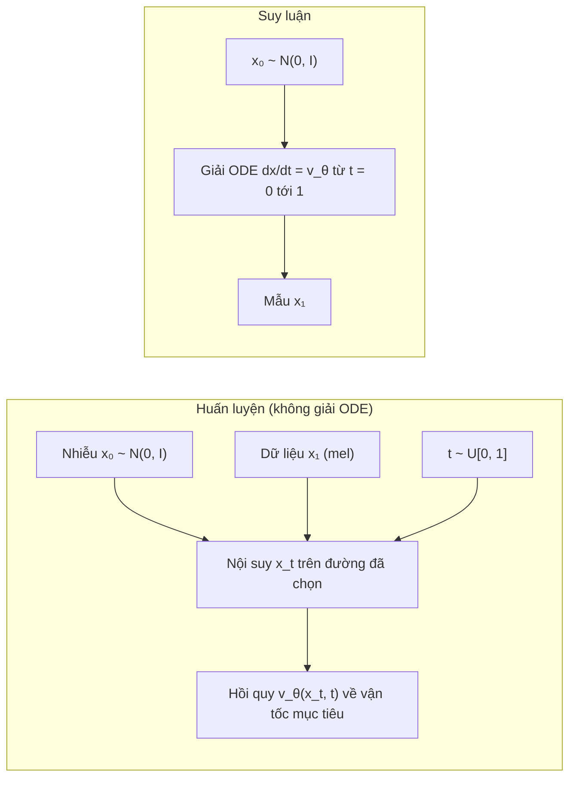

# Chương 12. Flow Matching

Hai chương trước để lại cho chúng ta hai mảnh ghép chưa khớp. [Chương 10](../phan-2-mo-hinh-sinh/ch10-normalizing-flows.md) cho thấy một **flow liên tục** (CNF) — một ODE $d\mathbf{x}/dt = \mathbf{v}_\theta(\mathbf{x}, t)$ — là mô hình sinh rất linh hoạt, nhưng huấn luyện bằng likelihood buộc phải giải ODE ở mỗi bước tối ưu. [Chương 11](../phan-2-mo-hinh-sinh/ch11-diffusion.md) cho thấy mô hình khuếch tán huấn luyện được **không cần mô phỏng** (chỉ cần hồi quy nhiễu), và cuối cùng cũng lấy mẫu bằng một ODE — ODE dòng xác suất — nhưng quỹ đạo của ODE đó bị áp đặt bởi SDE thuận và thường cong, nên cần nhiều bước.

**Flow matching** (Lipman và cộng sự, 2023; cùng thời với rectified flow của Liu và cộng sự, 2023 và stochastic interpolants của Albergo và Vanden-Eijnden, 2023) ghép hai mảnh lại: học **trực tiếp trường vận tốc** của một CNF bằng **hồi quy**, theo một "đường đi" xác suất do ta tự chọn — và ta có thể chọn đường **thẳng**. Kết quả là một mục tiêu huấn luyện đơn giản đến bất ngờ, mạng tùy ý, và lấy mẫu với ít bước. Đây là nền toán học của Matcha-TTS, Voicebox, E2 TTS, F5-TTS và bộ giải mã flow của CosyVoice — tức phần lớn các hệ thống TTS mạnh nhất tính đến thời điểm biên soạn (2026).

!!! abstract "Mục tiêu học tập"
    Sau chương này, bạn có thể:

    - **Phát biểu** bài toán flow matching qua ba khái niệm: đường xác suất, trường vận tốc và phương trình liên tục.
    - **Chứng minh** rằng trường vận tốc biên sinh ra đường xác suất biên, và gradient của mục tiêu có điều kiện (CFM) bằng gradient của mục tiêu flow matching; **kiểm chứng** điều này bằng số.
    - **Suy ra** trường vận tốc có điều kiện cho đường Gaussian, đặc biệt là đường "OT" với $\sigma_{\min}$.
    - **Cài đặt** OT-CFM, lấy mẫu bằng Euler, midpoint, RK4 và **phân tích** đánh đổi số lần gọi mạng (NFE).
    - **Giải thích** và **đo** tác dụng làm thẳng quỹ đạo của rectified flow/reflow và ghép cặp OT theo minibatch.
    - **Chuyển đổi** giữa vận tốc, nhiễu và score; **chứng minh** classifier-free guidance áp lên vận tốc tương đương áp lên score.
    - **Cài đặt** flow matching có mặt nạ (điền khuyết kiểu Voicebox) và **mô tả** lịch thời gian sway sampling của F5-TTS.
    - **Liên hệ** các thành phần trên với Matcha-TTS, Voicebox, E2/F5-TTS và CosyVoice.

!!! info "Kiến thức cần có"
    - [Chương 10](../phan-2-mo-hinh-sinh/ch10-normalizing-flows.md): CNF, công thức đổi biến tức thời, phương trình liên tục.
    - [Chương 11](../phan-2-mo-hinh-sinh/ch11-diffusion.md): DSM và mẹo chứng minh "số hạng chéo", công thức Tweedie, ODE dòng xác suất, các cách tham số hóa, classifier-free guidance.
    - [Chương 5](../phan-1-nen-tang/ch05-transformer.md): Transformer, AdaLN (dùng trong DiT của F5-TTS).
    - [Chương 7](../phan-2-mo-hinh-sinh/ch07-tong-quan-mo-hinh-sinh.md): bài toán một-nhiều trong TTS.

!!! warning "Quy ước thời gian trong chương này"
    Chúng ta theo quy ước của tài liệu flow matching (và của mã Matcha-TTS, F5-TTS): **$t = 0$ là nhiễu, $t = 1$ là dữ liệu**. Ký hiệu $\mathbf{x}_0 \sim p_0 = \mathcal{N}(\mathbf{0}, \mathbf{I})$ là **nhiễu**, $\mathbf{x}_1 \sim q$ là **dữ liệu** (ví dụ một mel-spectrogram $\mathbf{Y}$ làm phẳng; $\mathbf{x}$ ở đây không phải văn bản), $\mathbf{x}_t$ là điểm ở thời điểm $t$. Điều này **ngược** với Chương 11, nơi $\mathbf{x}_0$ là dữ liệu và $t = 1$ là nhiễu. Khi đọc một đoạn mã lạ, cách nhanh nhất để xác định quy ước là tìm xem `torch.randn` được gán cho biến nào.

## 12.1 Ý tưởng: hồi quy một trường vận tốc

Hãy hình dung một đám đông $N$ người đứng ngẫu nhiên trên quảng trường (nhiễu) cần di chuyển tới $N$ vị trí đã định trên sân khấu (dữ liệu). Một CNF là một "bản đồ gió": tại mỗi điểm và mỗi thời điểm, gió thổi theo hướng $\mathbf{v}(\mathbf{x}, t)$, và mỗi người chỉ việc trôi theo gió. Bài toán là học bản đồ gió sao cho, sau một đơn vị thời gian, đám đông được sắp xếp đúng như phân phối dữ liệu.

Huấn luyện CNF bằng likelihood giống như thử một bản đồ gió, thả đám đông trôi (giải ODE), đo kết quả rồi chỉnh — rất tốn kém. Flow matching làm khác: **tự chọn trước** cách mỗi người đi (ví dụ đi thẳng từ chỗ đứng tới chỗ đích), suy ra vận tốc "đúng" tại mỗi điểm, rồi dạy mạng nơ-ron bắt chước vận tốc đó bằng hồi quy. Không cần thả đám đông trôi khi huấn luyện; ODE chỉ được giải khi sinh mẫu.



Khó khăn duy nhất — và cũng là đóng góp lý thuyết chính của flow matching — là: vận tốc "đúng" của **cả đám đông** (phân phối biên) phụ thuộc vào toàn bộ phân phối dữ liệu mà ta không biết. Mục 12.3–12.4 cho thấy cách vượt qua bằng đúng mẹo đã dùng cho DSM ở Chương 11.

## 12.2 Đường xác suất, trường vận tốc và phương trình liên tục

Một trường vận tốc phụ thuộc thời gian $\mathbf{u}_t: \mathbb{R}^D \to \mathbb{R}^D$, $t \in [0, 1]$, định nghĩa một **flow** $\boldsymbol{\psi}_t$ qua ODE

$$
\frac{d}{dt}\boldsymbol{\psi}_t(\mathbf{x}) = \mathbf{u}_t\big(\boldsymbol{\psi}_t(\mathbf{x})\big), \qquad \boldsymbol{\psi}_0(\mathbf{x}) = \mathbf{x}.
$$

Nếu $\mathbf{x}_0 \sim p_0$ thì $\mathbf{x}_t = \boldsymbol{\psi}_t(\mathbf{x}_0)$ có phân phối $p_t$ — ta nói $p_t$ là **đẩy tiến** (*push-forward*) của $p_0$ qua $\boldsymbol{\psi}_t$, và họ $\{p_t\}_{t \in [0,1]}$ là một **đường xác suất** (*probability path*). Ta nói $\mathbf{u}_t$ **sinh ra** $p_t$. Như đã suy ra ở [Chương 10](../phan-2-mo-hinh-sinh/ch10-normalizing-flows.md), điều này tương đương với **phương trình liên tục**:

$$
\frac{\partial p_t(\mathbf{x})}{\partial t} + \nabla \cdot \big(p_t(\mathbf{x})\, \mathbf{u}_t(\mathbf{x})\big) = 0 .
$$

Giả sử ta có một đường $p_t$ với $p_0 = \mathcal{N}(\mathbf{0}, \mathbf{I})$ và $p_1 \approx q$ (phân phối dữ liệu), cùng trường $\mathbf{u}_t$ sinh ra nó. Mục tiêu **flow matching** (FM) là

$$
\mathcal{L}_{\text{FM}}(\theta) = \mathbb{E}_{t \sim \mathcal{U}[0,1],\; \mathbf{x} \sim p_t}\big\lVert \mathbf{v}_\theta(\mathbf{x}, t) - \mathbf{u}_t(\mathbf{x}) \big\rVert^2 .
$$

Nếu $\mathcal{L}_{\text{FM}} = 0$ thì $\mathbf{v}_\theta = \mathbf{u}_t$, và giải ODE với $\mathbf{v}_\theta$ từ nhiễu sẽ cho đúng $p_1 \approx q$. Vấn đề: ta không có cả $p_t$ lẫn $\mathbf{u}_t$ ở dạng tường minh — chúng phụ thuộc vào $q$.

## 12.3 Xây dựng đường biên từ các đường có điều kiện

Ý tưởng then chốt: xây đường biên như một **hỗn hợp** của các đường đơn giản, mỗi đường dẫn tới **một** điểm dữ liệu. Với mỗi $\mathbf{x}_1$, chọn một **đường có điều kiện** $p_t(\mathbf{x} \mid \mathbf{x}_1)$ sao cho

- $p_0(\mathbf{x} \mid \mathbf{x}_1) = \mathcal{N}(\mathbf{0}, \mathbf{I})$ — mọi đường đều xuất phát từ cùng một nhiễu chuẩn;
- $p_1(\mathbf{x} \mid \mathbf{x}_1) = \mathcal{N}(\mathbf{x}_1, \sigma_{\min}^2\mathbf{I})$ với $\sigma_{\min}$ rất nhỏ — đường kết thúc tập trung quanh $\mathbf{x}_1$;

và một trường vận tốc có điều kiện $\mathbf{u}_t(\mathbf{x} \mid \mathbf{x}_1)$ sinh ra nó. Lấy trung bình theo dữ liệu:

$$
p_t(\mathbf{x}) = \int p_t(\mathbf{x} \mid \mathbf{x}_1)\, q(\mathbf{x}_1)\, d\mathbf{x}_1 ,
$$

nên $p_0 = \mathcal{N}(\mathbf{0}, \mathbf{I})$ và $p_1 = q \ast \mathcal{N}(\mathbf{0}, \sigma_{\min}^2\mathbf{I}) \approx q$. Định nghĩa **trường vận tốc biên**:

$$
\mathbf{u}_t(\mathbf{x}) = \int \mathbf{u}_t(\mathbf{x} \mid \mathbf{x}_1)\, \frac{p_t(\mathbf{x} \mid \mathbf{x}_1)\, q(\mathbf{x}_1)}{p_t(\mathbf{x})}\, d\mathbf{x}_1 = \mathbb{E}\big[\mathbf{u}_t(\mathbf{x}_t \mid \mathbf{x}_1) \,\big\vert\, \mathbf{x}_t = \mathbf{x}\big].
$$

Phân số trong tích phân chính là hậu nghiệm $p(\mathbf{x}_1 \mid \mathbf{x}_t = \mathbf{x})$: trường biên tại $\mathbf{x}$ là **trung bình** vận tốc của mọi đường có điều kiện đi qua $\mathbf{x}$, có trọng số theo khả năng mỗi đường đi qua đó. (So sánh với "score biên là kỳ vọng hậu nghiệm của score có điều kiện" ở Chương 11 — cùng một cấu trúc.)

**Định lý 1** (Lipman và cộng sự, 2023). Nếu mỗi $\mathbf{u}_t(\cdot \mid \mathbf{x}_1)$ sinh ra $p_t(\cdot \mid \mathbf{x}_1)$, thì $\mathbf{u}_t$ biên sinh ra $p_t$ biên.

*Chứng minh.* Ta kiểm tra phương trình liên tục cho cặp biên. Đạo hàm theo $t$ đi vào trong tích phân theo $\mathbf{x}_1$ (giả thiết các hàm đủ chính quy):

$$
\frac{\partial p_t(\mathbf{x})}{\partial t} = \int \frac{\partial p_t(\mathbf{x} \mid \mathbf{x}_1)}{\partial t}\, q(\mathbf{x}_1)\, d\mathbf{x}_1
= -\int \nabla \cdot \big(p_t(\mathbf{x} \mid \mathbf{x}_1)\, \mathbf{u}_t(\mathbf{x} \mid \mathbf{x}_1)\big)\, q(\mathbf{x}_1)\, d\mathbf{x}_1
$$

$$
= -\nabla \cdot \Big(\int p_t(\mathbf{x} \mid \mathbf{x}_1)\, \mathbf{u}_t(\mathbf{x} \mid \mathbf{x}_1)\, q(\mathbf{x}_1)\, d\mathbf{x}_1\Big)
= -\nabla \cdot \big(p_t(\mathbf{x})\, \mathbf{u}_t(\mathbf{x})\big).
$$

Bước thứ hai dùng phương trình liên tục cho từng đường có điều kiện; bước thứ ba đổi thứ tự divergence (theo $\mathbf{x}$) và tích phân (theo $\mathbf{x}_1$); bước cuối là định nghĩa của $\mathbf{u}_t$ biên nhân với $p_t(\mathbf{x})$. $\square$

## 12.4 Flow matching có điều kiện

Định lý 1 cho ta một đường biên hợp lệ, nhưng $\mathbf{u}_t(\mathbf{x})$ vẫn là một tích phân không tính được. Mục tiêu **flow matching có điều kiện** (*conditional flow matching*, CFM) thay nó bằng vận tốc có điều kiện — thứ ta tự thiết kế nên luôn tính được:

$$
\mathcal{L}_{\text{CFM}}(\theta) = \mathbb{E}_{t \sim \mathcal{U}[0,1],\; \mathbf{x}_1 \sim q,\; \mathbf{x} \sim p_t(\cdot \mid \mathbf{x}_1)}\big\lVert \mathbf{v}_\theta(\mathbf{x}, t) - \mathbf{u}_t(\mathbf{x} \mid \mathbf{x}_1) \big\rVert^2 .
$$

**Định lý 2** (Lipman và cộng sự, 2023). Với giả thiết $p_t(\mathbf{x}) > 0$ với mọi $\mathbf{x}$ và $t \in [0, 1]$, ta có $\mathcal{L}_{\text{FM}}(\theta) = \mathcal{L}_{\text{CFM}}(\theta) + C$ với $C$ không phụ thuộc $\theta$; do đó $\nabla_\theta \mathcal{L}_{\text{FM}} = \nabla_\theta \mathcal{L}_{\text{CFM}}$.

*Chứng minh.* Cố định $t$ (kết quả cho mọi $t$ rồi lấy kỳ vọng). Khai triển $\lVert \mathbf{v} - \mathbf{u} \rVert^2 = \lVert \mathbf{v} \rVert^2 - 2\langle \mathbf{v}, \mathbf{u} \rangle + \lVert \mathbf{u} \rVert^2$ cho cả hai mục tiêu.

- **Số hạng $\lVert \mathbf{v}_\theta \rVert^2$** bằng nhau: lấy $\mathbf{x}_1 \sim q$ rồi $\mathbf{x} \sim p_t(\cdot \mid \mathbf{x}_1)$ cho đúng $\mathbf{x} \sim p_t$, nên $\mathbb{E}_{p_t(\mathbf{x})}\lVert \mathbf{v}_\theta(\mathbf{x}, t) \rVert^2 = \mathbb{E}_{q(\mathbf{x}_1)\,p_t(\mathbf{x} \mid \mathbf{x}_1)}\lVert \mathbf{v}_\theta(\mathbf{x}, t) \rVert^2$.
- **Số hạng $\lVert \mathbf{u} \rVert^2$** không phụ thuộc $\theta$ ở cả hai vế — chúng gộp vào $C$.
- **Số hạng chéo** bằng nhau:

$$
\mathbb{E}_{p_t(\mathbf{x})}\big\langle \mathbf{v}_\theta(\mathbf{x}, t), \mathbf{u}_t(\mathbf{x}) \big\rangle
= \int \Big\langle \mathbf{v}_\theta(\mathbf{x}, t), \int \mathbf{u}_t(\mathbf{x} \mid \mathbf{x}_1)\, \frac{p_t(\mathbf{x} \mid \mathbf{x}_1)\, q(\mathbf{x}_1)}{p_t(\mathbf{x})}\, d\mathbf{x}_1 \Big\rangle\, p_t(\mathbf{x})\, d\mathbf{x}
= \iint \big\langle \mathbf{v}_\theta(\mathbf{x}, t), \mathbf{u}_t(\mathbf{x} \mid \mathbf{x}_1) \big\rangle\, p_t(\mathbf{x} \mid \mathbf{x}_1)\, q(\mathbf{x}_1)\, d\mathbf{x}_1\, d\mathbf{x},
$$

trong đó $p_t(\mathbf{x})$ triệt tiêu (đây là chỗ cần $p_t > 0$) và tích vô hướng tuyến tính nên đưa được vào trong tích phân. Vế phải đúng là số hạng chéo của $\mathcal{L}_{\text{CFM}}$. $\square$

Ba hệ quả quan trọng cho thực hành:

1. **Huấn luyện không cần mô phỏng.** Mỗi bước: lấy $t$, $\mathbf{x}_1$ từ dữ liệu, $\mathbf{x}_t$ từ đường có điều kiện, rồi hồi quy. Không giải ODE, không tính divergence.
2. **Nghiệm tối ưu là kỳ vọng có điều kiện.** Hàm cực tiểu hóa sai số bình phương là $\mathbf{v}^\ast(\mathbf{x}, t) = \mathbb{E}[\mathbf{u}_t(\mathbf{x}_t \mid \mathbf{x}_1) \mid \mathbf{x}_t = \mathbf{x}] = \mathbf{u}_t(\mathbf{x})$ — chính là trường biên.
3. **Loss không về 0.** Giá trị nhỏ nhất của $\mathcal{L}_{\text{CFM}}$ là $C = \mathbb{E}\lVert \mathbf{u}_t(\mathbf{x} \mid \mathbf{x}_1) - \mathbf{u}_t(\mathbf{x}) \rVert^2$ — phương sai của vận tốc có điều kiện quanh trung bình của nó. Khi nhiều đường có điều kiện đi qua cùng một điểm với hướng khác nhau, phần phương sai này lớn. Đừng ngạc nhiên khi đường cong loss của F5-TTS hay Matcha-TTS "đứng yên" ở một giá trị khá lớn.

Kiểm chứng Định lý 2 bằng số. Với dữ liệu chỉ gồm ba điểm, trường biên $\mathbf{u}_t(\mathbf{x})$ tính được chính xác (hậu nghiệm trên ba điểm là một softmax), nên ta có thể so trực tiếp gradient của $\mathcal{L}_{\text{FM}}$ và $\mathcal{L}_{\text{CFM}}$ trên cùng một mạng nhỏ. Mã dùng đường OT với $\sigma_{\min} = 0{,}05$ (sẽ được suy ra ở mục 12.5):

```python
import math
import torch
import torch.nn as nn

torch.manual_seed(0)
sigma_min = 0.05
anchors = torch.tensor([[2.0, 0.0], [-1.0, 1.5], [-1.0, -1.5]])         # dữ liệu: 3 điểm, xác suất đều


def cond_field(x, t, a):
    """u_t(x | x1 = a) của đường OT."""
    return (a - (1 - sigma_min) * x) / (1 - (1 - sigma_min) * t)


def marginal_field(x, t):
    """u_t(x) = sum_m p(a_m | x_t = x) u_t(x | a_m), tính chính xác cho dữ liệu 3 điểm."""
    sig = 1 - (1 - sigma_min) * t                                       # (n, 1) độ lệch chuẩn của p_t(x | a)
    d2 = ((x[:, None, :] - t[:, :, None] * anchors[None]) ** 2).sum(-1)  # (n, 3)
    w = torch.softmax(-d2 / (2 * sig ** 2), dim=1)                      # hậu nghiệm p(a_m | x, t)
    u = cond_field(x[:, None, :], t[:, :, None], anchors[None])         # (n, 3, 2)
    return (w[:, :, None] * u).sum(dim=1)                               # (n, 2)


v_theta = nn.Sequential(nn.Linear(3, 64), nn.Tanh(), nn.Linear(64, 2))  # nhận [x, t]
n = 400_000
t = torch.rand(n, 1)
a = anchors[torch.randint(0, 3, (n,))]                                  # x1 ~ q
x = t * a + (1 - (1 - sigma_min) * t) * torch.randn(n, 2)              # x ~ p_t(. | x1), nên x ~ p_t
pred = v_theta(torch.cat([x, t], dim=1))
u_cond, u_marg = cond_field(x, t, a), marginal_field(x, t)
loss_cfm = ((pred - u_cond) ** 2).sum(1).mean()
loss_fm = ((pred - u_marg) ** 2).sum(1).mean()
params = list(v_theta.parameters())
g_cfm = torch.cat([g.flatten() for g in torch.autograd.grad(loss_cfm, params, retain_graph=True)])
g_fm = torch.cat([g.flatten() for g in torch.autograd.grad(loss_fm, params)])
cos = torch.nn.functional.cosine_similarity(g_cfm, g_fm, dim=0).item()
print(f"L_CFM = {loss_cfm:.3f}, L_FM = {loss_fm:.3f}, "
      f"E||u(x|x1) - u(x)||^2 = {((u_cond - u_marg) ** 2).sum(1).mean():.3f}")
print(f"cos(grad CFM, grad FM) = {cos:.5f}, sai lệch tương đối = {(g_cfm - g_fm).norm() / g_fm.norm():.4f}")
assert cos > 0.999
```

Hai giá trị loss khác nhau xa (chênh lệch đúng bằng phương sai có điều kiện, in ra ở cột thứ ba), nhưng hai véc-tơ gradient gần như trùng nhau: cosin cỡ 0,99998, sai lệch tương đối dưới 1% — phần sai lệch còn lại là nhiễu Monte Carlo và giảm khi tăng số mẫu. Đây là toàn bộ "phép màu" của flow matching, nhìn thấy được bằng mắt.

## 12.5 Đường có điều kiện Gaussian

Họ đường có điều kiện phổ biến nhất là Gaussian:

$$
p_t(\mathbf{x} \mid \mathbf{x}_1) = \mathcal{N}\big(\mathbf{x};\, \boldsymbol{\mu}_t(\mathbf{x}_1),\, \sigma_t(\mathbf{x}_1)^2\, \mathbf{I}\big),
\qquad \boldsymbol{\mu}_0 = \mathbf{0},\; \sigma_0 = 1,\quad \boldsymbol{\mu}_1 = \mathbf{x}_1,\; \sigma_1 = \sigma_{\min}.
$$

Có vô số trường vận tốc sinh ra cùng một đường; ta chọn cái đơn giản nhất, ứng với flow affine

$$
\boldsymbol{\psi}_t(\mathbf{x}_0) = \sigma_t\, \mathbf{x}_0 + \boldsymbol{\mu}_t, \qquad \mathbf{x}_0 \sim \mathcal{N}(\mathbf{0}, \mathbf{I}),
$$

(viết tắt $\sigma_t$, $\boldsymbol{\mu}_t$ cho $\sigma_t(\mathbf{x}_1)$, $\boldsymbol{\mu}_t(\mathbf{x}_1)$). Rõ ràng $\boldsymbol{\psi}_t(\mathbf{x}_0) \sim \mathcal{N}(\boldsymbol{\mu}_t, \sigma_t^2\mathbf{I})$. Đạo hàm theo $t$ (ký hiệu $'$):

$$
\frac{d}{dt}\boldsymbol{\psi}_t(\mathbf{x}_0) = \sigma_t'\, \mathbf{x}_0 + \boldsymbol{\mu}_t' .
$$

Để viết thành hàm của vị trí $\mathbf{x} = \boldsymbol{\psi}_t(\mathbf{x}_0)$, thay $\mathbf{x}_0 = (\mathbf{x} - \boldsymbol{\mu}_t)/\sigma_t$:

$$
\mathbf{u}_t(\mathbf{x} \mid \mathbf{x}_1) = \frac{\sigma_t'}{\sigma_t}\big(\mathbf{x} - \boldsymbol{\mu}_t\big) + \boldsymbol{\mu}_t' .
$$

Trong thực hành, ta lấy mẫu $\mathbf{x}_0$ rồi tạo $\mathbf{x}_t = \boldsymbol{\psi}_t(\mathbf{x}_0)$, nên dùng thẳng dạng theo $\mathbf{x}_0$ làm mục tiêu — không cần phép chia nào:

$$
\mathcal{L}_{\text{CFM}}(\theta) = \mathbb{E}_{t,\, \mathbf{x}_1,\, \mathbf{x}_0}\big\lVert \mathbf{v}_\theta\big(\sigma_t\mathbf{x}_0 + \boldsymbol{\mu}_t,\; t\big) - \big(\sigma_t'\mathbf{x}_0 + \boldsymbol{\mu}_t'\big) \big\rVert^2 .
$$

### 12.5.1 Đường khuếch tán là một trường hợp riêng

Đường VP của Chương 11, viết lại theo thời gian FM ($t \mapsto 1 - t$), là $\boldsymbol{\mu}_t = a_{1-t}\,\mathbf{x}_1$ và $\sigma_t = \sqrt{1 - a_{1-t}^2}$, với $a_s = \sqrt{\bar\alpha(s)}$ của VP-SDE. Huấn luyện CFM trên đường này cho một mô hình tương đương diffusion (ODE dòng xác suất) nhưng bằng hồi quy vận tốc. Lưu ý: đường này chỉ **xấp xỉ** $\mathcal{N}(\mathbf{0}, \mathbf{I})$ tại $t = 0$ (vì $\bar\alpha(1) > 0$) — chính là vấn đề "SNR cuối khác 0" ở Chương 11. Lipman và cộng sự báo cáo đường OT dưới đây cho kết quả tốt hơn với ít bước hơn trên ảnh.

### 12.5.2 Đường OT

Chọn trung bình và độ lệch chuẩn **tuyến tính** theo $t$:

$$
\boldsymbol{\mu}_t = t\, \mathbf{x}_1, \qquad \sigma_t = 1 - (1 - \sigma_{\min})\, t .
$$

Khi đó

$$
\mathbf{x}_t = \boldsymbol{\psi}_t(\mathbf{x}_0) = \big(1 - (1 - \sigma_{\min})t\big)\, \mathbf{x}_0 + t\, \mathbf{x}_1,
\qquad
\mathbf{u}_t(\mathbf{x}_t \mid \mathbf{x}_1) = \mathbf{x}_1 - (1 - \sigma_{\min})\, \mathbf{x}_0 = \frac{\mathbf{x}_1 - (1 - \sigma_{\min})\,\mathbf{x}_t}{1 - (1 - \sigma_{\min})\, t}.
$$

Và hàm mất mát thu về một dòng:

$$
\mathcal{L}_{\text{OT-CFM}}(\theta) = \mathbb{E}_{t \sim \mathcal{U}[0,1],\; \mathbf{x}_1 \sim q,\; \mathbf{x}_0 \sim \mathcal{N}(\mathbf{0}, \mathbf{I})}\big\lVert \mathbf{v}_\theta(\mathbf{x}_t, t) - \big(\mathbf{x}_1 - (1 - \sigma_{\min})\, \mathbf{x}_0\big) \big\rVert^2 .
$$

Đây đúng là hàm mất mát của bộ giải mã Matcha-TTS. Vài nhận xét:

- **Vì sao gọi là "OT"?** Với mỗi cặp $(\mathbf{x}_0, \mathbf{x}_1)$, quỹ đạo có điều kiện là **đoạn thẳng** đi với **vận tốc không đổi** — phép vận chuyển tối ưu (theo chi phí bình phương khoảng cách) giữa hai Gaussian $\mathcal{N}(\mathbf{0}, \mathbf{I})$ và $\mathcal{N}(\mathbf{x}_1, \sigma_{\min}^2\mathbf{I})$. Một bước Euler đã đi đúng quỹ đạo có điều kiện.
- **Nhưng flow biên không phải OT, và quỹ đạo biên không thẳng.** Trường biên là trung bình của các vận tốc có điều kiện tại mỗi điểm; nơi các đoạn thẳng "cắt nhau" (cùng $\mathbf{x}_t$ nhưng đi tới các $\mathbf{x}_1$ khác nhau), trung bình bẻ cong quỹ đạo. Các quỹ đạo của ODE không bao giờ cắt nhau — chúng "rẽ" để tránh nhau. Mục 12.8 cho thấy cách làm thẳng chúng.
- **Vai trò của $\sigma_{\min}$.** Giá trị dương nhỏ giữ cho $p_1(\cdot \mid \mathbf{x}_1)$ không suy biến (tương tự dequantization ở Chương 10). Nhiều cài đặt dùng giá trị rất nhỏ (mã công khai của Matcha-TTS dùng cỡ $10^{-4}$), một số hệ thống đặt hẳn $\sigma_{\min} = 0$ — khi đó ta được đúng **rectified flow**: $\mathbf{x}_t = (1 - t)\mathbf{x}_0 + t\mathbf{x}_1$ và mục tiêu $\mathbf{x}_1 - \mathbf{x}_0$.
- **Về tên gọi.** Matcha-TTS gọi mục tiêu này là "OT-CFM" theo đường OT của Lipman và cộng sự, với $\mathbf{x}_0$ và $\mathbf{x}_1$ được lấy **độc lập**. Tong và cộng sự (2024) lại dùng tên "OT-CFM" cho biến thể ghép cặp nhiễu–dữ liệu bằng vận chuyển tối ưu trong minibatch, và gọi bản lấy độc lập là "I-CFM". Khi đọc bài báo, hãy xem kỹ cách ghép cặp.

## 12.6 Thí nghiệm: OT-CFM trên dữ liệu 8 cụm

Ta dùng lại dữ liệu đồ chơi của Chương 11 (8 cụm Gaussian độ lệch chuẩn 0,1 trên đường tròn bán kính 2) để so sánh công bằng. Mạng vận tốc là một MLP nhận $\mathbf{x}_t$ và embedding hình sin của $t$ (nhân $t$ với 1000 để dải tần số giống embedding của bước $k$ ở Chương 11).

```python
torch.manual_seed(0)
SIGMA_MIN = 1e-4
CENTERS = 2.0 * torch.stack([torch.cos(2 * math.pi * torch.arange(8) / 8),
                             torch.sin(2 * math.pi * torch.arange(8) / 8)], dim=1)   # (8, 2)


def sample_ring(n: int, std: float = 0.1) -> torch.Tensor:
    c = torch.randint(0, 8, (n,))
    return CENTERS[c] + std * torch.randn(n, 2)                         # (n, 2)


def time_embedding(t: torch.Tensor, dim: int = 32) -> torch.Tensor:
    half = dim // 2
    freqs = torch.exp(-math.log(1000.0) * torch.arange(half) / half)
    ang = 1000.0 * t[:, None] * freqs[None]                             # (B, half)
    return torch.cat([torch.sin(ang), torch.cos(ang)], dim=-1)          # (B, dim)


class VelocityNet(nn.Module):
    """v_theta(x_t, t) cho dữ liệu 2-D."""

    def __init__(self, hidden: int = 128):
        super().__init__()
        self.net = nn.Sequential(nn.Linear(2 + 32, hidden), nn.SiLU(),
                                 nn.Linear(hidden, hidden), nn.SiLU(),
                                 nn.Linear(hidden, hidden), nn.SiLU(),
                                 nn.Linear(hidden, 2))

    def forward(self, x, t):                                            # x: (B, 2), t: (B,)
        return self.net(torch.cat([x, time_embedding(t)], dim=-1))


def ot_cfm_loss(model, x1):
    x0 = torch.randn_like(x1)                                           # nhiễu, t = 0
    t = torch.rand(x1.shape[0])
    tt = t[:, None]
    xt = (1 - (1 - SIGMA_MIN) * tt) * x0 + tt * x1                      # điểm trên đường OT
    target = x1 - (1 - SIGMA_MIN) * x0                                  # u_t(x_t | x1), dạng không chia
    return ((model(xt, t) - target) ** 2).mean()


model = VelocityNet()
n_iters = 4000
opt = torch.optim.Adam(model.parameters(), lr=2e-3)
sched = torch.optim.lr_scheduler.CosineAnnealingLR(opt, n_iters)
for it in range(1, n_iters + 1):
    loss = ot_cfm_loss(model, sample_ring(256))
    opt.zero_grad()
    loss.backward()
    opt.step()
    sched.step()
    if it % 1000 == 0:
        print(f"vòng {it}: L_CFM = {loss.item():.3f}")
```

Loss dừng ở cỡ 1,9–2,1 chứ không về 0 — đúng như hệ quả 3 ở mục 12.4 (phần lớn con số này là phương sai có điều kiện, không phải lỗi của mô hình). So với $\mathcal{L}_{\text{simple}}$ của Chương 11 (cỡ 0,24 trên cùng dữ liệu), con số lớn hơn nhiều, nhưng hai loss đo những đại lượng khác nhau nên **không so sánh được** với nhau.
