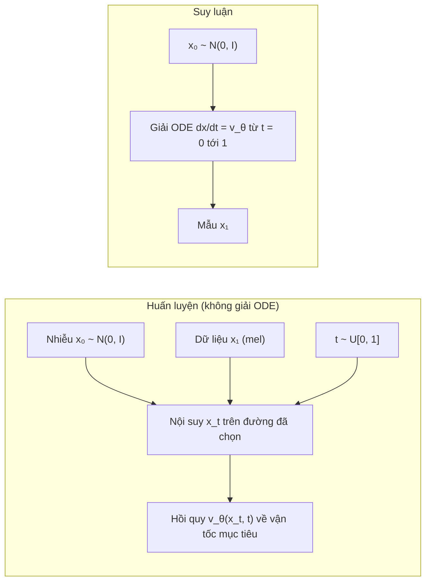

# Chương 12. Flow Matching

Hai chương trước để lại cho chúng ta hai mảnh ghép chưa khớp. [Chương 10](../phan-2-mo-hinh-sinh/ch10-normalizing-flows.md) cho thấy một **flow liên tục** (CNF) — một ODE $d\mathbf{x}/dt = \mathbf{v}_\theta(\mathbf{x}, t)$ — là mô hình sinh rất linh hoạt, nhưng huấn luyện bằng likelihood buộc phải giải ODE ở mỗi bước tối ưu. [Chương 11](../phan-2-mo-hinh-sinh/ch11-diffusion.md) cho thấy mô hình khuếch tán huấn luyện được **không cần mô phỏng** (chỉ cần hồi quy nhiễu), và cuối cùng cũng lấy mẫu bằng một ODE — ODE dòng xác suất — nhưng quỹ đạo của ODE đó bị áp đặt bởi SDE thuận và thường cong, nên cần nhiều bước.

**Flow matching** (Lipman và cộng sự, 2023; cùng thời với rectified flow của Liu và cộng sự, 2023 và stochastic interpolants của Albergo và Vanden-Eijnden, 2023) ghép hai mảnh lại: học **trực tiếp trường vận tốc** của một CNF bằng **hồi quy**, theo một "đường đi" xác suất do ta tự chọn — và ta có thể chọn đường **thẳng**. Kết quả là một mục tiêu huấn luyện đơn giản đến bất ngờ, mạng tùy ý, và lấy mẫu với ít bước. Đây là nền toán học của Matcha-TTS, Voicebox, E2 TTS, F5-TTS và bộ giải mã flow của CosyVoice — tức phần lớn các hệ thống TTS mạnh nhất tính đến thời điểm biên soạn (2026).

!!! abstract "Mục tiêu học tập"
    Sau chương này, bạn có thể:

    - **Phát biểu** bài toán flow matching qua ba khái niệm: đường xác suất, trường vận tốc và phương trình liên tục.
    - **Chứng minh** rằng trường vận tốc biên sinh ra đường xác suất biên, và gradient của mục tiêu có điều kiện (CFM) bằng gradient của mục tiêu flow matching; **kiểm chứng** điều này bằng số.
    - **Suy ra** trường vận tốc có điều kiện cho đường Gaussian, đặc biệt là đường "OT" với $\sigma_{\min}$.
    - **Cài đặt** OT-CFM, lấy mẫu bằng Euler, midpoint, RK4 và **phân tích** đánh đổi số lần gọi mạng (NFE).
    - **Giải thích** và **đo** tác dụng làm thẳng quỹ đạo của rectified flow/reflow và ghép cặp OT theo minibatch.
    - **Chuyển đổi** giữa vận tốc, nhiễu và score; **chứng minh** classifier-free guidance áp lên vận tốc tương đương áp lên score.
    - **Cài đặt** flow matching có mặt nạ (điền khuyết kiểu Voicebox) và **mô tả** lịch thời gian sway sampling của F5-TTS.
    - **Liên hệ** các thành phần trên với Matcha-TTS, Voicebox, E2/F5-TTS và CosyVoice.

!!! info "Kiến thức cần có"
    - [Chương 10](../phan-2-mo-hinh-sinh/ch10-normalizing-flows.md): CNF, công thức đổi biến tức thời, phương trình liên tục.
    - [Chương 11](../phan-2-mo-hinh-sinh/ch11-diffusion.md): DSM và mẹo chứng minh "số hạng chéo", công thức Tweedie, ODE dòng xác suất, các cách tham số hóa, classifier-free guidance.
    - [Chương 5](../phan-1-nen-tang/ch05-transformer.md): Transformer, AdaLN (dùng trong DiT của F5-TTS).
    - [Chương 7](../phan-2-mo-hinh-sinh/ch07-tong-quan-mo-hinh-sinh.md): bài toán một-nhiều trong TTS.

!!! warning "Quy ước thời gian trong chương này"
    Chúng ta theo quy ước của tài liệu flow matching (và của mã Matcha-TTS, F5-TTS): **$t = 0$ là nhiễu, $t = 1$ là dữ liệu**. Ký hiệu $\mathbf{x}_0 \sim p_0 = \mathcal{N}(\mathbf{0}, \mathbf{I})$ là **nhiễu**, $\mathbf{x}_1 \sim q$ là **dữ liệu** (ví dụ một mel-spectrogram $\mathbf{Y}$ làm phẳng; $\mathbf{x}$ ở đây không phải văn bản), $\mathbf{x}_t$ là điểm ở thời điểm $t$. Điều này **ngược** với Chương 11, nơi $\mathbf{x}_0$ là dữ liệu và $t = 1$ là nhiễu. Khi đọc một đoạn mã lạ, cách nhanh nhất để xác định quy ước là tìm xem `torch.randn` được gán cho biến nào.

## 12.1 Ý tưởng: hồi quy một trường vận tốc

Hãy hình dung một đám đông $N$ người đứng ngẫu nhiên trên quảng trường (nhiễu) cần di chuyển tới $N$ vị trí đã định trên sân khấu (dữ liệu). Một CNF là một "bản đồ gió": tại mỗi điểm và mỗi thời điểm, gió thổi theo hướng $\mathbf{v}(\mathbf{x}, t)$, và mỗi người chỉ việc trôi theo gió. Bài toán là học bản đồ gió sao cho, sau một đơn vị thời gian, đám đông được sắp xếp đúng như phân phối dữ liệu.

Huấn luyện CNF bằng likelihood giống như thử một bản đồ gió, thả đám đông trôi (giải ODE), đo kết quả rồi chỉnh — rất tốn kém. Flow matching làm khác: **tự chọn trước** cách mỗi người đi (ví dụ đi thẳng từ chỗ đứng tới chỗ đích), suy ra vận tốc "đúng" tại mỗi điểm, rồi dạy mạng nơ-ron bắt chước vận tốc đó bằng hồi quy. Không cần thả đám đông trôi khi huấn luyện; ODE chỉ được giải khi sinh mẫu.



Khó khăn duy nhất — và cũng là đóng góp lý thuyết chính của flow matching — là: vận tốc "đúng" của **cả đám đông** (phân phối biên) phụ thuộc vào toàn bộ phân phối dữ liệu mà ta không biết. Mục 12.3–12.4 cho thấy cách vượt qua bằng đúng mẹo đã dùng cho DSM ở Chương 11.

## 12.2 Đường xác suất, trường vận tốc và phương trình liên tục

Một trường vận tốc phụ thuộc thời gian $\mathbf{u}_t: \mathbb{R}^D \to \mathbb{R}^D$, $t \in [0, 1]$, định nghĩa một **flow** $\boldsymbol{\psi}_t$ qua ODE

$$
\frac{d}{dt}\boldsymbol{\psi}_t(\mathbf{x}) = \mathbf{u}_t\big(\boldsymbol{\psi}_t(\mathbf{x})\big), \qquad \boldsymbol{\psi}_0(\mathbf{x}) = \mathbf{x}.
$$

Nếu $\mathbf{x}_0 \sim p_0$ thì $\mathbf{x}_t = \boldsymbol{\psi}_t(\mathbf{x}_0)$ có phân phối $p_t$ — ta nói $p_t$ là **đẩy tiến** (*push-forward*) của $p_0$ qua $\boldsymbol{\psi}_t$, và họ $\{p_t\}_{t \in [0,1]}$ là một **đường xác suất** (*probability path*). Ta nói $\mathbf{u}_t$ **sinh ra** $p_t$. Như đã suy ra ở [Chương 10](../phan-2-mo-hinh-sinh/ch10-normalizing-flows.md), điều này tương đương với **phương trình liên tục**:

$$
\frac{\partial p_t(\mathbf{x})}{\partial t} + \nabla \cdot \big(p_t(\mathbf{x})\, \mathbf{u}_t(\mathbf{x})\big) = 0 .
$$

Giả sử ta có một đường $p_t$ với $p_0 = \mathcal{N}(\mathbf{0}, \mathbf{I})$ và $p_1 \approx q$ (phân phối dữ liệu), cùng trường $\mathbf{u}_t$ sinh ra nó. Mục tiêu **flow matching** (FM) là

$$
\mathcal{L}_{\text{FM}}(\theta) = \mathbb{E}_{t \sim \mathcal{U}[0,1],\; \mathbf{x} \sim p_t}\big\lVert \mathbf{v}_\theta(\mathbf{x}, t) - \mathbf{u}_t(\mathbf{x}) \big\rVert^2 .
$$

Nếu $\mathcal{L}_{\text{FM}} = 0$ thì $\mathbf{v}_\theta = \mathbf{u}_t$, và giải ODE với $\mathbf{v}_\theta$ từ nhiễu sẽ cho đúng $p_1 \approx q$. Vấn đề: ta không có cả $p_t$ lẫn $\mathbf{u}_t$ ở dạng tường minh — chúng phụ thuộc vào $q$.

## 12.3 Xây dựng đường biên từ các đường có điều kiện

Ý tưởng then chốt: xây đường biên như một **hỗn hợp** của các đường đơn giản, mỗi đường dẫn tới **một** điểm dữ liệu. Với mỗi $\mathbf{x}_1$, chọn một **đường có điều kiện** $p_t(\mathbf{x} \mid \mathbf{x}_1)$ sao cho

- $p_0(\mathbf{x} \mid \mathbf{x}_1) = \mathcal{N}(\mathbf{0}, \mathbf{I})$ — mọi đường đều xuất phát từ cùng một nhiễu chuẩn;
- $p_1(\mathbf{x} \mid \mathbf{x}_1) = \mathcal{N}(\mathbf{x}_1, \sigma_{\min}^2\mathbf{I})$ với $\sigma_{\min}$ rất nhỏ — đường kết thúc tập trung quanh $\mathbf{x}_1$;

và một trường vận tốc có điều kiện $\mathbf{u}_t(\mathbf{x} \mid \mathbf{x}_1)$ sinh ra nó. Lấy trung bình theo dữ liệu:

$$
p_t(\mathbf{x}) = \int p_t(\mathbf{x} \mid \mathbf{x}_1)\, q(\mathbf{x}_1)\, d\mathbf{x}_1 ,
$$

nên $p_0 = \mathcal{N}(\mathbf{0}, \mathbf{I})$ và $p_1 = q \ast \mathcal{N}(\mathbf{0}, \sigma_{\min}^2\mathbf{I}) \approx q$. Định nghĩa **trường vận tốc biên**:

$$
\mathbf{u}_t(\mathbf{x}) = \int \mathbf{u}_t(\mathbf{x} \mid \mathbf{x}_1)\, \frac{p_t(\mathbf{x} \mid \mathbf{x}_1)\, q(\mathbf{x}_1)}{p_t(\mathbf{x})}\, d\mathbf{x}_1 = \mathbb{E}\big[\mathbf{u}_t(\mathbf{x}_t \mid \mathbf{x}_1) \,\big\vert\, \mathbf{x}_t = \mathbf{x}\big].
$$

Phân số trong tích phân chính là hậu nghiệm $p(\mathbf{x}_1 \mid \mathbf{x}_t = \mathbf{x})$: trường biên tại $\mathbf{x}$ là **trung bình** vận tốc của mọi đường có điều kiện đi qua $\mathbf{x}$, có trọng số theo khả năng mỗi đường đi qua đó. (So sánh với "score biên là kỳ vọng hậu nghiệm của score có điều kiện" ở Chương 11 — cùng một cấu trúc.)

**Định lý 1** (Lipman và cộng sự, 2023). Nếu mỗi $\mathbf{u}_t(\cdot \mid \mathbf{x}_1)$ sinh ra $p_t(\cdot \mid \mathbf{x}_1)$, thì $\mathbf{u}_t$ biên sinh ra $p_t$ biên.

*Chứng minh.* Ta kiểm tra phương trình liên tục cho cặp biên. Đạo hàm theo $t$ đi vào trong tích phân theo $\mathbf{x}_1$ (giả thiết các hàm đủ chính quy):

$$
\frac{\partial p_t(\mathbf{x})}{\partial t} = \int \frac{\partial p_t(\mathbf{x} \mid \mathbf{x}_1)}{\partial t}\, q(\mathbf{x}_1)\, d\mathbf{x}_1
= -\int \nabla \cdot \big(p_t(\mathbf{x} \mid \mathbf{x}_1)\, \mathbf{u}_t(\mathbf{x} \mid \mathbf{x}_1)\big)\, q(\mathbf{x}_1)\, d\mathbf{x}_1
$$

$$
= -\nabla \cdot \Big(\int p_t(\mathbf{x} \mid \mathbf{x}_1)\, \mathbf{u}_t(\mathbf{x} \mid \mathbf{x}_1)\, q(\mathbf{x}_1)\, d\mathbf{x}_1\Big)
= -\nabla \cdot \big(p_t(\mathbf{x})\, \mathbf{u}_t(\mathbf{x})\big).
$$

Bước thứ hai dùng phương trình liên tục cho từng đường có điều kiện; bước thứ ba đổi thứ tự divergence (theo $\mathbf{x}$) và tích phân (theo $\mathbf{x}_1$); bước cuối là định nghĩa của $\mathbf{u}_t$ biên nhân với $p_t(\mathbf{x})$. $\square$

## 12.4 Flow matching có điều kiện

Định lý 1 cho ta một đường biên hợp lệ, nhưng $\mathbf{u}_t(\mathbf{x})$ vẫn là một tích phân không tính được. Mục tiêu **flow matching có điều kiện** (*conditional flow matching*, CFM) thay nó bằng vận tốc có điều kiện — thứ ta tự thiết kế nên luôn tính được:

$$
\mathcal{L}_{\text{CFM}}(\theta) = \mathbb{E}_{t \sim \mathcal{U}[0,1],\; \mathbf{x}_1 \sim q,\; \mathbf{x} \sim p_t(\cdot \mid \mathbf{x}_1)}\big\lVert \mathbf{v}_\theta(\mathbf{x}, t) - \mathbf{u}_t(\mathbf{x} \mid \mathbf{x}_1) \big\rVert^2 .
$$

**Định lý 2** (Lipman và cộng sự, 2023). Với giả thiết $p_t(\mathbf{x}) > 0$ với mọi $\mathbf{x}$ và $t \in [0, 1]$, ta có $\mathcal{L}_{\text{FM}}(\theta) = \mathcal{L}_{\text{CFM}}(\theta) + C$ với $C$ không phụ thuộc $\theta$; do đó $\nabla_\theta \mathcal{L}_{\text{FM}} = \nabla_\theta \mathcal{L}_{\text{CFM}}$.

*Chứng minh.* Cố định $t$ (kết quả cho mọi $t$ rồi lấy kỳ vọng). Khai triển $\lVert \mathbf{v} - \mathbf{u} \rVert^2 = \lVert \mathbf{v} \rVert^2 - 2\langle \mathbf{v}, \mathbf{u} \rangle + \lVert \mathbf{u} \rVert^2$ cho cả hai mục tiêu.

- **Số hạng $\lVert \mathbf{v}_\theta \rVert^2$** bằng nhau: lấy $\mathbf{x}_1 \sim q$ rồi $\mathbf{x} \sim p_t(\cdot \mid \mathbf{x}_1)$ cho đúng $\mathbf{x} \sim p_t$, nên $\mathbb{E}_{p_t(\mathbf{x})}\lVert \mathbf{v}_\theta(\mathbf{x}, t) \rVert^2 = \mathbb{E}_{q(\mathbf{x}_1)\,p_t(\mathbf{x} \mid \mathbf{x}_1)}\lVert \mathbf{v}_\theta(\mathbf{x}, t) \rVert^2$.
- **Số hạng $\lVert \mathbf{u} \rVert^2$** không phụ thuộc $\theta$ ở cả hai vế — chúng gộp vào $C$.
- **Số hạng chéo** bằng nhau:

$$
\mathbb{E}_{p_t(\mathbf{x})}\big\langle \mathbf{v}_\theta(\mathbf{x}, t), \mathbf{u}_t(\mathbf{x}) \big\rangle
= \int \Big\langle \mathbf{v}_\theta(\mathbf{x}, t), \int \mathbf{u}_t(\mathbf{x} \mid \mathbf{x}_1)\, \frac{p_t(\mathbf{x} \mid \mathbf{x}_1)\, q(\mathbf{x}_1)}{p_t(\mathbf{x})}\, d\mathbf{x}_1 \Big\rangle\, p_t(\mathbf{x})\, d\mathbf{x}
= \iint \big\langle \mathbf{v}_\theta(\mathbf{x}, t), \mathbf{u}_t(\mathbf{x} \mid \mathbf{x}_1) \big\rangle\, p_t(\mathbf{x} \mid \mathbf{x}_1)\, q(\mathbf{x}_1)\, d\mathbf{x}_1\, d\mathbf{x},
$$

trong đó $p_t(\mathbf{x})$ triệt tiêu (đây là chỗ cần $p_t > 0$) và tích vô hướng tuyến tính nên đưa được vào trong tích phân. Vế phải đúng là số hạng chéo của $\mathcal{L}_{\text{CFM}}$. $\square$

Ba hệ quả quan trọng cho thực hành:

1. **Huấn luyện không cần mô phỏng.** Mỗi bước: lấy $t$, $\mathbf{x}_1$ từ dữ liệu, $\mathbf{x}_t$ từ đường có điều kiện, rồi hồi quy. Không giải ODE, không tính divergence.
2. **Nghiệm tối ưu là kỳ vọng có điều kiện.** Hàm cực tiểu hóa sai số bình phương là $\mathbf{v}^\ast(\mathbf{x}, t) = \mathbb{E}[\mathbf{u}_t(\mathbf{x}_t \mid \mathbf{x}_1) \mid \mathbf{x}_t = \mathbf{x}] = \mathbf{u}_t(\mathbf{x})$ — chính là trường biên.
3. **Loss không về 0.** Giá trị nhỏ nhất của $\mathcal{L}_{\text{CFM}}$ là $C = \mathbb{E}\lVert \mathbf{u}_t(\mathbf{x} \mid \mathbf{x}_1) - \mathbf{u}_t(\mathbf{x}) \rVert^2$ — phương sai của vận tốc có điều kiện quanh trung bình của nó. Khi nhiều đường có điều kiện đi qua cùng một điểm với hướng khác nhau, phần phương sai này lớn. Đừng ngạc nhiên khi đường cong loss của F5-TTS hay Matcha-TTS "đứng yên" ở một giá trị khá lớn.

Kiểm chứng Định lý 2 bằng số. Với dữ liệu chỉ gồm ba điểm, trường biên $\mathbf{u}_t(\mathbf{x})$ tính được chính xác (hậu nghiệm trên ba điểm là một softmax), nên ta có thể so trực tiếp gradient của $\mathcal{L}_{\text{FM}}$ và $\mathcal{L}_{\text{CFM}}$ trên cùng một mạng nhỏ. Mã dùng đường OT với $\sigma_{\min} = 0{,}05$ (sẽ được suy ra ở mục 12.5):

```python
import math
import torch
import torch.nn as nn

torch.manual_seed(0)
sigma_min = 0.05
anchors = torch.tensor([[2.0, 0.0], [-1.0, 1.5], [-1.0, -1.5]])         # dữ liệu: 3 điểm, xác suất đều


def cond_field(x, t, a):
    """u_t(x | x1 = a) của đường OT."""
    return (a - (1 - sigma_min) * x) / (1 - (1 - sigma_min) * t)


def marginal_field(x, t):
    """u_t(x) = sum_m p(a_m | x_t = x) u_t(x | a_m), tính chính xác cho dữ liệu 3 điểm."""
    sig = 1 - (1 - sigma_min) * t                                       # (n, 1) độ lệch chuẩn của p_t(x | a)
    d2 = ((x[:, None, :] - t[:, :, None] * anchors[None]) ** 2).sum(-1)  # (n, 3)
    w = torch.softmax(-d2 / (2 * sig ** 2), dim=1)                      # hậu nghiệm p(a_m | x, t)
    u = cond_field(x[:, None, :], t[:, :, None], anchors[None])         # (n, 3, 2)
    return (w[:, :, None] * u).sum(dim=1)                               # (n, 2)


v_theta = nn.Sequential(nn.Linear(3, 64), nn.Tanh(), nn.Linear(64, 2))  # nhận [x, t]
n = 400_000
t = torch.rand(n, 1)
a = anchors[torch.randint(0, 3, (n,))]                                  # x1 ~ q
x = t * a + (1 - (1 - sigma_min) * t) * torch.randn(n, 2)              # x ~ p_t(. | x1), nên x ~ p_t
pred = v_theta(torch.cat([x, t], dim=1))
u_cond, u_marg = cond_field(x, t, a), marginal_field(x, t)
loss_cfm = ((pred - u_cond) ** 2).sum(1).mean()
loss_fm = ((pred - u_marg) ** 2).sum(1).mean()
params = list(v_theta.parameters())
g_cfm = torch.cat([g.flatten() for g in torch.autograd.grad(loss_cfm, params, retain_graph=True)])
g_fm = torch.cat([g.flatten() for g in torch.autograd.grad(loss_fm, params)])
cos = torch.nn.functional.cosine_similarity(g_cfm, g_fm, dim=0).item()
print(f"L_CFM = {loss_cfm:.3f}, L_FM = {loss_fm:.3f}, "
      f"E||u(x|x1) - u(x)||^2 = {((u_cond - u_marg) ** 2).sum(1).mean():.3f}")
print(f"cos(grad CFM, grad FM) = {cos:.5f}, sai lệch tương đối = {(g_cfm - g_fm).norm() / g_fm.norm():.4f}")
assert cos > 0.999
```

Hai giá trị loss khác nhau xa (chênh lệch đúng bằng phương sai có điều kiện, in ra ở cột thứ ba), nhưng hai véc-tơ gradient gần như trùng nhau: cosin cỡ 0,99998, sai lệch tương đối dưới 1% — phần sai lệch còn lại là nhiễu Monte Carlo và giảm khi tăng số mẫu. Đây là toàn bộ "phép màu" của flow matching, nhìn thấy được bằng mắt.

## 12.5 Đường có điều kiện Gaussian

Họ đường có điều kiện phổ biến nhất là Gaussian:

$$
p_t(\mathbf{x} \mid \mathbf{x}_1) = \mathcal{N}\big(\mathbf{x};\, \boldsymbol{\mu}_t(\mathbf{x}_1),\, \sigma_t(\mathbf{x}_1)^2\, \mathbf{I}\big),
\qquad \boldsymbol{\mu}_0 = \mathbf{0},\; \sigma_0 = 1,\quad \boldsymbol{\mu}_1 = \mathbf{x}_1,\; \sigma_1 = \sigma_{\min}.
$$

Có vô số trường vận tốc sinh ra cùng một đường; ta chọn cái đơn giản nhất, ứng với flow affine

$$
\boldsymbol{\psi}_t(\mathbf{x}_0) = \sigma_t\, \mathbf{x}_0 + \boldsymbol{\mu}_t, \qquad \mathbf{x}_0 \sim \mathcal{N}(\mathbf{0}, \mathbf{I}),
$$

(viết tắt $\sigma_t$, $\boldsymbol{\mu}_t$ cho $\sigma_t(\mathbf{x}_1)$, $\boldsymbol{\mu}_t(\mathbf{x}_1)$). Rõ ràng $\boldsymbol{\psi}_t(\mathbf{x}_0) \sim \mathcal{N}(\boldsymbol{\mu}_t, \sigma_t^2\mathbf{I})$. Đạo hàm theo $t$ (ký hiệu $'$):

$$
\frac{d}{dt}\boldsymbol{\psi}_t(\mathbf{x}_0) = \sigma_t'\, \mathbf{x}_0 + \boldsymbol{\mu}_t' .
$$

Để viết thành hàm của vị trí $\mathbf{x} = \boldsymbol{\psi}_t(\mathbf{x}_0)$, thay $\mathbf{x}_0 = (\mathbf{x} - \boldsymbol{\mu}_t)/\sigma_t$:

$$
\mathbf{u}_t(\mathbf{x} \mid \mathbf{x}_1) = \frac{\sigma_t'}{\sigma_t}\big(\mathbf{x} - \boldsymbol{\mu}_t\big) + \boldsymbol{\mu}_t' .
$$

Trong thực hành, ta lấy mẫu $\mathbf{x}_0$ rồi tạo $\mathbf{x}_t = \boldsymbol{\psi}_t(\mathbf{x}_0)$, nên dùng thẳng dạng theo $\mathbf{x}_0$ làm mục tiêu — không cần phép chia nào:

$$
\mathcal{L}_{\text{CFM}}(\theta) = \mathbb{E}_{t,\, \mathbf{x}_1,\, \mathbf{x}_0}\big\lVert \mathbf{v}_\theta\big(\sigma_t\mathbf{x}_0 + \boldsymbol{\mu}_t,\; t\big) - \big(\sigma_t'\mathbf{x}_0 + \boldsymbol{\mu}_t'\big) \big\rVert^2 .
$$

### 12.5.1 Đường khuếch tán là một trường hợp riêng

Đường VP của Chương 11, viết lại theo thời gian FM ($t \mapsto 1 - t$), là $\boldsymbol{\mu}_t = a_{1-t}\,\mathbf{x}_1$ và $\sigma_t = \sqrt{1 - a_{1-t}^2}$, với $a_s = \sqrt{\bar\alpha(s)}$ của VP-SDE. Huấn luyện CFM trên đường này cho một mô hình tương đương diffusion (ODE dòng xác suất) nhưng bằng hồi quy vận tốc. Lưu ý: đường này chỉ **xấp xỉ** $\mathcal{N}(\mathbf{0}, \mathbf{I})$ tại $t = 0$ (vì $\bar\alpha(1) > 0$) — chính là vấn đề "SNR cuối khác 0" ở Chương 11. Lipman và cộng sự báo cáo đường OT dưới đây cho kết quả tốt hơn với ít bước hơn trên ảnh.

### 12.5.2 Đường OT

Chọn trung bình và độ lệch chuẩn **tuyến tính** theo $t$:

$$
\boldsymbol{\mu}_t = t\, \mathbf{x}_1, \qquad \sigma_t = 1 - (1 - \sigma_{\min})\, t .
$$

Khi đó

$$
\mathbf{x}_t = \boldsymbol{\psi}_t(\mathbf{x}_0) = \big(1 - (1 - \sigma_{\min})t\big)\, \mathbf{x}_0 + t\, \mathbf{x}_1,
\qquad
\mathbf{u}_t(\mathbf{x}_t \mid \mathbf{x}_1) = \mathbf{x}_1 - (1 - \sigma_{\min})\, \mathbf{x}_0 = \frac{\mathbf{x}_1 - (1 - \sigma_{\min})\,\mathbf{x}_t}{1 - (1 - \sigma_{\min})\, t}.
$$

Và hàm mất mát thu về một dòng:

$$
\mathcal{L}_{\text{OT-CFM}}(\theta) = \mathbb{E}_{t \sim \mathcal{U}[0,1],\; \mathbf{x}_1 \sim q,\; \mathbf{x}_0 \sim \mathcal{N}(\mathbf{0}, \mathbf{I})}\big\lVert \mathbf{v}_\theta(\mathbf{x}_t, t) - \big(\mathbf{x}_1 - (1 - \sigma_{\min})\, \mathbf{x}_0\big) \big\rVert^2 .
$$

Đây đúng là hàm mất mát của bộ giải mã Matcha-TTS. Vài nhận xét:

- **Vì sao gọi là "OT"?** Với mỗi cặp $(\mathbf{x}_0, \mathbf{x}_1)$, quỹ đạo có điều kiện là **đoạn thẳng** đi với **vận tốc không đổi** — phép vận chuyển tối ưu (theo chi phí bình phương khoảng cách) giữa hai Gaussian $\mathcal{N}(\mathbf{0}, \mathbf{I})$ và $\mathcal{N}(\mathbf{x}_1, \sigma_{\min}^2\mathbf{I})$. Một bước Euler đã đi đúng quỹ đạo có điều kiện.
- **Nhưng flow biên không phải OT, và quỹ đạo biên không thẳng.** Trường biên là trung bình của các vận tốc có điều kiện tại mỗi điểm; nơi các đoạn thẳng "cắt nhau" (cùng $\mathbf{x}_t$ nhưng đi tới các $\mathbf{x}_1$ khác nhau), trung bình bẻ cong quỹ đạo. Các quỹ đạo của ODE không bao giờ cắt nhau — chúng "rẽ" để tránh nhau. Mục 12.8 cho thấy cách làm thẳng chúng.
- **Vai trò của $\sigma_{\min}$.** Giá trị dương nhỏ giữ cho $p_1(\cdot \mid \mathbf{x}_1)$ không suy biến (tương tự dequantization ở Chương 10). Nhiều cài đặt dùng giá trị rất nhỏ (mã công khai của Matcha-TTS dùng cỡ $10^{-4}$), một số hệ thống đặt hẳn $\sigma_{\min} = 0$ — khi đó ta được đúng **rectified flow**: $\mathbf{x}_t = (1 - t)\mathbf{x}_0 + t\mathbf{x}_1$ và mục tiêu $\mathbf{x}_1 - \mathbf{x}_0$.
- **Về tên gọi.** Matcha-TTS gọi mục tiêu này là "OT-CFM" theo đường OT của Lipman và cộng sự, với $\mathbf{x}_0$ và $\mathbf{x}_1$ được lấy **độc lập**. Tong và cộng sự (2024) lại dùng tên "OT-CFM" cho biến thể ghép cặp nhiễu–dữ liệu bằng vận chuyển tối ưu trong minibatch, và gọi bản lấy độc lập là "I-CFM". Khi đọc bài báo, hãy xem kỹ cách ghép cặp.

## 12.6 Thí nghiệm: OT-CFM trên dữ liệu 8 cụm

Ta dùng lại dữ liệu đồ chơi của Chương 11 (8 cụm Gaussian độ lệch chuẩn 0,1 trên đường tròn bán kính 2) để so sánh công bằng. Mạng vận tốc là một MLP nhận $\mathbf{x}_t$ và embedding hình sin của $t$ (nhân $t$ với 1000 để dải tần số giống embedding của bước $k$ ở Chương 11).

```python
torch.manual_seed(0)
SIGMA_MIN = 1e-4
CENTERS = 2.0 * torch.stack([torch.cos(2 * math.pi * torch.arange(8) / 8),
                             torch.sin(2 * math.pi * torch.arange(8) / 8)], dim=1)   # (8, 2)


def sample_ring(n: int, std: float = 0.1) -> torch.Tensor:
    c = torch.randint(0, 8, (n,))
    return CENTERS[c] + std * torch.randn(n, 2)                         # (n, 2)


def time_embedding(t: torch.Tensor, dim: int = 32) -> torch.Tensor:
    half = dim // 2
    freqs = torch.exp(-math.log(1000.0) * torch.arange(half) / half)
    ang = 1000.0 * t[:, None] * freqs[None]                             # (B, half)
    return torch.cat([torch.sin(ang), torch.cos(ang)], dim=-1)          # (B, dim)


class VelocityNet(nn.Module):
    """v_theta(x_t, t) cho dữ liệu 2-D."""

    def __init__(self, hidden: int = 128):
        super().__init__()
        self.net = nn.Sequential(nn.Linear(2 + 32, hidden), nn.SiLU(),
                                 nn.Linear(hidden, hidden), nn.SiLU(),
                                 nn.Linear(hidden, hidden), nn.SiLU(),
                                 nn.Linear(hidden, 2))

    def forward(self, x, t):                                            # x: (B, 2), t: (B,)
        return self.net(torch.cat([x, time_embedding(t)], dim=-1))


def ot_cfm_loss(model, x1):
    x0 = torch.randn_like(x1)                                           # nhiễu, t = 0
    t = torch.rand(x1.shape[0])
    tt = t[:, None]
    xt = (1 - (1 - SIGMA_MIN) * tt) * x0 + tt * x1                      # điểm trên đường OT
    target = x1 - (1 - SIGMA_MIN) * x0                                  # u_t(x_t | x1), dạng không chia
    return ((model(xt, t) - target) ** 2).mean()


model = VelocityNet()
n_iters = 4000
opt = torch.optim.Adam(model.parameters(), lr=2e-3)
sched = torch.optim.lr_scheduler.CosineAnnealingLR(opt, n_iters)
for it in range(1, n_iters + 1):
    loss = ot_cfm_loss(model, sample_ring(256))
    opt.zero_grad()
    loss.backward()
    opt.step()
    sched.step()
    if it % 1000 == 0:
        print(f"vòng {it}: L_CFM = {loss.item():.3f}")
```

Loss dừng ở cỡ 1,9–2,1 chứ không về 0 — đúng như hệ quả 3 ở mục 12.4 (phần lớn con số này là phương sai có điều kiện, không phải lỗi của mô hình). So với $\mathcal{L}_{\text{simple}}$ của Chương 11 (cỡ 0,24 trên cùng dữ liệu), con số lớn hơn nhiều, nhưng hai loss đo những đại lượng khác nhau nên **không so sánh được** với nhau.

## 12.7 Bộ giải ODE và đánh đổi số bước

Sau khi huấn luyện, sinh mẫu là giải bài toán giá trị đầu $d\mathbf{x}/dt = \mathbf{v}_\theta(\mathbf{x}, t)$, $\mathbf{x}(0) \sim \mathcal{N}(\mathbf{0}, \mathbf{I})$, trên lưới $0 = t_0 < t_1 < \cdots < t_S = 1$ với bước $h = t_{i+1} - t_i$. Ba bộ giải kinh điển (xem Hairer và cộng sự, 1993):

| Bộ giải | Cập nhật một bước | NFE/bước | Sai số toàn cục |
|---|---|---|---|
| Euler | $\mathbf{x} + h\,\mathbf{v}(\mathbf{x}, t)$ | 1 | $O(h)$ |
| Midpoint (RK2) | $\mathbf{x} + h\,\mathbf{v}\big(\mathbf{x} + \tfrac{h}{2}\mathbf{v}(\mathbf{x}, t),\; t + \tfrac{h}{2}\big)$ | 2 | $O(h^2)$ |
| RK4 | tổ hợp bốn đánh giá $\mathbf{k}_1, \ldots, \mathbf{k}_4$ | 4 | $O(h^4)$ |

Ngoài ra có các bộ giải thích nghi (như Dormand–Prince) tự điều chỉnh bước theo ước lượng sai số — tiện cho đánh giá chính xác, nhưng số NFE không cố định nên ít dùng khi triển khai. Câu hỏi thực tế là: **với cùng một ngân sách NFE**, bộ giải nào cho mẫu tốt nhất? Ta đo trên mô hình vừa huấn luyện, dùng cùng một nhiễu đầu vào và lấy nghiệm RK4 200 bước làm "chuẩn":

```python
@torch.no_grad()
def ode_solve(model, x0, n_steps: int, method: str = "euler", t_grid=None):
    """Giải dx/dt = v_theta(x, t) từ t = 0 (nhiễu) tới t = 1 (dữ liệu)."""
    ts = torch.linspace(0.0, 1.0, n_steps + 1) if t_grid is None else t_grid
    v = lambda x, t: model(x, torch.full((x.shape[0],), float(t)))
    x = x0.clone()
    for t, t_next in zip(ts[:-1], ts[1:]):
        h = t_next - t
        if method == "euler":                                           # 1 NFE / bước
            x = x + h * v(x, t)
        elif method == "midpoint":                                      # 2 NFE / bước
            x = x + h * v(x + 0.5 * h * v(x, t), t + 0.5 * h)
        elif method == "rk4":                                           # 4 NFE / bước
            k1 = v(x, t)
            k2 = v(x + 0.5 * h * k1, t + 0.5 * h)
            k3 = v(x + 0.5 * h * k2, t + 0.5 * h)
            k4 = v(x + h * k3, t + h)
            x = x + h / 6 * (k1 + 2 * k2 + 2 * k3 + k4)
    return x


def precision(xs: torch.Tensor) -> float:
    return (torch.cdist(xs, CENTERS).min(dim=1).values < 0.3).float().mean().item()


torch.manual_seed(1)
z = torch.randn(2000, 2)                                                # cùng nhiễu cho mọi bộ giải
x_ref = ode_solve(model, z, 200, "rk4")                                 # nghiệm tham chiếu, 800 NFE
print(f"tham chiếu (RK4, 800 NFE): precision = {precision(x_ref):.3f}")
for nfe in (4, 8, 16, 32):
    row = []
    for method, cost in (("euler", 1), ("midpoint", 2), ("rk4", 4)):
        xs = ode_solve(model, z, nfe // cost, method)
        err = (xs - x_ref).norm(dim=1).mean().item()                    # lệch so với nghiệm tham chiếu
        row.append(f"{method} {precision(xs):.3f}/{err:.3f}")
    print(f"NFE = {nfe:2d}: " + " | ".join(row))
```

Trong lần chạy của chúng tôi (mỗi ô in "precision/độ lệch so với tham chiếu"), nghiệm tham chiếu đạt precision cỡ 0,94 — tương đương DDPM 1000 bước ở Chương 11. Kết quả đáng suy ngẫm nhất nằm ở hai đầu:

- **Ngân sách rất nhỏ (4 NFE): Euler thắng.** Một bước RK4 duy nhất hay hai bước midpoint "tiêu" hết ngân sách vào việc ước lượng chính xác một bước quá dài; bốn bước Euler nhỏ bám quỹ đạo tốt hơn.
- **Ngân sách vừa (8–32 NFE): bậc hai thắng.** Midpoint cho độ lệch nhỏ nhất ở cùng NFE; RK4 không tốt hơn midpoint vì trường vận tốc học được không đủ trơn (gần $t = 1$, các cụm dữ liệu rất hẹp làm trường thay đổi nhanh) để sai số bậc bốn phát huy.

Bài học chung: bậc của bộ giải chỉ có ý nghĩa khi bước đủ nhỏ so với độ cong của quỹ đạo. Nếu quỹ đạo **thẳng**, mọi bộ giải — kể cả Euler một bước — đều chính xác. Đó là động lực của mục tiếp theo. Trong TTS, Euler với vài chục bước là lựa chọn mặc định phổ biến (ví dụ cấu hình suy luận mặc định của F5-TTS dùng cỡ 32 NFE theo mã nguồn công khai tại thời điểm biên soạn), còn Matcha-TTS báo cáo chất lượng tốt chỉ với vài bước Euler.

## 12.8 Rectified flow và reflow: làm thẳng quỹ đạo

### 12.8.1 Rectified flow

Rectified flow (Liu, Gong và Liu, 2023) xuất phát từ một góc nhìn hơi khác nhưng đi tới cùng một mục tiêu: cho một **phép ghép cặp** (*coupling*) $(\mathbf{x}_0, \mathbf{x}_1)$ giữa nhiễu và dữ liệu, nội suy tuyến tính $\mathbf{x}_t = (1 - t)\mathbf{x}_0 + t\mathbf{x}_1$ và học

$$
\min_\theta\; \mathbb{E}_{t,\, (\mathbf{x}_0, \mathbf{x}_1)}\big\lVert \mathbf{v}_\theta(\mathbf{x}_t, t) - (\mathbf{x}_1 - \mathbf{x}_0) \big\rVert^2 .
$$

Với ghép cặp độc lập, đây đúng là OT-CFM với $\sigma_{\min} = 0$. Liu và cộng sự chứng minh hai tính chất (theo bài báo): ODE học được **bảo toàn phân phối biên** của phép nội suy tại mọi $t$, và phép ghép cặp mới mà ODE tạo ra, $(\mathbf{x}_0, \boldsymbol{\psi}_1(\mathbf{x}_0))$, **không làm tăng chi phí vận chuyển** $\mathbb{E}[c(\mathbf{x}_1 - \mathbf{x}_0)]$ với mọi hàm chi phí lồi $c$.

### 12.8.2 Reflow

Tính chất thứ hai gợi ý một thủ tục lặp gọi là **reflow**: dùng mô hình vừa học để sinh cặp $(\mathbf{x}_0, \hat{\mathbf{x}}_1 = \text{ODE}(\mathbf{x}_0))$, rồi huấn luyện một rectified flow mới trên **các cặp này** thay vì cặp độc lập. Vì cặp mới được nối bởi chính các quỹ đạo không cắt nhau của ODE, các đoạn thẳng nối chúng gần như không cắt nhau, và trường vận tốc trung bình gần như không phải "bẻ cong" — quỹ đạo của mô hình mới thẳng hơn. Đo trực tiếp:

```python
torch.manual_seed(2)
z_pairs = torch.randn(20_000, 2)
x_pairs = ode_solve(model, z_pairs, 100, "euler")                       # cặp (x0, x1) sinh bởi ODE đã học

model_2rf = VelocityNet()
opt = torch.optim.Adam(model_2rf.parameters(), lr=2e-3)
sched = torch.optim.lr_scheduler.CosineAnnealingLR(opt, n_iters)
for it in range(n_iters):
    idx = torch.randint(0, len(z_pairs), (256,))
    x0, x1 = z_pairs[idx], x_pairs[idx]                                 # cặp đã ghép, KHÔNG độc lập
    t = torch.rand(256)
    xt = (1 - t[:, None]) * x0 + t[:, None] * x1                        # rectified flow (sigma_min = 0)
    loss = ((model_2rf(xt, t) - (x1 - x0)) ** 2).mean()
    opt.zero_grad()
    loss.backward()
    opt.step()
    sched.step()
print(f"loss cuối sau reflow: {loss.item():.4f}")

for n in (1, 2, 4, 8):
    print(f"Euler {n} bước: mô hình gốc {precision(ode_solve(model, z, n)):.3f} | "
          f"sau reflow {precision(ode_solve(model_2rf, z, n)):.3f}")
```

Hai quan sát từ lần chạy của chúng tôi:

1. **Loss sau reflow gần bằng 0** (cỡ $10^{-3}$, so với cỡ 2 trước đó). Theo hệ quả 3 ở mục 12.4, loss nhỏ nhất bằng phương sai của vận tốc có điều kiện quanh trường biên; loss gần 0 nghĩa là qua mỗi điểm gần như chỉ có **một** hướng đi — các đường đã hết cắt nhau.
2. **Euler 1 bước** đi từ precision bằng 0 (mô hình gốc ném mọi mẫu vào giữa các cụm, vì vận tốc tại $t = 0$ là trung bình hướng tới mọi cụm) lên cỡ 0,75. Với 8 bước, hai mô hình gần nhau; nhưng mô hình sau reflow không vượt được chất lượng của mô hình gốc khi dùng nhiều bước, vì các cặp huấn luyện của nó được sinh bằng ODE xấp xỉ và mang theo sai số đó.

Reflow vì vậy thường được dùng như bước chuẩn bị cho **chưng cất** về một hoặc vài bước (mục 12.13), chấp nhận giảm nhẹ chất lượng tối đa để đổi lấy tốc độ. Một cách khác để có quỹ đạo thẳng hơn mà không cần huấn luyện hai lần là **ghép cặp bằng vận chuyển tối ưu trong minibatch** (Tong và cộng sự, 2024; Pooladian và cộng sự, 2023): trong mỗi batch, giải bài toán gán cặp nhiễu–dữ liệu sao cho tổng bình phương khoảng cách nhỏ nhất, rồi huấn luyện trên các cặp đó (bài tập 7).

## 12.9 Liên hệ với diffusion: vận tốc, nhiễu và score

Xét đường Gaussian tổng quát viết theo cặp $(\mathbf{x}_0, \mathbf{x}_1)$: $\mathbf{x}_t = \alpha_t\mathbf{x}_1 + \sigma_t\mathbf{x}_0$ với $\alpha_0 = 0, \sigma_0 = 1$ và $\alpha_1 = 1, \sigma_1 \approx 0$. Vận tốc có điều kiện là $\alpha_t'\mathbf{x}_1 + \sigma_t'\mathbf{x}_0$, nên trường biên là

$$
\mathbf{u}_t(\mathbf{x}) = \alpha_t'\, \hat{\mathbf{x}}_1(\mathbf{x}, t) + \sigma_t'\, \hat{\boldsymbol{\epsilon}}(\mathbf{x}, t),
\qquad \hat{\mathbf{x}}_1 = \mathbb{E}[\mathbf{x}_1 \mid \mathbf{x}_t = \mathbf{x}],\; \hat{\boldsymbol{\epsilon}} = \mathbb{E}[\mathbf{x}_0 \mid \mathbf{x}_t = \mathbf{x}].
$$

Lấy kỳ vọng có điều kiện hai vế của $\mathbf{x}_t = \alpha_t\mathbf{x}_1 + \sigma_t\mathbf{x}_0$ cho $\mathbf{x} = \alpha_t\hat{\mathbf{x}}_1 + \sigma_t\hat{\boldsymbol{\epsilon}}$. Khử $\hat{\mathbf{x}}_1$:

$$
\mathbf{u}_t(\mathbf{x}) = \frac{\alpha_t'}{\alpha_t}\,\mathbf{x} + \Big(\sigma_t' - \sigma_t\frac{\alpha_t'}{\alpha_t}\Big)\hat{\boldsymbol{\epsilon}}(\mathbf{x}, t).
$$

Mặt khác, $\hat{\boldsymbol{\epsilon}}$ chính là "dự đoán nhiễu" của Chương 11, và lập luận Tweedie cho $\nabla \log p_t(\mathbf{x}) = -\hat{\boldsymbol{\epsilon}}(\mathbf{x}, t)/\sigma_t$. Vậy:

$$
\mathbf{u}_t(\mathbf{x}) = \frac{\alpha_t'}{\alpha_t}\,\mathbf{x} - \sigma_t\Big(\sigma_t' - \sigma_t\frac{\alpha_t'}{\alpha_t}\Big)\nabla \log p_t(\mathbf{x}).
$$

Với đường OT ($\alpha_t = t$, $\sigma_t = 1 - t$) các công thức rút gọn rất đẹp:

$$
\mathbf{u}_t(\mathbf{x}) = \frac{\mathbf{x} - \hat{\boldsymbol{\epsilon}}}{t} = \frac{\hat{\mathbf{x}}_1 - \mathbf{x}}{1 - t}.
$$

Những hệ quả thực tế:

1. **Vận tốc, nhiễu, dữ liệu sạch và score chuyển đổi qua lại được** bằng các công thức affine theo $\mathbf{x}$. Một mô hình diffusion có thể lấy mẫu bằng bộ giải ODE của FM và ngược lại; một mô hình FM cho ta score, nên cũng có thể lấy mẫu kiểu SDE nếu muốn thêm ngẫu nhiên.
2. **Khác biệt nằm ở trọng số.** Với đường OT, $\lVert \mathbf{v}_\theta - (\mathbf{x}_1 - \mathbf{x}_0) \rVert^2 = \lVert \hat{\boldsymbol{\epsilon}}_\theta - \mathbf{x}_0 \rVert^2/t^2 = \lVert \hat{\mathbf{x}}_{1,\theta} - \mathbf{x}_1 \rVert^2/(1-t)^2$: OT-CFM tương đương một hàm mất mát dự đoán nhiễu (hay dữ liệu) với một trọng số cụ thể theo $t$. Kingma và Gao (2023) phân tích rằng nhiều mục tiêu của diffusion và flow matching chỉ khác nhau ở hàm trọng số theo mức nhiễu và cách lấy mẫu $t$.
3. **Hình học của đường đi khác nhau.** Đường VP nối $\mathbf{x}_0$ và $\mathbf{x}_1$ theo một **cung tròn** ($\alpha^2 + \sigma^2 = 1$; tham số hóa $\mathbf{v}$ ở Chương 11 chính là vận tốc góc trên cung đó), còn đường OT là **đoạn thẳng**. Quỹ đạo có điều kiện thẳng không bảo đảm quỹ đạo biên thẳng, nhưng trong thực nghiệm thường dẫn tới quỹ đạo biên ít cong hơn và cần ít bước hơn.
4. **Không có vấn đề SNR cuối.** Đường OT bắt đầu **chính xác** tại $\mathcal{N}(\mathbf{0}, \mathbf{I})$ ở $t = 0$.

| | Diffusion (VP, dự đoán $\boldsymbol{\epsilon}$) | Flow matching (OT) |
|---|---|---|
| Đường nối nhiễu–dữ liệu | Cung tròn, do SDE quy định | Đoạn thẳng, tự chọn |
| Mục tiêu hồi quy | $\boldsymbol{\epsilon}$ | $\mathbf{x}_1 - (1 - \sigma_{\min})\mathbf{x}_0$ |
| Lấy mẫu | SDE (ngẫu nhiên) hoặc ODE dòng xác suất | ODE (Euler, midpoint…) |
| Phân phối đầu | Xấp xỉ $\mathcal{N}(\mathbf{0}, \mathbf{I})$ | Chính xác $\mathcal{N}(\mathbf{0}, \mathbf{I})$ |
| Số bước điển hình trong TTS | Vài chục đến hàng trăm (trước khi chưng cất) | Vài bước đến vài chục |

## 12.10 Classifier-free guidance cho flow matching

Huấn luyện giống hệt Chương 11: thay điều kiện $\mathbf{c}$ bằng $\varnothing$ với xác suất $p_{\text{uncond}}$. Khi suy luận, kết hợp hai vận tốc:

$$
\tilde{\mathbf{v}}(\mathbf{x}, t, \mathbf{c}) = \mathbf{v}_\theta(\mathbf{x}, t, \varnothing) + \gamma\,\big(\mathbf{v}_\theta(\mathbf{x}, t, \mathbf{c}) - \mathbf{v}_\theta(\mathbf{x}, t, \varnothing)\big),
$$

hay tương đương $\mathbf{v}_{\mathbf{c}} + w(\mathbf{v}_{\mathbf{c}} - \mathbf{v}_\varnothing)$ với $w = \gamma - 1$ (mã F5-TTS dùng dạng thứ hai, gọi $w$ là "cường độ CFG").

**Vì sao công thức của score áp nguyên được cho vận tốc?** Theo mục 12.9, với $\mathbf{x}$ và $t$ cố định, vận tốc là hàm **affine** của score: $\mathbf{u}_t(\mathbf{x} \mid \mathbf{c}) = a_t\mathbf{x} + b_t\nabla \log p_t(\mathbf{x} \mid \mathbf{c})$, trong đó $a_t = \alpha_t'/\alpha_t$ và $b_t$ **không phụ thuộc** điều kiện. Một tổ hợp affine có tổng hệ số bằng 1 giữ nguyên số hạng $a_t\mathbf{x}$:

$$
\mathbf{v}_\varnothing + \gamma(\mathbf{v}_{\mathbf{c}} - \mathbf{v}_\varnothing) = a_t\mathbf{x} + b_t\Big[\nabla \log p_t(\mathbf{x}) + \gamma\big(\nabla \log p_t(\mathbf{x} \mid \mathbf{c}) - \nabla \log p_t(\mathbf{x})\big)\Big],
$$

tức là đúng CFG trên score với cùng hệ số. Mọi nhận xét ở Chương 11 vẫn đúng: chi phí gấp đôi NFE (với 32 bước Euler và CFG, ta tốn 64 lần gọi mạng), đánh đổi độ bám điều kiện với đa dạng, và đây là một heuristic chứ không phải lấy mẫu chính xác. Trong TTS zero-shot, điều kiện thường gồm cả văn bản lẫn đoạn âm thanh mẫu; khi tạo nhánh "không điều kiện" cần quyết định bỏ cái gì (bỏ cả hai là cách phổ biến) và giữ **nhất quán** giữa huấn luyện và suy luận.

## 12.11 Flow matching có mặt nạ: điền khuyết kiểu Voicebox

Voicebox (Le và cộng sự, 2023) đặt TTS thành bài toán **điền khuyết** (*infilling*): cho một đoạn mel có một phần bị che và toàn bộ phiên âm, sinh phần bị che sao cho khớp văn bản và liền mạch với ngữ cảnh (cùng giọng, cùng phong cách, cùng điều kiện thu âm). Một mô hình duy nhất làm được nhiều việc:

- **TTS zero-shot**: ngữ cảnh là đoạn âm thanh mẫu của người nói; phần cần sinh là câu mới nối sau nó.
- **Chỉnh sửa tiếng nói**: che vài từ ở giữa câu và sinh lại theo văn bản mới.
- **Khử nhiễu, nối tiếp**: che đoạn bị hỏng hoặc đoạn cuối.

Hình thức hóa với mel $\mathbf{x}_1 \in \mathbb{R}^{T \times F}$ và mặt nạ $\mathbf{m} \in \{0, 1\}^T$ (1 = khung cần sinh):

$$
\mathbf{x}_{\text{ctx}} = (1 - \mathbf{m}) \odot \mathbf{x}_1,
\qquad
\mathcal{L}_{\text{mask}}(\theta) = \mathbb{E}\Big[\frac{\big\lVert \mathbf{m} \odot \big(\mathbf{v}_\theta(\mathbf{x}_t, t, \mathbf{x}_{\text{ctx}}, \mathbf{c}) - (\mathbf{x}_1 - (1 - \sigma_{\min})\mathbf{x}_0)\big) \big\rVert^2}{\sum_\tau m_\tau}\Big],
$$

trong đó $\mathbf{m}$ được phát sóng theo trục kênh, $\mathbf{c}$ là văn bản và loss chỉ tính trên khung bị che. Các điểm thiết kế:

- **Văn bản căn chỉnh hay không?** Voicebox dùng chuỗi âm vị đã căn chỉnh theo khung (từ một bộ căn chỉnh bên ngoài) và một mô hình trường độ riêng. E2 TTS (Eskimez và cộng sự, 2024) và F5-TTS (Chen và cộng sự, 2024) bỏ hẳn căn chỉnh: chuỗi **ký tự** được đệm bằng ký hiệu lấp chỗ (*filler*) cho bằng số khung mel, và mô hình tự học căn chỉnh — xem [Chương 33](../phan-8-mo-hinh-lon/ch33-nar-quy-mo-lon.md).
- **Chiến lược che.** Các bài báo che một **đoạn liên tục** chiếm phần lớn câu (theo báo cáo của Voicebox và F5-TTS, khoảng 70–100% số khung), buộc mô hình học sinh câu dài từ ngữ cảnh ngắn — đúng tình huống zero-shot. Bỏ toàn bộ ngữ cảnh với một xác suất nhỏ đồng thời tạo nhánh không điều kiện cho CFG.
- **Tổng độ dài phải biết trước.** Vì phần cần sinh là một số khung cố định, khi suy luận phải quyết định tổng thời lượng — bằng mô hình trường độ (Voicebox) hoặc ước lượng từ tốc độ nói của đoạn mẫu (E2/F5).

Thí nghiệm thu nhỏ: "câu nói" là chuỗi 32 khung, một kênh, có dạng sóng sin với biên độ, tần số, pha ngẫu nhiên; ta che một đoạn chiếm 30–70% chuỗi và học điền khuyết. Vì tham số của sóng sin suy ra được từ phần còn lại, một mô hình tốt phải điền gần đúng — điều mà nội suy tuyến tính không làm được. Mạng là một chồng `Conv1d` giãn với bố cục `(B, C, T)` như các bộ giải mã mel thật.

```python
import numpy as np

torch.manual_seed(0)
T_FRAMES = 32


def sample_waves(B: int) -> torch.Tensor:
    """Chuỗi đặc trưng 1 kênh: sin với biên độ, tần số, pha ngẫu nhiên. (B, T)"""
    n = torch.arange(T_FRAMES).float()
    amp = 0.5 + torch.rand(B, 1)
    freq = 1.0 + 2.0 * torch.rand(B, 1)                                 # 1–3 chu kỳ trên cả chuỗi
    phase = 2 * math.pi * torch.rand(B, 1)
    return amp * torch.sin(2 * math.pi * freq * n / T_FRAMES + phase)


def random_span_mask(B: int, min_frac: float = 0.3, max_frac: float = 0.7) -> torch.Tensor:
    """Mặt nạ một đoạn liên tục: 1 = khung cần sinh, 0 = khung ngữ cảnh. (B, T)"""
    lengths = (T_FRAMES * (min_frac + (max_frac - min_frac) * torch.rand(B))).long()
    starts = (torch.rand(B) * (T_FRAMES - lengths + 1)).long()
    n = torch.arange(T_FRAMES)[None]
    return ((n >= starts[:, None]) & (n < (starts + lengths)[:, None])).float()


class MaskedVelocityNet(nn.Module):
    """v_theta(x_t, t | ngữ cảnh, mặt nạ) cho chuỗi 1 kênh; bên trong dùng bố cục (B, C, T)."""

    def __init__(self, C: int = 32):
        super().__init__()
        self.inp = nn.Conv1d(3, C, kernel_size=1)                       # 3 kênh vào: x_t, ngữ cảnh, mặt nạ
        self.t_proj = nn.Linear(32, C)
        self.blocks = nn.ModuleList([nn.Conv1d(C, C, 5, padding=2 * d, dilation=d) for d in (1, 2, 4, 8, 1)])
        self.out = nn.Conv1d(C, 1, kernel_size=1)

    def forward(self, xt, t, ctx, mask):                                # xt, ctx, mask: (B, T); t: (B,)
        h = self.inp(torch.stack([xt, ctx, mask], dim=1))              # (B, C, T)
        h = h + self.t_proj(time_embedding(t))[:, :, None]             # cộng embedding thời gian
        for conv in self.blocks:
            h = h + conv(nn.functional.silu(h))                        # khối residual giãn
        return self.out(nn.functional.silu(h)).squeeze(1)              # (B, T)


def masked_cfm_loss(model, x1, mask):
    x0 = torch.randn_like(x1)
    t = torch.rand(x1.shape[0])
    xt = (1 - (1 - SIGMA_MIN) * t[:, None]) * x0 + t[:, None] * x1
    target = x1 - (1 - SIGMA_MIN) * x0
    ctx = x1 * (1 - mask)                                               # xóa phần cần sinh khỏi ngữ cảnh
    err = (model(xt, t, ctx, mask) - target) ** 2
    return (err * mask).sum() / mask.sum()                              # loss chỉ trên khung bị che


infill_model = MaskedVelocityNet()
opt = torch.optim.Adam(infill_model.parameters(), lr=3e-3)
sched = torch.optim.lr_scheduler.CosineAnnealingLR(opt, 2500)
for it in range(1, 2501):
    loss = masked_cfm_loss(infill_model, sample_waves(64), random_span_mask(64))
    opt.zero_grad()
    loss.backward()
    opt.step()
    sched.step()
    if it % 500 == 0:
        print(f"vòng {it}: loss = {loss.item():.4f}")
```

Suy luận: bắt đầu từ nhiễu ở mọi khung, giải ODE với điều kiện là ngữ cảnh và mặt nạ, rồi dán lại phần ngữ cảnh. So sánh với nội suy tuyến tính qua khoảng trống và với điền 0:

```python
@torch.no_grad()
def infill(model, ctx, mask, n_steps: int = 16):
    x = torch.randn_like(ctx)                                           # nhiễu ở mọi khung
    for i in range(n_steps):
        t = torch.full((ctx.shape[0],), i / n_steps)
        x = x + model(x, t, ctx, mask) / n_steps                       # một bước Euler
    return ctx + mask * x                                               # giữ nguyên khung ngữ cảnh


torch.manual_seed(1)
x1, mask = sample_waves(512), random_span_mask(512)
y = infill(infill_model, x1 * (1 - mask), mask)
mse_fm = (((y - x1) ** 2) * mask).sum() / mask.sum()

grid = np.arange(T_FRAMES)
baseline = np.stack([np.interp(grid, grid[m == 0], row[m == 0]) for row, m in zip(x1.numpy(), mask.numpy())])
mse_lin = (((torch.from_numpy(baseline).float() - x1) ** 2) * mask).sum() / mask.sum()
mse_zero = ((x1 ** 2) * mask).sum() / mask.sum()
print(f"MSE trên khung bị che: flow matching {mse_fm:.3f} | nội suy tuyến tính {mse_lin:.3f} | điền 0 {mse_zero:.3f}")
assert mse_fm < mse_lin
```

Trong lần chạy của chúng tôi (khoảng hai mươi giây trên CPU), MSE của flow matching cỡ 0,07 so với cỡ 0,94 của nội suy tuyến tính và 0,55 của điền 0: mô hình đã học được "quy luật" của dữ liệu từ ngữ cảnh. Đây chính là cơ chế cho phép Voicebox hay F5-TTS nối tiếp giọng của đoạn mẫu: thay sóng sin bằng mel, "biên độ, tần số, pha" bằng âm sắc, tốc độ nói, điều kiện thu âm.

## 12.12 Lịch thời gian khi huấn luyện và khi suy luận

Có hai "lịch" độc lập cần phân biệt:

- **Phân phối của $t$ khi huấn luyện.** Mặc định là $t \sim \mathcal{U}[0, 1]$ (Lipman và cộng sự; Matcha-TTS). Esser và cộng sự (2024) cho mô hình ảnh quy mô lớn lấy $t$ theo phân phối **logit-normal**, tập trung vào vùng giữa — nơi họ thấy việc học khó nhất. Đây là cách điều chỉnh trọng số theo mức nhiễu, tương tự cuộc thảo luận về $\lambda_k$ ở Chương 11.
- **Lưới thời gian khi suy luận.** Thay vì chia đều $[0, 1]$, có thể dồn nhiều bước hơn vào vùng quan trọng.

**Sway sampling** của F5-TTS (Chen và cộng sự, 2024) là một lưới suy luận không đều. Với lưới đều $u \in [0, 1]$, thời điểm thực tế được biến đổi bởi

$$
t = f_{\text{sway}}(u; s) = u + s\Big(\cos\Big(\frac{\pi}{2}u\Big) - 1 + u\Big).
$$

Ta có $f(0) = 0$, $f(1) = 1$ với mọi $s$, và $f'(u) = 1 + s\big(1 - \frac{\pi}{2}\sin\frac{\pi u}{2}\big)$. Biểu thức trong ngoặc chạy từ 1 (tại $u = 0$) xuống $1 - \pi/2$ (tại $u = 1$), nên $f$ đơn điệu tăng khi và chỉ khi $-1 \le s \le 2/(\pi - 2)$ — đúng miền giá trị mà bài báo nêu. Với $s < 0$, các điểm lưới dồn về phía $t = 0$ (đầu nhiễu); với $s = -1$, $f(u) = 1 - \cos(\pi u/2) \approx \pi^2 u^2/8$ gần 0, nên các bước đầu rất ngắn. Theo lập luận của các tác giả, những bước đầu quyết định "bộ khung" của lời nói — trong đó có căn chỉnh giữa văn bản và âm thanh mà mô hình kiểu E2/F5 phải tự tìm — nên cần độ phân giải cao hơn; họ báo cáo sway sampling với $s < 0$ cải thiện kết quả và có thể áp dụng cho mô hình đã huấn luyện mà không cần huấn luyện lại. Kiểm tra công thức và thử trên mô hình đồ chơi:

```python
def sway(u: torch.Tensor, s: float = -1.0) -> torch.Tensor:
    """Lưới thời gian sway sampling (F5-TTS): t = u + s * (cos(pi u / 2) - 1 + u)."""
    return u + s * (torch.cos(math.pi / 2 * u) - 1 + u)


u = torch.linspace(0, 1, 1001)
for s in (-1.0, 0.0, 2 / (math.pi - 2)):                                # hai đầu mút của miền đơn điệu
    tg = sway(u, s)
    assert abs(tg[0]) < 1e-6 and abs(tg[-1] - 1) < 1e-6 and (tg.diff() >= -1e-6).all()
print("lưới 8 bước, s = -1:", [round(v, 3) for v in sway(torch.linspace(0, 1, 9), -1.0).tolist()])

for s in (-1.0, 0.0, 1.0):
    xs = ode_solve(model, z, 8, "euler", t_grid=sway(torch.linspace(0, 1, 9), s))
    print(f"Euler 8 bước, s = {s:+.1f}: precision = {precision(xs):.3f}")
```

Trên dữ liệu đồ chơi, $s = -1$ lại **kém hơn** lưới đều (precision cỡ 0,81 so với 0,86 trong lần chạy của chúng tôi). Điều này không mâu thuẫn với F5-TTS: ở dữ liệu 8 cụm rất hẹp, phần khó nằm ở **cuối** quỹ đạo (gần dữ liệu, nơi trường vận tốc thay đổi nhanh), còn ở TTS phần khó — dựng căn chỉnh và cấu trúc thô — nằm ở **đầu**. Bài học: lưới thời gian tốt phụ thuộc bài toán, và phải được đo trên chính bài toán của bạn bằng các thước đo của [Chương 38](../phan-9-thuc-tien/ch38-danh-gia-tts.md).

## 12.13 Flow matching ít bước và chưng cất

Ngay cả 32 NFE (64 với CFG) vẫn là gánh nặng cho ứng dụng thời gian thực, nhất là khi mô hình lớn. Các hướng giảm số bước, tính đến thời điểm biên soạn (2026):

- **Bộ giải tốt hơn và lưới tốt hơn** (mục 12.7, 12.12): rẻ nhất, không cần huấn luyện lại.
- **Reflow rồi chưng cất** (Liu và cộng sự, 2023): làm thẳng quỹ đạo bằng reflow, sau đó huấn luyện một mô hình học sinh ánh xạ thẳng $\mathbf{x}_0 \mapsto \hat{\mathbf{x}}_1$ trong một bước. Trong TTS, VoiceFlow (Guo và cộng sự, 2024) áp dụng rectified flow cho mô hình âm học và báo cáo lợi ích ở chế độ ít bước.
- **Mô hình học cả kích thước bước.** Một số công trình gần đây cho mạng nhận thêm độ dài bước hoặc học vận tốc **trung bình** trên một khoảng thời gian, để một bước lớn vẫn chính xác — ví dụ *shortcut models* (Frans và cộng sự, 2025) và *MeanFlow* (Geng và cộng sự, 2025). Đây là hướng còn đang phát triển nhanh; hãy kiểm tra các công trình mới nhất trước khi chọn.
- **Chưng cất kiểu consistency** (Chương 11) áp dụng được cho FM vì cả hai đều định nghĩa một ODE.

Cái giá chung: mỗi lần giảm bước bằng chưng cất thường làm giảm nhẹ chất lượng tối đa hoặc độ đa dạng, và tốn thêm một (hoặc vài) lượt huấn luyện.

## 12.14 Flow matching trong TTS

| Hệ thống | FM sinh gì | Điều kiện chính | Điểm đáng chú ý |
|---|---|---|---|
| Matcha-TTS (Mehta và cộng sự, 2024) | Mel | $\boldsymbol{\mu}$ từ bộ mã hóa văn bản, căn chỉnh bằng MAS | OT-CFM, U-Net 1-D có khối Transformer; ít bước Euler; nhẹ và nhanh |
| Voicebox (Le và cộng sự, 2023) | Mel | Âm vị căn chỉnh theo khung + ngữ cảnh âm thanh có mặt nạ | Điền khuyết đa nhiệm, mô hình trường độ riêng, CFG |
| E2 TTS (Eskimez và cộng sự, 2024) | Mel | Ký tự đệm filler tới số khung | Không bộ căn chỉnh, không dự đoán trường độ từng token |
| F5-TTS (Chen và cộng sự, 2024) | Mel | Ký tự (tinh chỉnh bằng khối ConvNeXt) + ngữ cảnh âm thanh | Xương sống DiT, sway sampling, CFG, mã nguồn mở |
| CosyVoice (Du và cộng sự, 2024) | Mel | Token tiếng nói từ LM + embedding người nói + mel mẫu | Bộ giải mã CFM sau LM; CosyVoice 2 thêm FM nhân quả theo khối cho streaming |

**Matcha-TTS** là ví dụ rõ nhất cho bước chuyển "diffusion → flow matching": nó giữ gần như nguyên bộ mã hóa văn bản, bộ dự đoán trường độ và MAS của Glow-TTS/Grad-TTS ([Chương 23](../phan-5-mo-hinh-am-hoc/ch23-glow-grad-matcha.md)), nhưng thay bộ giải mã score-based bằng một bộ giải mã OT-CFM. Khác với Grad-TTS (xuất phát từ $\mathcal{N}(\boldsymbol{\mu}, \mathbf{I})$), Matcha-TTS xuất phát từ nhiễu chuẩn $\mathcal{N}(\mathbf{0}, \mathbf{I})$ (có thể nhân với một hệ số nhiệt độ) và đưa $\boldsymbol{\mu}$ vào mạng như một điều kiện. Nhờ quỹ đạo thẳng hơn, nó cần ít bước hơn đáng kể cho cùng chất lượng.

**Voicebox, E2 TTS, F5-TTS** là họ "điền khuyết" của mục 12.11, quy mô lớn, zero-shot — trình bày chi tiết ở [Chương 33](../phan-8-mo-hinh-lon/ch33-nar-quy-mo-lon.md). **CosyVoice** dùng FM ở vai trò khác: một mô hình ngôn ngữ sinh token tiếng nói rời rạc (nội dung), còn bộ giải mã FM biến token thành mel và "tô màu" giọng nói theo embedding người nói và đoạn mel mẫu — kiến trúc lai LM + Flow chủ đạo hiện nay ([Chương 34](../phan-8-mo-hinh-lon/ch34-he-thong-lai-hien-dai.md)).

!!! note "Góc tiếng Việt"
    - **Ký tự có dấu và NFC.** Với các mô hình nhận ký tự như E2/F5-TTS, mỗi ký tự tiếng Việt dựng sẵn mang dấu thanh (ví dụ "ế", "ỗ", "ự") là một token riêng. Văn bản phải được chuẩn hóa về **NFC** nhất quán giữa huấn luyện và suy luận ([Chương 17](../phan-4-frontend/ch17-chuan-hoa-van-ban.md)): ở dạng NFD, dấu thanh tách thành ký tự tổ hợp riêng, chuỗi token thay đổi hoàn toàn và mô hình có thể "mất thanh". Khi tinh chỉnh một mô hình huấn luyện sẵn trên tiếng Anh/Trung, cần mở rộng bộ từ vựng cho các ký tự này (xem [Dự án 4](../phan-10-du-an/du-an-4-zero-shot-tts.md)).
    - **Ước lượng tổng thời lượng.** Mô hình điền khuyết cần biết trước số khung cần sinh. Một số cài đặt ước lượng theo tỉ lệ độ dài văn bản (số ký tự hoặc số byte) giữa câu mẫu và câu cần sinh. Với tiếng Việt, số ký tự mỗi âm tiết dao động mạnh ("a" so với "nghiêng"), còn nhịp nói gần với nhịp âm tiết; ước lượng theo **số âm tiết** thường ổn định hơn — một điều chỉnh nhỏ nhưng ảnh hưởng rõ tới tốc độ nói và độ tự nhiên.
    - **Thanh điệu và số bước.** Thanh điệu là cấu trúc tương đối "thô" của đường F0, thường đã định hình ở các bước đầu của ODE; khi thấy lỗi thanh ở chế độ rất ít bước, hãy thử tăng NFE hoặc dồn bước về đầu quỹ đạo trước khi kết luận lỗi do dữ liệu.

## Lỗi thường gặp và mẹo thực hành

- **Nhầm quy ước thời gian.** Mã diffusion dùng $t = 0$ là dữ liệu, mã FM dùng $t = 0$ là nhiễu. Chép một hàm lấy mẫu từ codebase này sang codebase kia mà không đảo thời gian sẽ cho ra nhiễu thuần — hoặc tệ hơn, kết quả "gần đúng" khó phát hiện.
- **Mục tiêu sai dấu hoặc sai $\sigma_{\min}$.** Mục tiêu là $\mathbf{x}_1 - (1 - \sigma_{\min})\mathbf{x}_0$, và $\mathbf{x}_t$ phải dùng **cùng** $\sigma_{\min}$. Dùng dạng theo $\mathbf{x}_0$ thay vì dạng có phép chia $1/(1 - (1 - \sigma_{\min})t)$ để tránh bất ổn số khi $t \to 1$.
- **Hoảng hốt vì loss không giảm.** Loss CFM có giá trị nhỏ nhất lớn hơn 0 (mục 12.4) và giảm rất chậm sau giai đoạn đầu. Theo dõi mẫu sinh, WER và độ giống giọng trên tập kiểm định; đừng so loss giữa các cấu hình có đường đi hoặc $\sigma_{\min}$ khác nhau.
- **Rò rỉ đáp án vào ngữ cảnh.** Trong FM có mặt nạ, nếu quên xóa phần bị che khỏi $\mathbf{x}_{\text{ctx}}$, mô hình học cách sao chép: loss kiểm định đẹp bất thường nhưng suy luận thất bại. Thêm một `assert` rằng ngữ cảnh bằng 0 trên vùng mặt nạ.
- **Nhầm mặt nạ "cần sinh" với mặt nạ "padding".** Loss phải nhân với **cả hai**: khung bị che và khung hợp lệ (không phải padding).
- **Thang đo dữ liệu.** Nhiễu $\mathcal{N}(\mathbf{0}, \mathbf{I})$ phải "cùng cỡ" với dữ liệu; chuẩn hóa mel theo trung bình và độ lệch chuẩn của tập huấn luyện (Matcha-TTS làm như vậy) hoặc ít nhất kiểm tra phương sai mel trước khi huấn luyện.
- **Đếm sai NFE.** Midpoint tốn 2 NFE mỗi bước, RK4 tốn 4, CFG nhân đôi tất cả. So sánh tốc độ phải theo NFE (hoặc thời gian thực), không theo "số bước".
- **CFG không nhất quán.** Nhánh không điều kiện khi suy luận phải bỏ đúng những điều kiện đã bị bỏ khi huấn luyện; với nhiều điều kiện (văn bản, giọng mẫu), quyết định rõ và ghi vào cấu hình.
- **Ước lượng thời lượng sai** trong mô hình kiểu E2/F5 gây nói quá nhanh, quá chậm hoặc nuốt chữ; kiểm tra tỉ lệ thời lượng sinh/thật trên tập kiểm định.

## Tóm tắt

- Flow matching học trực tiếp trường vận tốc của một CNF bằng hồi quy, không giải ODE khi huấn luyện; ODE chỉ được giải khi sinh mẫu.
- Đường biên được xây từ các đường có điều kiện; trường vận tốc biên là kỳ vọng hậu nghiệm của vận tốc có điều kiện và sinh ra đường biên (chứng minh qua phương trình liên tục).
- $\mathcal{L}_{\text{CFM}}$ và $\mathcal{L}_{\text{FM}}$ chỉ khác một hằng số, nên có cùng gradient; giá trị nhỏ nhất của $\mathcal{L}_{\text{CFM}}$ là phương sai có điều kiện, khác 0.
- Đường OT: $\mathbf{x}_t = (1 - (1 - \sigma_{\min})t)\mathbf{x}_0 + t\mathbf{x}_1$, mục tiêu $\mathbf{x}_1 - (1 - \sigma_{\min})\mathbf{x}_0$; quỹ đạo có điều kiện thẳng nhưng quỹ đạo biên vẫn có thể cong.
- Với ngân sách NFE rất nhỏ, Euler thường tốt nhất; bộ giải bậc cao chỉ thắng khi bước đủ nhỏ. Reflow và ghép cặp OT trong minibatch làm thẳng quỹ đạo, giúp sinh mẫu với rất ít bước.
- Vận tốc, nhiễu, dữ liệu sạch và score chuyển đổi affine qua lại; khác biệt giữa diffusion và FM chủ yếu nằm ở hình học đường đi và trọng số theo mức nhiễu. CFG áp lên vận tốc tương đương áp lên score.
- FM có mặt nạ biến TTS zero-shot, chỉnh sửa và nối tiếp tiếng nói thành một bài toán điền khuyết (Voicebox, E2/F5-TTS); sway sampling là một lưới suy luận dồn bước về đầu quỹ đạo.
- FM là lõi của Matcha-TTS, Voicebox, E2/F5-TTS và bộ giải mã của CosyVoice.

## Bài tập

1. **[Cơ bản]** Với $\sigma_{\min} = 0$, chứng minh quỹ đạo có điều kiện $\boldsymbol{\psi}_t(\mathbf{x}_0)$ là đoạn thẳng đi với vận tốc không đổi và một bước Euler từ $t = 0$ tới $t = 1$ cho đúng $\mathbf{x}_1$. Vì sao điều này không đúng cho ODE biên? Trong thí nghiệm mục 12.8, vận tốc của mô hình gốc tại $t = 0$ xấp xỉ bằng bao nhiêu và vì sao Euler một bước cho precision bằng 0?

    ??? success "Lời giải"
        $\boldsymbol{\psi}_t(\mathbf{x}_0) = (1 - t)\mathbf{x}_0 + t\mathbf{x}_1$ có đạo hàm $\mathbf{x}_1 - \mathbf{x}_0$ không đổi; Euler một bước: $\mathbf{x}_0 + (\mathbf{x}_1 - \mathbf{x}_0) = \mathbf{x}_1$. Trường biên tại $t = 0$ là $\mathbb{E}[\mathbf{x}_1 - \mathbf{x}_0 \mid \mathbf{x}_0 = \mathbf{x}] = \mathbb{E}[\mathbf{x}_1] - \mathbf{x}$ (vì $\mathbf{x}_1$ độc lập với $\mathbf{x}_0$). Với 8 cụm đối xứng, $\mathbb{E}[\mathbf{x}_1] \approx \mathbf{0}$, nên $\mathbf{v}(\mathbf{x}, 0) \approx -\mathbf{x}$ và một bước Euler đưa mọi điểm về gần gốc tọa độ — tâm đường tròn, cách mọi cụm khoảng 2.

2. **[Cơ bản]** Một hệ thống dùng 32 bước Euler với CFG cho mỗi câu. (a) Có bao nhiêu NFE? (b) Nếu chuyển sang midpoint 16 bước (vẫn có CFG) thì sao? (c) Giả sử mỗi NFE cho một câu 10 giây tốn 8 ms trên GPU, tính thời gian sinh mel và hệ số thời gian thực (RTF) của riêng bộ giải mã.

    ??? success "Lời giải"
        (a) $32 \times 2 = 64$. (b) $16 \times 2 \times 2 = 64$ — cùng chi phí. (c) $64 \times 8$ ms $= 0{,}512$ giây, RTF $= 0{,}512/10 \approx 0{,}05$ (chưa tính bộ mã hóa văn bản và vocoder).

3. **[Nâng cao]** Suy ra $\mathbf{u}_t(\mathbf{x} \mid \mathbf{x}_1)$ cho đường Gaussian tổng quát (mục 12.5) và áp dụng cho đường VP viết theo thời gian FM, $\boldsymbol{\mu}_t = a_{1-t}\mathbf{x}_1$, $\sigma_t = \sqrt{1 - a_{1-t}^2}$. So sánh độ "thẳng" của quỹ đạo có điều kiện với đường OT.

    ??? tip "Gợi ý"
        Đặt $s = 1 - t$ thì $\boldsymbol{\mu}_t' = -a_s'\,\mathbf{x}_1$ và $\sigma_t' = a_sa_s'/\sqrt{1 - a_s^2}$. Quỹ đạo $\sigma_t\mathbf{x}_0 + \boldsymbol{\mu}_t$ nằm trên cung của "đường tròn" $\{\cos\phi\,\mathbf{x}_1 + \sin\phi\,\mathbf{x}_0\}$ (vì $a^2 + (1 - a^2) = 1$) chứ không phải đoạn thẳng, và tốc độ thay đổi theo $t$.

4. **[Nâng cao]** Chứng minh giá trị nhỏ nhất của $\mathcal{L}_{\text{CFM}}$ bằng $\mathbb{E}\lVert \mathbf{u}_t(\mathbf{x} \mid \mathbf{x}_1) - \mathbf{u}_t(\mathbf{x}) \rVert^2$. Giá trị này bằng bao nhiêu khi $q$ là phân phối tại một điểm? Dùng kết quả để giải thích vì sao loss sau reflow ở mục 12.8 gần bằng 0.

    ??? success "Lời giải"
        Theo phân rã phương sai: với mọi $\mathbf{v}$, $\mathbb{E}\lVert \mathbf{v}(\mathbf{x}) - \mathbf{U} \rVert^2 = \mathbb{E}\lVert \mathbf{v}(\mathbf{x}) - \mathbb{E}[\mathbf{U} \mid \mathbf{x}] \rVert^2 + \mathbb{E}\lVert \mathbf{U} - \mathbb{E}[\mathbf{U} \mid \mathbf{x}] \rVert^2$ với $\mathbf{U} = \mathbf{u}_t(\mathbf{x} \mid \mathbf{x}_1)$; số hạng đầu bằng 0 khi $\mathbf{v} = \mathbf{u}_t$. Nếu $q = \delta_{\mathbf{a}}$, chỉ có một đường nên $\mathbf{U} = \mathbf{u}_t(\mathbf{x})$ và cực tiểu bằng 0. Sau reflow, $\mathbf{x}_1$ là hàm tất định của $\mathbf{x}_0$ và các đoạn thẳng gần như không cắt nhau, nên mỗi $\mathbf{x}_t$ xác định (gần như) duy nhất một cặp — phương sai có điều kiện gần 0.

5. **[Nâng cao]** (a) Với đường OT ($\sigma_{\min} = 0$), suy ra $\mathbf{u}_t(\mathbf{x}) = (\mathbf{x} - \hat{\boldsymbol{\epsilon}})/t = (\hat{\mathbf{x}}_1 - \mathbf{x})/(1 - t)$ và biểu thức theo score. (b) Chứng minh CFG trên vận tốc tương đương CFG trên score với cùng hệ số $\gamma$. (c) Nếu một cài đặt dùng $\mathbf{v}_{\mathbf{c}} + w(\mathbf{v}_{\mathbf{c}} - \mathbf{v}_\varnothing)$ với $w = 2$, hệ số $\gamma$ tương ứng là bao nhiêu?

    ??? success "Lời giải"
        (a) Xem mục 12.9; theo score: $\nabla\log p_t = -\hat{\boldsymbol{\epsilon}}/(1 - t)$ nên $\mathbf{u}_t = \big(\mathbf{x} + (1 - t)\nabla\log p_t(\mathbf{x})\big)/t$. (b) Xem mục 12.10. (c) $\gamma = 1 + w = 3$.

6. **[Nâng cao]** Chứng minh $f_{\text{sway}}(\cdot\,; s)$ đơn điệu tăng trên $[0, 1]$ khi và chỉ khi $s \in [-1, 2/(\pi - 2)]$. Với $s = -1$ và lưới đều 8 bước, bước đầu tiên và bước cuối cùng dài bao nhiêu? So với lưới đều ($h = 0{,}125$).

    ??? success "Lời giải"
        $f'(u) = 1 + s\,g(u)$ với $g(u) = 1 - \frac{\pi}{2}\sin\frac{\pi u}{2}$ giảm từ $1$ xuống $1 - \pi/2$. Với $s < 0$, điều kiện xấu nhất tại $g = 1$: $s \ge -1$; với $s > 0$, xấu nhất tại $g = 1 - \pi/2$: $s \le 1/(\pi/2 - 1) = 2/(\pi - 2) \approx 1{,}75$. Với $s = -1$: bước đầu $1 - \cos(\pi/16) \approx 0{,}019$, bước cuối $\cos(7\pi/16) \approx 0{,}195$ — gấp khoảng 10 lần bước đầu.

7. **[Lập trình]** Cài đặt **ghép cặp OT trong minibatch**: với mỗi batch, giải bài toán gán tối ưu giữa nhiễu và dữ liệu theo bình phương khoảng cách (dùng `scipy.optimize.linear_sum_assignment`) rồi huấn luyện rectified flow trên các cặp đã gán. So sánh precision của Euler 1, 2, 4, 8, 32 bước với mô hình ghép độc lập ở mục 12.6.

    ??? success "Lời giải"
        Mã dùng lại `VelocityNet`, `sample_ring`, `ode_solve`, `precision`, `model`, `z`, `n_iters` ở trên.

        ```python
        from scipy.optimize import linear_sum_assignment

        torch.manual_seed(0)
        mb_model = VelocityNet()
        opt = torch.optim.Adam(mb_model.parameters(), lr=2e-3)
        sched = torch.optim.lr_scheduler.CosineAnnealingLR(opt, n_iters)
        for it in range(n_iters):
            x1 = sample_ring(256)
            x0 = torch.randn_like(x1)
            rows, cols = linear_sum_assignment(torch.cdist(x0, x1).pow(2).numpy())   # gán OT trong batch
            x0, x1 = x0[torch.as_tensor(rows)], x1[torch.as_tensor(cols)]
            t = torch.rand(256)
            xt = (1 - t[:, None]) * x0 + t[:, None] * x1
            loss = ((mb_model(xt, t) - (x1 - x0)) ** 2).mean()
            opt.zero_grad()
            loss.backward()
            opt.step()
            sched.step()
        print(f"loss cuối với ghép OT: {loss.item():.4f}")
        for n in (1, 2, 4, 8, 32):
            print(f"Euler {n:2d} bước: ghép độc lập {precision(ode_solve(model, z, n)):.3f} | "
                  f"ghép OT minibatch {precision(ode_solve(mb_model, z, n)):.3f}")
        ```

        Loss cuối giảm từ cỡ 2 xuống cỡ $10^{-2}$ và precision của Euler 1 bước tăng từ 0 lên cỡ 0,65 mà không cần huấn luyện hai lần như reflow; với 32 bước, hai mô hình gần nhau (bản ghép OT có thể nhỉnh kém một chút vì ghép trong batch 256 điểm chỉ là xấp xỉ của OT thật). Chi phí: một bài toán gán $O(B^3)$ mỗi bước — không đáng kể với batch nhỏ, nhưng cần cân nhắc với batch lớn hoặc dữ liệu nhiều chiều như mel (khi đó thường dùng Sinkhorn xấp xỉ).

8. **[Lập trình]** Thêm classifier-free guidance cho mô hình điền khuyết ở mục 12.11: khi huấn luyện, với xác suất 20% thay ngữ cảnh bằng 0 và mặt nạ bằng toàn 1 (nhánh không điều kiện); khi suy luận dùng $\tilde{\mathbf{v}} = \mathbf{v}_\varnothing + \gamma(\mathbf{v}_{\mathbf{c}} - \mathbf{v}_\varnothing)$ với $\gamma \in \{1, 1{,}5, 2, 3\}$. Đo MSE trên khung bị che. Giá trị $\gamma$ nào tốt nhất, và vì sao trên bài toán gần như tất định này CFG khó cải thiện nhiều?

    ??? tip "Gợi ý"
        Gộp hai nhánh vào một batch để chỉ gọi mạng một lần mỗi bước. Khi phần cần sinh gần như được xác định hoàn toàn bởi ngữ cảnh, mô hình có điều kiện đã gần tối ưu; $\gamma$ lớn chỉ đẩy mẫu đi xa, giống kết luận của bài tập CFG ở Chương 11.

## Tài liệu tham khảo

1. Lipman, Y., Chen, R. T. Q., Ben-Hamu, H., Nickel, M., Le, M. (2023). *Flow Matching for Generative Modeling*. ICLR 2023. arXiv:2210.02747.
2. Liu, X., Gong, C., Liu, Q. (2023). *Flow Straight and Fast: Learning to Generate and Transfer Data with Rectified Flow*. ICLR 2023. arXiv:2209.03003.
3. Albergo, M. S., Vanden-Eijnden, E. (2023). *Building Normalizing Flows with Stochastic Interpolants*. ICLR 2023. arXiv:2209.15571.
4. Tong, A. và cộng sự (2024). *Improving and Generalizing Flow-Based Generative Models with Minibatch Optimal Transport*. Transactions on Machine Learning Research. arXiv:2302.00482.
5. Pooladian, A.-A. và cộng sự (2023). *Multisample Flow Matching: Straightening Flows with Minibatch Couplings*. ICML 2023.
6. Lipman, Y. và cộng sự (2024). *Flow Matching Guide and Code*. arXiv:2412.06264.
7. Chen, R. T. Q., Rubanova, Y., Bettencourt, J., Duvenaud, D. (2018). *Neural Ordinary Differential Equations*. NeurIPS 2018. arXiv:1806.07366.
8. Song, Y. và cộng sự (2021). *Score-Based Generative Modeling through Stochastic Differential Equations*. ICLR 2021. arXiv:2011.13456.
9. Kingma, D. P., Gao, R. (2023). *Understanding Diffusion Objectives as the ELBO with Simple Data Augmentation*. NeurIPS 2023.
10. Ho, J., Salimans, T. (2022). *Classifier-Free Diffusion Guidance*. arXiv:2207.12598.
11. Esser, P. và cộng sự (2024). *Scaling Rectified Flow Transformers for High-Resolution Image Synthesis*. ICML 2024.
12. Hairer, E., Nørsett, S. P., Wanner, G. (1993). *Solving Ordinary Differential Equations I: Nonstiff Problems* (tái bản lần 2). Springer.
13. Mehta, S., Tu, R., Beskow, J., Székely, É., Henter, G. E. (2024). *Matcha-TTS: A Fast TTS Architecture with Conditional Flow Matching*. ICASSP 2024. arXiv:2309.03199.
14. Le, M. và cộng sự (2023). *Voicebox: Text-Guided Multilingual Universal Speech Generation at Scale*. NeurIPS 2023. arXiv:2306.15687.
15. Eskimez, S. E. và cộng sự (2024). *E2 TTS: Embarrassingly Easy Fully Non-Autoregressive Zero-Shot TTS*. IEEE SLT 2024. arXiv:2406.18009.
16. Chen, Y. và cộng sự (2024). *F5-TTS: A Fairytaler that Fakes Fluent and Faithful Speech with Flow Matching*. arXiv:2410.06885.
17. Du, Z. và cộng sự (2024). *CosyVoice: A Scalable Multilingual Zero-shot Text-to-speech Synthesizer based on Supervised Semantic Tokens*. arXiv:2407.05407.
18. Du, Z. và cộng sự (2024). *CosyVoice 2: Scalable Streaming Speech Synthesis with Large Language Models*. arXiv:2412.10117.
19. Guo, Y., Du, C., Ma, Z., Chen, X., Yu, K. (2024). *VoiceFlow: Efficient Text-to-Speech with Rectified Flow Matching*. ICASSP 2024.
20. Frans, K., Hafner, D., Levine, S., Abbeel, P. (2025). *One Step Diffusion via Shortcut Models*. ICLR 2025.
21. Geng, Z. và cộng sự (2025). *Mean Flows for One-step Generative Modeling*. arXiv, 2025.
