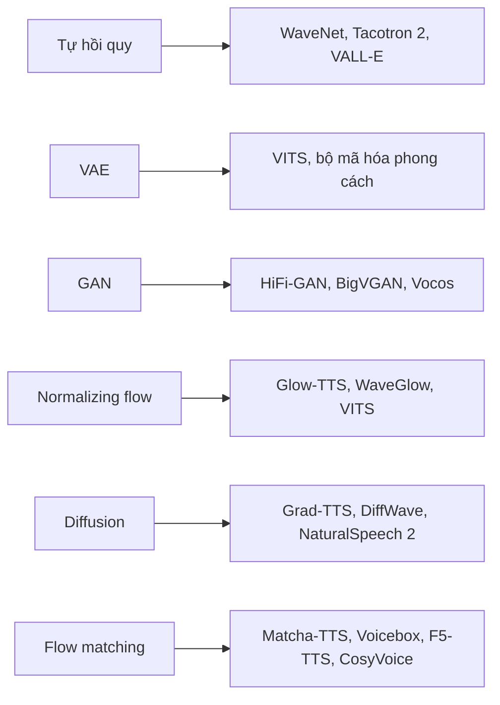

# Phần II. Mô hình sinh

Nếu chỉ được nhớ một ý từ cuốn sách này, hãy nhớ điều sau: **TTS là bài toán sinh có điều kiện một-đối-nhiều.** Cùng một câu văn có vô số cách đọc đúng — nhanh hay chậm, cao hay thấp, vui hay buồn. Một mô hình hồi quy đơn thuần sẽ học ra "trung bình" của tất cả các cách đọc ấy, và kết quả là giọng nói nhòe, đều đều, thiếu sức sống. Lịch sử TTS neural, ở một mức độ rất lớn, là lịch sử áp dụng ngày càng tốt các **mô hình sinh** để giải quyết vấn đề này.

Phần này trình bày đầy đủ, có suy dẫn, sáu họ mô hình sinh mà bạn sẽ gặp lại liên tục ở các phần sau.

## Các chương

| Chương | Nội dung |
|---|---|
| [7. Tổng quan mô hình sinh](ch07-tong-quan-mo-hinh-sinh.md) | Phân loại mô hình sinh, mô hình tự hồi quy, bài toán một-đối-nhiều và hiện tượng mel bị nhòe |
| [8. Variational Autoencoder](ch08-vae.md) | Biến ẩn, ELBO, thủ thuật tái tham số hóa, CVAE, VQ-VAE |
| [9. Mạng đối sinh (GAN)](ch09-gan.md) | Trò chơi minimax, LSGAN, hinge, WGAN, feature matching, ổn định huấn luyện |
| [10. Normalizing Flows](ch10-normalizing-flows.md) | Công thức đổi biến, coupling layer, Glow, flow tự hồi quy, CNF |
| [11. Mô hình khuếch tán](ch11-diffusion.md) | DDPM, score matching, SDE, DDIM, classifier-free guidance |
| [12. Flow Matching](ch12-flow-matching.md) | Conditional flow matching, đường đi OT, rectified flow, flow matching có mặt nạ |

!!! info "Kiến thức cần có"
    Phần I, đặc biệt [Chương 1](../phan-1-nen-tang/ch01-toan-nen-tang.md) (xác suất, KL divergence, công thức đổi biến cho mật độ).
