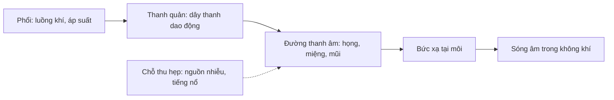
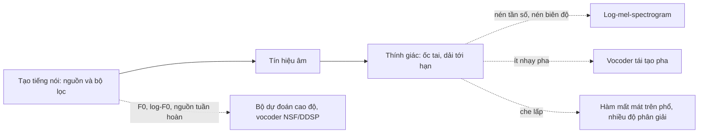

# Chương 13. Âm học và cơ chế tạo tiếng nói

!!! abstract "Mục tiêu học tập"
    Sau chương này, bạn có thể:

    - **Giải thích** các đại lượng cơ bản của sóng âm (tần số, biên độ, mức áp suất âm dB SPL, độ to) và chuyển đổi đúng giữa các thang decibel.
    - **Mô tả** cơ chế tạo tiếng nói qua ba khâu: hô hấp, phát âm ở thanh quản và cấu âm trong đường thanh âm; phân biệt âm hữu thanh, vô thanh, âm tắc, âm xát, âm mũi.
    - **Suy ra** công thức formant của mô hình ống đồng nhất và công thức hệ số của bộ cộng hưởng số bậc hai.
    - **Cài đặt** một bộ tổng hợp nguyên âm theo mô hình nguồn–bộ lọc (xung thanh môn + các bộ cộng hưởng formant) và kiểm chứng phổ của tín hiệu tạo ra.
    - **Phân loại** phụ âm theo vị trí và phương thức cấu âm, nguyên âm theo độ cao, độ trước–sau và độ tròn môi; đọc được ký hiệu IPA cơ bản.
    - **So sánh** các thang tần số tri giác (mel, Bark, ERB) và giải thích vì sao TTS dùng mel-spectrogram, log-biên độ và log-F0.
    - **Đánh giá** vai trò của pha trong cảm nhận âm thanh và hệ quả của nó đối với thiết kế vocoder.

!!! info "Kiến thức cần có"
    - Số phức, công thức Euler và trực giác về phân tích Fourier: [Chương 1](../phan-1-nen-tang/ch01-toan-nen-tang.md).
    - Tích chập một chiều: [Chương 4](../phan-1-nen-tang/ch04-cnn-rnn-mo-hinh-chuoi.md).
    - Không cần biết trước ngữ âm học. Biến đổi Fourier rời rạc, STFT và bộ lọc mel được trình bày chi tiết ở [Chương 14](ch14-xu-ly-tin-hieu-so.md); ở chương này bạn chỉ cần hiểu "phổ" là sự phân bố năng lượng theo tần số.

Một hệ thống TTS hiện đại có thể có hàng trăm triệu tham số, được huấn luyện trên hàng chục nghìn giờ dữ liệu. Thế nhưng gần như mọi lựa chọn "kỹ thuật" trong hệ thống ấy, từ việc dùng mel-spectrogram làm biểu diễn trung gian, lấy log của biên độ, mô hình hóa log-F0, cho đến cấu trúc của vocoder, đều bắt nguồn từ hai sự thật vật lý–sinh học: **con người tạo ra tiếng nói như thế nào** và **tai người nghe như thế nào**. Hiểu hai điều này giúp bạn đọc được bài báo nhanh hơn, chẩn đoán lỗi chính xác hơn (vì sao giọng tổng hợp nghe "rè kim loại"? vì sao đổi cao độ làm giọng nghe như "chuột chù"?) và thiết kế hệ thống tốt hơn cho tiếng Việt, một ngôn ngữ mà cao độ mang nghĩa từ vựng.

Chương này đi theo đúng đường đi của âm thanh: từ sóng âm (mục 13.1), qua bộ máy phát âm (13.2) và mô hình nguồn–bộ lọc (13.3), đến cách ngữ âm học mô tả các âm (13.4) và cách tai người cảm nhận chúng (13.5). Mục 13.6 tổng kết các hệ quả cho TTS.

## 13.1. Sóng âm và các đại lượng cơ bản

### 13.1.1. Sóng âm là gì

Âm thanh là **dao động áp suất** lan truyền trong môi trường đàn hồi (không khí). Khi dây thanh rung, nó lần lượt nén và giãn lớp không khí bên cạnh; các vùng nén–giãn này lan ra theo phương truyền sóng, nên sóng âm trong không khí là **sóng dọc**. Đại lượng ta đo bằng micro là **áp suất âm** $p(t)$: độ lệch nhỏ của áp suất so với áp suất khí quyển. Với tiếng nói thông thường, $p(t)$ chỉ cỡ phần trăm đến phần mười pascal, rất nhỏ so với áp suất khí quyển (khoảng $10^5$ Pa).

Tốc độ âm trong không khí khô ở 20 °C là $c \approx 343$ m/s; trong đường thanh âm (không khí ấm, ẩm) người ta thường lấy $c \approx 350$ m/s. Bước sóng liên hệ với tần số qua

$$
\lambda = \frac{c}{f}.
$$

Ở 1 kHz, $\lambda \approx 34$ cm, cùng bậc độ lớn với chiều dài đường thanh âm người trưởng thành (khoảng 14–18 cm). Đây không phải chi tiết vụn vặt: chính vì bước sóng của các tần số tiếng nói **so sánh được** với kích thước khoang miệng–họng mà đường thanh âm hoạt động như một **bộ cộng hưởng âm học**, tạo ra các formant (mục 13.3).

### 13.1.2. Tần số, chu kỳ, hài

Một **âm thuần** (*pure tone*) có dạng

$$
p(t) = A \sin(2\pi f t + \varphi),
$$

với biên độ $A$, tần số $f$ (Hz) và pha ban đầu $\varphi$. Chu kỳ $T_0 = 1/f$. Tiếng nói không phải âm thuần, nhưng các đoạn **hữu thanh** (nguyên âm, phụ âm mũi...) gần như **tuần hoàn**: dạng sóng lặp lại sau mỗi chu kỳ dao động của dây thanh. Theo khai triển Fourier, mọi tín hiệu tuần hoàn chu kỳ $T_0$ đều viết được thành tổng các thành phần sin có tần số là bội nguyên của $f_0 = 1/T_0$:

$$
p(t) = \sum_{k=1}^{\infty} A_k \cos(2\pi k f_0 t + \varphi_k).
$$

Thành phần $k = 1$ gọi là **tần số cơ bản** $f_0$ (F0); các thành phần $k \geq 2$ là **hài** (*harmonics*). Phổ của một đoạn nguyên âm vì vậy là một "hàng rào" các vạch cách đều nhau $f_0$ Hz; chiều cao các vạch (biên độ $A_k$) bị "nắn" bởi đường thanh âm. Hãy giữ hình ảnh này: **vị trí các vạch do nguồn quyết định, đường bao của chúng do bộ lọc quyết định**. Đó là toàn bộ tinh thần của mô hình nguồn–bộ lọc.

Tiếng nói thật chỉ **gần** tuần hoàn: F0 thay đổi liên tục (đó là ngữ điệu và thanh điệu), biên độ và chu kỳ dao động nhỏ từ chu kỳ này sang chu kỳ khác (*jitter*, *shimmer*). Các đoạn **vô thanh** như /s/, /f/ thì hoàn toàn không tuần hoàn: phổ của chúng liên tục, giống nhiễu đã được lọc.

### 13.1.3. Decibel: dB SPL, dB công suất và dBFS

Tai người cảm nhận được áp suất từ khoảng $2 \times 10^{-5}$ Pa đến hàng chục pascal, tức dải động hơn sáu bậc độ lớn. Vì vậy ta dùng thang logarit. **Mức áp suất âm** (*sound pressure level*) là

$$
L_p = 20 \log_{10} \frac{p_{\text{rms}}}{p_0} \quad \text{(dB SPL)}, \qquad p_0 = 20\ \mu\text{Pa},
$$

với $p_0$ xấp xỉ ngưỡng nghe của người trẻ ở khoảng 1 kHz. Với **cường độ** hoặc **công suất** (tỉ lệ với bình phương áp suất), ta dùng hệ số 10 thay vì 20:

$$
L_I = 10 \log_{10} \frac{I}{I_0}, \qquad I \propto p^2 \;\Rightarrow\; 10 \log_{10} \frac{p^2}{p_0^2} = 20 \log_{10} \frac{p}{p_0}.
$$

Hai công thức nhất quán với nhau. Vài quy tắc nhẩm rất hay dùng: tăng **gấp đôi biên độ** ứng với $+6{,}02$ dB; tăng **gấp đôi công suất** ứng với $+3{,}01$ dB; tăng biên độ gấp 10 ứng với $+20$ dB.

Một số mức điển hình (xấp xỉ, tùy nguồn và điều kiện đo): ngưỡng nghe quanh 0 dB SPL ở vùng 1–4 kHz; thì thầm khoảng 30 dB SPL; hội thoại thông thường ở khoảng cách 1 m khoảng 55–65 dB SPL; la hét có thể vượt 80 dB SPL; ngưỡng đau quanh 120–130 dB SPL.

Trong âm thanh số, ta còn gặp **dBFS** (*decibels relative to full scale*): với tín hiệu dấu phẩy động chuẩn hóa trong $[-1, 1]$, mức $20 \log_{10} \lvert x \rvert$ dBFS so với biên độ cực đại mà định dạng biểu diễn được. 0 dBFS là đỉnh tối đa; mọi mức thực tế đều âm. **dBFS không có quan hệ cố định với dB SPL** nếu không hiệu chuẩn chuỗi thu âm (micro, tiền khuếch đại, bộ chuyển đổi). Đây là nguồn nhầm lẫn phổ biến khi đọc thông số dữ liệu.

!!! warning "Không cộng decibel như số thường"
    Hai nguồn âm không tương quan, mỗi nguồn 60 dB SPL, phát cùng lúc cho tổng **công suất** gấp đôi, tức khoảng 63 dB SPL chứ không phải 120 dB. Muốn cộng, hãy đổi về công suất tuyến tính, cộng, rồi đổi lại sang dB.

### 13.1.4. Độ to: phon, sone và đường đồng mức âm lượng

**Độ to** (*loudness*) là cảm nhận chủ quan, không đồng nhất với mức áp suất. Tai nhạy nhất ở vùng khoảng 2–5 kHz và kém nhạy hơn nhiều ở tần số thấp: một âm 100 Hz phải có mức áp suất cao hơn đáng kể so với một âm 1 kHz mới được nghe to bằng. Các **đường đồng mức âm lượng** (*equal-loudness contours*, chuẩn hóa trong ISO 226) mô tả điều này. Đơn vị **phon** định nghĩa độ to của một âm bằng mức dB SPL của âm 1 kHz được nghe to bằng nó. Đơn vị **sone** đo độ to theo thang tỉ lệ: ở mức trung bình, tăng khoảng 10 phon thì độ to cảm nhận tăng khoảng gấp đôi. Nói cách khác, độ to tăng gần như theo **lũy thừa nhỏ** của cường độ (định luật lũy thừa của Stevens, số mũ cỡ 0,3 với âm 1 kHz). Tính chất **nén** (*compressive*) này là một lý do sâu xa khiến ta luôn lấy log (hoặc một hàm nén) của phổ trước khi đưa vào mô hình học sâu.

Trong xử lý dữ liệu TTS, ta sẽ gặp lại ý tưởng này dưới dạng **chuẩn hóa độ to theo LUFS** (dùng bộ lọc trọng số mô phỏng độ nhạy của tai), được trình bày ở [Chương 14](ch14-xu-ly-tin-hieu-so.md).

## 13.2. Cơ chế tạo tiếng nói

### 13.2.1. Ba khâu: hô hấp, phát âm, cấu âm

Bộ máy phát âm của con người có thể chia thành ba khâu nối tiếp:

1. **Hô hấp** (*respiration*): phổi đẩy luồng khí ra, tạo áp suất dưới thanh môn (*subglottal pressure*). Đây là nguồn năng lượng. Áp suất này giảm dần trong một hơi nói, góp phần tạo hiện tượng **đường xuống** của cao độ (*declination*) mà ta sẽ gặp ở [Chương 16](ch16-ngon-dieu.md).
2. **Phát âm** (*phonation*): trong thanh quản, hai **dây thanh** (*vocal folds*) có thể khép lại và dao động, cắt luồng khí thành các xung. Khe hở giữa hai dây thanh gọi là **thanh môn** (*glottis*). Khâu này tạo ra **nguồn âm** tuần hoàn của tiếng nói hữu thanh.
3. **Cấu âm** (*articulation*): đường thanh âm (*vocal tract*), gồm khoang họng, khoang miệng và (khi ngạc mềm hạ xuống) khoang mũi, được các **cơ quan cấu âm** (lưỡi, môi, hàm, ngạc mềm) thay đổi hình dạng. Đường thanh âm **lọc** nguồn âm, và ở những chỗ bị thu hẹp mạnh, nó còn tạo thêm **nguồn nhiễu** (luồng khí xoáy) hoặc **nguồn tức thời** (tiếng nổ khi mở chỗ tắc).



### 13.2.2. Dao động của dây thanh

Vì sao dây thanh dao động được mà không cần một "cơ bắp rung" theo từng chu kỳ? Lý thuyết **cơ đàn hồi – khí động** (*myoelastic–aerodynamic theory*) giải thích như sau. Khi dây thanh khép, áp suất dưới thanh môn tăng và đẩy chúng tách ra; luồng khí bắt đầu đi qua. Lực đàn hồi của mô, cùng với sự giảm áp suất trong khe hẹp khi luồng khí chảy nhanh và tính chất sóng của lớp niêm mạc, kéo chúng khép lại. Chu trình lặp lại một cách **tự duy trì**, giống như tiếng "rung" khi bạn thổi qua hai môi mím chặt. Người nói điều khiển F0 chủ yếu bằng **độ căng** của dây thanh (cơ nhẫn–giáp kéo dài dây thanh làm F0 tăng), cùng với khối lượng dao động hiệu dụng và áp suất dưới thanh môn.

Khi nói, F0 trung bình của nam giới trưởng thành thường quanh 100–120 Hz, của nữ giới quanh 190–220 Hz, trẻ em cao hơn nữa; các tài liệu khác nhau đưa ra những con số hơi khác, và dải biến thiên trong một câu nói có thể trải rộng cả quãng tám. Những con số này giải thích các thiết lập như `fmin=50–70 Hz`, `fmax=400–600 Hz` khi trích xuất F0 cho tiếng nói ([Chương 14](ch14-xu-ly-tin-hieu-so.md)).

Mỗi chu kỳ dao động gồm pha **mở** (thanh môn mở dần), pha **đóng** (thường nhanh hơn pha mở) và pha **khép kín**. Thời điểm thanh môn đóng lại đột ngột (*glottal closure instant*, GCI) là lúc nguồn âm "kích" đường thanh âm mạnh nhất; độ dốc của sự đóng này quyết định lượng năng lượng ở tần số cao. Các phương pháp xử lý tiếng nói cổ điển như TD-PSOLA ([Chương 19](../phan-5-mo-hinh-am-hoc/ch19-lich-su-tts.md)) đặt các cửa sổ phân tích đồng bộ với GCI.

### 13.2.3. Các kiểu phát âm (phonation types)

Cùng một bộ máy, người nói có thể tạo nhiều **chất giọng** khác nhau:

| Kiểu phát âm | Hoạt động của thanh môn | Đặc điểm âm học |
|---|---|---|
| Giọng thường (*modal*) | Khép kín hoàn toàn, dao động đều | Hài rõ, F0 ổn định |
| Giọng thở (*breathy*) | Khép không kín, khí rò liên tục | Nhiều nhiễu, hài bậc cao yếu, phổ dốc |
| Giọng kẹt (*creaky*, *vocal fry*) | Khép chặt, pha khép kín dài | F0 thấp, chu kỳ không đều, có thể "gãy" |
| Giọng gió (*falsetto*) | Dây thanh mỏng, căng | F0 cao, ít hài |
| Thì thầm (*whisper*) | Không dao động, khe hẹp tạo xoáy | Không có F0, chỉ có nhiễu được lọc |
| Vô thanh (*voiceless*) | Mở rộng | Không có nguồn ở thanh quản |

!!! note "Góc tiếng Việt"
    Trong tiếng Việt, chất giọng không chỉ là đặc điểm cá nhân mà còn là một phần của **thanh điệu**. Ở phương ngữ Bắc, thanh **ngã** thường được mô tả là có đoạn thanh quản hóa (kẹt, có khi gần như tắc thanh hầu) ở giữa âm tiết, còn thanh **nặng** thường ngắn và kết thúc bằng sự co thắt thanh hầu. Hệ quả kỹ thuật rất cụ thể: các thuật toán trích xuất F0 hay "mất dấu" hoặc nhảy quãng tám ở đúng những vùng này, và vocoder phải tái tạo được các chu kỳ không đều. Chi tiết ở [Chương 15](ch15-ngu-am-tieng-viet.md).

### 13.2.4. Nguồn thanh môn và độ nghiêng phổ

Luồng khí qua thanh môn trong một chu kỳ, $u_g(t)$, có dạng một "xung" bất đối xứng: tăng từ từ, giảm nhanh, rồi bằng không trong pha khép kín. Hai mô hình kinh điển là **xung Rosenberg** (Rosenberg, 1971), ghép các đoạn hàm lượng giác, và **mô hình LF** (Fant, Liljencrants và Lin, 1985) mô tả đạo hàm của luồng khí bằng bốn tham số. Ta sẽ dùng xung Rosenberg trong mã ở mục 13.3.

Phổ của xung thanh môn giảm khoảng $-12$ dB/quãng tám ở vùng tần số cao. Khi âm bức xạ ra khỏi môi, áp suất ở trường xa tỉ lệ với **đạo hàm** của lưu lượng khí, tương đương một bộ lọc vi phân với độ lợi tăng $+6$ dB/quãng tám. Kết hợp lại, phổ "nguồn + bức xạ" của nguyên âm có **độ nghiêng phổ** (*spectral tilt*) chung khoảng $-6$ dB/quãng tám. Đó là lý do nhiều hệ thống xử lý tiếng nói áp dụng **tiền nhấn** (*pre-emphasis*) $y[n] = x[n] - 0{,}97\,x[n-1]$ để "làm phẳng" phổ trước khi phân tích ([Chương 14](ch14-xu-ly-tin-hieu-so.md)).

### 13.2.5. Các loại âm theo nguồn kích thích

| Loại âm | Nguồn kích thích | Ví dụ tiếng Việt (chữ viết) | Dấu hiệu âm học |
|---|---|---|---|
| Nguyên âm | Tuần hoàn (thanh quản) | a, i, u, ư, ơ | Hài rõ, formant rõ |
| Âm mũi | Tuần hoàn, khí qua mũi | m, n, nh, ng | Năng lượng thấp, có phản cộng hưởng |
| Âm bên, bán nguyên âm | Tuần hoàn | l; âm đệm /w/ trong "hoa" | Giống nguyên âm, chuyển tiếp formant |
| Âm xát vô thanh | Nhiễu tại chỗ thu hẹp | x, s, ph, kh, h | Phổ liên tục, không có F0 |
| Âm xát hữu thanh | Tuần hoàn + nhiễu | v, d/gi (Hà Nội), g | Có cả hài lẫn nhiễu |
| Âm tắc | Tắc hoàn toàn, rồi bật hơi/nổ | t, th, đ, b, c/k | Khoảng lặng + xung nổ ngắn |

Với **âm tắc**, một khái niệm quan trọng là **thời gian khởi phát thanh** (*voice onset time*, VOT): khoảng thời gian từ lúc bật chỗ tắc đến lúc dây thanh bắt đầu rung. "th" trong tiếng Việt là âm tắc **bật hơi** (VOT dài), "t" thì không bật hơi (VOT ngắn), còn "b", "đ" thường được mô tả là âm **hút vào** (*implosive*) hữu thanh. Ở **âm mũi**, khoang miệng bị chặn nhưng vẫn nối với đường dẫn âm, tạo ra các **phản cộng hưởng** (*anti-resonance*): phổ có những "hố" sâu mà mô hình chỉ gồm cực (*all-pole*) không biểu diễn được. Ta sẽ quay lại hạn chế này ở mục 13.3.

## 13.3. Mô hình nguồn–bộ lọc

### 13.3.1. Trực giác

Hãy nghĩ đến chiếc kèn trumpet: đôi môi người thổi rung tạo ra một chuỗi xung giàu hài (nguồn); thân kèn với chiều dài và độ loe xác định chỉ cho một số tần số "cộng hưởng" đi qua mạnh (bộ lọc). Đổi nốt bằng cách đổi tần số rung môi; đổi âm sắc bằng cách đổi kèn. Tiếng nói cũng vậy: **dây thanh quyết định cao độ, đường thanh âm quyết định âm sắc** (nguyên âm nào, giọng ai). Mô hình **nguồn–bộ lọc** (*source–filter model*), được hệ thống hóa bởi Fant (1960), tách hai vai trò này ra một cách tường minh.

### 13.3.2. Hình thức hóa

Coi nguồn, đường thanh âm và bức xạ là các hệ tuyến tính bất biến theo thời gian (trong một khoảng ngắn vài chục mili-giây). Khi đó tín hiệu tiếng nói là tích chập:

$$
s(t) = \big(u_g \ast v \ast r\big)(t),
$$

với $u_g$ là luồng khí thanh môn, $v$ là đáp ứng xung của đường thanh âm, $r$ là đáp ứng của bức xạ tại môi. Trong miền tần số, tích chập thành phép nhân:

$$
S(f) = U_g(f)\, V(f)\, R(f).
$$

Trong miền rời rạc, người ta thường tách nguồn thành **kích thích** $E(z)$ (chuỗi xung đơn vị cách đều $T_0$ cho âm hữu thanh, nhiễu trắng cho âm vô thanh) và **dạng xung thanh môn** $G(z)$:

$$
S(z) = E(z)\, G(z)\, V(z)\, R(z).
$$

Lấy log biên độ, phép nhân thành phép cộng:

$$
\log \lvert S(f) \rvert = \log \lvert E(f) G(f) \rvert + \log \lvert V(f) \rvert + \log \lvert R(f) \rvert.
$$

Tính **cộng** này trong miền log là nền tảng của **cepstrum** và MFCC ([Chương 14](ch14-xu-ly-tin-hieu-so.md)): đường bao phổ biến thiên chậm theo tần số, còn cấu trúc hài biến thiên nhanh, nên có thể tách chúng bằng một phép lọc trong miền "quefrency".

Mô hình dựa trên vài giả thiết đơn giản hóa. Thứ nhất, nguồn **độc lập** với bộ lọc; thực tế có tương tác nguồn–đường thanh âm (*source–tract interaction*), nhất là khi F0 gần F1. Thứ hai, sóng phẳng lan truyền dọc đường thanh âm; giả thiết này đúng khá tốt dưới khoảng 4–5 kHz. Thứ ba, với nguyên âm, $V$ chỉ gồm các **cực** (*all-pole*); âm mũi và âm xát cần thêm **không điểm**. Dù vậy, mô hình đủ tốt để làm nền cho hầu hết kỹ thuật xử lý tiếng nói cổ điển (LPC, vocoder kênh, WORLD) và vẫn hiện diện ngầm trong nhiều vocoder neural.

!!! tip "Hài khác formant"
    Đây là nhầm lẫn phổ biến nhất của người mới. **Hài** là các vạch phổ tại $k f_0$, thuộc về **nguồn**. **Formant** là các đỉnh của **đường bao** phổ, tức các tần số cộng hưởng của **bộ lọc**. Khi bạn hát cùng một nguyên âm ở nhiều cao độ, các hài trượt đi nhưng formant đứng yên; khi bạn đổi từ "a" sang "i" ở cùng cao độ, hài đứng yên còn formant dịch chuyển. Nếu F0 cao (giọng nữ, trẻ em), các hài thưa và formant bị "lấy mẫu" rất thưa, khiến việc ước lượng formant khó hơn hẳn.

### 13.3.3. Mô hình ống đồng nhất và công thức formant

Mô hình vật lý đơn giản nhất của đường thanh âm ở tư thế trung tính (nguyên âm "ơ" trung tính, IPA [ə]) là một **ống đồng nhất** có tiết diện không đổi, chiều dài $L$, **đóng** ở đầu thanh môn (dây thanh gần như khép, trở kháng rất lớn) và **mở** ở đầu môi. Ta suy ra các tần số cộng hưởng của nó theo từng bước.

**Bước 1: phương trình sóng.** Với sóng phẳng, áp suất âm $p(x, t)$ dọc trục ống thỏa phương trình sóng một chiều:

$$
\frac{\partial^2 p}{\partial t^2} = c^2 \frac{\partial^2 p}{\partial x^2}.
$$

**Bước 2: tách biến.** Tìm nghiệm dừng dạng $p(x, t) = P(x) \cos(2\pi f t)$. Thay vào ta được $P''(x) = -k^2 P(x)$ với số sóng $k = 2\pi f / c$, nên $P(x) = a \cos(kx) + b \sin(kx)$.

**Bước 3: điều kiện biên tại thanh môn ($x = 0$).** Đầu đóng nghĩa là vận tốc hạt khí bằng không. Theo phương trình Euler tuyến tính hóa, vận tốc hạt tỉ lệ với $\partial p / \partial x$, nên $P'(0) = 0$, suy ra $b = 0$ và $P(x) = a \cos(kx)$. Đầu đóng là một **bụng áp suất**.

**Bước 4: điều kiện biên tại môi ($x = L$).** Đầu mở thông ra không gian rộng nên áp suất âm xấp xỉ bằng không: $P(L) = 0$, tức $\cos(kL) = 0$. Do đó

$$
kL = \frac{(2n - 1)\pi}{2}, \quad n = 1, 2, 3, \ldots
$$

**Bước 5: tần số cộng hưởng.** Thay $k = 2\pi f / c$:

$$
\boxed{F_n = \frac{(2n - 1)\, c}{4L}}, \qquad n = 1, 2, 3, \ldots
$$

Đây là các **cộng hưởng một phần tư bước sóng** (*quarter-wave resonances*): chiều dài ống bằng $\lambda/4$, $3\lambda/4$, $5\lambda/4$...

!!! example "Ví dụ: đường thanh âm 17,5 cm"
    Với $L = 17{,}5$ cm $= 0{,}175$ m và $c = 350$ m/s: $F_1 = 350 / (4 \times 0{,}175) = 500$ Hz, $F_2 = 3 F_1 = 1500$ Hz, $F_3 = 5 F_1 = 2500$ Hz. Đây đúng là bộ formant "giáo khoa" của nguyên âm trung tính. Một đường thanh âm ngắn hơn, ví dụ khoảng 14,5 cm (cỡ thường gặp ở nữ giới), cho $F_1 \approx 603$ Hz, $F_2 \approx 1810$ Hz, $F_3 \approx 3017$ Hz: **mọi formant tỉ lệ nghịch với chiều dài**. Đây là cơ sở của kỹ thuật chuẩn hóa độ dài đường thanh âm (*vocal tract length normalization*) trong nhận dạng tiếng nói và của nhiều phép biến đổi giọng.

Các nguyên âm khác ứng với những hình dạng **không đồng nhất**: thu hẹp ở phía sau, mở rộng ở phía trước (như "a") hay ngược lại (như "i"). Có thể xấp xỉ chúng bằng mô hình hai hoặc nhiều ống nối tiếp. Một quy tắc định tính hữu ích từ lý thuyết nhiễu loạn (*perturbation theory*, xem Stevens, 1998; Johnson, 2012): thu hẹp ống tại nơi **vận tốc** của sóng dừng ứng với formant $F_n$ lớn nhất sẽ **hạ** $F_n$, còn thu hẹp tại nơi **áp suất** lớn nhất sẽ **nâng** $F_n$. Vì môi luôn là nơi vận tốc lớn với mọi formant của ống đóng–mở, việc **tròn môi** (thu hẹp và kéo dài lối ra) **hạ toàn bộ formant**, đặc biệt là F2. Đó là lý do "u" có F2 rất thấp.

### 13.3.4. Bộ cộng hưởng số bậc hai

Để mô phỏng một formant trên máy tính, ta cần một bộ lọc số có một **cặp cực phức liên hợp**. Một cộng hưởng tương tự có tần số $F$ và băng thông $B$ (Hz) ứng với cặp cực trong mặt phẳng $s$ tại $s = -\pi B \pm j 2\pi F$. Ánh xạ sang miền $z$ bằng phép **bất biến xung** (*impulse invariance*) $z = e^{sT}$ với $T = 1/f_s$:

$$
z_{1,2} = e^{-\pi B T} e^{\pm j 2\pi F T} = r e^{\pm j\theta}, \qquad r = e^{-\pi B / f_s}, \quad \theta = \frac{2\pi F}{f_s}.
$$

Hàm truyền chỉ gồm hai cực này là

$$
H(z) = \frac{A}{(1 - r e^{j\theta} z^{-1})(1 - r e^{-j\theta} z^{-1})} = \frac{A}{1 - 2r\cos\theta\, z^{-1} + r^2 z^{-2}},
$$

ứng với phương trình sai phân

$$
y[n] = A\, x[n] + \underbrace{2 r \cos\theta}_{B_c}\, y[n-1] \underbrace{- r^2}_{C}\, y[n-2].
$$

Đây chính là bộ cộng hưởng trong bộ tổng hợp formant của Klatt (1980), với $C = -e^{-2\pi B T}$, $B_c = 2 e^{-\pi B T}\cos(2\pi F T)$ (ta viết $B_c$ để khỏi trùng với băng thông $B$). Chọn $A = 1 - B_c - C$ thì $H(1) = 1$, tức độ lợi tại 0 Hz bằng 1, giúp các tầng nối tiếp không làm tín hiệu tăng hay giảm vô tội vạ. **Bán kính cực** $r$ quyết định độ "nhọn": $r$ càng gần 1 thì băng thông càng hẹp, cộng hưởng càng mạnh (bài tập 5 yêu cầu bạn chứng minh băng thông $-3$ dB xấp xỉ $B$ khi $r \to 1$). Điều kiện ổn định là $r < 1$, luôn đúng khi $B > 0$.

### 13.3.5. Cài đặt: tổng hợp nguyên âm bằng nguồn–bộ lọc

Khối mã dưới đây ghép ba thành phần: nguồn (chuỗi xung đơn vị hoặc xung Rosenberg đã lấy vi phân để gộp luôn hiệu ứng bức xạ tại môi), ba bộ cộng hưởng formant mắc **nối tiếp** (*cascade*), và chuẩn hóa biên độ. Giá trị formant lấy từ số đo kinh điển của Peterson và Barney (1952) cho nam giới nói tiếng Anh Mỹ; băng thông là giá trị giả định hợp lý.

```python
import numpy as np
from scipy.signal import lfilter

def glottal_source(f0: float, dur: float, fs: int, kind: str = "rosenberg") -> np.ndarray:
    """Nguồn thanh môn: chuỗi xung đơn vị hoặc đạo hàm của xung Rosenberg."""
    L = int(dur * fs)                         # số mẫu
    period = int(round(fs / f0))              # chu kỳ (số mẫu)
    if kind == "impulse":
        g = np.zeros(L)
        g[::period] = 1.0
        return g
    # Xung Rosenberg: pha mở chiếm 40% chu kỳ, pha đóng 16%, còn lại đóng kín
    tp, tn = int(0.40 * period), int(0.16 * period)
    pulse = np.zeros(period)
    pulse[:tp] = 0.5 * (1 - np.cos(np.pi * np.arange(tp) / tp))
    pulse[tp:tp + tn] = np.cos(0.5 * np.pi * np.arange(tn) / tn)
    g = np.tile(pulse, L // period + 1)[:L]   # lưu lượng thanh môn u_g[n]
    return np.diff(g, prepend=0.0)            # vi phân ≈ bức xạ tại môi (+6 dB/oct)

def resonator(F: float, B: float, fs: int):
    """Bộ cộng hưởng bậc hai (Klatt, 1980). Trả về (b, a) dùng cho lfilter."""
    T = 1.0 / fs
    C = -np.exp(-2 * np.pi * B * T)
    Bc = 2 * np.exp(-np.pi * B * T) * np.cos(2 * np.pi * F * T)
    A = 1.0 - Bc - C                          # độ lợi tại 0 Hz bằng 1
    return np.array([A]), np.array([1.0, -Bc, -C])

def synth_vowel(formants, bandwidths, f0=120.0, dur=0.5, fs=16000, kind="rosenberg"):
    x = glottal_source(f0, dur, fs, kind)     # (L,)
    for F, B in zip(formants, bandwidths):    # các bộ cộng hưởng mắc nối tiếp
        b, a = resonator(F, B, fs)
        x = lfilter(b, a, x)
    return x / (np.max(np.abs(x)) + 1e-9)     # chuẩn hóa biên độ đỉnh về 1

# Formant trung bình của nam giới nói tiếng Anh Mỹ (Peterson & Barney, 1952), Hz
VOWELS = {"i": (270, 2290, 3010), "a": (730, 1090, 2440), "u": (300, 870, 2240)}
BANDWIDTHS = (60, 90, 150)                    # băng thông giả định (Hz)

if __name__ == "__main__":
    import soundfile as sf
    fs = 16000
    for name, F in VOWELS.items():
        y = synth_vowel(F, BANDWIDTHS, f0=120, fs=fs)
        sf.write(f"vowel_{name}.wav", y.astype(np.float32), fs)
```

Lưu khối trên thành `ch13_vowel.py` rồi chạy, bạn sẽ có ba tệp `vowel_i.wav`, `vowel_a.wav`, `vowel_u.wav`. Hãy nghe chúng: dù chỉ có ba formant tĩnh và F0 không đổi, tai bạn vẫn nhận ra ngay đó là "i", "a", "u", dù nghe "máy móc". Thử đổi `kind="impulse"`: âm nghe chói và "rè" hơn vì chuỗi xung đơn vị có phổ phẳng, thiếu độ nghiêng $-12$ dB/quãng tám của nguồn thật.

Khối mã sau kiểm chứng ba khẳng định của lý thuyết: đỉnh của một bộ cộng hưởng nằm đúng tại $F$; đường bao của cả bộ lọc có đỉnh tại F1, F2, F3; và phổ của tín hiệu tổng hợp chỉ gồm các vạch tại $k f_0$.

```python
from scipy.signal import freqz, find_peaks
from ch13_vowel import resonator, synth_vowel, VOWELS, BANDWIDTHS
import numpy as np

fs = 16000
# 1) Bộ cộng hưởng đơn: đỉnh đáp ứng tần số nằm đúng tại F
b, a = resonator(730, 60, fs)
w, h = freqz(b, a, worN=8192, fs=fs)
assert abs(w[np.argmax(np.abs(h))] - 730) < 5

# 2) Cả bộ lọc đường thanh âm: các đỉnh của |V(f)| trùng với F1, F2, F3
for name, F in VOWELS.items():
    H = np.ones_like(w, dtype=complex)
    for Fi, Bi in zip(F, BANDWIDTHS):
        H *= freqz(*resonator(Fi, Bi, fs), worN=8192, fs=fs)[1]
    peaks, _ = find_peaks(20 * np.log10(np.abs(H)))
    print(name, "đỉnh của |V(f)| (Hz):", np.round(w[peaks]).astype(int))
    assert np.allclose(w[peaks][:3], F, rtol=0.05)

# 3) Phổ của nguyên âm tổng hợp chỉ có năng lượng tại các hài k·F0
y = synth_vowel(VOWELS["a"], BANDWIDTHS, f0=125, dur=1.0, fs=fs)  # (16000,)
Y = np.abs(np.fft.rfft(y * np.hanning(len(y))))
f = np.fft.rfftfreq(len(y), 1 / fs)
pk, _ = find_peaks(Y, height=Y.max() * 0.05)
print("10 hài đầu tiên (Hz):", np.round(f[pk][:10]).astype(int))
assert np.allclose(f[pk][:5], 125 * np.arange(1, 6), atol=2)
```

Kết quả chạy thử (CPU, vài giây):

```text
i đỉnh của |V(f)| (Hz): [ 269 2291 2997]
a đỉnh của |V(f)| (Hz): [ 731 1083 2429]
u đỉnh của |V(f)| (Hz): [ 300  864 2229]
10 hài đầu tiên (Hz): [ 125  250  375  500  625  750  875 1000 1125 1250]
```

Đỉnh của đường bao lệch vài Hz so với giá trị đặt vì các bộ cộng hưởng chồng lên nhau (đuôi của F1 làm "nghiêng" vùng quanh F2) và vì độ phân giải hữu hạn của lưới tần số. Hãy để ý rằng trong phổ của tín hiệu thật, ta **không thấy trực tiếp** formant, chỉ thấy các hài bị nắn biên độ. Muốn ước lượng formant từ tín hiệu, ta phải ước lượng đường bao, ví dụ bằng dự đoán tuyến tính (LPC) ở [Chương 14](ch14-xu-ly-tin-hieu-so.md).

### 13.3.6. Liên hệ với TTS

Mô hình nguồn–bộ lọc hiện diện xuyên suốt lịch sử TTS:

- **Tổng hợp formant** (Klatt, DECtalk) chính là phiên bản đầy đủ của đoạn mã trên, với hàng chục tham số điều khiển theo thời gian; xem [Chương 19](../phan-5-mo-hinh-am-hoc/ch19-lich-su-tts.md).
- **Vocoder tham số** như WORLD phân tích tiếng nói thành F0, đường bao phổ và độ phi tuần hoàn (*aperiodicity*), tức đúng ba "núm vặn" của nguồn–bộ lọc.
- **LPCNet**, **neural source–filter (NSF)** và **DDSP** tạo nguồn kích thích tường minh từ F0 rồi để mạng nơ-ron đóng vai bộ lọc; xem [Chương 24](../phan-6-vocoder/ch24-vocoder-tu-hoi-quy-va-flow.md).
- Ngay cả các vocoder GAN "thuần dữ liệu" như HiFi-GAN cũng phải học ngầm cấu trúc tuần hoàn này; BigVGAN đưa thẳng thiên kiến tuần hoàn vào kiến trúc qua hàm kích hoạt Snake ([Chương 25](../phan-6-vocoder/ch25-gan-vocoder.md)).

Một hệ quả thực hành quan trọng: muốn **đổi cao độ mà giữ nguyên âm sắc**, ta phải đổi nguồn mà giữ bộ lọc. Nếu chỉ "tua nhanh" tín hiệu (lấy mẫu lại), cả hài lẫn formant cùng bị nhân lên, giọng nghe như trẻ con hay "chuột chù". Bài tập 7 cho bạn tự kiểm chứng điều này.

## 13.4. Ngữ âm học cấu âm

Ngữ âm học cấu âm (*articulatory phonetics*) mô tả âm theo **cách cơ quan cấu âm tạo ra nó**. Với kỹ sư TTS, đây là "ngôn ngữ chung" để thiết kế bộ ký hiệu âm vị, đọc tài liệu G2P và hiểu vì sao mô hình hay nhầm cặp âm này mà không nhầm cặp âm kia.

### 13.4.1. Phụ âm: thanh tính, vị trí và phương thức cấu âm

Mỗi phụ âm được mô tả bằng ba thuộc tính:

- **Thanh tính** (*voicing*): dây thanh có rung (hữu thanh) hay không (vô thanh). Thêm vào đó là **bật hơi** (*aspiration*), ký hiệu IPA bằng chữ nhỏ ʰ.
- **Vị trí cấu âm** (*place of articulation*): nơi luồng khí bị cản trở.
- **Phương thức cấu âm** (*manner of articulation*): cách luồng khí bị cản trở.

| Vị trí cấu âm | Mô tả | Ví dụ IPA | Ví dụ tiếng Việt (chữ viết → IPA, giọng Hà Nội) |
|---|---|---|---|
| Môi–môi (*bilabial*) | Hai môi | p, b, m | b → [ɓ], m → [m] |
| Môi–răng (*labiodental*) | Môi dưới chạm răng trên | f, v | ph → [f], v → [v] |
| Răng/lợi (*dental/alveolar*) | Đầu lưỡi chạm răng/lợi | t, d, n, s, l | t, th → [tʰ], đ → [ɗ], n, l, x → [s] |
| Quặt lưỡi (*retroflex*) | Đầu lưỡi uốn lên sau lợi | ʈ, ʂ, ʐ | tr, s, r ở những vùng phân biệt chúng |
| Ngạc cứng (*palatal*) | Mặt lưỡi chạm ngạc cứng | c, ɲ, j | ch → [c], nh → [ɲ] |
| Ngạc mềm (*velar*) | Gốc lưỡi chạm ngạc mềm | k, ŋ, x, ɣ | c/k/q → [k], ng → [ŋ], kh → [x], g → [ɣ] |
| Thanh hầu (*glottal*) | Tại thanh môn | ʔ, h | h → [h]; âm tiết mở đầu bằng nguyên âm như "ăn" thường có [ʔ] |

| Phương thức | Mô tả | Ví dụ |
|---|---|---|
| Tắc (*plosive*) | Chặn hoàn toàn rồi bật ra | t, k, tʰ |
| Tắc hút vào (*implosive*) | Thanh quản hạ xuống khi đóng, khí "hút" vào | ɓ, ɗ |
| Mũi (*nasal*) | Chặn miệng, khí qua mũi | m, n, ɲ, ŋ |
| Xát (*fricative*) | Khe hẹp gây xoáy | f, v, s, z, x, ɣ, h |
| Tắc–xát (*affricate*) | Tắc rồi nhả thành xát | tɕ (một cách phiên âm "ch") |
| Tiếp cận (*approximant*) | Thu hẹp nhẹ, không xoáy | w, j |
| Bên (*lateral*) | Khí đi hai bên lưỡi | l |

Bảng trên chỉ là phác thảo để làm quen; danh sách đầy đủ phụ âm tiếng Việt, các biến thể theo phương ngữ và những điểm còn tranh luận được trình bày cẩn thận ở [Chương 15](ch15-ngu-am-tieng-viet.md).

Mỗi thuộc tính cấu âm để lại **dấu vết âm học** riêng. Vị trí cấu âm của âm tắc thể hiện chủ yếu qua **chuyển tiếp formant** (*formant transitions*) ở nguyên âm kế bên và phổ của tiếng nổ; phương thức thể hiện qua khoảng lặng, tiếng nổ, độ dài nhiễu xát hay nhiễu mũi; thanh tính và bật hơi thể hiện qua VOT. Âm xát /s/ có năng lượng tập trung ở vùng tần số cao, thường từ khoảng 4 kHz trở lên và có thể kéo dài tới 8–10 kHz. Đây là lý do thực tế để TTS dùng tần số lấy mẫu 22,05 kHz trở lên: với 16 kHz (tần số Nyquist 8 kHz), các âm xát nghe "đục" và thiếu độ sắc nét.

### 13.4.2. Nguyên âm: độ cao, độ trước–sau, độ tròn môi

Nguyên âm được tạo khi luồng khí đi tương đối tự do; khác biệt giữa chúng nằm ở **hình dạng** đường thanh âm, mô tả bằng ba tham số:

- **Độ cao** (*height*): lưỡi nâng cao (nguyên âm đóng như "i", "u") hay hạ thấp (nguyên âm mở như "a").
- **Độ trước–sau** (*backness*): khối lưỡi dồn ra trước ("i", "ê") hay lùi về sau ("u", "ô").
- **Độ tròn môi** (*rounding*): môi tròn ("u", "ô", "o") hay không tròn ("i", "ư", "ơ").

Ba tham số này có tương quan âm học khá rõ: **F1 tỉ lệ nghịch với độ cao** (há miệng rộng thì F1 lớn), **F2 tăng khi lưỡi dồn ra trước**, và **tròn môi làm giảm F2, F3**. Bảng sau trích một phần số đo của Peterson và Barney (1952) (nam giới, tiếng Anh Mỹ):

| Nguyên âm (IPA) | Mô tả | F1 (Hz) | F2 (Hz) | F3 (Hz) |
|---|---|---|---|---|
| [i] | cao, trước, không tròn | 270 | 2290 | 3010 |
| [ɛ] | nửa thấp, trước | 530 | 1840 | 2480 |
| [ɑ] | thấp, sau | 730 | 1090 | 2440 |
| [ɔ] | nửa thấp, sau, tròn | 570 | 840 | 2410 |
| [u] | cao, sau, tròn | 300 | 870 | 2240 |

Đặt các nguyên âm lên mặt phẳng (F2, F1) với trục F1 hướng xuống, ta được một **tam giác/tứ giác nguyên âm** gần giống sơ đồ lưỡi trong miệng, với [i], [a], [u] ở ba góc. Không gian nguyên âm này còn phụ thuộc vào người nói (nữ và trẻ em có formant cao hơn vì đường thanh âm ngắn hơn), nên các số liệu trên chỉ có giá trị tham khảo, nhất là khi áp dụng cho tiếng Việt.

!!! note "Góc tiếng Việt"
    Tiếng Việt có những nguyên âm khá hiếm trên thế giới: **ư** và **ơ** là nguyên âm **sau (hoặc giữa), không tròn môi**, thường được ghi là [ɯ] (có tác giả ghi [ɨ]) và [ɤ] (có tác giả ghi [əː]). Ngoài ra tiếng Việt còn đối lập **dài–ngắn** như "tai" và "tay", "cơn" và "cân". Với các mô hình TTS đa ngôn ngữ huấn luyện chủ yếu trên tiếng Anh, những âm này thường bị phát âm lệch về [u], [ə] hay [ʊ]. Khi dùng bộ ký hiệu IPA chung, hãy kiểm tra kỹ rằng mỗi nguyên âm tiếng Việt có ký hiệu riêng; xem [Chương 15](ch15-ngu-am-tieng-viet.md) và [Chương 30](../phan-7-e2e-bieu-cam/ch30-da-ngon-ngu-code-switching.md).

### 13.4.3. Bảng mẫu tự ngữ âm quốc tế (IPA)

**IPA** (*International Phonetic Alphabet*) cho mỗi âm một ký hiệu duy nhất, không phụ thuộc chính tả của ngôn ngữ nào (International Phonetic Association, 1999). Vài quy ước cần nắm:

- Ngoặc vuông $[\,]$ dùng cho phiên âm **ngữ âm** (âm thực tế, có thể chi tiết); gạch chéo $/\,/$ dùng cho phiên âm **âm vị** (đơn vị trừu tượng có chức năng phân biệt nghĩa). Ví dụ /t/ có thể được phát âm [t] hay [t̚] tùy vị trí. Chương 15 phân biệt kỹ âm tố, âm vị và biến thể.
- **Dấu phụ** (*diacritics*): ʰ bật hơi; ˀ hoặc dấu ngã dưới (như a̰) chỉ giọng kẹt/thanh quản hóa; ̆ chỉ nguyên âm ngắn (ă); ̚ chỉ âm tắc không buông (các phụ âm cuối -p, -t, -c của tiếng Việt thường không buông: "đẹp" [ɗɛp̚]); ː chỉ nguyên âm dài.
- **Thanh điệu**: IPA có các "chữ thanh" ˥ ˦ ˧ ˨ ˩ (từ cao đến thấp) ghép thành đường nét, tương đương **số Chao** (Chao Yuen Ren) từ 5 (cao nhất) đến 1 (thấp nhất). Ví dụ một thanh đi ngang ở mức giữa ghi là ˧ hay "33". Các giá trị số Chao của sáu thanh tiếng Việt và sự khác biệt giữa các mô tả được thảo luận ở Chương 15.

### 13.4.4. Đồng cấu âm

Cơ quan cấu âm có quán tính và không thể nhảy tức thời từ tư thế này sang tư thế khác. Vì vậy các âm kế cận **chồng lấn** lên nhau, gọi là **đồng cấu âm** (*coarticulation*): môi đã tròn từ trước khi phát "u" trong "tu", lưỡi đã chuẩn bị cho "i" khi còn đang phát phụ âm đầu trong "ti". Hệ quả là một âm vị không có một hình ảnh âm học cố định; nó phụ thuộc mạnh vào ngữ cảnh. Điều này giải thích vì sao tổng hợp ghép nối phải dùng **âm đôi** (*diphone*, từ giữa âm này đến giữa âm kia) thay vì ghép từng âm rời ([Chương 19](../phan-5-mo-hinh-am-hoc/ch19-lich-su-tts.md)), và vì sao mọi mô hình âm học neural đều cần ngữ cảnh rộng (tích chập, attention) chứ không thể dự đoán từng khung một cách độc lập.

## 13.5. Thính giác: tai người nghe như thế nào

### 13.5.1. Cấu tạo của tai

- **Tai ngoài** gồm vành tai và ống tai dài khoảng 2,5 cm. Ống tai là một ống đóng một đầu (màng nhĩ), mở một đầu: áp dụng ngay công thức một phần tư bước sóng ở mục 13.3.3 ta được cộng hưởng khoảng $343 / (4 \times 0{,}025) \approx 3{,}4$ kHz. Điều này góp phần giải thích vì sao tai nhạy nhất ở vùng 2–5 kHz.
- **Tai giữa** với chuỗi ba xương con (búa, đe, bàn đạp) đóng vai trò **phối hợp trở kháng**, truyền dao động từ không khí vào chất lỏng của tai trong một cách hiệu quả.
- **Tai trong** chứa **ốc tai** (*cochlea*), một ống xoắn chứa dịch, có **màng đáy** (*basilar membrane*) chạy dọc theo chiều dài. Màng đáy ở gần đáy ốc tai hẹp và cứng, cộng hưởng với tần số cao; càng về phía đỉnh, màng rộng và mềm hơn, cộng hưởng với tần số thấp. Mỗi vị trí trên màng đáy vì thế ứng với một tần số đặc trưng: đây là **tổ chức theo tần số** (*tonotopy*). Các tế bào lông trong biến dao động cơ học thành xung thần kinh; các tế bào lông ngoài khuếch đại chủ động và tạo ra tính **nén phi tuyến** của tai.

Về mặt kỹ thuật, có thể hình dung ốc tai như một **dãy bộ lọc thông dải** chồng lấn nhau, với băng thông **tăng theo tần số trung tâm**: hẹp và gần như cố định ở tần số thấp, xấp xỉ tỉ lệ với tần số (hằng số Q) ở tần số cao. Mel filterbank chính là một mô phỏng thô của dãy bộ lọc này.

### 13.5.2. Dải tới hạn và hiện tượng che lấp

**Dải tới hạn** (*critical band*) xuất phát từ thí nghiệm của Fletcher (1940): phát một âm thuần trong nhiễu dải hẹp có tâm tại tần số của âm, rồi mở rộng dần dải nhiễu (giữ mật độ phổ không đổi). Ngưỡng nghe được âm thuần tăng theo độ rộng dải nhiễu, nhưng chỉ đến một độ rộng nhất định; vượt quá đó, phần nhiễu thêm vào nằm ngoài "bộ lọc thính giác" nên không ảnh hưởng nữa. Độ rộng ấy là dải tới hạn. Có hai thang phổ biến dựa trên ý tưởng này:

- **Thang Bark** (Zwicker, 1961) chia dải nghe thành khoảng 24 dải tới hạn. Một công thức xấp xỉ gọn của Traunmüller (1990) là $z = 26{,}81 f / (1960 + f) - 0{,}53$ (Bark).
- **Thang ERB** (*equivalent rectangular bandwidth*) của Glasberg và Moore (1990) ước lượng băng thông bộ lọc thính giác $\mathrm{ERB}(f) = 24{,}7\,(4{,}37 f / 1000 + 1)$ Hz, khoảng 133 Hz tại 1 kHz, và "số ERB" tích lũy $21{,}4 \log_{10}(1 + 0{,}00437 f)$.

**Che lấp** (*masking*) là hiện tượng một âm làm âm khác khó hoặc không nghe được. **Che lấp đồng thời** mạnh nhất khi hai âm nằm trong cùng dải tới hạn và **bất đối xứng**: âm thấp che âm cao dễ hơn chiều ngược lại (*upward spread of masking*). **Che lấp theo thời gian** cũng tồn tại: một âm mạnh che các âm yếu ngay sau nó (hậu che lấp, có thể kéo dài tới cỡ 100–200 ms) và, ở mức yếu hơn nhiều, ngay trước nó (tiền che lấp, chỉ vài mili-giây đến khoảng 20 ms). Các bộ mã hóa âm thanh tri giác (MP3, AAC, Opus) khai thác triệt để che lấp. Với TTS, bài học là: **sai số dạng sóng tính theo L2 không phản ánh cảm nhận**. Một nhiễu nhỏ nằm dưới ngưỡng che lấp của nguyên âm mạnh là vô hại, nhưng cùng mức nhiễu ấy trong khoảng lặng lại rất dễ nghe. Đó là lý do hàm mất mát của vocoder thường được tính trên log-mel hoặc phổ nhiều độ phân giải ([Chương 25](../phan-6-vocoder/ch25-gan-vocoder.md)), và vì sao lỗi "rì rì" trong khoảng lặng là một trong những lỗi vocoder dễ bị phát hiện nhất.

### 13.5.3. Thang mel

Thang **mel** ra đời từ thí nghiệm của Stevens, Volkmann và Newman (1937): người nghe điều chỉnh một âm cho đến khi cảm thấy cao độ của nó bằng "một nửa" hay "gấp đôi" một âm tham chiếu. Thang được neo sao cho 1000 Hz ứng với 1000 mel. Trong thực hành có hai họ công thức, và sự khác biệt giữa chúng là một cái bẫy kinh điển:

- **Công thức HTK** (O'Shaughnessy, 1987; dùng trong bộ công cụ HTK và là mặc định của `torchaudio`):

$$
m_{\text{HTK}}(f) = 2595 \log_{10}\!\left(1 + \frac{f}{700}\right).
$$

- **Công thức Slaney** (Slaney, 1998; mặc định của `librosa`): **tuyến tính** dưới 1 kHz với bước $200/3$ Hz mỗi đơn vị, **logarit** phía trên:

$$
m_{\text{Slaney}}(f) =
\begin{cases}
\dfrac{3f}{200}, & f < 1000, \\[2mm]
15 + \dfrac{27 \ln(f / 1000)}{\ln 6{,}4}, & f \geq 1000.
\end{cases}
$$

Lưu ý thang Slaney có **đơn vị khác**: 1000 Hz ứng với 15 chứ không phải 1000. Vì bộ lọc mel chỉ cần các điểm **cách đều** trên thang, hệ số nhân không quan trọng, nhưng **hình dạng** của đường cong thì quan trọng: hai công thức đặt tâm các bộ lọc ở những vị trí khác nhau. [Chương 14](ch14-xu-ly-tin-hieu-so.md) cho thấy bằng số rằng trộn lẫn hai quy ước này giữa mô hình âm học và vocoder là một lỗi âm thầm nhưng nghiêm trọng.

Khối mã sau so sánh các thang tri giác tại vài tần số:

```python
import numpy as np

def mel_htk(f):     # O'Shaughnessy (1987), dùng trong HTK
    return 2595.0 * np.log10(1.0 + f / 700.0)

def mel_slaney(f):  # Slaney (1998): tuyến tính dưới 1 kHz, logarit phía trên
    f = np.asarray(f, dtype=float)
    lin = f / (200.0 / 3)
    log = 15.0 + np.log(f / 1000.0 + 1e-12) / (np.log(6.4) / 27.0)
    return np.where(f < 1000.0, lin, log)

def bark(f):        # công thức xấp xỉ của Traunmüller (1990)
    return 26.81 * f / (1960.0 + f) - 0.53

def erb_rate(f):    # Glasberg & Moore (1990): số ERB tính từ 0 Hz
    return 21.4 * np.log10(1.0 + 0.00437 * f)

freqs = np.array([100, 250, 500, 1000, 2000, 4000, 8000, 11025])
print(f"{'f (Hz)':>7} {'mel HTK':>8} {'mel Slaney':>10} {'Bark':>6} {'ERB-rate':>8}")
for f in freqs:
    print(f"{f:>7} {mel_htk(f):>8.0f} {mel_slaney(f):>10.1f} {bark(f):>6.1f} {erb_rate(f):>8.1f}")

# Cả hai công thức mel đều neo 1000 Hz ≈ 1000 mel (Slaney đo theo đơn vị khác: 15)
assert abs(mel_htk(1000) - 1000) < 1
# Độ phân giải: 1 kHz ở vùng thấp chiếm nhiều mel hơn hẳn 1 kHz ở vùng cao
print("mel(1k)-mel(0) =", round(mel_htk(1000)), " mel(8k)-mel(7k) =", round(mel_htk(8000) - mel_htk(7000)))
```

```text
 f (Hz)  mel HTK mel Slaney   Bark ERB-rate
    100      150        1.5    0.8      3.4
    250      344        3.7    2.5      6.9
    500      607        7.5    4.9     10.8
   1000     1000       15.0    8.5     15.6
   2000     1521       25.1   13.0     21.2
   4000     2146       35.2   17.5     27.1
   8000     2840       45.2   21.0     33.3
  11025     3176       49.9   22.2     36.2
mel(1k)-mel(0) = 1000  mel(8k)-mel(7k) = 138
```

Cả ba thang đều **nén** trục tần số ở vùng cao: khoảng 0–1 kHz chiếm 1000 mel, trong khi 7–8 kHz chỉ chiếm 138 mel. Một mel filterbank 80 kênh vì thế dành rất nhiều kênh cho vùng dưới 2 kHz, nơi chứa F0, F1, F2 và phần lớn thông tin phân biệt nguyên âm và thanh điệu, và rất ít kênh cho vùng cao.

Cũng nên biết rằng thí nghiệm gốc của thang mel đã bị phê phán về phương pháp, và các thang Bark/ERB có cơ sở tâm sinh lý chắc chắn hơn. Ngày nay mel được dùng chủ yếu như một **phép nén trục tần số thuận tiện, đã được kiểm chứng thực nghiệm trong ASR và TTS**, chứ không phải một định luật tri giác chính xác. Trong thực tế, chọn mel hay ERB hiếm khi là yếu tố quyết định chất lượng; **nhất quán** giữa các thành phần mới là điều quyết định.

### 13.5.4. Cảm nhận cao độ

**Cao độ** (*pitch*) là thuộc tính tri giác; **F0** là đại lượng vật lý. Với âm phức có hài, cao độ cảm nhận gần như luôn bằng F0, **kể cả khi thành phần tần số cơ bản bị loại bỏ hoàn toàn**. Đây là hiện tượng **cơ bản bị khuyết** (*missing fundamental*), hay cao độ ảo. Ví dụ quen thuộc: đường điện thoại truyền thống chỉ truyền khoảng 300–3400 Hz, cắt mất F0 của giọng nam (khoảng 100 Hz), vậy mà ta vẫn nghe rõ cao độ và thanh điệu. Bộ não suy ra F0 từ **khoảng cách giữa các hài** và từ **tính tuần hoàn** của đường bao tín hiệu trong các kênh thính giác. Các lý thuyết "vị trí" (dựa trên mẫu phổ) và "thời gian" (dựa trên chu kỳ phát xung thần kinh) ngày nay được xem là bổ sung cho nhau.

Hai tính chất của cảm nhận cao độ ảnh hưởng trực tiếp đến TTS:

1. **Cao độ được cảm nhận theo tỉ lệ (logarit)**. Từ 100 lên 200 Hz và từ 200 lên 400 Hz đều là "một quãng tám". Vì thế người ta đo khoảng cao độ bằng **semitone** (nửa cung) hoặc **cent**:

    $$
    \Delta_{\text{st}} = 12 \log_2 \frac{f_2}{f_1}, \qquad \Delta_{\text{cent}} = 1200 \log_2 \frac{f_2}{f_1}.
    $$

    Các mô hình TTS do đó thường dự đoán **log-F0** (hoặc F0 đã chuẩn hóa z-score trong miền log theo từng người nói) thay vì F0 tính bằng Hz, và sai số F0 được báo cáo bằng cent.

2. **Ngưỡng phân biệt F0 rất nhỏ**: trong điều kiện phòng thí nghiệm với âm ổn định, người nghe có thể phân biệt thay đổi F0 dưới 1%. Với đường nét cao độ động như trong lời nói, ngưỡng lớn hơn, nhưng sai lệch vài chục cent ở vị trí quan trọng vẫn có thể nghe ra.

!!! note "Góc tiếng Việt"
    Giọng nam và giọng nữ chênh nhau gần một quãng tám về F0, nhưng **hình dạng** đường nét thanh điệu, đo bằng semitone so với mức trung bình của người nói, lại khá giống nhau. Biểu diễn log-F0 đã chuẩn hóa theo người nói giúp mô hình đa người nói "chia sẻ" tri thức về thanh điệu giữa các giọng. Ngược lại, nếu mô hình hóa F0 trong miền Hz và co giãn tuyến tính, phép "đổi cao độ" có thể bóp méo tỉ lệ giữa các thanh. [Chương 16](ch16-ngon-dieu.md) minh họa cách tách thanh điệu khỏi ngữ điệu trong miền semitone.

### 13.5.5. Cảm nhận pha

Theo "định luật âm học Ohm" mà Helmholtz phát triển, tai **gần như không nhạy** với quan hệ pha giữa các hài của một âm ổn định: thay đổi pha các hài làm dạng sóng khác hẳn, nhưng âm sắc nghe gần như không đổi. Nhận định này đúng một phần, và chính nó cho phép dùng **biên độ phổ** (như mel-spectrogram) làm biểu diễn trung gian trong TTS. Tuy nhiên có ba ngoại lệ quan trọng:

- Ở **tần số cao**, bộ lọc thính giác rộng nên chứa nhiều hài cùng lúc; đường bao thời gian trong kênh ấy phụ thuộc vào pha tương đối của các hài. Với F0 thấp, thay đổi pha có thể nghe ra như độ "gắt" hay "mềm" khác nhau.
- **Âm tức thời** (tiếng nổ của âm tắc, điểm đóng thanh môn) cần các thành phần tần số **đồng pha** tại một thời điểm; pha sai làm chúng bị "nhòe".
- **Tính nhất quán giữa các khung**: STFT dùng các khung chồng lấp, nên pha của các khung kế tiếp phải ăn khớp. Pha không nhất quán tạo âm "vang ống" (*phasiness*) hoặc "kim loại".

Hệ quả cho TTS rất rõ ràng. Mel-spectrogram bỏ hẳn pha và còn làm mờ chi tiết phổ ở tần số cao; **vocoder phải tự "phát minh" lại pha** sao cho nhất quán và hợp lý. Thuật toán Griffin–Lim ([Chương 14](ch14-xu-ly-tin-hieu-so.md)) làm việc này bằng phép lặp và để lại tiếng kim loại đặc trưng; các vocoder neural ([Chương 24](../phan-6-vocoder/ch24-vocoder-tu-hoi-quy-va-flow.md) đến [Chương 26](../phan-6-vocoder/ch26-diffusion-vocoder-va-so-sanh.md)) học cách sinh pha từ dữ liệu, và một số như Vocos dự đoán pha tường minh.

## 13.6. Vì sao những điều này quan trọng với TTS



| Hiện tượng âm học hoặc thính giác | Lựa chọn thiết kế trong TTS | Chương liên quan |
|---|---|---|
| Ốc tai phân giải tần số kém dần ở vùng cao | Mel filterbank 80–100 kênh | [14](ch14-xu-ly-tin-hieu-so.md) |
| Độ to tăng theo hàm nén của cường độ | Log của biên độ, nén dải động | [14](ch14-xu-ly-tin-hieu-so.md) |
| Cao độ cảm nhận theo tỉ lệ | Log-F0, semitone, chuẩn hóa theo người nói | [16](ch16-ngon-dieu.md), [22](../phan-5-mo-hinh-am-hoc/ch22-fastspeech.md) |
| Tiếng nói = nguồn ⊗ bộ lọc | WORLD, LPCNet, NSF, DDSP; đổi cao độ giữ âm sắc | [24](../phan-6-vocoder/ch24-vocoder-tu-hoi-quy-va-flow.md) |
| Tai ít nhạy với pha của âm ổn định | Mel làm biểu diễn trung gian; vocoder tái tạo pha | [24](../phan-6-vocoder/ch24-vocoder-tu-hoi-quy-va-flow.md)–[26](../phan-6-vocoder/ch26-diffusion-vocoder-va-so-sanh.md) |
| Che lấp, sai số L2 trên dạng sóng không phản ánh tri giác | Hàm mất mát log-mel, STFT nhiều độ phân giải, GAN | [25](../phan-6-vocoder/ch25-gan-vocoder.md) |
| Âm xát có năng lượng tới 8–10 kHz | Lấy mẫu 22,05/24 kHz trở lên cho TTS | [14](ch14-xu-ly-tin-hieu-so.md) |
| Đồng cấu âm | Mô hình cần ngữ cảnh rộng; đơn vị diphone thời ghép nối | [19](../phan-5-mo-hinh-am-hoc/ch19-lich-su-tts.md) |
| Chất giọng kẹt trong thanh ngã, nặng | Vocoder phải tái tạo chu kỳ không đều; cẩn trọng với F0 | [15](ch15-ngu-am-tieng-viet.md) |

## Lỗi thường gặp và mẹo thực hành

- **Nhầm hài với formant.** Khi đọc spectrogram băng hẹp (cửa sổ dài), các vạch ngang song song là hài; các dải đậm rộng là formant. Một "đỉnh" trong phổ của giọng nữ cao chưa chắc là formant, có thể chỉ là một hài tình cờ nằm gần formant.
- **Đổi cao độ bằng cách lấy mẫu lại.** Thao tác này dịch cả formant, làm giọng biến dạng. Muốn đổi F0 mà giữ âm sắc, hãy dùng phương pháp tách nguồn–bộ lọc (WORLD, PSOLA) hoặc điều khiển F0 trong mô hình TTS.
- **Trộn dB SPL với dBFS** hoặc cộng các giá trị dB như số thường. Hãy luôn ghi rõ mốc tham chiếu và đổi về miền công suất trước khi cộng.
- **Dùng bảng formant của giọng nam tiếng Anh cho giọng nữ hay cho tiếng Việt.** Formant phụ thuộc chiều dài đường thanh âm và hệ thống nguyên âm; số liệu Peterson và Barney chỉ dùng để minh họa.
- **Bộ cộng hưởng mất ổn định hoặc "réo".** Băng thông quá nhỏ (vài Hz) làm $r$ gần 1, gây dao động kéo dài và tràn số khi mắc nhiều tầng; tần số gần Nyquist làm méo. Giữ $B$ cỡ vài chục đến vài trăm Hz và $F < f_s/2$ với khoảng an toàn.
- **Bỏ qua pha.** Mel-spectrogram tốt không đảm bảo âm thanh tốt; pha không nhất quán giữa các khung là nguồn gốc của nhiều lỗi "kim loại".
- **Tin tuyệt đối vào F0 ở vùng giọng kẹt.** Ở thanh ngã, thanh nặng và cuối câu, F0 trích xuất hay bị nhảy quãng tám hoặc bị coi là vô thanh. Hãy nghe lại và quan sát spectrogram trước khi kết luận mô hình "sai thanh".
- **Nhầm đơn vị mel Slaney với mel HTK** khi tự viết hàm đổi thang: 1000 Hz là 15 đơn vị trong Slaney nhưng là 1000 mel trong HTK.

## Tóm tắt

- Âm thanh là dao động áp suất; tiếng nói hữu thanh gần tuần hoàn nên phổ của nó gồm các hài tại $k f_0$. Mức âm đo bằng dB SPL (mốc 20 µPa), còn âm thanh số dùng dBFS; độ to là cảm nhận chủ quan, phụ thuộc tần số.
- Tiếng nói được tạo qua ba khâu: phổi cấp năng lượng, dây thanh tạo nguồn tuần hoàn (F0 do độ căng dây thanh điều khiển), đường thanh âm lọc nguồn và tạo thêm nguồn nhiễu hoặc tiếng nổ.
- Mô hình nguồn–bộ lọc $S(f) = U_g(f) V(f) R(f)$ tách cao độ (nguồn) khỏi âm sắc (bộ lọc); trong miền log, hai thành phần cộng với nhau.
- Ống đồng nhất đóng–mở có formant $F_n = (2n-1)c/(4L)$; với $L = 17{,}5$ cm ta được 500, 1500, 2500 Hz. Formant tỉ lệ nghịch với chiều dài đường thanh âm; tròn môi hạ formant.
- Một formant được mô phỏng bằng bộ cộng hưởng số có cặp cực $r e^{\pm j\theta}$ với $r = e^{-\pi B/f_s}$, $\theta = 2\pi F/f_s$.
- Phụ âm được mô tả bằng thanh tính, vị trí và phương thức cấu âm; nguyên âm bằng độ cao (ngược với F1), độ trước–sau (theo F2) và độ tròn môi. IPA là công cụ ký hiệu chung.
- Ốc tai hoạt động như dãy bộ lọc có băng thông tăng theo tần số; các thang mel, Bark, ERB mô phỏng điều này. Có hai công thức mel (HTK và Slaney) với hình dạng khác nhau.
- Cao độ được cảm nhận theo tỉ lệ, nên TTS mô hình hóa log-F0; tai ít nhạy với pha của âm ổn định nhưng nhạy với pha không nhất quán, nên vocoder phải tái tạo pha cẩn thận.

## Bài tập

**Bài 1 [Cơ bản].** Một micro đo được áp suất hiệu dụng 0,02 Pa. (a) Tính mức áp suất âm theo dB SPL. (b) Nếu có thêm một nguồn thứ hai không tương quan, cùng mức, thì tổng là bao nhiêu dB SPL? (c) Nếu hai nguồn **hoàn toàn đồng pha** thì sao?

??? success "Lời giải"
    (a) $L_p = 20 \log_{10}(0{,}02 / 2 \times 10^{-5}) = 20 \log_{10} 1000 = 60$ dB SPL.
    (b) Hai nguồn không tương quan: công suất cộng lại, gấp đôi, nên khoảng $60 + 3{,}01 \approx 63$ dB SPL.
    (c) Đồng pha: **biên độ** áp suất cộng lại, gấp đôi, nên $60 + 6{,}02 \approx 66$ dB SPL. Trường hợp (c) hiếm gặp trong thực tế với nguồn độc lập, nhưng xảy ra khi bạn vô tình cộng hai bản sao của cùng một tín hiệu (ví dụ trộn kênh trái và phải giống hệt nhau).

**Bài 2 [Cơ bản].** Dùng mô hình ống đồng nhất đóng–mở với $c = 350$ m/s, tính ba formant đầu của một đường thanh âm dài 15 cm. Formant thay đổi theo tỉ lệ nào khi chiều dài giảm 10%?

??? success "Lời giải"
    $F_1 = 350/(4 \times 0{,}15) \approx 583$ Hz, $F_2 = 3F_1 = 1750$ Hz, $F_3 = 5F_1 \approx 2917$ Hz. Vì $F_n \propto 1/L$, giảm chiều dài 10% làm mọi formant tăng theo hệ số $1/0{,}9 \approx 1{,}11$, tức khoảng 11%.

**Bài 3 [Cơ bản].** Giải thích bằng mô hình nguồn–bộ lọc: (a) vì sao khi thì thầm ta vẫn phân biệt được các nguyên âm; (b) vì sao giọng nói qua điện thoại băng hẹp vẫn giữ được cao độ.

??? tip "Gợi ý"
    (a) Thì thầm thay nguồn tuần hoàn bằng nguồn nhiễu, nhưng bộ lọc (hình dạng đường thanh âm, tức formant) vẫn như cũ. (b) Xem mục 13.5.4 về hiện tượng cơ bản bị khuyết: các hài bậc cao vẫn còn và cách nhau đúng F0.

**Bài 4 [Nâng cao].** Suy ra các tần số cộng hưởng của một ống đồng nhất **mở cả hai đầu** (hoặc đóng cả hai đầu). So sánh với ống đóng–mở. Hãy nêu một tình huống trong phát âm mà một phần đường thanh âm có thể được xấp xỉ bằng ống loại này.

??? success "Lời giải"
    Với ống mở–mở, điều kiện biên là $P(0) = P(L) = 0$, nghiệm $P(x) = \sin(kx)$ và $\sin(kL) = 0$, nên $kL = n\pi$ và $F_n = n c / (2L)$, $n = 1, 2, \ldots$ Ống đóng–đóng cho cùng tập tần số (với $P(x) = \cos(kx)$, $n \geq 1$, cộng thêm "mode" tầm thường ở 0 Hz). Các cộng hưởng này cách nhau $c/(2L)$ và bắt đầu từ $c/(2L)$, khác với ống đóng–mở chỉ có các bội lẻ của $c/(4L)$. Trong mô hình hai ống của nguyên âm "a", khoang họng hẹp phía sau và khoang miệng rộng phía trước có thể xấp xỉ bằng các ống với điều kiện biên khác nhau; ở chỗ nối giữa ống hẹp và ống rộng, ống hẹp "nhìn thấy" gần như một đầu mở.

**Bài 5 [Nâng cao].** Với bộ cộng hưởng $H(z) = A / [(1 - r e^{j\theta} z^{-1})(1 - r e^{-j\theta} z^{-1})]$, chứng minh rằng khi $r \to 1$, độ rộng dải $-3$ dB quanh đỉnh xấp xỉ $B$ Hz nếu $r = e^{-\pi B / f_s}$.

??? success "Lời giải"
    Gần đỉnh $\omega \approx \theta$, thừa số $(1 - r e^{-j\theta} e^{-j\omega})$ gần như không đổi, nên $\lvert H(e^{j\omega}) \rvert \propto 1 / \lvert 1 - r e^{-j(\omega - \theta)} \rvert$. Đặt $\delta = \omega - \theta$ nhỏ: $\lvert 1 - r e^{-j\delta} \rvert^2 = 1 - 2r\cos\delta + r^2 \approx (1 - r)^2 + r\delta^2$. Công suất giảm một nửa khi $r\delta^2 = (1-r)^2$, tức $\delta \approx \pm (1 - r)$ (vì $r \approx 1$). Độ rộng dải theo rad/mẫu là $2(1 - r)$. Với $r = e^{-\pi B/f_s} \approx 1 - \pi B / f_s$, độ rộng là $2\pi B / f_s$ rad/mẫu, đổi sang Hz bằng cách nhân $f_s / (2\pi)$, được đúng $B$ Hz.

**Bài 6 [Lập trình].** Mở rộng `synth_vowel` để tổng hợp nguyên âm đôi "ai" bằng cách nội suy tuyến tính formant từ bộ của [a] sang bộ của [i] trong 250 ms. Gợi ý: xử lý theo từng khối 5 ms và truyền trạng thái bộ lọc giữa các khối bằng tham số `zi` của `scipy.signal.lfilter`, hoặc cài đặt phương trình sai phân theo từng mẫu với hệ số thay đổi theo thời gian. Nghe và so sánh với việc ghép cứng hai nguyên âm.

??? tip "Gợi ý"
    Nếu không truyền trạng thái bộ lọc giữa các khối, bạn sẽ nghe tiếng "lách tách" ở mỗi ranh giới khối, một phiên bản thu nhỏ của lỗi nối khung trong vocoder streaming ([Chương 35](../phan-8-mo-hinh-lon/ch35-streaming-speech-llm.md)).

**Bài 7 [Lập trình].** Tổng hợp nguyên âm [a] với $f_0 = 120$ Hz. (a) Lấy mẫu lại tín hiệu sao cho khi phát ở cùng $f_s$ thì cao độ tăng 1,5 lần (ví dụ `scipy.signal.resample` xuống còn 2/3 số mẫu). (b) Tổng hợp lại trực tiếp với $f_0 = 180$ Hz và cùng formant. Dùng `find_peaks` trên đường bao (ví dụ bằng LPC ở Chương 14, hoặc đơn giản là làm trơn phổ) để so sánh formant của (a) và (b). Giải thích hiện tượng "giọng chuột chù".

??? success "Lời giải"
    Ở (a), mọi tần số đều nhân với 1,5: F0 thành 180 Hz nhưng formant cũng thành khoảng 1095, 1635, 3660 Hz, nên nguyên âm và "kích thước người nói" đều thay đổi. Ở (b), chỉ nguồn thay đổi, formant giữ nguyên 730, 1090, 2440 Hz. Đây là lý do mọi phép đổi cao độ chất lượng cao đều cần tách nguồn khỏi bộ lọc.

**Bài 8 [Lập trình].** Viết hàm `erb_filterbank(sr, n_fft, n_filters)` tạo các bộ lọc tam giác có tâm cách đều trên thang ERB-rate (thay vì thang mel), theo cùng cách xây dựng mel filterbank ở [Chương 14](ch14-xu-ly-tin-hieu-so.md). So sánh vị trí tâm của 80 bộ lọc ERB với 80 bộ lọc mel HTK trong dải 0–8 kHz.

## Tài liệu tham khảo

1. Fant, G. (1960). *Acoustic Theory of Speech Production*. Mouton, The Hague.
2. Stevens, K. N. (1998). *Acoustic Phonetics*. MIT Press.
3. Johnson, K. (2012). *Acoustic and Auditory Phonetics* (ấn bản 3). Wiley-Blackwell.
4. Ladefoged, P., & Johnson, K. (2015). *A Course in Phonetics* (ấn bản 7). Cengage Learning.
5. International Phonetic Association (1999). *Handbook of the International Phonetic Association: A Guide to the Use of the International Phonetic Alphabet*. Cambridge University Press.
6. Rabiner, L. R., & Schafer, R. W. (2010). *Theory and Applications of Digital Speech Processing*. Pearson.
7. Titze, I. R. (1994). *Principles of Voice Production*. Prentice Hall.
8. Klatt, D. H. (1980). Software for a cascade/parallel formant synthesizer. *Journal of the Acoustical Society of America*, 67(3), 971–995.
9. Peterson, G. E., & Barney, H. L. (1952). Control methods used in a study of the vowels. *Journal of the Acoustical Society of America*, 24(2), 175–184.
10. Rosenberg, A. E. (1971). Effect of glottal pulse shape on the quality of natural vowels. *Journal of the Acoustical Society of America*, 49(2B), 583–590.
11. Fant, G., Liljencrants, J., & Lin, Q. (1985). A four-parameter model of glottal flow. *STL-QPSR (KTH)*, 26(4), 1–13.
12. Stevens, S. S., Volkmann, J., & Newman, E. B. (1937). A scale for the measurement of the psychological magnitude pitch. *Journal of the Acoustical Society of America*, 8(3), 185–190.
13. O'Shaughnessy, D. (1987). *Speech Communication: Human and Machine*. Addison-Wesley.
14. Slaney, M. (1998). *Auditory Toolbox, Version 2*. Technical Report #1998-010, Interval Research Corporation.
15. Fletcher, H. (1940). Auditory patterns. *Reviews of Modern Physics*, 12(1), 47–65.
16. Zwicker, E. (1961). Subdivision of the audible frequency range into critical bands (Frequenzgruppen). *Journal of the Acoustical Society of America*, 33(2), 248.
17. Traunmüller, H. (1990). Analytical expressions for the tonotopic sensory scale. *Journal of the Acoustical Society of America*, 88(1), 97–100.
18. Glasberg, B. R., & Moore, B. C. J. (1990). Derivation of auditory filter shapes from notched-noise data. *Hearing Research*, 47(1–2), 103–138.
19. ISO 226 (2003; có bản sửa đổi sau đó). *Acoustics — Normal equal-loudness-level contours*. International Organization for Standardization.
