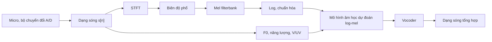

# Chương 14. Xử lý tín hiệu số cho tiếng nói

!!! abstract "Mục tiêu học tập"
    Sau chương này, bạn có thể:

    - **Giải thích** định lý lấy mẫu, hiện tượng chồng phổ, lượng tử hóa và nén giãn μ-law; tính được SNR lượng tử hóa theo số bit.
    - **Cài đặt** STFT từ đầu và kiểm chứng với `torch.stft`; chọn cửa sổ, độ dài khung và bước nhảy dựa trên đánh đổi thời gian – tần số.
    - **Xây dựng** mel filterbank theo cả hai quy ước HTK và Slaney, và **chẩn đoán** các khác biệt mặc định giữa `librosa` và `torchaudio`.
    - **Giải thích** điều kiện COLA, cơ chế overlap-add và thuật toán Griffin–Lim; cài đặt Griffin–Lim nhanh.
    - **Cài đặt** bộ ước lượng F0 kiểu YIN và **so sánh** các họ phương pháp F0 (tự tương quan, YIN/pYIN, WORLD, CREPE, RMVPE).
    - **Áp dụng** LPC, tiền nhấn, MFCC, năng lượng khung và chuẩn hóa độ to LUFS trong tiền xử lý dữ liệu TTS.
    - **Thiết lập và kiểm tra** "hợp đồng đặc trưng" giữa mô hình âm học và vocoder để tránh các lỗi lệch cấu hình âm thầm.

!!! info "Kiến thức cần có"
    - Âm học tiếng nói, mô hình nguồn–bộ lọc, thang mel: [Chương 13](ch13-am-hoc-tieng-noi.md).
    - Số phức, công thức Euler, tích vô hướng và phép chiếu: [Chương 1](../phan-1-nen-tang/ch01-toan-nen-tang.md).
    - Tích chập và tensor trong PyTorch, đọc ghi âm thanh: [Chương 4](../phan-1-nen-tang/ch04-cnn-rnn-mo-hinh-chuoi.md), [Chương 6](../phan-1-nen-tang/ch06-pytorch-cho-tieng-noi.md).

Ở [Chương 13](ch13-am-hoc-tieng-noi.md), tiếng nói là một hiện tượng vật lý liên tục. Máy tính chỉ làm việc với dãy số rời rạc, và mô hình học sâu lại thích những biểu diễn "gọn" hơn dạng sóng thô. Chương này đi qua toàn bộ chuỗi biến đổi mà mọi hệ thống TTS đều dùng, theo đúng thứ tự dữ liệu chảy qua:



Mỗi mũi tên là một chỗ có thể sai. Khác với lỗi trong mạng nơ-ron (thường làm loss tăng hoặc NaN), lỗi xử lý tín hiệu thường **âm thầm**: mọi thứ vẫn chạy, loss vẫn giảm, nhưng giọng tổng hợp nghe "đục", "rè" hoặc sai cao độ. Vì vậy chương này đặc biệt chú trọng vào các **cái bẫy** thực tế và cách kiểm chứng bằng mã.

## 14.1. Lấy mẫu và lượng tử hóa

### 14.1.1. Định lý lấy mẫu

Lấy mẫu một tín hiệu liên tục $s_c(t)$ với chu kỳ $T = 1/f_s$ cho dãy $s[n] = s_c(nT)$. Câu hỏi then chốt: khi nào dãy mẫu chứa **đủ** thông tin để khôi phục $s_c(t)$?

Hãy mô hình hóa việc lấy mẫu như phép nhân $s_c(t)$ với một "lược" xung Dirac $\sum_n \delta(t - nT)$. Biến đổi Fourier của một lược xung chu kỳ $T$ là một lược xung chu kỳ $f_s$ trong miền tần số (công thức tổng Poisson). Phép nhân trong miền thời gian thành tích chập trong miền tần số, nên phổ của tín hiệu đã lấy mẫu là **phổ gốc lặp lại tuần hoàn**:

$$
S_s(f) = f_s \sum_{k=-\infty}^{\infty} S_c(f - k f_s).
$$

Nếu $s_c$ có **băng thông giới hạn**, tức $S_c(f) = 0$ khi $\lvert f \rvert \geq B$, và $f_s > 2B$, thì các bản sao không chồng lên nhau. Lọc thông thấp lý tưởng giữ lại bản sao trung tâm sẽ khôi phục chính xác tín hiệu gốc, bằng phép nội suy sinc:

$$
s_c(t) = \sum_{n=-\infty}^{\infty} s[n]\, \operatorname{sinc}\!\left(\frac{t - nT}{T}\right), \qquad \operatorname{sinc}(x) = \frac{\sin(\pi x)}{\pi x}.
$$

Đây là **định lý lấy mẫu Nyquist–Shannon** (Shannon, 1949). Tần số $f_s / 2$ gọi là **tần số Nyquist**.

Nếu điều kiện bị vi phạm, các bản sao chồng lên nhau và một thành phần tần số $f > f_s/2$ sẽ "hiện hình" ở tần số

$$
f_{\text{alias}} = \lvert f - k f_s \rvert, \quad k = \operatorname{round}(f / f_s),
$$

không phân biệt được với một thành phần thật ở tần số đó. Hiện tượng này gọi là **chồng phổ** (*aliasing*). Khi chồng phổ đã xảy ra thì **không có cách nào gỡ ra** từ dữ liệu số; chỉ có thể ngăn nó từ trước.

### 14.1.2. Chống chồng phổ và lấy mẫu lại

Bộ chuyển đổi A/D luôn có bộ lọc tương tự chống chồng phổ trước khi lấy mẫu. Vấn đề thường gặp trong TTS lại nằm ở **miền số**: khi ta hạ tần số lấy mẫu (ví dụ dữ liệu thu 48 kHz xuống 22,05 kHz), ta phải **lọc thông thấp trước rồi mới bỏ mẫu**. Bỏ mẫu trực tiếp chính là lấy mẫu lại mà không có bộ lọc chống chồng phổ.

```python
import numpy as np
from scipy.signal import resample_poly

def peak_freq(x, fs):
    X = np.abs(np.fft.rfft(x * np.hanning(len(x))))
    return np.fft.rfftfreq(len(x), 1 / fs)[np.argmax(X)]

# 1) Chồng phổ: tông 7 kHz lấy mẫu ở 10 kHz "hiện hình" thành 3 kHz
fs = 10_000
n = np.arange(fs)                                # 1 giây
x = np.sin(2 * np.pi * 7000 * n / fs)
print("tần số đo được:", peak_freq(x, fs))       # 3000.0 = |7000 - 10000|
assert abs(peak_freq(x, fs) - 3000) < 1

# 2) Hạ tần số lấy mẫu 48 kHz -> 16 kHz: bỏ mẫu trực tiếp vs có lọc chống chồng phổ
fs_hi, fs_lo = 48_000, 16_000
t = np.arange(fs_hi) / fs_hi
x_hi = 0.5 * np.sin(2 * np.pi * 1000 * t) + 0.5 * np.sin(2 * np.pi * 11000 * t)
naive = x_hi[::3]                                # giữ 1 mẫu trong 3, không lọc
proper = resample_poly(x_hi, up=1, down=3)       # lọc thông thấp đa pha rồi mới bỏ mẫu

def band_energy(x, fs, lo, hi):
    X = np.abs(np.fft.rfft(x * np.hanning(len(x)))) ** 2
    f = np.fft.rfftfreq(len(x), 1 / fs)
    return X[(f > lo) & (f < hi)].sum()

# Tông 11 kHz vượt Nyquist mới (8 kHz) -> chồng phổ về |11000 - 16000| = 5 kHz
for name, y in [("naive", naive), ("resample_poly", proper)]:
    ratio = band_energy(y, fs_lo, 4900, 5100) / band_energy(y, fs_lo, 900, 1100)
    print(f"{name:>14}: năng lượng 5 kHz / 1 kHz = {10 * np.log10(ratio + 1e-20):6.1f} dB")
assert band_energy(proper, fs_lo, 4900, 5100) < 1e-4 * band_energy(proper, fs_lo, 900, 1100)
```

```text
tần số đo được: 3000.0
         naive: năng lượng 5 kHz / 1 kHz =   -0.0 dB
 resample_poly: năng lượng 5 kHz / 1 kHz =  -67.6 dB
```

Với cách bỏ mẫu ngây thơ, tông 11 kHz chồng xuống 5 kHz với năng lượng **bằng** tông 1 kHz thật; với `resample_poly` (bộ lọc FIR đa pha), nó bị triệt tiêu gần 70 dB. Các thư viện phổ biến đều có bộ lấy mẫu lại chất lượng tốt nhưng **không giống hệt nhau**: `librosa.resample` mặc định dùng `soxr_hq`, `torchaudio.functional.resample` dùng nội suy sinc có cửa sổ (tham số mặc định `lowpass_filter_width=6`, `rolloff=0.99`), `scipy.signal.resample_poly` dùng FIR thiết kế bằng cửa sổ Kaiser. Khác biệt này nhỏ, nhưng nguyên tắc vẫn là: **dùng cùng một bộ lấy mẫu lại cho dữ liệu huấn luyện và lúc suy luận**.

!!! warning "Nâng tần số lấy mẫu không thêm thông tin"
    Dữ liệu 16 kHz (rất phổ biến trong các kho ngữ liệu ASR, ví dụ VIVOS cho tiếng Việt) khi nâng lên 22,05 hay 24 kHz vẫn **trống hoàn toàn** phía trên 8 kHz. Trộn loại dữ liệu này với dữ liệu băng rộng thật khiến mô hình học một phân phối "lúc có lúc không" ở vùng cao tần, và vocoder có thể sinh âm xát đục hoặc nhiễu cao tần bất thường. Trong quy trình làm sạch dữ liệu ([Chương 36](../phan-9-thuc-tien/ch36-du-lieu-tts.md)), hãy đo tỉ lệ năng lượng trên 8 kHz để phát hiện các tệp đã bị nâng tần số lấy mẫu.

Vì sao TTS hay dùng 22,05 kHz hoặc 24 kHz? Tiếng nói có năng lượng đáng kể tới khoảng 8–10 kHz (âm xát), nên tần số Nyquist 11–12 kHz giữ được độ "sáng" của giọng, trong khi chi phí tính toán (số mẫu vocoder phải sinh) thấp hơn nhiều so với 44,1 hay 48 kHz. Bộ LJSpeech được phát hành ở 22,05 kHz, LibriTTS ở 24 kHz, và nhiều hệ thống chọn tần số lấy mẫu theo bộ dữ liệu chủ lực của mình. Các hệ thống chất lượng cao nhắm tới thu âm studio có xu hướng dùng 44,1 hoặc 48 kHz.

### 14.1.3. Lượng tử hóa và độ sâu bit

Sau khi lấy mẫu, mỗi giá trị được làm tròn về một trong $2^b$ mức. Với bộ lượng tử hóa đều trên đoạn $[-A, A]$, bước lượng tử là $\Delta = 2A / 2^b$. Nếu sai số lượng tử phân bố đều trên $[-\Delta/2, \Delta/2]$ thì công suất nhiễu là

$$
\sigma_e^2 = \frac{\Delta^2}{12} = \frac{A^2}{3 \cdot 2^{2b}}.
$$

Với sóng sin toàn thang biên độ $A$, công suất tín hiệu là $A^2/2$, nên

$$
\text{SNR} = \frac{A^2 / 2}{A^2 / (3 \cdot 2^{2b})} = \frac{3}{2} \cdot 2^{2b}
\;\Rightarrow\;
\text{SNR}_{\text{dB}} = 10\log_{10} 1{,}5 + 20 b \log_{10} 2 \approx 1{,}76 + 6{,}02\, b.
$$

Mỗi bit thêm vào cho khoảng 6 dB. Âm thanh 16 bit cho khoảng 98 dB với sóng sin toàn thang; thu âm studio thường dùng 24 bit để có **khoảng dự trữ** (*headroom*): có thể thu ở mức thấp, tránh cắt đỉnh, mà vẫn giữ SNR lượng tử hóa rất cao. Khi huấn luyện, ta gần như luôn chuyển về `float32` trong $[-1, 1]$; tệp PCM 16 bit được chia cho 32768.

Một hệ quả quan trọng của công thức: SNR tính cho tín hiệu **toàn thang**. Tiếng nói có dải động lớn, phần lớn mẫu có biên độ nhỏ; với lượng tử hóa đều, các đoạn nhỏ tiếng có SNR thấp hơn nhiều. Đây là động cơ của nén giãn.

### 14.1.4. Nén giãn μ-law

Ý tưởng: trước khi lượng tử hóa đều, "nén" biên độ bằng một hàm logarit để các mức nhỏ được cấp nhiều bậc lượng tử hơn. Hàm **μ-law** với $x \in [-1, 1]$ là

$$
F(x) = \operatorname{sgn}(x) \frac{\ln(1 + \mu \lvert x \rvert)}{\ln(1 + \mu)}, \qquad
F^{-1}(y) = \operatorname{sgn}(y) \frac{(1 + \mu)^{\lvert y \rvert} - 1}{\mu},
$$

thường với $\mu = 255$ (chuẩn G.711 cho điện thoại 8 bit). Với $\lvert x \rvert$ lớn, $F$ gần như logarit nên sai số **tương đối** gần như không đổi. WaveNet dùng đúng phép biến đổi này để biến dạng sóng thành 256 lớp và mô hình hóa bằng softmax ([Chương 24](../phan-6-vocoder/ch24-vocoder-tu-hoi-quy-va-flow.md)).

```python
import numpy as np

def mu_law_encode(x, mu=255):
    """x trong [-1, 1] -> y trong [-1, 1] (nén biên độ)."""
    return np.sign(x) * np.log1p(mu * np.abs(x)) / np.log1p(mu)

def mu_law_decode(y, mu=255):
    return np.sign(y) * ((1 + mu) ** np.abs(y) - 1) / mu

def quantize(x, bits):
    """Lượng tử hóa đều x trong [-1, 1] thành 2^bits mức (mid-rise)."""
    levels = 2 ** bits
    idx = np.clip(np.floor((x + 1) / 2 * levels), 0, levels - 1)
    return (idx + 0.5) / levels * 2 - 1

def snr_db(x, x_hat):
    return 10 * np.log10(np.sum(x ** 2) / np.sum((x - x_hat) ** 2))

rng = np.random.default_rng(0)
# Tín hiệu "giống tiếng nói": phân phối Laplace, phần lớn mẫu có biên độ nhỏ
for level in [0.3, 0.03]:                       # độ lệch chuẩn: lớn và nhỏ
    x = np.clip(rng.laplace(scale=level / np.sqrt(2), size=100_000), -1, 1)
    lin8 = quantize(x, 8)
    mu8 = mu_law_decode(quantize(mu_law_encode(x), 8))
    print(f"std={level:<5} SNR tuyến tính 8 bit = {snr_db(x, lin8):5.1f} dB | "
          f"μ-law 8 bit = {snr_db(x, mu8):5.1f} dB | tuyến tính 16 bit = {snr_db(x, quantize(x, 16)):5.1f} dB")

# Lý thuyết cho sóng sin toàn thang: SNR ≈ 6.02·b + 1.76 dB
s = np.sin(2 * np.pi * 440 * np.arange(48_000) / 48_000 + 0.1)
print("sin 16 bit:", round(snr_db(s, quantize(s, 16)), 1), "dB; lý thuyết:", round(6.02 * 16 + 1.76, 1))
assert abs(mu_law_decode(mu_law_encode(0.123)) - 0.123) < 1e-12  # nén/giãn khả nghịch
```

```text
std=0.3   SNR tuyến tính 8 bit =  42.2 dB | μ-law 8 bit =  37.2 dB | tuyến tính 16 bit =  90.3 dB
std=0.03  SNR tuyến tính 8 bit =  22.5 dB | μ-law 8 bit =  37.2 dB | tuyến tính 16 bit =  70.6 dB
sin 16 bit: 98.2 dB; lý thuyết: 98.1
```

Kết quả minh họa đúng tinh thần của μ-law: SNR của lượng tử hóa đều **giảm 20 dB khi tín hiệu nhỏ đi 10 lần**, còn SNR của μ-law gần như **không phụ thuộc mức tín hiệu**. Cái giá là ở mức lớn, μ-law kém hơn lượng tử hóa đều cùng số bit.

## 14.2. Biến đổi Fourier rời rạc

### 14.2.1. DFT và FFT

**Biến đổi Fourier rời rạc** (DFT) của một đoạn $N$ mẫu là

$$
X[k] = \sum_{n=0}^{N-1} x[n]\, e^{-j 2\pi k n / N}, \qquad
x[n] = \frac{1}{N} \sum_{k=0}^{N-1} X[k]\, e^{j 2\pi k n / N}.
$$

Có thể xem $X[k]$ là **tích vô hướng** giữa $x$ và véc-tơ mũ phức $\mathbf{e}_k = (e^{j 2\pi k n / N})_{n}$; các véc-tơ này trực giao với nhau, nên DFT là một phép đổi cơ sở (sai khác hệ số chuẩn hóa). Bin $k$ ứng với tần số $f_k = k f_s / N$. Với tín hiệu thực, $X[N - k] = \overline{X[k]}$ (đối xứng Hermite), nên chỉ cần lưu $N/2 + 1$ bin: đó là lý do STFT với `n_fft=1024` cho 513 bin tần số. Thuật toán **FFT** (Cooley và Tukey, 1965) tính DFT với độ phức tạp $O(N \log N)$ thay vì $O(N^2)$.

Hai hiểu lầm cần tránh. Thứ nhất, **đệm thêm số 0** (*zero-padding*) làm lưới tần số dày hơn (nội suy phổ), nhưng **không** tăng độ phân giải: khả năng tách hai thành phần gần nhau chỉ phụ thuộc độ dài đoạn tín hiệu thật. Thứ hai, DFT ngầm giả thiết đoạn tín hiệu **lặp lại tuần hoàn**; nếu hai đầu đoạn không khớp nhau, ta gặp rò rỉ phổ.

### 14.2.2. Cửa sổ và rò rỉ phổ

Cắt một đoạn $N$ mẫu tương đương nhân tín hiệu với **cửa sổ chữ nhật**. Phép nhân trong miền thời gian là tích chập trong miền tần số, nên mỗi vạch phổ bị "nhòe" thành hình dạng phổ của cửa sổ: một **búp chính** (*main lobe*) và nhiều **búp phụ** (*side lobes*). Búp phụ cao làm năng lượng của thành phần mạnh "rò" sang các bin xa, che lấp các thành phần yếu. Đó là **rò rỉ phổ** (*spectral leakage*). Các cửa sổ thuôn hai đầu đánh đổi búp chính rộng hơn lấy búp phụ thấp hơn:

$$
w_{\text{Hann}}[n] = 0{,}5 - 0{,}5 \cos\frac{2\pi n}{N}, \qquad
w_{\text{Hamming}}[n] = 0{,}54 - 0{,}46 \cos\frac{2\pi n}{N}, \qquad n = 0, \ldots, N-1.
$$

(Đây là dạng **tuần hoàn**; dạng **đối xứng** thay $N$ bằng $N - 1$ ở mẫu số.)

```python
import numpy as np
import torch
from scipy.signal import get_window

N = 1024
def sidelobe_db(w, pad=64):
    """Mức búp phụ cao nhất (dB, so với búp chính) của cửa sổ w."""
    W = np.abs(np.fft.rfft(w, n=pad * len(w)))
    W_db = 20 * np.log10(W / W.max() + 1e-12)
    first_null = np.argmax(np.diff(W_db) > 0)    # điểm cực tiểu đầu tiên = hết búp chính
    return W_db[first_null:].max(), first_null / pad   # (dB, nửa bề rộng búp chính theo bin)

for name in ["boxcar", "hann", "hamming", "blackman"]:
    db, half_width = sidelobe_db(get_window(name, N, fftbins=False))
    print(f"{name:>8}: búp phụ cao nhất {db:6.1f} dB, nửa bề rộng búp chính ≈ {half_width:.2f} bin")

# Bẫy: cửa sổ "tuần hoàn" (periodic) và "đối xứng" (symmetric) khác nhau một chút
w_torch = torch.hann_window(N).numpy()                  # mặc định periodic=True
w_scipy = get_window("hann", N)                         # mặc định fftbins=True -> periodic
w_numpy = np.hanning(N)                                 # luôn đối xứng!
print("torch vs scipy:", np.abs(w_torch - w_scipy).max())
print("torch vs numpy:", np.abs(w_torch - w_numpy).max())
assert np.allclose(w_torch, w_scipy, atol=1e-6)
assert np.allclose(w_torch, np.hanning(N + 1)[:-1], atol=1e-6)   # periodic = symmetric(N+1) bỏ mẫu cuối
```

```text
  boxcar: búp phụ cao nhất  -13.3 dB, nửa bề rộng búp chính ≈ 1.00 bin
    hann: búp phụ cao nhất  -31.5 dB, nửa bề rộng búp chính ≈ 2.00 bin
 hamming: búp phụ cao nhất  -42.7 dB, nửa bề rộng búp chính ≈ 2.00 bin
blackman: búp phụ cao nhất  -58.1 dB, nửa bề rộng búp chính ≈ 3.00 bin
torch vs scipy: 1.948066807866411e-07
torch vs numpy: 0.0023519106883118646
```

Các con số khớp với bảng kinh điển của Harris (1978). Hamming có búp phụ cao nhất thấp hơn Hann, nhưng búp phụ của Hann **suy giảm nhanh** hơn khi ra xa (khoảng 18 dB/quãng tám so với 6 dB/quãng tám), nên rò rỉ đi xa của Hann ít hơn; Hann cũng thỏa điều kiện COLA (mục 14.5) một cách gọn gàng. Vì vậy Hann là lựa chọn gần như mặc định trong TTS.

!!! warning "Cửa sổ tuần hoàn và cửa sổ đối xứng"
    `torch.hann_window(N)` và `scipy.signal.get_window("hann", N)` mặc định trả về cửa sổ **tuần hoàn** (dùng cho phân tích phổ và STFT), còn `np.hanning(N)` luôn trả về cửa sổ **đối xứng** (dùng khi thiết kế bộ lọc). Chênh lệch nhỏ (khoảng $2 \times 10^{-3}$ ở đây) nhưng đủ phá vỡ điều kiện COLA chính xác và làm đặc trưng tính bằng hai thư viện lệch nhau một chút. Hãy luôn ghi rõ loại cửa sổ trong cấu hình.

## 14.3. STFT và spectrogram

### 14.3.1. Định nghĩa

Tiếng nói **không dừng**: phổ thay đổi theo từng âm. Ý tưởng của **biến đổi Fourier thời gian ngắn** (STFT) là cắt tín hiệu thành các khung ngắn chồng lấp, nhân với cửa sổ và lấy DFT từng khung:

$$
S(t, k) = \sum_{n=0}^{N_{\text{FFT}}-1} \tilde{s}[n + tH]\; w[n]\; e^{-j 2\pi k n / N_{\text{FFT}}}, \qquad t = 0, \ldots, T-1, \quad k = 0, \ldots, \tfrac{N_{\text{FFT}}}{2},
$$

với $H$ là **bước nhảy** (*hop*), $w$ là cửa sổ dài $W \leq N_{\text{FFT}}$ (đệm 0 hai bên cho đủ $N_{\text{FFT}}$ nếu $W < N_{\text{FFT}}$), và $\tilde{s}$ là tín hiệu sau khi đệm. Với tùy chọn **`center=True`** (mặc định của `torch.stft` và `librosa.stft`), tín hiệu được đệm $N_{\text{FFT}}/2$ mẫu mỗi bên để khung $t$ có **tâm** tại mẫu $tH$; khi đó số khung là $T = 1 + \lfloor L / H \rfloor$. Cách đệm (phản xạ `reflect` hay hằng số 0 `constant`) ảnh hưởng tới các khung ở hai đầu, và như ta sẽ thấy, các thư viện chọn khác nhau.

### 14.3.2. Đánh đổi thời gian – tần số

Độ phân giải tần số của STFT (khoảng cách giữa hai bin) là $\Delta f = f_s / N_{\text{FFT}}$, còn độ phân giải thời gian được quyết định bởi độ dài cửa sổ $W / f_s$ và bước nhảy $H / f_s$. Không thể làm cả hai nhỏ tùy ý: theo nguyên lý bất định Gabor, tích độ trải thời gian và độ trải tần số của một hàm cửa sổ bị chặn dưới, $\sigma_t \sigma_f \geq 1/(4\pi)$.

- **Spectrogram băng rộng** (cửa sổ ngắn, cỡ 3–5 ms): mỗi khung ngắn hơn một chu kỳ thanh môn, nên thấy rõ các xung thanh môn thành vạch dọc và các **formant** thành dải ngang rộng.
- **Spectrogram băng hẹp** (cửa sổ dài, cỡ 30–50 ms): chứa vài chu kỳ, nên thấy rõ từng **hài** thành các vạch ngang song song, thuận lợi để quan sát đường nét F0 và thanh điệu.

Cấu hình TTS kinh điển ở 22,05 kHz với `n_fft=1024, win=1024, hop=256` cho cửa sổ 46,4 ms, bước 11,6 ms và $\Delta f \approx 21{,}5$ Hz: một spectrogram khá "băng hẹp". Sau khi qua mel filterbank, các hài ở vùng thấp vẫn phân biệt được, còn ở vùng cao bị gộp lại, đúng như ốc tai làm.

### 14.3.3. Biên độ, công suất và pha

$S(t, k)$ là số phức. Ta tách nó thành **biên độ** $\lvert S \rvert$ (hoặc **công suất** $\lvert S \rvert^2$) và **pha** $\angle S$. Ảnh của pha trông gần như nhiễu ngẫu nhiên vì pha bị "cuộn" trong $(-\pi, \pi]$ và phụ thuộc vào vị trí khung so với chu kỳ tín hiệu. Tuy nhiên pha có cấu trúc: đạo hàm của nó theo thời gian là **tần số tức thời**, theo tần số là **trễ nhóm**. Các mô hình âm học thường chỉ dự đoán biên độ (dưới dạng log-mel) và để vocoder lo phần pha, vì biên độ trơn, dễ học, và gần với cảm nhận của tai ([Chương 13](ch13-am-hoc-tieng-noi.md), mục 13.5.5).

### 14.3.4. Cài đặt STFT từ đầu

```python
import numpy as np
import torch

def stft_np(s, n_fft=1024, hop=256, win_length=1024, center=True, pad_mode="reflect"):
    """STFT viết tay. Trả về ma trận phức S có dạng (T, n_fft//2 + 1)."""
    w = np.hanning(win_length + 1)[:-1]                  # Hann tuần hoàn (periodic)
    if win_length < n_fft:                               # đặt cửa sổ vào giữa khung n_fft
        lpad = (n_fft - win_length) // 2
        w = np.pad(w, (lpad, n_fft - win_length - lpad))
    if center:                                           # khung t được căn giữa tại mẫu t·hop
        s = np.pad(s, (n_fft // 2, n_fft // 2), mode=pad_mode)
    T = 1 + (len(s) - n_fft) // hop                      # số khung
    idx = np.arange(n_fft)[None, :] + hop * np.arange(T)[:, None]   # (T, n_fft)
    frames = s[idx] * w                                  # (T, n_fft)
    return np.fft.rfft(frames, axis=-1)                  # (T, n_fft//2 + 1)

fs, L = 22050, 22050
rng = np.random.default_rng(0)
s = rng.standard_normal(L).astype(np.float64) * 0.1      # (L,)

S_np = stft_np(s)                                         # (T, 513)
S_pt = torch.stft(torch.from_numpy(s), n_fft=1024, hop_length=256, win_length=1024,
                  window=torch.hann_window(1024, dtype=torch.float64),
                  center=True, pad_mode="reflect", return_complex=True).T.numpy()  # (T, 513)
print("số khung:", S_np.shape[0], "= 1 + L // hop =", 1 + L // 256)
assert S_np.shape == S_pt.shape and np.allclose(S_np, S_pt, atol=1e-8)

# Phân giải: bề rộng mỗi bin và thời lượng cửa sổ/bước nhảy
print(f"Δf = fs/N_FFT = {fs / 1024:.1f} Hz | cửa sổ = {1024 / fs * 1e3:.1f} ms | hop = {256 / fs * 1e3:.1f} ms")
```

```text
số khung: 87 = 1 + L // hop = 87
Δf = fs/N_FFT = 21.5 Hz | cửa sổ = 46.4 ms | hop = 11.6 ms
```

Một chi tiết hay bị bỏ qua: vì $L \approx T \cdot H$ chỉ là xấp xỉ, mô hình âm học (dự đoán $T$ khung) và vocoder (sinh $T \cdot H$ mẫu) phải thống nhất **chính xác** cách đệm và cắt, nếu không các đoạn âm thanh và đoạn mel dùng khi huấn luyện vocoder sẽ lệch nhau vài mẫu. Mục 14.7 quay lại vấn đề này.

## 14.4. Mel filterbank và log-mel-spectrogram

### 14.4.1. Xây dựng bộ lọc mel

Mel filterbank là một ma trận $\mathbf{M} \in \mathbb{R}^{F \times (N_{\text{FFT}}/2 + 1)}$ biến phổ tuyến tính thành $F$ kênh mel. Cách dựng gồm ba bước:

1. Đổi $f_{\min}$ và $f_{\max}$ sang thang mel, chia đều đoạn đó thành $F + 2$ điểm, rồi đổi ngược về Hz, được các mốc $h_0 < h_1 < \cdots < h_{F+1}$.
2. Bộ lọc thứ $i$ ($i = 1, \ldots, F$) là một **tam giác** đi lên từ $h_{i-1}$ đến đỉnh tại $h_i$ rồi đi xuống tới $h_{i+1}$. Tại bin tần số $f_k = k f_s / N_{\text{FFT}}$:

    $$
    M_{i,k} = \max\!\left(0,\ \min\!\left(\frac{f_k - h_{i-1}}{h_i - h_{i-1}},\ \frac{h_{i+1} - f_k}{h_{i+1} - h_i}\right)\right).
    $$

3. (Tùy chọn) **Chuẩn hóa diện tích** kiểu Slaney: nhân hàng $i$ với $2 / (h_{i+1} - h_{i-1})$, để mọi tam giác có cùng "diện tích" bất kể độ rộng.

Mel-spectrogram là $\mathbf{M} \lvert \mathbf{S} \rvert^{p}$ với $p = 1$ (biên độ) hoặc $p = 2$ (công suất), và đặc trưng cuối cùng thường là

$$
\mathbf{Y}_{t,i} = \log \max\!\Big(\epsilon,\ \sum_{k} M_{i,k} \lvert S(t,k) \rvert^{p}\Big).
$$

Như [Chương 1](../phan-1-nen-tang/ch01-toan-nen-tang.md) đã nhận xét, đây là một **phép chiếu tuyến tính** (giảm chiều từ 513 xuống 80) theo sau bởi một phi tuyến nén.

### 14.4.2. HTK hay Slaney: một cái bẫy có thật

Có **hai lựa chọn độc lập** ảnh hưởng tới ma trận $\mathbf{M}$:

- **Thang mel** (`mel_scale` trong torchaudio, `htk` trong librosa): công thức HTK $2595\log_{10}(1 + f/700)$ hay công thức Slaney (tuyến tính dưới 1 kHz, logarit phía trên); xem [Chương 13](ch13-am-hoc-tieng-noi.md), mục 13.5.3. Hai công thức đặt các mốc $h_i$ ở **vị trí khác nhau**.
- **Chuẩn hóa** (`norm`): không chuẩn hóa (đỉnh mỗi tam giác bằng 1) hay chuẩn hóa diện tích Slaney (đỉnh bằng $2/(h_{i+1} - h_{i-1})$, cỡ $10^{-2}$ đến $10^{-3}$ Hz⁻¹ với cấu hình 80 kênh thông dụng).

Mặc định của hai thư viện phổ biến **trái ngược nhau ở cả hai lựa chọn**. Khối mã sau dựng $\mathbf{M}$ từ đầu và đối chiếu với cả `librosa` lẫn `torchaudio` cho mọi tổ hợp:

```python
import numpy as np
import librosa
import torch
import torchaudio.functional as AF

def hz_to_mel(f, scale):
    f = np.asarray(f, dtype=np.float64)
    if scale == "htk":
        return 2595.0 * np.log10(1.0 + f / 700.0)
    f_sp, min_log_hz = 200.0 / 3, 1000.0             # Slaney: tuyến tính dưới 1 kHz
    logstep = np.log(6.4) / 27.0
    return np.where(f < min_log_hz, f / f_sp,
                    min_log_hz / f_sp + np.log(np.maximum(f, 1e-10) / min_log_hz) / logstep)

def mel_to_hz(m, scale):
    m = np.asarray(m, dtype=np.float64)
    if scale == "htk":
        return 700.0 * (10.0 ** (m / 2595.0) - 1.0)
    f_sp, min_log_hz = 200.0 / 3, 1000.0
    logstep, min_log_mel = np.log(6.4) / 27.0, 1000.0 / (200.0 / 3)
    return np.where(m < min_log_mel, m * f_sp, min_log_hz * np.exp(logstep * (m - min_log_mel)))

def mel_filterbank(sr, n_fft, n_mels, fmin=0.0, fmax=None, scale="slaney", norm="slaney"):
    """Ma trận M có dạng (n_mels, n_fft//2 + 1): mel = M @ |S|^p."""
    fmax = sr / 2 if fmax is None else fmax
    fft_freqs = np.linspace(0, sr / 2, n_fft // 2 + 1)                    # (K,)
    mel_pts = np.linspace(hz_to_mel(fmin, scale), hz_to_mel(fmax, scale), n_mels + 2)
    hz_pts = mel_to_hz(mel_pts, scale)                                     # (F+2,) mép các tam giác
    lower = (fft_freqs[None, :] - hz_pts[:-2, None]) / np.diff(hz_pts)[:-1, None]  # sườn lên
    upper = (hz_pts[2:, None] - fft_freqs[None, :]) / np.diff(hz_pts)[1:, None]    # sườn xuống
    M = np.maximum(0.0, np.minimum(lower, upper))                          # (F, K)
    if norm == "slaney":                      # chuẩn hóa diện tích: mỗi tam giác có "diện tích" như nhau
        M *= (2.0 / (hz_pts[2:] - hz_pts[:-2]))[:, None]
    return M

sr, n_fft, n_mels, fmax = 22050, 1024, 80, 8000
for scale, norm in [("slaney", "slaney"), ("htk", None), ("htk", "slaney"), ("slaney", None)]:
    ours = mel_filterbank(sr, n_fft, n_mels, 0.0, fmax, scale, norm)
    ref_lr = librosa.filters.mel(sr=sr, n_fft=n_fft, n_mels=n_mels, fmin=0.0, fmax=fmax,
                                 htk=(scale == "htk"), norm=norm, dtype=np.float64)
    ref_ta = AF.melscale_fbanks(n_fft // 2 + 1, 0.0, fmax, n_mels, sr,
                                norm=norm, mel_scale=scale).T.double().numpy()  # (F, K)
    print(f"{scale:>6}/{str(norm):>6}: lệch librosa {np.abs(ours - ref_lr).max():.1e}, "
          f"lệch torchaudio {np.abs(ours - ref_ta).max():.1e}")
    assert np.allclose(ours, ref_lr, atol=1e-6) and np.allclose(ours, ref_ta, atol=1e-5)

# Hai lựa chọn "mặc định" khác nhau thế nào?
A = mel_filterbank(sr, n_fft, n_mels, 0, fmax, "slaney", "slaney")   # librosa mặc định
B = mel_filterbank(sr, n_fft, n_mels, 0, fmax, "htk", None)          # torchaudio mặc định
centers = lambda M: (M * np.linspace(0, sr / 2, M.shape[1])).sum(1) / M.sum(1)
print("tâm 5 kênh đầu (Hz) Slaney:", np.round(centers(A)[:5]), " HTK:", np.round(centers(B)[:5]))
print("tổng trọng số kênh 40: Slaney-norm %.4f, không norm %.1f" % (A[40].sum(), B[40].sum()))
```

```text
slaney/slaney: lệch librosa 0.0e+00, lệch torchaudio 6.8e-08
   htk/  None: lệch librosa 0.0e+00, lệch torchaudio 5.3e-06
   htk/slaney: lệch librosa 0.0e+00, lệch torchaudio 7.1e-08
slaney/  None: lệch librosa 0.0e+00, lệch torchaudio 8.1e-06
tâm 5 kênh đầu (Hz) Slaney: [ 39.  74. 110. 150. 187.]  HTK: [ 23.  46.  70.  94. 118.]
tổng trọng số kênh 40: Slaney-norm 0.0465, không norm 3.7
```

Ba kết luận. Một, cả hai thư viện đều cài đặt **đúng** công thức; chúng chỉ khác **mặc định**. Hai, tâm các kênh thấp lệch nhau đáng kể (39 Hz so với 23 Hz ở kênh đầu), tức kênh mel thứ $i$ của hai quy ước **không mô tả cùng một dải tần**. Ba, chuẩn hóa Slaney làm giá trị mel nhỏ đi khoảng hai bậc độ lớn (hệ số 0,0465 so với 3,7 ở kênh 40), tương đương một độ lệch cỡ vài nat sau khi lấy log. (Bài tập 5 giải thích vì sao $0{,}0465 \approx 1/\Delta f$.)

Bảng dưới tóm tắt các mặc định khác nhau giữa hai thư viện, đã kiểm tra trên phiên bản dùng trong sách (`librosa` 1.0, `torchaudio` 2.11); hãy kiểm tra lại với phiên bản của bạn:

| Tham số | `librosa.feature.melspectrogram` | `torchaudio.transforms.MelSpectrogram` |
|---|---|---|
| Thang mel | Slaney (`htk=False`) | HTK (`mel_scale="htk"`) |
| Chuẩn hóa bộ lọc | `norm="slaney"` | `norm=None` |
| Lũy thừa | `power=2.0` (công suất) | `power=2.0` (công suất) |
| Đệm khi `center=True` | `pad_mode="constant"` | `pad_mode="reflect"` |
| `n_fft` mặc định | 2048 | 400 |
| `hop_length` mặc định | 512 | `win_length // 2` |
| `n_mels` mặc định | 128 | 128 |
| `fmax` mặc định | $f_s/2$ | $f_s/2$ |

Ngay cả khi bạn đặt tường minh `n_fft`, `hop_length`, `n_mels` giống nhau, kết quả vẫn khác:

```python
import numpy as np
import librosa
import torch
import torchaudio.transforms as AT

sr = 22050
t = np.arange(sr) / sr                                    # 1 giây
f0 = 110 + 40 * t                                         # F0 tăng dần 110 -> 150 Hz
phase = 2 * np.pi * np.cumsum(f0) / sr
y = sum(np.sin(k * phase) / k for k in range(1, 30))      # tín hiệu hữu thanh giả lập
y = (0.3 * y / np.abs(y).max()).astype(np.float32)        # (L,)

common = dict(n_fft=1024, hop_length=256, n_mels=80)
mel_lr = librosa.feature.melspectrogram(y=y, sr=sr, **common)               # (F, T)
mel_ta = AT.MelSpectrogram(sample_rate=sr, **common)(torch.from_numpy(y)).numpy()  # (F, T)
print("hình dạng:", mel_lr.shape, mel_ta.shape)

db = lambda m: 10 * np.log10(np.maximum(m, 1e-10))
diff = db(mel_ta) - db(mel_lr)                            # (F, T), đơn vị dB
print("độ lệch dB trung bình theo kênh (5 kênh cách đều):",
      np.round(diff.mean(1)[::16], 1))

# Đặt torchaudio dùng đúng quy ước của librosa -> khớp nhau
mel_ta2 = AT.MelSpectrogram(sample_rate=sr, **common, mel_scale="slaney", norm="slaney",
                            pad_mode="constant")(torch.from_numpy(y)).numpy()
rel = np.abs(mel_ta2 - mel_lr).max() / mel_lr.max()
print(f"sau khi đồng bộ cấu hình: sai số tương đối lớn nhất = {rel:.1e}")
assert rel < 1e-4
```

```text
hình dạng: (80, 87) (80, 87)
độ lệch dB trung bình theo kênh (5 kênh cách đều): [ 7.7 18.6 18.8 20.4  1.3]
sau khi đồng bộ cấu hình: sai số tương đối lớn nhất = 3.1e-07
```

Độ lệch trung bình từ khoảng 1 đến 20 dB tùy kênh, **không phải một hằng số**, nên không thể "bù" bằng một phép cộng đơn giản. Khi đặt cả ba tham số `mel_scale`, `norm`, `pad_mode` giống nhau, hai thư viện khớp tới sai số làm tròn. Đây chính là loại lỗi xảy ra khi bạn huấn luyện mô hình âm học bằng một thư viện rồi ghép với vocoder huấn luyện sẵn bằng thư viện khác.

### 14.4.3. Nén log, nén dải động và chuẩn hóa

Sau mel filterbank, các giá trị trải rộng nhiều bậc độ lớn; lấy log vừa phù hợp tri giác (độ to tăng theo hàm nén), vừa làm phân phối gọn hơn cho hồi quy. Có vài biến thể, và chúng **không thay thế cho nhau**:

- **Log tự nhiên có kẹp dưới**: $\ln \max(x, \epsilon)$. Mã HiFi-GAN và Tacotron 2 của NVIDIA gọi bước này là *dynamic range compression*, với $\epsilon = 10^{-5}$ trên mel biên độ; Vocos dùng $\epsilon = 10^{-7}$. Giá trị $\epsilon$ quyết định "sàn" của khoảng lặng: $\ln 10^{-5} \approx -11{,}5$.
- **Log cơ số 10**: một số bộ công cụ (ví dụ các recipe của ParallelWaveGAN/ESPnet) dùng $\log_{10}$. Đổi cơ số làm mọi giá trị nhân với $\ln 10 \approx 2{,}3$.
- **Decibel**: `librosa.power_to_db` tính $10\log_{10}$ của công suất và mặc định **cắt** tại `top_db=80` dB **dưới mức cực đại của chính tín hiệu đó**. Sàn này vì thế phụ thuộc từng câu, một nguồn không nhất quán khó phát hiện nếu bạn dùng nó cho đặc trưng huấn luyện.

Sau log, nhiều hệ thống còn **chuẩn hóa** thêm: trừ trung bình và chia độ lệch chuẩn tính trên toàn tập dữ liệu (theo từng kênh hoặc toàn cục, như Matcha-TTS), hoặc co về một đoạn đối xứng (một số cài đặt Tacotron 2 mã nguồn mở đời đầu dùng đoạn $[-4, 4]$). Quy tắc vàng: **mọi phép chuẩn hóa phải được lưu cùng checkpoint và đảo ngược chính xác trước khi đưa vào vocoder**. Tránh chuẩn hóa theo từng câu (*per-utterance*) cho đặc trưng đích của TTS: nó xóa thông tin về độ to tương đối và làm mô hình không biết câu nào to, câu nào nhỏ.

### 14.4.4. MFCC

**Hệ số cepstrum tần số mel** (MFCC; Davis và Mermelstein, 1980) là biến đổi cosin rời rạc (DCT-II) của log-mel:

$$
c_n = \sum_{i=1}^{F} \mathbf{Y}_i \cos\!\left(\frac{\pi n (i - \tfrac12)}{F}\right), \qquad n = 0, 1, \ldots
$$

(sai khác hệ số chuẩn hóa trực giao). Nhớ lại từ [Chương 13](ch13-am-hoc-tieng-noi.md) rằng trong miền log, nguồn và bộ lọc **cộng** với nhau, và đường bao (bộ lọc) biến thiên chậm theo tần số còn cấu trúc hài (nguồn) biến thiên nhanh. DCT tách hai loại biến thiên này: các hệ số bậc thấp mô tả đường bao (formant), các hệ số bậc cao mô tả chi tiết. Giữ khoảng 13 hệ số đầu là một cách "làm trơn" phổ và loại bớt thông tin cao độ, hữu ích cho ASR và nhận dạng người nói.

```python
import numpy as np
import librosa
import scipy.fft

sr = 22050
rng = np.random.default_rng(0)
t = np.arange(sr) / sr
y = (np.sign(np.sin(2 * np.pi * 140 * t)) * 0.1 + 0.01 * rng.standard_normal(sr)).astype(np.float32)

S = np.abs(librosa.stft(y, n_fft=1024, hop_length=256)) ** 2           # (K, T) phổ công suất
mel = librosa.feature.melspectrogram(S=S, sr=sr, n_mels=80)            # (F, T)
log_mel_db = librosa.power_to_db(mel)                                   # 10·log10, có top_db=80
mfcc_ours = scipy.fft.dct(log_mel_db, type=2, norm="ortho", axis=0)[:13]   # (13, T)
mfcc_ref = librosa.feature.mfcc(S=log_mel_db, n_mfcc=13)
assert np.allclose(mfcc_ours, mfcc_ref, atol=1e-3)

# Năng lượng theo khung: chuẩn L2 của biên độ STFT (cách FastSpeech 2 định nghĩa)
energy = np.linalg.norm(np.sqrt(S), axis=0)                    # (T,)
print(mfcc_ours.shape, energy.shape, float(energy.mean()))
```

TTS hiện đại **không** dùng MFCC làm đặc trưng đích: cắt cụt hệ số làm mất chi tiết, và việc khôi phục dạng sóng từ MFCC kém hơn nhiều so với từ log-mel. MFCC vẫn xuất hiện trong TTS ở vai trò **đánh giá**: chỉ số méo cepstrum mel (MCD) đo khoảng cách giữa các hệ số cepstrum ([Chương 38](../phan-9-thuc-tien/ch38-danh-gia-tts.md)). Khối mã trên cũng tính **năng lượng khung** theo cách của FastSpeech 2: chuẩn L2 của biên độ STFT mỗi khung.

## 14.5. Từ phổ trở về dạng sóng

### 14.5.1. iSTFT, overlap-add và điều kiện COLA

Nếu có đủ STFT phức $S(t,k)$, ta khôi phục tín hiệu bằng cách lấy iDFT từng khung để được các đoạn $y_t[n]$, rồi **chồng và cộng** (*overlap-add*, OLA). Dạng có trọng số (*weighted overlap-add*) nhân mỗi đoạn với cửa sổ tổng hợp rồi chia cho tổng bình phương cửa sổ:

$$
\hat{s}[n] = \frac{\sum_t w[n - tH]\, y_t[n - tH]}{\sum_t w^2[n - tH]}.
$$

Công thức này cho khôi phục hoàn hảo miễn là mẫu số khác 0 tại mọi $n$ (điều kiện **NOLA**, *nonzero overlap-add*). Với cách cộng đơn giản không chia, ta cần điều kiện mạnh hơn: tổng các cửa sổ dịch chuyển phải là hằng số,

$$
\sum_{t} w[n - tH] = C \quad \forall n,
$$

gọi là điều kiện **COLA** (*constant overlap-add*). Cửa sổ Hann **tuần hoàn** thỏa COLA với $H = N/2$ ($C = 1$) và $H = N/4$ ($C = 2$):

```python
import numpy as np
import torch

def ola_envelope(w, hop, n_frames=64):
    """Tổng chồng lấp sum_t w[n - t·hop] ở vùng giữa (bỏ hai đầu)."""
    N = len(w)
    env = np.zeros(N + hop * (n_frames - 1))
    for t in range(n_frames):
        env[t * hop: t * hop + N] += w
    return env[N: -N]                                   # vùng ổn định

N = 1024
hann_periodic = np.hanning(N + 1)[:-1]
hann_symmetric = np.hanning(N)
for name, w in [("Hann tuần hoàn", hann_periodic), ("Hann đối xứng", hann_symmetric)]:
    for hop in [512, 256]:
        e = ola_envelope(w, hop)
        print(f"{name:<15} hop={hop:<4} COLA: min={e.min():.4f} max={e.max():.4f}")

# Khôi phục hoàn hảo bằng iSTFT (weighted overlap-add)
torch.manual_seed(0)
s = torch.randn(22050, dtype=torch.float64)            # (L,)
win = torch.hann_window(N, dtype=torch.float64)
S = torch.stft(s, N, hop_length=256, window=win, center=True, return_complex=True)  # (513, T)
s_rec = torch.istft(S, N, hop_length=256, window=win, center=True, length=len(s))  # (L,)
print("sai số khôi phục lớn nhất:", (s - s_rec).abs().max().item())
assert torch.allclose(s, s_rec, atol=1e-10)
```

```text
Hann tuần hoàn  hop=512  COLA: min=1.0000 max=1.0000
Hann tuần hoàn  hop=256  COLA: min=2.0000 max=2.0000
Hann đối xứng   hop=512  COLA: min=0.9985 max=1.0000
Hann đối xứng   hop=256  COLA: min=1.9978 max=1.9985
sai số khôi phục lớn nhất: 1.3322676295501878e-15
```

Cửa sổ đối xứng chỉ thỏa COLA gần đúng (gợn khoảng 0,1%), thêm một lý do để dùng cửa sổ tuần hoàn. COLA trở nên đặc biệt quan trọng với các vocoder sinh STFT rồi dùng iSTFT ở lớp cuối như iSTFTNet và Vocos ([Chương 25](../phan-6-vocoder/ch25-gan-vocoder.md)), và với việc ghép các khối âm thanh khi streaming ([Chương 35](../phan-8-mo-hinh-lon/ch35-streaming-speech-llm.md)).

### 14.5.2. Thuật toán Griffin–Lim

Bài toán thực tế khó hơn: ta chỉ có **biên độ** $A(t,k)$ (mô hình âm học không dự đoán pha). Không phải mọi ma trận phức đều là STFT của một tín hiệu nào đó, vì các khung chồng lấp ràng buộc lẫn nhau; ta gọi ma trận là **nhất quán** (*consistent*) nếu nó là STFT của một tín hiệu. Griffin và Lim (1984) tìm tín hiệu $x$ sao cho $\lvert \mathrm{STFT}(x) \rvert$ gần $A$ nhất, bằng cách **chiếu luân phiên** giữa hai tập:

1. Tập các ma trận có biên độ đúng bằng $A$: giữ pha hiện tại, thay biên độ, $Y \leftarrow A \odot e^{j \angle X}$.
2. Tập các STFT nhất quán: $x \leftarrow \mathrm{iSTFT}(Y)$ (nghiệm bình phương tối thiểu), rồi $X \leftarrow \mathrm{STFT}(x)$.

Griffin và Lim chứng minh khoảng cách bình phương giữa $X$ và $Y$ không tăng qua các vòng lặp. Thuật toán **Griffin–Lim nhanh** (Perraudin, Balazs và Søndergaard, 2013) thêm một số hạng quán tính kiểu momentum, hội tụ nhanh hơn đáng kể; cả `torchaudio.transforms.GriffinLim` và `librosa.griffinlim` đều dùng `momentum=0.99` làm mặc định.

```python
import torch

def griffin_lim(mag, n_fft=1024, hop=256, n_iter=60, momentum=0.99, length=None, seed=0):
    """mag: biên độ STFT (K, T). Trả về dạng sóng (L,) và lịch sử spectral convergence."""
    win = torch.hann_window(n_fft, dtype=mag.dtype)
    stft = lambda x: torch.stft(x, n_fft, hop, window=win, return_complex=True)
    istft = lambda X: torch.istft(X, n_fft, hop, window=win, length=length)
    g = torch.Generator().manual_seed(seed)
    angles = torch.exp(2j * torch.pi * torch.rand(mag.shape, generator=g, dtype=mag.dtype))
    prev = torch.zeros_like(angles)
    history = []
    for _ in range(n_iter):
        x = istft(mag * angles)                       # chiếu lên tập tín hiệu "hợp lệ"
        rebuilt = stft(x)                             # STFT nhất quán của x
        history.append((torch.linalg.norm(rebuilt.abs() - mag) / torch.linalg.norm(mag)).item())
        # Fast Griffin-Lim (Perraudin và cộng sự, 2013): thêm quán tính
        accel = rebuilt - momentum / (1 + momentum) * prev
        prev = rebuilt
        angles = accel / accel.abs().clamp_min(1e-8)  # giữ pha, thay biên độ bằng mag
    return istft(mag * angles), history

sr = 22050
t = torch.arange(sr, dtype=torch.float64) / sr
f0 = 120 + 30 * torch.sin(2 * torch.pi * 2 * t)          # F0 dao động quanh 120 Hz
phase = 2 * torch.pi * torch.cumsum(f0, 0) / sr
s = sum(torch.sin(k * phase) / k for k in range(1, 20)) * 0.1   # (L,)

win = torch.hann_window(1024, dtype=torch.float64)
mag = torch.stft(s, 1024, 256, window=win, return_complex=True).abs()   # (513, T)
for m in [0.0, 0.99]:                                   # 0.0 = Griffin-Lim gốc
    _, hist = griffin_lim(mag, momentum=m, length=len(s))
    print(f"momentum={m}: SC sau 1/10/60 vòng = {hist[0]:.3f} / {hist[9]:.3f} / {hist[-1]:.3f}")
    if m == 0.0:                                        # GL gốc: SC không tăng qua các vòng
        assert all(b <= a + 1e-9 for a, b in zip(hist, hist[1:]))
```

```text
momentum=0.0: SC sau 1/10/60 vòng = 0.652 / 0.261 / 0.130
momentum=0.99: SC sau 1/10/60 vòng = 0.652 / 0.198 / 0.061
```

Độ đo *spectral convergence* $\mathrm{SC} = \lVert \lvert X \rvert - A \rVert_F / \lVert A \rVert_F$ giảm đều; với momentum, sau 60 vòng nó chỉ còn khoảng một nửa so với Griffin–Lim gốc. Tuy vậy, SC không về 0 và âm thanh Griffin–Lim luôn có tiếng "kim loại", "vang ống" đặc trưng: thuật toán chỉ tìm được một cực tiểu địa phương, pha giữa các hài không mạch lạc.

Muốn đi từ **log-mel** về âm thanh, ta còn phải đảo bộ lọc mel trước. Vì $\mathbf{M}$ không vuông, ta giải bài toán bình phương tối thiểu không âm (`librosa.feature.inverse.mel_to_stft` dùng NNLS) để có biên độ tuyến tính xấp xỉ, rồi chạy Griffin–Lim. Tacotron 1 dùng đúng con đường này làm "vocoder" (theo bài báo gốc, biên độ dự đoán được nâng lũy thừa 1,2 trước khi đưa vào Griffin–Lim để giảm nhiễu).

!!! tip "Griffin–Lim như một công cụ gỡ lỗi"
    Trước khi huấn luyện vocoder hay mô hình âm học trên một bộ dữ liệu mới, hãy lấy vài mel-spectrogram trích từ dữ liệu, đảo về âm thanh bằng Griffin–Lim và **nghe**. Âm thanh sẽ "kim loại" nhưng phải nghe được rõ lời, đúng cao độ, đúng tốc độ. Nếu nghe nhanh hoặc chậm bất thường, sai tần số lấy mẫu; nếu thiếu âm xát, kiểm tra `fmax`; nếu nghe toàn nhiễu, có thể bạn đã lấy log hai lần hoặc chuẩn hóa sai.

## 14.6. F0, năng lượng và các đặc trưng khác

### 14.6.1. Bài toán ước lượng F0

Mô hình âm học kiểu FastSpeech 2 ([Chương 22](../phan-5-mo-hinh-am-hoc/ch22-fastspeech.md)) cần F0 làm đích huấn luyện cho bộ dự đoán cao độ; đánh giá ngôn điệu ([Chương 16](ch16-ngon-dieu.md)) cũng cần F0. Ước lượng F0 nghe đơn giản ("tìm chu kỳ") nhưng có nhiều khó khăn: tín hiệu chỉ gần tuần hoàn, F0 thay đổi liên tục, hài thứ hai có khi mạnh hơn thành phần cơ bản, giọng kẹt có chu kỳ không đều, nhiễu và tiếng vang làm mờ cấu trúc, và phải quyết định khung nào **hữu thanh**. Lỗi điển hình là **lỗi quãng tám**: ước lượng ra $2 f_0$ hoặc $f_0/2$.

### 14.6.2. Phương pháp tự tương quan

Với tín hiệu tuần hoàn chu kỳ $\tau_0$, hàm tự tương quan

$$
r_t(\tau) = \sum_{j=0}^{W-1} x[t + j]\, x[t + j + \tau]
$$

đạt cực đại tại $\tau = 0, \tau_0, 2\tau_0, \ldots$ Ước lượng đơn giản nhất là $\hat f_0 = f_s / \arg\max_{\tau \geq \tau_{\min}} r_t(\tau)$. Phương pháp này hay mắc lỗi: cực đại ở $2\tau_0$ có thể cao ngang $\tau_0$ (lỗi xuống quãng tám), một formant mạnh tạo cực đại phụ ở chu kỳ của formant (lỗi lên), và biên độ $r_t(\tau)$ thay đổi theo năng lượng tín hiệu.

### 14.6.3. YIN và pYIN

**YIN** (de Cheveigné và Kawahara, 2002) cải tiến tự tương quan qua một chuỗi bước, mỗi bước sửa một loại lỗi cụ thể:

1. **Hàm hiệu** thay cho tự tương quan:

    $$
    d_t(\tau) = \sum_{j=0}^{W-1} \big(x[t+j] - x[t+j+\tau]\big)^2 .
    $$

    Với tín hiệu tuần hoàn, $d_t(\tau_0) = 0$. Khai triển ra, $d_t(\tau) = r_t(0) + r_{t+\tau}(0) - 2 r_t(\tau)$, nên nó tự điều chỉnh khi năng lượng thay đổi trong cửa sổ.
2. **Chuẩn hóa bằng trung bình tích lũy** (CMNDF):

    $$
    d'_t(\tau) = \begin{cases} 1, & \tau = 0, \\[1mm] \dfrac{d_t(\tau)}{\frac{1}{\tau}\sum_{j=1}^{\tau} d_t(j)}, & \tau > 0. \end{cases}
    $$

    Bước này loại bỏ cực tiểu tầm thường tại $\tau = 0$ và đưa $d'$ về thang không thứ nguyên, giá trị nhỏ nghĩa là "rất tuần hoàn".
3. **Ngưỡng tuyệt đối**: chọn $\tau$ **nhỏ nhất** mà $d'_t(\tau)$ xuống dưới ngưỡng (ví dụ 0,1) rồi đi tới đáy hố đó, thay vì lấy cực tiểu toàn cục. Đây là bước chống lỗi xuống quãng tám chính.
4. **Nội suy parabol** quanh đáy để có độ phân giải dưới một mẫu (rất quan trọng ở F0 cao, nơi một mẫu chênh lệch ứng với vài phần trăm tần số).
5. (Trong bài báo gốc còn có bước "ước lượng cục bộ tốt nhất" để làm ổn định đường F0; ta bỏ qua cho gọn.)

```python
import numpy as np

def yin_f0(x, sr, fmin=60.0, fmax=400.0, win=512, hop=256, threshold=0.1):
    """Ước lượng F0 kiểu YIN. Trả về (f0, cmndf_min) cho mỗi khung; f0 = nan nếu vô thanh."""
    tau_min, tau_max = int(sr / fmax), int(sr / fmin)
    n_frames = 1 + (len(x) - win - tau_max) // hop
    idx = np.arange(win + tau_max)[None, :] + hop * np.arange(n_frames)[:, None]
    frames = x[idx]                                            # (T, win + tau_max)
    # Bước 1-2: hàm hiệu d(τ) = Σ_j (x_j - x_{j+τ})^2
    d = np.stack([((frames[:, :win] - frames[:, tau:tau + win]) ** 2).sum(1)
                  for tau in range(tau_max + 1)], axis=1)      # (T, tau_max + 1)
    # Bước 3: chuẩn hóa bằng trung bình tích lũy (CMNDF), d'(0) = 1
    cum = np.cumsum(d[:, 1:], axis=1) / np.arange(1, tau_max + 1)
    dn = np.ones_like(d)
    dn[:, 1:] = d[:, 1:] / np.maximum(cum, 1e-12)
    f0 = np.full(n_frames, np.nan)
    best = np.ones(n_frames)
    for t in range(n_frames):
        row = dn[t]
        below = np.where(row[tau_min:] < threshold)[0]
        # Bước 4: ngưỡng tuyệt đối -> lấy cực tiểu đầu tiên dưới ngưỡng (tránh lỗi quãng tám)
        if len(below) == 0:
            continue                                            # coi là vô thanh
        tau = tau_min + below[0]
        while tau + 1 <= tau_max and row[tau + 1] < row[tau]:
            tau += 1                                            # đi xuống đáy của hố
        # Bước 5: nội suy parabol quanh đáy để có độ phân giải dưới một mẫu
        if 1 <= tau < tau_max:
            a, b, c = row[tau - 1], row[tau], row[tau + 1]
            denom = a - 2 * b + c
            shift = 0.5 * (a - c) / denom if abs(denom) > 1e-12 else 0.0
        else:
            shift = 0.0
        f0[t], best[t] = sr / (tau + shift), row[tau]
    return f0, best

# Tín hiệu thử: F0 trượt 100 -> 220 Hz, nửa sau thêm đoạn nhiễu (vô thanh)
sr = 16000
t = np.arange(int(1.0 * sr)) / sr
f0_true = 100 + 120 * t
phase = 2 * np.pi * np.cumsum(f0_true) / sr
voiced = sum(np.sin(k * phase) * 0.8 ** k for k in range(1, 25))
rng = np.random.default_rng(0)
x = np.concatenate([voiced + 0.01 * rng.standard_normal(len(t)), 0.3 * rng.standard_normal(sr // 4)])

f0_est, _ = yin_f0(x, sr)
centers = (np.arange(len(f0_est)) * 256 + 512 / 2) / sr      # tâm cửa sổ phân tích (giây)
in_voiced = centers < 0.95
ref = 100 + 120 * centers[in_voiced]
err_cents = 1200 * np.abs(np.log2(f0_est[in_voiced] / ref))
print(f"khung hữu thanh: sai số trung vị {np.nanmedian(err_cents):.1f} cent, "
      f"tỉ lệ lỗi thô (>20%) {np.mean(err_cents > 1200 * np.log2(1.2)):.1%}")
print("tỉ lệ khung nhiễu bị coi là vô thanh:", np.mean(np.isnan(f0_est[centers > 1.05])))
assert np.nanmedian(err_cents) < 20
```

```text
khung hữu thanh: sai số trung vị 4.6 cent, tỉ lệ lỗi thô (>20%) 0.0%
tỉ lệ khung nhiễu bị coi là vô thanh: 1.0
```

Trên tín hiệu tổng hợp sạch, cài đặt 50 dòng này đạt sai số trung vị dưới 5 cent, không có lỗi thô, và nhận đúng đoạn nhiễu là vô thanh nhờ ngưỡng của CMNDF. Trên tiếng nói thật, bạn nên dùng các cài đặt đã được tối ưu và kiểm chứng.

**pYIN** (Mauch và Dixon, 2014) thay ngưỡng cố định bằng một **phân phối** trên các ngưỡng, sinh ra nhiều ứng viên F0 kèm xác suất cho mỗi khung, rồi dùng **mô hình Markov ẩn** với các trạng thái hữu thanh/vô thanh và giải mã Viterbi để chọn đường F0 trơn và hợp lý. Kết quả là đường F0 ít nhảy quãng tám hơn và có sẵn xác suất hữu thanh. `librosa.pyin` cài đặt thuật toán này:

```python
# Tiếp nối khối mã YIN ở trên (dùng lại x, sr)
import librosa
f0_p, voiced_flag, voiced_prob = librosa.pyin(x.astype(np.float32), fmin=60, fmax=400, sr=sr,
                                              frame_length=1024, hop_length=256)
c = np.arange(len(f0_p)) * 256 / sr           # center=True: khung t có tâm tại t·hop
m = (c > 0.05) & (c < 0.95)
e = 1200 * np.abs(np.log2(f0_p[m] / (100 + 120 * c[m])))
print(f"pYIN: sai số trung vị {np.nanmedian(e):.1f} cent; "
      f"tỉ lệ khung hữu thanh ở đoạn nhiễu {voiced_flag[c > 1.05].mean():.2f}")
```

Trên cùng tín hiệu, pYIN cho sai số trung vị khoảng 3 cent. Lưu ý lần gọi đầu tiên chậm hơn hẳn vì thư viện biên dịch JIT.

### 14.6.4. WORLD, CREPE, RMVPE

- **WORLD** (Morise, Yokomori và Ozawa, 2016) là một vocoder tham số phân tích tiếng nói thành F0, đường bao phổ (CheapTrick) và độ phi tuần hoàn (D4C). Bộ ước lượng F0 của nó có **DIO** (nhanh, kém bền hơn) và **Harvest** (Morise, 2017; chậm hơn nhưng bền hơn, ít bỏ sót khung hữu thanh), thường kèm bước tinh chỉnh **StoneMask**. Gói `pyworld` cung cấp giao diện Python; FastSpeech 2 dùng PyWorld để lấy F0 đích.
- **CREPE** (Kim và cộng sự, 2018) là một mạng tích chập nhận trực tiếp đoạn dạng sóng 1024 mẫu ở 16 kHz và phân loại cao độ trên 360 bin cách nhau 20 cent. Nó bền với nhiễu hơn các phương pháp DSP, nhưng nặng hơn và cần GPU để chạy nhanh.
- **RMVPE** (Wei và cộng sự, 2023) được thiết kế để ước lượng cao độ giọng hát trong nhạc nhiều bè; nó được dùng rộng rãi trong cộng đồng chuyển đổi giọng hát nhờ độ bền trong điều kiện khó.

| Phương pháp | Loại | Ưu điểm | Nhược điểm |
|---|---|---|---|
| Tự tương quan | DSP | Đơn giản, nhanh | Nhiều lỗi quãng tám |
| YIN / pYIN | DSP | Chính xác trên tín hiệu sạch, có V/UV (pYIN) | Nhạy với nhiễu, giọng kẹt |
| DIO / Harvest (WORLD) | DSP | Gắn với vocoder WORLD, Harvest khá bền | Harvest chậm |
| CREPE, RMVPE | Học sâu | Bền với nhiễu, đa dạng điều kiện | Cần GPU, phụ thuộc dữ liệu huấn luyện |

!!! note "Góc tiếng Việt"
    Với tiếng Việt, F0 vừa là ngôn điệu vừa là **thanh điệu**, nên lỗi F0 trực tiếp trở thành lỗi "sai thanh" trong dữ liệu huấn luyện. Ba lời khuyên thực tế. (1) Đặt `fmin` đủ thấp (khoảng 50–60 Hz với giọng nam) vì thanh hỏi và nặng ở cuối câu có thể xuống rất thấp. (2) Ở vùng giọng kẹt của thanh ngã và nặng, các thuật toán thường báo vô thanh hoặc nhảy quãng tám; hãy kiểm tra bằng mắt trên spectrogram băng hẹp trước khi tin. (3) Khi so sánh nhiều bộ trích F0, hãy dùng các câu có cặp tối thiểu về thanh (ma, mà, má, mả, mã, mạ) làm bộ kiểm tra ([Chương 15](ch15-ngu-am-tieng-viet.md)).

### 14.6.5. Năng lượng và quyết định hữu thanh/vô thanh

**Năng lượng khung** thường được tính bằng chuẩn L2 của biên độ STFT (như FastSpeech 2) hoặc bằng RMS của các mẫu trong khung, rồi lấy log. Quyết định **hữu thanh/vô thanh** (V/UV) có thể dựa vào xác suất hữu thanh của pYIN, vào giá trị nhỏ nhất của CMNDF, vào **tỉ lệ cắt điểm không** (*zero-crossing rate*: âm xát vô thanh cắt trục 0 rất nhiều lần) và năng lượng. Trong mô hình âm học, F0 tại các khung vô thanh không xác định, nên cách phổ biến là **nội suy** log-F0 qua các đoạn vô thanh để có đường liên tục, kèm một cờ V/UV riêng. Một số mô hình (FastPitch, nhiều biến thể FastSpeech 2) lấy **trung bình F0 theo âm vị** thay vì theo khung, giúp đích dự đoán ổn định hơn.

### 14.6.6. Dự đoán tuyến tính (LPC)

LPC mô hình hóa mỗi mẫu như một tổ hợp tuyến tính của $p$ mẫu trước cộng với sai số:

$$
s[n] = -\sum_{i=1}^{p} a_i\, s[n - i] + e[n] \quad\Longleftrightarrow\quad S(z) = \frac{E(z)}{A(z)}, \quad A(z) = 1 + \sum_{i=1}^{p} a_i z^{-i}.
$$

Đối chiếu với [Chương 13](ch13-am-hoc-tieng-noi.md): $1/A(z)$ là một bộ lọc toàn cực, đóng vai **đường thanh âm** (gộp cả độ nghiêng của nguồn và bức xạ), còn $e[n]$ là **kích thích**. Cực tiểu hóa năng lượng sai số $\sum_n e[n]^2$ theo $a_i$ dẫn tới hệ phương trình chuẩn (Yule–Walker) với ma trận tự tương quan **Toeplitz**, giải được bằng thuật toán **Levinson–Durbin** trong $O(p^2)$; phương pháp tự tương quan đảm bảo bộ lọc thu được ổn định (Makhoul, 1975). Quy tắc kinh nghiệm cho bậc LPC là $p \approx f_s / 1000 + 2$: mỗi kHz băng thông chứa khoảng một formant (hai cực), cộng thêm vài cực cho độ nghiêng phổ.

Các nghiệm phức của $A(z)$ cho ta formant: góc của nghiệm cho tần số, bán kính cho băng thông, đúng như công thức bộ cộng hưởng ở Chương 13. Khối mã sau tổng hợp nguyên âm [a] bằng nguồn có độ nghiêng phổ, rồi ước lượng ngược formant bằng LPC (`librosa.lpc` dùng phương pháp Burg, một biến thể cũng cho bộ lọc ổn định):

```python
import numpy as np
import librosa
from scipy.signal import lfilter

def allpole_from_formants(formants, bandwidths, fs):
    """Đa thức A(z) có cặp cực tại mỗi formant: r = exp(-π·B/fs), θ = 2π·F/fs."""
    a = np.array([1.0])
    for F, B in zip(formants, bandwidths):
        r, th = np.exp(-np.pi * B / fs), 2 * np.pi * F / fs
        a = np.convolve(a, [1.0, -2 * r * np.cos(th), r * r])
    return a

def lpc_formants(y, fs, order):
    a = librosa.lpc(y, order=order)                       # A(z) = 1 + a1 z^-1 + ... + ap z^-p
    roots = np.roots(a)
    roots = roots[np.imag(roots) > 0]                     # mỗi cặp liên hợp lấy một nghiệm
    freqs = np.angle(roots) * fs / (2 * np.pi)
    bws = -np.log(np.abs(roots)) * fs / np.pi             # băng thông suy từ bán kính cực
    keep = (freqs > 90) & (bws < 400)                     # bỏ cực mô tả độ nghiêng phổ
    return np.sort(freqs[keep])

fs, F_true, B_true = 16000, (730, 1090, 2440), (60, 90, 150)   # nguyên âm /a/
a_vt = allpole_from_formants(F_true, B_true, fs)          # đường thanh âm V(z) = 1/A(z)
for f0 in [100, 220]:
    e = np.zeros(fs // 2)
    e[:: int(fs / f0)] = 1.0                              # chuỗi xung, chu kỳ fs/f0
    g = lfilter([1.0], np.convolve([1, -0.95], [1, -0.95]), e)   # nguồn G(z): ~ -12 dB/oct
    s = lfilter([1.0, -1.0], [1.0], lfilter([1.0], a_vt, g))     # V(z) rồi bức xạ R(z)
    for pre in [False, True]:
        y = lfilter([1.0, -0.97], [1.0], s) if pre else s       # tiền nhấn
        est = lpc_formants(y * np.hamming(len(y)), fs, order=10)[:3]
        print(f"F0={f0:>3} Hz, tiền nhấn={pre!s:<5}: {np.round(est).astype(int)}  (thật {F_true})")
        assert np.allclose(est, F_true, rtol=0.08)
```

```text
F0=100 Hz, tiền nhấn=False: [ 716 1091 2441]  (thật (730, 1090, 2440))
F0=100 Hz, tiền nhấn=True : [ 722 1092 2435]  (thật (730, 1090, 2440))
F0=220 Hz, tiền nhấn=False: [ 680 1104 2444]  (thật (730, 1090, 2440))
F0=220 Hz, tiền nhấn=True : [ 694 1106 2438]  (thật (730, 1090, 2440))
```

Hai quan sát. **Tiền nhấn** giúp ước lượng F1 chính xác hơn, vì nó bù độ nghiêng phổ của nguồn để LPC dồn "ngân sách cực" cho formant. Và khi **F0 cao** (220 Hz), sai số F1 tăng: các hài thưa nên LPC bị kéo về phía các hài, đúng như cảnh báo ở Chương 13. LPC còn là trái tim của LPCNet ([Chương 24](../phan-6-vocoder/ch24-vocoder-tu-hoi-quy-va-flow.md)): phần "dễ đoán" của tín hiệu do bộ lọc LPC lo, mạng nơ-ron nhỏ chỉ cần mô hình hóa phần dư.

### 14.6.7. Tiền nhấn

**Tiền nhấn** (*pre-emphasis*) là bộ lọc thông cao bậc một $y[n] = x[n] - \alpha x[n-1]$ với $\alpha \approx 0{,}95$–$0{,}97$, tăng khoảng $+6$ dB/quãng tám để bù độ nghiêng $-6$ dB/quãng tám của nguồn cộng bức xạ. Nó phổ biến trong MFCC, LPC và các hệ thống đời đầu (Tacotron 1 với Griffin–Lim). Nhiều pipeline neural hiện đại (mel của HiFi-GAN, Vocos) **không** dùng tiền nhấn. Không có lựa chọn nào đúng tuyệt đối; điều quan trọng là **nếu dùng thì phải dùng ở mọi nơi** và phải khử nhấn (*de-emphasis*, bộ lọc ngược $1/(1 - \alpha z^{-1})$) sau vocoder.

### 14.6.8. Chuẩn hóa độ to (LUFS)

Dữ liệu TTS thu ở nhiều buổi, nhiều nguồn có mức to khác nhau. Có ba cách chuẩn hóa:

- **Chuẩn hóa đỉnh**: chia cho $\max \lvert x \rvert$. Đơn giản nhưng nhạy với một tiếng "bụp" duy nhất. (Mã huấn luyện HiFi-GAN gốc chuẩn hóa đỉnh về 0,95 khi không fine-tune; hãy kiểm tra lại trong mã nguồn nếu bạn tái tạo kết quả.)
- **Chuẩn hóa RMS**: đưa năng lượng trung bình về một mức chung. Bị ảnh hưởng bởi tỉ lệ khoảng lặng.
- **Chuẩn hóa độ to theo ITU-R BS.1770**: lọc **trọng số K** (mô phỏng gần đúng độ nhạy của tai và ảnh hưởng của đầu), tính công suất trung bình trên các khối 400 ms chồng lấp, loại các khối quá nhỏ bằng **cổng tuyệt đối** (−70 LUFS) và **cổng tương đối** (−10 LU dưới mức đã cổng hóa), rồi quy ra đơn vị **LUFS**. Chuẩn phát thanh EBU R128 nhắm −23 LUFS; các nền tảng phát trực tuyến và podcast thường dùng mức cao hơn (khoảng −14 đến −16 LUFS, tùy nền tảng). Thư viện `pyloudnorm` cài đặt chuẩn này.

Với dữ liệu huấn luyện TTS, chuẩn hóa LUFS về một mức cố định (đồng thời kiểm tra để không bị cắt đỉnh) thường cho mel-spectrogram nhất quán hơn chuẩn hóa đỉnh. Quy trình đầy đủ nằm ở [Chương 36](../phan-9-thuc-tien/ch36-du-lieu-tts.md).

## 14.7. Cấu hình phổ biến và "hợp đồng" giữa mô hình âm học và vocoder

### 14.7.1. Các cấu hình thường gặp

Trong pipeline hai tầng, mô hình âm học dự đoán log-mel và vocoder biến log-mel thành dạng sóng. Hai mô hình thường được huấn luyện riêng, thậm chí bởi hai nhóm khác nhau. Bảng dưới liệt kê vài cấu hình phổ biến (đúng với mã nguồn công khai tại thời điểm biên soạn, 2026; luôn đối chiếu với tệp cấu hình gốc trước khi dùng):

| Hệ (mã nguồn tham chiếu) | $f_s$ | `n_fft` / `win` / `hop` | Số mel | $f_{\min}$–$f_{\max}$ | Thang / chuẩn hóa | Biên độ | Log |
|---|---|---|---|---|---|---|---|
| Tacotron 2 (NVIDIA), HiFi-GAN V1 (LJSpeech) | 22050 | 1024 / 1024 / 256 | 80 | 0–8000 | Slaney / Slaney | biên độ | $\ln \max(x, 10^{-5})$ |
| Vocos 24 kHz (cũng là mặc định mel của F5-TTS) | 24000 | 1024 / 1024 / 256 | 100 | 0–12000 | HTK / không | biên độ | $\ln \max(x, 10^{-7})$ |
| Recipe LJSpeech của ParallelWaveGAN | 22050 | 1024 / 1024 / 256 | 80 | 80–7600 | Slaney / Slaney | biên độ | $\log_{10} \max(x, 10^{-10})$, rồi chuẩn hóa theo thống kê |

Lưu ý thêm: bài báo gốc Tacotron 2 (Shen và cộng sự, 2018) mô tả khung 50 ms, bước 12,5 ms, 80 kênh mel từ 125 Hz đến 7,6 kHz trên dữ liệu 24 kHz nội bộ, khác với cài đặt mã nguồn mở phổ biến trong bảng. Đây là ví dụ điển hình cho việc **"cùng tên mô hình" không có nghĩa là "cùng đặc trưng"**.

### 14.7.2. Danh sách kiểm tra hợp đồng đặc trưng

Một vocoder chỉ hoạt động đúng khi nhận **chính xác** loại đặc trưng nó đã được huấn luyện. Hợp đồng gồm:

1. Tần số lấy mẫu; bộ lấy mẫu lại đã dùng.
2. `n_fft`, `win_length`, `hop_length`, loại cửa sổ (tuần hoàn hay đối xứng).
3. Cách đệm: `center=True` (đệm phản xạ hay hằng số) hay đệm thủ công kiểu HiFi-GAN ($({N_{\text{FFT}} - H})/2$ mỗi bên, `center=False`). Hai cách cho **số khung khác nhau** ($1 + \lfloor L/H \rfloor$ so với $L/H$) và **lệch nửa bước nhảy** về thời gian.
4. Số kênh mel, $f_{\min}$, $f_{\max}$.
5. Thang mel (HTK/Slaney) và chuẩn hóa bộ lọc.
6. Biên độ hay công suất ($p = 1$ hay $2$).
7. Hàm log (cơ số, $\epsilon$, cắt `top_db` nếu có).
8. Chuẩn hóa sau log (trung bình/độ lệch chuẩn, khoảng giá trị) và tệp thống kê đi kèm.
9. Tiền nhấn có hay không; mức độ to của âm thanh huấn luyện (chuẩn hóa đỉnh/LUFS).

### 14.7.3. Kiểm chứng bằng mã

Cách tốt nhất để không vi phạm hợp đồng là **mã hóa nó thành một đối tượng cấu hình** dùng chung cho cả hai mô hình, và kiểm tra tự động khi ghép. Lưu khối sau thành `mel_contract.py`:

```python
from dataclasses import dataclass, asdict
from typing import Optional
import numpy as np
import torch
import torchaudio.functional as AF

@dataclass(frozen=True)
class MelConfig:
    sample_rate: int
    n_fft: int = 1024
    hop_length: int = 256
    win_length: int = 1024
    n_mels: int = 80
    f_min: float = 0.0
    f_max: Optional[float] = None          # None = sample_rate / 2
    mel_scale: str = "slaney"              # "slaney" | "htk"
    norm: Optional[str] = "slaney"         # "slaney" | None
    padding: str = "center"                # "center" (reflect) | "hifigan" (reflect (n_fft-hop)/2, center=False)
    log_eps: float = 1e-5                  # log(clamp(x, eps))

def log_mel(wav: torch.Tensor, c: MelConfig) -> torch.Tensor:
    """wav: (B, L) -> log-mel (B, F, T), biên độ (power = 1), log tự nhiên."""
    if c.padding == "hifigan":
        p = (c.n_fft - c.hop_length) // 2
        wav = torch.nn.functional.pad(wav[:, None], (p, p), mode="reflect")[:, 0]
    spec = torch.stft(wav, c.n_fft, c.hop_length, c.win_length, torch.hann_window(c.win_length),
                      center=(c.padding == "center"), pad_mode="reflect", return_complex=True)
    mag = spec.abs()                                             # (B, K, T)
    fb = AF.melscale_fbanks(c.n_fft // 2 + 1, c.f_min, c.f_max or c.sample_rate / 2,
                            c.n_mels, c.sample_rate, c.norm, c.mel_scale)  # (K, F)
    return torch.log(torch.clamp(fb.T @ mag, min=c.log_eps))     # (B, F, T)

def check_contract(acoustic: MelConfig, vocoder: MelConfig) -> list[str]:
    a, v = asdict(acoustic), asdict(vocoder)
    return [f"{k}: mô hình âm học={a[k]!r} ≠ vocoder={v[k]!r}" for k in a if a[k] != v[k]]

# Hai cấu hình phổ biến (tham khảo; hãy đối chiếu với mã nguồn gốc trước khi dùng)
HIFIGAN_STYLE = MelConfig(22050, f_max=8000.0, padding="hifigan", log_eps=1e-5)
VOCOS_STYLE = MelConfig(24000, n_mels=100, mel_scale="htk", norm=None, log_eps=1e-7)
if __name__ == "__main__":
    print("\n".join(check_contract(HIFIGAN_STYLE, VOCOS_STYLE)))
```

```text
sample_rate: mô hình âm học=22050 ≠ vocoder=24000
n_mels: mô hình âm học=80 ≠ vocoder=100
f_max: mô hình âm học=8000.0 ≠ vocoder=None
mel_scale: mô hình âm học='slaney' ≠ vocoder='htk'
norm: mô hình âm học='slaney' ≠ vocoder=None
padding: mô hình âm học='hifigan' ≠ vocoder='center'
log_eps: mô hình âm học=1e-05 ≠ vocoder=1e-07
```

Bảy điểm vi phạm giữa hai cấu hình "nổi tiếng". Vi phạm nào nghiêm trọng nhất? Khối mã sau giữ nguyên tín hiệu và cấu hình gốc kiểu HiFi-GAN, mỗi lần chỉ đổi **một** trường, rồi đo hai đại lượng: độ lệch trung bình, và phần sai khác **còn lại** sau khi đã trừ đi độ lệch hằng của từng kênh (tức phần không thể sửa bằng một phép "hiệu chỉnh" đơn giản):

```python
import torch
from mel_contract import MelConfig, log_mel, HIFIGAN_STYLE

sr = 22050
t = torch.arange(2 * sr) / sr
f0 = 110 + 40 * t                                                # F0 tăng 110 -> 190 Hz
phase = 2 * torch.pi * torch.cumsum(f0, 0) / sr
wav = sum(torch.sin(k * phase) / k for k in range(1, 40))[None] # (1, L) tín hiệu hữu thanh giả
wav = 0.3 * wav / wav.abs().max()

def compare(cfg_a, cfg_b, label):
    A, B = log_mel(wav, cfg_a), log_mel(wav, cfg_b)              # (1, F, T_a), (1, F, T_b)
    T = min(A.shape[-1], B.shape[-1])
    D = B[..., :T] - A[..., :T]
    off = D.mean(-1, keepdim=True)                               # lệch hằng theo từng kênh
    print(f"{label:<28} T={A.shape[-1]}/{B.shape[-1]} | lệch TB {D.mean():6.2f} nat"
          f" | còn lại sau khi bù từng kênh {(D - off).abs().mean():.3f} nat")

base = HIFIGAN_STYLE
compare(base, MelConfig(sr, f_max=8000.0, padding="hifigan", norm=None), "chỉ khác norm")
compare(base, MelConfig(sr, f_max=8000.0, padding="hifigan", mel_scale="htk"), "chỉ khác mel_scale")
compare(base, MelConfig(sr, f_max=8000.0, padding="center"), "chỉ khác padding")
compare(base, MelConfig(sr, f_max=8000.0, padding="hifigan", log_eps=1e-7), "chỉ khác log_eps")
compare(base, MelConfig(sr, f_max=11025.0, padding="hifigan"), "chỉ khác f_max")
```

```text
chỉ khác norm                T=172/172 | lệch TB   4.30 nat | còn lại sau khi bù từng kênh 0.049 nat
chỉ khác mel_scale           T=172/172 | lệch TB  -0.08 nat | còn lại sau khi bù từng kênh 0.845 nat
chỉ khác padding             T=172/173 | lệch TB  -0.00 nat | còn lại sau khi bù từng kênh 0.059 nat
chỉ khác log_eps             T=172/172 | lệch TB  -0.03 nat | còn lại sau khi bù từng kênh 0.049 nat
chỉ khác f_max               T=172/172 | lệch TB  -0.60 nat | còn lại sau khi bù từng kênh 1.359 nat
```

Đọc kết quả (nhớ rằng 1 nat trong miền log tự nhiên tương ứng khoảng 8,7 dB):

- **Chuẩn hóa bộ lọc** gây lệch lớn nhất về trung bình (4,3 nat, gần 40 dB) nhưng gần như là một hằng số theo từng kênh; về lý thuyết có thể bù, nhưng nếu không biết mà đưa thẳng vào vocoder thì giống như đưa một tín hiệu nhỏ hơn hàng chục dB, vocoder sẽ sinh âm thanh méo hoặc gần như im lặng.
- **Thang mel** và **$f_{\max}$** gây sai khác **không bù được** (0,85 và 1,36 nat sau khi đã bù từng kênh), vì kênh $i$ của hai cấu hình mô tả những dải tần khác nhau. Không có phép biến đổi đơn giản nào cứu được; chỉ có cách trích lại đặc trưng hoặc huấn luyện lại.
- **Cách đệm** làm số khung lệch một (172 so với 173) và dịch nửa bước nhảy; trong huấn luyện vocoder với các đoạn cắt ngẫu nhiên, sai lệch này làm âm thanh và mel không khớp nhau.
- **$\epsilon$ của log** chỉ ảnh hưởng vùng năng lượng rất thấp, nhưng đó lại chính là khoảng lặng, nơi tai rất nhạy với nhiễu nền (Chương 13, mục 13.5.2).

!!! tip "Một bài kiểm tra nên có trong mọi dự án"
    Viết một kiểm thử đơn vị: lấy một tệp âm thanh, trích mel bằng **mã của mô hình âm học** và bằng **mã của vocoder**, rồi `assert` hai kết quả trùng nhau tới sai số làm tròn. Bài kiểm tra mười dòng này loại bỏ được cả một họ lỗi mà bạn có thể mất nhiều ngày để truy ra bằng tai. Khi tải một vocoder huấn luyện sẵn, hãy đọc tệp cấu hình của nó trước tiên và tạo `MelConfig` tương ứng.

## Lỗi thường gặp và mẹo thực hành

- **Hạ tần số lấy mẫu bằng cách bỏ mẫu** (`x[::2]`) hoặc bằng nội suy tuyến tính: gây chồng phổ không thể sửa. Luôn dùng hàm lấy mẫu lại có lọc chống chồng phổ.
- **Đọc âm thanh int16 mà quên chia 32768**, hoặc chia hai lần: mel lệch một hằng số rất lớn. Kiểm tra `x.abs().max()` ngay sau khi đọc.
- **Dữ liệu bị cắt đỉnh** (*clipping*) trong lúc thu: nhiều mẫu bằng đúng ±1. Đếm tỉ lệ mẫu có $\lvert x \rvert > 0{,}999$ và loại các tệp vượt ngưỡng.
- **Dùng mặc định của thư viện** mà không ghi rõ trong cấu hình: `librosa` và `torchaudio` khác nhau ở thang mel, chuẩn hóa bộ lọc, cách đệm, và cả `n_fft`/`hop_length` mặc định.
- **Nhầm biên độ với công suất**: mel công suất gấp đôi mel biên độ trong miền log (nhân 2 sau log), phân phối giá trị khác hẳn.
- **Dùng `power_to_db` với `top_db` mặc định** cho đặc trưng huấn luyện: sàn phụ thuộc từng câu.
- **Quên đảo chuẩn hóa** (mean/std) trước khi đưa log-mel vào vocoder, hoặc dùng thống kê của tập dữ liệu khác.
- **Số khung lệch một** giữa mel và âm thanh do khác cách đệm; khi cắt đoạn ngẫu nhiên cho vocoder, hãy cắt theo **chỉ số khung** rồi suy ra chỉ số mẫu bằng cách nhân với `hop_length`.
- **Tin vào F0 ở các vùng khó** (giọng kẹt, cuối câu, nhiễu nền): luôn nhìn spectrogram băng hẹp và nghe lại vài mẫu; với tiếng Việt, lỗi F0 trở thành lỗi thanh điệu.
- **Đặt $f_{\max}$ của mel vượt quá tần số Nyquist**, hoặc dùng quá nhiều kênh mel với `n_fft` nhỏ: một số bộ lọc ở vùng thấp không chứa bin nào (librosa cảnh báo "Empty filters detected").

## Tóm tắt

- Lấy mẫu với $f_s > 2B$ cho phép khôi phục hoàn hảo; vi phạm gây chồng phổ không sửa được. Hạ tần số lấy mẫu phải lọc thông thấp trước; nâng tần số lấy mẫu không thêm thông tin.
- Mỗi bit lượng tử hóa thêm khoảng 6 dB SNR ($\approx 6{,}02b + 1{,}76$ dB với sin toàn thang); μ-law giữ SNR gần như không đổi theo mức tín hiệu.
- DFT là phép đổi cơ sở sang các mũ phức; cửa sổ đánh đổi bề rộng búp chính và mức búp phụ; Hann tuần hoàn là lựa chọn mặc định hợp lý cho STFT.
- STFT có đánh đổi thời gian – tần số; cấu hình TTS điển hình 1024/1024/256 ở 22,05 kHz cho cửa sổ 46 ms, bước 11,6 ms.
- Mel filterbank là ma trận tam giác trên thang mel; HTK và Slaney khác nhau ở **vị trí** các tam giác, chuẩn hóa Slaney khác ở **thang giá trị**. `librosa` và `torchaudio` có mặc định trái ngược.
- Log-mel cần thống nhất cơ số, $\epsilon$ và chuẩn hóa; MFCC là DCT của log-mel, dùng cho ASR và đánh giá (MCD) hơn là làm đích TTS.
- iSTFT với cửa sổ thỏa COLA/NOLA khôi phục hoàn hảo; Griffin–Lim ước lượng pha từ biên độ bằng chiếu luân phiên, hữu ích để gỡ lỗi nhưng để lại tiếng kim loại.
- YIN sửa các lỗi của tự tương quan bằng hàm hiệu, CMNDF, ngưỡng tuyệt đối và nội suy parabol; pYIN thêm HMM cho đường F0 trơn và V/UV.
- LPC ước lượng bộ lọc toàn cực (đường thanh âm) và formant; tiền nhấn và LUFS là các bước tiền xử lý phải áp dụng nhất quán.
- Mô hình âm học và vocoder phải tuân thủ cùng một hợp đồng đặc trưng; hãy mã hóa nó thành cấu hình dùng chung và kiểm thử tự động.

## Bài tập

**Bài 1 [Cơ bản].** Một tông 15 kHz được lấy mẫu ở 22,05 kHz mà không lọc chống chồng phổ. Nó xuất hiện ở tần số nào? Nếu lấy mẫu ở 24 kHz thì sao?

??? success "Lời giải"
    Với $f_s = 22{,}05$ kHz: $\lvert 15 - 22{,}05 \rvert = 7{,}05$ kHz. Với $f_s = 24$ kHz: $\lvert 15 - 24 \rvert = 9$ kHz. Cả hai đều nằm trong dải nghe được và trùng vùng âm xát của tiếng nói.

**Bài 2 [Cơ bản].** Với cấu hình $f_s = 24000$ Hz, `n_fft = win = 1024`, `hop = 256`: tính $\Delta f$, độ dài cửa sổ và bước nhảy theo mili-giây, và số khung (với `center=True`) của một câu dài 3 giây.

??? success "Lời giải"
    $\Delta f = 24000/1024 \approx 23{,}4$ Hz; cửa sổ $1024/24000 \approx 42{,}7$ ms; bước nhảy $256/24000 \approx 10{,}7$ ms. Câu 3 giây có $L = 72000$ mẫu, số khung $T = 1 + \lfloor 72000/256 \rfloor = 1 + 281 = 282$.

**Bài 3 [Cơ bản].** Âm thanh 24 bit có SNR lượng tử hóa lý thuyết bao nhiêu với sóng sin toàn thang? Nếu bạn thu âm với đỉnh chỉ ở −24 dBFS (để dự phòng), SNR lượng tử hóa của đoạn đỉnh đó còn khoảng bao nhiêu với 16 bit và 24 bit?

??? success "Lời giải"
    24 bit: $6{,}02 \times 24 + 1{,}76 \approx 146$ dB. Tín hiệu nhỏ hơn toàn thang 24 dB thì SNR giảm 24 dB: còn khoảng $98 - 24 = 74$ dB với 16 bit và $146 - 24 = 122$ dB với 24 bit. Trên thực tế, nhiễu của micro và tiền khuếch đại thường lớn hơn nhiễu lượng tử hóa 24 bit rất nhiều.

**Bài 4 [Nâng cao].** Chứng minh rằng cửa sổ Hann tuần hoàn $w[n] = 0{,}5 - 0{,}5\cos(2\pi n/N)$ thỏa COLA với $H = N/2$, tức $w[n] + w[n + N/2] = 1$ với $0 \leq n < N/2$. Mở rộng cho $H = N/4$.

??? success "Lời giải"
    $w[n + N/2] = 0{,}5 - 0{,}5\cos(2\pi n/N + \pi) = 0{,}5 + 0{,}5\cos(2\pi n/N)$. Cộng với $w[n]$ được đúng 1. Với $H = N/4$, mỗi mẫu được phủ bởi bốn cửa sổ dịch $0, N/4, N/2, 3N/4$; ghép thành hai cặp cách nhau $N/2$, mỗi cặp có tổng 1, nên tổng bằng 2, khớp với kết quả số ở mục 14.5.1. Với cửa sổ đối xứng, mẫu số là $N - 1$ nên phép dịch $N/2$ không cho đúng góc $\pi$, dẫn tới gợn nhỏ.

**Bài 5 [Nâng cao].** Ở mục 14.4.2, tổng các trọng số của kênh mel thứ 40 với chuẩn hóa Slaney là 0,0465. Giải thích vì sao con số này xấp xỉ $1/\Delta f$ với $\Delta f = f_s/N_{\text{FFT}} \approx 21{,}5$ Hz, và suy ra ý nghĩa của "chuẩn hóa diện tích".

??? success "Lời giải"
    Tam giác thứ $i$ có đáy $h_{i+1} - h_{i-1}$ (Hz) và đỉnh cao $2/(h_{i+1} - h_{i-1})$, nên diện tích (tích phân theo Hz) bằng $\tfrac12 \cdot \text{đáy} \cdot \text{chiều cao} = 1$. Tổng rời rạc trên các bin cách nhau $\Delta f$ xấp xỉ tích phân chia cho $\Delta f$: $\sum_k M_{i,k} \approx 1/\Delta f \approx 1/21{,}5 \approx 0{,}0465$. Chuẩn hóa diện tích làm mỗi kênh mel đo **mật độ** năng lượng trung bình trong dải của nó (không phụ thuộc độ rộng dải), còn không chuẩn hóa thì kênh rộng (vùng cao) cộng nhiều bin hơn nên có giá trị lớn hơn.

**Bài 6 [Lập trình].** Cài đặt thuật toán Levinson–Durbin để giải hệ Yule–Walker từ hàm tự tương quan, rồi đối chiếu với `scipy.linalg.solve_toeplitz`. Dùng nó thay cho `librosa.lpc` trong mục 14.6.6 và so sánh formant ước lượng được.

??? tip "Gợi ý"
    Khởi tạo $E_0 = r(0)$; ở bước $i$, tính hệ số phản xạ $k_i = -\big(r(i) + \sum_{j=1}^{i-1} a_j^{(i-1)} r(i-j)\big)/E_{i-1}$, cập nhật $a_j^{(i)} = a_j^{(i-1)} + k_i a_{i-j}^{(i-1)}$, $a_i^{(i)} = k_i$, $E_i = (1 - k_i^2) E_{i-1}$. Bộ lọc ổn định khi mọi $\lvert k_i \rvert < 1$.

**Bài 7 [Lập trình].** Lấy một câu nói thật (hoặc tín hiệu tổng hợp ở mục 14.5.2), tính log-mel 80 kênh, rồi khôi phục âm thanh bằng hai cách đảo mel: (a) giả nghịch đảo `np.linalg.pinv(M)` rồi kẹp giá trị âm về 0; (b) `librosa.feature.inverse.mel_to_stft` (NNLS). Chạy Griffin–Lim cho cả hai và so sánh spectral convergence với biên độ STFT gốc. Nghe và mô tả khác biệt.

**Bài 8 [Lập trình].** Viết một kiểm thử `pytest` cho dự án của bạn: với một tệp âm thanh mẫu, trích mel bằng hàm của mô hình âm học và bằng hàm của vocoder, rồi kiểm tra (a) cùng số khung, (b) sai số tuyệt đối lớn nhất nhỏ hơn $10^{-4}$, (c) `check_contract` trả về danh sách rỗng. Thử cố ý đổi một tham số để thấy kiểm thử thất bại.

## Tài liệu tham khảo

1. Shannon, C. E. (1949). Communication in the presence of noise. *Proceedings of the IRE*, 37(1), 10–21.
2. Oppenheim, A. V., & Schafer, R. W. (2010). *Discrete-Time Signal Processing* (ấn bản 3). Pearson.
3. Rabiner, L. R., & Schafer, R. W. (2010). *Theory and Applications of Digital Speech Processing*. Pearson.
4. Cooley, J. W., & Tukey, J. W. (1965). An algorithm for the machine calculation of complex Fourier series. *Mathematics of Computation*, 19(90), 297–301.
5. Harris, F. J. (1978). On the use of windows for harmonic analysis with the discrete Fourier transform. *Proceedings of the IEEE*, 66(1), 51–83.
6. ITU-T (1972). *Recommendation G.711: Pulse code modulation (PCM) of voice frequencies*. International Telecommunication Union.
7. Davis, S., & Mermelstein, P. (1980). Comparison of parametric representations for monosyllabic word recognition in continuously spoken sentences. *IEEE Transactions on Acoustics, Speech, and Signal Processing*, 28(4), 357–366.
8. Slaney, M. (1998). *Auditory Toolbox, Version 2*. Technical Report #1998-010, Interval Research Corporation.
9. Young, S. và cộng sự (2006). *The HTK Book* (phiên bản 3.4). Cambridge University Engineering Department.
10. Griffin, D., & Lim, J. (1984). Signal estimation from modified short-time Fourier transform. *IEEE Transactions on Acoustics, Speech, and Signal Processing*, 32(2), 236–243.
11. Perraudin, N., Balazs, P., & Søndergaard, P. L. (2013). A fast Griffin–Lim algorithm. *IEEE Workshop on Applications of Signal Processing to Audio and Acoustics (WASPAA)*.
12. Makhoul, J. (1975). Linear prediction: A tutorial review. *Proceedings of the IEEE*, 63(4), 561–580.
13. de Cheveigné, A., & Kawahara, H. (2002). YIN, a fundamental frequency estimator for speech and music. *Journal of the Acoustical Society of America*, 111(4), 1917–1930.
14. Mauch, M., & Dixon, S. (2014). pYIN: A fundamental frequency estimator using probabilistic threshold distributions. *ICASSP 2014*.
15. Morise, M., Yokomori, F., & Ozawa, K. (2016). WORLD: A vocoder-based high-quality speech synthesis system for real-time applications. *IEICE Transactions on Information and Systems*, E99-D(7), 1877–1884.
16. Morise, M. (2017). Harvest: A high-performance fundamental frequency estimator from speech signals. *Interspeech 2017*.
17. Kim, J. W., Salamon, J., Li, P., & Bello, J. P. (2018). CREPE: A convolutional representation for pitch estimation. *ICASSP 2018*.
18. Wei, H. và cộng sự (2023). RMVPE: A robust model for vocal pitch estimation in polyphonic music. *Interspeech 2023*.
19. ITU-R (2015). *Recommendation BS.1770-4: Algorithms to measure audio programme loudness and true-peak audio level* (đã có các bản sửa đổi sau). International Telecommunication Union.
20. EBU (2020). *EBU R 128: Loudness normalisation and permitted maximum level of audio signals*. European Broadcasting Union.
21. McFee, B. và cộng sự (2015). librosa: Audio and music signal analysis in Python. *Proceedings of the 14th Python in Science Conference (SciPy)*.
22. Yang, Y.-Y. và cộng sự (2022). TorchAudio: Building blocks for audio and speech processing. *ICASSP 2022*.
23. Shen, J. và cộng sự (2018). Natural TTS synthesis by conditioning WaveNet on mel spectrogram predictions. *ICASSP 2018*.
24. Kong, J., Kim, J., & Bae, J. (2020). HiFi-GAN: Generative adversarial networks for efficient and high fidelity speech synthesis. *NeurIPS 2020*.
25. Siuzdak, H. (2024). Vocos: Closing the gap between time-domain and Fourier-based neural vocoders for high-quality audio synthesis. *ICLR 2024*.
26. Ren, Y. và cộng sự (2021). FastSpeech 2: Fast and high-quality end-to-end text to speech. *ICLR 2021*.
