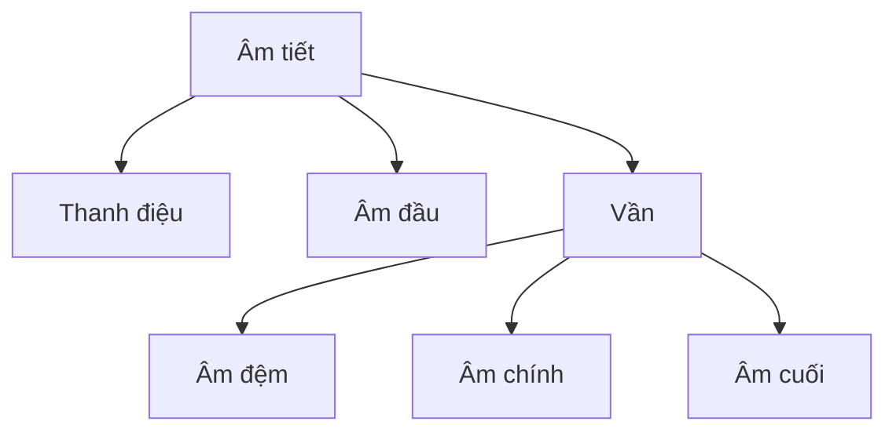

# Chương 15. Ngữ âm và âm vị học tiếng Việt

!!! abstract "Mục tiêu học tập"
    Sau chương này, bạn có thể:

    - **Phân tích** một âm tiết tiếng Việt thành âm đầu, âm đệm, âm chính, âm cuối và thanh điệu theo mô hình của Đoàn Thiện Thuật, đồng thời **trình bày** được các quan điểm phân tích khác.
    - **Liệt kê và phiên âm IPA** hệ thống phụ âm đầu, nguyên âm, âm cuối của giọng Hà Nội, nhận diện các biến thể quan trọng (âm cuối sau nguyên âm tròn môi, vần -anh/-ach).
    - **Mô tả** sáu thanh điệu theo đường nét cao độ, chất giọng và số Chao, và **giải thích** vì sao các mô tả khác nhau giữa các tác giả.
    - **So sánh** các vùng phương ngữ Bắc, Trung, Nam và **đánh giá** hệ quả của việc chọn phương ngữ đích cho một hệ thống TTS.
    - **Áp dụng** các quy tắc tương ứng giữa chữ viết và âm vị (c/k/q, g/gh, ng/ngh, gi, qu, i/y, iê/ia/yê/ya...).
    - **Cài đặt và kiểm thử** một bộ phân tích âm tiết chữ quốc ngữ, làm nền cho G2P ở Chương 18 và Dự án 1.
    - **Giải thích** vì sao lỗi thanh điệu là kiểu lỗi chủ yếu của TTS tiếng Việt và đề xuất cách mô hình hóa F0, đơn vị đầu vào phù hợp.

!!! info "Kiến thức cần có"
    - Ngữ âm học cấu âm, IPA, các kiểu phát âm (giọng kẹt, giọng thở): [Chương 13](ch13-am-hoc-tieng-noi.md).
    - Tần số cơ bản và cách trích xuất F0: [Chương 14](ch14-xu-ly-tin-hieu-so.md).
    - Python cơ bản (dataclass, chuỗi Unicode). Không cần kiến thức ngôn ngữ học chuyên sâu.

Với phần lớn ngôn ngữ châu Âu, kỹ sư TTS có thể coi ngữ âm học là "việc của chuyên gia từ điển". Với tiếng Việt thì không. Ba đặc điểm khiến hiểu biết ngữ âm trở thành điều kiện cần cho người làm TTS tiếng Việt:

1. **Thanh điệu mang nghĩa từ vựng.** "ma", "mà", "má", "mả", "mã", "mạ" là sáu từ khác nhau. Một lỗi cao độ không chỉ làm giọng kém tự nhiên mà còn **đổi nghĩa**.
2. **Âm tiết là đơn vị trung tâm.** Chữ viết tách từng âm tiết bằng dấu cách; mỗi âm tiết có cấu trúc chặt chẽ, số lượng âm tiết khác nhau thực sự được dùng chỉ vào cỡ vài nghìn. Đây vừa là thuận lợi (dễ phân tích, dễ thiết kế bộ ký hiệu) vừa là cái bẫy (âm tiết không trùng với "từ" về mặt ngôn điệu).
3. **Chữ quốc ngữ gần với âm vị nhưng không hoàn toàn.** Có nhiều quy tắc chính tả theo ngữ cảnh (c/k/q, gi, qu, iê/ia/yê/ya) và nhiều chữ khác nhau ứng với cùng một âm tùy phương ngữ (d, gi, r đều là /z/ ở Hà Nội).

!!! warning "Về sự khác biệt giữa các mô tả"
    Ngữ âm học tiếng Việt có một truyền thống nghiên cứu phong phú, và **các tác giả không hoàn toàn thống nhất** về số lượng âm vị, cách phiên âm, cách phân tích một số vần, hay giá trị số Chao của các thanh. Chương này lấy mô hình của Đoàn Thiện Thuật (1977) và mô tả giọng Hà Nội của Kirby (2011) làm khung tham chiếu chính, và nói rõ ở những chỗ có quan điểm khác. Bộ phân tích âm tiết ở cuối chương làm việc trên **chữ viết**; việc diễn giải ngữ âm (G2P) là bước riêng ở [Chương 18](../phan-4-frontend/ch18-g2p-bieu-dien-dau-vao.md).

## 15.1. Một số khái niệm nền tảng

**Âm tố** (*phone*) là một âm cụ thể được phát ra; **âm vị** (*phoneme*) là đơn vị trừu tượng nhỏ nhất có chức năng **phân biệt nghĩa** trong một ngôn ngữ; các âm tố khác nhau cùng thể hiện một âm vị gọi là **biến thể âm vị** (*allophone*). Công cụ cơ bản để xác định âm vị là **cặp tối thiểu** (*minimal pair*): hai từ chỉ khác nhau ở một vị trí. "ba" và "pha" chứng tỏ /ɓ/ và /f/ là hai âm vị; "tai" và "tay" chứng tỏ /aː/ dài và /ă/ ngắn là hai âm vị; "ma" và "má" chứng tỏ thanh ngang và thanh sắc đối lập nhau.

Quy ước ghi: chữ viết đặt trong ngoặc nhọn hoặc in nghiêng (⟨gi⟩), phiên âm âm vị trong gạch chéo (/z/), phiên âm ngữ âm trong ngoặc vuông ([z]).

## 15.2. Cấu trúc âm tiết

### 15.2.1. Mô hình năm thành phần

Theo Đoàn Thiện Thuật (1977), âm tiết tiếng Việt có cấu trúc phân tầng: **thanh điệu** bao trùm toàn âm tiết; phần đoạn tính gồm **âm đầu** và **vần**; vần lại gồm **âm đệm**, **âm chính** và **âm cuối**.



Có thể viết gọn là

$$
\sigma = T + (C_1) + (w) + V + (C_2),
$$

với $T$ là thanh điệu, $C_1$ là âm đầu, $w$ là âm đệm, $V$ là âm chính và $C_2$ là âm cuối; các thành phần trong ngoặc là tùy chọn **trên chữ viết**. Âm chính và thanh điệu luôn có mặt (thanh ngang cũng là một thanh, chỉ là không có dấu). Nhiều tác giả còn coi âm đầu luôn có mặt **về mặt âm vị học**: các âm tiết viết bắt đầu bằng nguyên âm như "ăn", "uống" thực ra mở đầu bằng âm tắc thanh hầu [ʔ].

| Âm tiết | Âm đầu | Âm đệm | Âm chính | Âm cuối | Thanh |
|---|---|---|---|---|---|
| toán | t | o (/w/) | a | n | sắc |
| khuyết | kh | u (/w/) | yê (/iə/) | t | sắc |
| người | ng | | ươ (/ɯə/) | i (/j/) | huyền |
| ăn | (∅, [ʔ]) | | ă | n | ngang |
| ạ | (∅, [ʔ]) | | a | | nặng |

Dựa vào âm cuối, Đoàn Thiện Thuật chia âm tiết thành bốn loại: **mở** (không có âm cuối: "ba"), **nửa mở** (âm cuối là bán nguyên âm: "bai", "bao"), **nửa khép** (âm cuối là phụ âm mũi: "ban") và **khép** (âm cuối là phụ âm tắc: "bát"). Âm tiết khép có một ràng buộc quan trọng với thanh điệu (mục 15.6.4).

### 15.2.2. Những quan điểm phân tích khác

Mô hình năm thành phần là khung được dùng rộng rãi nhất trong giáo dục và trong xử lý ngôn ngữ tiếng Việt, nhưng không phải là duy nhất:

- **Vị trí của âm đệm.** Một số tác giả xem /w/ là một phần của âm đầu, tạo thành các phụ âm **môi hóa** như /kʷ/ (qu), /xʷ/ (khu-), /hʷ/ (ho-), thay vì xếp vào vần. Ngược lại, việc trong thơ "hoa" vẫn hiệp vần với "ba" (ví dụ trong *Truyện Kiều*: "Cành lê trắng điểm một vài bông hoa / Thanh minh trong tiết tháng ba") là một lập luận cho thấy âm đệm chỉ gắn lỏng với phần cốt lõi của vần (âm chính + âm cuối).
- **Phạm vi của thanh điệu.** Thanh được mô tả là đặc trưng của cả âm tiết, nhưng về mặt ngữ âm, đường nét cao độ chủ yếu thể hiện trên phần hữu thanh, tức là vần.
- **Phê phán cách phân tích tuyến tính.** Cao Xuân Hạo (1985) lập luận rằng việc áp nguyên xi phương pháp chia âm vị tuyến tính của các ngôn ngữ châu Âu vào âm tiết tiếng Việt là không thỏa đáng, và nhấn mạnh tính chỉnh thể của âm tiết.

Với kỹ sư, điều quan trọng là hiểu rằng mỗi cách phân tích dẫn tới **một bộ ký hiệu khác nhau** cho mô hình TTS (ví dụ /kʷ/ là một ký hiệu hay /k/ + /w/ là hai ký hiệu). Không có lựa chọn nào "sai"; điều cần là **nhất quán** và có cơ sở.

## 15.3. Phụ âm đầu

Bảng dưới liệt kê các phụ âm đầu theo chữ viết và cách phát âm ở giọng Hà Nội, kèm biến thể ở các vùng khác khi đáng chú ý.

| Chữ viết | IPA (Hà Nội) | Mô tả | Ví dụ | Ghi chú |
|---|---|---|---|---|
| b | ɓ | tắc hút vào, môi–môi, hữu thanh | ba | thường được mô tả là âm hút vào hoặc tiền thanh hầu hóa |
| m | m | mũi, môi–môi | mẹ | |
| ph | f | xát, môi–răng, vô thanh | phở | |
| v | v | xát, môi–răng, hữu thanh | về | giọng Nam thường phát âm gần [j] |
| t | t | tắc, lợi, không bật hơi | tôi | |
| th | tʰ | tắc, lợi, bật hơi | thơ | |
| đ | ɗ | tắc hút vào, lợi, hữu thanh | đi | khác hẳn chữ d |
| n | n | mũi, lợi | nói | |
| l | l | bên, lợi | lá | một số địa phương phía Bắc lẫn l/n |
| x | s | xát, lợi, vô thanh | xa | |
| s | s | như x ở Hà Nội | sông | nhiều vùng Trung, Nam phân biệt: [ʂ] |
| d | z | xát, lợi, hữu thanh | da | giọng Nam: [j] |
| gi | z | như d ở Hà Nội | gia | giọng Nam: [j] |
| r | z | như d ở Hà Nội | ra | Trung, Nam: [ʐ], [ɹ], [r]... tùy vùng và người nói |
| ch | c | tắc (hơi xát), ngạc | cha | có tác giả phiên [tɕ] |
| tr | c | như ch ở Hà Nội | tre | nhiều vùng Trung, Nam phân biệt: [ʈ] |
| nh | ɲ | mũi, ngạc | nhà | |
| c, k, q | k | tắc, ngạc mềm | ca, kẻ, qua | xem quy tắc chính tả ở mục 15.9 |
| ng, ngh | ŋ | mũi, ngạc mềm | ngủ, nghe | |
| kh | x | xát, ngạc mềm, vô thanh | khế | |
| g, gh | ɣ | xát, ngạc mềm, hữu thanh | gà, ghế | |
| h | h | xát, thanh hầu | hoa | |
| (không viết) | ʔ | tắc thanh hầu | ăn, uống | âm vị hay hiện tượng ngữ âm: còn tranh luận |
| p | p | tắc, môi–môi | pin | chủ yếu ở từ vay mượn; /p/ bản ngữ chỉ xuất hiện ở cuối âm tiết |

**Bao nhiêu phụ âm đầu?** Câu trả lời phụ thuộc vào ba quyết định: có tính âm tắc thanh hầu /ʔ/ là âm vị không; có tính /p/ của từ vay mượn không; và mô tả giọng Hà Nội (nơi tr/ch, s/x, r/d/gi đã nhập làm một) hay một hệ thống có phân biệt các âm quặt lưỡi ứng với tr, s, r. Giọng Hà Nội có 19 phụ âm đầu nếu tính cả /ʔ/ (18 nếu không tính). Các giáo trình ngữ âm học tiếng Việt thường nêu con số khoảng 22, ví dụ Đoàn Thiện Thuật, cho hệ thống có phân biệt ba âm quặt lưỡi; thêm /p/ thì được 23. Khi đọc một tài liệu G2P hay một bộ ký hiệu, hãy kiểm tra xem nó theo quy ước nào.

!!! note "Góc tiếng Việt"
    Hai cặp chữ hay gây nhầm cho công cụ xử lý ngôn ngữ phát triển từ tiếng Anh: ⟨d⟩ là /z/ (giọng Bắc) hoặc /j/ (giọng Nam), **không phải** [d]; ⟨đ⟩ mới là âm tắc lợi hữu thanh [ɗ]. Văn bản "không dấu" (viết `dau` thay cho "đau" hoặc "dâu") làm mất phân biệt này, và không bộ chuẩn hóa nào khôi phục được hoàn toàn chính xác. Nếu dữ liệu huấn luyện có lẫn văn bản không dấu, hãy lọc bỏ hoặc dùng mô hình khôi phục dấu có kiểm tra thủ công.

## 15.4. Âm đệm

Âm đệm là bán nguyên âm môi /w/ (có tác giả ghi /u̯/), làm tròn môi ở đầu vần. Trên chữ viết, nó được ghi bằng:

- ⟨o⟩ trước các nguyên âm a, ă, e: "hoa", "hoặc", "khoe", "oanh";
- ⟨u⟩ trước y, ê, â, ơ: "huy", "huế", "tuần", "thuở", "khuya", "chuyện";
- ⟨u⟩ sau ⟨q⟩ trong mọi trường hợp: "qua", "quê", "quen", "quăng", "quý".

Về phân bố, âm đệm **không xuất hiện sau các phụ âm môi** b, m, ph, v (trừ một số từ vay mượn như "buýt") và **không đi với các âm chính tròn môi** (u, ô, o, uô). Cả hai ràng buộc đều có thể hiểu là sự **dị hóa**: hai yếu tố tròn môi không đứng cạnh nhau.

Ràng buộc thứ hai làm nảy sinh một ca khó trên chữ viết: "**quốc**". Theo chính tả, đó là ⟨q⟩ + ⟨u⟩ + ⟨ô⟩ + ⟨c⟩, tức âm đệm đi với âm chính tròn môi, điều không được phép theo ràng buộc trên. Nhiều phân tích vì vậy coi "quốc" là /k/ + /uə/ + /k/ (âm chính là nguyên âm đôi "uô"), và trong nhiều cách phát âm "quốc" gần như đồng âm với "cuốc". Bộ phân tích ở mục 15.12 trả về phân tích **theo chữ viết** (âm đệm ⟨u⟩, âm chính ⟨ô⟩); bước G2P ở Chương 18 cần xử lý riêng trường hợp này.

Ở phương ngữ Nam, âm đệm thường bị rụng hoặc biến đổi: "hoa" có thể nghe như [wa], "quá" như [wa], "tuần" với âm đệm yếu đi. Đây là một trong những khác biệt khiến bộ G2P giọng Bắc không dùng được cho giọng Nam.

## 15.5. Âm chính

### 15.5.1. Nguyên âm đơn

| | Trước, không tròn | Sau (hoặc giữa), không tròn | Sau, tròn |
|---|---|---|---|
| Cao | /i/ ⟨i, y⟩ | /ɯ/ ⟨ư⟩ | /u/ ⟨u⟩ |
| Nửa cao | /e/ ⟨ê⟩ | /ɤ/ ⟨ơ⟩, /ɤ̆/ ⟨â⟩ | /o/ ⟨ô⟩ |
| Nửa thấp | /ɛ/ ⟨e⟩ | | /ɔ/ ⟨o⟩ |
| Thấp | | /a/ ⟨a⟩, /ă/ ⟨ă⟩ | |

Một số điểm cần lưu ý:

- **Nguyên âm sau không tròn môi** /ɯ/ (ư) và /ɤ/ (ơ) khá hiếm trong các ngôn ngữ trên thế giới ([Chương 13](ch13-am-hoc-tieng-noi.md)). Có tác giả ghi ư là /ɨ/ (giữa) và ơ là /əː/.
- **Đối lập dài–ngắn**: /a/ ~ /ă/ ("tai" ~ "tay", "sao" ~ "sau") và /ɤ/ ~ /ɤ̆/ ("cơn" ~ "cân"). Hai nguyên âm ngắn ă, â **luôn cần âm cuối**: không có âm tiết nào kết thúc bằng ă hay â.
- Theo phân tích của Đoàn Thiện Thuật, còn có hai nguyên âm ngắn nữa: /ɛ̆/ trong các vần "anh, ach" và /ɔ̆/ trong các vần "ong, oc" (ngắn hơn "oong" trong "xoong", "boong"). Cách đếm này cho **13 nguyên âm đơn**; nếu không tách hai âm đó, ta có 11.

### 15.5.2. Nguyên âm đôi

Tiếng Việt có ba nguyên âm đôi, mỗi nguyên âm có **nhiều cách viết tùy theo âm cuối và âm đệm**:

| Âm vị | Không có âm cuối | Có âm cuối | Sau âm đệm / đầu âm tiết | Ví dụ |
|---|---|---|---|---|
| /iə/ | ia | iê | ya (không có âm cuối), yê (có âm cuối) | mía, miếng, khuya, khuyên, yêu |
| /ɯə/ | ưa | ươ | | mưa, mương, người |
| /uə/ | ua | uô | | mua, muốn, uống |

Cách phiên âm cũng khác nhau giữa các tác giả: /ie, ɯɤ, uo/ (Đoàn Thiện Thuật) hay /iə, ɨə, uə/ (nhiều tài liệu khác). Về mặt ngữ âm, yếu tố thứ hai của nguyên âm đôi thường bị "trung tâm hóa" về phía [ə], rõ nhất ở âm tiết không có âm cuối. Với 13 (hoặc 11) nguyên âm đơn và 3 nguyên âm đôi, ta có tổng cộng **16 (hoặc 14) âm chính**, tùy cách phân tích.

!!! tip "Bẫy chính tả của nguyên âm đôi"
    Hai chữ "ua" có thể là nguyên âm đôi /uə/ ("mua") **hoặc** âm đệm + âm chính /wa/ ("qua"). Phân biệt dựa vào âm đầu ⟨q⟩. Tương tự, "gia" là ⟨gi⟩ + ⟨a⟩ chứ không phải ⟨g⟩ + ⟨ia⟩. Các bộ G2P viết bằng biểu thức chính quy hay mắc lỗi ở đúng những chỗ này.

## 15.6. Âm cuối

### 15.6.1. Hệ thống âm cuối

Theo phân tích phổ biến (Đoàn Thiện Thuật, 1977), tiếng Việt có 6 phụ âm cuối /m, n, ŋ, p, t, k/ và 2 bán nguyên âm cuối /w, j/; nếu coi -nh, -ch là âm vị riêng thì có thêm /ɲ, c/ (mục 15.6.2):

| Âm vị | Chữ viết | Ví dụ |
|---|---|---|
| /m/, /p/ | m, p | cam, cáp |
| /n/, /t/ | n, t | can, cát |
| /ŋ/, /k/ | ng, c; nh, ch (sau i, ê, a; xem mục 15.6.2) | cang, các; canh, cách |
| /w/ | o (sau a, e); u (các trường hợp khác) | cao, kéo; cau, kêu, cứu |
| /j/ | y (sau ă, â); i (các trường hợp khác) | cay, cây; cai, côi, cười |

Các phụ âm tắc cuối được phát âm **không buông** (*unreleased*): [p̚, t̚, k̚]. Chú ý cặp "cai" /kaːj/ và "cay" /kăj/: chữ ⟨y⟩ cuối âm tiết báo hiệu nguyên âm ⟨a⟩ đứng trước là **ngắn**; tương tự "cao" /kaːw/ và "cau" /kăw/.

### 15.6.2. Vần -nh/-ch: âm vị riêng hay biến thể của -ng/-c?

Đây là điểm mà các phân tích khác nhau rõ rệt nhất.

- **Phân tích A** (Đoàn Thiện Thuật và nhiều tác giả khác): -nh và -ch là **biến thể** của /ŋ/ và /k/ khi đứng sau nguyên âm hàng trước. Lập luận chính là **phân bố bổ sung**: ⟨nh, ch⟩ chỉ đứng sau i, ê, a; còn ⟨ng, c⟩ không đứng sau i, ê. Đối lập "anh" ~ "ang" khi đó được giải thích bằng **nguyên âm**: "anh" là /ɛ̆ŋ/ (với nguyên âm trước, ngắn) còn "ang" là /aːŋ/.
- **Phân tích B**: coi /ɲ/ và /c/ là hai âm vị cuối riêng biệt, "anh" là /aɲ/ (hoặc /ăɲ/), "ách" là /ac/. Cách này bám sát chữ viết hơn và được nhiều bộ từ điển phát âm, nhiều hệ thống G2P thực dụng sử dụng.

Về mặt ngữ âm, các vần -inh, -ênh, -anh (và -ich, -êch, -ach) ở giọng Hà Nội thường được mô tả là có một yếu tố lướt [j] trước phụ âm cuối, hoặc có phụ âm cuối dịch về phía ngạc; ví dụ "anh" được các tác giả khác nhau phiên là [ajŋ̟] hay [ɛ̆ɲ]. Với TTS, cả hai phân tích đều dùng được **miễn là nhất quán**: mô hình sẽ học ánh xạ từ ký hiệu sang âm thanh. Phân tích B thường dễ hơn cho mô hình vì ít "phụ thuộc ngữ cảnh"; phân tích A phản ánh tốt hơn cấu trúc âm vị học và giảm số ký hiệu.

### 15.6.3. Âm cuối sau nguyên âm tròn môi

Sau các nguyên âm tròn môi /u, o, ɔ/ trong các vần "ung, uc, ông, ôc, ong, oc", âm cuối ngạc mềm thường được mô tả là phát âm **kèm khép môi**, tức các âm cấu âm kép [ŋ͡m] và [k͡p]: "ông" có thể phiên là [ʔoŋ͡m], "học" là [hɔ̆k͡p]. Bạn có thể tự quan sát: khi nói "ông" hay "học", hai môi khép lại ở cuối âm tiết. Hiện tượng này rõ ở giọng Bắc; mức độ khép môi khác nhau giữa các người nói. Với TTS, đây chủ yếu là vấn đề của bộ ký hiệu: nếu dùng chung một ký hiệu /ŋ/ cho mọi vị trí, mô hình phải tự học biến thể theo ngữ cảnh (thường học được nếu dữ liệu đủ).

### 15.6.4. Âm tiết khép và thanh điệu

Âm tiết kết thúc bằng phụ âm tắc (-p, -t, -c, -ch) **chỉ mang thanh sắc hoặc thanh nặng**: có "các", "cạc" nhưng không có "càc", "cảc", "cãc" hay "cac". Ràng buộc này rất hữu ích trong thực hành: một âm tiết khép mang thanh khác gần như chắc chắn là lỗi chính tả, lỗi OCR hoặc lỗi gõ, và bộ phân tích ở mục 15.12 dùng nó để kiểm tra dữ liệu.

Về ngữ âm, thanh sắc và thanh nặng trong âm tiết khép **ngắn hơn** và có đường nét khác với trong âm tiết không khép. Vì thế một số tác giả, theo truyền thống âm vị học Hán và một số mô tả hiện đại, tách chúng thành hai thanh riêng ("thanh nhập"), nâng tổng số lên **8 thanh**. Đây là thêm một chỗ mà con số "6 thanh" phụ thuộc vào cách phân tích.

## 15.7. Thanh điệu

### 15.7.1. Sáu thanh của giọng Bắc

| Thanh | Dấu | Ví dụ | Đường nét (mô tả định tính, giọng Bắc) | Chất giọng | Số Chao thường gặp | Các giá trị khác được đề xuất |
|---|---|---|---|---|---|---|
| ngang | (không) | ma | ngang, mức trung bình | thường | 33 | 44 |
| huyền | ` | mà | thấp, đi xuống nhẹ | thường, có thể hơi thở | 21 | 31, 32 |
| sắc | ´ | má | đi lên | thường | 35 | 24, 45 |
| hỏi | ̉ | mả | thấp, đi xuống, có thể vòng lên ở cuối | có thể hơi kẹt ở điểm thấp | 313 | 312, 21 |
| ngã | ˜ | mã | đi lên, có đoạn "gãy" ở giữa | thanh quản hóa giữa âm tiết | 3ʔ5 | 4ʔ5, 325 |
| nặng | . | mạ | thấp, đi xuống, ngắn | co thắt thanh hầu ở cuối | 21ʔ | 31ʔ, 32ʔ |

Số Chao (Chao, 1930) chia quãng cao độ của **từng người nói** thành 5 mức, 5 là cao nhất; một thanh được mô tả bằng các mức ở đầu, (giữa) và cuối. Ký hiệu ʔ chen giữa (3ʔ5) chỉ sự thanh quản hóa hay tắc thanh hầu.

!!! warning "Đọc số Chao một cách thận trọng"
    Các giá trị trong bảng là **mô tả thô** được nhiều tài liệu dùng, không phải số đo chuẩn. Các tác giả khác nhau (Thompson, 1965; Đoàn Thiện Thuật, 1977; Kirby, 2011 và nhiều nghiên cứu thực nghiệm) đưa ra những giá trị khác nhau, và đường nét thực tế thay đổi theo người nói, tốc độ nói, vị trí trong câu và ngữ điệu. Ví dụ thanh hỏi giọng Hà Nội trong lời nói nhanh thường chỉ còn là một đường đi xuống thấp, không vòng lên rõ. Đừng dùng số Chao làm **đích** huấn luyện; hãy để mô hình học F0 từ dữ liệu, và dùng số Chao để **hiểu** và **kiểm tra định tính** kết quả.

### 15.7.2. Chất giọng là một phần của thanh điệu

Ở giọng Bắc, thanh điệu không chỉ là đường nét F0. Thanh **ngã** có đoạn thanh quản hóa (giọng kẹt, có khi tắc thanh hầu hoàn toàn) ở khoảng giữa âm tiết, sau đó F0 vọt lên cao. Thanh **nặng** ngắn, đi xuống và kết thúc bằng sự co thắt thanh hầu. Thanh **huyền** đôi khi có giọng hơi thở. Các nghiên cứu thực nghiệm như của Nguyễn Văn Lợi và Edmondson (1998) và Michaud (2004) đã mô tả chi tiết các đặc điểm này. Về tri giác, kết quả của Brunelle (2009) gợi ý rằng người nghe phương Bắc dựa vào cả F0 lẫn chất giọng để nhận diện thanh, trong khi người nghe phương Nam dựa chủ yếu vào F0.

Hệ quả kỹ thuật đã được nhắc ở [Chương 13](ch13-am-hoc-tieng-noi.md) và [Chương 14](ch14-xu-ly-tin-hieu-so.md): ở vùng thanh quản hóa, bộ trích F0 hay báo "vô thanh" hoặc nhảy quãng tám, và vocoder phải tái tạo được những chu kỳ không đều. Một mô hình TTS chỉ học được "đường cong F0 trơn" sẽ phát âm thanh ngã và thanh nặng thiếu tự nhiên, dù F0 trung bình đúng.

### 15.7.3. Phạm trù thanh và dấu vết lịch sử

Sáu thanh có thể xếp vào một bảng $3 \times 2$:

| Phạm trù | Âm vực cao (bổng) | Âm vực thấp (trầm) |
|---|---|---|
| A | ngang | huyền |
| B | sắc | nặng |
| C | hỏi | ngã |

Cách xếp này có cơ sở lịch sử. Haudricourt (1954) chỉ ra rằng tiếng Việt cổ chưa có thanh điệu; các phạm trù B và C hình thành từ sự rụng các yếu tố ở cuối âm tiết (một âm tắc thanh hầu và một âm xát), còn sự tách mỗi phạm trù thành cặp cao/thấp bắt nguồn từ tính thanh của phụ âm đầu thời cổ. Đây là một ví dụ kinh điển của quá trình **hình thành thanh điệu** (*tonogenesis*).

Bảng này có những hệ quả quan sát được ngay trong tiếng Việt hiện đại:

- Ở **từ láy**, các thanh thường kết hợp theo cùng **âm vực**: nhóm cao {ngang, sắc, hỏi} đi với nhau ("nho nhỏ", "vui vẻ", "xinh xắn"), nhóm thấp {huyền, nặng, ngã} đi với nhau ("nhè nhẹ", "mạnh mẽ", "vội vàng", "dễ dàng"). Quy luật này là cơ sở của mẹo chính tả quen thuộc phân biệt dấu hỏi và dấu ngã ("Chị Huyền mang nặng ngã đau"). Quy luật có ngoại lệ, nhưng đủ mạnh để dùng làm bài tập.
- **Hỏi và ngã** cùng thuộc phạm trù C, và chính hai thanh này nhập làm một ở phương ngữ Nam (mục 15.8).
- Với mô hình TTS, các cặp **cùng phạm trù** (hỏi/ngã) và **cùng âm vực thấp, đi xuống** (huyền/nặng) là những cặp dễ nhầm nhất; đây là nơi nên tập trung khi thiết kế bộ kiểm thử thanh điệu ([Chương 38](../phan-9-thuc-tien/ch38-danh-gia-tts.md)).

### 15.7.4. Thanh điệu trong lời nói liên tục

Trong lời nói liên tục, đường nét của mỗi thanh bị ảnh hưởng bởi các thanh lân cận. Ở tiếng Quan Thoại, Xu (1997) cho thấy ảnh hưởng **thuận chiều** (thanh trước tác động lên thanh sau) mạnh hơn ảnh hưởng **ngược chiều**; hiện tượng **đồng cấu âm thanh điệu** tương tự cũng hiện diện trong tiếng Việt. Khác với tiếng Quan Thoại, tiếng Việt chuẩn không có các quy tắc **biến điệu** (*tone sandhi*) mang tính phạm trù phổ biến (như thanh 3 đứng trước thanh 3 đổi thành thanh 2 trong tiếng Quan Thoại), nên mô hình TTS không cần một bước "đổi thanh" tường minh. Tuy nhiên, các hư từ không mang trọng âm ("của", "thì", "là", "các") thường bị **rút ngắn** và đường nét thanh bị "phẳng" đi; ngữ điệu câu chồng lên thanh điệu và làm dịch chuyển âm vực. Sự tương tác giữa thanh điệu và ngữ điệu là chủ đề của [Chương 16](ch16-ngon-dieu.md).

## 15.8. Phương ngữ

Tiếng Việt thường được chia thành ba vùng phương ngữ lớn: Bắc, Trung và Nam, mỗi vùng lại có nhiều biến thể địa phương (Hoàng Thị Châu, 2004). Phương ngữ miền Trung đặc biệt đa dạng. Bảng sau tóm tắt các khác biệt **thường được nêu** giữa giọng Hà Nội và giọng Sài Gòn (TP.HCM), kèm vài ghi chú chung về miền Trung; đây là những khái quát, và người nói thực tế có thể khác.

| Đặc điểm | Bắc (Hà Nội) | Nam (Sài Gòn) | Ghi chú về miền Trung |
|---|---|---|---|
| Số thanh | 6 | 5: hỏi và ngã nhập làm một (thường mô tả là xuống rồi lên) | nhiều vùng có ít hơn 6 thanh, cách nhập khác nhau tùy địa phương |
| tr / ch | nhập: [c] | phân biệt trong lời nói cẩn thận, có xu hướng nhập | thường giữ âm quặt lưỡi cho tr |
| s / x | nhập: [s] | như trên | thường phân biệt |
| r / d / gi | nhập: [z] | r: [ɹ], [ʐ], [r] hoặc [ɣ] tùy người; d, gi: [j] | r thường là âm quặt lưỡi hoặc rung |
| v | [v] | thường [j] (hoặc [v]) | |
| Âm cuối -n / -ng, -t / -c | phân biệt | trung hòa sau nhiều nguyên âm: "lan" ~ "lang", "mát" ~ "mác" | tùy vùng |
| Vần -anh, -ach | [ajŋ]/[ɛ̆ɲ], [ajk]/[ɛ̆c] (tùy cách phiên) | thường thành [an], [at]: "anh" ~ [ʔan] | |
| Âm đệm | giữ | thường yếu hoặc rụng: "hoa" ~ [wa], "quá" ~ [wa] | |

Ngoài ra còn có những khác biệt về từ vựng ("má" và "mẹ", "trái" và "quả") và về sự trung hòa một số đối lập nguyên âm trước âm cuối ở giọng Nam, mà phạm vi chương này không đi sâu.

!!! note "Góc tiếng Việt: chọn phương ngữ đích cho hệ thống TTS"
    - **Một giọng, một phương ngữ.** Một mô hình đơn người nói nên được huấn luyện trên dữ liệu của một phương ngữ nhất quán. Trộn hai phương ngữ cho cùng một giọng khiến mô hình "lúc Bắc lúc Nam" trên cùng một từ.
    - **Chữ viết giống nhau, âm khác nhau.** Văn bản đầu vào không cho biết phương ngữ; mô hình phải học ánh xạ từ dữ liệu âm thanh. Nếu dùng G2P, cần một bộ quy tắc riêng cho mỗi phương ngữ (ví dụ giọng Nam: 5 thanh, d/gi/v thành /j/, -n/-ng trung hòa...). Dùng G2P giọng Bắc cho dữ liệu giọng Nam sẽ tạo ra **nhãn sai có hệ thống**: chữ có dấu ngã được gán ký hiệu thanh ngã nhưng âm thanh lại là thanh hỏi.
    - **Mô hình đa phương ngữ.** Có thể thêm embedding phương ngữ (tương tự embedding ngôn ngữ ở [Chương 30](../phan-7-e2e-bieu-cam/ch30-da-ngon-ngu-code-switching.md)) và gắn nhãn phương ngữ cho từng người nói.
    - **Đánh giá theo phương ngữ.** Người nghe đánh giá nên là người bản ngữ của phương ngữ đích; một người nghe miền Bắc có thể đánh giá thấp một giọng Nam hoàn toàn tự nhiên, và ngược lại.
    - Trên thị trường, giọng Bắc (Hà Nội) và giọng Nam (TP.HCM) là hai lựa chọn phổ biến nhất; nhu cầu giọng miền Trung có thực nhưng dữ liệu hiếm hơn.

## 15.9. Quan hệ giữa chữ viết và âm vị

### 15.9.1. Các quy tắc chính tả theo ngữ cảnh

| Âm vị | Chữ viết | Điều kiện | Ví dụ |
|---|---|---|---|
| /k/ | k | trước i, y, e, ê (kể cả iê) | kí, kẻ, kể, kiếm |
| | q (luôn đi với u) | khi có âm đệm /w/ | qua, quê, quyết |
| | c | các trường hợp còn lại | ca, cô, cũ, của |
| /ɣ/ | gh | trước i, e, ê | ghi, ghé, ghế, ghiền |
| | g | các trường hợp còn lại | ga, gỗ, gửi |
| /ŋ/ | ngh | trước i, e, ê | nghĩ, nghe, nghề, nghiêng |
| | ng | các trường hợp còn lại | ngà, ngủ, ngước |
| /z/ (Hà Nội) | d, gi, r | theo từ (lý do lịch sử) | da, gia, ra |
| /i/ | y | đứng một mình (y, ý), sau âm đệm (uy), trong một số từ (mỹ, lý, kỹ) | ý kiến, huy, kỹ thuật |
| | i | các trường hợp còn lại | đi, kim, tìm |
| /w/ (âm đệm) | o / u | o trước a, ă, e; u trước y, ê, â, ơ và sau q | hoa, khoe; huế, tuần, quý |
| /w/ (âm cuối) | o / u | o sau a, e (dài); u các trường hợp còn lại | cao, kéo; cau, kêu |
| /j/ (âm cuối) | y / i | y sau ă, â; i các trường hợp còn lại | tay, cây; tai, tôi |
| /ă/ | a | trước âm cuối y, u | tay, sau |
| /iə/ | ia, iê, ya, yê | xem bảng ở mục 15.5.2 | mía, tiên, khuya, yên |

Ngoài các quy tắc trên, có một số **trường hợp đặc biệt** mà mọi bộ phân tích phải xử lý:

- **⟨gi⟩ dùng chung chữ i.** "gì" là /z/ + /i/ (chữ i vừa thuộc ⟨gi⟩ vừa là âm chính); "gìn" tương tự. "giếng" là ⟨gi⟩ + /iə/ + /ŋ/: theo lý thuyết phải viết "giiếng", nhưng chính tả lược một chữ i.
- **⟨qu⟩ + ⟨ô⟩** trong "quốc" (mục 15.4).
- **Biến thể i/y** trong từ Hán Việt: "lí/lý", "kĩ/kỹ", "mĩ/mỹ" cùng tồn tại trong văn bản thực tế (sách này dùng "lý", "kỹ" theo quy ước biên soạn). G2P phải ánh xạ cả hai về /i/; bộ chuẩn hóa văn bản có thể thống nhất chúng ([Chương 17](../phan-4-frontend/ch17-chuan-hoa-van-ban.md)).
- **Vị trí dấu thanh** kiểu cũ và kiểu mới: "hòa/hoà", "thủy/thuỷ", "khỏe/khoẻ". Hai cách viết là **hai chuỗi Unicode khác nhau** dù cùng ở dạng NFC; tokenizer sẽ coi chúng là hai từ khác nhau nếu không chuẩn hóa.
- **Địa danh, tên riêng và từ vay mượn**: "Bắc Kạn", "Kon Tum" (⟨k⟩ trước a, o), "Đắk Lắk" (⟨k⟩ ở cuối âm tiết), "xoong", "soóc" (⟨oo⟩), "pin", "buýt"; tên nước ngoài có f, j, w, z và cụm phụ âm. Những âm tiết này vi phạm quy tắc chính tả chuẩn nhưng vẫn phải đọc được.

### 15.9.2. Từ âm tiết đến biểu diễn đầu vào

Ngay cả khi văn bản đã chuẩn hóa, một âm tiết vẫn có thể được biểu diễn theo nhiều cách cho mô hình TTS: chuỗi ký tự (dạng NFC hay NFD), chuỗi âm vị IPA cộng một token thanh, hoặc một bộ đặc trưng ở mức âm tiết. Việc chọn biểu diễn nào và cách gắn thanh điệu vào đâu (token riêng, gắn vào nguyên âm, hay đặc trưng mức âm tiết) được thảo luận ở [Chương 18](../phan-4-frontend/ch18-g2p-bieu-dien-dau-vao.md). Điều chương này cung cấp là bước đầu tiên chung cho mọi lựa chọn đó: **phân tích chính xác âm tiết chữ viết thành các thành phần**.

## 15.10. Nhịp điệu, đồng cấu âm và từ láy

### 15.10.1. Nhịp điệu

Tiếng Việt thường được xếp vào nhóm ngôn ngữ có **nhịp theo âm tiết** (*syllable-timed*): các âm tiết có độ dài tương đối đồng đều, không có hiện tượng nguyên âm không trọng âm bị rút gọn mạnh như tiếng Anh. Cần biết rằng sự phân chia "nhịp theo âm tiết" và "nhịp theo trọng âm" đã bị nhiều nghiên cứu thực nghiệm đặt câu hỏi, và nên được hiểu như một xu hướng hơn là một phân loại tuyệt đối. Trong thực tế, độ dài âm tiết tiếng Việt vẫn biến thiên đáng kể: âm tiết cuối ngữ đoạn **kéo dài** (*final lengthening*), âm tiết mang thanh nặng hoặc kết thúc bằng phụ âm tắc thường ngắn hơn, hư từ bị rút ngắn, và âm tiết mang tiêu điểm được kéo dài. Đây chính là những gì bộ dự đoán trường độ của mô hình TTS phải học ([Chương 16](ch16-ngon-dieu.md), [Chương 22](../phan-5-mo-hinh-am-hoc/ch22-fastspeech.md)).

### 15.10.2. Đồng cấu âm và ranh giới âm tiết

Ngoài đồng cấu âm thông thường giữa phụ âm và nguyên âm ([Chương 13](ch13-am-hoc-tieng-noi.md)), cần chú ý hai hiện tượng ở **ranh giới âm tiết**. Thứ nhất, phụ âm tắc cuối không buông và âm tắc thanh hầu ở đầu các âm tiết bắt đầu bằng nguyên âm làm cho ranh giới âm tiết khá rõ; tiếng Việt hầu như không có hiện tượng **nối âm** (phụ âm cuối chuyển sang làm âm đầu của âm tiết sau) như tiếng Anh hay tiếng Pháp: "ăn uống" không thành "ă-nuống". Thứ hai, trong lời nói nhanh và khẩu ngữ có những hiện tượng **rút gọn** quen thuộc như "hai mươi mốt" thành "hăm mốt", hay các biến thể "mười lăm" ~ "mười nhăm"; bộ chuẩn hóa văn bản và dữ liệu huấn luyện cần nhất quán về những biến thể này ([Chương 17](../phan-4-frontend/ch17-chuan-hoa-van-ban.md)).

### 15.10.3. Từ láy

**Từ láy** là từ được tạo bằng cách lặp lại toàn bộ hoặc một phần âm tiết gốc: láy toàn bộ ("xanh xanh", với biến đổi thanh: "đo đỏ"), láy phụ âm đầu ("xinh xắn", "lấp lánh"), láy vần ("lò dò", "bối rối"). Như đã thấy ở mục 15.7.3, thanh điệu trong từ láy thường hài hòa theo âm vực. Với TTS, từ láy không đặt ra vấn đề kỹ thuật riêng (mỗi âm tiết vẫn được phân tích bình thường), nhưng chúng rất phổ biến trong văn chương và sách nói. Các cặp như "nho nhỏ" (ngang–hỏi) hay "nhè nhẹ" (huyền–nặng) là phép thử tốt để xem mô hình có giữ đúng sự tương phản thanh điệu giữa hai âm tiết gần giống nhau hay không.

## 15.11. Hệ quả cho TTS tiếng Việt

**Lỗi thanh điệu là kiểu lỗi chủ yếu.** Có ít nhất năm nguyên nhân hội tụ:

1. **Đối lập sáu hướng** dựa trên cả đường nét F0 lẫn chất giọng, trong khi quãng cao độ của người nói có hạn; các cặp hỏi/ngã, huyền/nặng gần nhau về âm học.
2. **Ngữ điệu chồng lên thanh điệu**: cùng một thanh có đường nét khác nhau ở đầu câu, cuối câu, câu hỏi, câu cảm. Đây là một dạng của bài toán một-nhiều ([Chương 7](../phan-2-mo-hinh-sinh/ch07-tong-quan-mo-hinh-sinh.md)): các mô hình hồi quy L1/L2 có xu hướng **làm trơn** F0, khiến các thanh có đường nét đặc trưng (ngã, hỏi) bị "phẳng" về phía trung bình.
3. **Dữ liệu ít**: so với tiếng Anh hay tiếng Trung, dữ liệu tiếng Việt chất lượng cao còn hạn chế, nên các âm tiết hiếm với thanh hiếm có rất ít mẫu.
4. **Biểu diễn đầu vào**: trong biểu diễn ký tự, dấu thanh có thể là một ký tự riêng (NFD) hoặc dính vào nguyên âm (NFC); với các tokenizer BPE huấn luyện chủ yếu trên tiếng Anh, một âm tiết tiếng Việt có thể bị cắt thành những mảnh không phản ánh thanh. Lựa chọn biểu diễn ảnh hưởng trực tiếp đến việc mô hình "nhìn thấy" thanh rõ đến đâu ([Chương 18](../phan-4-frontend/ch18-g2p-bieu-dien-dau-vao.md)).
5. **Nhãn F0 nhiễu**: lỗi trích xuất F0 ở vùng giọng kẹt (ngã, nặng) đưa nhãn sai vào các mô hình có bộ dự đoán cao độ tường minh.

Một lỗi thanh đổi nghĩa ngay lập tức ("bán" thành "bàn", "sợ" thành "sở"), nên người nghe bản ngữ rất nhạy với nó. Bộ đánh giá cho TTS tiếng Việt vì vậy cần các phép thử thanh điệu với cặp tối thiểu ([Chương 38](../phan-9-thuc-tien/ch38-danh-gia-tts.md)).

**Mô hình hóa F0.** Nên mô hình hóa log-F0 đã chuẩn hóa theo người nói; xử lý cẩn thận vùng vô thanh và vùng giọng kẹt (nội suy kèm cờ V/UV, hoặc dùng các mô hình không phụ thuộc vào F0 tường minh); và nếu dùng đặc trưng cao độ ở mức âm vị hay âm tiết, cần nhớ rằng **đường nét** trong âm tiết quan trọng không kém **mức trung bình**: thanh sắc và thanh huyền có thể có F0 trung bình gần nhau nhưng hướng ngược nhau.

**Đơn vị đầu vào.** Số âm tiết khác nhau thực sự được dùng chỉ vào cỡ vài nghìn (các thống kê khác nhau tùy kho ngữ liệu và cách đếm), đủ nhỏ để một số hệ thống dùng embedding mức âm tiết. Tuy nhiên phân bố của chúng rất lệch, nhiều âm tiết hiếm; biểu diễn dưới âm tiết (âm vị cộng thanh) chia sẻ thống kê tốt hơn. Bộ phân tích âm tiết dưới đây là nền móng cho cả hai hướng.

**Độ phủ dữ liệu.** Khi thiết kế kịch bản thu âm, cần phủ đủ các tổ hợp **vần × thanh**, không chỉ đủ âm vị; quy trình chọn câu tham lam theo độ phủ được trình bày ở [Chương 36](../phan-9-thuc-tien/ch36-du-lieu-tts.md), và có thể dùng trực tiếp bộ phân tích dưới đây để đếm.

## 15.12. Cài đặt: bộ phân tích âm tiết chữ quốc ngữ

### 15.12.1. Thiết kế

Đầu vào là **một âm tiết** đã được tách và chuẩn hóa sơ bộ (việc tách câu, tách âm tiết và chuẩn hóa số, ngày tháng... thuộc [Chương 17](../phan-4-frontend/ch17-chuan-hoa-van-ban.md)). Đầu ra là năm thành phần theo chữ viết. Thuật toán gồm các bước:

1. **Tách thanh bằng NFD.** Chuyển âm tiết sang dạng tổ hợp NFD, nhặt ra đúng một trong năm dấu thanh (huyền U+0300, sắc U+0301, ngã U+0303, hỏi U+0309, nặng U+0323), rồi ghép lại phần còn lại về NFC. Cách này **không phụ thuộc** vào vị trí đặt dấu (hòa hay hoà) hay dạng chuẩn hóa của đầu vào, và giữ nguyên các dấu phụ chỉ chất lượng nguyên âm (mũ, trăng, móc).
2. **So khớp tham lam âm đầu**, thử các chuỗi dài trước ("ngh" trước "ng" trước "n").
3. **Xử lý các ca đặc biệt** của ⟨gi⟩ (dùng chung chữ i) và ⟨qu⟩ (tách thành ⟨q⟩ + âm đệm ⟨u⟩).
4. **Nhận diện âm đệm** ⟨o⟩ trước a, ă, e và ⟨u⟩ trước y, ê, â, ơ.
5. **So khớp tham lam âm chính** (nguyên âm đôi trước nguyên âm đơn); phần còn lại phải là một âm cuối hợp lệ.
6. **Kiểm tra ràng buộc** (khi `strict=True`): cách viết nguyên âm đôi theo âm cuối, k/gh/ngh trước nguyên âm trước, -nh/-ch chỉ sau a, ê, i, âm tiết khép chỉ mang sắc/nặng...

Ngoài ra, hàm `compose` làm phép **ngược**: từ năm thành phần, dựng lại chữ viết với vị trí dấu thanh theo kiểu cũ (hóa, thủy) hoặc kiểu mới (hoá, thuỷ). Cặp `parse`/`compose` cho phép kiểm thử khứ hồi (*round-trip*) và cũng là một công cụ chuẩn hóa vị trí dấu thanh.

### 15.12.2. Mã nguồn

Khối thứ nhất định nghĩa dữ liệu và hàm tách thanh. Ba khối đầu ghép lại thành tệp `vn_syllable.py`.

```python
import unicodedata
from dataclasses import dataclass

# Dấu thanh ở dạng ký tự tổ hợp (sau khi tách NFD). Dấu mũ, trăng, móc KHÔNG nằm ở đây.
TONE_MARKS = {"̀": "huyen", "́": "sac", "̉": "hoi", "̃": "nga", "̣": "nang"}
TONES = ("ngang", "huyen", "sac", "hoi", "nga", "nang")

# Âm đầu theo chữ viết, dài trước ngắn sau để so khớp tham lam
ONSETS = ("ngh", "ng", "gh", "gi", "kh", "nh", "ph", "th", "tr", "ch", "qu",
          "b", "c", "d", "đ", "g", "h", "k", "l", "m", "n", "p", "q", "r", "s", "t", "v", "x")
# Âm chính theo chữ viết (đã bỏ dấu thanh), dài trước ngắn sau
NUCLEI = ("iê", "yê", "ia", "ya", "uô", "ua", "ươ", "ưa", "oo",
          "a", "ă", "â", "e", "ê", "i", "y", "o", "ô", "ơ", "u", "ư")
CODAS = ("ng", "nh", "ch", "m", "n", "p", "t", "c", "i", "y", "o", "u")
CHECKED_CODAS = ("p", "t", "c", "ch", "k")          # âm tiết khép: chỉ mang thanh sắc/nặng
VOWEL_LETTERS = set("aăâeêioôơuưy")

@dataclass(frozen=True)
class Syllable:
    onset: str     # âm đầu theo chữ viết, "" nếu không viết (âm tắc thanh hầu)
    glide: str     # âm đệm: "o", "u" hoặc ""
    nucleus: str   # âm chính, không dấu thanh: "a", "ă", "iê", "ươ", ...
    coda: str      # âm cuối: "", "m", "n", "ng", "nh", "p", "t", "c", "ch", "i", "y", "o", "u"
    tone: str      # một trong TONES

    @property
    def rhyme(self) -> str:                         # vần = âm đệm + âm chính + âm cuối
        return self.glide + self.nucleus + self.coda

def split_tone(word: str) -> tuple[str, str]:
    """Tách dấu thanh khỏi một âm tiết. Trả về (chữ thường không dấu thanh, dạng NFC; tên thanh)."""
    decomposed = unicodedata.normalize("NFD", word.lower())
    found = [TONE_MARKS[ch] for ch in decomposed if ch in TONE_MARKS]
    if len(found) > 1:
        raise ValueError(f"'{word}': có nhiều hơn một dấu thanh")
    bare = "".join(ch for ch in decomposed if ch not in TONE_MARKS)
    return unicodedata.normalize("NFC", bare), (found[0] if found else "ngang")
```

Khối thứ hai là hàm phân tích và các ràng buộc chính tả:

```python
def parse_syllable(word: str, strict: bool = True) -> Syllable:
    """Phân tích một âm tiết chữ quốc ngữ thành (âm đầu, âm đệm, âm chính, âm cuối, thanh)."""
    bare, tone = split_tone(word.strip())
    onset = next((o for o in ONSETS if bare.startswith(o)), "")
    rest = bare[len(onset):]
    if onset == "gi" and (not rest or rest[0] not in VOWEL_LETTERS):
        rest = "i" + rest                    # "gì", "gìn": chữ i dùng chung cho âm đầu và âm chính
    elif onset == "gi" and rest.startswith("ê"):
        rest = "i" + rest                    # "giếng" = gi + iê + ng (một chữ i bị lược)
    if onset == "q":
        raise ValueError(f"'{word}': chữ q phải đi với u")
    glide = ""
    if onset == "qu":                        # qu = /k/ + âm đệm /w/
        onset, glide = "q", "u"
    elif rest[:1] == "o" and rest[1:2] in ("a", "ă", "e"):
        glide, rest = "o", rest[1:]          # hoa, hoặc, khoe
    elif rest[:1] == "u" and rest[1:2] in ("y", "ê", "â", "ơ"):
        glide, rest = "u", rest[1:]          # huy, khuya, huế, tuần, thuở
    nucleus = next((n for n in NUCLEI if rest.startswith(n)), "")
    coda = rest[len(nucleus):]
    allowed = CODAS if strict else CODAS + ("k",)    # "k" cuối: Đắk Lắk (địa danh)
    if not nucleus or coda not in allowed + ("",):
        raise ValueError(f"'{word}': không phân tích được phần vần '{rest}'")
    if strict:
        _check_spelling(word, onset, glide, nucleus, coda, tone)
    return Syllable(onset, glide, nucleus, coda, tone)

def _check_spelling(word, onset, glide, nucleus, coda, tone):
    """Các ràng buộc chính tả/âm vị học phổ biến (tên riêng, từ vay mượn có thể vi phạm)."""
    rules = [
        (nucleus in ("iê", "yê", "uô", "ươ") and not coda, f"'{nucleus}' cần âm cuối"),
        (nucleus in ("ia", "ya", "ua", "ưa") and bool(coda), f"'{nucleus}' không đi với âm cuối"),
        (nucleus in ("ă", "â") and not coda, f"'{nucleus}' cần âm cuối"),
        (nucleus in ("yê", "ya") and bool(onset) and not glide, "sau phụ âm phải viết 'iê/ia'"),
        (bool(glide) and nucleus in ("iê", "ia"), "sau âm đệm u phải viết 'yê/ya'"),
        (onset in ("gh", "ngh", "k") and (bool(glide) or nucleus[0] not in "eêiy"),
         f"'{onset}' chỉ đứng trước e, ê, i, y"),
        (onset in ("g", "ng", "c") and not glide and nucleus[0] in "eêiy",
         "trước e, ê, i, y phải viết gh/ngh/k"),
        (coda in ("nh", "ch") and nucleus not in ("a", "ê", "i", "y"), f"'-{coda}' chỉ sau a, ê, i, y"),
        (coda == "o" and nucleus not in ("a", "e"), "âm cuối 'o' chỉ sau a, e"),
        (coda == "y" and nucleus not in ("a", "â"), "âm cuối 'y' chỉ sau a, â"),
        (coda in CHECKED_CODAS and tone not in ("sac", "nang"),
         f"âm tiết khép (-{coda}) chỉ mang thanh sắc hoặc nặng"),
    ]
    for violated, msg in rules:
        if violated:
            raise ValueError(f"'{word}': {msg}")
```

Khối thứ ba là hàm ghép ngược, với quy tắc đặt dấu thanh: ưu tiên chữ mang dấu phụ (ê trong iê, ơ trong ươ); với nguyên âm đôi không có dấu phụ (ia, ua) thì đặt ở chữ đầu; với âm đệm và âm chính một chữ, không có âm cuối (oa, oe, uy) thì kiểu cũ đặt dấu ở âm đệm, kiểu mới đặt ở âm chính; riêng ⟨qu⟩ thì chữ u không bao giờ mang dấu ("quý", "quả").

```python
MARK = {name: mark for mark, name in TONE_MARKS.items()}     # tên thanh -> dấu tổ hợp

def compose(s: Syllable, style: str = "old") -> str:
    """Ghép lại chữ viết (NFC) từ Syllable. style="old": hóa, thủy; "new": hoá, thuỷ."""
    nucleus = s.nucleus
    if s.onset == "gi" and nucleus.startswith("i"):
        nucleus = nucleus[1:]                     # gì, giếng: chữ i đã nằm trong "gi"
    head = s.onset + s.glide                      # "q" + "u" ghép lại thành "qu"
    letters = list(head + nucleus + s.coda)
    if s.tone == "ngang":
        return "".join(letters)
    start = len(head)                             # chỉ số chữ cái đầu tiên của âm chính
    marked = [i for i, ch in enumerate(nucleus) if ch in "ăâêôơư"]
    if marked:                                    # chữ mang dấu phụ: ê (iê), ô (uô), ơ (ươ), ư (ưa)
        pos = start + marked[-1]
    elif nucleus == "oo":
        pos = start + 1                           # soóc, xoóng
    elif not nucleus:
        pos = start - 1                           # gì, gìn: dấu đặt trên chữ i của "gi"
    elif s.glide and s.onset != "q" and not s.coda and len(nucleus) == 1 and style == "old":
        pos = start - 1                           # kiểu cũ: hóa, khỏe, thủy (không áp dụng cho qu)
    else:
        pos = start                               # mặc định: chữ đầu của âm chính (mía, múa, tài)
    letters[pos] = unicodedata.normalize("NFC", letters[pos] + MARK[s.tone])
    return "".join(letters)
```

### 15.12.3. Kiểm thử

Các kiểm thử dưới đây bao phủ những ca khó đã nêu trong chương: ⟨ngh⟩, ⟨gi⟩ dùng chung chữ i, ⟨qu⟩, nguyên âm đôi với các cách viết khác nhau, âm đệm ⟨o⟩/⟨u⟩, vị trí dấu thanh kiểu cũ/mới, đầu vào NFD và chữ hoa, các cách viết sai cần bị từ chối, và chế độ nới lỏng cho địa danh.

```python
# test_vn_syllable.py — chạy bằng `pytest` hoặc trực tiếp `python test_vn_syllable.py`
import unicodedata
from vn_syllable import parse_syllable, compose

CASES = {  # âm tiết -> (âm đầu, âm đệm, âm chính, âm cuối, thanh)
    "nghiêng": ("ngh", "", "iê", "ng", "ngang"), "giếng": ("gi", "", "iê", "ng", "sac"),
    "gì": ("gi", "", "i", "", "huyen"),          "giữa": ("gi", "", "ưa", "", "nga"),
    "quốc": ("q", "u", "ô", "c", "sac"),         "quyết": ("q", "u", "yê", "t", "sac"),
    "khuya": ("kh", "u", "ya", "", "ngang"),     "hóa": ("h", "o", "a", "", "sac"),
    "hoá": ("h", "o", "a", "", "sac"),           "thủy": ("th", "u", "y", "", "hoi"),
    "người": ("ng", "", "ươ", "i", "huyen"),     "rượu": ("r", "", "ươ", "u", "nang"),
    "yêu": ("", "", "yê", "u", "ngang"),         "oanh": ("", "o", "a", "nh", "ngang"),
    "ạ": ("", "", "a", "", "nang"),              "khuỷu": ("kh", "u", "y", "u", "hoi"),
    "xoong": ("x", "", "oo", "ng", "ngang"),     "tuần": ("t", "u", "â", "n", "huyen"),
    "của": ("c", "", "ua", "", "hoi"),           "bánh": ("b", "", "a", "nh", "sac"),
    "tay": ("t", "", "a", "y", "ngang"),         "chuyện": ("ch", "u", "yê", "n", "nang"),
}

def test_parse_known_cases():
    for word, expected in CASES.items():
        s = parse_syllable(word)
        assert (s.onset, s.glide, s.nucleus, s.coda, s.tone) == expected, word

def test_unicode_and_case_invariance():
    for word in CASES:
        nfd_upper = unicodedata.normalize("NFD", word.upper())
        assert parse_syllable(nfd_upper) == parse_syllable(word)

def test_round_trip_old_style():
    for word in ["nghiêng", "giếng", "gì", "quốc", "khuya", "hóa", "thủy", "khỏe", "người",
                 "khuỷu", "soóc", "quý", "hoài", "huỳnh", "mía", "múa", "giết", "tòa", "ủy"]:
        assert compose(parse_syllable(word), "old") == word

def test_tone_placement_styles():
    for new, old in {"hoá": "hóa", "thuỷ": "thủy", "khoẻ": "khỏe", "toà": "tòa"}.items():
        s = parse_syllable(new)
        assert compose(s, "new") == new and compose(s, "old") == old

def test_invalid_spellings_rejected():
    for bad in ["ghá", "kan", "ngé", "tiê", "miac", "mă", "mảt", "bà́", "fan"]:
        try:
            parse_syllable(bad)
        except ValueError:
            continue
        raise AssertionError(f"lẽ ra phải báo lỗi: {bad}")

def test_lenient_mode_for_place_names():
    assert parse_syllable("Đắk", strict=False) == parse_syllable("đắk", strict=False)
    assert parse_syllable("Kạn", strict=False).onset == "k"

if __name__ == "__main__":
    for name, fn in list(globals().items()):
        if name.startswith("test_"):
            fn()
    print("Tất cả kiểm thử đều qua.")
```

```text
$ python test_vn_syllable.py
Tất cả kiểm thử đều qua.
$ pytest -q test_vn_syllable.py
......                                                                   [100%]
6 passed
```

Ngoài các ca chọn lọc trên, khi biên soạn chúng tôi đã chạy bộ phân tích trên toàn bộ văn bản tiếng Việt của các chương 13–14 và các trang giới thiệu (khoảng 15 000 âm tiết có dấu): mọi âm tiết tiếng Việt đều được phân tích, và `compose(parse(w))` cho lại đúng chữ ban đầu. Bạn nên làm điều tương tự với kho văn bản của mình: đó là cách nhanh nhất để phát hiện cả lỗi của bộ phân tích lẫn lỗi chính tả trong dữ liệu.

### 15.12.4. Dùng thử

```python
from collections import Counter
from vn_syllable import parse_syllable

sentence = "Hôm qua quý khách đã nghiêng người khuyên tôi uống nước giếng"
rows = [parse_syllable(w) for w in sentence.split()]
print(f"{'âm tiết':<9}{'đầu':<5}{'đệm':<4}{'chính':<6}{'cuối':<5}{'thanh':<6}")
for w, s in zip(sentence.split(), rows):
    print(f"{w:<9}{s.onset or '∅':<5}{s.glide or '-':<4}{s.nucleus:<6}{s.coda or '-':<5}{s.tone:<6}")
print(Counter(s.tone for s in rows))
```

```text
âm tiết  đầu  đệm chính cuối thanh 
Hôm      h    -   ô     m    ngang 
qua      q    u   a     -    ngang 
quý      q    u   y     -    sac   
khách    kh   -   a     ch   sac   
đã       đ    -   a     -    nga   
nghiêng  ngh  -   iê    ng   ngang 
người    ng   -   ươ    i    huyen 
khuyên   kh   u   yê    n    ngang 
tôi      t    -   ô     i    ngang 
uống     ∅    -   uô    ng   sac   
nước     n    -   ươ    c    sac   
giếng    gi   -   iê    ng   sac   
Counter({'ngang': 5, 'sac': 5, 'nga': 1, 'huyen': 1})
```

### 15.12.5. Giới hạn và hướng mở rộng

- Bộ phân tích làm việc trên **chữ viết**. Nó trả về "iê" và "yê" như hai chuỗi khác nhau dù cùng là /iə/, và trả về "quốc" là ⟨q⟩ + ⟨u⟩ + ⟨ô⟩ + ⟨c⟩. Ánh xạ sang âm vị (theo phương ngữ được chọn) là việc của G2P ở [Chương 18](../phan-4-frontend/ch18-g2p-bieu-dien-dau-vao.md).
- Từ nước ngoài, từ viết tắt, số... phải được chuẩn hóa trước ([Chương 17](../phan-4-frontend/ch17-chuan-hoa-van-ban.md)); khi gặp chúng, bộ phân tích báo `ValueError` thay vì đoán, giúp bạn phát hiện chỗ cần xử lý.
- Chế độ `strict=False` chấp nhận một số tên riêng vi phạm quy tắc chính tả (Kạn, Đắk Lắk), nhưng không cố gắng xử lý mọi trường hợp.
- [Dự án 1](../phan-10-du-an/du-an-1-frontend-tieng-viet.md) đóng gói bộ phân tích này cùng chuẩn hóa văn bản và G2P thành một thư viện hoàn chỉnh có giao diện dòng lệnh.

## Lỗi thường gặp và mẹo thực hành

- **Không chuẩn hóa Unicode và vị trí dấu thanh** trước khi tạo bộ từ vựng ký tự: "hòa" (NFC, kiểu cũ), "hoà" (NFC, kiểu mới) và dạng NFD trở thành ba token khác nhau. Hãy chuẩn hóa về NFC và về một kiểu đặt dấu thống nhất (ví dụ bằng `compose(parse_syllable(w))`).
- **Dùng số Chao làm đích huấn luyện F0.** Số Chao là mô tả định tính, thay đổi theo tác giả và người nói; F0 phải học từ dữ liệu.
- **Áp G2P giọng Bắc cho dữ liệu giọng Nam** (hoặc ngược lại): sinh nhãn sai có hệ thống, đặc biệt với hỏi/ngã, d/gi/v, -n/-ng.
- **Quên các ca đặc biệt** ⟨gi⟩ + i/iê, ⟨qu⟩, "ua" sau ⟨q⟩, "gia": đây là nguồn lỗi G2P phổ biến nhất trong mã viết bằng biểu thức chính quy.
- **Bỏ qua ràng buộc âm tiết khép**: một âm tiết như "mảt" trong dữ liệu là dấu hiệu lỗi gõ hoặc lỗi OCR; hãy dùng ràng buộc này để lọc bản ghi.
- **Coi mỗi âm tiết là một từ** khi dự đoán ngắt nhịp: "học sinh" là một từ hai âm tiết; ngắt giữa chúng nghe rất mất tự nhiên ([Chương 16](ch16-ngon-dieu.md)).
- **Văn bản không dấu lẫn vào dữ liệu**: không thể suy ra thanh và phân biệt d/đ một cách chắc chắn; loại bỏ hoặc xử lý riêng.
- **Đánh giá bằng người nghe khác phương ngữ** với giọng tổng hợp; hoặc chỉ đo MOS chung mà không có phép thử riêng cho thanh điệu.

## Tóm tắt

- Âm tiết tiếng Việt có cấu trúc thanh điệu + âm đầu + vần (âm đệm + âm chính + âm cuối); chỉ âm chính và thanh luôn có mặt trên chữ viết. Có các quan điểm khác về vị trí âm đệm và về cách phân tích tuyến tính.
- Giọng Hà Nội có 19 phụ âm đầu kể cả /ʔ/; các giáo trình thường nêu khoảng 22 cho hệ thống có phân biệt tr/s/r. ⟨b⟩, ⟨đ⟩ là âm hút vào; ⟨d⟩, ⟨gi⟩, ⟨r⟩ đều là /z/ ở Hà Nội.
- Âm chính gồm 11 hoặc 13 nguyên âm đơn (tùy cách phân tích, có đối lập dài–ngắn a/ă, ơ/â) và 3 nguyên âm đôi /iə, ɯə, uə/, mỗi nguyên âm đôi có nhiều cách viết theo âm cuối và âm đệm.
- Âm cuối gồm /m, n, ŋ, p, t, k, w, j/; -nh/-ch có thể phân tích là biến thể của /ŋ, k/ hoặc là âm vị riêng; sau nguyên âm tròn môi, /ŋ, k/ thường được phát âm kèm khép môi.
- Sáu thanh (ngang, huyền, sắc, hỏi, ngã, nặng) khác nhau về đường nét F0 và chất giọng (ngã, nặng thanh quản hóa ở giọng Bắc); số Chao chỉ là mô tả thô và khác nhau giữa các tác giả. Âm tiết khép chỉ mang sắc hoặc nặng.
- Sáu thanh xếp thành ba phạm trù A, B, C × hai âm vực; điều này giải thích hài hòa thanh trong từ láy và sự nhập hỏi–ngã ở giọng Nam.
- Phương ngữ Bắc, Trung, Nam khác nhau ở số thanh, phụ âm đầu, âm cuối và âm đệm; một hệ thống TTS nên chọn và nhất quán với một phương ngữ đích cho mỗi giọng.
- Chữ quốc ngữ có nhiều quy tắc theo ngữ cảnh (c/k/q, g/gh, ng/ngh, gi, qu, i/y, iê/ia/yê/ya) và các ca đặc biệt; bộ phân tích âm tiết phải xử lý chúng và nên được kiểm thử khứ hồi.
- Lỗi thanh điệu là kiểu lỗi chính của TTS tiếng Việt, do đối lập sáu hướng, ngữ điệu chồng lên thanh, dữ liệu ít, biểu diễn đầu vào và nhãn F0 nhiễu.

## Bài tập

**Bài 1 [Cơ bản].** Phân tích các âm tiết sau thành năm thành phần theo chữ viết, rồi ghi âm chính và âm cuối bằng IPA (giọng Hà Nội): "khuyến", "nghiêng", "giữa", "quạ", "oanh", "ướt", "gìn".

??? success "Lời giải"
    - khuyến: kh + u + yê + n + sắc; âm chính /iə/, âm cuối /n/.
    - nghiêng: ngh + ∅ + iê + ng + ngang; /iə/, /ŋ/.
    - giữa: gi + ∅ + ưa + ∅ + ngã; /ɯə/.
    - quạ: q + u + a + ∅ + nặng; /a/ (sau âm đệm /w/).
    - oanh: ∅ + o + a + nh + ngang; âm chính /a/ hoặc /ɛ̆/ và âm cuối /ɲ/ hoặc /ŋ/ tùy phân tích A hay B ở mục 15.6.2.
    - ướt: ∅ + ∅ + ươ + t + sắc; /ɯə/, /t/.
    - gìn: gi + ∅ + i + n + huyền; /i/, /n/ (chữ i dùng chung với ⟨gi⟩).

**Bài 2 [Cơ bản].** Giải thích vì sao các chuỗi "kan", "ghà", "ngé", "tiê", "măn"... hợp lệ hay không hợp lệ theo chính tả, và vì sao âm tiết "mảt" không tồn tại trong tiếng Việt chuẩn. Kiểm tra câu trả lời bằng `parse_syllable`.

??? tip "Gợi ý"
    "kan": ⟨k⟩ chỉ đứng trước e, ê, i, y. "ghà": ⟨gh⟩ chỉ đứng trước e, ê, i. "ngé": trước e phải viết ⟨ngh⟩. "tiê": nguyên âm đôi viết ⟨iê⟩ chỉ khi có âm cuối. "măn" hợp lệ (ví dụ trong "mằn mặn"). "mảt": âm tiết khép chỉ mang thanh sắc hoặc nặng.

**Bài 3 [Cơ bản].** Viết sáu âm tiết "ba" với sáu thanh và nêu nghĩa (ít nhất một nghĩa) của mỗi âm tiết. Theo bạn, cặp nào dễ bị mô hình TTS nhầm nhất ở giọng Bắc, và ở giọng Nam? Vì sao?

??? success "Lời giải"
    ba (số ba; cha), bà (bà nội), bá (bá chủ), bả (bả chuột), bã (bã mía), bạ (bạ đâu nói đấy). Ở giọng Bắc, các cặp dễ nhầm là hỏi/ngã (cùng phạm trù C) và huyền/nặng (cùng thấp, đi xuống). Ở giọng Nam, hỏi và ngã vốn đã nhập làm một nên "bả" và "bã" đồng âm; mô hình chỉ cần (và chỉ có thể) phân biệt năm thanh, nhưng văn bản vẫn có sáu dấu, nên bộ G2P hoặc mô hình phải ánh xạ cả dấu hỏi lẫn dấu ngã về cùng một thanh.

**Bài 4 [Nâng cao].** Hãy lập luận cho và chống lại việc coi -nh, -ch là biến thể của /ŋ/, /k/. Trong phân tích A, ba vần "anh", "ăng", "ang" được phân biệt bằng gì? Trong phân tích B thì sao? Mỗi phân tích ảnh hưởng thế nào tới số ký hiệu và tính "phụ thuộc ngữ cảnh" của bộ ký hiệu TTS?

??? success "Lời giải"
    Ủng hộ phân tích A: phân bố bổ sung (⟨nh, ch⟩ chỉ sau i, ê, a; ⟨ng, c⟩ không sau i, ê), tiết kiệm âm vị, và giải thích được vì sao nguyên âm trong "anh" khác "ang" về chất. Chống: phải đưa thêm nguyên âm ngắn /ɛ̆/ chỉ xuất hiện trong đúng vần này, và quan hệ với chữ viết kém trực quan hơn. Trong A: "anh" /ɛ̆ŋ/, "ăng" /ăŋ/, "ang" /aːŋ/ phân biệt bằng **nguyên âm**. Trong B: "anh" /aɲ/ (hoặc /ăɲ/), "ăng" /ăŋ/, "ang" /aːŋ/ phân biệt bằng **âm cuối** (và độ dài). A dùng ít ký hiệu âm cuối hơn nhưng làm một ký hiệu (/ŋ/) có hai cách phát âm khác nhau tùy nguyên âm đứng trước, tức mô hình phải học sự phụ thuộc ngữ cảnh; B tăng số ký hiệu nhưng mỗi ký hiệu ứng với một âm gần như cố định.

**Bài 5 [Nâng cao].** Dựa vào quy luật hài hòa âm vực trong từ láy (mục 15.7.3), hãy đoán dấu thanh còn thiếu (hỏi hay ngã) trong: "nho nh?", "mạnh m?", "vui v?", "lặng l?", "sạch s?", "lơ l?ng" (nghĩa là "lơ lửng"), "đẹp đ?". Sau đó tìm hai từ láy là ngoại lệ của quy luật.

??? success "Lời giải"
    nho nhỏ (ngang → hỏi), mạnh mẽ (nặng → ngã), vui vẻ (ngang → hỏi), lặng lẽ (nặng → ngã), sạch sẽ (nặng → ngã), lơ lửng (ngang → hỏi), đẹp đẽ (nặng → ngã). Quy luật không tuyệt đối; khi tìm ngoại lệ, hãy tra từ điển chính tả để chắc chắn về cách viết.

**Bài 6 [Lập trình].** Viết hàm `normalize_tone_placement(text, style="old")` chuẩn hóa vị trí dấu thanh cho cả một câu: tách theo khoảng trắng, giữ nguyên dấu câu bao quanh, gọi `compose(parse_syllable(w, strict=False), style)` cho các âm tiết phân tích được và giữ nguyên các token khác. Kiểm tra tính **lũy đẳng** (áp dụng hai lần cho cùng kết quả) và kiểm tra rằng "Hoà bình, khoẻ mạnh!" thành "Hòa bình, khỏe mạnh!".

**Bài 7 [Lập trình].** Dùng `parse_syllable` để thống kê một kho văn bản tiếng Việt (ví dụ vài chương của cuốn sách này): (a) phân bố sáu thanh; (b) số vần khác nhau; (c) số tổ hợp vần × thanh xuất hiện so với số tổ hợp hợp lệ về lý thuyết. Kết quả này gợi ý gì cho việc thiết kế kịch bản thu âm ([Chương 36](../phan-9-thuc-tien/ch36-du-lieu-tts.md))?

**Bài 8 [Lập trình].** Viết hàm `southern_key(s: Syllable) -> tuple` áp dụng một số quy tắc giọng Nam đơn giản lên các trường: nhập thanh hỏi và ngã; ⟨v⟩, ⟨d⟩, ⟨gi⟩ cùng một lớp; -n/-ng và -t/-c trung hòa (giả định đơn giản hóa: áp dụng cho mọi nguyên âm). Đếm xem trong một danh sách âm tiết, bao nhiêu cặp âm tiết khác nhau trở thành **đồng âm** dưới khóa này. Hãy nêu rõ những chỗ giả định của bạn quá thô so với mô tả phương ngữ thực tế.

## Tài liệu tham khảo

1. Đoàn Thiện Thuật (1977). *Ngữ âm tiếng Việt*. NXB Đại học và Trung học chuyên nghiệp, Hà Nội (tái bản nhiều lần).
2. Thompson, L. C. (1965). *A Vietnamese Grammar*. University of Washington Press.
3. Kirby, J. P. (2011). Vietnamese (Hanoi Vietnamese). *Journal of the International Phonetic Association*, 41(3), 381–392.
4. Cao Xuân Hạo (1985). *Phonologie et linéarité: Réflexions critiques sur les postulats de la phonologie contemporaine*. SELAF, Paris.
5. Hoàng Thị Châu (2004). *Phương ngữ học tiếng Việt*. NXB Đại học Quốc gia Hà Nội.
6. Haudricourt, A.-G. (1954). De l'origine des tons en vietnamien. *Journal Asiatique*, 242, 69–82.
7. Chao, Y. R. (1930). A system of tone letters. *Le Maître Phonétique*, 30, 24–27.
8. Nguyễn Văn Lợi & Edmondson, J. A. (1998). Tones and voice quality in modern northern Vietnamese: Instrumental case studies. *Mon-Khmer Studies*, 28.
9. Michaud, A. (2004). Final consonants and glottalization: New perspectives from Hanoi Vietnamese. *Phonetica*, 61.
10. Brunelle, M. (2009). Tone perception in Northern and Southern Vietnamese. *Journal of Phonetics*, 37(1), 79–96.
11. Xu, Y. (1997). Contextual tonal variations in Mandarin. *Journal of Phonetics*, 25(1), 61–83.
12. International Phonetic Association (1999). *Handbook of the International Phonetic Association*. Cambridge University Press.
