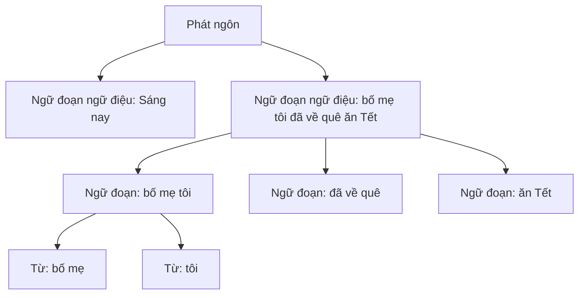

# Chương 16. Ngôn điệu (Prosody)

!!! abstract "Mục tiêu học tập"
    Sau chương này, bạn có thể:

    - **Định nghĩa** ngôn điệu và phân biệt các thành phần của nó: ngữ điệu, nhịp, độ nổi bật, tốc độ, ngừng nghỉ, chất giọng.
    - **Đo** các tương quan âm học của ngôn điệu (F0 theo semitone, trường độ, năng lượng, độ nghiêng phổ) và chuẩn hóa chúng theo người nói.
    - **Mô tả** cấu trúc phân cấp ngôn điệu và hệ thống ký hiệu ToBI ở mức khái quát.
    - **Phân tích** sự tương tác giữa thanh điệu và ngữ điệu trong tiếng Việt: âm vực, đường xuống, tiểu từ cuối câu, câu hỏi, tiêu điểm.
    - **Thiết kế** quy tắc và đặc trưng ngắt nhịp cho tiếng Việt dựa trên tách từ, cú pháp và dấu câu.
    - **So sánh** cách các họ mô hình TTS mô hình hóa ngôn điệu (tường minh và ẩn).
    - **Cài đặt** quy trình trích F0, thống kê theo âm tiết và ước lượng đường xuống có tách ảnh hưởng của thanh điệu.
    - **Đánh giá** ngôn điệu bằng các phép đo chủ quan và khách quan, và nhận ra giới hạn của từng phép đo.

!!! info "Kiến thức cần có"
    - Cảm nhận cao độ, semitone: [Chương 13](ch13-am-hoc-tieng-noi.md).
    - Trích xuất F0, năng lượng, V/UV: [Chương 14](ch14-xu-ly-tin-hieu-so.md).
    - Thanh điệu và cấu trúc âm tiết tiếng Việt: [Chương 15](ch15-ngu-am-tieng-viet.md).
    - Bài toán một-nhiều trong TTS: [Chương 7](../phan-2-mo-hinh-sinh/ch07-tong-quan-mo-hinh-sinh.md) (nên đọc).

Hãy đọc to ba câu: "Anh ấy đi rồi.", "Anh ấy đi rồi?", "Anh ấy đi rồi!". Các âm tiết và thanh điệu y hệt nhau, vậy mà người nghe hiểu ba ý khác nhau: một thông báo, một câu hỏi ngạc nhiên, một lời cảm thán. Phần thông tin "nằm ngoài" chuỗi âm vị ấy là **ngôn điệu** (*prosody*). Một hệ thống TTS phát âm đúng từng âm nhưng sai ngôn điệu sẽ nghe như "đọc chính tả": rõ chữ nhưng đơn điệu, ngắt sai chỗ, nhấn sai từ. Với các mô hình hiện đại, chất lượng âm thanh gần như đã bão hòa; **ngôn điệu là nơi phân biệt giữa giọng tổng hợp "tốt" và giọng "giống người"**.

Với tiếng Việt, ngôn điệu có thêm một độ khó đặc thù: cùng một kênh F0 phải mang **hai** loại thông tin, thanh điệu (từ vựng) và ngữ điệu (câu). Chương này xây dựng các khái niệm cần thiết, rồi kết thúc bằng một thực hành tách hai thành phần đó trên dữ liệu tổng hợp.

## 16.1. Ngôn điệu là gì

Ngôn điệu là các đặc trưng **siêu đoạn tính** (*suprasegmental*): chúng trải trên những đơn vị lớn hơn một âm (âm tiết, từ, ngữ đoạn, câu) và được thể hiện qua cao độ, trường độ, cường độ, chất giọng cùng cách tổ chức các yếu tố đó thành ngữ đoạn.

| Thành phần | Nội dung | Tương quan âm học chính |
|---|---|---|
| Ngữ điệu (*intonation*) | Hình dạng cao độ trên ngữ đoạn, câu | Đường F0 |
| Nhịp (*rhythm*) | Tổ chức thời gian của các âm tiết | Trường độ âm tiết, khoảng cách giữa các đỉnh |
| Độ nổi bật, trọng âm (*prominence, stress*) | Mức "nổi" tương đối của một âm tiết hay từ | Biên độ dao động F0, trường độ, cường độ, độ nghiêng phổ |
| Tốc độ (*tempo*) | Nhanh hay chậm | Số âm tiết mỗi giây (có hoặc không tính ngừng) |
| Ngừng nghỉ (*pause*) | Khoảng lặng hoặc ngừng có âm ("ờ", "à") | Thời lượng khoảng lặng, vị trí |
| Chất giọng (*voice quality*) | Thở, kẹt, căng... | H1–H2, độ nghiêng phổ, độ tuần hoàn |

Ngôn điệu có ba nhóm chức năng: **ngôn ngữ** (phân ngữ đoạn, đánh dấu kiểu câu, tiêu điểm thông tin), **cận ngôn ngữ** (cảm xúc, thái độ, mức lịch sự) và **ngoài ngôn ngữ** (danh tính, tuổi, phương ngữ, sức khỏe của người nói). Mô hình TTS phải tái tạo cả ba, trong khi văn bản đầu vào chỉ chứa gợi ý gián tiếp cho nhóm thứ nhất (dấu câu, cú pháp) và hầu như không chứa gì cho hai nhóm sau.

## 16.2. Tương quan âm học và chuẩn hóa

### 16.2.1. Cao độ

Như [Chương 13](ch13-am-hoc-tieng-noi.md) đã giải thích, cao độ được cảm nhận theo tỉ lệ, nên phân tích ngôn điệu dùng **semitone** so với một mức tham chiếu $f_{\text{ref}}$:

$$
\text{st}(t) = 12 \log_2 \frac{f_0(t)}{f_{\text{ref}}}.
$$

Để so sánh nhiều người nói, ta chuẩn hóa theo người nói bằng **z-score của log-F0**:

$$
z(t) = \frac{\log f_0(t) - \mu_s}{\sigma_s},
$$

với $\mu_s$, $\sigma_s$ là trung bình và độ lệch chuẩn của log-F0 trên các khung hữu thanh của người nói $s$. Quãng cao độ (*pitch range*) nên đo bằng khoảng giữa các phân vị (ví dụ phân vị 5 và 95) thay vì min–max, vì vài khung bị lỗi quãng tám có thể làm hỏng hoàn toàn min và max.

### 16.2.2. Trường độ

Trường độ âm vị, âm tiết và khoảng lặng lấy từ căn chỉnh cưỡng bức ([Chương 21](../phan-5-mo-hinh-am-hoc/ch21-alignment.md)). Phân phối trường độ lệch phải, gần log-chuẩn, nên các bộ dự đoán trường độ thường hồi quy **log-trường độ** ([Chương 22](../phan-5-mo-hinh-am-hoc/ch22-fastspeech.md)). Hai hiện tượng quan trọng: **kéo dài cuối ngữ đoạn** (âm tiết trước ranh giới dài hơn hẳn) và sự phụ thuộc mạnh vào **tốc độ nói**. Người ta phân biệt tốc độ nói (tính cả ngừng) và tốc độ phát âm (*articulation rate*, bỏ ngừng).

### 16.2.3. Năng lượng, độ nghiêng phổ và chất giọng

Năng lượng khung (RMS hoặc chuẩn L2 của STFT, tính bằng dB) tương quan với nhấn mạnh, nhưng phụ thuộc vào độ lợi của micro, nên chỉ có ý nghĩa **tương đối** trong một bản ghi. Khi nói nhấn mạnh hoặc to hơn, năng lượng ở vùng cao tần tăng nhanh hơn vùng thấp tần, tức **độ nghiêng phổ** giảm; đây là tương quan của độ nổi bật đôi khi đáng tin hơn cả cường độ tổng. Chất giọng được đo bằng các chỉ số như H1–H2 (chênh lệch biên độ hai hài đầu: lớn thì giọng thở, nhỏ thì giọng kẹt) hay độ tuần hoàn. Với tiếng Việt, giọng kẹt vừa là một phần của thanh ngã, nặng ([Chương 15](ch15-ngu-am-tieng-viet.md)), vừa xuất hiện ở cuối câu như một hiện tượng ngôn điệu; hai nguồn này dễ bị lẫn khi phân tích.

## 16.3. Cấu trúc phân cấp ngôn điệu và ToBI

Lý thuyết âm vị học ngôn điệu (Selkirk, 1984; Nespor và Vogel, 1986) cho rằng lời nói được tổ chức thành một **phân cấp ngôn điệu**: âm tiết → từ ngôn điệu → ngữ đoạn âm vị học → ngữ đoạn ngữ điệu → phát ngôn. Ranh giới ở cấp càng cao thì càng "mạnh": kéo dài cuối càng nhiều, khả năng có ngừng càng lớn, và cao độ thường được đặt lại (*reset*).



Ranh giới ngôn điệu **thường** trùng với ranh giới cú pháp nhưng không bắt buộc: ngữ đoạn quá dài bị chia nhỏ, ngữ đoạn quá ngắn được gộp, và tốc độ nói càng nhanh thì ranh giới càng ít.

**ToBI** (*Tones and Break Indices*; Silverman và cộng sự, 1992) là hệ thống gán nhãn ngôn điệu chuẩn cho tiếng Anh Mỹ, gồm các tầng: **tầng âm điệu** (trọng âm cao độ như H\*, L\*, L+H\*; trọng âm ngữ đoạn H-, L-; âm điệu ranh giới H%, L%), **tầng chỉ số ngắt** từ 0 (không ranh giới, như giữa từ và hư từ dính liền) đến 4 (ranh giới ngữ đoạn ngữ điệu), tầng chữ viết và tầng ghi chú. Nhiều ngôn ngữ đã có biến thể ToBI riêng. Theo hiểu biết của chúng tôi tại thời điểm biên soạn (2026), tiếng Việt **chưa có** một chuẩn gán nhãn kiểu ToBI được dùng rộng rãi.

Trong thực hành TTS, người ta thường chỉ dùng phiên bản đơn giản hóa của tầng chỉ số ngắt. Một số kho dữ liệu tiếng Trung gán nhãn các mức ranh giới kiểu #1–#4 ngay trong văn bản. Cho tiếng Việt, bạn có thể tự định nghĩa một thang tương tự, ví dụ: B0 giữa các âm tiết trong cùng một từ, B1 ranh giới từ, B2 ranh giới ngữ đoạn không ngừng, B3 ngừng ngắn (thường ở dấu phẩy), B4 cuối câu. Đây là một **đề xuất thiết kế**, không phải chuẩn; quan trọng là gán nhãn nhất quán.

## 16.4. Thanh điệu và ngữ điệu

### 16.4.1. Một kênh, hai chức năng

Trong tiếng Anh, F0 chủ yếu mang ngữ điệu, nên có thể đọc đường F0 khá trực tiếp thành các trọng âm cao độ và âm điệu ranh giới. Trong tiếng Việt, mỗi âm tiết đã có một **đích cao độ** do thanh điệu quy định; ngữ điệu chỉ có thể **điều chỉnh** các đích đó: nâng/hạ âm vực, mở rộng/thu hẹp quãng, kéo dài, thay đổi chất giọng ở cuối ngữ đoạn. Có thể hình dung bằng các mô hình **chồng chập** (*superpositional*). Mô hình nổi tiếng nhất là của Fujisaki (Fujisaki và Hirose, 1984), biểu diễn log-F0 là tổng của một mức nền, các thành phần ngữ đoạn biến thiên chậm và các thành phần trọng âm (hoặc thanh điệu) biến thiên nhanh:

$$
\log F_0(t) = \log F_b + \sum_{i} A_{p,i}\, G_p(t - T_{0,i}) + \sum_{j} A_{a,j}\big[G_a(t - T_{1,j}) - G_a(t - T_{2,j})\big],
$$

với $G_p(t) = \alpha^2 t\, e^{-\alpha t}$ và $G_a(t) = \min\!\big[1 - (1 + \beta t)e^{-\beta t},\, \gamma\big]$ khi $t \geq 0$ (bằng 0 khi $t < 0$). Lệnh ngữ đoạn tại $T_{0,i}$ với biên độ $A_{p,i}$ tạo một "bướu" đi lên rồi giảm dần (đường xuống); lệnh trọng âm/thanh từ $T_{1,j}$ đến $T_{2,j}$ tạo một "bậc" trơn. Với ngôn ngữ có thanh, các lệnh thanh có thể mang dấu dương hoặc âm.

Một hướng khác là mô hình **tiếp cận đích** (*target approximation*; Xu, 2005; Prom-on, Xu và Thipakorn, 2009): mỗi âm tiết có một đích cao độ (một hàm tuyến tính theo thời gian), và F0 thực tế tiến dần về đích đó theo động lực học của cơ quan phát âm; ngữ điệu và tiêu điểm thay đổi độ cao và quãng của các đích. Mô hình này giải thích tự nhiên vì sao thanh trước ảnh hưởng mạnh lên phần đầu của thanh sau ([Chương 15](ch15-ngu-am-tieng-viet.md), mục 15.7.4).

Phần thực hành (mục 16.9) dùng phiên bản đơn giản nhất của ý tưởng chồng chập: trong miền semitone, F0 = đường nền tuyến tính theo thời gian + hình dạng thanh + nhiễu.

### 16.4.2. Đường xuống, hạ cuối và đặt lại

Trong câu trần thuật, F0 có xu hướng giảm dần từ đầu đến cuối: đó là **đường xuống** (*declination*). Hiện tượng này được giải thích một phần bằng sự giảm áp suất dưới thanh môn khi hơi thở cạn dần ([Chương 13](ch13-am-hoc-tieng-noi.md)) và một phần bằng việc người nói chủ động lập kế hoạch; độ dốc thường **thoải hơn** ở câu dài ('t Hart, Collier và Cohen, 1990). Ở ranh giới ngữ đoạn lớn, cao độ thường được **đặt lại** (*reset*) lên mức cao; ở cuối câu trần thuật thường có thêm **hạ cuối** (*final lowering*). Với tiếng Việt, đường xuống tác động lên **âm vực** mà các thanh được thực hiện: thanh ngang ở cuối câu dài có thể thấp hơn thanh ngang ở đầu câu vài semitone mà người nghe vẫn nhận là "ngang".

### 16.4.3. Ngữ điệu tiếng Việt

Các mô tả ngữ điệu tiếng Việt (ví dụ Đỗ, Trần và Boulakia, 1998; Brunelle, Hạ và Grice, 2012) nhìn chung trình bày ngữ điệu chủ yếu qua **sự nâng hoặc hạ âm vực** và **sự mở rộng hoặc thu hẹp quãng cao độ**, đặc biệt ở âm tiết cuối ngữ đoạn, chồng lên đường nét thanh điệu, kèm theo các thay đổi về trường độ và chất giọng, thay vì qua các trọng âm cao độ như tiếng Anh. Hình dạng thanh nhìn chung được bảo toàn để không mất nghĩa, nhưng âm tiết cuối có thể bị biến đổi rõ rệt (ví dụ được nâng cao hơn trong một số loại câu hỏi). Chi tiết của các mô hình này vẫn đang được nghiên cứu; bạn đọc nên tham khảo trực tiếp các công trình trên.

Về **câu hỏi**, tiếng Việt chủ yếu đánh dấu bằng **từ vựng**: câu hỏi có/không dùng "có ... không", "... chưa", "phải không", "à", "hả"; câu hỏi có từ để hỏi dùng "ai", "gì", "đâu", "nào", "bao giờ", "sao". Vì phương tiện từ vựng đã đủ, ngữ điệu câu hỏi thường không cần một đường lên rõ như tiếng Anh. Tuy vậy, câu hỏi chỉ bằng ngữ điệu ("Anh đi rồi?") vẫn tồn tại trong khẩu ngữ, và khi đó âm tiết cuối thường được nâng âm vực và kéo dài. Đây là trường hợp mô hình TTS chỉ có thể dựa vào **dấu chấm hỏi**.

### 16.4.4. Tiểu từ tình thái cuối câu

Tiếng Việt có một lớp **tiểu từ tình thái** đứng cuối câu, mang thái độ và chức năng giao tiếp. Mỗi tiểu từ có thanh điệu cố định, nhưng **cách nói** (độ cao, độ dài, chất giọng) thay đổi theo ý định.

| Tiểu từ | Chức năng thường gặp | Ví dụ |
|---|---|---|
| à | Hỏi để xác nhận, có thể kèm ngạc nhiên | Anh về rồi à? |
| ạ | Lễ phép với người trên | Cháu chào bác ạ. |
| nhé (nhá; Nam: nha) | Đề nghị nhẹ nhàng, mong đồng tình | Mai gặp nhé. |
| nhỉ (Nam: ha) | Tìm sự đồng tình, tự hỏi | Hôm nay đẹp trời nhỉ? |
| chứ | Giả định điều hiển nhiên, khẳng định | Anh cũng đi chứ? |
| hả, hở | Hỏi thân mật | Thật hả? |
| đấy, đó | Nhấn, hướng sự chú ý | Anh làm gì đấy? |
| mà | Khẳng định, giải thích, có thể hơi phân trần | Em đã bảo rồi mà. |
| cơ (Bắc) | Nhấn, đối lập | Em muốn cái kia cơ. |
| thôi | Giới hạn, kết thúc | Thế thôi. |

!!! note "Góc tiếng Việt"
    Tiểu từ cuối câu là "điểm mù" phổ biến của TTS tiếng Việt. Mô hình huấn luyện trên dữ liệu tin tức (gần như không có tiểu từ) thường đọc "nhé", "ạ", "nhỉ" như một âm tiết bình thường ở cuối câu trần thuật: đủ thanh nhưng thiếu sắc thái, nghe cứng và đôi khi thiếu lịch sự. Ba lời khuyên. (1) Nếu ứng dụng là hội thoại hoặc chăm sóc khách hàng, dữ liệu huấn luyện phải có nhiều câu chứa tiểu từ trong ngữ cảnh tự nhiên. (2) Bộ chuẩn hóa văn bản **không được** xóa hay "sửa" tiểu từ. (3) Cùng một tiểu từ có thể mang nhiều thái độ ("Anh đi à?" ngạc nhiên hay hờ hững); văn bản không đủ để quyết định, nên cần điều kiện phong cách hoặc ngữ cảnh hội thoại ([Chương 29](../phan-7-e2e-bieu-cam/ch29-prosody-cam-xuc-phong-cach.md), [Chương 35](../phan-8-mo-hinh-lon/ch35-streaming-speech-llm.md)).

### 16.4.5. Tiêu điểm và nhấn mạnh

**Tiêu điểm** (*focus*) là phần thông tin mới hoặc đối lập mà người nói muốn làm nổi bật. Ở nhiều ngôn ngữ, từ mang tiêu điểm được nói với quãng cao độ rộng hơn, dài hơn và to hơn; phần sau tiêu điểm có thể bị thu hẹp quãng (*post-focus compression*). Mức độ của hiện tượng thu hẹp sau tiêu điểm khác nhau giữa các ngôn ngữ, và với tiếng Việt vẫn là đề tài nghiên cứu. Tiếng Việt còn dùng nhiều phương tiện **từ vựng – cú pháp** để đánh dấu tiêu điểm: "chính", "đúng là", "mới", "thì", cấu trúc "Chính tôi là người...". Đây là tín hiệu văn bản quý cho TTS: bộ dự đoán ngôn điệu có thể học rằng từ đứng sau "chính" thường được nhấn.

Khi **điều khiển** nhấn mạnh trong TTS tiếng Việt (ví dụ qua thẻ SSML `emphasis`), hãy mở rộng quãng và kéo dài trường độ **quanh mức trung bình cục bộ trong miền semitone**, chứ không cộng một lượng Hz cố định: phép cộng Hz bóp méo đường nét thanh theo cách khác nhau giữa giọng trầm và giọng cao.

## 16.5. Ngắt nhịp và ngừng nghỉ trong tiếng Việt

### 16.5.1. Âm tiết không phải là từ

Chữ viết tiếng Việt đặt dấu cách giữa các **âm tiết**, không phải giữa các **từ**: "học sinh", "Việt Nam", "máy tính" là từ hai âm tiết. Ngắt nhịp giữa hai âm tiết của một từ nghe rất mất tự nhiên, nên **tách từ** là bước nền tảng của dự đoán ngắt nhịp; các công cụ như VnCoreNLP, underthesea, pyvi được giới thiệu ở [Chương 18](../phan-4-frontend/ch18-g2p-bieu-dien-dau-vao.md). Tách từ và ngắt nhịp còn quyết định nghĩa trong các câu mơ hồ kinh điển:

- "Ông già đi nhanh quá": [Ông già] [đi nhanh quá] (người đàn ông già bước nhanh) hay [Ông] [già đi nhanh quá] (ông ấy lão hóa nhanh).
- "Con ngựa đá con ngựa đá": [Con ngựa] [đá] [con ngựa đá] (con ngựa thật đá con ngựa bằng đá) hay [Con ngựa đá] [đá] [con ngựa] (ngược lại).

Văn bản không chứa đủ thông tin để giải các mơ hồ này; một hệ thống TTS tốt ít nhất phải chọn **một** cách đọc nhất quán với một cách phân tích hợp lệ, thay vì ngắt ở vị trí không ứng với cách hiểu nào.

### 16.5.2. Cú pháp và độ dài ngữ đoạn

Ranh giới ngữ đoạn thường rơi vào ranh giới giữa chủ ngữ và vị ngữ (nhất là khi chủ ngữ dài), giữa các mệnh đề, trước các liên từ ("nhưng", "và", "vì", "nên") trong câu dài, sau cụm chủ đề có "thì" ("Việc này thì / tôi không biết"). Người nói cũng có xu hướng **cân bằng độ dài** các ngữ đoạn: ít khi có ngữ đoạn chỉ một âm tiết hay quá dài. Một hệ thống dựa trên quy tắc đơn giản có thể kết hợp ba tín hiệu: dấu câu (ranh giới mạnh), ranh giới cú pháp từ bộ phân tích (ranh giới yếu), và ràng buộc độ dài (chèn ranh giới khi ngữ đoạn vượt quá một ngưỡng số âm tiết, tại ranh giới từ hợp lý nhất).

### 16.5.3. Dấu câu và ngừng

Dấu câu là tín hiệu ngắt mạnh nhất trong văn bản: dấu phẩy, chấm phẩy, hai chấm thường ứng với ngừng ngắn hoặc ranh giới ngữ đoạn; dấu chấm, chấm hỏi, chấm than ứng với ranh giới câu; ngoặc đơn, gạch ngang và ngoặc kép thường kèm thay đổi âm vực (đoạn chú thích trong ngoặc thường được nói thấp và nhanh hơn). Thời lượng ngừng phụ thuộc mạnh vào người đọc và thể loại: trong sách nói, ngừng sau dấu phẩy thường ngắn (cỡ vài trăm mili-giây), sau dấu chấm dài hơn, giữa các đoạn văn còn dài hơn nữa. Hãy **đo trên dữ liệu của bạn** thay vì áp một con số cố định.

!!! warning "Dấu phẩy thập phân và dấu chấm trong viết tắt"
    Tiếng Việt dùng **dấu phẩy** làm dấu thập phân ("3,5 triệu") và dấu chấm để nhóm chữ số ("1.000.000"), đồng thời dùng dấu chấm trong viết tắt ("TP.HCM", "PGS.TS."). Nếu bước tách câu và dự đoán ngắt chạy **trước** chuẩn hóa văn bản, "3,5" sẽ bị ngắt thành "ba [ngừng] năm". Chuẩn hóa ([Chương 17](../phan-4-frontend/ch17-chuan-hoa-van-ban.md)) phải chạy trước, và nên giữ lại thông tin ranh giới cho bước ngôn điệu.

### 16.5.4. Mô hình dự đoán ngắt

Lịch sử dự đoán ngắt nhịp đi từ quy tắc, qua mô hình thống kê (cây quyết định, CRF) trên đặc trưng từ loại và vị trí, đến mô hình neural (BiLSTM, Transformer, mô hình ngôn ngữ huấn luyện trước như PhoBERT cho tiếng Việt; Nguyen và Nguyen, 2020). Nhãn huấn luyện có thể lấy rẻ từ dữ liệu TTS: chạy căn chỉnh cưỡng bức, coi khoảng lặng dài hơn một ngưỡng là ranh giới. Nhãn này nhiễu (người đọc không ngừng ở mọi ranh giới) nhưng đủ dùng. Trong các mô hình end-to-end và mô hình lớn, ngắt nhịp thường được học ngầm từ dấu câu và ngữ cảnh; chèn thêm **token ngắt tường minh** vẫn hữu ích khi cần kiểm soát.

## 16.6. Phong cách nói

| Phong cách | Tốc độ | Cao độ | Ngừng nghỉ | Đặc điểm khác |
|---|---|---|---|---|
| Tin tức | Nhanh, đều | Quãng vừa, trung tính | Theo cú pháp, ngắn | Ít tiểu từ, phát âm rõ |
| Sách nói, kể chuyện | Vừa đến chậm, biến thiên | Quãng rộng, kịch tính | Dài giữa các đoạn | Giọng nhân vật, cảm xúc |
| Hội thoại | Biến thiên mạnh | Nhiều sắc thái | Ngập ngừng, chồng lời | Tiểu từ, từ đệm ("ừ", "ờ", "thì"), rút gọn |
| Chăm sóc khách hàng | Vừa | Thân thiện, ổn định | Rõ ràng trước thông tin quan trọng | "dạ", "ạ"; đọc chậm số tài khoản, số tiền |
| Thông báo công cộng, tổng đài | Chậm | Ít biến thiên | Nhiều, đều | Ưu tiên độ dễ hiểu |

Một mô hình chỉ học một phong cách sẽ mang phong cách đó vào mọi văn bản: giọng tin tức đọc truyện cổ tích nghe khô, giọng sách nói đọc thông báo nghe "diễn". Các cách điều kiện hóa theo phong cách (token phong cách, embedding tham chiếu, mô tả bằng ngôn ngữ tự nhiên) được trình bày ở [Chương 29](../phan-7-e2e-bieu-cam/ch29-prosody-cam-xuc-phong-cach.md).

## 16.7. TTS mô hình hóa ngôn điệu như thế nào

**Gốc rễ của vấn đề** là tính một-nhiều ([Chương 7](../phan-2-mo-hinh-sinh/ch07-tong-quan-mo-hinh-sinh.md)): cùng một câu có nhiều cách nói đúng. Một mô hình hồi quy tối thiểu L2 sẽ dự đoán **trung bình** của các cách nói, tức một ngôn điệu phẳng, "an toàn" và đơn điệu. Mọi tiến bộ về ngôn điệu trong TTS đều là những cách khác nhau để thoát khỏi cái trung bình đó.

**Mô hình hóa tường minh.** FastSpeech 2 ([Chương 22](../phan-5-mo-hinh-am-hoc/ch22-fastspeech.md)) có các bộ dự đoán trường độ, cao độ, năng lượng, huấn luyện với đích trích từ dữ liệu (bài báo gốc biểu diễn cao độ qua biến đổi wavelet liên tục; nhiều cài đặt sau dùng F0 mức khung hoặc mức âm vị); FastPitch dự đoán F0 trung bình theo từng âm vị. Ưu điểm: dễ kiểm soát (nhân trường độ để đổi tốc độ, dịch F0 để đổi cao độ) và dễ gỡ lỗi. Nhược điểm: vẫn hồi quy nên vẫn trung bình hóa, và phụ thuộc chất lượng nhãn F0 (rất đáng lo với thanh ngã, nặng).

**Mô hình hóa ẩn.** Biến ẩn VAE, bộ mã hóa tham chiếu và Global Style Tokens ([Chương 29](../phan-7-e2e-bieu-cam/ch29-prosody-cam-xuc-phong-cach.md)) đưa thông tin ngôn điệu vào một biến ẩn; bộ dự đoán trường độ ngẫu nhiên của VITS ([Chương 27](../phan-7-e2e-bieu-cam/ch27-vits.md)) và các bộ giải mã flow/diffusion/flow matching ([Chương 23](../phan-5-mo-hinh-am-hoc/ch23-glow-grad-matcha.md)) **lấy mẫu** ngôn điệu thay vì lấy trung bình; các mô hình ngôn ngữ trên token âm thanh ([Chương 32](../phan-8-mo-hinh-lon/ch32-codec-language-model.md)–[34](../phan-8-mo-hinh-lon/ch34-he-thong-lai-hien-dai.md)) học ngôn điệu từ ngữ cảnh rộng và từ đoạn âm thanh mẫu (*prompt*).

**Đặc trưng phía văn bản.** Dấu câu, từ loại, ranh giới cú pháp, embedding từ mô hình ngôn ngữ huấn luyện trước, và với văn bản dài là ngữ cảnh đoạn văn: tất cả giúp mô hình đoán được ngữ đoạn và tiêu điểm.

!!! note "Góc tiếng Việt: điều khiển cao độ mà không làm hỏng thanh"
    Có ba phép biến đổi F0 thường gặp, và chúng ảnh hưởng tới thanh điệu rất khác nhau. **Dịch** cao độ $k$ semitone (nhân F0 với $2^{k/12}$) giữ nguyên đường nét mọi thanh. **Co giãn quãng** trong miền semitone quanh mức trung bình cục bộ với hệ số $r$ giữ hình dạng nhưng làm nhỏ biên độ; khi $r$ nhỏ, độ dốc của thanh sắc, độ gãy của thanh ngã bị san phẳng và các thanh bắt đầu khó phân biệt (ngưỡng cụ thể cần kiểm chứng bằng nghe thử). **Cộng một lượng Hz** cố định thì bóp méo tỉ lệ, tác động lên giọng trầm mạnh hơn giọng cao. Khi cài đặt chức năng "đổi cao độ" hay "giọng biểu cảm hơn" cho TTS tiếng Việt, hãy làm việc trong miền log và kiểm tra lại bằng phép thử thanh điệu.

## 16.8. Đánh giá ngôn điệu

**Đánh giá chủ quan.** MOS về độ tự nhiên nói chung, hoặc MOS riêng cho ngôn điệu; so sánh cặp (AB, CMOS); xếp hạng nhiều hệ thống; và các **phép thử theo nhiệm vụ**: người nghe có nhận ra câu hỏi hay câu kể không, từ nào được nhấn, thanh nào được nói ra (với cặp tối thiểu tiếng Việt), câu trả lời có phù hợp ngữ cảnh hội thoại không. Người nghe nên là người bản ngữ cùng phương ngữ với giọng được đánh giá ([Chương 38](../phan-9-thuc-tien/ch38-danh-gia-tts.md)).

**Đánh giá khách quan.** Sau khi căn chỉnh thời gian giữa giọng tổng hợp và giọng tham chiếu (dùng cùng trường độ, hoặc DTW), các độ đo phổ biến là:

$$
\text{RMSE}_{\text{cent}} = \sqrt{\frac{1}{\lvert \mathcal{V} \rvert} \sum_{t \in \mathcal{V}} \left(1200 \log_2 \frac{\hat f_0(t)}{f_0(t)}\right)^2},
$$

với $\mathcal{V}$ là tập khung mà cả hai đều hữu thanh; hệ số tương quan Pearson giữa hai đường log-F0 (đo **hình dạng**, không phụ thuộc lệch mức); và bộ ba độ đo lỗi cao độ:

- **GPE** (*gross pitch error*): tỉ lệ khung trong $\mathcal{V}$ có sai số tương đối vượt 20%;
- **VDE** (*voicing decision error*): tỉ lệ khung (trên tổng số khung) có quyết định hữu thanh/vô thanh khác nhau;
- **FFE** (*F0 frame error*; Chu và Alwan, 2009): tỉ lệ khung mắc **một trong hai** loại lỗi trên, gộp cả hai thành một con số.

Với trường độ: RMSE của log-trường độ âm vị/âm tiết, chênh lệch tốc độ nói, độ chính xác/độ phủ/F1 của vị trí ngừng so với tham chiếu, sai số thời lượng ngừng.

!!! warning "Giới hạn của so sánh với một tham chiếu duy nhất"
    Vì ngôn điệu là một-nhiều, một giọng tổng hợp có ngữ điệu **khác nhưng đúng** vẫn bị F0 RMSE phạt nặng, trong khi một giọng phẳng nằm "giữa" các khả năng lại được điểm tốt. Đừng tối ưu mô hình chỉ theo RMSE so với tham chiếu; hãy kết hợp với thống kê phân phối (độ lệch chuẩn của F0 trong câu, độ đa dạng giữa các lần lấy mẫu) và đánh giá chủ quan. Với tiếng Việt, độ chính xác thanh điệu có thể ước lượng gián tiếp qua CER của một hệ thống ASR tốt, vì sai thanh làm sai âm tiết.

## 16.9. Thực hành: F0 theo âm tiết và đường xuống

Ta xây dựng một thí nghiệm nhỏ nhưng chứa đúng vấn đề cốt lõi: trong ngôn ngữ có thanh, không thể "đọc" ngữ điệu trực tiếp từ đường F0 mà phải tách ảnh hưởng của thanh điệu. Vì không đi kèm dữ liệu thu âm, ta **tổng hợp** một câu 16 âm tiết "giống tiếng Việt": mỗi âm tiết là một đoạn hữu thanh có đường F0 theo một khuôn thanh **minh họa** (không phải số đo thực nghiệm), cộng với một đường xuống tuyến tính có độ dốc biết trước. Ta biết đáp án, nên có thể kiểm chứng phương pháp. Với dữ liệu thật, bạn chỉ cần thay tín hiệu và lấy ranh giới âm tiết từ căn chỉnh cưỡng bức ([Chương 21](../phan-5-mo-hinh-am-hoc/ch21-alignment.md)).

Lưu khối sau thành `prosody_synth.py`:

```python
import numpy as np

SR = 16000
REF_HZ = 120.0                 # cao độ tham chiếu của "người nói" giả lập (Hz)
DECL = -1.5                    # độ dốc đường xuống (semitone/giây) - giá trị giả định
# Đường nét thanh điệu MINH HỌA, đơn vị semitone so với REF_HZ, theo thời gian chuẩn hóa 0..1.
# Đây không phải số đo thực nghiệm; chỉ mô phỏng hình dạng định tính (xem Chương 15).
TONE_SHAPES = {
    "ngang": ([0.0, 1.0], [0.0, -0.5]),
    "huyen": ([0.0, 1.0], [-1.0, -4.0]),
    "sac":   ([0.0, 0.3, 1.0], [-0.5, -0.5, 4.0]),
    "hoi":   ([0.0, 0.6, 1.0], [-1.5, -5.0, -3.0]),
    "nga":   ([0.0, 0.45, 0.55, 1.0], [0.0, -1.5, 0.5, 5.0]),
    "nang":  ([0.0, 1.0], [-2.0, -6.0]),
}
DURATION = {"ngang": 0.22, "huyen": 0.22, "sac": 0.22, "hoi": 0.26, "nga": 0.26, "nang": 0.17}
UTTERANCE = [("sáng", "sac"), ("nay", "ngang"), ("bố", "sac"), ("mẹ", "nang"), ("tôi", "ngang"),
             ("đã", "nga"), ("về", "huyen"), ("quê", "ngang"), ("ăn", "ngang"), ("Tết", "sac"),
             ("ở", "hoi"), ("Huế", "sac"), ("với", "sac"), ("ông", "ngang"), ("bà", "huyen"),
             ("nội", "nang")]

def synthesize(utt, gap=0.04, final_lengthening=1.4, seed=0):
    """Tạo câu 'giống tiếng Việt': mỗi âm tiết là đoạn hữu thanh, giữa các âm tiết có khoảng lặng."""
    rng = np.random.default_rng(seed)
    wav, f0_track, bounds, t = [], [], [], 0.0
    for i, (syl, tone) in enumerate(utt):
        dur = DURATION[tone] * (final_lengthening if i == len(utt) - 1 else 1.0)
        n = int(dur * SR)
        tau = np.linspace(0, 1, n)
        st = np.interp(tau, *TONE_SHAPES[tone]) + DECL * (t + tau * dur)   # thanh điệu + đường xuống
        f0 = REF_HZ * 2 ** (st / 12)                                       # semitone -> Hz
        phase = 2 * np.pi * np.cumsum(f0) / SR
        env = np.sin(np.pi * tau) ** 0.5                                   # biên độ lên rồi xuống
        if tone == "nga":
            env *= 1 - 0.7 * np.exp(-((tau - 0.5) / 0.06) ** 2)            # "gãy" giữa âm tiết
        harm = sum(np.sin(k * phase) * 0.7 ** k for k in range(1, 20))
        wav.append(env * harm)
        f0_track.append(f0)
        bounds.append((t, t + dur, syl, tone))
        t += dur
        sil = int(gap * SR)                                               # phụ âm/khoảng lặng
        wav.append(0.003 * rng.standard_normal(sil))
        f0_track.append(np.full(sil, np.nan))
        t += gap
    wav = np.concatenate(wav)
    return 0.5 * wav / np.abs(wav).max(), np.concatenate(f0_track), bounds

wav, f0_true, bounds = synthesize(UTTERANCE)
print(f"{len(UTTERANCE)} âm tiết, {len(wav) / SR:.2f} giây")
```

Khối thứ hai (lưu thành `prosody_stats.py`) trích F0 bằng pYIN, đổi sang semitone và tính thống kê theo âm tiết: trung bình, mức đầu, mức cuối, độ dốc, biên độ. Đây đúng là các đặc trưng mà bộ dự đoán cao độ mức âm tiết hay phép thử thanh điệu dùng tới.

```python
import librosa
from prosody_synth import *

HOP = 160                                                   # 10 ms ở 16 kHz
f0, voiced, _ = librosa.pyin(wav.astype(np.float32), fmin=60, fmax=400, sr=SR,
                             frame_length=1024, hop_length=HOP)  # (T,)
times = librosa.times_like(f0, sr=SR, hop_length=HOP)       # tâm khung (giây)
st = 12 * np.log2(f0 / REF_HZ)                              # Hz -> semitone (nan nếu vô thanh)

def syllable_stats(times, st, bounds, margin=0.02):
    """Thống kê F0 theo âm tiết; bỏ 20 ms ở hai đầu để tránh vùng chuyển tiếp."""
    rows = []
    for start, end, syl, tone in bounds:
        m = (times >= start + margin) & (times <= end - margin) & ~np.isnan(st)
        tt, ss = times[m], st[m]
        slope = np.polyfit(tt - tt[0], ss, 1)[0] if len(tt) >= 3 else np.nan
        rows.append(dict(syl=syl, tone=tone, t_mid=(start + end) / 2, dur=end - start,
                         mean=ss.mean(), start=ss[:3].mean(), end=ss[-3:].mean(),
                         slope=slope, range=ss.max() - ss.min(), voiced=m.sum()))
    return rows

stats = syllable_stats(times, st, bounds)
print(f"{'âm tiết':<7}{'thanh':<7}{'TB':>6}{'đầu':>6}{'cuối':>6}{'dốc st/s':>9}{'biên độ':>8}")
for r in stats:
    print(f"{r['syl']:<7}{r['tone']:<7}{r['mean']:6.1f}{r['start']:6.1f}{r['end']:6.1f}"
          f"{r['slope']:9.1f}{r['range']:8.1f}")
# Sai số của F0 trích xuất so với đường F0 "thật" đã dùng để tổng hợp
truth = np.interp(times, np.arange(len(f0_true)) / SR, f0_true)
ok = ~np.isnan(f0) & ~np.isnan(truth)
print(f"sai số trung vị: {np.median(np.abs(1200 * np.log2(f0[ok] / truth[ok]))):.1f} cent")
```

```text
16 âm tiết, 4.21 giây
âm tiếtthanh      TB   đầu  cuối dốc st/s biên độ
sáng   sac       0.8  -0.5   2.6     20.7     3.4
nay    ngang    -0.8  -0.5  -1.1     -3.6     0.6
bố     sac       0.0  -1.3   1.9     20.9     3.3
mẹ     nang     -5.3  -4.1  -6.5    -22.0     2.6
tôi    ngang    -1.9  -1.6  -2.2     -3.7     0.6
đã     nga      -1.3  -2.5   1.3     23.5     4.9
về     huyen    -5.0  -4.0  -6.1    -14.2     2.3
quê    ngang    -3.1  -2.9  -3.4     -3.6     0.6
ăn     ngang    -3.5  -3.3  -3.8     -3.5     0.6
Tết    sac      -2.6  -4.0  -0.9     22.0     3.3
ở      hoi      -7.9  -6.5  -7.9     -8.8     2.6
Huế    sac      -3.5  -4.9  -1.8     21.6     3.3
với    sac      -3.8  -5.3  -2.1     21.9     3.4
ông    ngang    -5.5  -5.3  -5.8     -3.5     0.6
bà     huyen    -8.2  -7.1  -9.2    -14.0     2.3
nội    nang    -10.1  -8.7 -11.5    -17.2     3.0
sai số trung vị: 5.1 cent
```

Bảng cho thấy hai điều. Thứ nhất, **hình dạng** thanh (độ dốc dương của sắc, ngã; âm của huyền, nặng; gần 0 của ngang) giữ ổn định suốt câu. Thứ hai, **mức** của cùng một thanh giảm dần: thanh ngang đi từ −0,8 st ("nay") xuống −5,5 st ("ông"). Đó là đường xuống. Vậy đo độ dốc đường xuống thế nào?

Khối thứ ba so sánh hai cách. Cách ngây thơ hồi quy mức trung bình của mọi âm tiết theo thời gian. Cách thứ hai dùng mô hình cộng tính: mức trung bình của âm tiết $i$ bằng $b\, t_i + c_{\text{thanh}(i)}$ cộng nhiễu, với $b$ là độ dốc chung và $c_k$ là "mức riêng" của thanh $k$, ước lượng đồng thời bằng bình phương tối thiểu.

```python
from prosody_stats import *

t_mid = np.array([r["t_mid"] for r in stats])
mean_st = np.array([r["mean"] for r in stats])
tones = [r["tone"] for r in stats]

# Cách 1 (ngây thơ): hồi quy tuyến tính trung bình cao độ của mọi âm tiết theo thời gian
naive_slope = np.polyfit(t_mid, mean_st, 1)[0]

# Cách 2: mô hình cộng tính  mean_i = b·t_i + c_{tone(i)} + nhiễu
# (mỗi thanh có một "mức riêng" c_k; b là độ dốc đường xuống dùng chung cho cả câu)
names = sorted(set(tones))
X = np.column_stack([t_mid] + [[1.0 if tn == k else 0.0 for tn in tones] for k in names])
coef, *_ = np.linalg.lstsq(X, mean_st, rcond=None)
tone_slope, offsets = coef[0], dict(zip(names, coef[1:]))

print(f"độ dốc thật: {DECL:+.2f} st/s | ngây thơ: {naive_slope:+.2f} | tách thanh điệu: {tone_slope:+.2f}")
print("mức riêng của từng thanh (st):", {k: round(float(v), 1) for k, v in offsets.items()})
assert abs(tone_slope - DECL) < abs(naive_slope - DECL)
```

```text
độ dốc thật: -1.50 st/s | ngây thơ: -1.92 | tách thanh điệu: -1.49
mức riêng của từng thanh (st): {'hoi': -3.8, 'huyen': -2.6, 'nang': -4.0, 'nga': 0.7, 'ngang': -0.3, 'sac': 1.0}
```

Cách ngây thơ cho độ dốc dốc hơn thực tế khoảng 28%, vì câu kết thúc bằng hai thanh thấp ("bà" huyền, "nội" nặng): mức thấp của **thanh** bị nhầm thành sự đi xuống của **ngữ điệu**. Đây là **thiên lệch do bỏ sót biến** (*omitted-variable bias*) quen thuộc trong thống kê (bài tập 5). Khi đưa thanh vào mô hình, độ dốc ước lượng gần như trùng giá trị thật, và các mức riêng của thanh xếp đúng thứ tự trực giác: sắc, ngã cao; ngang ở giữa; huyền, hỏi, nặng thấp. Với dữ liệu thật và nhiều câu, cùng ý tưởng này cho phép ước lượng khuôn thanh của từng người nói, so sánh ngữ điệu giữa các phong cách, và kiểm tra liệu một mô hình TTS có tái tạo đúng cả thanh điệu lẫn đường xuống hay không.

## Lỗi thường gặp và mẹo thực hành

- **Phân tích F0 bằng Hz qua nhiều người nói**: giọng nam và nữ lệch nhau gần một quãng tám; hãy dùng semitone hoặc z-score log-F0 theo người nói.
- **Coi lỗi quãng tám là ngữ điệu**: một bước nhảy đột ngột gấp đôi hoặc giảm một nửa F0 gần như chắc chắn là lỗi trích xuất; lọc theo phân vị và kiểm tra bằng mắt.
- **Đọc ngữ điệu trực tiếp từ F0 trong ngôn ngữ có thanh**: như mục 16.9 cho thấy, phải tách ảnh hưởng thanh điệu trước.
- **Ngắt chỉ dựa vào dấu câu** và **ngắt giữa một từ đa âm tiết**: cần tách từ và thông tin cú pháp.
- **Tách câu trước khi chuẩn hóa văn bản**: dấu phẩy thập phân và dấu chấm viết tắt bị coi là ranh giới.
- **Huấn luyện trên tin tức rồi dùng cho hội thoại**: tiểu từ, từ đệm và ngữ điệu hội thoại sẽ sai; dữ liệu phải khớp phong cách đích.
- **Khoảng lặng đầu/cuối và giữa câu không nhất quán trong dữ liệu**: mô hình học ngừng ngẫu nhiên; cắt và chuẩn hóa khoảng lặng khi chuẩn bị dữ liệu ([Chương 36](../phan-9-thuc-tien/ch36-du-lieu-tts.md)).
- **Điều khiển cao độ bằng cách cộng Hz** hoặc nén quãng quá mạnh: làm hỏng thanh điệu.
- **Đánh giá ngôn điệu chỉ bằng F0 RMSE với một tham chiếu**: khuyến khích ngôn điệu phẳng.

## Tóm tắt

- Ngôn điệu gồm ngữ điệu, nhịp, độ nổi bật, tốc độ, ngừng nghỉ và chất giọng; nó mang chức năng ngôn ngữ, cận ngôn ngữ và ngoài ngôn ngữ mà văn bản chỉ gợi ý một phần.
- Tương quan âm học chính là F0 (đo bằng semitone, chuẩn hóa theo người nói), trường độ (thường mô hình hóa log-trường độ), năng lượng và độ nghiêng phổ, chất giọng.
- Lời nói được tổ chức thành phân cấp ngôn điệu; ToBI là chuẩn gán nhãn cho tiếng Anh, còn tiếng Việt chưa có chuẩn tương đương được dùng rộng rãi; thực hành TTS thường dùng thang chỉ số ngắt đơn giản.
- Trong tiếng Việt, F0 vừa mang thanh điệu vừa mang ngữ điệu; ngữ điệu thể hiện chủ yếu qua âm vực, quãng, trường độ và chất giọng, đặc biệt ở cuối ngữ đoạn, chồng lên các thanh; đường xuống làm mức của mọi thanh giảm dần trong câu.
- Câu hỏi tiếng Việt chủ yếu được đánh dấu bằng từ vựng; tiểu từ tình thái cuối câu (à, ạ, nhé, nhỉ, chứ...) mang thái độ và là điểm yếu phổ biến của TTS huấn luyện trên tin tức.
- Ngắt nhịp phải tôn trọng ranh giới từ (không phải âm tiết), cú pháp, dấu câu, và chạy sau chuẩn hóa văn bản.
- TTS mô hình hóa ngôn điệu theo hướng tường minh (bộ dự đoán trường độ, cao độ, năng lượng) hoặc ẩn (biến ẩn, tham chiếu, mô hình sinh lấy mẫu, mô hình ngôn ngữ trên token âm thanh); điều khiển cao độ cho tiếng Việt nên làm trong miền log.
- Đánh giá ngôn điệu cần cả phép đo chủ quan theo nhiệm vụ và phép đo khách quan (F0 RMSE theo cent, tương quan, GPE/VDE/FFE, trường độ, vị trí ngừng), với ý thức rõ về giới hạn của tham chiếu duy nhất.

## Bài tập

**Bài 1 [Cơ bản].** F0 đi từ 110 Hz lên 165 Hz là bao nhiêu semitone? Một giọng nữ đi từ 220 Hz lên bao nhiêu Hz thì có cùng khoảng cao độ cảm nhận?

??? success "Lời giải"
    $12\log_2(165/110) = 12\log_2 1{,}5 \approx 7{,}02$ semitone. Giọng nữ cần cùng tỉ lệ 1,5: từ 220 Hz lên 330 Hz (tăng 110 Hz, gấp đôi giọng nam tính theo Hz nhưng bằng nhau tính theo semitone).

**Bài 2 [Cơ bản].** Đánh dấu ranh giới ngữ đoạn (dùng "/") cho hai cách hiểu của câu "Con ngựa đá con ngựa đá" và mô tả bạn sẽ nói hai cách ấy khác nhau thế nào về ngừng và trường độ.

??? tip "Gợi ý"
    "Con ngựa / đá / con ngựa đá" và "Con ngựa đá / đá / con ngựa". Âm tiết đứng trước ranh giới được kéo dài; động từ "đá" thường được tách khỏi chủ ngữ bằng một ranh giới.

**Bài 3 [Cơ bản].** Với mỗi tiểu từ à, ạ, nhé, nhỉ, chứ, hãy viết một câu và mô tả cách bạn nói nó. Dự đoán một mô hình TTS huấn luyện chỉ trên tin tức sẽ đọc các câu đó sai thế nào.

**Bài 4 [Nâng cao].** Gọi $N$ là tổng số khung, $N_{\text{VDE}}$ là số khung sai quyết định hữu thanh, $N_{\text{GPE}}$ là số khung (trong tập cả hai cùng hữu thanh) có lỗi thô. Viết công thức của GPE, VDE, FFE theo các đại lượng này và chứng minh $\text{FFE} \geq \text{VDE}$. Khi nào FFE bằng VDE?

??? success "Lời giải"
    $\text{GPE} = N_{\text{GPE}} / \lvert \mathcal{V} \rvert$, $\text{VDE} = N_{\text{VDE}} / N$, $\text{FFE} = (N_{\text{GPE}} + N_{\text{VDE}})/N$ (hai tập khung rời nhau vì lỗi thô chỉ tính trên khung cả hai cùng hữu thanh, tức khung không sai quyết định V/UV). Do $N_{\text{GPE}} \geq 0$ nên $\text{FFE} \geq \text{VDE}$, dấu bằng khi không có lỗi thô nào.

**Bài 5 [Nâng cao].** Giải thích bằng công thức vì sao hồi quy ngây thơ ở mục 16.9 bị lệch. Gợi ý: nếu mô hình đúng là $y_i = b t_i + c_{k(i)} + \varepsilon_i$ mà ta hồi quy $y$ chỉ theo $t$, hệ số ước lượng có kỳ vọng xấp xỉ $b + \operatorname{Cov}(t, c_{k})/\operatorname{Var}(t)$.

??? success "Lời giải"
    Trong hồi quy đơn biến, hệ số góc là $\widehat{\operatorname{Cov}}(t, y)/\widehat{\operatorname{Var}}(t) = b + \widehat{\operatorname{Cov}}(t, c_k)/\widehat{\operatorname{Var}}(t) + \widehat{\operatorname{Cov}}(t, \varepsilon)/\widehat{\operatorname{Var}}(t)$. Số hạng cuối có kỳ vọng 0. Số hạng giữa khác 0 khi thành phần thanh tương quan với vị trí trong câu: câu của ta kết thúc bằng các thanh có $c_k$ thấp (huyền, nặng), nên $\operatorname{Cov}(t, c_k) < 0$ và độ dốc ước lượng âm hơn thực tế. Khi đưa biến thanh vào mô hình, phần này được hấp thụ bởi các hệ số $c_k$.

**Bài 6 [Lập trình].** Sửa `prosody_synth.py`: thêm một ranh giới ngữ đoạn sau "nay" (ngừng 200 ms và đặt lại đường nền lên mức đầu câu) và thêm hạ cuối −2 st cho âm tiết cuối. Mở rộng mô hình hồi quy với một biến "ngữ đoạn" (mức riêng cho mỗi ngữ đoạn) và kiểm tra rằng độ dốc vẫn được khôi phục.

**Bài 7 [Lập trình].** Cài đặt phép co giãn quãng trong miền semitone quanh trung bình của câu với hệ số $r \in \{1; 0{,}75; 0{,}5; 0{,}25\}$, tổng hợp lại câu và dùng `syllable_stats` để đo độ dốc trung bình của các âm tiết thanh sắc. Với $r$ nào thì độ dốc của thanh sắc chỉ còn gần bằng của thanh ngang trong bản gốc? Nghe thử và ghi nhận.

**Bài 8 [Lập trình].** Cài đặt GPE, VDE, FFE và F0 RMSE theo cent giữa `f0_true` (lấy mẫu lại theo tâm khung) và đầu ra pYIN ở mục 16.9. Thêm nhiễu trắng với SNR 20, 10, 5 dB vào tín hiệu và quan sát các độ đo thay đổi thế nào.

## Tài liệu tham khảo

1. Ladd, D. R. (2008). *Intonational Phonology* (ấn bản 2). Cambridge University Press.
2. Selkirk, E. (1984). *Phonology and Syntax: The Relation between Sound and Structure*. MIT Press.
3. Nespor, M., & Vogel, I. (1986). *Prosodic Phonology*. Foris.
4. Silverman, K. và cộng sự (1992). ToBI: A standard for labeling English prosody. *ICSLP 1992*.
5. 't Hart, J., Collier, R., & Cohen, A. (1990). *A Perceptual Study of Intonation*. Cambridge University Press.
6. Fujisaki, H., & Hirose, K. (1984). Analysis of voice fundamental frequency contours for declarative sentences of Japanese. *Journal of the Acoustical Society of Japan (E)*, 5(4), 233–242.
7. Xu, Y. (2005). Speech melody as articulatorily implemented communicative functions. *Speech Communication*, 46(3–4), 220–251.
8. Prom-on, S., Xu, Y., & Thipakorn, B. (2009). Modeling tone and intonation in Mandarin and English as a process of target approximation. *Journal of the Acoustical Society of America*, 125(1), 405–424.
9. Đỗ Thế Dũng, Trần Thiên Hương, & Boulakia, G. (1998). Intonation in Vietnamese. Trong D. Hirst & A. Di Cristo (chủ biên), *Intonation Systems: A Survey of Twenty Languages*. Cambridge University Press.
10. Brunelle, M., Hạ Kiều Phương, & Grice, M. (2012). Intonation in Northern Vietnamese. *The Linguistic Review*, 29(1).
11. Chu, W., & Alwan, A. (2009). Reducing F0 frame error of F0 tracking algorithms under noisy conditions with an unvoiced/voiced classification frontend. *ICASSP 2009*.
12. Ren, Y. và cộng sự (2021). FastSpeech 2: Fast and high-quality end-to-end text to speech. *ICLR 2021*.
13. Łańcucki, A. (2021). FastPitch: Parallel text-to-speech with pitch prediction. *ICASSP 2021*.
14. Skerry-Ryan, R. J. và cộng sự (2018). Towards end-to-end prosody transfer for expressive speech synthesis with Tacotron. *ICML 2018*.
15. Wang, Y. và cộng sự (2018). Style Tokens: Unsupervised style modeling, control and transfer in end-to-end speech synthesis. *ICML 2018*.
16. Nguyen, D. Q., & Nguyen, A. T. (2020). PhoBERT: Pre-trained language models for Vietnamese. *Findings of EMNLP 2020*.
17. Mauch, M., & Dixon, S. (2014). pYIN: A fundamental frequency estimator using probabilistic threshold distributions. *ICASSP 2014*.
