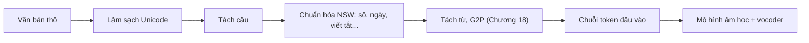

# Chương 17. Chuẩn hóa văn bản tiếng Việt

!!! abstract "Mục tiêu học tập"
    Sau chương này, bạn có thể:

    - **Giải thích** vai trò của khối xử lý văn bản (*front-end*) trong hệ thống TTS và lý do chuẩn hóa văn bản vẫn cần thiết ngay cả với các mô hình end-to-end quy mô lớn.
    - **Chẩn đoán và sửa** các lỗi Unicode điển hình của văn bản tiếng Việt: NFC/NFD, vị trí dấu thanh (*hòa*/*hoà*), ký tự trông giống nhau, ký tự vô hình.
    - **Phân loại** từ không chuẩn (*non-standard words*, NSW) theo hệ thống của Sproat và cộng sự (2001) và chỉ ra các nguồn nhập nhằng đặc thù tiếng Việt.
    - **Suy ra và cài đặt** thuật toán đọc số tiếng Việt chính xác (mười/mươi, mốt, tư, lăm, linh/lẻ, "không trăm", nghìn/triệu/tỷ), kèm kiểm thử khứ hồi (*round-trip*).
    - **Xây dựng** một bộ chuẩn hóa dựa trên luật cho ngày, giờ, tiền tệ, phần trăm, đơn vị đo, số điện thoại, chữ viết tắt và có bộ kiểm thử hồi quy.
    - **So sánh** các hướng tiếp cận: luật/regex, văn phạm WFST, mô hình seq2seq, mô hình ngôn ngữ lớn (LLM) và hệ lai có kiểm chứng.
    - **Thiết kế** quy trình bảo đảm nhất quán chuẩn hóa giữa dữ liệu huấn luyện và lúc suy luận.

!!! info "Kiến thức cần có"
    - [Chương 15](../phan-3-tin-hieu-ngu-am/ch15-ngu-am-tieng-viet.md): cấu trúc âm tiết, thanh điệu và chính tả tiếng Việt.
    - [Chương 16](../phan-3-tin-hieu-ngu-am/ch16-ngon-dieu.md): vai trò của dấu câu và ngắt nghỉ đối với ngôn điệu (đọc lướt là đủ).
    - Lập trình Python cơ bản, đặc biệt là biểu thức chính quy (*regular expression*, mô-đun `re`).

Hãy thử đọc to câu sau: *"Ngày 2/9/2024, UBND TP.HCM chi 1.005.021 USD (tăng 15%) cho 21 km đường."* Bạn sẽ đọc "ngày hai tháng chín năm hai nghìn không trăm hai mươi tư, ủy ban nhân dân thành phố Hồ Chí Minh chi một triệu không trăm linh năm nghìn không trăm hai mươi mốt đô la Mỹ…". Trong câu ngắn ấy có ít nhất bảy quy ước khác nhau mà bạn đã áp dụng mà không cần suy nghĩ: dấu "/" trong ngày tháng, dấu "." ngăn cách hàng nghìn, viết tắt, tên đơn vị tiền tệ, ký hiệu phần trăm, đơn vị đo, và cả những biến thể âm tinh tế như *mốt* (không phải *một*) trong "hai mươi mốt" hay *tư* trong "hai mươi tư". Một hệ thống TTS phải làm được đúng điều đó, mọi lúc, cho mọi văn bản. Chương này trình bày cách làm.

## 17.1. Khối xử lý văn bản trong hệ thống TTS

### 17.1.1. Từ văn bản viết đến chuỗi đầu vào của mô hình

Một hệ thống TTS cổ điển gồm ba khối: **khối xử lý văn bản** (*front-end*), **mô hình âm học** (*acoustic model*) và **vocoder**. Front-end biến văn bản thô thành một biểu diễn mà mô hình âm học "đọc" được: chuỗi âm vị, thanh điệu, ranh giới từ, dấu ngắt. Phần IV của giáo trình dành riêng cho front-end: chương này lo **chuẩn hóa văn bản** (*text normalization*, TN), còn [Chương 18](ch18-g2p-bieu-dien-dau-vao.md) lo chuyển chữ thành âm vị (G2P) và thiết kế bộ ký hiệu đầu vào.



Về mặt hình thức, chuẩn hóa văn bản là một ánh xạ

$$
f_{\text{TN}} : \Sigma^{*} \longrightarrow \Gamma^{*},
$$

trong đó $\Sigma$ là bảng ký tự của **dạng viết** (chữ cái, chữ số, dấu câu, ký hiệu như %, °C, @) và $\Gamma$ là bảng ký tự của **dạng nói** (*spoken form*): chỉ gồm chữ cái tiếng Việt, khoảng trắng và một vài dấu câu mang thông tin ngắt nghỉ. Hai đặc điểm làm bài toán khó hơn vẻ ngoài:

1. **Phụ thuộc ngữ cảnh.** Chuỗi "1/2" là "ngày một tháng hai" sau chữ "ngày", nhưng là "một phần hai" trong "1/2 số người". Do đó $f_{\text{TN}}$ không thể áp dụng độc lập lên từng token.
2. **Một-nhiều.** "24" có thể đọc "hai mươi tư" hoặc "hai mươi bốn"; "2024" có thể đọc trang trọng "hai nghìn không trăm hai mươi tư" hoặc khẩu ngữ "hai không hai tư". Cả hai đều đúng, nhưng một hệ thống phải *chọn* và chọn **nhất quán**.

### 17.1.2. Vì sao vẫn cần chuẩn hóa trong thời đại end-to-end?

Một câu hỏi tự nhiên: các mô hình hiện đại học trực tiếp từ ký tự (thậm chí byte) — sao không để mô hình tự học cách đọc số? Có ba lý do khiến các hệ thống sản phẩm vẫn giữ một bước TN tường minh:

- **Dữ liệu thưa.** Số lượng chuỗi số khác nhau là vô hạn, còn dữ liệu tiếng nói có nhãn chỉ vài chục đến vài nghìn giờ. Một số như "1.005.021" gần như chắc chắn không xuất hiện trong dữ liệu huấn luyện. Quy tắc đọc số là **tổ hợp** (*compositional*) và cần khái quát hóa hệ thống (*systematic generalization*) — điều mà mạng nơ-ron học từ ít ví dụ làm rất kém.
- **Lỗi đọc số là lỗi "không thể chấp nhận".** Đọc sai một âm vị làm giọng kém tự nhiên; đọc "hai mươi ba" thành "hai mươi tư" làm *sai nội dung*. Với văn bản tài chính, y tế, pháp lý, một lỗi như vậy nghiêm trọng hơn nhiều lần so với giọng hơi máy móc.
- **Khả năng kiểm soát.** Khách hàng muốn "VTV" đọc là "vê tê vê", "TP.HCM" đọc đầy đủ, số điện thoại đọc từng chữ số theo nhóm. Luật tường minh cho phép sửa lỗi ngay lập tức, không phải huấn luyện lại.

Ngay cả các mô hình TTS dựa trên LLM ([Phần VIII](../phan-8-mo-hinh-lon/ch34-he-thong-lai-hien-dai.md)), vốn đọc văn bản thô khá tốt nhờ tiền huấn luyện trên lượng văn bản khổng lồ, vẫn thường mắc lỗi với số dài, ngày tháng kiểu Việt và chữ viết tắt địa phương. Thực tiễn phổ biến là vẫn đặt một bước TN trước mô hình.

!!! note "Góc tiếng Việt"
    Tiếng Việt có một số thuận lợi cho front-end: chữ Quốc ngữ dùng bảng chữ cái Latinh gần như **biểu âm** (G2P đơn giản hơn tiếng Anh nhiều, xem [Chương 18](ch18-g2p-bieu-dien-dau-vao.md)), và mỗi âm tiết được viết tách bằng khoảng trắng. Nhưng cũng có những khó khăn riêng: dấu thanh và dấu phụ khiến Unicode phức tạp; quy ước số dùng "." ngăn cách hàng nghìn và "," cho phần thập phân — **ngược** với tiếng Anh; báo chí dùng rất nhiều chữ viết tắt (UBND, HĐND, TP.HCM, PGS.TS.); và văn bản mạng xã hội trộn tiếng Anh, viết không dấu, dùng "k", "tr", "j" thay chữ.

## 17.2. Unicode và văn bản tiếng Việt

Lỗi Unicode là nhóm lỗi "vô hình": hai chuỗi trông y hệt trên màn hình nhưng khác nhau ở cấp byte. Với một mô hình TTS, chúng là hai chuỗi ký hiệu khác nhau, nên embedding của một âm tiết bị "chia đôi", hoặc tệ hơn, một ký hiệu lạ rơi vào trạng thái ngoài từ vựng (*out-of-vocabulary*, OOV) và bị bỏ qua lặng lẽ.

### 17.2.1. Code point, NFC và NFD

Unicode gán cho mỗi ký tự một **code point** (ví dụ U+1EC7 cho "ệ"). Nhưng chữ "ệ" có thể được biểu diễn theo hai cách **tương đương chuẩn tắc** (*canonically equivalent*):

| Dạng | Chuỗi code point | Số code point | Số byte UTF-8 |
|---|---|---|---|
| Dựng sẵn (NFC) | U+1EC7 | 1 | 3 |
| Tổ hợp (NFD) | U+0065 (e) + U+0302 (dấu mũ) + U+0323 (dấu nặng) | 3 | 5 |

Chuẩn Unicode (Phụ lục UAX #15) định nghĩa các **dạng chuẩn hóa** (*normalization forms*): NFD phân tách tối đa các ký tự thành ký tự cơ sở cộng các dấu kết hợp (*combining marks*) theo một thứ tự chuẩn tắc; NFC phân tách rồi **ghép lại** (*compose*) thành ký tự dựng sẵn khi có thể. Hai chuỗi tương đương chuẩn tắc luôn có cùng NFC và cùng NFD, do đó phép so sánh đúng là:

$$
s_1 \equiv s_2 \iff \operatorname{NFC}(s_1) = \operatorname{NFC}(s_2).
$$

Văn bản dạng NFD hoặc "lai" (một phần dựng sẵn, một phần tổ hợp) xuất hiện từ nhiều nguồn: bảng mã Windows-1258 (vốn biểu diễn dấu thanh bằng ký tự kết hợp), một số bộ gõ, tên tệp trên hệ thống tệp HFS+ của macOS (lưu tên tệp ở một biến thể của dạng phân tách), văn bản sao chép từ PDF. Quy tắc vàng cho mọi pipeline TTS tiếng Việt: **chuẩn hóa NFC ngay khi đọc dữ liệu, ở cả lúc huấn luyện lẫn lúc suy luận.** Giáo trình này cũng bắt buộc NFC cho chính mã nguồn Markdown của nó.

!!! warning "NFC không giải quyết mọi thứ"
    Chuỗi "hoà" (dấu huyền trên *a*) và "hòa" (dấu huyền trên *o*) **đều đã ở dạng NFC** nhưng là hai chuỗi khác nhau. Chuẩn hóa Unicode không biết gì về quy tắc đặt dấu của tiếng Việt. Đó là bài toán của mục tiếp theo.

### 17.2.2. Vị trí dấu thanh: "hòa" hay "hoà"?

Với các vần mở có hai nguyên âm *oa*, *oe*, *uy* (không có âm cuối), tồn tại hai thói quen đặt dấu cùng phổ biến:

| Kiểu | Ví dụ | Quy tắc |
|---|---|---|
| "Cũ" (dùng trong giáo trình này) | hòa, khỏe, thủy, ủy ban | dấu trên nguyên âm **thứ nhất** của *oa, oe, uy* khi không có âm cuối |
| "Mới" | hoà, khoẻ, thuỷ, uỷ ban | dấu trên nguyên âm **thứ hai** (âm chính) |

Khi có âm cuối, hai kiểu trùng nhau: *hoàng, toán, huỳnh, khuyết*. Cả hai kiểu đều chấp nhận được về chính tả; vấn đề chỉ là **trộn lẫn** chúng trong cùng một kho dữ liệu. Ta cần một hàm đưa mọi âm tiết về một vị trí dấu chuẩn. Quy tắc (cho kiểu "cũ") có thể phát biểu như sau, với *cụm nguyên âm* là chuỗi nguyên âm liên tiếp sau khi bỏ âm đầu (lưu ý: *qu* và *gi* đứng trước nguyên âm được coi là âm đầu, nên *quý*, *già* đặt dấu trên *y*, *a*):

1. Nếu cụm nguyên âm chứa nguyên âm có dấu phụ (ă, â, ê, ô, ơ, ư), đặt dấu thanh lên nguyên âm có dấu phụ **cuối cùng**: *người* (ơ), *thuở* (ơ), *cửa* (ư), *khuấy* (â).
2. Ngược lại, nếu âm tiết có âm cuối là phụ âm, đặt lên nguyên âm **cuối** của cụm: *hoàng*, *toán*, *huỳnh*.
3. Ngược lại, nếu cụm có ba nguyên âm, đặt lên nguyên âm **giữa**: *ngoài*, *khuỷu*, *ngoẹo*.
4. Ngược lại (cụm hai nguyên âm, vần mở), đặt lên nguyên âm **đầu**: *mùa*, *kìa*, *hòa*, *khỏe*, *thủy* (kiểu "mới" chỉ khác ở trường hợp *oa, oe, uy*: đặt lên nguyên âm thứ hai).

Thuật toán cài đặt rất gọn nhờ NFD: tách dấu thanh (một trong năm ký tự kết hợp U+0300 huyền, U+0301 sắc, U+0309 hỏi, U+0303 ngã, U+0323 nặng) ra khỏi âm tiết, xác định vị trí chuẩn trên phần còn lại, rồi gắn lại và chuẩn hóa NFC. Một chi tiết quan trọng: chỉ áp dụng khi cụm nguyên âm **liền nhau** và âm tiết có đúng một dấu thanh; nhờ đó các từ nước ngoài như "café" hay "résumé" được để nguyên.

### 17.2.3. Ký tự trông giống nhau, ký tự vô hình và bảng mã cũ

Những lỗi sau đây gặp thường xuyên khi thu thập văn bản từ web:

- **Ký tự giả dạng** (*confusables*): chữ "Ð" (U+00D0, chữ *eth* của tiếng Iceland) trông y hệt "Đ" (U+0110); chữ Kirin "а" (U+0430), "о", "е", "р", "с" trông như chữ Latinh. Chúng làm G2P thất bại hoặc tạo ra ký hiệu lạ. Cách xử lý an toàn: chỉ thay chữ Kirin trong những từ **lai** (vừa có chữ Latinh vừa có chữ Kirin), để không phá hỏng văn bản tiếng Nga thật.
- **Ký tự vô hình**: khoảng trắng không ngắt (U+00A0), khoảng trắng độ rộng 0 (U+200B), gạch nối mềm (U+00AD), dấu BOM (U+FEFF), bộ chọn biến thể (U+FE0F) đi kèm emoji.
- **Dấu câu "thông minh"**: ngoặc kép cong, gạch ngang dài (–, —), dấu trừ toán học (U+2212). Nên quy về một tập dấu câu nhỏ, vì bộ ký hiệu của mô hình (xem [Chương 18](ch18-g2p-bieu-dien-dau-vao.md)) chỉ có vài dấu câu.
- **Emoji và biểu tượng**: thường bỏ đi (hoặc thay bằng mô tả nếu ứng dụng yêu cầu).
- **Bảng mã cũ**: văn bản soạn bằng các phông chữ TCVN3 (ABC) hay VNI trước khi Unicode phổ biến, nếu bị đọc nhầm bảng mã, sẽ hiện ra những chuỗi ký tự vô nghĩa. Nếu một kho văn bản có tỷ lệ cao các ký tự lạ như vậy, cần chuyển mã bằng công cụ chuyên dụng trước mọi bước khác — đừng cố "vá" bằng regex.

### 17.2.4. Cài đặt: làm sạch Unicode

Các khối mã trong chương này **nối tiếp nhau**: hãy chạy tuần tự trong cùng một phiên Python (hoặc ghép thành một tệp `vn_tn.py`). Tất cả chỉ dùng thư viện chuẩn của Python.

```python
import re
import unicodedata

TONES = {"̀", "́", "̃", "̉", "̣"}  # huyền, sắc, ngã, hỏi, nặng
VOWELS = set("aăâeêioôơuưy")
HAT_VOWELS = set("ăâêôơư")                                  # nguyên âm có mũ/trăng/móc
INVISIBLE = re.compile("[​‌‍⁠­️]")
EMOJI = re.compile("[\U0001F1E6-\U0001F1FF\U0001F300-\U0001FAFF☀-➿]")
PUNCT_MAP = str.maketrans({" ": " ", " ": " ", " ": " ",
                           "–": "-", "−": "-", "—": " - ",
                           "“": '"', "”": '"', "‘": "'", "’": "'",
                           "Ð": "Đ", "ð": "đ"})           # Ð/ð (Eth) giả Đ/đ
CYR2LAT = str.maketrans("аеорсухАВЕКМНОРСТХ", "aeopcyxABEKMHOPCTX")
WORD_RE = re.compile(r"[^\W\d_]+")


def tone_index(base: str, style: str = "old") -> int | None:
    """Vị trí đặt dấu thanh trong âm tiết `base` (chữ thường, đã bỏ dấu thanh)."""
    start = 0
    if base.startswith("qu") or (base.startswith("gi") and len(base) > 2
                                 and base[2] in VOWELS):
        start = 2                                     # "qu", "gi" là âm đầu
    vs = [i for i in range(start, len(base)) if base[i] in VOWELS]
    if not vs or vs != list(range(vs[0], vs[-1] + 1)):
        return None                                   # không phải âm tiết tiếng Việt
    hats = [i for i in vs if base[i] in HAT_VOWELS]
    if hats:
        return hats[-1]                               # người, thuở, cửa, khuấy
    if vs[-1] < len(base) - 1:
        return vs[-1]                                 # có âm cuối: hoàng, toán, huỳnh
    if len(vs) == 3:
        return vs[1]                                  # ngoài, khuỷu, ngoẹo
    if len(vs) == 2 and style == "new" and base[vs[0]:vs[1] + 1] in ("oa", "oe", "uy"):
        return vs[1]                                  # kiểu mới: hoà, khoẻ, thuỷ
    return vs[0]                                      # kiểu cũ: hòa, khỏe, thủy; mùa, kìa


def normalize_tone_placement(word: str, style: str = "old") -> str:
    nfd = unicodedata.normalize("NFD", word)
    tones = [c for c in nfd if c in TONES]
    if len(tones) != 1:
        return word                                   # không dấu hoặc nhiều dấu: giữ nguyên
    base = unicodedata.normalize("NFC", "".join(c for c in nfd if c not in TONES))
    i = tone_index(base.lower(), style)
    if i is None:
        return word                                   # ví dụ "café": để nguyên
    ch = unicodedata.normalize("NFC", unicodedata.normalize("NFD", base[i]) + tones[0])
    return base[:i] + ch + base[i + 1:]


def _fix_word(w: str, style: str) -> str:
    scripts = {unicodedata.name(c, "").split()[0] for c in w}
    if "CYRILLIC" in scripts and "LATIN" in scripts:  # từ "lai" chữ Kirin giả Latin
        w = w.translate(CYR2LAT)
    return normalize_tone_placement(w, style)


def clean_text(text: str, style: str = "old") -> str:
    """NFC → bỏ ký tự vô hình/emoji → chuẩn dấu câu → sửa ký tự giả → chuẩn vị trí dấu."""
    text = unicodedata.normalize("NFC", text)
    text = EMOJI.sub(" ", INVISIBLE.sub("", text)).translate(PUNCT_MAP)
    text = WORD_RE.sub(lambda m: _fix_word(m.group(0), style), text)
    return re.sub(r"\s+", " ", text).strip()
```

Hàm `tone_index` cài đặt đúng bốn quy tắc ở Mục 17.2.2; điều kiện `vs != list(range(...))` loại các chuỗi có nguyên âm không liền nhau (dấu hiệu của từ nước ngoài). Bộ kiểm thử dưới đây vừa minh họa vừa đóng vai trò **kiểm thử hồi quy** (*regression test*): mỗi lần sửa luật, bạn chạy lại để chắc chắn không làm hỏng trường hợp cũ.

```python
nfd = unicodedata.normalize("NFD", "Tiếng Việt")
assert nfd != "Tiếng Việt" and len(nfd) > len("Tiếng Việt")   # NFD dài hơn, khác chuỗi
assert clean_text(nfd) == "Tiếng Việt"

pairs = {  # đầu vào (kiểu mới / lẫn lộn) → kiểu "cũ" dùng trong sách
    "hoà": "hòa", "Hoà Bình": "Hòa Bình", "khoẻ": "khỏe", "Thuỷ": "Thủy",
    "uỷ ban": "ủy ban", "loè loẹt": "lòe loẹt",
}
for src, dst in pairs.items():
    assert clean_text(src) == dst, (src, clean_text(src))

unchanged = ["quý", "hoàng", "toán", "huỳnh", "người", "thuở", "của", "giữa", "gì",
             "giếng", "ngoài", "khuỷu", "khuấy", "rượu", "quốc", "kìa", "mùa", "café"]
for w in unchanged:
    assert clean_text(w) == w, (w, clean_text(w))

assert clean_text("hòa khỏe thủy", style="new") == "hoà khoẻ thuỷ"
assert clean_text("Ðà Nẵng") == "Đà Nẵng"                 # Ð (Eth) → Đ
assert clean_text("Hà​ Nội") == "Hà Nội"                        # zero-width space
assert clean_text("Việt Nаm") == "Việt Nam"                     # 'а' Kirin
assert clean_text("Chúc mừng 🎉🎉 năm mới") == "Chúc mừng năm mới"
assert clean_text("10–15 km") == "10-15 km"
print("Tất cả kiểm thử Unicode đều qua.")
```

## 17.3. Tách câu và tách token

### 17.3.1. Vì sao phải tách câu?

Hầu hết mô hình TTS được huấn luyện trên các đoạn âm thanh dài vài giây đến vài chục giây. Đưa vào một đoạn văn dài hàng trăm âm tiết thường gây lỗi căn chỉnh (lặp, bỏ chữ — xem [Chương 20](../phan-5-mo-hinh-am-hoc/ch20-tacotron.md) và [Chương 21](../phan-5-mo-hinh-am-hoc/ch21-alignment.md)), tốn bộ nhớ và tăng độ trễ. Vì vậy front-end tách văn bản thành câu (hoặc cụm), tổng hợp từng phần rồi ghép lại với khoảng lặng phù hợp. Trong hệ thống streaming, tách câu còn quyết định **độ trễ đến âm thanh đầu tiên** ([Chương 35](../phan-8-mo-hinh-lon/ch35-streaming-speech-llm.md)).

### 17.3.2. Những cái bẫy của dấu chấm

Một luật ngây thơ "tách sau dấu chấm" sai ở rất nhiều chỗ trong văn bản tiếng Việt:

- **Chữ viết tắt có dấu chấm**: "TP. Huế", "PGS.TS. Lê Văn A", "Q. Ba Đình".
- **Tên viết tắt**: "Nguyễn V. A.".
- **Số**: "1.500.000", "3.14" (kiểu Anh), địa chỉ IP, số phiên bản.
- **Dấu ba chấm** giữa câu: "Sau đó... mọi người về."
- **Trích dẫn**: dấu chấm than/hỏi nằm trong ngoặc kép, câu tiếp theo bắt đầu ngoài ngoặc.

Cách tiếp cận dựa trên luật ở mục 17.8 dùng ba tín hiệu: (i) ký tự sau khoảng trắng phải là chữ hoa, chữ số hoặc ngoặc mở; (ii) từ đứng trước dấu chấm không nằm trong danh sách viết tắt; (iii) từ đứng trước không phải một chữ cái hoa đơn lẻ. Một hướng khác là học không giám sát các chữ viết tắt từ chính kho văn bản, như thuật toán Punkt (Kiss và Strunk, 2006) — có sẵn trong thư viện NLTK; theo hiểu biết của chúng tôi, gói dữ liệu đi kèm không có mô hình huấn luyện sẵn cho tiếng Việt, nên bạn cần tự huấn luyện trên văn bản báo chí tiếng Việt. Với văn bản mạng xã hội thiếu dấu câu, cần đến mô hình khôi phục dấu câu (*punctuation restoration*) — chủ đề của [Chương 36](../phan-9-thuc-tien/ch36-du-lieu-tts.md).

### 17.3.3. Token trong tiếng Việt

Trong tiếng Việt, khoảng trắng phân tách **âm tiết**, không phải từ: "học sinh" là một từ gồm hai âm tiết. Với chuẩn hóa văn bản, đơn vị làm việc tự nhiên là **token chính tả**: một chuỗi liên tục không chứa khoảng trắng, được tách tiếp thành phần chữ, phần số và dấu câu (ví dụ "U23" → "U" + "23", "50.000đ" → "50.000" + "đ"). Ranh giới **từ** chỉ cần ở các bước sau (dự đoán ngắt nghỉ, G2P cho từ mượn) và được bàn ở [Chương 18](ch18-g2p-bieu-dien-dau-vao.md).

## 17.4. Từ không chuẩn và bài toán phân loại

### 17.4.1. Phân loại của Sproat và cộng sự

Công trình kinh điển về TN là bài báo *Normalization of non-standard words* (Sproat và cộng sự, 2001). Các tác giả định nghĩa **từ không chuẩn** (NSW) là những token không thể đọc bằng cách tra từ điển phát âm thông thường, và đề xuất một hệ thống nhãn chi tiết. Bảng dưới đây trích các nhãn chính (tên nhãn giữ theo bài gốc), kèm ví dụ tiếng Việt do chúng tôi bổ sung:

| Nhóm | Nhãn | Ý nghĩa | Ví dụ tiếng Việt |
|---|---|---|---|
| Chữ | EXPN | viết tắt cần khai triển | UBND, TP., PGS.TS. |
| Chữ | LSEQ | đọc từng chữ cái | VTV, GDP |
| Chữ | ASWD | đọc như một từ | ASEAN, NATO |
| Chữ | MSPL | lỗi chính tả | "ko" (không), "dc" (được) |
| Số | NUM | số đếm | 1.005.021 |
| Số | NORD | số thứ tự | thứ 4, thế kỷ XXI |
| Số | NTEL | số điện thoại | 0912 345 678 |
| Số | NDIG | đọc từng chữ số | mã OTP 0409 |
| Số | NIDE | mã định danh | U23, iPhone 15, A320 |
| Số | NADDR | số trong địa chỉ | số nhà 12/3 |
| Số | NTIME | thời gian | 14:30, 7h05 |
| Số | NDATE | ngày tháng | 2/9/1945 |
| Số | NYER | năm | năm 2024 |
| Số | MONEY | tiền tệ | 50.000đ, 100 USD |
| Số | PRCT | phần trăm | 6,5% |
| Khác | URL | địa chỉ web, email | abc@gmail.com |
| Khác | PUNC, SLNT | dấu không đọc, ký tự trang trí | "***", "=====" |

Bài gốc còn một số nhãn khác (ví dụ cho tiền tệ kèm "triệu/tỷ", token trộn chữ–số, cách viết cố ý kéo dài kiểu "slloooow"); bạn đọc nên tham khảo trực tiếp.

### 17.4.2. Hai bài toán con: phân loại và diễn đạt

Sproat và cộng sự tách TN thành hai bước, và cách tách này vẫn đúng với mọi hệ thống hiện đại:

1. **Phân loại** (*classification/tagging*): token này thuộc loại nào? "1/2" là NDATE hay phân số? "2-1" là khoảng hay tỷ số? "III" là số La Mã hay chữ viết tắt?
2. **Diễn đạt** (*verbalization*): khi đã biết loại, đọc thế nào? Bước này gần như **tất định**: "2/9/1945" khi đã biết là ngày thì chỉ có một cách đọc (trừ các biến thể văn phong).

Gọi $x$ là token cần đọc và $c$ là ngữ cảnh xung quanh. Một cách nhìn xác suất:

$$
\hat{y} = \arg\max_{y} \; \sum_{k} p(y \mid x, k)\, p(k \mid x, c) \;\approx\; \operatorname{verbalize}\big(x, \hat{k}\big), \quad \hat{k} = \arg\max_{k} p(k \mid x, c),
$$

trong đó $k$ là nhãn loại. Phép xấp xỉ bên phải nói rằng: nếu bước diễn đạt gần như tất định khi biết $k$, toàn bộ độ khó dồn vào bước **phân loại**. Đây là lý do các hệ thống lai hiện đại thường dùng mô hình học máy (hoặc LLM) cho phân loại, nhưng giữ luật/văn phạm tất định cho diễn đạt (Mục 17.9).

!!! note "Góc tiếng Việt"
    Một số nhập nhằng điển hình của tiếng Việt:

    - **"1/2"**: ngày 1 tháng 2 (nếu đứng sau "ngày", "hôm", trong bối cảnh lịch), phân số "một phần hai" (hoặc "một nửa"), hay số nhà "một trên hai".
    - **"2-1"**: khoảng "hai đến một" (vô lý), hay tỷ số bóng đá "hai – một".
    - **"5g"**: 5 gam, hay "5 giờ" theo lối viết tắt miền Nam ("5g30").
    - **"Thứ 7"**: ngày trong tuần (thứ bảy) — trùng với số thứ tự "thứ bảy" nên may mắn đọc giống nhau; nhưng "Thứ 2" luôn là "thứ hai", không phải "thứ nhì".
    - **"VN"**: "Việt Nam" (khai triển) hay "vê nờ" (đọc từng chữ cái)?
    - **"MC"**: người dẫn chương trình (đọc "em xi" theo tiếng Anh) chứ không phải số La Mã 1100.
    - **Ngày kiểu Mỹ** (tháng/ngày/năm) trong văn bản dịch: "03/04/2024" có thể là 3 tháng 4 hoặc 4 tháng 3.

## 17.5. Đọc số đếm tiếng Việt: từ quy tắc đến thuật toán

Đây là phần quan trọng nhất của chương. Đọc số tưởng đơn giản nhưng có khá nhiều biến thể âm phụ thuộc vị trí; người bản ngữ dùng đúng một cách tự nhiên nhưng hiếm khi phát biểu được thành quy tắc.

### 17.5.1. Các chữ số và biến thể âm

Mười chữ số cơ bản: *không, một, hai, ba, bốn, năm, sáu, bảy, tám, chín*. Khi ghép thành số, một số chữ số **đổi âm** tùy vị trí:

| Hiện tượng | Điều kiện | Ví dụ đúng | Ví dụ sai |
|---|---|---|---|
| *mười* (thanh huyền) | hàng chục bằng 1 | 10 mười, 15 mười lăm, 110 một trăm mười | "một mươi" |
| *mươi* (thanh ngang) | hàng chục từ 2 trở lên | 20 hai mươi, 90 chín mươi | "hai mười" |
| *mốt* | hàng đơn vị là 1 **và** hàng chục ≥ 2 | 21 hai mươi mốt, 91 chín mươi mốt | 11 "mười mốt", 101 "một trăm linh mốt" |
| *tư* | hàng đơn vị là 4 **và** hàng chục ≥ 2 (tùy chọn, "bốn" cũng đúng) | 24 hai mươi tư | — (14 thường đọc "mười bốn") |
| *lăm* (hoặc *nhăm*) | hàng đơn vị là 5 **và** hàng chục ≥ 1 | 15 mười lăm, 25 hai mươi lăm (nhăm) | 15 "mười năm", 105 "một trăm linh lăm" |
| *linh* / *lẻ* | hàng chục bằng 0, hàng đơn vị khác 0, **có** hàng trăm đứng trước | 105 một trăm linh năm (Bắc), một trăm lẻ năm (Nam) | "một trăm năm" (khẩu ngữ hiểu là 150) |
| *không trăm* | nhóm ba chữ số **không đứng đầu** có hàng trăm bằng 0 | 2024 hai nghìn không trăm hai mươi tư | "hai nghìn hai mươi tư" (khẩu ngữ, dễ nhầm) |

Vài nhận xét giúp hiểu *vì sao* có những biến thể này:

- *Mốt* và *lăm* là các biến thể đã cố định trong ngôn ngữ và gần như **bắt buộc** ở vị trí của chúng: không ai nói "hai mươi một" hay "mười năm" để chỉ 21 hay 15. Với *lăm*, lợi ích khử nhập nhằng thấy rõ: "mười năm" là một khoảng thời gian (10 năm), còn "mười lăm" là con số 15.
- *Tư* sau *mươi* là biến thể phổ biến ở cả hai miền nhưng không bắt buộc; nhiều người miền Nam nói "hai mươi bốn". Một hệ thống TTS nên để đây là **tùy chọn** và đặt theo giọng của người nói trong dữ liệu.
- *Linh/lẻ* đánh dấu một hàng chục bằng 0. Lý do là khẩu ngữ tiếng Việt có lối **nói tắt**: chữ số đứng ngay sau một hàng được hiểu là chữ số của hàng *liền dưới* — "một trăm hai" là 120, "một nghìn hai" là 1.200, "hai triệu tư" là 2.400.000. Nếu đọc 102 là "một trăm hai", người nghe sẽ hiểu thành 120.
- *Không trăm* có cùng vai trò ở cấp nhóm: đọc 1.002 là "một nghìn hai" sẽ trùng với cách nói tắt của 1.200; phải đọc "một nghìn không trăm linh hai". Văn phong trang trọng (tin tức, văn bản hành chính, ghi số tiền bằng chữ) luôn dùng "không trăm".

### 17.5.2. Cấu trúc nhóm ba chữ số

Tiếng Việt đếm theo nhóm **ba chữ số** với các hàng *nghìn* (hoặc *ngàn*), *triệu*, *tỷ* (hoặc *tỉ*). Với số nguyên $0 < n < 10^9$, ta viết

$$
n = g_2 \cdot 10^{6} + g_1 \cdot 10^{3} + g_0, \qquad 0 \le g_k \le 999,
$$

và gọi $\operatorname{scale}(2) = \text{triệu}$, $\operatorname{scale}(1) = \text{nghìn}$, $\operatorname{scale}(0) = \varnothing$. Cách đọc là phép nối (ký hiệu $\oplus$):

$$
\operatorname{read}(n) = \bigoplus_{k \in \{2,1,0\},\; g_k \neq 0} \Big[ \operatorname{read}_3\big(g_k, \text{full}_k\big) \oplus \operatorname{scale}(k) \Big],
$$

trong đó $\text{full}_k = \text{đúng}$ khi và chỉ khi nhóm $g_k$ **không phải** nhóm khác 0 đầu tiên. Hai quy ước nằm trong công thức này:

- Nhóm toàn số 0 bị **bỏ qua hoàn toàn** (không đọc "không nghìn").
- Nhóm khác 0 đầu tiên đọc **rút gọn** (21 nghìn, không phải "không trăm hai mươi mốt nghìn"); các nhóm sau đọc **đầy đủ**, kể cả "không trăm".

Hàm đọc một nhóm $g = 100h + 10t + u$ phân tích theo các trường hợp:

$$
\operatorname{read}_3(g, \text{full}) =
\underbrace{[\,h \text{ trăm}\,]}_{\text{nếu } h > 0 \text{ hoặc full}}
\oplus
\begin{cases}
[\,\text{linh } u\,] & t = 0,\ u > 0,\ \text{có phần hàng trăm}\\
[\,u\,] & t = 0,\ u > 0,\ \text{không có hàng trăm}\\
\text{mười} \oplus u' & t = 1\\
t \text{ mươi} \oplus u'' & t \ge 2,
\end{cases}
$$

với $u'$ là cách đọc hàng đơn vị sau *mười* (5 → *lăm*, 0 → rỗng) và $u''$ là cách đọc sau *mươi* (1 → *mốt*, 4 → *tư*, 5 → *lăm*, 0 → rỗng).

Với số từ $10^9$ trở lên, tiếng Việt không có tên hàng mới mà **lặp lại** "tỷ": $10^{12}$ là "nghìn tỷ", $10^{15}$ là "triệu tỷ", $10^{18}$ là "tỷ tỷ". Cách gọn nhất là đệ quy: viết $n = a \cdot 10^9 + b$ với $0 \le b < 10^9$, rồi

$$
\operatorname{read}(n) = \operatorname{read}(a) \oplus \text{tỷ} \oplus \operatorname{read}_{\text{full}}(b) \quad (\text{bỏ phần cuối nếu } b = 0),
$$

trong đó $\operatorname{read}_{\text{full}}$ đọc mọi nhóm khác 0 ở dạng đầy đủ (vì đã có phần "tỷ" đứng trước). Cách đệ quy này tránh được lỗi tinh vi: 1.002.000.000.000 phải đọc "một nghìn không trăm linh hai tỷ", **không phải** "một nghìn tỷ không trăm linh hai tỷ".

!!! example "Ví dụ: đọc 1.005.021 từng bước"
    1. Tách nhóm: $g_2 = 1$, $g_1 = 5$, $g_0 = 21$.
    2. $g_2 = 1$ là nhóm khác 0 đầu tiên → đọc rút gọn: "một", thêm "triệu".
    3. $g_1 = 5 = 100 \cdot 0 + 10 \cdot 0 + 5$, đầy đủ → "không trăm", hàng chục bằng 0 và đã có phần hàng trăm → "linh năm"; thêm "nghìn".
    4. $g_0 = 21$, đầy đủ → "không trăm", $t = 2$ → "hai mươi", $u = 1$ sau *mươi* → "mốt".
    5. Kết quả: **một triệu không trăm linh năm nghìn không trăm hai mươi mốt**.

    Tương tự: 2024 → "hai nghìn không trăm hai mươi tư"; 105 → "một trăm linh năm"; 15 → "mười lăm"; 21 → "hai mươi mốt"; 1.000.000 → "một triệu" (hai nhóm 0 bị bỏ qua).

### 17.5.3. Cài đặt

Hàm dưới đây cài đặt đúng các công thức trên. Các biến thể phương ngữ và văn phong được gom vào một từ điển tùy chọn để có thể đặt theo giọng của người nói.

```python
DIGITS = ["không", "một", "hai", "ba", "bốn", "năm", "sáu", "bảy", "tám", "chín"]

# Các lựa chọn phương ngữ/văn phong; mặc định theo giọng Bắc, văn phong trang trọng.
DEFAULT_OPTS = {
    "linh": "linh",            # "linh" (Bắc) hoặc "lẻ" (Nam): 105 → một trăm linh/lẻ năm
    "nghin": "nghìn",          # "nghìn" (Bắc) hoặc "ngàn" (Nam)
    "ty": "tỷ",                # "tỷ" hoặc "tỉ"
    "four_after_tens": "tư",   # 24 → hai mươi tư (hoặc "bốn")
    "five_after_tens": "lăm",  # 25 → hai mươi lăm (hoặc "nhăm", khẩu ngữ Bắc)
}


def _read_triplet(n: int, full: bool, o: dict) -> list[str]:
    """Đọc một nhóm ba chữ số 0 < n < 1000.

    full=True khi nhóm KHÔNG đứng đầu cả số: khi đó luôn đọc hàng trăm,
    kể cả "không trăm" (ví dụ nhóm 021 trong 1.005.021).
    """
    h, t, u = n // 100, (n // 10) % 10, n % 10
    words: list[str] = []
    if h > 0 or full:
        words += [DIGITS[h], "trăm"]
    if t == 0:
        if u > 0:
            # có hàng trăm đứng trước mà hàng chục bằng 0 → chèn "linh"/"lẻ"
            words += [o["linh"], DIGITS[u]] if words else [DIGITS[u]]
    elif t == 1:
        words.append("mười")                       # 10–19: "mười", không phải "một mươi"
        if u == 5:
            words.append("lăm")                    # 15: mười lăm
        elif u > 0:
            words.append(DIGITS[u])                # 11: mười một (không dùng "mốt")
    else:
        words += [DIGITS[t], "mươi"]               # 20–90: "mươi" (thanh ngang)
        if u == 1:
            words.append("mốt")                    # 21: hai mươi mốt
        elif u == 4:
            words.append(o["four_after_tens"])     # 24: hai mươi tư
        elif u == 5:
            words.append(o["five_after_tens"])     # 25: hai mươi lăm
        elif u > 0:
            words.append(DIGITS[u])
    return words


def _int_words(n: int, leading: bool, o: dict) -> list[str]:
    """n > 0. leading=False: phần này đứng sau một hàng lớn hơn (cần "không trăm")."""
    if n >= 10**9:
        # Đệ quy theo hàng tỷ: 10^12 = "nghìn tỷ", 10^18 = "tỷ tỷ"
        high, low = divmod(n, 10**9)
        words = _int_words(high, leading, o) + [o["ty"]]
        if low:
            words += _int_words(low, False, o)
        return words
    groups = [(n // 10**6) % 1000, (n // 1000) % 1000, n % 1000]
    scales = ["triệu", o["nghin"], ""]
    words: list[str] = []
    for g, scale in zip(groups, scales):
        if g == 0:
            continue                                # bỏ qua nhóm toàn số 0
        full = not (leading and not words)          # chỉ nhóm khác 0 đầu tiên mới "rút gọn"
        words += _read_triplet(g, full, o)
        if scale:
            words.append(scale)
    return words


def int_to_words(n: int, **opts) -> str:
    """Đọc số nguyên thành chữ tiếng Việt. Ví dụ: 2024 → 'hai nghìn không trăm hai mươi tư'."""
    o = {**DEFAULT_OPTS, **opts}
    if n < 0:
        return "âm " + int_to_words(-n, **opts)
    if n == 0:
        return DIGITS[0]
    return " ".join(_int_words(n, True, o))
```

### 17.5.4. Kiểm thử khứ hồi: viết hàm ngược để kiểm chứng

Làm sao tin được hàm trên đúng với **mọi** số, không chỉ vài chục ví dụ ta nghĩ ra? Một kỹ thuật rất hiệu quả là viết **hàm ngược** $g = \text{words\_to\_int}$ (đây cũng chính là bài toán *chuẩn hóa ngược*, *inverse text normalization*, ITN, mà hệ thống nhận dạng tiếng nói cần) rồi kiểm tra tính chất khứ hồi

$$
g\big(f(n)\big) = n \qquad \forall n \in \mathcal{S},
$$

trên một tập $\mathcal{S}$ lớn (toàn bộ các số nhỏ và một mẫu ngẫu nhiên các số lớn). Tính chất này buộc $f$ phải **đơn ánh** (*injective*): hai số khác nhau không bao giờ có cùng cách đọc — đúng là điều mà các quy tắc *linh*, *không trăm*, *mốt*, *lăm* nhằm bảo đảm. Đây là một dạng **kiểm thử dựa trên tính chất** (*property-based testing*): thay vì liệt kê đầu ra mong muốn, ta kiểm tra một bất biến trên rất nhiều đầu vào. Hàm ngược còn có ích về sau, khi ta cần kiểm chứng đầu ra của một mô hình sinh (Mục 17.9.4).

```python
UNIT = {"không": 0, "một": 1, "mốt": 1, "hai": 2, "ba": 3, "bốn": 4, "tư": 4,
        "năm": 5, "lăm": 5, "nhăm": 5, "sáu": 6, "bảy": 7, "tám": 8, "chín": 9}
SCALES = [({"tỷ", "tỉ"}, 10**9), ({"triệu"}, 10**6), ({"nghìn", "ngàn"}, 10**3)]


def _parse_triplet(tokens: list[str]) -> int:
    value, pending = 0, None
    for w in tokens:
        if w == "trăm" and pending is not None:
            value, pending = value + pending * 100, None
        elif w == "mươi" and pending is not None:
            value, pending = value + pending * 10, None
        elif w == "mười" and pending is None:
            value += 10
        elif w in ("linh", "lẻ"):
            continue
        elif w in UNIT and pending is None:
            pending = UNIT[w]
        else:
            raise ValueError(f"không đọc được: {' '.join(tokens)!r}")
    return value + (pending or 0)


def words_to_int(text: str) -> int:
    """Phép ngược của int_to_words: dùng để KIỂM CHỨNG đầu ra (round-trip)."""
    tokens = text.split()
    if tokens and tokens[0] == "âm":
        return -words_to_int(" ".join(tokens[1:]))
    for names, value in SCALES:
        idx = [i for i, w in enumerate(tokens) if w in names]
        if idx:
            i = idx[-1]                    # tách tại lần xuất hiện CUỐI của hàng lớn nhất
            left = words_to_int(" ".join(tokens[:i])) if i > 0 else 1
            right = words_to_int(" ".join(tokens[i + 1:])) if i + 1 < len(tokens) else 0
            return left * value + right
    return _parse_triplet(tokens)


def digits_to_words(s: str) -> str:
    """Đọc từng chữ số: '0912' → 'không chín một hai' (số điện thoại, mã số)."""
    return " ".join(DIGITS[int(c)] for c in s if c.isdigit())


def decimal_to_words(int_part: str, frac_part: str, **opts) -> str:
    """'3', '14' → 'ba phẩy mười bốn'; '0', '05' → 'không phẩy không năm'."""
    head = int_to_words(int(int_part), **opts)
    if frac_part.startswith("0") or len(frac_part) > 3:
        tail = digits_to_words(frac_part)             # đọc từng chữ số
    else:
        tail = int_to_words(int(frac_part), **opts)   # đọc như số nguyên
    return f"{head} phẩy {tail}"


def ordinal_to_words(n: int, **opts) -> str:
    """Số thứ tự: 1 → 'thứ nhất', 4 → 'thứ tư', 21 → 'thứ hai mươi mốt'."""
    special = {1: "nhất", 4: "tư"}
    return "thứ " + special.get(n, int_to_words(n, **opts))
```

Lưu ý thuật toán của `words_to_int`: nó tách chuỗi tại lần xuất hiện **cuối cùng** của hàng lớn nhất ("tỷ"), đọc đệ quy hai phía. Chọn lần xuất hiện cuối là cần thiết cho các số như "một tỷ không trăm linh hai tỷ" ($10^{18} + 2 \cdot 10^9$). Bây giờ là bộ kiểm thử: các ca "vàng" do người viết kiểm tra thủ công (bao gồm mọi số được nêu trong chương), các biến thể phương ngữ, và kiểm thử khứ hồi trên 20 000 số liên tiếp cùng 20 000 số ngẫu nhiên tới $10^{21}$.

```python
import random

CASES = {
    0: "không",
    5: "năm",
    10: "mười",
    11: "mười một",
    14: "mười bốn",
    15: "mười lăm",
    20: "hai mươi",
    21: "hai mươi mốt",
    24: "hai mươi tư",
    25: "hai mươi lăm",
    55: "năm mươi lăm",
    101: "một trăm linh một",
    105: "một trăm linh năm",
    110: "một trăm mười",
    115: "một trăm mười lăm",
    121: "một trăm hai mươi mốt",
    1000: "một nghìn",
    1001: "một nghìn không trăm linh một",
    1010: "một nghìn không trăm mười",
    1100: "một nghìn một trăm",
    2024: "hai nghìn không trăm hai mươi tư",
    10_000: "mười nghìn",
    15_000: "mười lăm nghìn",
    21_000: "hai mươi mốt nghìn",
    105_000: "một trăm linh năm nghìn",
    1_000_000: "một triệu",
    1_000_021: "một triệu không trăm hai mươi mốt",
    1_005_021: "một triệu không trăm linh năm nghìn không trăm hai mươi mốt",
    1_500_000: "một triệu năm trăm nghìn",
    1_000_000_000: "một tỷ",
    2_005_000_000: "hai tỷ không trăm linh năm triệu",
    1_000_000_000_000: "một nghìn tỷ",
    1_002_000_000_000: "một nghìn không trăm linh hai tỷ",
    -15: "âm mười lăm",
}
for n, expected in CASES.items():
    got = int_to_words(n)
    assert got == expected, (n, got, expected)

# Biến thể phương ngữ (giọng Nam) và văn phong
south = dict(linh="lẻ", nghin="ngàn", four_after_tens="bốn")
assert int_to_words(105, **south) == "một trăm lẻ năm"
assert int_to_words(2024, **south) == "hai ngàn không trăm hai mươi bốn"
assert int_to_words(25, five_after_tens="nhăm") == "hai mươi nhăm"

# Round-trip: words_to_int(int_to_words(n)) == n trên toàn dải nhỏ + mẫu ngẫu nhiên lớn
for n in range(0, 20_000):
    assert words_to_int(int_to_words(n)) == n, n
rng = random.Random(0)
for _ in range(20_000):
    n = rng.randrange(0, 10**rng.randint(1, 21))
    assert words_to_int(int_to_words(n)) == n, n
    assert words_to_int(int_to_words(n, **south)) == n, n

# Số thập phân, số thứ tự, đọc từng chữ số
assert decimal_to_words("3", "14") == "ba phẩy mười bốn"
assert decimal_to_words("0", "05") == "không phẩy không năm"
assert decimal_to_words("2", "5") == "hai phẩy năm"
assert ordinal_to_words(1) == "thứ nhất" and ordinal_to_words(4) == "thứ tư"
assert ordinal_to_words(21) == "thứ hai mươi mốt"
assert digits_to_words("0912") == "không chín một hai"
print("Tất cả kiểm thử đọc số đều qua.")
```

Trên CPU thông thường, toàn bộ kiểm thử chạy dưới một giây.

### 17.5.5. Số thập phân, số thứ tự, phân số, số âm, khoảng

- **Số thập phân.** Tiếng Việt dùng dấu phẩy: "3,14" đọc "ba phẩy mười bốn". Phần sau dấu phẩy thường được đọc như một số nguyên khi ngắn (≤ 3 chữ số) và không có số 0 đứng đầu; nếu có số 0 đứng đầu ("0,05" → "không phẩy không năm") hoặc quá dài, đọc **từng chữ số**. Đây là một quy ước thực dụng, không phải quy tắc ngữ pháp cứng; một số người đọc "ba phẩy một bốn".
- **Số thứ tự.** "thứ" + số đếm, với hai ngoại lệ: thứ **nhất** (không phải "thứ một") và thứ **tư** (không phải "thứ bốn"). Từ 5 trở đi dùng số đếm bình thường: thứ năm, thứ mười một, thứ hai mươi mốt. Ngày trong tuần theo đúng quy tắc này ("Thứ 4" → "thứ tư"), riêng "CN" là "chủ nhật".
- **Phân số.** "a/b" đọc "a phần b"; mẫu số 4 thường đọc "phần tư" ("ba phần tư"). "1/2" trong văn nói hay được thay bằng "một nửa".
- **Số âm.** "-5" đọc "âm năm" (nhiệt độ, tọa độ, tài chính). Cẩn thận phân biệt với gạch đầu dòng và dấu gạch nối.
- **Khoảng.** "10-15" đọc "mười đến mười lăm" (hoặc "từ mười đến mười lăm" nếu trước đó chưa có "từ"). Luật khoảng phải chạy **sau** luật ngày ISO ("2024-04-30") và số điện thoại có gạch nối, nếu không sẽ phá chúng.

### 17.5.6. Chuỗi chữ số: điện thoại, mã số, năm

Nhiều chuỗi số **không** được đọc như số đếm:

- **Số điện thoại** đọc từng chữ số, theo nhóm, với ngắt hơi giữa các nhóm: "0912 345 678" → "không chín một hai, ba bốn năm, sáu bảy tám". Dấu phẩy ở đầu ra được giữ lại để mô hình âm học tạo khoảng ngắt ([Chương 18](ch18-g2p-bieu-dien-dau-vao.md) giữ dấu câu như một token). Mã quốc gia "+84" đọc "cộng tám bốn".
- **Mã số** (OTP, số tài khoản, căn cước, mã sản phẩm) đọc từng chữ số; biển số xe có quy ước riêng (nhóm chữ số đầu, sê-ri chữ cái, rồi dãy số).
- **Năm** đọc như số đếm trong văn phong trang trọng ("năm hai nghìn không trăm hai mươi tư"); văn nói đôi khi đọc "năm hai không hai tư". Thập niên viết "những năm 90" đọc "những năm chín mươi".

## 17.6. Ngày giờ, tiền tệ, phần trăm và đơn vị đo

### 17.6.1. Ngày tháng

Định dạng phổ biến: "dd/mm/yyyy", "d/m/yyyy", "dd-mm-yyyy", "dd.mm.yyyy", ISO "yyyy-mm-dd", và các dạng thiếu như "ngày 2/9", "tháng 9/2024". Quy tắc đọc: "ngày" + số đếm + "tháng" + tên tháng + "năm" + số đếm. Tên tháng theo dương lịch là số đếm, **trừ tháng 4 đọc là "tháng tư"**. Theo âm lịch còn có "tháng giêng" (tháng 1) và "tháng chạp" (tháng 12); ngày 1–10 âm lịch thường đọc với "mùng" ("mùng một Tết"). Một bộ TN tốt cho phép bật/tắt các biến thể này theo miền ứng dụng.

Các ràng buộc đơn giản (ngày 1–31, tháng 1–12) giúp loại bỏ nhiều nhận dạng nhầm: "1.234.567" có thể khớp mẫu "d.m.y" nếu viết regex lỏng, nhưng tháng 234 không hợp lệ.

### 17.6.2. Giờ

"14:30", "14h30", "7h05", "7g30" (lối viết miền Nam), "9h". Đọc: số giờ + "giờ" + số phút + "phút" (+ số giây + "giây"). Phút có số 0 đứng đầu đọc như số đếm: "7h05" → "bảy giờ năm phút" (văn nói đôi khi "bảy giờ không năm"). Không nên tự sinh cách nói "kém" ("chín giờ kém mười lăm") vì nó đòi hỏi biến đổi số học và không phải cách đọc trung thực văn bản.

### 17.6.3. Tiền tệ

| Viết | Đọc |
|---|---|
| 50.000đ, 50.000 đ, 50.000 VNĐ, 50.000 VND | năm mươi nghìn đồng |
| 35k (khẩu ngữ) | ba mươi lăm nghìn |
| 1,5 tỷ đồng | một phẩy năm tỷ đồng |
| 100 USD | một trăm đô la Mỹ |
| ký hiệu đô-la đứng trước số | … đô la |
| 20 € | hai mươi ơ rô |

Chữ "k" trong "35k" rất phổ biến trên mạng xã hội nhưng nhập nhằng (5k cũng có thể là giải chạy 5 km). Với văn bản báo chí, nên giữ luật này; với văn bản tùy ý, nên yêu cầu ngữ cảnh (giá, tiền, mua, bán…).

### 17.6.4. Phần trăm và đơn vị đo

"6,5%" → "sáu phẩy năm phần trăm"; "10-15%" → "mười đến mười lăm phần trăm". Đơn vị đo được đọc theo cách Việt hóa phổ biến: km → "ki lô mét", kg → "ki lô gam", m² → "mét vuông", km/h → "ki lô mét trên giờ", °C → "độ xê", ha → "héc ta", GB → "gi ga bai". Đầu ra ghi các âm tiết cách nhau bằng khoảng trắng (thay vì "ki-lô-mét") vì G2P ở [Chương 18](ch18-g2p-bieu-dien-dau-vao.md) làm việc theo âm tiết.

Lưu ý phân biệt hoa/thường: "5 m" là 5 mét, "5 M" có thể là 5 triệu (kiểu Anh) hoặc kích cỡ áo; "5G" là mạng di động thế hệ 5 ("năm gờ"). Mẫu regex cho đơn vị phải có **ranh giới phải** để "5 giờ" không bị hiểu là "5 g" + "iờ", và "5 lần" không bị hiểu là "5 l".

## 17.7. Chữ viết tắt, từ viết tắt, số La Mã, URL và ký hiệu

### 17.7.1. Chữ viết tắt cần khai triển

Một từ điển viết tắt là thành phần không thể thiếu: UBND → ủy ban nhân dân, HĐND → hội đồng nhân dân, TP. → thành phố, TP.HCM → thành phố Hồ Chí Minh, PGS.TS. → phó giáo sư tiến sĩ, ThS. → thạc sĩ, THPT → trung học phổ thông, CLB → câu lạc bộ, HLV → huấn luyện viên. Ba lưu ý kỹ thuật:

- **Khớp dài nhất trước**: "PGS.TS." phải được thử trước "TS.", nếu không sẽ ra "PGS. tiến sĩ".
- **Ranh giới từ**: "TS." trong "PGS.TS." và trong "TS. Nguyễn" khác với chuỗi "TS" trong một mã chứng khoán. Dùng lookbehind/lookahead `(?<!\w)` và `(?!\w)`.
- **Phụ thuộc ngữ cảnh**: "Q.1" là "quận một", "P.5" là "phường năm" khi đứng trước số; chữ "P." đứng một mình có thể là tên viết tắt. Hãy gắn điều kiện ngữ cảnh vào luật thay vì khai triển vô điều kiện.

### 17.7.2. Từ viết tắt (acronym): khai triển, đánh vần hay đọc như từ?

Một chuỗi chữ in hoa có ba cách đọc: **khai triển** (UBND), **đánh vần** theo tên chữ cái (VTV → "vê tê vê", GDP → "gờ đê pê"), hoặc **đọc như một từ** (ASEAN → "a xê an", NATO → "na tô", COVID → "cô vít"). Không có quy tắc thuần hình thức nào quyết định được; cần từ điển, và với chuỗi lạ thì dùng heuristic: nếu chuỗi có hình dạng một âm tiết tiếng Việt hợp lệ (ví dụ "XE" trong một tấm biển viết hoa "CẤM ĐỖ XE") thì đọc như âm tiết, ngược lại đánh vần.

Tên chữ cái khi đánh vần **không thống nhất** giữa các vùng và các thế hệ: B là "bê" hay "bờ", G là "giê" hay "gờ", M là "em-mờ" hay "mờ", S là "ét-xì" hay "ét". Ví dụ, người nói thường đọc "VTV" là "vê tê vê" nhưng "HCM" là "hát xê mờ". Bảng tên chữ cái trong mã nguồn dưới đây chỉ là **một** lựa chọn hợp lý; điều quan trọng là chọn một bảng, ghi lại, và dùng nhất quán cho cả dữ liệu huấn luyện lẫn suy luận. Từ viết tắt tiếng Anh ("CEO", "AI") đọc theo tiếng Anh hay theo tên chữ cái tiếng Việt là bài toán **trộn mã** (*code-switching*), được bàn ở [Chương 30](../phan-7-e2e-bieu-cam/ch30-da-ngon-ngu-code-switching.md).

### 17.7.3. Số La Mã

"Thế kỷ XXI", "Chương IV", "Đại hội XIII", "quý IV", "Thế chiến thứ II". Chỉ chuyển số La Mã khi có **từ khóa ngữ cảnh** đứng trước (thế kỷ, chương, phần, khóa, đại hội, quý, thứ…), vì các chuỗi như "I", "V", "X", "MC", "CD", "MIX" quá dễ trùng với chữ thường gặp. Kiểm tra tính hợp lệ bằng một regex chuẩn cho số La Mã trước khi đổi. Khi đứng sau "thứ", đọc như số thứ tự ("thứ II" → "thứ hai").

### 17.7.4. URL, email, ký hiệu và emoji

URL và email đọc theo từng thành phần: "@" → "a còng", "." → "chấm", "/" → "gạch chéo", "_" → "gạch dưới", "-" → "gạch ngang"; tên miền quen thuộc có cách đọc cố định ("gmail" → "gờ meo", "com" → "com", "vn" → "vê nờ"). Các ký hiệu khác: "&" → "và", "+" → "cộng", "=" → "bằng", "~" → "khoảng". Emoji thường được loại bỏ ở bước làm sạch (Mục 17.2), trừ khi ứng dụng muốn đọc mô tả của chúng.

## 17.8. Ghép lại: một bộ chuẩn hóa dựa trên luật

### 17.8.1. Kiến trúc thác luật có thứ tự

Bộ chuẩn hóa của chúng ta là một **thác luật viết lại** (*ordered cascade of rewrite rules*): một danh sách các cặp (mẫu regex, hàm diễn đạt), áp dụng tuần tự lên toàn bộ câu. Ba nguyên tắc thiết kế:

1. **Cụ thể trước, tổng quát sau.** Số điện thoại và ngày tháng phải được xử lý trước luật "khoảng" (vì chúng chứa gạch nối) và trước luật "số đếm" (vì chúng chứa chữ số). Luật số đếm tổng quát gần như đứng cuối.
2. **Hàm diễn đạt được quyền từ chối.** Nếu một mẫu khớp nhưng nội dung không hợp lệ (tháng 13, giờ 25, số điện thoại 7 chữ số), hàm trả về `None` và đoạn văn bản được giữ nguyên để luật sau xử lý. Điều này giúp regex có thể viết "rộng tay" mà vẫn an toàn.
3. **Đầu ra của luật trước là đầu vào của luật sau.** Đây vừa là sức mạnh vừa là cái bẫy: ví dụ luật "khoảng" chỉ thay dấu gạch bằng "đến" và **giữ nguyên chữ số** ("10-15%" → "10 đến 15%"), để luật phần trăm và luật đơn vị phía sau vẫn nhận ra số. Khi thêm luật mới, hãy luôn chạy lại toàn bộ bộ kiểm thử.

Về mặt hình thức, mỗi luật là một hàm $r_i : \Sigma^{*} \to \Sigma^{*}$ và bộ chuẩn hóa là hợp thành $f_{\text{TN}} = r_m \circ \cdots \circ r_2 \circ r_1$. Hợp thành không giao hoán — đổi thứ tự hai luật có thể cho kết quả khác — nên thứ tự là một phần của đặc tả.

### 17.8.2. Các hàm diễn đạt

Khối mã sau định nghĩa các hàm diễn đạt cho từng loại NSW. Chú ý hàm `read_number` áp dụng quy ước Việt ("." ngăn cách nghìn, "," thập phân) và hàm `read_letters` cài đặt heuristic "âm tiết hay đánh vần" ở Mục 17.7.2.

```python
NUM = r"\d{1,3}(?:\.\d{3})+(?:,\d+)?(?!\d)|\d+(?:,\d+)?"     # 1.234.567,8 | 2024 | 3,5


def read_number(s: str) -> str:
    """Quy ước Việt: '.' ngăn cách hàng nghìn, ',' là dấu thập phân."""
    s = s.replace(".", "")
    if "," in s:
        return decimal_to_words(*s.split(","))
    return int_to_words(int(s))


def month_words(m: int) -> str:
    return "tư" if m == 4 else int_to_words(m)               # tháng tư, không "tháng bốn"


def read_date(d: int, m: int, y: int | None = None) -> str | None:
    if not (1 <= d <= 31 and 1 <= m <= 12):
        return None                                          # không hợp lệ → luật khác xử lý
    out = f"ngày {int_to_words(d)} tháng {month_words(m)}"
    return out + (f" năm {int_to_words(y)}" if y is not None else "")


def read_time(h: int, mi: int = 0, s: int | None = None) -> str | None:
    if h > 24 or mi > 59:
        return None
    out = f"{int_to_words(h)} giờ" + (f" {int_to_words(mi)} phút" if mi else "")
    return out + (f" {int_to_words(s)} giây" if s else "")


def read_phone(raw: str) -> str | None:
    if not 9 <= sum(c.isdigit() for c in raw) <= 12:
        return None
    prefix = "cộng " if raw.startswith("+") else ""
    groups = [g for g in re.split(r"[\s.+-]", raw) if g]
    if len(groups) == 1 and len(groups[0]) == 10:            # 0912345678 → 4-3-3
        g = groups[0]
        groups = [g[:4], g[4:7], g[7:]]
    return prefix + ", ".join(digits_to_words(g) for g in groups)  # dấu phẩy → ngắt hơi


LETTERS = dict(zip("ABCDĐEFGHIJKLMNOPQRSTUVWXYZ",
                   ["a", "bê", "xê", "dê", "đê", "e", "ép", "gờ", "hát", "i", "gi", "ca",
                    "lờ", "mờ", "nờ", "o", "pê", "quy", "rờ", "ét", "tê", "u", "vê",
                    "vê kép", "ích", "i", "dét"]))
SYLLABLE_RE = re.compile(r"(ngh|ng|nh|ch|tr|th|ph|kh|gh|gi|qu|[bcdđghklmnprstvx])?"
                         r"[aăâeêioôơuưy]{1,3}(ng|nh|ch|[cmnpt])?")


def read_letters(tok: str) -> str:
    """Từ viết hoa: đọc như âm tiết nếu "trông như" tiếng Việt, ngược lại đánh vần."""
    if SYLLABLE_RE.fullmatch(tok.lower()):
        return tok.lower()                                   # "XE" → "xe", "A" → "a"
    return " ".join(LETTERS.get(c, c) for c in tok.upper())  # "VTV" → "vê tê vê"


URL_SYMBOLS = {"@": "a còng", ".": "chấm", "/": "gạch chéo", ":": "hai chấm",
               "_": "gạch dưới", "-": "gạch ngang"}
URL_WORDS = {"gmail": "gờ meo", "com": "com", "vn": "vê nờ", "www": "vê kép vê kép vê kép",
             "http": "hát tê tê pê", "https": "hát tê tê pê ét"}


def read_url(raw: str) -> str:
    out = []
    for tok in re.findall(r"[A-Za-z]+|\d+|[@./:_-]", raw):
        if tok in URL_SYMBOLS or tok.lower() in URL_WORDS:
            out.append(URL_SYMBOLS.get(tok) or URL_WORDS[tok.lower()])
        elif tok.isdigit():
            out.append(digits_to_words(tok))
        else:
            out.append(read_letters(tok) if len(tok) <= 3 else tok.lower())
    return " ".join(out)
```

### 17.8.3. Danh sách luật và hàm chuẩn hóa

```python
CURRENCY = {"đ": "đồng", "đồng": "đồng", "vnđ": "đồng", "vnd": "đồng",
            "usd": "đô la Mỹ", "eur": "ơ rô", "€": "ơ rô"}
UNITS = {"km/h": "ki lô mét trên giờ", "km": "ki lô mét", "cm": "xen ti mét",
         "mm": "mi li mét", "m²": "mét vuông", "m2": "mét vuông", "m³": "mét khối",
         "m3": "mét khối", "m": "mét", "kg": "ki lô gam", "mg": "mi li gam", "g": "gam",
         "ml": "mi li lít", "l": "lít", "ha": "héc ta", "°C": "độ xê", "kWh": "ki lô oát giờ",
         "kW": "ki lô oát", "MHz": "mê ga héc", "GB": "gi ga bai", "MB": "mê ga bai"}
UNIT_ALT = "|".join(sorted(map(re.escape, UNITS), key=len, reverse=True))
ABBR = {"TP.HCM": "thành phố Hồ Chí Minh", "TP. HCM": "thành phố Hồ Chí Minh",
        "TP.": "thành phố", "UBND": "ủy ban nhân dân", "HĐND": "hội đồng nhân dân",
        "PGS.TS.": "phó giáo sư tiến sĩ", "PGS.": "phó giáo sư", "GS.": "giáo sư",
        "TS.": "tiến sĩ", "ThS.": "thạc sĩ", "BS.": "bác sĩ", "THPT": "trung học phổ thông",
        "ĐH": "đại học", "CLB": "câu lạc bộ", "HLV": "huấn luyện viên"}
ABBR_RE = "(?<!\\w)(" + "|".join(map(re.escape, sorted(ABBR, key=len, reverse=True))) + ")(?!\\w)"
AS_WORD = {"ASEAN": "a xê an", "NATO": "na tô", "COVID": "cô vít"}   # đọc như một từ
ROMAN = {"I": 1, "V": 5, "X": 10, "L": 50, "C": 100, "D": 500, "M": 1000}
ROMAN_RE = re.compile(r"M{0,3}(CM|CD|D?C{0,3})(XC|XL|L?X{0,3})(IX|IV|V?I{0,3})")


def roman_to_int(s: str) -> int | None:
    if not s or not ROMAN_RE.fullmatch(s):
        return None
    return sum(-ROMAN[a] if ROMAN.get(b, 0) > ROMAN[a] else ROMAN[a]
               for a, b in zip(s, s[1:] + " "))


def read_ordinal_or_roman(kw: str, n: int | None) -> str | None:
    if n is None:
        return None
    return f"{kw} {ordinal_to_words(n)[4:]}" if kw.lower() == "thứ" else f"{kw} {int_to_words(n)}"


RULES = [  # (mẫu, hàm) — THỨ TỰ QUAN TRỌNG: luật cụ thể chạy trước luật tổng quát
    (r"[\w.+-]+@[\w-]+(?:\.[\w-]+)+|(?:https?://)?(?:www\.)?[\w-]+(?:\.[\w-]+)*"
     r"\.(?:com|vn|net|org|edu)\b(?:/[\w./-]*)?", lambda m: read_url(m[0])),
    (ABBR_RE, lambda m: ABBR[m[1]]),
    (r"\b([QP])\.\s*(?=\d)", lambda m: {"Q": "quận ", "P": "phường "}[m[1]]),
    (r"(?<![\d+.,])(?:\+84[\s.-]?|0)\d{1,3}(?:[\s.-]?\d{2,4}){2,3}(?!\d)",
     lambda m: read_phone(m[0])),
    (r"(?:(?i:ngày)\s+)?\b(\d{1,2})[/.-](\d{1,2})[/.-](\d{4})\b",
     lambda m: read_date(int(m[1]), int(m[2]), int(m[3]))),
    (r"\b(\d{4})-(\d{2})-(\d{2})\b", lambda m: read_date(int(m[3]), int(m[2]), int(m[1]))),
    (r"\b(?i:ngày)\s+(\d{1,2})/(\d{1,2})\b", lambda m: read_date(int(m[1]), int(m[2]))),
    (r"\b(?i:tháng)\s+(\d{1,2})(?:/(\d{4}))?\b", lambda m: (
        f"tháng {month_words(int(m[1]))}" + (f" năm {int_to_words(int(m[2]))}" if m[2] else "")
        if 1 <= int(m[1]) <= 12 else None)),
    (r"(?<=\d)([hg%]?)\s*-\s*(?=\d)", lambda m: f"{m[1]} đến "),   # 10-15 → 10 đến 15
    (r"(?<![\w-])-(?=\d)", lambda m: "âm "),                         # -5 → âm 5
    (r"\b(\d{1,2})[hg:](\d{2})(?::(\d{2}))?\b",
     lambda m: read_time(int(m[1]), int(m[2]), int(m[3]) if m[3] else None)),
    (r"\b(\d{1,2})h\b", lambda m: read_time(int(m[1]))),
    (rf"\$\s?({NUM})", lambda m: f"{read_number(m[1])} đô la"),
    (rf"({NUM})\s*((?i:đồng|đ|vnđ|vnd|usd|eur)|€)(?!\w)",
     lambda m: f"{read_number(m[1])} {CURRENCY[m[2].lower()]}"),
    (rf"({NUM})k\b", lambda m: f"{read_number(m[1])} nghìn"),         # 50k → năm mươi nghìn
    (rf"({NUM})\s*%", lambda m: f"{read_number(m[1])} phần trăm"),
    (rf"({NUM})\s*({UNIT_ALT})(?![\w/])", lambda m: f"{read_number(m[1])} {UNITS[m[2]]}"),
    (r"\b((?i:thế kỷ|thế kỉ|chương|phần|khóa|đại hội|quý|thứ))\s+([IVXLCDM]+)\b",
     lambda m: read_ordinal_or_roman(m[1], roman_to_int(m[2]))),
    (r"\b((?i:thứ))\s+(\d+)\b", lambda m: read_ordinal_or_roman(m[1], int(m[2]))),
    (r"\b(\d+)/(\d+)\b", lambda m: f"{int_to_words(int(m[1]))} phần "     # mặc định: phân số
     + ("tư" if m[2] == "4" else int_to_words(int(m[2])))),
    (r"\b\d+(?:\.\d+)+\b", lambda m: None if re.fullmatch(r"\d{1,3}(?:\.\d{3})+", m[0])
     else " chấm ".join(int_to_words(int(p)) for p in m[0].split("."))),  # 3.14, 192.168.1.1
    (r"(?<=[^\W\d_])(?=\d)|(?<=\d)(?=[^\W\d_])", lambda m: " "),      # U23 → U 23
    (rf"({NUM})", lambda m: read_number(m[1])),
    (r"\b[A-ZĐ]{1,6}\b", lambda m: AS_WORD.get(m[0]) or read_letters(m[0])),
]


def normalize_text(text: str) -> str:
    text = clean_text(text)
    for pattern, fn in RULES:
        text = re.sub(pattern, lambda m: fn(m) or m.group(0), text)  # fn trả None → giữ nguyên
    text = re.sub(r"(?<=\w)-(?=\w)", " ", text)                       # COVID-19 → COVID 19
    return re.sub(r"\s+", " ", text).strip()
```

Một vài điểm đáng chú ý trong danh sách luật:

- Biểu thức `(?i:ngày)` bật chế độ không phân biệt hoa/thường **chỉ** cho từ khóa, không làm ảnh hưởng các lớp ký tự khác (nếu bật `re.I` cho cả mẫu số La Mã, lớp `[IVXLCDM]` sẽ khớp cả chữ thường như "mix").
- Luật `\b\d+(?:\.\d+)+\b` đọc các chuỗi kiểu "3.14" hoặc "192.168.1.1" bằng "chấm", nhưng **từ chối** (trả `None`) nếu chuỗi đúng định dạng phân cách hàng nghìn kiểu Việt ("100.000"), để luật số đếm phía sau xử lý.
- Luật tách chữ–số `(?<=[^\W\d_])(?=\d)` ("U23" → "U 23") đặt **sau** các luật đơn vị, tiền tệ và giờ, vì chúng cần "75m2", "35k", "7h05" còn dính liền.

### 17.8.4. Tách câu và bộ kiểm thử hồi quy

```python
NO_SPLIT = {"TP", "GS", "PGS", "TS", "ThS", "BS", "Q", "P", "St", "Mr", "Dr"}


def split_sentences(text: str) -> list[str]:
    """Tách câu sau . ! ? … nếu theo sau là chữ hoa/chữ số và trước đó không phải viết tắt."""
    out, start = [], 0
    for m in re.finditer(r"[.!?…]+[\"')\]]*\s+", text):
        nxt = text[m.end():m.end() + 1]
        if not (nxt.isupper() or nxt.isdigit() or nxt in "\"'(["):
            continue                                       # "..." rồi chữ thường: chưa hết câu
        tokens = text[start:m.start()].split()
        last = tokens[-1].split(".")[-1] if tokens else ""
        if m.group(0)[0] == "." and (last in NO_SPLIT or re.fullmatch(r"[A-ZĐ]", last)):
            continue                                       # "TP. Huế", "PGS.TS. Lê", "Nguyễn V. A."
        out.append(text[start:m.end()].strip())
        start = m.end()
    rest = text[start:].strip()
    return out + ([rest] if rest else [])
```

Bộ kiểm thử dưới đây bao phủ mọi loại NSW đã thảo luận. Trong thực tế, bộ kiểm thử này nên được tổ chức **theo nhãn** (NUM, NDATE, MONEY…) và tăng dần mỗi khi phát hiện lỗi mới từ người nghe hoặc từ log sản phẩm: mỗi lỗi được sửa phải đi kèm một ca kiểm thử mới.

```python
TN_CASES = {
    "Ngày 2/9/1945": "ngày hai tháng chín năm một nghìn chín trăm bốn mươi lăm",
    "hạn chót 2024-04-30": "hạn chót ngày ba mươi tháng tư năm hai nghìn không trăm hai mươi tư",
    "ngày 1/2 âm lịch": "ngày một tháng hai âm lịch",
    "tháng 4/2024": "tháng tư năm hai nghìn không trăm hai mươi tư",
    "họp lúc 14:30": "họp lúc mười bốn giờ ba mươi phút",
    "7h05 sáng": "bảy giờ năm phút sáng",
    "giá 1.500.000đ": "giá một triệu năm trăm nghìn đồng",
    "50.000 VNĐ/tháng": "năm mươi nghìn đồng/tháng",
    "từ 8h-17h": "từ tám giờ đến mười bảy giờ",
    "1/2 số người": "một phần hai số người",
    "Q.1, TP.HCM": "quận một, thành phố Hồ Chí Minh",
    "mạng 5G": "mạng năm gờ",
    "đội U23": "đội u hai mươi ba",
    "CẤM ĐỖ XE": "CẤM ĐỖ xe",
    "Python 3.10": "Python ba chấm mười",
    "liên hệ abc@gmail.com": "liên hệ a bê xê a còng gờ meo chấm com",
    "giá 1.000.000.000 đồng": "giá một tỷ đồng",
    "trà sữa 35k": "trà sữa ba mươi lăm nghìn",
    "100 USD": "một trăm đô la Mỹ",
    "lãi suất 6,5%": "lãi suất sáu phẩy năm phần trăm",
    "tăng 10-15%": "tăng mười đến mười lăm phần trăm",
    "nhiệt độ -5°C": "nhiệt độ âm năm độ xê",
    "chạy 21 km": "chạy hai mươi mốt ki lô mét",
    "tốc độ 60km/h": "tốc độ sáu mươi ki lô mét trên giờ",
    "căn hộ 75m2": "căn hộ bảy mươi lăm mét vuông",
    "gọi 0912 345 678": "gọi không chín một hai, ba bốn năm, sáu bảy tám",
    "gọi +84 912 345 678": "gọi cộng tám bốn, chín một hai, ba bốn năm, sáu bảy tám",
    "thế kỷ XXI": "thế kỷ hai mươi mốt",
    "Thế chiến thứ II": "Thế chiến thứ hai",
    "Thứ 4 tuần sau": "Thứ tư tuần sau",
    "về đích thứ 1": "về đích thứ nhất",
    "UBND TP.HCM": "ủy ban nhân dân thành phố Hồ Chí Minh",
    "PGS.TS. Lê Văn A": "phó giáo sư tiến sĩ Lê Văn a",
    "đài VTV": "đài vê tê vê",
    "khối ASEAN": "khối a xê an",
    "dịch COVID-19": "dịch cô vít mười chín",
    "dân số 100 triệu": "dân số một trăm triệu",
    "năm 2005": "năm hai nghìn không trăm linh năm",
    "100.000 người": "một trăm nghìn người",
    "địa chỉ 192.168.1.1": "địa chỉ một trăm chín mươi hai chấm một trăm sáu mươi tám chấm một chấm một",
}
for src, expected in TN_CASES.items():
    got = normalize_text(src)
    assert got == expected, f"\n  vào : {src}\n  ra  : {got}\n  cần : {expected}"

text = ("TP. Huế mưa to. PGS.TS. Lê Văn A phát biểu lúc 9h. Ông nói: \"Rất tốt!\" "
        "Sau đó... mọi người về. Giá 3,5 triệu.")
assert split_sentences(text) == [
    "TP. Huế mưa to.", "PGS.TS. Lê Văn A phát biểu lúc 9h.", "Ông nói: \"Rất tốt!\"",
    "Sau đó... mọi người về.", "Giá 3,5 triệu."], split_sentences(text)
print("Tất cả kiểm thử chuẩn hóa đều qua.")
```

!!! warning "Những gì bộ chuẩn hóa này chưa làm được"
    Thử chạy `normalize_text` với "tỷ số 2-1" (ra "hai đến một"), "số nhà 12/3" (ra "mười hai phần ba") hay "địa chỉ IP" ("IP" có hình dạng âm tiết *íp* nên không được đánh vần). Đây không phải lỗi lập trình mà là giới hạn cố hữu của luật **không nhìn đủ ngữ cảnh**. Mỗi luật vá thêm (ví dụ "sau *tỷ số* thì đọc A B") giải quyết một trường hợp nhưng làm hệ thống phức tạp dần. Mục tiếp theo bàn về các cách vượt qua giới hạn này.

## 17.9. Các hướng tiếp cận: từ luật đến LLM

### 17.9.1. Luật và regex

**Ưu điểm:** tất định, dễ gỡ lỗi, không cần dữ liệu, chạy nhanh, sửa lỗi tức thì. **Nhược điểm:** khó mở rộng — một bộ luật sản phẩm có thể lên tới hàng nghìn luật với tương tác khó lường; phân loại theo ngữ cảnh rộng rất khó; mỗi ngôn ngữ phải viết lại. Với tiếng Việt, đây vẫn là điểm khởi đầu hợp lý nhất vì không có kho dữ liệu TN công khai lớn.

### 17.9.2. Văn phạm WFST

Một bước tiến về kỹ thuật là viết luật dưới dạng **bộ chuyển đổi trạng thái hữu hạn có trọng số** (*weighted finite-state transducer*, WFST). Một WFST $T$ biểu diễn một quan hệ có trọng số giữa chuỗi vào và chuỗi ra; các phép toán quan trọng là **hợp thành** ($\circ$), **hợp** (union) và **đường đi ngắn nhất** (*shortest path*) (Mohri và cộng sự, 2002). Hệ thống Kestrel của Google (Ebden và Sproat, 2015) chia TN thành hai văn phạm: **tokenize & classify** gán nhãn và cấu trúc cho từng token (minh họa: một token tiền tệ được biểu diễn thành cấu trúc kiểu `money { amount: "50000" currency: "VND" }`), sau đó **verbalize** biến cấu trúc đó thành lời. Về hình thức:

$$
\hat{y} = \operatorname{ShortestPath}\big( x \circ T_{\text{classify}} \circ T_{\text{verbalize}} \big),
$$

trong đó trọng số mã hóa mức ưu tiên giữa các cách phân tích cạnh tranh — tương đương với "thứ tự luật" của chúng ta nhưng được biểu diễn tường minh và có thể tối ưu toàn cục. Các công cụ mã nguồn mở theo hướng này gồm thư viện OpenFst, Thrax và Pynini (Gorman, 2016) để viết văn phạm bằng Python, Sparrowhawk (phiên bản mã nguồn mở của kiến trúc Kestrel) và bộ công cụ NeMo text processing của NVIDIA (Zhang và cộng sự, 2021). Tính đến thời điểm biên soạn (2026), mức độ hỗ trợ tiếng Việt của các bộ văn phạm có sẵn khác nhau giữa các dự án và thay đổi theo phiên bản — hãy kiểm tra trực tiếp kho mã nguồn trước khi dùng.

Ưu điểm lớn của WFST: một văn phạm có thể **đảo chiều** (từ TN sang ITN) và có thể dùng làm **văn phạm bao phủ** (*covering grammar*) để ràng buộc mô hình nơ-ron (xem dưới).

### 17.9.3. Mô hình seq2seq nơ-ron

Sproat và Jaitly (2016) công bố bộ dữ liệu TN quy mô lớn cho tiếng Anh và tiếng Nga (sinh từ hệ thống Kestrel) và thử các mô hình RNN encoder–decoder. Kết luận then chốt của họ — và được Zhang và cộng sự (2019) phân tích sâu hơn — là: mô hình nơ-ron đạt độ chính xác tổng thể rất cao nhưng vẫn mắc một số lỗi nghiêm trọng kiểu "tự tin mà sai", chẳng hạn đọc sai chữ số hoặc sai đơn vị — loại lỗi mà một hệ thống luật được kiểm thử kỹ hầu như không mắc. Các lỗi này hiếm, nhưng xuất hiện đúng ở những chỗ quan trọng nhất (số tiền, liều thuốc). Giải pháp được đề xuất là dùng một văn phạm bao phủ (WFST) giới hạn không gian đầu ra của mô hình: mô hình chỉ được chọn trong các cách đọc **hợp lệ** do văn phạm sinh ra, nhờ đó loại bỏ lỗi "bịa số" mà vẫn tận dụng được khả năng hiểu ngữ cảnh của mạng nơ-ron.

Với tiếng Việt, một chiến lược thực tế là dùng chính bộ luật (như của chương này) để **sinh dữ liệu huấn luyện tổng hợp** cho mô hình seq2seq, rồi bổ sung nhãn thủ công cho các trường hợp nhập nhằng. Cần ý thức rằng mô hình sẽ thừa hưởng mọi thiên lệch của bộ luật sinh ra nó.

### 17.9.4. Dùng LLM để chuẩn hóa

Các mô hình ngôn ngữ lớn có thể chuẩn hóa văn bản chỉ với vài ví dụ trong lời nhắc (*few-shot prompting*) và xử lý nhập nhằng ngữ cảnh tốt hơn hẳn luật ("tỷ số 2-1" trong bài báo bóng đá). Nhưng chúng mang theo các rủi ro mà kỹ sư TTS phải quản lý:

- **Ảo giác** (*hallucination*): đọc "1.005.021" thành "một triệu năm nghìn hai mươi mốt" (mất "không trăm linh", tức là ra một số khác), thêm hoặc bớt từ, "sửa" văn bản gốc.
- **Không tất định và không nhất quán** giữa các lần gọi, khó tái lập.
- **Độ trễ và chi phí**: một lời gọi LLM có thể chậm hơn chính bước tổng hợp tiếng nói, không phù hợp với streaming.

Nguyên tắc thiết kế an toàn: **không tin, phải kiểm chứng**. Hàm dưới đây kiểm tra một điều kiện cần: mọi số nguyên trong văn bản nguồn phải xuất hiện trong đầu ra dưới **một** cách đọc hợp lệ (tính đến các biến thể phương ngữ). Nếu kiểm tra thất bại, hệ thống quay về bộ luật.

```python
from itertools import product


def number_variants(n: int) -> set[str]:
    """Mọi cách đọc được chấp nhận của n (Bắc/Nam, tư/bốn, lăm/nhăm)."""
    return {int_to_words(n, linh=a, nghin=b, four_after_tens=c, five_after_tens=d)
            for a, b, c, d in product(["linh", "lẻ"], ["nghìn", "ngàn"],
                                      ["tư", "bốn"], ["lăm", "nhăm"])}


def verify_numbers(src: str, hyp: str) -> list[str]:
    """Liệt kê các số nguyên trong `src` KHÔNG có cách đọc hợp lệ nào xuất hiện trong `hyp`.

    Đây là điều kiện cần (không đủ): dùng để chặn lỗi "bịa số" của mô hình sinh.
    """
    missing = []
    for tok in re.findall(NUM, src):
        if "," in tok:
            continue                                   # bỏ qua số thập phân cho gọn
        n = int(tok.replace(".", ""))
        if not any(re.search(rf"(?<!\w){v}(?!\w)", hyp) for v in number_variants(n)):
            missing.append(tok)
    return missing


src = "Năm 2024 có 1.005.021 lượt khách."
good = normalize_text(src)
bad = "Năm hai nghìn không trăm hai mươi ba có một triệu năm nghìn hai mươi mốt lượt khách."
assert verify_numbers(src, good) == []
assert verify_numbers(src, bad) == ["2024", "1.005.021"]
assert verify_numbers("Có 25 người", "có hai mươi nhăm người") == []   # biến thể hợp lệ
print(good)
```

Kiểm tra này là điều kiện cần chứ không đủ (ví dụ số "2" luôn "tìm thấy" trong một đầu ra có chữ "hai" ở chỗ khác), nhưng nó chặn được đúng loại lỗi nguy hiểm nhất: số dài bị đọc sai.

### 17.9.5. Hệ lai và đánh giá

Kiến trúc được khuyến nghị cho sản phẩm là **hệ lai**: luật/văn phạm tất định cho các loại có độ chính xác cao (số, ngày, tiền, đơn vị); một mô hình học máy hoặc LLM chỉ làm **phân loại** cho các token nhập nhằng ("1/2" là ngày hay phân số? "VN" khai triển hay đánh vần?); và một lớp kiểm chứng như trên. Lớp diễn đạt cuối cùng luôn là tất định.

Về đánh giá, các thước đo thường dùng là **tỷ lệ lỗi câu** (*sentence error rate*), độ chính xác **theo từng nhãn** NSW và đặc biệt là **tỷ lệ lỗi không chấp nhận được**. Vì một token có thể có nhiều cách đọc đúng ("hai mươi tư"/"hai mươi bốn"), bộ kiểm thử nên cho phép nhiều đáp án tham chiếu. Ở thời điểm biên soạn, tiếng Việt chưa có một bộ đánh giá TN công khai được dùng rộng rãi như bộ dữ liệu của Sproat và Jaitly cho tiếng Anh; các nhóm phát triển thường tự xây bộ kiểm thử theo nhãn như ở Mục 17.8.4. Việc đánh giá **đầu ra âm thanh** cho các trường hợp số và viết tắt (nghe thử, hoặc chạy ASR rồi so khớp) được bàn ở [Chương 38](../phan-9-thuc-tien/ch38-danh-gia-tts.md).

## 17.10. Nhất quán giữa dữ liệu huấn luyện và suy luận

### 17.10.1. Mô hình học ánh xạ từ văn bản đã chuẩn hóa sang âm thanh

Đây là điểm mà nhiều dự án TTS bỏ qua và trả giá đắt. Mô hình âm học học ánh xạ **chuỗi token đầu vào → âm thanh**. Chuỗi token đó được tạo bởi front-end. Nếu lúc huấn luyện, bản ghi "Năm 2024 kinh tế tăng trưởng" được giữ nguyên chữ số trong khi người đọc nói "năm hai nghìn không trăm hai mươi tư", mô hình phải tự học rằng bốn ký tự "2", "0", "2", "4" ứng với mười âm tiết — điều gần như không thể với lượng dữ liệu nhỏ, và làm hỏng việc căn chỉnh ở cả câu. Tệ hơn, lúc suy luận front-end lại khai triển "2024" thành chữ, nên mô hình gặp một phân phối đầu vào khác hẳn lúc huấn luyện.

Ba quy tắc thực hành:

1. **Cùng một bộ TN, cùng một phiên bản** cho cả tiền xử lý dữ liệu huấn luyện và suy luận. Đánh số phiên bản bộ luật và lưu kèm checkpoint.
2. **Văn bản huấn luyện phải khớp với cái người nói thực sự nói.** Nếu người đọc nói "hai không hai tư" thì bản ghi phải là "hai không hai tư", bất kể bộ TN mặc định ra gì. Với dữ liệu thu âm theo kịch bản, cách tốt nhất là **chuẩn hóa kịch bản trước khi thu** và cho người đọc đọc đúng văn bản đã chuẩn hóa.
3. **Dữ liệu thu thập tự động phải được kiểm tra chéo.** Các hệ thống ASR như Whisper thường xuất ra chữ số và ký hiệu (dạng viết), làm mất thông tin về cách đọc. Khi đưa bản ghi ASR qua TN, hãy kiểm tra lại bằng cách so khớp với âm thanh (điểm căn chỉnh CTC, hoặc chạy ASR lần nữa ở dạng nói) và loại bỏ những câu không khớp — chi tiết ở [Chương 36](../phan-9-thuc-tien/ch36-du-lieu-tts.md).

!!! note "Góc tiếng Việt"
    Các tùy chọn phương ngữ của bộ đọc số (*linh/lẻ*, *nghìn/ngàn*, *tư/bốn*, *lăm/nhăm*) **phải được đặt theo người nói trong dữ liệu**. Nếu giọng mẫu là người Sài Gòn quen nói "một trăm lẻ năm", "hai ngàn", mà bộ TN sinh "một trăm linh năm", "hai nghìn", thì lúc huấn luyện hoặc bản ghi không khớp âm thanh, hoặc mô hình buộc phải nói những từ mà người mẫu ít nói — cả hai đều làm giảm chất lượng. Với hệ thống đa giọng, tùy chọn TN nên là một **thuộc tính của giọng** (*voice profile*), không phải một hằng số toàn cục.

### 17.10.2. Chuẩn hóa ngược và đánh giá

Bài toán ngược, ITN, biến dạng nói thành dạng viết ("hai mươi mốt" → "21"), là bước hậu xử lý của ASR. Đối với TTS, ITN xuất hiện ở hai chỗ: (i) như một công cụ kiểm chứng (Mục 17.5.4 và 17.9.4); (ii) khi đánh giá TTS bằng tỷ lệ lỗi từ (WER/CER) của một hệ ASR trên âm thanh tổng hợp: văn bản tham chiếu và văn bản nhận dạng phải được đưa về **cùng một dạng** (cùng chuẩn hóa) trước khi so sánh, nếu không WER sẽ bị thổi phồng vì "21" ≠ "hai mươi mốt" ([Chương 38](../phan-9-thuc-tien/ch38-danh-gia-tts.md)).

## Lỗi thường gặp và mẹo thực hành

- **Quên NFC ở một trong hai đầu.** Dữ liệu huấn luyện đã NFC nhưng API suy luận nhận văn bản NFD từ một ứng dụng macOS: các ký tự kết hợp rơi vào OOV và bị bỏ qua, mô hình đọc mất dấu. Đặt `unicodedata.normalize("NFC", ...)` ở **cửa vào** của mọi hàm công khai.
- **Trộn kiểu đặt dấu thanh.** "hòa" và "hoà" trở thành hai chuỗi ký tự khác nhau trong mô hình dựa trên ký tự. Hoặc chuẩn hóa vị trí dấu, hoặc dùng G2P tách dấu thanh qua NFD ([Chương 18](ch18-g2p-bieu-dien-dau-vao.md)) — cách sau miễn nhiễm với vấn đề này.
- **Đếm sai "không trăm" và "linh".** Lỗi kinh điển của bộ đọc số tự viết: "2005" → "hai nghìn năm" (thực ra là 2500 nếu nghe). Luôn chạy kiểm thử khứ hồi.
- **Áp dụng quy ước số kiểu Anh cho văn bản Việt** (hoặc ngược lại). "1,500" trong văn bản Việt là "một phẩy năm trăm", trong văn bản dịch từ tiếng Anh có thể là 1500. Nếu nguồn văn bản hỗn tạp, hãy ghi nhận ngôn ngữ/nguồn và chọn quy ước theo nguồn.
- **Regex thiếu ranh giới.** Mẫu đơn vị "g" khớp vào "5 giờ", mẫu "đ" khớp vào "10 đến". Luôn có lookahead `(?!\w)` hoặc `\b`, và luôn có ca kiểm thử âm (*negative test*) cho những chỗ dễ khớp nhầm.
- **Sửa luật mà không có kiểm thử hồi quy.** Mỗi luật mới có thể phá luật cũ do thứ tự áp dụng. Bộ kiểm thử theo nhãn là "lưới an toàn" bắt buộc.
- **TN phiên bản khác nhau giữa huấn luyện và suy luận.** Ghi phiên bản bộ luật vào cấu hình mô hình; khi thay đổi cách đọc (ví dụ "tư" → "bốn"), cân nhắc tinh chỉnh lại mô hình.
- **Dùng LLM chuẩn hóa mà không kiểm chứng.** Ít nhất hãy kiểm tra số (Mục 17.9.4) và độ dài đầu ra; có cơ chế quay về luật khi kiểm chứng thất bại.
- **Bỏ đi dấu câu sau khi chuẩn hóa.** Dấu phẩy, dấu chấm, dấu hỏi mang thông tin ngắt nghỉ và ngữ điệu ([Chương 16](../phan-3-tin-hieu-ngu-am/ch16-ngon-dieu.md)); hãy giữ chúng cho bước G2P.

## Tóm tắt

- Front-end biến văn bản thô thành chuỗi đầu vào cho mô hình âm học; chuẩn hóa văn bản (TN) là bước biến dạng viết thành dạng nói, phụ thuộc ngữ cảnh và có tính một-nhiều.
- TN tường minh vẫn cần thiết trong thời end-to-end vì dữ liệu thưa, vì lỗi đọc số là lỗi nội dung, và vì khả năng kiểm soát.
- Với tiếng Việt, luôn chuẩn hóa NFC; NFC không xử lý vị trí dấu thanh (*hòa*/*hoà*) — cần một luật đặt dấu riêng; cẩn thận ký tự giả dạng (Ð, chữ Kirin) và ký tự vô hình.
- TN gồm hai bài toán con: **phân loại** NSW (khó, phụ thuộc ngữ cảnh) và **diễn đạt** (gần như tất định).
- Đọc số tiếng Việt dựa trên nhóm ba chữ số với các biến thể *mười/mươi*, *mốt*, *tư*, *lăm/nhăm*, *linh/lẻ*, *không trăm*; số từ $10^9$ trở lên đọc đệ quy với "tỷ". Kiểm thử khứ hồi bằng hàm ngược là cách hiệu quả để bảo đảm đúng với mọi số.
- Bộ chuẩn hóa dựa trên luật là một thác luật có thứ tự (cụ thể trước, tổng quát sau), với hàm diễn đạt có quyền từ chối và một bộ kiểm thử hồi quy theo nhãn.
- WFST, seq2seq và LLM mở rộng khả năng hiểu ngữ cảnh nhưng mô hình sinh có thể mắc lỗi không chấp nhận được; hệ lai dùng mô hình để phân loại, văn phạm để diễn đạt và lớp kiểm chứng để chặn lỗi.
- Văn bản huấn luyện phải khớp với lời nói thực tế và được chuẩn hóa bằng **cùng** bộ TN (cùng phiên bản, cùng tùy chọn phương ngữ) như lúc suy luận.

## Bài tập

**Bài 1 [Cơ bản].** Viết cách đọc (giọng Bắc, văn phong trang trọng) của: (a) 1.010.010; (b) 500.005; (c) 2.000.000.024; (d) 1.000.000.000.000; (e) 1.005.000.000.

??? success "Lời giải"
    (a) một triệu không trăm mười nghìn không trăm mười;
    (b) năm trăm nghìn không trăm linh năm;
    (c) hai tỷ không trăm hai mươi tư — nhóm triệu và nhóm nghìn đều bằng 0 nên bị bỏ qua, nhóm đơn vị 024 đọc đầy đủ;
    (d) một nghìn tỷ;
    (e) một tỷ không trăm linh năm triệu.
    Bạn có thể kiểm tra bằng `int_to_words`.

**Bài 2 [Cơ bản].** Giải thích vì sao hai chuỗi "hoà" và "hòa" đều ở dạng NFC nhưng `"hoà" == "hòa"` trả về `False`. Liệt kê chuỗi code point của mỗi chuỗi. Một mô hình TTS dựa trên ký tự sẽ bị ảnh hưởng thế nào nếu dữ liệu huấn luyện trộn lẫn hai cách viết?

??? tip "Gợi ý"
    Dùng `[hex(ord(c)) for c in s]`. Một chuỗi có "à" (U+00E0) đứng sau "o", chuỗi kia có "ò" (U+00F2) đứng trước "a". Với mô hình dựa trên ký tự, cùng một âm tiết có hai biểu diễn, mỗi biểu diễn chỉ nhận một phần dữ liệu; embedding của "à" còn phải "gánh" cả trường hợp nó thuộc vần *oa* lẫn vần *a*.

**Bài 3 [Nâng cao].** (a) Chứng minh rằng nếu tồn tại hàm $g$ sao cho $g(f(n)) = n$ với mọi $n$, thì $f$ là đơn ánh. (b) Sửa `_read_triplet` để bỏ "linh" và bỏ "không trăm", rồi vét cạn $n \in \{0, \ldots, 2 \cdot 10^6\}$ để tìm các cặp số có cùng cách đọc. (c) Kết quả của (b) cho thấy gì, và vì sao văn phong trang trọng vẫn bắt buộc "linh" và "không trăm"?

??? success "Lời giải"
    (a) Nếu $f(a) = f(b)$ thì $a = g(f(a)) = g(f(b)) = b$, nên $f$ đơn ánh.

    (b) Dùng một từ điển `reading → list[n]`. Kết quả (đã chạy thử): **không** có cặp trùng nào. Hệ thống hình thức vẫn đơn trị vì các từ chỉ hàng ("trăm", "mươi", "nghìn", "triệu") luôn đánh dấu vị trí: 102 thành "một trăm hai", còn 120 vẫn là "một trăm hai mươi".

    (c) Đơn trị *về hình thức* chưa đủ, vì người nghe còn dùng quy ước **nói tắt** của khẩu ngữ: "một trăm hai" = 120, "một nghìn hai" = 1.200, "ba triệu rưỡi" = 3.500.000. Dưới quy ước đó, cách đọc thiếu "linh" của 102 trùng với cách nói tắt của 120, và cách đọc thiếu "không trăm linh" của 1.002 trùng với cách nói tắt của 1.200. "Linh" và "không trăm" là các dấu hiệu khử nhập nhằng giữa hai hệ quy ước cùng tồn tại; một hệ thống TTS phải luôn sinh chúng.

**Bài 4 [Nâng cao].** Thiết kế một bộ phân loại (luật hoặc học máy) quyết định chuỗi dạng "a/b" là ngày tháng, phân số hay số nhà. Liệt kê ít nhất sáu đặc trưng ngữ cảnh (từ đứng trước, phạm vi giá trị, từ đứng sau…) và giải thích mỗi đặc trưng giúp phân biệt trường hợp nào.

??? tip "Gợi ý"
    Từ đứng trước: "ngày", "hôm", "sáng/chiều" (ngày); "số nhà", "hẻm", "ngõ", "kiệt" (số nhà); "khoảng", "chiếm" (phân số). Phạm vi: $b \le 12$ và $a \le 31$ là điều kiện cần cho ngày. Từ đứng sau: "số", "dân số" (phân số); "năm" hoặc một năm 4 chữ số (ngày). Dấu hiệu tài liệu: lịch, thông báo (ngày). Với học máy, hãy dùng các đặc trưng này cho một bộ phân loại tuyến tính, và tự gán nhãn vài trăm ví dụ từ báo điện tử.

**Bài 5 [Lập trình].** Mở rộng bộ chuẩn hóa: (a) thêm tùy chọn "mùng" cho ngày 1–10 ("mùng hai tháng chín"); (b) thêm tùy chọn giọng Nam cho toàn bộ `normalize_text` (truyền tùy chọn xuống `int_to_words`); (c) viết ít nhất mười ca kiểm thử mới.

??? tip "Gợi ý"
    Thêm tham số `opts: dict` cho `normalize_text`, truyền xuống `read_number`, `read_date`, `read_time` thông qua `functools.partial` hoặc biến toàn cục cấu hình. Cẩn thận: các hàm lambda trong `RULES` đang gọi `int_to_words` trực tiếp.

**Bài 6 [Lập trình].** Xử lý văn bản viết hoa toàn bộ: "CHÚ Ý: CẤM ĐỖ XE TRƯỚC CỔNG TRƯỜNG" hiện chỉ được sửa một phần ("XE" → "xe"). Viết hàm phát hiện các đoạn từ hai từ viết hoa liên tiếp trở lên có chứa chữ có dấu tiếng Việt và đưa cả đoạn về chữ thường trước khi áp dụng luật từ viết tắt. Viết kiểm thử để chắc chắn "VTV" và "GDP" vẫn được đánh vần.

**Bài 7 [Lập trình].** Mở rộng `verify_numbers` thành bộ kiểm chứng cho ngày và giờ: với mỗi ngày dạng "d/m/yyyy" trong văn bản nguồn, kiểm tra đầu ra có chứa cụm "ngày … tháng … năm …" với đúng các giá trị. Gợi ý: dùng `words_to_int` để đọc ngược các cụm số nằm giữa các từ khóa.

## Tài liệu tham khảo

1. Sproat, R., Black, A. W., Chen, S., Kumar, S., Ostendorf, M., và Richards, C. (2001). *Normalization of non-standard words*. Computer Speech & Language, 15(3), 287–333.
2. Ebden, P., và Sproat, R. (2015). *The Kestrel TTS text normalization system*. Natural Language Engineering, 21(3).
3. Sproat, R., và Jaitly, N. (2016). *RNN approaches to text normalization: A challenge*. arXiv preprint.
4. Zhang, H., Sproat, R., Ng, A. H., Stahlberg, F., Peng, X., Gorman, K., và Roark, B. (2019). *Neural models of text normalization for speech applications*. Computational Linguistics, 45(2).
5. Mohri, M., Pereira, F., và Riley, M. (2002). *Weighted finite-state transducers in speech recognition*. Computer Speech & Language, 16(1).
6. Gorman, K. (2016). *Pynini: A Python library for weighted finite-state grammar compilation*. Proceedings of the SIGFSM Workshop on Statistical NLP and Weighted Automata (ACL 2016).
7. Zhang, Y., Bakhturina, E., Gorman, K., và Ginsburg, B. (2021). *NeMo inverse text normalization: From development to production*. Interspeech 2021.
8. Kiss, T., và Strunk, J. (2006). *Unsupervised multilingual sentence boundary detection*. Computational Linguistics, 32(4).
9. Taylor, P. (2009). *Text-to-Speech Synthesis*. Cambridge University Press.
10. The Unicode Consortium. *Unicode Standard Annex #15: Unicode Normalization Forms*. https://unicode.org/reports/tr15/
