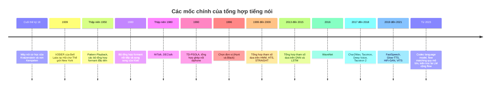

# Chương 19. Lịch sử TTS: từ formant đến neural

!!! abstract "Mục tiêu học tập"
    Sau chương này, bạn có thể:

    - **Trình bày** các mốc chính của tổng hợp tiếng nói, từ máy nói cơ học và VODER đến WaveNet, Tacotron và các mô hình quy mô lớn.
    - **Giải thích** nguyên lý của tổng hợp formant, tổng hợp cấu âm, tổng hợp ghép nối (diphone, PSOLA), chọn đơn vị (*unit selection*) và tổng hợp tham số thống kê (HMM, DNN).
    - **Cài đặt** thuật toán Viterbi cho chọn đơn vị với chi phí mục tiêu và chi phí nối.
    - **Suy ra** công thức sinh tham số có ràng buộc động (MLPG) và giải thích vì sao nó làm quỹ đạo trơn — cũng như vì sao nó gây hiện tượng "quá trơn" (*over-smoothing*).
    - **Phân tích** nguyên nhân của mỗi lần chuyển đổi mô hình (chất lượng, dữ liệu, tính toán, tính linh hoạt) và nhận ra các ý tưởng cũ đang tái xuất trong TTS hiện đại.
    - **Định vị** các Phần V–VIII của giáo trình trên bản đồ phát triển của TTS nơ-ron.
    - **Mô tả** một cách thận trọng tiến trình phát triển TTS tiếng Việt và những đặc thù khiến tiếng Việt phù hợp với một số hướng tiếp cận.

!!! info "Kiến thức cần có"
    - [Chương 13](../phan-3-tin-hieu-ngu-am/ch13-am-hoc-tieng-noi.md): mô hình nguồn–bộ lọc, formant.
    - [Chương 14](../phan-3-tin-hieu-ngu-am/ch14-xu-ly-tin-hieu-so.md): STFT, mel-spectrogram, F0, LPC, Griffin–Lim.
    - [Chương 7](../phan-2-mo-hinh-sinh/ch07-tong-quan-mo-hinh-sinh.md): bài toán một-nhiều và vì sao hồi quy L2 làm trơn đầu ra.
    - Quy hoạch động ở mức cơ bản (thuật toán Viterbi).

Lịch sử tổng hợp tiếng nói không chỉ là chuyện của quá khứ. Hầu như mọi ý tưởng "mới" trong TTS hiện đại đều có tiền thân: các token âm thanh rời rạc của mô hình ngôn ngữ ([Chương 31](../phan-8-mo-hinh-lon/ch31-audio-codec-speech-token.md)) gợi nhớ các "đơn vị" của tổng hợp ghép nối; thuật toán căn chỉnh đơn điệu MAS ([Chương 21](../phan-5-mo-hinh-am-hoc/ch21-alignment.md)) là họ hàng của Viterbi; bộ dự đoán trường độ của FastSpeech ([Chương 22](../phan-5-mo-hinh-am-hoc/ch22-fastspeech.md)) kế thừa mô hình trường độ của HMM; và hiện tượng giọng "mờ, đục" do trung bình hóa đã làm khổ các kỹ sư HMM từ những năm 2000 trước khi quay lại với FastSpeech. Hiểu vì sao mỗi thế hệ ra đời và vì sao nó bị thay thế sẽ giúp bạn đánh giá các mô hình mới một cách tỉnh táo.



## 19.1. Máy nói cơ học và điện tử

### 19.1.1. Thời kỳ cơ học

Những nỗ lực tạo tiếng nói nhân tạo đầu tiên mang tính **cơ học**. Vào cuối thế kỷ 18, Christian Kratzenstein chế tạo các ống cộng hưởng có hình dạng khác nhau, kích thích bằng lưỡi gà rung, để tạo ra các nguyên âm. Cùng thời kỳ, Wolfgang von Kempelen phát triển một "máy nói" gồm ống thổi (đóng vai phổi), một lưỡi gà (thanh quản) và một khoang da mềm có thể bóp bằng tay (đường âm), cùng các van tạo phụ âm xát; ông mô tả cỗ máy trong một cuốn sách xuất bản năm 1791. Thế kỷ 19 chứng kiến nhiều cỗ máy tiếp nối, như bản dựng lại máy của von Kempelen do Charles Wheatstone thực hiện hay máy "Euphonia" của Joseph Faber.

Điểm đáng chú ý là các máy này đã ngầm hiện thực **mô hình nguồn–bộ lọc** ([Chương 13](../phan-3-tin-hieu-ngu-am/ch13-am-hoc-tieng-noi.md)): một nguồn kích thích (lưỡi gà) và một bộ lọc cộng hưởng có thể thay đổi hình dạng (khoang miệng). Đây là ý tưởng xuyên suốt toàn bộ lịch sử TTS.

### 19.1.2. Bell Labs: vocoder và VODER

Bước ngoặt điện tử đến từ Phòng thí nghiệm Bell. Homer Dudley phát triển **vocoder** (*voice coder*) trong thập niên 1930: phân tích tiếng nói thành năng lượng trong một số dải tần cùng thông tin nguồn (hữu thanh/vô thanh, cao độ), truyền đi các tham số ít ỏi đó, rồi tổng hợp lại ở đầu thu. Đây là ý tưởng **phân tích–tổng hợp** (*analysis–synthesis*) mà sau này các vocoder thống kê và nơ-ron thừa kế — cái tên "vocoder" vẫn được dùng đến ngày nay cho khối biến đặc trưng âm học thành dạng sóng ([Phần VI](../phan-6-vocoder/ch24-vocoder-tu-hoi-quy-va-flow.md)).

Từ phần tổng hợp của vocoder, Dudley và cộng sự chế tạo **VODER** (*Voice Operating Demonstrator*), trình diễn tại Hội chợ Thế giới New York năm 1939 (Dudley và cộng sự, 1939). VODER không tự đọc văn bản: một người vận hành được huấn luyện lâu dài "chơi" nó như một nhạc cụ — các phím điều khiển năng lượng của một dãy bộ lọc thông dải, một thanh gạt chọn nguồn "buzz" (hữu thanh) hay "hiss" (vô thanh), và bàn đạp điều khiển cao độ. VODER chứng minh rằng tiếng nói dễ hiểu có thể được **tổng hợp hoàn toàn bằng điện tử** từ một số ít tham số.

Khoảng năm 1950, nhóm của Franklin Cooper tại Phòng thí nghiệm Haskins chế tạo **Pattern Playback** (Cooper và cộng sự, 1951): thiết bị biến các hình phổ (*spectrogram*) vẽ tay thành âm thanh. Pattern Playback không phải hệ thống TTS, nhưng là công cụ nền tảng để khám phá **các tín hiệu âm học** (*acoustic cues*) mà người nghe dùng để nhận ra phụ âm và nguyên âm — kiến thức mà tổng hợp theo luật ngay sau đó cần đến.

## 19.2. Tổng hợp formant: tổng hợp theo luật

### 19.2.1. Nguyên lý

**Tổng hợp formant** hiện thực hóa trực tiếp mô hình nguồn–bộ lọc: một nguồn (chuỗi xung thanh môn cho âm hữu thanh, nhiễu cho âm vô thanh) đi qua một tập **bộ cộng hưởng** (*resonator*), mỗi bộ mô phỏng một formant. Các tham số — tần số và băng thông của F1, F2, F3…, biên độ, F0, mức hữu thanh — được cập nhật mỗi vài mili giây theo **luật** do chuyên gia ngữ âm viết ra (vì vậy còn gọi là *synthesis by rule*): ví dụ, "khi chuyển từ /b/ sang /a/, F2 đi từ khoảng X Hz đến giá trị mục tiêu của /a/ trong khoảng Y ms".

Một bộ cộng hưởng số bậc hai — khối xây dựng của bộ tổng hợp Klatt (1980) — có dạng phương trình sai phân

$$
y[n] = A\, x[n] + B\, y[n-1] + C\, y[n-2],
$$

với $T = 1/f_s$ là chu kỳ lấy mẫu, $F$ là tần số formant, $BW$ là băng thông và

$$
C = -e^{-2\pi BW T}, \qquad B = 2 e^{-\pi BW T} \cos(2\pi F T), \qquad A = 1 - B - C.
$$

Hàm truyền $H(z) = A / (1 - B z^{-1} - C z^{-2})$ có hai cực tại $r e^{\pm j\theta}$ với $r = e^{-\pi BW T}$, $\theta = 2\pi F T$: góc của cực quyết định tần số cộng hưởng, bán kính quyết định băng thông (cực càng gần đường tròn đơn vị, đỉnh càng nhọn). Hệ số $A$ chuẩn hóa để độ lợi tại tần số 0 bằng 1. Bạn đã gặp đúng bộ lọc này khi tổng hợp nguyên âm ở [Chương 13](../phan-3-tin-hieu-ngu-am/ch13-am-hoc-tieng-noi.md). Klatt mô tả hai cách ghép: **nối tiếp** (*cascade*), tự nhiên cho nguyên âm vì biên độ tương đối giữa các formant tự động đúng, và **song song** (*parallel*), cần cho phụ âm xát và âm mũi vì cho phép điều khiển biên độ từng formant.

### 19.2.2. Các hệ thống tiêu biểu

Đầu thập niên 1950 đã có các bộ tổng hợp formant điện tử đầu tiên (ví dụ PAT của Walter Lawrence ở Anh và OVE của Gunnar Fant ở Thụy Điển). Hệ thống chuyển văn bản thành tiếng nói hoàn chỉnh trên máy tính xuất hiện cuối thập niên 1960 (tổng quan lịch sử chi tiết xem Klatt, 1987). Đỉnh cao của hướng này là bộ tổng hợp của Dennis Klatt tại MIT (Klatt, 1980), hệ thống MITalk (Allen, Hunnicutt và Klatt, 1987) và sản phẩm thương mại **DECtalk** của Digital Equipment Corporation ra đời giữa thập niên 1980 dựa trên công trình của Klatt. Giọng nói quen thuộc của nhà vật lý Stephen Hawking cũng xuất phát từ một bộ tổng hợp thuộc dòng dõi công trình của Klatt.

### 19.2.3. Ưu và nhược điểm

- **Ưu điểm:** cực kỳ gọn nhẹ (không lưu bản ghi âm nào), điều khiển hoàn toàn (tốc độ, cao độ, giọng), và rất **dễ hiểu ngay cả ở tốc độ cao**. Đó là lý do bộ tổng hợp formant vẫn được nhiều người khiếm thị ưa dùng với trình đọc màn hình; eSpeak/espeak-ng ngày nay là một bộ tổng hợp kiểu formant.
- **Nhược điểm:** giọng **máy móc**, thiếu tự nhiên; viết luật đòi hỏi chuyên gia ngữ âm và nhiều năm tinh chỉnh cho mỗi ngôn ngữ; nguồn xung đơn giản không tái tạo được sự phong phú của dao động dây thanh thật.

Bài học: một mô hình **tham số gọn, dễ hiểu** của tiếng nói là đủ cho độ **dễ nghe hiểu** (*intelligibility*) nhưng không đủ cho độ **tự nhiên** (*naturalness*). Khoảng cách giữa hai tiêu chí này là động lực chính của mọi thế hệ sau.

## 19.3. Tổng hợp cấu âm

**Tổng hợp cấu âm** (*articulatory synthesis*) đi sâu hơn một bước: thay vì mô hình hóa formant (hệ quả âm học), nó mô phỏng **chính bộ máy phát âm** — vị trí lưỡi, môi, hàm, vòm miệng mềm, dây thanh — rồi tính âm thanh bằng vật lý truyền sóng trong ống. Mô hình ống của Kelly và Lochbaum (1962) xấp xỉ đường âm bằng chuỗi các đoạn ống trụ có tiết diện khác nhau, với sóng phản xạ và truyền qua tại mỗi chỗ nối — một dạng sớm của mô hình *ống dẫn sóng số* (*digital waveguide*).

Về lý thuyết, đây là cách tiếp cận "đúng" nhất: đồng cấu âm (*coarticulation*) xuất hiện tự nhiên vì các cơ quan phát âm chuyển động liên tục; thay đổi giọng tương ứng với thay đổi giải phẫu. Trên thực tế, hướng này gặp hai khó khăn lớn: **bài toán ngược** (từ âm thanh suy ra cấu hình cơ quan phát âm) rất khó và không duy nhất, nên khó lấy tham số từ dữ liệu; và chất lượng âm thanh nhìn chung tụt hậu so với các phương pháp dựa trên dữ liệu. Tổng hợp cấu âm vẫn là một hướng nghiên cứu khoa học có giá trị (về sinh lý phát âm, về sản sinh tiếng nói), và gần đây có các nghiên cứu kết hợp nó với mạng nơ-ron, nhưng chưa trở thành dòng chính của TTS ứng dụng.

## 19.4. Tổng hợp ghép nối

### 19.4.1. Từ luật sang dữ liệu: diphone

Thay vì viết luật mô tả âm thanh, tại sao không **ghi âm** người thật rồi ghép các đoạn lại? Vấn đề là chỗ nối: nếu ghép theo đơn vị âm vị, mỗi chỗ nối rơi vào vùng **chuyển tiếp** giữa hai âm — nơi tín hiệu biến đổi nhanh nhất và khó khớp nhất. Giải pháp là **diphone**: đơn vị kéo dài từ **giữa** một âm vị đến **giữa** âm vị kế tiếp. Chỗ nối khi đó rơi vào phần ổn định của âm vị, còn phần chuyển tiếp khó được giữ nguyên vẹn bên trong đơn vị. Số diphone xấp xỉ bình phương số âm vị (trừ các cặp không xuất hiện), vào cỡ một đến vài nghìn đơn vị với một ngôn ngữ, đủ nhỏ để ghi âm mỗi diphone một lần, thường với giọng đều đều.

### 19.4.2. Điều chỉnh ngôn điệu bằng PSOLA

Các diphone được ghi với cao độ và trường độ cố định, nhưng câu cần tổng hợp có đường nét F0 và nhịp điệu riêng. Kỹ thuật kinh điển để sửa đổi chúng là **TD-PSOLA** (*Time-Domain Pitch-Synchronous Overlap-Add*; Moulines và Charpentier, 1990). Ý tưởng:

1. Đánh dấu các **mốc cao độ** $t_m$ (thường tại thời điểm đóng thanh môn) trên tín hiệu gốc $s[n]$.
2. Cắt các **đoạn ngắn** quanh mỗi mốc bằng cửa sổ dài khoảng hai chu kỳ: $x_m[n] = h_m[n - t_m]\, s[n]$.
3. Đặt một dãy **mốc tổng hợp** $\tilde{t}_q$ cách nhau đúng bằng chu kỳ mong muốn $1/F_0^{\text{đích}}$, gán cho mỗi mốc tổng hợp một đoạn phân tích $m(q)$ (theo trục thời gian đã co giãn), rồi **cộng chồng** (*overlap-add*):

$$
\tilde{s}[n] = \sum_{q} x_{m(q)}\big[n - \tilde{t}_q + t_{m(q)}\big].
$$

Đặt các đoạn sát nhau hơn làm **tăng** F0; đặt thưa hơn làm **giảm** F0. Lặp lại hoặc bỏ bớt đoạn làm thay đổi trường độ. Vì mỗi đoạn giữ nguyên hình dạng (tức giữ nguyên bao phổ, xấp xỉ đáp ứng của đường âm), formant không bị dịch theo F0 — điều mà phép co giãn thời gian ngây thơ không làm được. Dự án **MBROLA** (Dutoit và cộng sự, 1996) cung cấp cơ sở dữ liệu diphone miễn phí cho mục đích phi thương mại ở nhiều ngôn ngữ và đóng vai trò quan trọng trong nghiên cứu những năm 1990–2000.

Giới hạn: biến đổi lớn (ví dụ đổi F0 quá nhiều) gây méo tiếng; chỗ nối giữa các diphone ghi ở những thời điểm khác nhau có thể lệch phổ; và cần mốc cao độ chính xác. Quan trọng hơn: dù mỗi đơn vị là tiếng người thật, giọng tổng thể vẫn **thiếu tự nhiên** vì mỗi âm chỉ có **một** phiên bản, bị kéo giãn để phục vụ mọi ngữ cảnh.

### 19.4.3. Chọn đơn vị (*unit selection*)

Bước nhảy tiếp theo đến cùng với dung lượng lưu trữ rẻ: thay vì một phiên bản cho mỗi đơn vị, hãy ghi âm **hàng giờ** tiếng nói của một người, để mỗi đơn vị có **hàng trăm** phiên bản ở nhiều ngữ cảnh, cao độ, trường độ khác nhau, rồi **chọn** chuỗi phiên bản phù hợp nhất cho câu cần đọc — lý tưởng là không cần sửa đổi tín hiệu chút nào. Ý tưởng dùng đơn vị có độ dài thay đổi đã xuất hiện trong hệ thống ν-Talk của ATR (Sagisaka, 1988); khung hình thức hóa được trích dẫn nhiều nhất là của Hunt và Black (1996).

**Hình thức hóa.** Câu cần tổng hợp được front-end biến thành dãy **đích** $t_1, \ldots, t_n$ (mỗi đích là đặc tả: âm vị, ngữ cảnh, F0 và trường độ dự đoán…). Với mỗi đích $t_i$, cơ sở dữ liệu cho một tập **ứng viên** $u_{i,1}, \ldots, u_{i,K_i}$. Hai loại chi phí:

- **Chi phí mục tiêu** $C^{t}(t_i, u_i) = \sum_{j} w^{t}_{j}\, C^{t}_{j}(t_i, u_i)$: ứng viên khớp với đặc tả đến đâu (sai khác ngữ cảnh âm vị, F0, trường độ, vị trí trong câu…).
- **Chi phí nối** $C^{c}(u_{i-1}, u_i) = \sum_{k} w^{c}_{k}\, C^{c}_{k}(u_{i-1}, u_i)$: hai đơn vị liền nhau ghép có "êm" không (sai khác phổ, F0, năng lượng tại điểm nối). Đặc biệt, $C^{c} = 0$ nếu hai đơn vị vốn **liền nhau** trong bản ghi gốc — vì vậy hệ thống có xu hướng chọn những đoạn dài nguyên vẹn khi có thể.

Bài toán là tìm dãy ứng viên cực tiểu tổng chi phí:

$$
\hat{u}_{1:n} = \arg\min_{u_{1:n}} \left[ \sum_{i=1}^{n} C^{t}(t_i, u_i) + \sum_{i=2}^{n} C^{c}(u_{i-1}, u_i) \right].
$$

Vét cạn có $\prod_i K_i$ khả năng — bất khả thi. Nhưng hàm mục tiêu chỉ có tương tác giữa các vị trí **liền kề** (một chuỗi Markov bậc nhất), nên quy hoạch động áp dụng được. Gọi $D_i(k)$ là chi phí nhỏ nhất của một dãy kết thúc bằng ứng viên $k$ tại vị trí $i$:

$$
D_1(k) = C^{t}(t_1, u_{1,k}), \qquad
D_i(k) = C^{t}(t_i, u_{i,k}) + \min_{k'} \Big[ D_{i-1}(k') + C^{c}(u_{i-1,k'}, u_{i,k}) \Big].
$$

Đáp án là $\min_k D_n(k)$, và dãy tối ưu được khôi phục bằng cách lưu $\arg\min_{k'}$ ở mỗi bước rồi truy vết ngược. Độ phức tạp là $O(n K^2)$ thay vì $O(K^n)$. Đây chính là **thuật toán Viterbi** — cùng họ với các thuật toán quy hoạch động bạn sẽ gặp lại ở MAS ([Chương 21](../phan-5-mo-hinh-am-hoc/ch21-alignment.md)). Trong hệ thống thực, $K$ lên tới hàng trăm và có thêm các kỹ thuật tỉa (*pruning*) để giới hạn số ứng viên.

```python
import itertools
import numpy as np


def unit_selection(target_cost: list[np.ndarray], join_cost: list[np.ndarray]):
    """Tìm chuỗi đơn vị có tổng chi phí nhỏ nhất bằng quy hoạch động (Viterbi).

    target_cost[i]: (K_i,)          chi phí mục tiêu C^t của các ứng viên cho vị trí i
    join_cost[i]:   (K_i, K_{i+1})  chi phí nối C^c giữa ứng viên vị trí i và i+1
    """
    D = target_cost[0].copy()                                    # (K_0,)
    back = []
    for i in range(1, len(target_cost)):
        total = D[:, None] + join_cost[i - 1] + target_cost[i][None, :]   # (K_{i-1}, K_i)
        back.append(total.argmin(axis=0))                        # ứng viên trước tốt nhất
        D = total.min(axis=0)                                    # (K_i,)
    path = [int(D.argmin())]
    for b in reversed(back):                                     # truy vết ngược
        path.append(int(b[path[-1]]))
    return path[::-1], float(D.min())


# Ví dụ đồ chơi: 4 vị trí đích, mỗi vị trí có 3–5 ứng viên mang (F0 đầu, F0 cuối) ngẫu nhiên
rng = np.random.default_rng(0)
target_f0 = np.array([120.0, 140.0, 130.0, 110.0])               # F0 mong muốn (Hz)
cands = [rng.uniform(90, 160, size=(rng.integers(3, 6), 2)) for _ in target_f0]
tc = [np.abs(c.mean(axis=1) - f) / 10 for c, f in zip(cands, target_f0)]
jc = [np.abs(a[:, 1][:, None] - b[:, 0][None, :]) / 5            # lệch F0 tại chỗ nối
      for a, b in zip(cands[:-1], cands[1:])]

path, cost = unit_selection(tc, jc)
# Kiểm tra với vét cạn (chỉ khả thi vì ví dụ rất nhỏ)
def total_cost(p):
    return sum(tc[i][k] for i, k in enumerate(p)) + sum(jc[i][p[i], p[i + 1]] for i in range(len(p) - 1))
best = min(itertools.product(*[range(len(c)) for c in cands]), key=total_cost)
assert list(best) == path and np.isclose(total_cost(best), cost)
print("chuỗi đơn vị:", path, "| tổng chi phí:", round(cost, 3))
```

Ví dụ đồ chơi dùng hai chi phí đơn giản (lệch F0 trung bình so với đích, và lệch F0 tại điểm nối) và kiểm tra rằng Viterbi cho đúng nghiệm của phép vét cạn.

**Vì sao chọn đơn vị thống trị (cuối thập niên 1990 – đầu thập niên 2010)?** Khi cơ sở dữ liệu có đơn vị tốt cho câu cần đọc, kết quả **gần như không phân biệt được** với tiếng người, vì đó *chính là* tiếng người, không qua xử lý. Các khung phần mềm như Festival (Taylor, Black và Caley, 1998) giúp hướng này lan rộng trong nghiên cứu; nhiều sản phẩm thương mại thời kỳ đó dùng chọn đơn vị. Chuỗi đánh giá **Blizzard Challenge** bắt đầu từ năm 2005 (Black và Tokuda, 2005) cho phép so sánh các hệ thống trên cùng dữ liệu bằng thính giả.

**Nhược điểm:** chất lượng **không đều** — câu có đơn vị tốt nghe rất tự nhiên, câu thiếu đơn vị phù hợp có lỗi nối rõ rệt (và người nghe rất nhạy với những lỗi này); cơ sở dữ liệu lớn (hàng trăm MB đến hàng GB); mỗi giọng mới đòi hỏi ghi âm hàng giờ trong điều kiện nghiêm ngặt; gần như **không linh hoạt** về ngôn điệu — muốn giọng vui, buồn, đọc truyện… phải ghi âm thêm; và việc chỉnh các trọng số $w^t_j, w^c_k$ rất tốn công.

## 19.5. Tổng hợp tham số thống kê dựa trên HMM

### 19.5.1. Ý tưởng: lưu mô hình, không lưu tín hiệu

Đầu những năm 2000, một hướng khác trưởng thành: **tổng hợp tham số thống kê** (*statistical parametric speech synthesis*, SPSS; xem tổng quan của Zen, Tokuda và Black, 2009). Thay vì lưu bản ghi âm, ta học một **mô hình thống kê** của các **tham số âm học** theo ngữ cảnh ngôn ngữ, rồi lúc tổng hợp sinh tham số từ mô hình và đưa qua vocoder để tạo dạng sóng. Một hệ thống SPSS gồm:

1. **Vocoder phân tích–tổng hợp**: biểu diễn mỗi khung (thường 5 ms) bằng bao phổ (ví dụ hệ số mel-cepstrum), log F0 và thông tin phi tuần hoàn (*aperiodicity*). Các vocoder như STRAIGHT (Kawahara và cộng sự, 1999) và sau này WORLD (Morise và cộng sự, 2016) cải thiện đáng kể chất lượng tái tạo ([Chương 14](../phan-3-tin-hieu-ngu-am/ch14-xu-ly-tin-hieu-so.md)).
2. **Mô hình âm học**: các **HMM phụ thuộc ngữ cảnh** (Yoshimura và cộng sự, 1999) mô hình hóa đồng thời phổ, F0 và trường độ. Mỗi âm vị thường là một HMM trái–phải nhiều trạng thái; mỗi trạng thái phát xạ một phân phối Gauss trên véc-tơ tham số.
3. **Thuật toán sinh tham số** biến dãy trạng thái thành quỹ đạo tham số trơn (MLPG, Mục 19.5.3).

### 19.5.2. Ngữ cảnh, cây quyết định và F0

Phát âm của một âm vị phụ thuộc rất nhiều vào ngữ cảnh: âm đứng trước và sau, vị trí trong âm tiết, từ, cụm, câu, trọng âm hoặc thanh điệu, từ loại… Nhãn **ngữ cảnh đầy đủ** (*full-context label*) của HTS mã hóa hàng chục thuộc tính như vậy. Số tổ hợp ngữ cảnh là khổng lồ, nên hầu hết ngữ cảnh lúc tổng hợp **chưa từng xuất hiện** trong dữ liệu huấn luyện. Giải pháp là **phân cụm ngữ cảnh bằng cây quyết định**: các trạng thái HMM của nhiều ngữ cảnh được gom vào cùng một lá theo các câu hỏi nhị phân ("âm bên trái có phải âm mũi không?", "thanh điệu hiện tại có phải thanh ngang không?"), mỗi lá dùng chung một phân phối Gauss. Phổ, F0 và trường độ có cây riêng.

F0 đặt ra một khó khăn riêng: nó **có giá trị liên tục** ở đoạn hữu thanh nhưng **không xác định** ở đoạn vô thanh. **HMM phân phối đa không gian** (*multi-space probability distribution HMM*, MSD-HMM; Tokuda và cộng sự, 2002) giải quyết bằng cách cho mỗi trạng thái một phân phối hỗn hợp trên hai "không gian": không gian liên tục một chiều cho log F0 và không gian rời rạc cho "vô thanh". Trường độ được mô hình hóa tường minh cho từng trạng thái. Toàn bộ các thành phần được đóng gói trong bộ công cụ mã nguồn mở **HTS** (Zen và cộng sự, 2007), vốn được dùng rộng rãi trong nghiên cứu suốt hơn một thập kỷ.

### 19.5.3. Sinh tham số với đặc trưng động (MLPG)

Nếu chỉ lấy trung bình của trạng thái HMM tại mỗi khung, quỹ đạo tham số sẽ là **hàm bậc thang**: hằng số trong mỗi trạng thái và nhảy đột ngột giữa các trạng thái — nghe rất giả. Tokuda và cộng sự (2000) giải quyết bằng cách mô hình hóa cả **đặc trưng động** (đạo hàm theo thời gian) và sinh quỹ đạo thỏa mãn đồng thời cả hai.

Gọi $\mathbf{c} = (c_1, \ldots, c_T)^\top$ là quỹ đạo tham số **tĩnh** (một chiều cho đơn giản) và $\Delta c_t = \tfrac{1}{2}(c_{t+1} - c_{t-1})$. Véc-tơ quan sát gồm cả tĩnh lẫn động là một biến đổi **tuyến tính** của $\mathbf{c}$:

$$
\mathbf{o} = \begin{bmatrix} \mathbf{c} \\ \Delta \mathbf{c} \end{bmatrix} = \mathbf{W} \mathbf{c}, \qquad \mathbf{W} \in \mathbb{R}^{2T \times T}.
$$

Với một dãy trạng thái cho trước, HMM cho mỗi khung một trung bình và phương sai cho cả phần tĩnh lẫn phần động; ghép lại thành $\boldsymbol{\mu} \in \mathbb{R}^{2T}$ và ma trận hiệp phương sai chéo $\boldsymbol{\Sigma}$. Ta tìm $\mathbf{c}$ cực đại hóa hợp lý:

$$
\mathbf{c}^{*} = \arg\max_{\mathbf{c}}\; \log \mathcal{N}\big(\mathbf{W}\mathbf{c};\, \boldsymbol{\mu}, \boldsymbol{\Sigma}\big)
= \arg\min_{\mathbf{c}}\; \tfrac{1}{2} (\mathbf{W}\mathbf{c} - \boldsymbol{\mu})^\top \boldsymbol{\Sigma}^{-1} (\mathbf{W}\mathbf{c} - \boldsymbol{\mu}).
$$

Đây là bài toán bình phương tối thiểu có trọng số. Lấy gradient theo $\mathbf{c}$ và cho bằng 0:

$$
\nabla_{\mathbf{c}} = \mathbf{W}^\top \boldsymbol{\Sigma}^{-1} (\mathbf{W}\mathbf{c} - \boldsymbol{\mu}) = \mathbf{0}
\quad\Longrightarrow\quad
\mathbf{W}^\top \boldsymbol{\Sigma}^{-1} \mathbf{W}\, \mathbf{c}^{*} = \mathbf{W}^\top \boldsymbol{\Sigma}^{-1} \boldsymbol{\mu}.
$$

Ma trận $\mathbf{W}^\top \boldsymbol{\Sigma}^{-1} \mathbf{W}$ đối xứng xác định dương (vì $\mathbf{W}$ chứa khối đơn vị nên có hạng đầy đủ), do đó nghiệm duy nhất là

$$
\mathbf{c}^{*} = \big(\mathbf{W}^\top \boldsymbol{\Sigma}^{-1} \mathbf{W}\big)^{-1} \mathbf{W}^\top \boldsymbol{\Sigma}^{-1} \boldsymbol{\mu}.
$$

Hai nhận xét:

- Nếu bỏ phần động (chỉ giữ khối đơn vị trong $\mathbf{W}$), nghiệm suy biến thành $\mathbf{c}^{*} = \boldsymbol{\mu}_{\text{tĩnh}}$ — chính là hàm bậc thang. Ràng buộc "đạo hàm gần trung bình động (thường gần 0 bên trong trạng thái)" kéo quỹ đạo thành đường cong trơn, với độ trơn được cân bằng bởi tỷ lệ phương sai tĩnh/động.
- Vì cửa sổ $\Delta$ chỉ liên quan các khung lân cận, $\mathbf{W}^\top \boldsymbol{\Sigma}^{-1} \mathbf{W}$ là **ma trận băng** (*banded*), nên hệ có thể giải trong $O(T)$ bằng phân tích Cholesky cho ma trận băng. Mã minh họa dưới đây dùng `np.linalg.solve` cho đơn giản.

```python
import numpy as np


def delta_matrix(T: int) -> np.ndarray:
    """W (2T, T): o = W c = [c; Δc], với Δc_t = (c_{t+1} - c_{t-1}) / 2 (biên: lặp phần tử)."""
    I = np.eye(T)
    D = np.zeros((T, T))
    for t in range(T):
        D[t, min(t + 1, T - 1)] += 0.5
        D[t, max(t - 1, 0)] -= 0.5
    return np.vstack([I, D])


def mlpg(mu: np.ndarray, var: np.ndarray, W: np.ndarray) -> np.ndarray:
    """Nghiệm c* = (Wᵀ Σ⁻¹ W)⁻¹ Wᵀ Σ⁻¹ μ, Σ chéo với đường chéo `var`."""
    P = 1.0 / var                                    # (2T,) độ chính xác (precision)
    A = W.T @ (P[:, None] * W)                       # (T, T)
    b = W.T @ (P * mu)                               # (T,)
    return np.linalg.solve(A, b)


# Ba "trạng thái HMM", mỗi trạng thái 10 khung với trung bình tĩnh hằng số → bậc thang
T = 30
mu_static = np.repeat([100.0, 140.0, 110.0], 10)     # ví dụ: F0 trung bình (Hz)
mu_delta = np.zeros(T)                               # trung bình Δ = 0: "kỳ vọng đứng yên"
var = np.concatenate([np.full(T, 25.0), np.full(T, 4.0)])
W = delta_matrix(T)
c = mlpg(np.concatenate([mu_static, mu_delta]), var, W)

A = W.T @ (W / var[:, None])
assert np.allclose(A @ c, W.T @ (np.concatenate([mu_static, mu_delta]) / var))  # phương trình chuẩn
jump_step = np.abs(np.diff(mu_static)).max()
jump_mlpg = np.abs(np.diff(c)).max()
assert jump_mlpg < jump_step                         # quỹ đạo trơn hơn bậc thang
print(f"bước nhảy lớn nhất: bậc thang {jump_step:.1f} Hz → MLPG {jump_mlpg:.1f} Hz")
```

### 19.5.4. Ưu điểm, nhược điểm và hiện tượng quá trơn

SPSS có nhiều ưu điểm so với chọn đơn vị: mô hình chỉ vài MB; giọng **ổn định**, không có lỗi nối; **linh hoạt** — có thể thích ứng sang giọng mới với ít dữ liệu bằng các phép biến đổi tuyến tính trên tham số mô hình, nội suy giữa các giọng, điều khiển phong cách; và xây hệ thống cho ngôn ngữ mới tương đối nhanh (rất hấp dẫn với ngôn ngữ ít tài nguyên như tiếng Việt thời đó). Nhưng chất lượng có một "trần" rõ rệt: tiếng nói nghe **đục, rè** (*buzzy, muffled*). Zen, Tokuda và Black (2009) chỉ ra ba nguyên nhân chính:

1. **Vocoder**: mô hình nguồn–bộ lọc đơn giản hóa (nguồn xung + nhiễu) không tái tạo được dạng sóng tự nhiên.
2. **Độ chính xác của mô hình âm học**: Gauss trên lá cây quyết định là mô hình thô.
3. **Quá trơn** (*over-smoothing*): tham số được sinh là **trung bình** của nhiều mẫu huấn luyện, nên mất các chi tiết tinh vi (cấu trúc formant sắc nét, biến động vi mô của F0).

Nguyên nhân thứ ba đáng được nhấn mạnh vì nó **quay lại** nhiều lần: như [Chương 7](../phan-2-mo-hinh-sinh/ch07-tong-quan-mo-hinh-sinh.md) đã phân tích, cực đại hợp lý Gauss tương đương cực tiểu sai số L2, và nghiệm tối ưu của L2 là **kỳ vọng có điều kiện** — trung bình của mọi cách nói có thể. Một chữa cháy kinh điển là **phương sai toàn cục** (*global variance*, GV; Toda và Tokuda, 2007): thêm vào hàm mục tiêu một số hạng buộc phương sai của quỹ đạo sinh ra gần với phương sai của tiếng nói thật. Giải pháp triệt để chỉ đến khi mô hình được thay bằng các **mô hình sinh** thực sự (GAN, flow, diffusion, flow matching — Phần II), như bạn sẽ thấy ở [Chương 22](../phan-5-mo-hinh-am-hoc/ch22-fastspeech.md) và [Chương 23](../phan-5-mo-hinh-am-hoc/ch23-glow-grad-matcha.md).

## 19.6. Tổng hợp tham số dựa trên mạng nơ-ron sâu

Cây quyết định là điểm yếu cấu trúc của HMM-SPSS: nó **chia cắt** không gian ngữ cảnh, mỗi lá chỉ thấy một phần nhỏ dữ liệu, và rất kém trong việc biểu diễn các tương tác phức tạp giữa thuộc tính ngữ cảnh (kiểu hàm XOR). Zen, Senior và Schuster (2013) đề xuất thay cây quyết định bằng **mạng nơ-ron sâu** (DNN): đầu vào là véc-tơ đặc trưng ngôn ngữ ở mức khung (các thuộc tính ngữ cảnh mã hóa nhị phân/số, cùng vị trí của khung trong âm vị), đầu ra là tham số vocoder (kèm đặc trưng động); MLPG và vocoder giữ nguyên. Lợi ích chính: **chia sẻ tham số** giữa mọi ngữ cảnh — mỗi mẫu huấn luyện cập nhật toàn bộ mạng.

Các bước tiếp theo nhanh chóng: **mạng mật độ hỗn hợp** (*mixture density network*) để mô hình hóa phân phối thay vì chỉ trung bình (Zen và Senior, 2014); **LSTM hai chiều** để nắm phụ thuộc thời gian dài (Fan và cộng sự, 2014); LSTM một chiều với lớp đầu ra hồi quy cho tổng hợp độ trễ thấp (Zen và Sak, 2015); bộ công cụ mã nguồn mở Merlin (Wu, Watts và King, 2016). Một số sản phẩm thương mại giữa thập niên 2010 chuyển sang SPSS dựa trên mạng nơ-ron.

Dù vậy, cấu trúc hệ thống vẫn là một **dây chuyền nhiều khối thiết kế thủ công**: front-end sinh hàng trăm đặc trưng ngôn ngữ, mô hình trường độ riêng, mô hình âm học, MLPG, và vocoder tham số với giới hạn chất lượng cố hữu. Hai "nút thắt" còn lại — vocoder và sự phức tạp của dây chuyền — chính là thứ cuộc cách mạng tiếp theo phá bỏ.

## 19.7. Bước ngoặt nơ-ron (2016–2018)

### 19.7.1. WaveNet: phá nút thắt vocoder

Tháng 9 năm 2016, DeepMind công bố **WaveNet** (van den Oord và cộng sự, 2016): một mô hình **tự hồi quy** trực tiếp trên mẫu dạng sóng,

$$
p(\mathbf{s} \mid \mathbf{h}) = \prod_{n=0}^{L-1} p\big(s[n] \mid s[0], \ldots, s[n-1], \mathbf{h}\big),
$$

trong đó $\mathbf{h}$ là điều kiện (đặc trưng ngôn ngữ, F0). Mỗi phân phối có điều kiện được tham số hóa bởi một chồng **tích chập nhân quả giãn** (*dilated causal convolution*) với trường tiếp nhận hàng nghìn mẫu, và đầu ra là softmax trên 256 mức lượng tử μ-law ([Chương 24](../phan-6-vocoder/ch24-vocoder-tu-hoi-quy-va-flow.md)). Không còn giả định nguồn–bộ lọc, không còn mel-cepstrum: mô hình học thẳng phân phối của dạng sóng. Theo báo cáo gốc, trong các bài kiểm tra nghe với tiếng Anh Mỹ và tiếng Quan Thoại, WaveNet được đánh giá tự nhiên hơn cả hệ thống ghép nối lẫn hệ thống tham số tốt nhất mà nhóm tác giả dùng để so sánh. Cái giá: sinh tuần tự từng mẫu (hàng chục nghìn mẫu mỗi giây âm thanh) **cực kỳ chậm** ở phiên bản đầu. Việc tăng tốc WaveNet (Parallel WaveNet, WaveRNN…) rồi thay thế nó bằng các vocoder song song (WaveGlow, HiFi-GAN…) là nội dung của [Phần VI](../phan-6-vocoder/ch25-gan-vocoder.md).

### 19.7.2. Seq2seq với attention: phá nút thắt dây chuyền

Song song, cộng đồng học sâu mang mô hình **seq2seq với attention** (vốn thành công trong dịch máy) sang TTS. **Char2Wav** (Sotelo và cộng sự, 2017) dùng một "bộ đọc" encoder–decoder có attention ánh xạ ký tự sang đặc trưng vocoder, kết hợp vocoder nơ-ron SampleRNN (Mehri và cộng sự, 2017). **Tacotron** (Wang và cộng sự, 2017) của Google ánh xạ trực tiếp **ký tự → spectrogram** bằng encoder (khối CBHG), decoder tự hồi quy có attention, rồi dùng Griffin–Lim để khôi phục dạng sóng. Điểm cách mạng không nằm ở chất lượng (Griffin–Lim còn nhiều nhiễu) mà ở chỗ: mô hình được **huấn luyện đầu–cuối từ các cặp (văn bản, âm thanh)**, không cần nhãn ngữ cảnh đầy đủ, không cần cây quyết định, không cần mô hình trường độ riêng — căn chỉnh được học ngầm qua attention.

**Tacotron 2** (Shen và cộng sự, 2018) ghép hai mảnh lại: một mạng seq2seq dự đoán **mel-spectrogram** từ ký tự, và một WaveNet được điều kiện trên mel làm vocoder. Theo báo cáo gốc, trên tập dữ liệu tiếng Anh Mỹ nội bộ, điểm MOS của Tacotron 2 xấp xỉ 4,53, rất gần mức 4,58 của bản ghi âm thật trong cùng bài kiểm tra. Bên cạnh đó, nhóm Baidu công bố loạt **Deep Voice**: Deep Voice (Arık và cộng sự, 2017) thay từng khối của dây chuyền cổ điển bằng mạng nơ-ron với trọng tâm là suy luận thời gian thực, Deep Voice 2 mở rộng sang nhiều người nói, và Deep Voice 3 (Ping và cộng sự, 2018) là kiến trúc tích chập hoàn toàn dựa trên attention. Chi tiết Tacotron và các vấn đề của attention được bàn ở [Chương 20](../phan-5-mo-hinh-am-hoc/ch20-tacotron.md).

### 19.7.3. Vì sao lần chuyển đổi này xảy ra?

Ba lần chuyển đổi lớn (luật → ghép nối, ghép nối → thống kê, thống kê → nơ-ron) đều có thể phân tích theo bốn trục:

| Lần chuyển đổi | Chất lượng | Dữ liệu | Tính toán | Tính linh hoạt |
|---|---|---|---|---|
| Formant → ghép nối | tiếng người thật thay cho nguồn tổng hợp | cần ghi âm (diphone, rồi hàng giờ) | cần bộ nhớ lớn hơn | giảm (khó đổi giọng, phong cách) |
| Chọn đơn vị → HMM-SPSS | giảm độ tự nhiên, nhưng ổn định hơn | ít dữ liệu hơn cho một giọng mới | mô hình rất nhỏ | tăng mạnh (thích ứng, nội suy) |
| SPSS → nơ-ron | tăng vọt (vocoder nơ-ron, mô hình sinh) | cần cặp (văn bản, âm thanh) lớn hơn, nhưng ít nhãn chuyên gia | cần GPU | tăng (đa người nói, phong cách, ngôn ngữ mới) |

Cuộc cách mạng nơ-ron xảy ra vào giữa thập niên 2010 vì các điều kiện **hội tụ**: GPU đủ mạnh để huấn luyện mô hình tự hồi quy trên dạng sóng; các thư viện học sâu (TensorFlow, sau đó PyTorch) giúp thử nghiệm nhanh; kỹ thuật seq2seq và attention đã chín muồi trong dịch máy; và các bộ dữ liệu công khai như LJSpeech (một người đọc, khoảng 24 giờ, phát hành năm 2017) cho phép cộng đồng tái lập kết quả. Quan trọng không kém là **chi phí xây dựng hệ thống cho ngôn ngữ mới giảm mạnh**: thay vì cần chuyên gia viết luật ngữ âm và thiết kế hàng trăm đặc trưng ngữ cảnh, chỉ cần một tập cặp văn bản–âm thanh sạch và một front-end tối thiểu (chuẩn hóa văn bản, có thể thêm G2P — [Phần IV](../phan-4-frontend/ch17-chuan-hoa-van-ban.md)).

## 19.8. Dây chuyền hai giai đoạn và các thời kỳ tiếp theo

### 19.8.1. Kiến trúc hai giai đoạn kinh điển

Từ Tacotron 2, kiến trúc **hai giai đoạn** trở thành chuẩn mực của TTS nơ-ron trong nhiều năm:


Mel-spectrogram đóng vai trò **biểu diễn trung gian**: đủ gọn để mô hình âm học dự đoán (vài chục kênh, vài chục đến một trăm khung mỗi giây), đủ thông tin để vocoder khôi phục dạng sóng chất lượng cao. Tách hai giai đoạn cho phép huấn luyện và thay thế từng khối độc lập — nhưng cũng tạo ra **sai lệch** giữa mel do mô hình âm học sinh ra và mel thật mà vocoder được huấn luyện, cùng một "hợp đồng" cấu hình mel nghiêm ngặt giữa hai khối ([Chương 14](../phan-3-tin-hieu-ngu-am/ch14-xu-ly-tin-hieu-so.md), [Chương 26](../phan-6-vocoder/ch26-diffusion-vocoder-va-so-sanh.md)).

### 19.8.2. Bản đồ các phần tiếp theo của giáo trình

Mỗi thế hệ mô hình sau Tacotron 2 có thể đọc như lời giải cho một vấn đề của thế hệ trước:

| Vấn đề | Lời giải | Ở đâu trong sách |
|---|---|---|
| Attention tự hồi quy không ổn định (lặp, bỏ chữ), suy luận chậm | Căn chỉnh tường minh, mô hình không tự hồi quy với bộ dự đoán trường độ (FastSpeech) | [Chương 20](../phan-5-mo-hinh-am-hoc/ch20-tacotron.md), [21](../phan-5-mo-hinh-am-hoc/ch21-alignment.md), [22](../phan-5-mo-hinh-am-hoc/ch22-fastspeech.md) |
| Hồi quy L2/L1 trên mel bị quá trơn | Bộ giải mã sinh: flow, diffusion, flow matching (Glow-TTS, Grad-TTS, Matcha-TTS) | [Chương 23](../phan-5-mo-hinh-am-hoc/ch23-glow-grad-matcha.md) |
| WaveNet quá chậm | Vocoder song song: flow, GAN (HiFi-GAN), diffusion | [Chương 24](../phan-6-vocoder/ch24-vocoder-tu-hoi-quy-va-flow.md)–[26](../phan-6-vocoder/ch26-diffusion-vocoder-va-so-sanh.md) |
| Sai lệch giữa hai giai đoạn | Huấn luyện đầu–cuối (VITS) | [Chương 27](../phan-7-e2e-bieu-cam/ch27-vits.md) |
| Cần nhiều giọng, phong cách, ngôn ngữ | Embedding người nói, bộ mã hóa tham chiếu, đa ngôn ngữ | [Chương 28](../phan-7-e2e-bieu-cam/ch28-da-nguoi-noi-voice-cloning.md)–[30](../phan-7-e2e-bieu-cam/ch30-da-ngon-ngu-code-switching.md) |
| Nhân bản giọng không cần huấn luyện lại | Token âm thanh rời rạc + mô hình ngôn ngữ, flow matching quy mô lớn, kiến trúc lai | [Chương 31](../phan-8-mo-hinh-lon/ch31-audio-codec-speech-token.md)–[34](../phan-8-mo-hinh-lon/ch34-he-thong-lai-hien-dai.md) |
| Độ trễ trong hội thoại | Streaming, speech LLM | [Chương 35](../phan-8-mo-hinh-lon/ch35-streaming-speech-llm.md) |

### 19.8.3. Những ý tưởng cũ tái xuất

Một cách đọc thú vị lịch sử là nhận ra các ý tưởng cổ điển trong trang phục mới:

- **Đơn vị rời rạc**: chọn đơn vị ghép các đoạn tiếng nói lưu sẵn; các mô hình codec LM ([Chương 32](../phan-8-mo-hinh-lon/ch32-codec-language-model.md)) sinh chuỗi **token âm thanh** rời rạc học được từ dữ liệu.
- **"Sao chép" từ dữ liệu**: chọn đơn vị chép nguyên đoạn từ cơ sở dữ liệu; nhân bản giọng bằng lời nhắc (*prompt*) âm thanh ở các mô hình lớn khai thác ngữ cảnh âm thanh có sẵn theo cách học được.
- **Quy hoạch động**: Viterbi trong chọn đơn vị và HMM ↔ MAS trong Glow-TTS/VITS ([Chương 21](../phan-5-mo-hinh-am-hoc/ch21-alignment.md)).
- **Mô hình trường độ**: trường độ trạng thái HMM ↔ bộ dự đoán trường độ của FastSpeech.
- **Mô hình nguồn–bộ lọc**: vocoder tham số ↔ các vocoder nơ-ron có cấu trúc nguồn–bộ lọc như LPCNet hay NSF ([Chương 24](../phan-6-vocoder/ch24-vocoder-tu-hoi-quy-va-flow.md)).
- **Quá trơn**: GV trong HMM ↔ bộ giải mã sinh và hàm mất mát đối kháng trong TTS nơ-ron.

## 19.9. TTS tiếng Việt: một cái nhìn thận trọng

Viết lịch sử TTS tiếng Việt khó hơn viết lịch sử TTS tiếng Anh: tài liệu phân tán ở nhiều hội nghị trong nước và quốc tế, nhiều hệ thống thương mại không công bố chi tiết kỹ thuật, và nhiều sản phẩm đã ngừng hoạt động. Vì vậy, mục này mô tả các **xu hướng** mà người đọc có thể kiểm chứng, thay vì liệt kê tên hệ thống và năm tháng cụ thể. Người đọc muốn tìm hiểu sâu nên tra cứu các kỷ yếu hội thảo VLSP, các hội nghị khu vực như Oriental COCOSDA, và các hội nghị quốc tế về tiếng nói (Interspeech, ICASSP) với từ khóa "Vietnamese speech synthesis".

### 19.9.1. Đặc thù tiếng Việt và các hướng tiếp cận cổ điển

Một số đặc điểm của tiếng Việt khiến nó phù hợp tự nhiên với một số kỹ thuật:

- **Âm tiết là đơn vị trung tâm**: chữ viết tách theo âm tiết, cấu trúc âm tiết chặt chẽ, và số âm tiết khác nhau thực sự xuất hiện trong văn bản chỉ vào khoảng vài nghìn (con số cụ thể phụ thuộc cách đếm và kho ngữ liệu). Điều này khiến **ghép nối theo âm tiết** (hoặc nửa âm tiết: phần âm đầu và phần vần) là một lựa chọn tự nhiên cho tiếng Việt — điều mà với tiếng Anh, vốn có số âm tiết lớn hơn rất nhiều, là bất khả thi.
- **Thanh điệu**: mỗi âm tiết mang một đường nét F0 phân biệt nghĩa. Với tổng hợp ghép nối, ghi âm đủ các tổ hợp (vần × thanh) tốn kém; còn điều chỉnh F0 bằng PSOLA trên diện rộng dễ gây méo, và đường nét F0 của từng thanh lại thay đổi theo ngữ cảnh và ngữ điệu câu ([Chương 16](../phan-3-tin-hieu-ngu-am/ch16-ngon-dieu.md)).
- **Chính tả nông**: G2P tương đối dễ ([Chương 18](../phan-4-frontend/ch18-g2p-bieu-dien-dau-vao.md)), nhưng chuẩn hóa văn bản (số, viết tắt, từ mượn) lại có nhiều đặc thù ([Chương 17](../phan-4-frontend/ch17-chuan-hoa-van-ban.md)).

Theo những gì được công bố trong tài liệu khoa học, từ khoảng những năm 2000 các nhóm nghiên cứu tại một số trường đại học và viện nghiên cứu trong nước (nhiều khi hợp tác với đối tác quốc tế) đã xây dựng các hệ thống tổng hợp tiếng Việt theo hướng **ghép nối** và theo hướng **tham số thống kê dựa trên HMM**. Với hướng HMM, thanh điệu của âm tiết hiện tại và các âm tiết lân cận được đưa vào nhãn ngữ cảnh — một ví dụ cụ thể của việc khung HTS có thể thích nghi với ngôn ngữ có thanh điệu chỉ bằng cách thiết kế lại tập câu hỏi ngữ cảnh. Một nhu cầu ứng dụng quan trọng trong suốt giai đoạn này là **công nghệ hỗ trợ người khiếm thị** (trình đọc màn hình đọc tiếng Việt), nơi độ dễ hiểu và tốc độ quan trọng hơn độ tự nhiên.

### 19.9.2. Thời kỳ nơ-ron và thời kỳ mô hình lớn

Sau năm 2017–2018, các kiến trúc nơ-ron mã nguồn mở (Tacotron 2, FastSpeech 2, VITS…) nhanh chóng được cộng đồng học thuật và cộng đồng mã nguồn mở thử nghiệm cho tiếng Việt. Hội thảo và cộng đồng **VLSP** (*Vietnamese Language and Speech Processing*) tổ chức các chiến dịch đánh giá chung (*shared task*); trong một số năm có các nhiệm vụ về **tổng hợp tiếng nói tiếng Việt**, cung cấp dữ liệu huấn luyện chung và tổ chức đánh giá chủ quan giữa các đội tham gia. Thể thức, dữ liệu và chủ đề thay đổi theo từng năm; hãy tra cứu trang chính thức của VLSP để có thông tin chính xác. Song song, một số bộ dữ liệu tiếng Việt được công bố cho cộng đồng (xem [Chương 36](../phan-9-thuc-tien/ch36-du-lieu-tts.md); luôn kiểm tra giấy phép), và nhiều doanh nghiệp công nghệ trong nước cung cấp dịch vụ TTS tiếng Việt thương mại qua API.

Tính đến thời điểm biên soạn (2026), nhiều mô hình TTS đa ngôn ngữ quy mô lớn có hỗ trợ tiếng Việt ở các mức độ khác nhau, và cộng đồng đã công bố nhiều bản tinh chỉnh (*fine-tune*) các mô hình mở cho tiếng Việt ([Dự án 4](../phan-10-du-an/du-an-4-zero-shot-tts.md)). Chất lượng, giấy phép và điều kiện sử dụng dữ liệu của các mô hình này khác nhau rất nhiều; hãy đánh giá cẩn thận ([Chương 38](../phan-9-thuc-tien/ch38-danh-gia-tts.md), [Chương 40](../phan-9-thuc-tien/ch40-dao-duc-an-toan.md)) trước khi dùng.

!!! note "Góc tiếng Việt"
    Những thách thức "kinh niên" của TTS tiếng Việt xuất hiện ở mọi thời kỳ, chỉ đổi hình thức:

    - **Thanh điệu**: từ việc ghi âm đủ tổ hợp vần × thanh (ghép nối), qua thiết kế câu hỏi ngữ cảnh thanh điệu (HMM), đến lỗi thanh của mô hình nơ-ron khi dữ liệu ít hoặc khi mô hình đa ngôn ngữ bị chi phối bởi các ngôn ngữ không có thanh điệu ([Chương 30](../phan-7-e2e-bieu-cam/ch30-da-ngon-ngu-code-switching.md)).
    - **Chuẩn hóa văn bản**: số, ngày tháng, viết tắt — mọi hệ thống đều cần, kể cả mô hình lớn ([Chương 17](../phan-4-frontend/ch17-chuan-hoa-van-ban.md)).
    - **Dữ liệu**: dữ liệu thu âm chất lượng phòng thu, có giấy phép rõ ràng, đa phương ngữ (đặc biệt giọng miền Trung) và đa phong cách vẫn còn khan hiếm so với tiếng Anh.
    - **Trộn mã Việt–Anh** ngày càng phổ biến trong văn bản thực tế.

## Lỗi thường gặp và mẹo thực hành

Đây là một chương lịch sử, nhưng có nhiều bài học thực hành rút ra trực tiếp từ đó:

- **So sánh MOS giữa các bài báo khác nhau.** Điểm MOS phụ thuộc thính giả, thang đo, bộ câu, điều kiện nghe và các hệ thống cùng được đánh giá. "Tacotron 2 đạt 4,53" không so sánh được với "mô hình X đạt 4,4" trong một bài báo khác. Chỉ so sánh trong cùng một bài kiểm tra ([Chương 38](../phan-9-thuc-tien/ch38-danh-gia-tts.md)).
- **Mặc định "nơ-ron luôn tốt hơn".** Với miền hẹp và cố định (thông báo nhà ga, tổng đài với câu mẫu), ghép các đoạn ghi âm sẵn vẫn có thể cho chất lượng hoàn hảo với chi phí thấp. Với trình đọc màn hình tốc độ cao, bộ tổng hợp formant vẫn được nhiều người dùng chuộng vì độ rõ ràng.
- **Chẩn đoán sai hiện tượng quá trơn.** Giọng "mờ, đục" với mel nhòe ở tần số cao thường là dấu hiệu của hồi quy L1/L2 trên dữ liệu đa dạng (bài toán một-nhiều), không phải lỗi vocoder. Kiểm tra bằng cách cho vocoder chạy trên mel **thật**: nếu tiếng tốt, vấn đề nằm ở mô hình âm học.
- **Bỏ qua các công cụ cổ điển còn hữu ích.** Bộ căn chỉnh cưỡng bức dựa trên HMM (như Montreal Forced Aligner), vocoder WORLD để trích F0 và thao tác tín hiệu, Viterbi/quy hoạch động — vẫn là công cụ hằng ngày của kỹ sư TTS ([Chương 21](../phan-5-mo-hinh-am-hoc/ch21-alignment.md)).
- **Quên "hợp đồng" giữa mô hình âm học và vocoder.** Bài học từ thời SPSS (vocoder quyết định trần chất lượng) vẫn đúng: cấu hình mel (tần số lấy mẫu, kích thước FFT, bước nhảy, dải tần) phải khớp tuyệt đối giữa hai khối.
- **Quên front-end vì mô hình "end-to-end".** Thuật ngữ end-to-end chỉ có nghĩa là mô hình học từ cặp (văn bản, âm thanh); chuẩn hóa văn bản vẫn là trách nhiệm của bạn ([Chương 17](../phan-4-frontend/ch17-chuan-hoa-van-ban.md)).

## Tóm tắt

- Tổng hợp tiếng nói đi từ máy cơ học (thế kỷ 18) và VODER (1939) đến tổng hợp formant theo luật (thập niên 1950–1980), dựa trên mô hình nguồn–bộ lọc: dễ hiểu, gọn nhẹ nhưng máy móc.
- Tổng hợp cấu âm mô phỏng bộ máy phát âm, có giá trị khoa học nhưng khó lấy tham số từ dữ liệu.
- Tổng hợp ghép nối dùng tiếng người thật: diphone + PSOLA để sửa ngôn điệu, rồi chọn đơn vị trên cơ sở dữ liệu lớn với chi phí mục tiêu, chi phí nối và tìm kiếm Viterbi — rất tự nhiên khi có đơn vị tốt, nhưng chất lượng không đều và kém linh hoạt.
- Tổng hợp tham số thống kê (HMM, HTS) lưu mô hình thay vì tín hiệu: nhỏ, ổn định, linh hoạt; MLPG sinh quỹ đạo trơn nhờ đặc trưng động, nghiệm $\mathbf{c}^{*} = (\mathbf{W}^\top \boldsymbol{\Sigma}^{-1} \mathbf{W})^{-1} \mathbf{W}^\top \boldsymbol{\Sigma}^{-1} \boldsymbol{\mu}$; chất lượng bị giới hạn bởi vocoder, độ chính xác mô hình và hiện tượng quá trơn.
- DNN/LSTM thay cây quyết định, chia sẻ tham số giữa các ngữ cảnh, nhưng vẫn giữ dây chuyền nhiều khối và vocoder tham số.
- Bước ngoặt 2016–2018: WaveNet phá nút thắt vocoder; Char2Wav, Tacotron, Deep Voice và Tacotron 2 thay dây chuyền thủ công bằng mô hình seq2seq học từ cặp (văn bản, âm thanh); động lực là chất lượng, GPU, công cụ học sâu và dữ liệu công khai.
- Kiến trúc hai giai đoạn (mô hình âm học → mel → vocoder) là khung tham chiếu cho Phần V–VI; các thế hệ sau (FastSpeech, mô hình sinh, VITS, codec LM, flow matching quy mô lớn) lần lượt giải quyết vấn đề của thế hệ trước.
- Nhiều ý tưởng cổ điển (đơn vị rời rạc, Viterbi, mô hình trường độ, nguồn–bộ lọc, chống quá trơn) tái xuất trong TTS hiện đại.
- TTS tiếng Việt đi qua cùng các thời kỳ, với các thách thức xuyên suốt: thanh điệu, chuẩn hóa văn bản, khan hiếm dữ liệu và trộn mã.

## Bài tập

**Bài 1 [Cơ bản].** Với mỗi phương pháp sau, nêu (i) "nguồn tri thức" chính (luật chuyên gia, bản ghi âm, mô hình thống kê, mạng nơ-ron), (ii) nút thắt chất lượng chính và (iii) phương pháp nào kế tiếp đã giải quyết nút thắt đó: tổng hợp formant, diphone + PSOLA, chọn đơn vị, HMM-SPSS, DNN-SPSS, Tacotron (với Griffin–Lim).

??? tip "Gợi ý"
    Ví dụ: diphone + PSOLA — nguồn tri thức là bản ghi âm (mỗi diphone một phiên bản); nút thắt là mỗi âm chỉ có một phiên bản bị kéo giãn để phục vụ mọi ngữ cảnh, cộng với méo do PSOLA khi biến đổi lớn; chọn đơn vị giải quyết bằng cách lưu nhiều phiên bản và chọn phiên bản cần ít biến đổi nhất. Với Tacotron, nút thắt là Griffin–Lim → Tacotron 2 dùng vocoder WaveNet.

**Bài 2 [Cơ bản].** Trong chọn đơn vị, vì sao chi phí nối bằng 0 khi hai đơn vị vốn liền nhau trong bản ghi gốc? Hệ quả của quy ước này đối với độ dài các đoạn được chọn là gì? Nó có liên hệ gì với việc các hệ thống chọn đơn vị đọc rất hay những câu "giống" câu trong kịch bản thu âm?

??? success "Lời giải"
    Hai đơn vị liền nhau trong bản ghi gốc nối với nhau "hoàn hảo" theo định nghĩa: chỗ nối là tín hiệu tự nhiên liên tục. Quy ước này khiến hàm mục tiêu ưu tiên các **chuỗi dài** các đơn vị liên tiếp từ cùng một câu gốc, vì mỗi chỗ nối tự nhiên tiết kiệm một khoản chi phí. Khi câu cần đọc có nhiều đoạn trùng với kịch bản thu âm, hệ thống chép được những đoạn dài nguyên vẹn, nên gần như không có lỗi nối — đó là lý do chất lượng chọn đơn vị phụ thuộc mạnh vào độ bao phủ của kịch bản thu âm đối với miền ứng dụng.

**Bài 3 [Nâng cao].** (a) Từ hàm mục tiêu của MLPG, chứng minh rằng nếu $\mathbf{W} = \mathbf{I}$ (không có đặc trưng động) thì $\mathbf{c}^{*} = \boldsymbol{\mu}$. (b) Chứng minh $\mathbf{W}^\top \boldsymbol{\Sigma}^{-1} \mathbf{W}$ xác định dương khi $\boldsymbol{\Sigma}$ chéo dương và $\mathbf{W}$ chứa khối đơn vị. (c) Chỉ ra rằng với cửa sổ $\Delta$ ba điểm, ma trận này có độ rộng băng bằng 2 (mọi phần tử $(t, t')$ với $|t - t'| > 2$ đều bằng 0).

??? success "Lời giải"
    (a) Khi $\mathbf{W} = \mathbf{I}$: $\mathbf{c}^{*} = (\boldsymbol{\Sigma}^{-1})^{-1} \boldsymbol{\Sigma}^{-1} \boldsymbol{\mu} = \boldsymbol{\mu}$.
    (b) Với mọi $\mathbf{v} \neq \mathbf{0}$: $\mathbf{v}^\top \mathbf{W}^\top \boldsymbol{\Sigma}^{-1} \mathbf{W} \mathbf{v} = \lVert \boldsymbol{\Sigma}^{-1/2} \mathbf{W} \mathbf{v} \rVert^2 \ge \sum_t v_t^2 / \sigma^2_{t} > 0$, vì $T$ hàng đầu của $\mathbf{W}\mathbf{v}$ chính là $\mathbf{v}$.
    (c) Phần tử $(t, t')$ của $\mathbf{W}^\top \boldsymbol{\Sigma}^{-1} \mathbf{W}$ là $\sum_r W_{rt} W_{rt'} / \sigma^2_r$. Hàng $\Delta$ thứ $r$ chỉ khác 0 tại các cột $r-1$ và $r+1$, nên một hàng chỉ "nối" hai cột cách nhau tối đa 2; phần khối đơn vị chỉ đóng góp vào đường chéo. Do đó các phần tử với $|t - t'| > 2$ bằng 0.

**Bài 4 [Nâng cao].** Một hệ thống chọn đơn vị cần tổng hợp một câu dài $n = 50$ đơn vị, mỗi vị trí có $K = 500$ ứng viên. (a) Ước lượng số phép tính chi phí nối cần cho Viterbi đầy đủ và so với vét cạn. (b) Đề xuất hai chiến lược tỉa để giảm chi phí và phân tích rủi ro của mỗi chiến lược. (c) Viterbi trong chọn đơn vị và MAS trong Glow-TTS ([Chương 21](../phan-5-mo-hinh-am-hoc/ch21-alignment.md)) giống và khác nhau ở điểm nào?

??? tip "Gợi ý"
    (a) Viterbi: $(n-1) K^2 = 49 \times 250\,000 \approx 1.2 \times 10^7$ phép tính chi phí nối — khả thi; vét cạn: $500^{50}$ — bất khả thi. (b) Giữ $K' \ll K$ ứng viên có chi phí mục tiêu thấp nhất trước khi chạy Viterbi; hoặc *beam search* giữ các đường đi tốt nhất ở mỗi vị trí. Rủi ro: loại mất ứng viên có chi phí mục tiêu hơi cao nhưng nối rất êm (ví dụ ứng viên liền kề trong bản ghi gốc). (c) Cả hai là quy hoạch động trên cấu trúc chuỗi; Viterbi chọn **một ứng viên** cho mỗi vị trí, còn MAS gán **mỗi khung** cho một token theo ràng buộc đơn điệu.

**Bài 5 [Lập trình].** Mở rộng ví dụ chọn đơn vị: mỗi ứng viên có thêm nhãn (câu gốc, vị trí trong câu); đặt chi phí nối bằng 0 khi hai ứng viên liền nhau trong cùng câu gốc. Tạo một cơ sở dữ liệu đồ chơi trong đó có một chuỗi ứng viên liên tiếp và kiểm tra rằng Viterbi chọn được chuỗi đó khi trọng số chi phí nối đủ lớn.

**Bài 6 [Lập trình].** Mở rộng MLPG với đặc trưng gia tốc $\Delta^2 c_t = c_{t+1} - 2c_t + c_{t-1}$ (ghép thêm $T$ hàng vào $\mathbf{W}$). So sánh độ trơn (ví dụ tổng bình phương sai phân bậc hai) của quỹ đạo khi dùng (i) chỉ tĩnh, (ii) tĩnh + $\Delta$, (iii) tĩnh + $\Delta$ + $\Delta^2$. Sau đó thử giảm phương sai của phần động và quan sát quỹ đạo trở nên trơn hơn hay kém trơn hơn — giải thích bằng công thức nghiệm.

**Bài 7 [Nâng cao].** Viết một đoạn khoảng một trang phân tích: những yếu tố nào (dữ liệu, tính toán, công cụ, nhu cầu ứng dụng) có thể dẫn tới lần chuyển đổi mô hình **tiếp theo** của TTS? Dựa trên mẫu hình của các lần chuyển đổi trước (bảng ở Mục 19.7.3), hãy nêu ít nhất hai giả thuyết có thể kiểm chứng.

## Tài liệu tham khảo

1. Dudley, H., Riesz, R. R., và Watkins, S. S. A. (1939). *A synthetic speaker*. Journal of the Franklin Institute, 227(6).
2. Cooper, F. S., Liberman, A. M., và Borst, J. M. (1951). *The interconversion of audible and visible patterns as a basis for research in the perception of speech*. Proceedings of the National Academy of Sciences, 37(5).
3. Kelly, J. L., và Lochbaum, C. C. (1962). *Speech synthesis*. Proceedings of the Fourth International Congress on Acoustics.
4. Klatt, D. H. (1980). *Software for a cascade/parallel formant synthesizer*. Journal of the Acoustical Society of America, 67(3).
5. Klatt, D. H. (1987). *Review of text-to-speech conversion for English*. Journal of the Acoustical Society of America, 82(3).
6. Allen, J., Hunnicutt, M. S., và Klatt, D. (1987). *From Text to Speech: The MITalk System*. Cambridge University Press.
7. Moulines, E., và Charpentier, F. (1990). *Pitch-synchronous waveform processing techniques for text-to-speech synthesis using diphones*. Speech Communication, 9(5–6).
8. Dutoit, T., Pagel, V., Pierret, N., Bataille, F., và van der Vrecken, O. (1996). *The MBROLA project: Towards a set of high quality speech synthesizers free of use for non commercial purposes*. ICSLP 1996.
9. Sagisaka, Y. (1988). *Speech synthesis by rule using an optimal selection of non-uniform synthesis units*. ICASSP 1988.
10. Hunt, A. J., và Black, A. W. (1996). *Unit selection in a concatenative speech synthesis system using a large speech database*. ICASSP 1996.
11. Taylor, P., Black, A. W., và Caley, R. (1998). *The architecture of the Festival speech synthesis system*. 3rd ESCA/COCOSDA Workshop on Speech Synthesis.
12. Black, A. W., và Tokuda, K. (2005). *The Blizzard Challenge – 2005: Evaluating corpus-based speech synthesis on common datasets*. Interspeech 2005.
13. Yoshimura, T., Tokuda, K., Masuko, T., Kobayashi, T., và Kitamura, T. (1999). *Simultaneous modeling of spectrum, pitch and duration in HMM-based speech synthesis*. Eurospeech 1999.
14. Tokuda, K., Yoshimura, T., Masuko, T., Kobayashi, T., và Kitamura, T. (2000). *Speech parameter generation algorithms for HMM-based speech synthesis*. ICASSP 2000.
15. Tokuda, K., Masuko, T., Miyazaki, N., và Kobayashi, T. (2002). *Multi-space probability distribution HMM*. IEICE Transactions on Information and Systems, E85-D(3).
16. Zen, H., Nose, T., Yamagishi, J., Sako, S., Masuko, T., Black, A. W., và Tokuda, K. (2007). *The HMM-based speech synthesis system (HTS) version 2.0*. 6th ISCA Workshop on Speech Synthesis.
17. Toda, T., và Tokuda, K. (2007). *A speech parameter generation algorithm considering global variance for HMM-based speech synthesis*. IEICE Transactions on Information and Systems, E90-D(5).
18. Zen, H., Tokuda, K., và Black, A. W. (2009). *Statistical parametric speech synthesis*. Speech Communication, 51(11).
19. Kawahara, H., Masuda-Katsuse, I., và de Cheveigné, A. (1999). *Restructuring speech representations using a pitch-adaptive time–frequency smoothing and an instantaneous-frequency-based F0 extraction*. Speech Communication, 27(3–4).
20. Morise, M., Yokomori, F., và Ozawa, K. (2016). *WORLD: A vocoder-based high-quality speech synthesis system for real-time applications*. IEICE Transactions on Information and Systems, E99-D(7).
21. Zen, H., Senior, A., và Schuster, M. (2013). *Statistical parametric speech synthesis using deep neural networks*. ICASSP 2013.
22. Zen, H., và Senior, A. (2014). *Deep mixture density networks for acoustic modeling in statistical parametric speech synthesis*. ICASSP 2014.
23. Fan, Y., Qian, Y., Xie, F.-L., và Soong, F. K. (2014). *TTS synthesis with bidirectional LSTM based recurrent neural networks*. Interspeech 2014.
24. Zen, H., và Sak, H. (2015). *Unidirectional long short-term memory recurrent neural network with recurrent output layer for low-latency speech synthesis*. ICASSP 2015.
25. Wu, Z., Watts, O., và King, S. (2016). *Merlin: An open source neural network speech synthesis system*. 9th ISCA Speech Synthesis Workshop.
26. van den Oord, A., Dieleman, S., Zen, H., Simonyan, K., Vinyals, O., Graves, A., Kalchbrenner, N., Senior, A., và Kavukcuoglu, K. (2016). *WaveNet: A generative model for raw audio*. arXiv:1609.03499.
27. Mehri, S., Kumar, K., Gulrajani, I., Kumar, R., Jain, S., Sotelo, J., Courville, A., và Bengio, Y. (2017). *SampleRNN: An unconditional end-to-end neural audio generation model*. ICLR 2017.
28. Sotelo, J., Mehri, S., Kumar, K., Santos, J. F., Kastner, K., Courville, A., và Bengio, Y. (2017). *Char2Wav: End-to-end speech synthesis*. ICLR 2017 Workshop.
29. Wang, Y., Skerry-Ryan, R. J., Stanton, D., và cộng sự (2017). *Tacotron: Towards end-to-end speech synthesis*. Interspeech 2017.
30. Arık, S. Ö., Chrzanowski, M., Coates, A., và cộng sự (2017). *Deep Voice: Real-time neural text-to-speech*. ICML 2017.
31. Ping, W., Peng, K., Gibiansky, A., và cộng sự (2018). *Deep Voice 3: Scaling text-to-speech with convolutional sequence learning*. ICLR 2018.
32. Shen, J., Pang, R., Weiss, R. J., và cộng sự (2018). *Natural TTS synthesis by conditioning WaveNet on mel spectrogram predictions*. ICASSP 2018.
33. Taylor, P. (2009). *Text-to-Speech Synthesis*. Cambridge University Press.
34. Tan, X., Qin, T., Soong, F., và Liu, T.-Y. (2021). *A survey on neural speech synthesis*. arXiv preprint.
