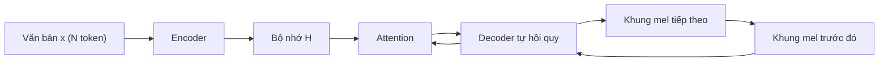
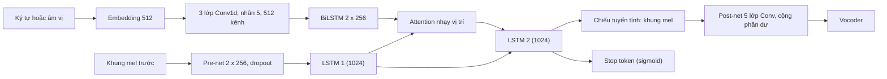

# Chương 20. Tacotron và TTS dựa trên attention

!!! abstract "Mục tiêu học tập"
    Sau chương này, bạn có thể:

    - **Giải thích** vì sao TTS có thể được phát biểu như một bài toán *sequence-to-sequence* và vai trò "mô hình trường độ ngầm" của attention.
    - **Mô tả** kiến trúc Tacotron (CBHG, hệ số rút gọn, Griffin–Lim) và chỉ ra những gì Tacotron 2 đã đơn giản hóa hoặc thay thế.
    - **Viết ra** các phương trình của attention nhạy vị trí (*location-sensitive attention*) và giải thích ý nghĩa từng thành phần.
    - **Cài đặt** pre-net, attention nhạy vị trí, một bước giải mã, post-net và hàm mất mát của Tacotron 2 bằng PyTorch, có kiểm tra hình dạng tensor.
    - **Phân biệt** quá trình huấn luyện bằng *teacher forcing* với suy luận tự do và giải thích hiện tượng *exposure bias*.
    - **Chẩn đoán** các lỗi đặc trưng của TTS dựa trên attention (bỏ từ, lặp từ, lảm nhảm, không dừng) từ ma trận căn chỉnh.
    - **So sánh** Tacotron 2 với Deep Voice 3 và Transformer-TTS, và lập luận vì sao TTS tự hồi quy dựa trên attention dần bị thay thế trong nhiều hệ thống sản phẩm.

!!! info "Kiến thức cần có"
    - Mạng hồi quy, LSTM, seq2seq, *teacher forcing* và attention cộng (Bahdanau): [Chương 4](../phan-1-nen-tang/ch04-cnn-rnn-mo-hinh-chuoi.md).
    - Attention tích vô hướng, Transformer, mã hóa vị trí: [Chương 5](../phan-1-nen-tang/ch05-transformer.md).
    - Bài toán một-nhiều và lý do hồi quy L1/L2 làm mel bị "mờ": [Chương 7](../phan-2-mo-hinh-sinh/ch07-tong-quan-mo-hinh-sinh.md).
    - STFT, mel-spectrogram, Griffin–Lim: [Chương 14](../phan-3-tin-hieu-ngu-am/ch14-xu-ly-tin-hieu-so.md).
    - Bức tranh lịch sử từ tổng hợp tham số thống kê sang TTS nơ-ron: [Chương 19](ch19-lich-su-tts.md).

Năm 2017, một ý tưởng nghe có vẻ táo bạo đã làm thay đổi cả ngành tổng hợp tiếng nói: **coi TTS như dịch máy**. Thay vì xây một chuỗi dài các mô-đun riêng lẻ — phân tích ngôn ngữ, mô hình trường độ, mô hình âm học, bộ tổng hợp tham số — hãy để một mạng nơ-ron duy nhất học cách "dịch" chuỗi ký tự sang chuỗi khung phổ, chỉ từ các cặp ⟨văn bản, âm thanh⟩. Tacotron (Wang và cộng sự, 2017) và đặc biệt là Tacotron 2 (Shen và cộng sự, 2018) đã chứng minh ý tưởng này cho chất lượng gần với giọng người thật. Chương này đi sâu vào họ mô hình đó: cách chúng hoạt động, vì sao chúng hoạt động, và — quan trọng không kém — vì sao chúng thất bại theo những cách rất đặc trưng. Hiểu kỹ các thất bại ấy là chìa khóa để hiểu toàn bộ phần còn lại của Phần V: [Chương 21](ch21-alignment.md) về căn chỉnh, [Chương 22](ch22-fastspeech.md) về FastSpeech và [Chương 23](ch23-glow-grad-matcha.md) về các bộ giải mã sinh.

## 20.1 TTS như một bài toán sequence-to-sequence

### Trực giác

Hãy nghĩ về việc đọc to một câu. Mắt bạn lướt qua văn bản **theo thứ tự**, dừng ở mỗi chữ một khoảng thời gian dài ngắn khác nhau, và miệng phát ra một dòng âm thanh liên tục. Một mô hình seq2seq với attention mô phỏng đúng quá trình này: bộ mã hóa (*encoder*) đọc toàn bộ chuỗi ký tự $\mathbf{x} = (x_1, \ldots, x_N)$ và tạo ra một "bộ nhớ" $\mathbf{H} = (\mathbf{h}_1, \ldots, \mathbf{h}_N)$; bộ giải mã (*decoder*) sinh lần lượt từng khung mel $\mathbf{y}_1, \mathbf{y}_2, \ldots$, và ở mỗi bước, cơ chế attention quyết định "mắt đang nhìn vào đâu" trên văn bản.

### Hình thức hóa

Mô hình tự hồi quy (*autoregressive*) phân rã phân phối có điều kiện của mel-spectrogram $\mathbf{Y} \in \mathbb{R}^{T \times F}$ theo quy tắc chuỗi:

$$
p(\mathbf{Y} \mid \mathbf{x}) = \prod_{t=1}^{T} p\left(\mathbf{y}_t \mid \mathbf{y}_{<t}, \mathbf{x}\right).
$$

Tacotron 2 không mô hình hóa đầy đủ phân phối này mà dùng hồi quy tất định: $\hat{\mathbf{y}}_t = g_\theta(\mathbf{y}_{<t}, \mathbf{c}_t)$, trong đó véc-tơ ngữ cảnh

$$
\mathbf{c}_t = \sum_{n=1}^{N} \alpha_{t,n} \, \mathbf{h}_n, \qquad \alpha_{t,n} \ge 0, \quad \sum_{n=1}^{N} \alpha_{t,n} = 1
$$

là trung bình có trọng số của bộ nhớ encoder. Xếp các trọng số thành ma trận $\mathbf{A} \in [0,1]^{N \times T}$ với $A_{n,t} = \alpha_{t,n}$, ta được đúng **ma trận căn chỉnh mềm** trong [bảng ký hiệu](../gioi-thieu/ky-hieu.md): mỗi cột là một phân phối xác suất trên các token văn bản.

Điểm mấu chốt: **không ai nói cho mô hình biết mỗi ký tự kéo dài bao nhiêu khung**. Thông tin trường độ $\mathbf{d}$ — vốn là một mô-đun riêng trong hệ thống tham số thống kê ([Chương 19](ch19-lich-su-tts.md)) — giờ được học *ngầm* thông qua attention. Nếu attention học tốt, ma trận $\mathbf{A}$ có dạng một dải chéo đơn điệu, và số khung mà token $n$ "chiếm" chính là trường độ $d_n$ của nó.

### Ba khó khăn riêng của TTS so với dịch máy

Dù cùng khung seq2seq, TTS khó hơn dịch máy ở ba điểm:

1. **Độ dài chênh lệch lớn.** Với bước nhảy 12,5 ms (80 khung/giây) và tốc độ nói tiếng Anh cỡ hơn chục ký tự mỗi giây, mỗi ký tự ứng với trung bình khoảng 5–10 khung. Một câu 100 ký tự cho ra vài trăm bước giải mã — dài hơn rất nhiều so với một câu dịch.
2. **Căn chỉnh phải đơn điệu và đầy đủ.** Dịch máy cho phép đảo trật tự từ; TTS thì không: mọi token phải được đọc, đúng thứ tự, không bỏ, không lặp. Cơ chế attention tổng quát *không hề* bảo đảm điều này.
3. **Đầu ra liên tục, nhiều chiều và một-nhiều.** Mỗi bước sinh một véc-tơ $F = 80$ chiều thực chứ không phải một token rời rạc; cùng một câu có vô số cách đọc hợp lệ. Hồi quy L1/L2 dẫn tới mel "trung bình" bị mờ ([Chương 7](../phan-2-mo-hinh-sinh/ch07-tong-quan-mo-hinh-sinh.md)).



## 20.2 Tacotron: mô hình đầu tiên

Tacotron (Wang và cộng sự, 2017) là hệ thống đầu tiên được công bố rộng rãi sinh phổ trực tiếp từ ký tự với chất lượng cạnh tranh. Kiến trúc gồm bốn khối: encoder, decoder có attention, mạng hậu xử lý (*post-processing net*) và Griffin–Lim.

### Khối CBHG

Thành phần đặc trưng nhất của Tacotron là **CBHG** (*1-D Convolution Bank + Highway network + bidirectional GRU*), lấy cảm hứng từ mô hình dịch máy mức ký tự của Lee và cộng sự (2017). Một khối CBHG xử lý chuỗi đầu vào qua các bước:

1. **Ngân hàng tích chập (*convolution bank*)**: $K$ bộ lọc Conv1d song song với độ rộng nhân $k = 1, 2, \ldots, K$ (trong encoder, $K = 16$). Đầu ra được nối theo kênh. Ý tưởng: mỗi độ rộng nhân bắt một loại ngữ cảnh cục bộ khác nhau, tương tự đặc trưng $n$-gram với $n$ từ 1 đến 16.
2. **Max-pooling theo thời gian** với bước 1 (giữ nguyên độ phân giải) để tăng tính bất biến cục bộ.
3. **Tích chập chiếu (*projection*)** đưa số kênh về lại kích thước ban đầu, rồi **cộng phần dư** với đầu vào.
4. **Mạng highway** nhiều lớp (Srivastava và cộng sự, 2015): $\mathbf{y} = \mathbf{T}(\mathbf{x}) \odot \mathbf{H}(\mathbf{x}) + (1 - \mathbf{T}(\mathbf{x})) \odot \mathbf{x}$ với cổng $\mathbf{T}$ dạng sigmoid.
5. **GRU hai chiều** tạo biểu diễn chứa ngữ cảnh cả trước lẫn sau.

Trong encoder, ký tự đi qua embedding, một *pre-net* (hai lớp FC + ReLU + dropout 0,5 đóng vai trò nút cổ chai) rồi tới CBHG.

### Decoder và hệ số rút gọn

Decoder của Tacotron gồm một GRU tạo truy vấn attention (*attention RNN*) và hai lớp GRU có kết nối phần dư. Attention là attention cộng dựa trên nội dung (*content-based*). Đóng góp quan trọng là **hệ số rút gọn** (*reduction factor*) $r$: mỗi bước giải mã dự đoán **$r$ khung** cùng lúc (bài báo dùng $r = 2$ và báo cáo vẫn hoạt động với $r$ lớn hơn). Số bước giải mã giảm từ $T$ xuống $\lceil T/r \rceil$.

Vì sao $r > 1$ giúp ích? Thứ nhất, các khung mel liền kề tương quan rất mạnh (một âm vị kéo dài nhiều khung), nên dự đoán chung chúng không mất nhiều thông tin. Thứ hai, số bước giảm đồng nghĩa với ma trận căn chỉnh "ngắn" hơn $r$ lần theo trục thời gian, nên attention học được dải chéo nhanh và ổn định hơn — Wang và cộng sự (2017) ghi nhận điều này làm mô hình hội tụ nhanh hơn rõ rệt. Thứ ba, suy luận nhanh hơn xấp xỉ $r$ lần.

Khi huấn luyện, đầu vào của bước kế tiếp là khung *cuối cùng* trong nhóm $r$ khung thật của bước trước. Đoạn mã dưới đây minh họa phép gom khung (các khối mã trong chương viết để chạy nối tiếp nhau trong cùng một phiên Python):

```python
import torch
import torch.nn.functional as F


def group_frames(mel: torch.Tensor, r: int) -> torch.Tensor:
    """Gom r khung liên tiếp thành một bước giải mã: (B, T, F) -> (B, ceil(T/r), r*F)."""
    B, T, n_mels = mel.shape
    pad = (-T) % r                                   # đệm cuối để T chia hết cho r
    mel = F.pad(mel, (0, 0, 0, pad))                 # (B, T + pad, F)
    return mel.reshape(B, (T + pad) // r, r * n_mels)


def ungroup_frames(x: torch.Tensor, r: int) -> torch.Tensor:
    """Phép ngược: (B, S, r*F) -> (B, S*r, F)."""
    B, S, rF = x.shape
    return x.reshape(B, S * r, rF // r)


mel = torch.randn(2, 103, 80)                        # (B, T, F)
g = group_frames(mel, r=3)
assert g.shape == (2, 35, 240)                       # 103 khung -> đệm thành 105 -> 35 bước
assert torch.equal(ungroup_frames(g, r=3)[:, :103], mel)
# Tacotron 1: đầu vào của bước giải mã kế tiếp là khung CUỐI của nhóm r khung trước đó
next_inputs = g[:, :, -80:]                          # (B, 35, F)
assert torch.equal(next_inputs[:, 0], mel[:, 2])
print("decoder steps:", g.shape[1], "instead of", mel.shape[1])
```

### Mạng hậu xử lý và Griffin–Lim

Decoder của Tacotron sinh mel 80 kênh. Một CBHG thứ hai (mạng hậu xử lý) biến chuỗi mel thành **phổ biên độ tuyến tính** (*linear-scale spectrogram*). Khác decoder chỉ nhìn được quá khứ, mạng này thấy toàn bộ chuỗi nên có thể sửa lỗi dựa vào ngữ cảnh hai phía. Hàm mất mát là tổng L1 trên mel và trên phổ tuyến tính. Cuối cùng, dạng sóng được khôi phục bằng **Griffin–Lim** ([Chương 14](../phan-3-tin-hieu-ngu-am/ch14-xu-ly-tin-hieu-so.md)): theo bài báo gốc, biên độ dự đoán được nâng lũy thừa khoảng 1,2 trước khi chạy khoảng 50 vòng lặp, giúp giảm nhiễu nền.

Theo báo cáo gốc, Tacotron đạt MOS khoảng 3,82 trên tiếng Anh Mỹ — vượt hệ thống tham số thống kê đang dùng trong sản phẩm của nhóm tác giả nhưng còn thua hệ thống ghép nối (*concatenative*). Điểm yếu lớn nhất nằm ở **Griffin–Lim**: pha được ước lượng lặp nên âm thanh có tiếng "kim loại", rè nhẹ. Điểm yếu thứ hai là kiến trúc khá cồng kềnh (CBHG nhiều thành phần). Tacotron 2 nhắm vào cả hai.

## 20.3 Tacotron 2: kiến trúc chi tiết

Tacotron 2 (Shen và cộng sự, 2018) giữ khung seq2seq nhưng đơn giản hóa mọi khối: **LSTM và tích chập thường thay cho CBHG và GRU**, **không dùng hệ số rút gọn** ($r = 1$, mỗi bước giải mã đúng một khung), và **thay Griffin–Lim bằng WaveNet** điều kiện trên mel. Theo báo cáo gốc, hệ thống đạt MOS khoảng 4,53, rất gần mức 4,58 của bản ghi thật trong cùng thí nghiệm — một cột mốc của TTS nơ-ron.



Bảng sau tóm tắt các siêu tham số chính theo bài báo gốc:

| Thành phần | Cấu hình trong Tacotron 2 |
|---|---|
| Đặc trưng đích | mel 80 kênh, 125 Hz – 7,6 kHz; cửa sổ 50 ms, bước nhảy 12,5 ms; log sau khi kẹp biên độ tối thiểu 0,01 |
| Embedding ký tự | 512 chiều |
| Encoder | 3 lớp Conv1d (512 bộ lọc, nhân 5) + BatchNorm + ReLU; 1 BiLSTM 512 đơn vị (256 mỗi chiều) |
| Attention | nhạy vị trí; 32 bộ lọc vị trí dài 31; không gian ẩn 128 chiều |
| Pre-net | 2 lớp FC 256 + ReLU, dropout 0,5 (cả khi suy luận) |
| Decoder | 2 lớp LSTM một chiều, 1024 đơn vị, zoneout 0,1 |
| Post-net | 5 lớp Conv1d 512 bộ lọc, nhân 5, BatchNorm, tanh (trừ lớp cuối) |
| Huấn luyện | Adam ($\beta_1 = 0.9$, $\beta_2 = 0.999$, $\epsilon = 10^{-6}$), tốc độ học $10^{-3}$ giảm mũ về $10^{-5}$, batch 64, điều chuẩn L2 $10^{-6}$ |

Các bản cài đặt mã nguồn mở phổ biến thường đổi sang tần số lấy mẫu 22 050 Hz, cửa sổ 1024, bước nhảy 256 và $f_{\max} = 8$ kHz để khớp với các vocoder như HiFi-GAN; chi tiết này phải **khớp tuyệt đối** giữa mô hình âm học và vocoder ([Chương 14](../phan-3-tin-hieu-ngu-am/ch14-xu-ly-tin-hieu-so.md)).

### Encoder

Mỗi ký tự (hoặc âm vị) được ánh xạ thành véc-tơ 512 chiều. Ba lớp tích chập với nhân rộng 5 cho phép mỗi vị trí "nhìn" khoảng 13 ký tự lân cận (trường tiếp nhận $1 + 3 \times 4 = 13$), mô hình hóa ngữ cảnh kiểu $n$-gram — điều quan trọng vì cách đọc một chữ cái phụ thuộc vào chữ xung quanh (trong tiếng Anh, "c" trong "cat" và "city"). BiLSTM sau đó lan truyền thông tin trên toàn câu. Đầu ra là $\mathbf{H} \in \mathbb{R}^{N \times 512}$.

### Attention nhạy vị trí

Đây là trái tim của Tacotron 2. Ta xây dựng nó qua ba bước, mỗi bước sửa một khuyết điểm của bước trước.

**Bước 1 — attention cộng dựa trên nội dung** (Bahdanau và cộng sự, 2015). Gọi $\mathbf{s}_t$ là trạng thái ẩn của LSTM thứ nhất ở bước $t$ (đóng vai trò truy vấn). Năng lượng (*energy*) cho token $n$:

$$
e_{t,n} = \mathbf{w}^\top \tanh\left(\mathbf{W}\mathbf{s}_t + \mathbf{V}\mathbf{h}_n + \mathbf{b}\right).
$$

Vấn đề: $e_{t,n}$ chỉ phụ thuộc vào *nội dung* $\mathbf{h}_n$. Nếu hai vị trí có biểu diễn gần giống nhau — chẳng hạn một âm tiết lặp lại — attention không có cơ sở nào để phân biệt chúng, và có thể "nhảy" sang vị trí sai. Hơn nữa, không có gì khuyến khích attention tiến dần về phía trước.

**Bước 2 — thêm đặc trưng vị trí** (Chorowski và cộng sự, 2015). Cho attention biết nó *đã nhìn ở đâu* ở bước trước bằng cách tích chập phân phối attention cũ với một tập bộ lọc $\mathbf{F}$:

$$
\mathbf{f}_t = \mathbf{F} \ast \boldsymbol{\alpha}_{t-1}, \qquad
e_{t,n} = \mathbf{w}^\top \tanh\left(\mathbf{W}\mathbf{s}_t + \mathbf{V}\mathbf{h}_n + \mathbf{U}\mathbf{f}_{t,n} + \mathbf{b}\right).
$$

Ở đây $\boldsymbol{\alpha}_{t-1} \in \mathbb{R}^N$ là phân phối attention ở bước trước, $\mathbf{F}$ gồm $k$ bộ lọc một chiều, $\mathbf{f}_{t,n} \in \mathbb{R}^{k}$ là đặc trưng vị trí tại token $n$, và $\mathbf{U}$ chiếu nó vào không gian attention. Vì tích chập là phép toán **bất biến tịnh tiến**, mạng có thể học quy tắc kiểu "tăng năng lượng ở ngay bên phải chỗ vừa nhìn" — đúng hành vi đọc tuần tự mà ta muốn.

**Bước 3 — dùng attention tích lũy.** Tacotron 2 dùng *tổng tích lũy* các phân phối attention trước đó, $\boldsymbol{\alpha}^{\text{cum}}_{t-1} = \sum_{t' < t} \boldsymbol{\alpha}_{t'}$, làm đặc trưng vị trí. Tổng này giống một "bản đồ độ phủ" (*coverage*): token nào đã được đọc nhiều sẽ có giá trị lớn, giúp mô hình biết phần nào của câu đã xong và khuyến khích nó tiến về phía trước, giảm nguy cơ lặp lại hoặc bỏ sót. Bản cài đặt phổ biến của NVIDIA dùng **cả hai**: xếp $\boldsymbol{\alpha}_{t-1}$ và $\boldsymbol{\alpha}^{\text{cum}}_{t-1}$ thành hai kênh đầu vào của tích chập. Cuối cùng:

$$
\alpha_{t,n} = \frac{\exp(e_{t,n})}{\sum_{m=1}^{N} \exp(e_{t,m})}, \qquad
\mathbf{c}_t = \sum_{n=1}^{N} \alpha_{t,n} \mathbf{h}_n.
$$

Với batch có độ dài khác nhau, năng lượng ở các vị trí đệm được gán $-\infty$ trước softmax để chúng nhận trọng số 0.

Hai nhận xét nhỏ nhưng hữu ích khi cài đặt. (i) Phép chiếu $\mathbf{V}\mathbf{h}_n$ không phụ thuộc $t$, nên được **tính một lần** cho cả câu — tiết kiệm đáng kể vì vòng giải mã chạy hàng trăm bước. (ii) Một độ lệch cộng *bên ngoài* $\tanh$ là vô ích, vì softmax bất biến với phép cộng hằng số vào mọi năng lượng; độ lệch hữu ích là $\mathbf{b}$ *bên trong* $\tanh$.

```python
import torch
import torch.nn as nn
import torch.nn.functional as F


class Prenet(nn.Module):
    """Hai lớp FC + ReLU; dropout LUÔN bật, kể cả khi suy luận (như Tacotron 2)."""

    def __init__(self, in_dim=80, sizes=(256, 256), p=0.5):
        super().__init__()
        dims = [in_dim, *sizes]
        self.layers = nn.ModuleList(
            nn.Linear(a, b, bias=False) for a, b in zip(dims[:-1], dims[1:]))
        self.p = p

    def forward(self, x):                                   # x: (B, F)
        for lin in self.layers:
            # training=True có chủ đích: không phụ thuộc model.eval()
            x = F.dropout(F.relu(lin(x)), p=self.p, training=True)
        return x                                            # (B, 256)


class LocationSensitiveAttention(nn.Module):
    """e_{t,n} = w^T tanh(W s_t + V h_n + U f_{t,n} + b)."""

    def __init__(self, query_dim=1024, enc_dim=512, attn_dim=128,
                 n_filters=32, kernel=31):
        super().__init__()
        self.W = nn.Linear(query_dim, attn_dim, bias=True)   # chứa luôn độ lệch b
        self.V = nn.Linear(enc_dim, attn_dim, bias=False)
        self.loc_conv = nn.Conv1d(2, n_filters, kernel,
                                  padding=(kernel - 1) // 2, bias=False)
        self.U = nn.Linear(n_filters, attn_dim, bias=False)
        self.w = nn.Linear(attn_dim, 1, bias=False)  # độ lệch ngoài tanh là thừa (softmax bất biến)

    def preprocess_memory(self, H):                       # H: (B, N, enc_dim)
        return self.V(H)                                  # (B, N, attn_dim), tính một lần/câu

    def forward(self, query, H, VH, prev_alpha, cum_alpha, mask):
        # query: (B, query_dim); prev_alpha, cum_alpha: (B, N); mask: (B, N), True = token thật
        loc = torch.stack([prev_alpha, cum_alpha], dim=1)  # (B, 2, N)
        f = self.loc_conv(loc).transpose(1, 2)             # (B, N, n_filters)
        e = self.w(torch.tanh(self.W(query).unsqueeze(1) + VH + self.U(f)))
        e = e.squeeze(-1).masked_fill(~mask, float("-inf"))  # (B, N)
        alpha = torch.softmax(e, dim=-1)                   # (B, N), tổng theo n bằng 1
        context = torch.bmm(alpha.unsqueeze(1), H).squeeze(1)  # (B, enc_dim)
        return context, alpha


# --- Kiểm tra hình dạng và tính chất ---
torch.manual_seed(0)
B, N = 2, 7
H = torch.randn(B, N, 512)                                 # đầu ra encoder
mask = torch.arange(N)[None, :] < torch.tensor([7, 5])[:, None]   # câu 2 chỉ có 5 token
attn = LocationSensitiveAttention()
VH = attn.preprocess_memory(H)
zeros = torch.zeros(B, N)
ctx, alpha = attn(torch.randn(B, 1024), H, VH, zeros, zeros, mask)
assert ctx.shape == (B, 512) and alpha.shape == (B, N)
assert torch.allclose(alpha.sum(-1), torch.ones(B))
assert torch.all(alpha[1, 5:] == 0)                        # không chú ý vào phần đệm
prenet = Prenet()
x = torch.randn(4, 80)
assert not torch.equal(prenet.eval()(x), prenet.eval()(x)) # dropout vẫn bật khi eval()
```

### Decoder tự hồi quy và pre-net

Ở mỗi bước $t$, decoder thực hiện tuần tự (theo cách tổ chức của bản cài đặt NVIDIA, vốn được dùng làm tham chiếu rộng rãi):

1. Đưa khung trước $\mathbf{y}_{t-1}$ (khung "GO" toàn số 0 ở bước đầu) qua **pre-net**: hai lớp FC 256 chiều + ReLU + dropout 0,5.
2. Nối đầu ra pre-net với ngữ cảnh $\mathbf{c}_{t-1}$, đưa vào **LSTM thứ nhất** để được truy vấn $\mathbf{s}_t$.
3. Tính attention nhạy vị trí từ $\mathbf{s}_t$, thu $\boldsymbol{\alpha}_t$ và ngữ cảnh mới $\mathbf{c}_t$; cập nhật $\boldsymbol{\alpha}^{\text{cum}}_t$.
4. Nối $\mathbf{s}_t$ với $\mathbf{c}_t$, đưa vào **LSTM thứ hai**, được $\mathbf{o}_t$.
5. Chiếu tuyến tính $[\mathbf{o}_t; \mathbf{c}_t]$ thành khung mel $\hat{\mathbf{y}}_t \in \mathbb{R}^{F}$, và (song song) thành một số thực — logit của **stop token**.

Vì sao pre-net lại quan trọng đến vậy? Shen và cộng sự (2018) nhận xét rằng pre-net đóng vai trò **nút cổ chai thông tin** là thiết yếu để attention học được. Trực giác: hai khung mel liên tiếp rất giống nhau, nên nếu decoder được nhìn rõ khung trước, cách "rẻ" nhất để giảm mất mát là *sao chép* nó mà bỏ qua văn bản — attention khi đó không bao giờ hình thành. Nút cổ chai hẹp cộng dropout mạnh làm thông tin từ khung trước bị nhiễu và mất mát, buộc decoder phải dựa vào ngữ cảnh $\mathbf{c}_t$ từ văn bản. Dropout được **giữ cả khi suy luận** vì hai lý do: tạo biến thiên nhỏ ở đầu ra (Shen và cộng sự, 2018), và giữ cho phân phối đầu vào của decoder khi suy luận giống lúc huấn luyện. Tắt nó đi khi suy luận thường làm chất lượng giảm rõ rệt.

LSTM được điều chuẩn bằng **zoneout** (Krueger và cộng sự, 2017) với xác suất 0,1: thay vì đặt ngẫu nhiên một số đơn vị về 0 như dropout, zoneout ngẫu nhiên *giữ nguyên* giá trị trạng thái cũ, phù hợp hơn với mạng hồi quy. Mã dưới đây bỏ qua zoneout cho gọn.

```python
class DecoderStep(nn.Module):
    """Một bước giải mã Tacotron 2 (cách tổ chức thường gặp, ví dụ bản cài đặt của NVIDIA)."""

    def __init__(self, n_mels=80, enc_dim=512, rnn_dim=1024, prenet_dim=256):
        super().__init__()
        self.prenet = Prenet(n_mels, (prenet_dim, prenet_dim))
        self.attn_rnn = nn.LSTMCell(prenet_dim + enc_dim, rnn_dim)  # LSTM 1: sinh truy vấn
        self.attention = LocationSensitiveAttention(rnn_dim, enc_dim)
        self.dec_rnn = nn.LSTMCell(rnn_dim + enc_dim, rnn_dim)      # LSTM 2
        self.mel_proj = nn.Linear(rnn_dim + enc_dim, n_mels)        # chiếu tuyến tính ra khung mel
        self.stop_proj = nn.Linear(rnn_dim + enc_dim, 1)            # logit của stop token

    def init_state(self, H):
        B, N, E = H.shape
        R = self.attn_rnn.hidden_size
        z = H.new_zeros
        return dict(h1=z(B, R), c1=z(B, R), h2=z(B, R), c2=z(B, R),
                    ctx=z(B, E), alpha=z(B, N), cum=z(B, N))

    def forward(self, prev_frame, st, H, VH, mask):
        x = self.prenet(prev_frame)                                  # (B, 256)
        st["h1"], st["c1"] = self.attn_rnn(torch.cat([x, st["ctx"]], -1), (st["h1"], st["c1"]))
        st["ctx"], alpha = self.attention(st["h1"], H, VH, st["alpha"], st["cum"], mask)
        st["alpha"], st["cum"] = alpha, st["cum"] + alpha            # cập nhật attention tích lũy
        st["h2"], st["c2"] = self.dec_rnn(torch.cat([st["h1"], st["ctx"]], -1), (st["h2"], st["c2"]))
        out = torch.cat([st["h2"], st["ctx"]], -1)                   # (B, 1024 + 512)
        return self.mel_proj(out), self.stop_proj(out).squeeze(-1), alpha


# --- Giải mã với teacher forcing trên dữ liệu giả ---
torch.manual_seed(0)
B, N, T, n_mels = 2, 7, 12, 80
H = torch.randn(B, N, 512)                                # đầu ra encoder (B, N, 512)
mask = torch.arange(N)[None] < torch.tensor([7, 5])[:, None]
Y = torch.randn(B, T, n_mels)                             # mel đích (B, T, F)
dec = DecoderStep()
VH = dec.attention.preprocess_memory(H)
st = dec.init_state(H)
prev = Y.new_zeros(B, n_mels)                             # khung "GO" toàn số 0
mels, stops, aligns = [], [], []
for t in range(T):
    m, s, a = dec(prev, st, H, VH, mask)
    mels.append(m); stops.append(s); aligns.append(a)
    prev = Y[:, t]                                        # teacher forcing: khung THẬT
mel_pre = torch.stack(mels, 1)                            # (B, T, F)
stop_logits = torch.stack(stops, 1)                       # (B, T)
A = torch.stack(aligns, 2)                                # (B, N, T): ma trận căn chỉnh mềm
assert mel_pre.shape == (B, T, n_mels) and stop_logits.shape == (B, T)
assert A.shape == (B, N, T) and torch.allclose(A.sum(1), torch.ones(B, T), atol=1e-5)
```

### Post-net, stop token và hàm mất mát

**Post-net** là năm lớp Conv1d (512 kênh, nhân 5, BatchNorm, tanh trừ lớp cuối) dự đoán một **phần dư** cộng vào mel của decoder: $\hat{\mathbf{Y}}^{\text{post}} = \hat{\mathbf{Y}}^{\text{pre}} + \text{PostNet}(\hat{\mathbf{Y}}^{\text{pre}})$. Decoder là nhân quả — khi sinh khung $t$ nó không biết tương lai — còn post-net nhìn cả hai phía nên có thể làm sắc nét chi tiết phổ và sửa các chuyển tiếp. Học phần dư dễ hơn học lại toàn bộ mel.

**Stop token.** Một mô hình tự hồi quy phải tự biết khi nào dừng. Tacotron 2 dự đoán ở mỗi bước xác suất $p^{\text{stop}}_t = \sigma(z_t)$ rằng câu đã kết thúc; khi suy luận, giải mã dừng ở khung đầu tiên có $p^{\text{stop}}_t > 0.5$. Đây là một bài toán phân loại nhị phân **mất cân bằng nặng**: một câu 500 khung chỉ có một khung dương. Nhiều bản cài đặt nhân trọng số cho lớp dương (Li và cộng sự (2019) báo cáo dùng trọng số khoảng 5–8 cho Transformer-TTS) hoặc gán nhãn 1 cho cả phần đệm sau khung cuối.

**Hàm mất mát** tổng hợp, với mặt nạ $m_t \in \{0, 1\}$ đánh dấu khung thật:

$$
\mathcal{L} = \frac{1}{\sum_t m_t F} \sum_{t} m_t \left( \lVert \mathbf{y}_t - \hat{\mathbf{y}}^{\text{pre}}_t \rVert_2^2 + \lVert \mathbf{y}_t - \hat{\mathbf{y}}^{\text{post}}_t \rVert_2^2 \right) + \mathcal{L}_{\text{BCE}}\left(p^{\text{stop}}, s\right) + \lambda \lVert \theta \rVert_2^2,
$$

trong đó $s_t = 1$ tại khung cuối và $0$ ở các khung trước. Shen và cộng sự (2018) dùng MSE cho cả hai số hạng mel; mất mát trước post-net giúp decoder tự nó đã phải sinh mel tốt, làm hội tụ nhanh hơn. Họ cũng có thử thay MSE bằng hợp lý cực đại với mô hình hỗn hợp (*mixture density*) nhưng ghi nhận khó huấn luyện hơn.

```python
class Postnet(nn.Module):
    """5 lớp Conv1d (512 kênh, nhân 5) + BatchNorm, tanh trừ lớp cuối; cộng phần dư."""

    def __init__(self, n_mels=80, ch=512, k=5, n_layers=5, p=0.5):
        super().__init__()
        layers = []
        for i in range(n_layers):
            cin = n_mels if i == 0 else ch
            cout = n_mels if i == n_layers - 1 else ch
            layers += [nn.Conv1d(cin, cout, k, padding=k // 2), nn.BatchNorm1d(cout)]
            if i < n_layers - 1:
                layers.append(nn.Tanh())
            layers.append(nn.Dropout(p))
        self.net = nn.Sequential(*layers)

    def forward(self, mel):                                   # mel: (B, T, F)
        return mel + self.net(mel.transpose(1, 2)).transpose(1, 2)


def tacotron2_loss(mel_pre, mel_post, stop_logits, Y, lengths, stop_pos_weight=5.0):
    B, T, n_mels = Y.shape
    frame_mask = torch.arange(T)[None] < lengths[:, None]       # (B, T)
    m = frame_mask.unsqueeze(-1).float()
    denom = m.sum() * n_mels
    l_pre = (((mel_pre - Y) ** 2) * m).sum() / denom            # MSE trước post-net
    l_post = (((mel_post - Y) ** 2) * m).sum() / denom          # MSE sau post-net
    stop_target = (torch.arange(T)[None] == lengths[:, None] - 1).float()  # 1 tại khung cuối
    l_stop = F.binary_cross_entropy_with_logits(
        stop_logits[frame_mask], stop_target[frame_mask],
        pos_weight=torch.tensor(stop_pos_weight))               # bù mất cân bằng 1 : (T-1)
    return l_pre + l_post + l_stop, (l_pre.item(), l_post.item(), l_stop.item())


postnet = Postnet()
mel_post = postnet(mel_pre)
lengths = torch.tensor([12, 9])
loss, parts = tacotron2_loss(mel_pre, mel_post, stop_logits, Y, lengths)
loss.backward()
assert dec.attention.loc_conv.weight.grad is not None       # gradient chảy về attention
print("loss parts:", [round(p, 3) for p in parts])
```

### Huấn luyện bằng teacher forcing

Khi huấn luyện, decoder nhận **khung thật** $\mathbf{y}_{t-1}$ ở mỗi bước (*teacher forcing*). Nhờ đó mọi bước dùng đầu vào đúng, gradient ổn định, và mất mát được tính song song trên toàn câu sau khi chạy xong vòng lặp. Lưu ý rằng ngay cả với teacher forcing, vòng lặp theo $t$ vẫn tuần tự (LSTM và attention phụ thuộc trạng thái trước), nên huấn luyện Tacotron 2 chậm hơn nhiều so với các mô hình song song hoàn toàn ở chương sau.

Một quan sát thú vị khi theo dõi huấn luyện: ma trận căn chỉnh thường **không có cấu trúc** trong một khoảng đầu, rồi tương đối đột ngột "bừng sáng" thành một dải chéo rõ nét. Từ lúc đó chất lượng mel cải thiện nhanh. Nếu sau một khoảng huấn luyện đáng kể mà dải chéo vẫn chưa xuất hiện, gần như chắc chắn có vấn đề (dữ liệu lệch văn bản–âm thanh, khoảng lặng quá dài, tốc độ học không phù hợp…). Các kỹ thuật ép attention học nhanh hơn như *guided attention loss* được trình bày ở [Chương 21](ch21-alignment.md).

Một hệ quả thực tế quan trọng: để huấn luyện vocoder (WaveNet trong bài báo, ngày nay thường là HiFi-GAN), Shen và cộng sự dùng mel **do Tacotron 2 sinh ra với teacher forcing** — gọi là mel căn chỉnh theo dữ liệu thật (*ground-truth-aligned*, GTA). Vì GTA mel có cùng độ dài với âm thanh thật nhưng mang "dấu vân tay" lỗi của mô hình âm học, vocoder học cách bù các lỗi đó. Kỹ thuật này được bàn kỹ ở [Chương 25](../phan-6-vocoder/ch25-gan-vocoder.md).

### Suy luận

Khi suy luận không có khung thật, nên decoder dùng chính dự đoán của nó làm đầu vào cho bước sau (*free-running*), cho đến khi stop token vượt ngưỡng hoặc chạm giới hạn số bước tối đa. Mel sau post-net được đưa vào vocoder.

```python
@torch.no_grad()
def infer(dec, postnet, H, mask, max_steps=1000, threshold=0.5):
    """Giải mã tự do (free-running) cho đến khi sigmoid(stop) > threshold."""
    st = dec.init_state(H)
    VH = dec.attention.preprocess_memory(H)
    prev = H.new_zeros(H.size(0), dec.mel_proj.out_features)
    frames, aligns = [], []
    for _ in range(max_steps):
        m, s, a = dec(prev, st, H, VH, mask)
        frames.append(m); aligns.append(a)
        prev = m                                           # đưa chính dự đoán vào bước sau
        if torch.all(torch.sigmoid(s) > threshold):
            break
    mel = torch.stack(frames, 1)                            # (B, T_gen, F)
    return postnet.eval()(mel), torch.stack(aligns, 2)


mel_gen, A_gen = infer(dec, postnet, H[:1], mask[:1], max_steps=20)
# mô hình chưa huấn luyện nên số khung sinh ra là tùy ý (1..20)
assert mel_gen.shape[0] == 1 and mel_gen.shape[2] == 80 and A_gen.shape[1] == N
assert 1 <= mel_gen.shape[1] <= 20
```

Chú ý điều kiện dừng `torch.all(...)` cho cả batch: câu đã kết thúc vẫn tiếp tục sinh "rác" cho tới khi câu dài nhất dừng, nên khi suy luận theo batch cần ghi lại vị trí dừng riêng của từng câu và cắt bỏ phần thừa.

## 20.4 Exposure bias: cái giá của teacher forcing

Teacher forcing tạo ra một độ lệch giữa huấn luyện và suy luận. Khi huấn luyện, mô hình học $g_\theta(\mathbf{y}_{<t}, \mathbf{x})$ với $\mathbf{y}_{<t}$ lấy từ **phân phối dữ liệu thật**; khi suy luận, đầu vào là $\hat{\mathbf{y}}_{<t}$ lấy từ **phân phối của chính mô hình**. Hai phân phối này khác nhau, và sai khác tích lũy theo thời gian: một lỗi nhỏ ở bước $t$ đẩy đầu vào bước $t+1$ ra khỏi vùng mô hình đã thấy, gây lỗi lớn hơn, và cứ thế. Hiện tượng này gọi là **exposure bias** ([Chương 7](../phan-2-mo-hinh-sinh/ch07-tong-quan-mo-hinh-sinh.md)).

Với TTS, exposure bias còn bị khuếch đại bởi bài toán một-nhiều: hồi quy MSE sinh ra mel "trung bình", mượt hơn mel thật. Khi suy luận, decoder liên tục nhận các khung mượt bất thường mà nó chưa từng thấy khi huấn luyện. Pre-net với dropout cao là một cách giảm nhẹ: vì đầu vào luôn bị làm nhiễu mạnh, decoder trở nên ít nhạy với chi tiết của khung trước.

Một biện pháp kinh điển khác là **scheduled sampling** (Bengio và cộng sự, 2015): khi huấn luyện, với xác suất tăng dần, thay khung thật bằng khung mô hình tự sinh. Với TTS, kết quả của kỹ thuật này không nhất quán: thay khung thật bằng khung dự đoán làm lệch căn chỉnh thời gian giữa đầu vào và đích, và có thể khiến attention khó học hơn. Bạn nên coi nó là một tùy chọn cần thử nghiệm cẩn thận chứ không phải giải pháp mặc định.

## 20.5 Các kiểu lỗi đặc trưng của TTS dựa trên attention

Attention cho phép mô hình học căn chỉnh mà không cần nhãn — nhưng chính sự tự do đó là nguồn gốc của các lỗi rất khó chịu trong sản phẩm. Điều đáng sợ là chúng **không xảy ra đều đặn**: mô hình có thể đọc đúng 99 câu rồi hỏng câu thứ 100. Bảng sau liệt kê các lỗi kinh điển và dấu hiệu của chúng trên ma trận căn chỉnh $\mathbf{A}$ (trục ngang là khung $t$, trục dọc là token $n$):

| Lỗi | Biểu hiện khi nghe | Dấu hiệu trên ma trận căn chỉnh | Nguyên nhân thường gặp |
|---|---|---|---|
| Bỏ từ (*skipping*) | Thiếu một từ hoặc âm tiết | Dải chéo "nhảy cóc" lên trên, một số hàng không có khung nào | Attention nhảy tới token có nội dung giống; câu dài; dấu câu lạ |
| Lặp từ (*repeating*) | Một cụm từ được đọc hai lần | Dải chéo quay ngược xuống rồi đi lại | Thiếu thông tin vị trí; vùng văn bản lặp (từ láy, liệt kê) |
| Lảm nhảm (*babbling*) | Âm thanh giống tiếng nói nhưng vô nghĩa | Attention mờ, trải đều hoặc dao động không đơn điệu | Đầu vào ngoài phân phối; câu quá dài; mô hình chưa hội tụ |
| Không dừng | Câu kéo dài vô tận, lặp âm cuối hoặc tiếng ồn | Attention đứng yên ở token cuối thêm hàng trăm khung | Stop token không vượt ngưỡng; dữ liệu có khoảng lặng cuối dài, không nhất quán |
| Dừng sớm | Mất phần cuối câu | Kết thúc trước khi dải chéo chạm token cuối | Stop token quá nhạy; ngắt nhầm ở dấu câu giữa câu |
| Hỏng câu dài | Câu ngắn tốt, câu dài sụp đổ ở nửa sau | Dải chéo đúng ở đầu rồi lạc hướng | Độ dài vượt phân phối huấn luyện; attention dựa trên nội dung không tổng quát hóa theo độ dài |

Vì sao câu dài đặc biệt nguy hiểm? Tập LJSpeech chẳng hạn chỉ chứa các đoạn dài tối đa khoảng 10 giây. Khi gặp đoạn 30 giây, decoder phải đi tới các vị trí token và trạng thái tích lũy chưa bao giờ thấy. Attention dựa trên nội dung tính năng lượng theo "token này trông như thế nào", không theo "token này nằm ở đâu so với chỗ vừa đọc", nên không có lý do gì để nó tổng quát hóa sang độ dài mới. Battenberg và cộng sự (2020) cho thấy các cơ chế attention **dựa trên vị trí tương đối** (GMM, Dynamic Convolution Attention) tổng quát hóa sang văn bản dài tốt hơn nhiều; chúng được trình bày ở [Chương 21](ch21-alignment.md). Trong thực tế, cách đơn giản và hiệu quả nhất là **tách văn bản dài thành câu hoặc cụm** trước khi tổng hợp.

!!! tip "Cách đọc ma trận căn chỉnh"
    Hãy vẽ $\mathbf{A}$ của vài câu kiểm định sau mỗi lần lưu checkpoint. Một mô hình khỏe cho dải chéo **sắc nét, liên tục, đơn điệu** từ góc dưới trái tới góc trên phải. Dải mờ nghĩa là mô hình chưa chắc chắn; dải đứt hoặc gãy là bỏ hoặc lặp; đoạn nằm ngang dài ở cuối là không dừng. Các thước đo định lượng (focus rate, entropy attention, CER qua ASR) được trình bày ở [Chương 21](ch21-alignment.md) và [Chương 38](../phan-9-thuc-tien/ch38-danh-gia-tts.md).

## 20.6 Các biến thể: Deep Voice 3 và Transformer-TTS

### Deep Voice 3

Deep Voice 3 (Ping và cộng sự, 2018) thay toàn bộ mạng hồi quy bằng **tích chập**: encoder tích chập, decoder tích chập nhân quả (*causal*), và attention giữa chúng. Ưu điểm chính là huấn luyện song song được trên trục thời gian (với teacher forcing, mọi khung đầu vào đã biết trước), nên nhanh hơn hẳn mô hình RNN. Một số điểm đáng chú ý:

- **Mã hóa vị trí trong attention**: khóa và truy vấn được cộng mã hóa vị trí hình sin với "tốc độ" khác nhau (phụ thuộc tỉ lệ độ dài âm thanh / văn bản, hoặc người nói), như một tiên nghiệm khuyến khích attention đi chéo.
- **Ép đơn điệu khi suy luận**: thay vì softmax trên toàn câu, chỉ tính attention trong một cửa sổ nhỏ bắt đầu từ vị trí vừa được chú ý, giúp giảm đáng kể lỗi bỏ và lặp từ.
- **Đa người nói quy mô lớn**: theo báo cáo gốc, mô hình được huấn luyện với dữ liệu của hơn hai nghìn người nói, và có thể sinh đặc trưng cho nhiều loại vocoder (Griffin–Lim, WORLD, WaveNet).

### Transformer-TTS

Transformer-TTS (Li và cộng sự, 2019) thay cả encoder lẫn decoder bằng Transformer ([Chương 5](../phan-1-nen-tang/ch05-transformer.md)), giữ nguyên các thành phần "đặc sản" của Tacotron 2: encoder pre-net tích chập, decoder pre-net hai lớp FC (cộng một lớp chiếu tuyến tính), post-net năm lớp và stop token. Một chi tiết hay là **mã hóa vị trí có hệ số học được**: $\mathbf{x}_i + \alpha \, \text{PE}(i)$ với $\alpha$ là tham số huấn luyện, vì thang giá trị của embedding âm vị và của khung mel sau pre-net rất khác nhau, cộng mã hóa vị trí cố định có thể lấn át hoặc bị lấn át.

Nhờ self-attention, Transformer-TTS huấn luyện song song trên toàn chuỗi và mô hình hóa phụ thuộc xa tốt hơn; theo báo cáo gốc, chất lượng tương đương Tacotron 2 trong khi huấn luyện nhanh hơn đáng kể. Tuy vậy, **suy luận vẫn tự hồi quy** — thậm chí mỗi bước còn đắt hơn vì chi phí attention tăng theo độ dài chuỗi đã sinh — và cross-attention nhiều đầu vẫn có thể bỏ hoặc lặp từ. Transformer-TTS có một vai trò lịch sử quan trọng: nó là **mô hình thầy** cung cấp trường độ cho FastSpeech ([Chương 22](ch22-fastspeech.md)).

Ngoài hai hệ thống trên, cần nhắc tới Char2Wav (Sotelo và cộng sự, 2017) — một trong những mô hình ký tự-tới-đặc trưng-vocoder sớm nhất — và DCTTS (Tachibana và cộng sự, 2018), mô hình tích chập hoàn toàn nổi tiếng với *guided attention loss* ([Chương 21](ch21-alignment.md)).

## 20.7 Vì sao TTS tự hồi quy dựa trên attention dần bị thay thế

Từ khoảng 2019–2020, nhiều hệ thống TTS sản phẩm chuyển sang các mô hình **không tự hồi quy có trường độ tường minh** (FastSpeech 2, Glow-TTS, VITS). Có bốn lý do chính.

**1. Tốc độ.** Mô hình tự hồi quy cần $T$ bước tuần tự; mỗi bước chỉ là vài phép nhân ma trận nhỏ nên GPU bị sử dụng rất kém. Một câu 10 giây ở 80 khung/giây là 800 bước nối tiếp, không thể song song hóa theo thời gian. Mô hình không tự hồi quy sinh cả $T$ khung trong một (hoặc vài) lượt tính song song. Ren và cộng sự (2019) báo cáo FastSpeech tăng tốc sinh mel hàng trăm lần so với mô hình tự hồi quy cùng cỡ.

**2. Độ bền vững.** Trong sản phẩm, một lỗi bỏ từ trên vài trăm câu đã là không chấp nhận được (hãy tưởng tượng đọc nhầm số tài khoản). Với trường độ tường minh và căn chỉnh cứng, bỏ hay lặp token là **không thể xảy ra về mặt cấu trúc**: mỗi token được mở rộng thành đúng $d_n \ge 1$ khung theo thứ tự.

**3. Khả năng điều khiển.** Muốn đọc chậm hơn 20%? Với trường độ tường minh, chỉ cần nhân $\mathbf{d}$ với 1,2. Muốn chèn khoảng ngừng sau dấu phẩy, nhấn mạnh một từ? Can thiệp trực tiếp vào trường độ, cao độ, năng lượng ([Chương 22](ch22-fastspeech.md)). Với attention, những điều này rất khó làm.

**4. Hiệu quả huấn luyện.** Không phải chờ attention "bừng sáng", ít nhạy với siêu tham số, dễ chạy song song.

Để công bằng, mô hình tự hồi quy cũng có ưu điểm thật: **không cần căn chỉnh ngoài**, ngôn điệu thường tự nhiên và đa dạng hơn so với mô hình hồi quy tất định không tự hồi quy, và **dễ phát trực tuyến** (*streaming*) vì sinh tuần tự từng khung. Vì thế nhiều hướng lai đã xuất hiện: DurIAN (Yu và cộng sự, 2020) và Non-Attentive Tacotron (Shen và cộng sự, 2020) giữ decoder tự hồi quy nhưng thay attention bằng **trường độ tường minh** (Non-Attentive Tacotron dùng phép nội suy Gauss — *Gaussian upsampling* — được nhắc lại ở [Chương 22](ch22-fastspeech.md)).

Điều thú vị là lịch sử lặp lại. Từ 2023, **mô hình ngôn ngữ trên token codec** (VALL-E và họ hàng, [Chương 32](../phan-8-mo-hinh-lon/ch32-codec-language-model.md)) đưa TTS tự hồi quy trở lại ở quy mô lớn — và cùng với nó là các lỗi quen thuộc: lặp, bỏ từ, ảo giác, không dừng. Những bài học trong chương này vì thế vẫn còn nguyên giá trị.

!!! note "Góc tiếng Việt"
    - **Bộ ký tự lớn.** Nếu dùng ký tự làm đầu vào, chữ quốc ngữ có 12 nguyên âm (a, ă, â, e, ê, i, o, ô, ơ, u, ư, y), mỗi nguyên âm có 6 dạng thanh, cộng 17 phụ âm đơn (kể cả đ), tức khoảng 89 chữ cái thường ở dạng dựng sẵn (NFC). Mỗi ký tự có dấu xuất hiện ít hơn hẳn, nên mô hình học thanh điệu kém hơn với dữ liệu ít. Một lựa chọn là tách dấu thanh thành token riêng, hoặc dùng âm vị kèm token thanh điệu ([Chương 18](../phan-4-frontend/ch18-g2p-bieu-dien-dau-vao.md)). Dù chọn cách nào, **chuẩn hóa Unicode NFC** nhất quán giữa huấn luyện và suy luận là bắt buộc ([Chương 17](../phan-4-frontend/ch17-chuan-hoa-van-ban.md)).
    - **Từ láy và lặp âm tiết.** Tiếng Việt có nhiều từ láy hoàn toàn ("từ từ", "xa xa", "ba ba") và cụm lặp. Đây đúng là trường hợp attention dựa trên nội dung dễ "nhảy" giữa hai vị trí giống nhau. Đặc trưng vị trí tích lũy giúp nhiều, nhưng bạn nên đưa các câu loại này vào bộ kiểm thử.
    - **Câu dài, ít dấu câu.** Văn bản tiếng Việt trên mạng thường có câu rất dài. Hãy tách câu và cụm theo dấu câu và ranh giới cú pháp trước khi tổng hợp ([Chương 16](../phan-3-tin-hieu-ngu-am/ch16-ngon-dieu.md)).
    - **Thanh điệu là lỗi dễ nghe thấy nhất.** Một mel bị "mờ" trong tiếng Anh có thể chỉ làm giọng kém tự nhiên, nhưng trong tiếng Việt, đường F0 bị san phẳng có thể làm thanh hỏi nghe thành thanh huyền, thanh ngã mất chỗ gãy — tức là **sai nghĩa**. Khi đánh giá mô hình kiểu Tacotron cho tiếng Việt, hãy kiểm tra riêng các cặp tối thiểu về thanh điệu ([Chương 38](../phan-9-thuc-tien/ch38-danh-gia-tts.md)).

## Lỗi thường gặp và mẹo thực hành

- **Attention không bao giờ hình thành.** Kiểm tra dữ liệu trước tiên: văn bản có khớp âm thanh không, có cắt khoảng lặng đầu/cuối chưa, có câu nào quá dài không. Sau đó thử: dùng âm vị thay ký tự, giảm độ dài câu khi bắt đầu huấn luyện (*curriculum*), tăng hệ số rút gọn $r$ lúc đầu, thêm *guided attention loss* ([Chương 21](ch21-alignment.md)). Đừng quên kiểm tra pre-net có thực sự là nút cổ chai và có dropout.
- **Quên rằng dropout của pre-net phải bật khi suy luận.** Nếu bạn tự viết pre-net bằng `nn.Dropout`, lệnh `model.eval()` sẽ tắt nó và chất lượng suy luận có thể sụp đổ. Dùng `F.dropout(..., training=True)` như trong mã ở trên.
- **Khoảng lặng không nhất quán.** Nếu một số bản ghi có 0,1 giây lặng ở cuối còn số khác có 1 giây, stop token học rất khó và mô hình hay "không dừng". Cắt khoảng lặng nhất quán bằng ngưỡng năng lượng ([Chương 36](../phan-9-thuc-tien/ch36-du-lieu-tts.md)).
- **Mặt nạ đệm sai.** Quên gán $-\infty$ cho năng lượng ở token đệm khiến attention "rò" vào vùng đệm; quên che khung đệm trong mất mát khiến mô hình học sinh số 0 ở cuối câu. Luôn có `assert` kiểm tra tổng attention bằng 1 và bằng 0 trên phần đệm.
- **Không giới hạn số bước giải mã.** Luôn đặt `max_steps` (ví dụ tương ứng 1,5–2 lần độ dài âm thanh dài nhất hợp lý) để tránh vòng lặp vô tận khi stop token hỏng.
- **Đánh giá bằng teacher forcing.** Mất mát kiểm định với teacher forcing có thể rất thấp trong khi suy luận tự do vẫn hỏng. Luôn nghe và vẽ căn chỉnh của **suy luận tự do** trên tập câu kiểm thử cố định, gồm cả câu dài, câu nhiều số và từ lặp.
- **Gradient bùng nổ.** Mạng hồi quy dài hàng trăm bước cần cắt chuẩn gradient (*gradient clipping*, thường quanh 1,0) — xem [Chương 3](../phan-1-nen-tang/ch03-toi-uu-va-ky-thuat-huan-luyen.md).
- **Không khớp cấu hình mel với vocoder.** Mel của Tacotron 2 phải được tính với *cùng* tần số lấy mẫu, FFT, bước nhảy, dải tần, cơ số log và chuẩn hóa như dữ liệu huấn luyện vocoder. Lỗi này cho ra âm thanh rè hoặc méo mà rất khó chẩn đoán.

## Tóm tắt

- Tacotron phát biểu TTS như seq2seq: encoder đọc văn bản, decoder tự hồi quy sinh từng khung mel, attention đóng vai trò mô hình trường độ ngầm; ma trận attention chính là căn chỉnh mềm $\mathbf{A} \in [0,1]^{N \times T}$.
- Tacotron 1 dùng CBHG, hệ số rút gọn $r$ (giảm số bước, giúp attention học nhanh) và Griffin–Lim (nguồn gốc tiếng "kim loại").
- Tacotron 2 đơn giản hóa kiến trúc (Conv + BiLSTM, hai LSTM 1024, $r = 1$), thêm post-net phần dư, stop token và vocoder nơ-ron, đạt chất lượng gần giọng thật trên dữ liệu một người nói.
- Attention nhạy vị trí bổ sung đặc trưng vị trí $\mathbf{U}(\mathbf{F} \ast \boldsymbol{\alpha})$ từ attention trước đó và tích lũy, giúp đi tiến đều và phân biệt các token giống nhau.
- Pre-net là nút cổ chai có dropout luôn bật — thiết yếu để attention hình thành và để giảm lệch phân phối khi suy luận.
- Teacher forcing gây exposure bias; kết hợp với bài toán một-nhiều, nó làm mô hình nhạy cảm khi suy luận tự do.
- Các lỗi đặc trưng — bỏ từ, lặp từ, lảm nhảm, không dừng, hỏng câu dài — đều đọc được trên ma trận căn chỉnh.
- Deep Voice 3 (tích chập) và Transformer-TTS (self-attention) tăng tốc huấn luyện nhưng vẫn suy luận tự hồi quy.
- Tốc độ, độ bền vững và khả năng điều khiển là lý do nhiều hệ thống chuyển sang mô hình không tự hồi quy có trường độ tường minh; tuy vậy TTS tự hồi quy trở lại mạnh mẽ trong kỷ nguyên codec LM.

## Bài tập

**Bài 1 [Cơ bản].** Một câu dài 8 giây ở tần số lấy mẫu 22 050 Hz, bước nhảy 256 mẫu. (a) Tacotron 2 cần bao nhiêu bước giải mã? (b) Với Tacotron 1 dùng $r = 3$? (c) Nếu mỗi bước giải mã tốn 3 ms trên GPU, hệ số thời gian thực (RTF) của phần mô hình âm học là bao nhiêu trong mỗi trường hợp?

??? success "Lời giải"
    (a) $T = \lceil 8 \times 22050 / 256 \rceil = \lceil 689{,}06 \rceil = 690$ bước. (b) $\lceil 690 / 3 \rceil = 230$ bước. (c) Thời gian sinh: $690 \times 3 = 2070$ ms, RTF $\approx 2{,}07 / 8 \approx 0{,}26$; với $r = 3$: $230 \times 3 = 690$ ms, RTF $\approx 0{,}086$. Lưu ý chi phí này **tăng tuyến tính** theo độ dài và không giảm được bằng cách thêm GPU, vì các bước là tuần tự.

**Bài 2 [Cơ bản].** Giải thích bằng lời vì sao (a) pre-net cần là nút cổ chai hẹp có dropout, và (b) dropout của nó vẫn bật khi suy luận. Điều gì có thể xảy ra nếu ta thay pre-net bằng một lớp tuyến tính rộng 1024 chiều, không dropout?

??? tip "Gợi ý"
    Nghĩ về "đường tắt" sao chép khung trước: các khung mel liền kề gần như giống hệt nhau. Nếu decoder nhìn rõ khung trước, mất mát MSE có thể giảm đáng kể mà không cần đọc văn bản, và attention không có động lực hình thành. Với câu (b), so sánh phân phối đầu vào của decoder khi huấn luyện và khi suy luận.

**Bài 3 [Nâng cao].** (a) Chứng minh rằng cộng một hằng số $c$ (không phụ thuộc $n$) vào mọi năng lượng $e_{t,n}$ không làm thay đổi $\boldsymbol{\alpha}_t$. Suy ra vì sao độ lệch đặt ngoài $\tanh$ là thừa. (b) Xét attention chỉ dựa trên nội dung. Giả sử $\mathbf{h}_i = \mathbf{h}_j$ với $i \ne j$. Chứng minh $\alpha_{t,i} = \alpha_{t,j}$ với mọi $t$. (c) Giải thích vì sao số hạng vị trí $\mathbf{U}\mathbf{f}_{t,n}$ phá vỡ được sự đối xứng này.

??? success "Lời giải"
    (a) $\frac{\exp(e_{t,n} + c)}{\sum_m \exp(e_{t,m} + c)} = \frac{e^c \exp(e_{t,n})}{e^c \sum_m \exp(e_{t,m})} = \alpha_{t,n}$. Độ lệch ngoài $\tanh$ chính là một hằng số như vậy. (b) Khi chỉ dựa trên nội dung, $e_{t,n} = \mathbf{w}^\top \tanh(\mathbf{W}\mathbf{s}_t + \mathbf{V}\mathbf{h}_n + \mathbf{b})$ là một hàm của $(\mathbf{s}_t, \mathbf{h}_n)$; nếu $\mathbf{h}_i = \mathbf{h}_j$ thì $e_{t,i} = e_{t,j}$, do đó $\alpha_{t,i} = \alpha_{t,j}$: attention chia đều cho hai vị trí, hoặc dao động giữa chúng khi $\mathbf{s}_t$ thay đổi nhỏ. (c) $\mathbf{f}_{t,n} = (\mathbf{F} \ast \boldsymbol{\alpha}_{t-1})_n$ phụ thuộc vào *vị trí* $n$ so với nơi attention vừa tập trung; nếu attention ở bước trước tập trung gần $i$, các bộ lọc có thể học tăng năng lượng ở $i$ (hoặc $i+1$) và giảm ở $j$ xa hơn, nên $e_{t,i} \neq e_{t,j}$. Trong thực tế BiLSTM cũng làm $\mathbf{h}_i \neq \mathbf{h}_j$ nhờ ngữ cảnh, nhưng hai biểu diễn vẫn có thể rất gần nhau.

**Bài 4 [Nâng cao].** Với stop token, một câu có $T$ khung chỉ có 1 khung nhãn dương. (a) Nếu mô hình luôn dự đoán $p^{\text{stop}}_t = 0$ cho mọi khung, độ chính xác phân loại là bao nhiêu? (b) Với trọng số dương $w$ trong BCE, tổng trọng số của lớp dương và lớp âm trong một câu là bao nhiêu? Chọn $w$ thế nào để hai lớp cân bằng, và vì sao trong thực tế người ta thường chọn $w$ nhỏ hơn nhiều (cỡ vài đơn vị)?

??? tip "Gợi ý"
    (a) $(T-1)/T$, rất cao nhưng vô dụng. (b) Dương: $w$; âm: $T - 1$. Cân bằng hoàn toàn cần $w \approx T - 1$ (hàng trăm), nhưng khi đó mô hình dễ báo dừng sớm — một lỗi nghiêm trọng hơn dừng muộn vài khung, vì dừng muộn có thể cắt bằng hậu xử lý còn dừng sớm làm mất nội dung. Hãy nghĩ về chi phí bất đối xứng của hai loại lỗi, và về việc ngưỡng 0,5 có thể được điều chỉnh khi suy luận.

**Bài 5 [Nâng cao].** Đề xuất một lịch *scheduled sampling* cho Tacotron 2 và phân tích hai rủi ro của nó trong bối cảnh TTS (gợi ý: căn chỉnh thời gian giữa đầu vào và đích; độ mượt của khung tự sinh). Thiết kế một thí nghiệm nhỏ để kiểm tra nó có giúp ích hay không.

??? tip "Gợi ý"
    Rủi ro 1: khung tự sinh có thể lệch pha (sai vài khung) so với khung thật ở cùng vị trí, nên đích ở bước $t$ không còn tương ứng với đầu vào. Rủi ro 2: khung tự sinh mượt hơn khung thật, nên mô hình học cách phụ thuộc vào đầu vào "mờ". Thí nghiệm: cố định tập kiểm thử gồm câu ngắn và câu rất dài, đo tỉ lệ lỗi bỏ/lặp bằng CER qua ASR, so sánh có và không có scheduled sampling, với vài hạt giống ngẫu nhiên.

**Bài 6 [Lập trình].** Mở rộng `DecoderStep` để hỗ trợ hệ số rút gọn $r$: `mel_proj` xuất $r \cdot F$ giá trị, stop token vẫn một giá trị mỗi bước, và đầu vào pre-net là khung cuối của nhóm trước. Dùng `group_frames` để tạo đích và viết `assert` kiểm tra hình dạng cho $r \in \{1, 2, 3\}$.

??? tip "Gợi ý"
    Chỉ cần đổi `nn.Linear(rnn_dim + enc_dim, n_mels)` thành `nn.Linear(rnn_dim + enc_dim, r * n_mels)`. Trong vòng teacher forcing, lặp trên $S = \lceil T/r \rceil$ bước, đầu vào bước $s$ là `g[:, s - 1, -n_mels:]` (với `g = group_frames(Y, r)`). Sau vòng lặp, dùng `ungroup_frames` để đưa về `(B, S*r, F)` rồi cắt về $T$ khung trước khi tính mất mát. Nhớ rằng nhãn stop cũng phải gom theo nhóm.

**Bài 7 [Lập trình].** Cài đặt "attention ép đơn điệu" khi suy luận theo tinh thần Deep Voice 3: ở mỗi bước, chỉ cho phép năng lượng khác $-\infty$ trong cửa sổ $[n^\star_{t-1}, n^\star_{t-1} + 2]$, với $n^\star_{t-1}$ là argmax attention ở bước trước. Chạy với decoder chưa huấn luyện và kiểm tra rằng dãy argmax không giảm.

??? tip "Gợi ý"
    Thêm tham số `window_start` (tensor `(B,)`) vào `forward` của attention; tạo mặt nạ `win = (n >= start) & (n <= start + 2)`, kết hợp `mask & win` trước `masked_fill`. Lưu ý trường hợp cửa sổ vượt quá độ dài câu.

## Tài liệu tham khảo

1. Wang, Y. và cộng sự (2017). *Tacotron: Towards End-to-End Speech Synthesis*. Interspeech 2017. arXiv:1703.10135.
2. Shen, J. và cộng sự (2018). *Natural TTS Synthesis by Conditioning WaveNet on Mel Spectrogram Predictions*. ICASSP 2018. arXiv:1712.05884.
3. Bahdanau, D., Cho, K., Bengio, Y. (2015). *Neural Machine Translation by Jointly Learning to Align and Translate*. ICLR 2015.
4. Chorowski, J. và cộng sự (2015). *Attention-Based Models for Speech Recognition*. NeurIPS 2015.
5. Lee, J., Cho, K., Hofmann, T. (2017). *Fully Character-Level Neural Machine Translation without Explicit Segmentation*. Transactions of the ACL.
6. Srivastava, R. K., Greff, K., Schmidhuber, J. (2015). *Highway Networks*. ICML 2015 Deep Learning Workshop.
7. Griffin, D., Lim, J. (1984). *Signal Estimation from Modified Short-Time Fourier Transform*. IEEE Transactions on Acoustics, Speech, and Signal Processing.
8. Krueger, D. và cộng sự (2017). *Zoneout: Regularizing RNNs by Randomly Preserving Hidden Activations*. ICLR 2017.
9. van den Oord, A. và cộng sự (2016). *WaveNet: A Generative Model for Raw Audio*. arXiv:1609.03499.
10. Bengio, S. và cộng sự (2015). *Scheduled Sampling for Sequence Prediction with Recurrent Neural Networks*. NeurIPS 2015.
11. Ping, W. và cộng sự (2018). *Deep Voice 3: Scaling Text-to-Speech with Convolutional Sequence Learning*. ICLR 2018.
12. Li, N. và cộng sự (2019). *Neural Speech Synthesis with Transformer Network*. AAAI 2019.
13. Sotelo, J. và cộng sự (2017). *Char2Wav: End-to-End Speech Synthesis*. ICLR 2017 Workshop.
14. Tachibana, H., Uenoyama, K., Aihara, S. (2018). *Efficiently Trainable Text-to-Speech System Based on Deep Convolutional Networks with Guided Attention*. ICASSP 2018.
15. Battenberg, E. và cộng sự (2020). *Location-Relative Attention Mechanisms for Robust Long-Form Speech Synthesis*. ICASSP 2020.
16. Ren, Y. và cộng sự (2019). *FastSpeech: Fast, Robust and Controllable Text to Speech*. NeurIPS 2019.
17. Yu, C. và cộng sự (2020). *DurIAN: Duration Informed Attention Network for Speech Synthesis*. Interspeech 2020.
18. Shen, J. và cộng sự (2020). *Non-Attentive Tacotron: Robust and Controllable Neural TTS Synthesis Including Unsupervised Duration Modeling*. arXiv:2010.04301.
