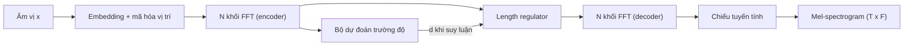
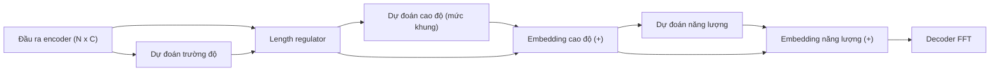

# Chương 22. FastSpeech và TTS không tự hồi quy

!!! abstract "Mục tiêu học tập"
    Sau chương này, bạn có thể:

    - **Giải thích** ba động lực của TTS không tự hồi quy — tốc độ, độ bền vững, khả năng điều khiển — và giả thiết độc lập có điều kiện mà nó dựa vào.
    - **Mô tả** kiến trúc FastSpeech: khối FFT, bộ điều chỉnh độ dài (*length regulator*), bộ dự đoán trường độ và chưng cất tri thức từ mô hình thầy.
    - **Phân tích** các cải tiến của FastSpeech 2: huấn luyện trên mel thật, *variance adaptor* với trường độ, cao độ (F0) và năng lượng, lượng tử hóa thành embedding.
    - **Suy ra** vì sao điều kiện hóa trên thông tin phương sai làm giảm hiện tượng mel bị "mờ", bằng định luật phương sai toàn phần.
    - **Cài đặt** length regulator, bộ dự đoán phương sai và một lượt tính xuôi kiểu FastSpeech 2 hoàn chỉnh, có kiểm tra hình dạng.
    - **So sánh** cao độ mức khung (FastSpeech 2) và cao độ trung bình theo âm vị (FastPitch), đặc biệt cho ngôn ngữ có thanh điệu như tiếng Việt.
    - **Lập luận** vì sao bài toán một-nhiều vẫn còn tồn tại trong FastSpeech 2 và dẫn tới các bộ giải mã sinh ở chương sau.

!!! info "Kiến thức cần có"
    - Transformer, self-attention, mã hóa vị trí: [Chương 5](../phan-1-nen-tang/ch05-transformer.md).
    - Bài toán một-nhiều, quan hệ giữa MSE/L1 và phân phối Gauss/Laplace: [Chương 7](../phan-2-mo-hinh-sinh/ch07-tong-quan-mo-hinh-sinh.md), [Chương 1](../phan-1-nen-tang/ch01-toan-nen-tang.md).
    - Trích xuất F0 và năng lượng: [Chương 14](../phan-3-tin-hieu-ngu-am/ch14-xu-ly-tin-hieu-so.md); ngôn điệu: [Chương 16](../phan-3-tin-hieu-ngu-am/ch16-ngon-dieu.md).
    - Tacotron 2 và các lỗi của TTS dựa trên attention: [Chương 20](ch20-tacotron.md).
    - Căn chỉnh, trường độ, MFA, MAS: [Chương 21](ch21-alignment.md).

[Chương 20](ch20-tacotron.md) kết thúc với một danh sách "tội trạng" của TTS tự hồi quy dựa trên attention: chậm vì phải sinh tuần tự từng khung, thỉnh thoảng bỏ hoặc lặp từ, khó điều khiển tốc độ và ngữ điệu. FastSpeech (Ren và cộng sự, 2019) giải quyết cả ba bằng một thay đổi có vẻ đơn giản: **đưa trường độ trở lại thành một đại lượng tường minh**, như thời của hệ thống tham số thống kê, nhưng giữ sức mạnh biểu diễn của Transformer. Khi đã biết mỗi token kéo dài bao nhiêu khung, toàn bộ mel-spectrogram có thể được sinh **song song** trong một lượt. FastSpeech 2 (Ren và cộng sự, 2021) tiếp tục bổ sung cao độ và năng lượng, trở thành một trong những kiến trúc mô hình âm học được dùng rộng rãi nhất trong thực tế — và là xương sống của [Dự án 2](../phan-10-du-an/du-an-2-fastspeech2-hifigan.md).

## 22.1 Động lực: nhanh, bền vững, điều khiển được

### Từ tự hồi quy sang không tự hồi quy

Hãy viết phân phối của mel-spectrogram $\mathbf{Y} \in \mathbb{R}^{T \times F}$ qua biến trường độ $\mathbf{d}$ (với $\sum_n d_n = T$):

$$
p(\mathbf{Y} \mid \mathbf{x}) = \sum_{\mathbf{d}} p(\mathbf{d} \mid \mathbf{x}) \, p(\mathbf{Y} \mid \mathbf{x}, \mathbf{d}).
$$

Mô hình không tự hồi quy kiểu FastSpeech thực hiện hai phép xấp xỉ. Thứ nhất, thay tổng trên mọi $\mathbf{d}$ bằng **một** trường độ dự đoán $\hat{\mathbf{d}}$. Thứ hai, coi các khung **độc lập có điều kiện** khi đã biết văn bản và trường độ:

$$
p(\mathbf{Y} \mid \mathbf{x}, \mathbf{d}) \approx \prod_{t=1}^{T} p(\mathbf{y}_t \mid \mathbf{x}, \mathbf{d}).
$$

Giả thiết độc lập cho phép sinh mọi khung **cùng lúc**: số bước tuần tự không còn tỉ lệ với $T$. Nhưng nó có giá: nếu mỗi khung được *lấy mẫu* độc lập, các khung liền kề có thể không nhất quán với nhau (khung này chọn "lên giọng", khung kia "xuống giọng"). FastSpeech né vấn đề bằng cách **không lấy mẫu**: nó hồi quy tất định một giá trị cho mỗi khung, và sự nhất quán giữa các khung đến từ việc chúng cùng được tính từ một biểu diễn ẩn chung qua self-attention và tích chập. Cái giá thật sự sẽ lộ ra ở mục 22.6.

### Ba lợi ích

| Tiêu chí | Tự hồi quy dựa trên attention (Tacotron 2) | Không tự hồi quy có trường độ (FastSpeech) |
|---|---|---|
| Số bước tuần tự khi suy luận | $T$ (hàng trăm, hàng nghìn) | Hằng số (một lượt qua mạng) |
| Bỏ từ, lặp từ | Có thể xảy ra | Không thể về mặt cấu trúc (mỗi token có $d_n \ge 1$ khung) |
| Điều khiển tốc độ, khoảng ngừng | Khó | Trực tiếp qua $\mathbf{d}$ |
| Cần căn chỉnh ngoài | Không | Có (mô hình thầy, MFA hoặc aligner nội bộ) |
| Tính đa dạng của ngôn điệu | Tốt hơn (sinh có điều kiện trên quá khứ) | Hạn chế nếu hồi quy tất định |



## 22.2 FastSpeech

### Khối FFT

FastSpeech xây cả encoder (phía âm vị) lẫn decoder (phía mel) từ **khối Feed-Forward Transformer (FFT)**. Mỗi khối gồm multi-head self-attention và — điểm khác Transformer gốc — một mạng **hai lớp Conv1d với ReLU** thay cho mạng truyền thẳng theo vị trí, cùng kết nối phần dư, chuẩn hóa tầng và dropout. Lý do được nêu trong bài báo: trong chuỗi âm vị và chuỗi mel, các trạng thái ẩn **liền kề liên quan chặt chẽ** với nhau (đồng cấu âm, chuyển tiếp phổ), và tích chập mô hình hóa quan hệ cục bộ này tốt hơn một lớp tuyến tính áp dụng độc lập từng vị trí. Theo bài báo gốc, FastSpeech dùng 6 khối FFT mỗi phía, kích thước ẩn 384, 2 đầu attention, nhân tích chập 3 với kích thước tầng trong 1536.

### Bộ điều chỉnh độ dài

Chuỗi âm vị dài $N$ còn chuỗi mel dài $T \gg N$. **Bộ điều chỉnh độ dài** (*length regulator*, LR) bắc cầu giữa hai chuỗi bằng cách **lặp lại** biểu diễn của token $n$ đúng $d_n$ lần:

$$
\tilde{\mathbf{H}} = \operatorname{LR}(\mathbf{H}, \mathbf{d}, \alpha) = \big(\underbrace{\mathbf{h}_1, \ldots, \mathbf{h}_1}_{\alpha d_1}, \underbrace{\mathbf{h}_2, \ldots, \mathbf{h}_2}_{\alpha d_2}, \ldots, \underbrace{\mathbf{h}_N, \ldots, \mathbf{h}_N}_{\alpha d_N}\big),
$$

trong đó $\alpha$ là hệ số tốc độ (số lần lặp được làm tròn về số nguyên). Ví dụ trong bài báo: với $\mathbf{H} = (\mathbf{h}_1, \mathbf{h}_2, \mathbf{h}_3, \mathbf{h}_4)$ và $\mathbf{d} = (2, 2, 3, 1)$, ta được $(\mathbf{h}_1, \mathbf{h}_1, \mathbf{h}_2, \mathbf{h}_2, \mathbf{h}_3, \mathbf{h}_3, \mathbf{h}_3, \mathbf{h}_4)$. Với $\alpha = 1{,}3$ (chậm hơn), trường độ thành $(2{,}6;\ 2{,}6;\ 3{,}9;\ 1{,}3) \approx (3, 3, 4, 1)$.

Dưới góc nhìn ma trận, nếu $\mathbf{A} \in \{0,1\}^{N \times T}$ là căn chỉnh cứng ứng với $\mathbf{d}$ ([Chương 21](ch21-alignment.md)) và $\mathbf{H} \in \mathbb{R}^{N \times C}$ thì đơn giản

$$
\tilde{\mathbf{H}} = \mathbf{A}^\top \mathbf{H} \in \mathbb{R}^{T \times C}.
$$

LR không có tham số học được và không khả vi theo $\mathbf{d}$ (lặp một số nguyên lần) — trường độ được học riêng bằng bộ dự đoán trường độ. Cài đặt hiệu quả theo batch không cần vòng lặp Python: tính tổng tích lũy của $\mathbf{d}$ rồi dùng `searchsorted` để tìm token chứa từng khung. Hàm `durations_from_log` đi kèm chuyển đầu ra của bộ dự đoán (ở miền log, xem mục 22.5) thành trường độ nguyên khi suy luận.

```python
import torch


def length_regulator(H, d, max_len=None):
    """H: (B, N, C) ẩn mức token; d: (B, N) trường độ nguyên >= 0 (0 ở token đệm).
    Trả về H_frame: (B, T, C) và mask: (B, T). Không có vòng lặp Python theo câu."""
    B, N, C = H.shape
    T_b = d.sum(1)                                            # (B,) số khung thật mỗi câu
    T = int(T_b.max()) if max_len is None else max_len
    cum = d.cumsum(1)                                         # (B, N) biên phải của từng token
    frames = torch.arange(T, device=H.device).expand(B, T)    # (B, T)
    idx = torch.searchsorted(cum, frames.contiguous(), right=True)  # token chứa khung t
    idx = idx.clamp(max=N - 1)                                # khung đệm: chỉ số tạm, sẽ bị che
    H_frame = torch.gather(H, 1, idx.unsqueeze(-1).expand(B, T, C))   # (B, T, C)
    mask = frames < T_b.unsqueeze(1)                          # (B, T)
    return H_frame * mask.unsqueeze(-1), mask


def durations_from_log(log_d_hat, mask, alpha=1.0, min_dur=1):
    """Đảo log(d + 1) -> d, nhân hệ số tốc độ alpha, làm tròn; token thật có ít nhất min_dur khung."""
    d = torch.round((torch.exp(log_d_hat) - 1.0) * alpha)
    d = torch.clamp(d, min=min_dur).long()
    return d * mask.long()                                    # (B, N), token đệm = 0


# Ví dụ của FastSpeech: 4 token, d = [2, 2, 3, 1]
H = torch.arange(1, 5).float().view(1, 4, 1)                  # h1..h4 = 1, 2, 3, 4
out, m = length_regulator(H, torch.tensor([[2, 2, 3, 1]]))
assert out[0, :, 0].tolist() == [1, 1, 2, 2, 3, 3, 3, 4]
log_d = torch.log(torch.tensor([[2.0, 2.0, 3.0, 1.0]]) + 1)   # giả sử bộ dự đoán đúng hoàn toàn
mask = torch.ones(1, 4, dtype=torch.bool)
assert durations_from_log(log_d, mask, alpha=1.3).tolist() == [[3, 3, 4, 1]]   # chậm lại
assert durations_from_log(log_d, mask, alpha=0.5).tolist() == [[1, 1, 2, 1]]   # nhanh lên

# So với repeat_interleave từng câu, có token d = 0 và câu ngắn hơn
torch.manual_seed(0)
H = torch.randn(3, 6, 8)
d = torch.tensor([[1, 0, 3, 2, 2, 1], [2, 2, 2, 0, 0, 0], [5, 1, 1, 1, 1, 1]])
out, mask = length_regulator(H, d)
for b in range(3):
    ref = torch.repeat_interleave(H[b], d[b], dim=0)          # (T_b, C)
    assert torch.allclose(out[b, : len(ref)], ref) and mask[b].sum() == len(ref)
    assert torch.all(out[b, len(ref):] == 0)
print("length regulator ok:", tuple(out.shape))                # (3, 10, 8)
```

### Bộ dự đoán trường độ

Khi suy luận không có trường độ thật, nên FastSpeech học một **bộ dự đoán trường độ** đặt trên encoder: hai lớp Conv1d (nhân 3) với ReLU, mỗi lớp theo sau bởi chuẩn hóa tầng và dropout, rồi một lớp tuyến tính ra một số thực cho mỗi token. Nó dự đoán trường độ trong **miền log** và được tối ưu bằng MSE:

$$
\mathcal{L}_{\text{dur}} = \frac{1}{N} \sum_{n=1}^{N} \left(\hat{l}_n - \log(d_n + 1)\right)^2.
$$

Phân phối trường độ lệch phải mạnh (đa số âm vị ngắn, một số rất dài như khoảng ngừng), nên log làm nó gần Gauss hơn và biến sai số tuyệt đối thành sai số **tương đối**: đoán 6 khung thay vì 3 bị phạt như đoán 60 thay vì 30. Hằng số $+1$ tránh $\log 0$ khi một số token (dấu câu, khoảng trắng) có trường độ 0. Khi huấn luyện, LR dùng **trường độ thật**; bộ dự đoán chỉ được dùng khi suy luận — giống teacher forcing, nhưng cho trường độ.

### Trường độ từ mô hình thầy và chưng cất tri thức

FastSpeech lấy trường độ thật từ đâu? Từ một **mô hình Transformer-TTS tự hồi quy** đã huấn luyện ([Chương 20](ch20-tacotron.md)): chọn đầu attention có *focus rate* cao nhất và đếm số khung mà mỗi âm vị nhận trọng số lớn nhất ([Chương 21](ch21-alignment.md), mục 21.4).

Mô hình thầy còn được dùng thêm một lần nữa: thay vì học mel thật, FastSpeech học **mel do mô hình thầy sinh ra** — kỹ thuật **chưng cất tri thức mức chuỗi** (*sequence-level knowledge distillation*, Kim và Rush, 2016). Vì sao lại học bản "nhái" thay vì bản gốc? Vì đầu ra của mô hình thầy ít đa dạng hơn dữ liệu thật: với cùng một văn bản, mô hình thầy cho một kết quả gần như tất định, đã "chọn sẵn" một cách nói. Phân phối đích vì thế **đơn giản hơn**, ít đa mốt hơn — vừa sức với một mô hình học hồi quy độc lập từng khung. Đây là một lời thú nhận ngầm rằng bài toán một-nhiều là trở ngại chính của mô hình không tự hồi quy.

### Kết quả và hạn chế

Theo báo cáo gốc, FastSpeech tăng tốc sinh mel khoảng 270 lần và tăng tốc tổng hợp đầu-cuối (kèm vocoder WaveGlow) khoảng 38 lần so với Transformer-TTS, chất lượng gần tương đương, và **gần như loại bỏ** lỗi bỏ/lặp từ trên tập câu khó. Nó cũng cho phép điều chỉnh tốc độ bằng $\alpha$ và chèn khoảng ngừng bằng cách thay đổi trường độ của ký hiệu khoảng trắng.

Nhưng quy trình huấn luyện **cồng kềnh**: phải huấn luyện mô hình thầy tự hồi quy trước, sinh mel chưng cất cho toàn bộ dữ liệu, rút trường độ từ attention. Chất lượng của FastSpeech bị chặn trên bởi chất lượng mô hình thầy, và trường độ rút từ attention không thật chính xác. FastSpeech 2 nhắm vào tất cả những điểm này.

## 22.3 FastSpeech 2

FastSpeech 2 (Ren và cộng sự, 2021) đưa ra hai thay đổi chính: (1) **huấn luyện trực tiếp trên mel thật**, bỏ hẳn mô hình thầy và chưng cất; (2) bù lại sự đa dạng của dữ liệu thật bằng cách cung cấp thêm **thông tin phương sai** (*variance information*) — trường độ chính xác hơn, cao độ và năng lượng — làm đầu vào có điều kiện. Theo báo cáo gốc, thời gian huấn luyện giảm khoảng 3 lần so với FastSpeech và chất lượng vượt FastSpeech.

### Variance adaptor

Giữa encoder và decoder, FastSpeech 2 đặt một **variance adaptor** gồm ba bộ dự đoán cùng kiến trúc với bộ dự đoán trường độ:



Nguyên tắc chung: **khi huấn luyện dùng giá trị thật**, **khi suy luận dùng giá trị dự đoán**. Mỗi bộ dự đoán được huấn luyện bằng MSE trên giá trị thật tương ứng, còn decoder luôn nhận embedding của giá trị thật lúc huấn luyện — nhờ vậy decoder học ánh xạ "(văn bản, trường độ, cao độ, năng lượng) → mel" trong điều kiện thông tin đầy đủ.

**Trường độ.** Lấy từ căn chỉnh cưỡng bức bằng Montreal Forced Aligner ([Chương 21](ch21-alignment.md)) thay cho attention của mô hình thầy, chính xác hơn và không cần mô hình phụ.

**Cao độ.** F0 được trích xuất cho từng khung ([Chương 14](../phan-3-tin-hieu-ngu-am/ch14-xu-ly-tin-hieu-so.md)). Đường F0 thật có phương sai lớn và nhiều biến động, khó dự đoán trực tiếp. Bài báo gốc dùng một quy trình khá công phu: nội suy tuyến tính F0 qua các đoạn vô thanh để có đường liên tục, chuyển sang thang log, chuẩn hóa về trung bình 0 và phương sai 1 theo từng câu, rồi dùng **biến đổi wavelet liên tục** (*continuous wavelet transform*, CWT) phân tích đường F0 thành một "phổ cao độ" gồm nhiều thang thời gian. Bộ dự đoán học phổ cao độ này (cùng các thống kê để khôi phục thang đo), và khi suy luận, đường F0 được dựng lại bằng biến đổi ngược. Trực giác: ngữ điệu có cấu trúc đa thang — dao động nhanh ở mức âm tiết chồng lên xu hướng chậm ở mức cụm và câu — và tách thang giúp mỗi thành phần dễ học hơn. Nhiều bản cài đặt mã nguồn mở bỏ CWT và dự đoán trực tiếp F0 đã chuẩn hóa (mức khung hoặc mức âm vị) với kết quả chấp nhận được; nếu bạn so sánh với số liệu trong bài báo, hãy để ý khác biệt này.

Để đưa cao độ vào mạng, F0 của mỗi khung (thật khi huấn luyện, dự đoán khi suy luận) được **lượng tử hóa thành 256 giá trị theo thang log** rồi tra bảng embedding; véc-tơ embedding được cộng vào chuỗi ẩn đã mở rộng.

**Năng lượng.** Với mỗi khung STFT, năng lượng là chuẩn L2 của biên độ phổ. Nó được lượng tử hóa đều thành 256 giá trị, tra embedding và cộng vào chuỗi ẩn; bộ dự đoán năng lượng học giá trị liên tục (chưa lượng tử hóa) bằng MSE.

Vì sao lượng tử hóa rồi embedding thay vì đưa thẳng số thực vào một lớp tuyến tính? Embedding cho phép mỗi khoảng giá trị có một biểu diễn **phi tuyến, tự do** — mạng có thể học rằng vùng F0 rất cao ứng với một chất giọng khác hẳn chứ không chỉ "nhiều hơn một chút" so với vùng thấp. Các ngưỡng lượng tử hóa thường được tính từ thống kê F0 và năng lượng (min/max hoặc phân vị) trên **tập huấn luyện**, và phải được lưu lại để dùng y hệt khi suy luận.

### Vì sao thông tin phương sai giúp ích: một lập luận định lượng

Gọi $\mathbf{v}$ là thông tin phương sai (trường độ, F0, năng lượng) và xét một khung $\mathbf{y}$. Với mất mát bình phương, dự đoán tốt nhất của decoder là kỳ vọng có điều kiện và mất mát tối thiểu là phương sai có điều kiện (mục 22.6). **Định luật phương sai toàn phần** cho:

$$
\operatorname{tr}\operatorname{Cov}(\mathbf{y} \mid \mathbf{x})
= \underbrace{\mathbb{E}_{\mathbf{v} \mid \mathbf{x}}\left[\operatorname{tr}\operatorname{Cov}(\mathbf{y} \mid \mathbf{x}, \mathbf{v})\right]}_{\text{mất mát tối thiểu khi biết } \mathbf{v}}
+ \underbrace{\operatorname{tr}\operatorname{Cov}\left(\mathbb{E}[\mathbf{y} \mid \mathbf{x}, \mathbf{v}] \mid \mathbf{x}\right)}_{\ge 0}.
$$

Số hạng thứ hai không âm, nên điều kiện hóa trên $\mathbf{v}$ **luôn làm giảm** phần biến thiên mà decoder không thể giải thích. Nói cách khác, khi đã biết "câu này đọc lên giọng ở cuối, nhấn vào từ thứ ba", mel đích ít mơ hồ hơn nhiều, và trung bình có điều kiện $\mathbb{E}[\mathbf{y} \mid \mathbf{x}, \mathbf{v}]$ sắc nét hơn $\mathbb{E}[\mathbf{y} \mid \mathbf{x}]$. Đây là lời giải thích định lượng cho việc FastSpeech 2 không cần chưng cất nữa.

Nhưng hãy để ý điều gì xảy ra khi suy luận: $\mathbf{v}$ được thay bằng $\hat{\mathbf{v}}$ từ các bộ dự đoán — mà các bộ dự đoán này **cũng là mô hình hồi quy MSE**. Bài toán một-nhiều không biến mất; nó được **chuyển** từ decoder sang các bộ dự đoán phương sai, nơi nó biểu hiện thành ngữ điệu "trung bình", phẳng. Ta sẽ trở lại điểm này ở mục 22.6.

### Hàm mất mát

Tổng mất mát của FastSpeech 2:

$$
\mathcal{L} = \mathcal{L}_{\text{mel}} + \mathcal{L}_{\text{dur}} + \mathcal{L}_{\text{pitch}} + \mathcal{L}_{\text{energy}},
$$

trong đó $\mathcal{L}_{\text{dur}}$ là MSE trên $\log(d + 1)$, $\mathcal{L}_{\text{pitch}}$ và $\mathcal{L}_{\text{energy}}$ là MSE trên giá trị đã chuẩn hóa, và $\mathcal{L}_{\text{mel}}$ thường là L1 (MAE) theo cách làm của các bản cài đặt phổ biến — L1 ứng với giả thiết nhiễu Laplace, ít nhạy với ngoại lai hơn MSE ([Chương 1](../phan-1-nen-tang/ch01-toan-nen-tang.md)). Mọi số hạng đều phải được **che mặt nạ** đúng: mất mát mel và mất mát F0/năng lượng mức khung chỉ tính trên khung thật; mất mát trường độ chỉ tính trên token thật.

### Cài đặt

Trước hết là hai khối xây dựng: bộ dự đoán phương sai (dùng chung cho trường độ, cao độ, năng lượng) và khối FFT. Mã viết theo bố cục `(B, S, C)` cho Transformer và chuyển vị sang `(B, C, S)` khi qua `Conv1d`.

```python
import math
import torch.nn as nn


class VariancePredictor(nn.Module):
    """2 x (Conv1d -> ReLU -> LayerNorm -> Dropout) -> Linear. Dùng cho trường độ, F0, năng lượng."""

    def __init__(self, C=256, filt=256, k=3, p=0.5):
        super().__init__()
        self.convs = nn.ModuleList([nn.Conv1d(C, filt, k, padding=k // 2),
                                    nn.Conv1d(filt, filt, k, padding=k // 2)])
        self.norms = nn.ModuleList([nn.LayerNorm(filt), nn.LayerNorm(filt)])
        self.drop = nn.Dropout(p)
        self.proj = nn.Linear(filt, 1)

    def forward(self, x, mask):                       # x: (B, S, C); mask: (B, S), True = hợp lệ
        h = x * mask.unsqueeze(-1)
        for conv, norm in zip(self.convs, self.norms):
            h = torch.relu(conv(h.transpose(1, 2))).transpose(1, 2)   # Conv1d cần (B, C, S)
            h = self.drop(norm(h)) * mask.unsqueeze(-1)
        return self.proj(h).squeeze(-1) * mask        # (B, S): một số thực mỗi vị trí


class FFTBlock(nn.Module):
    """Khối Feed-Forward Transformer: self-attention + 'FFN' bằng hai lớp Conv1d (Post-LN)."""

    def __init__(self, C=256, heads=2, filt=1024, k=9, p=0.1):
        super().__init__()
        self.attn = nn.MultiheadAttention(C, heads, dropout=p, batch_first=True)
        self.conv1 = nn.Conv1d(C, filt, k, padding=k // 2)
        self.conv2 = nn.Conv1d(filt, C, 1)
        self.ln1, self.ln2 = nn.LayerNorm(C), nn.LayerNorm(C)
        self.drop = nn.Dropout(p)

    def forward(self, x, mask):                       # x: (B, S, C); mask: (B, S)
        a, _ = self.attn(x, x, x, key_padding_mask=~mask, need_weights=False)
        x = self.ln1(x + self.drop(a)) * mask.unsqueeze(-1)
        h = self.conv2(torch.relu(self.conv1(x.transpose(1, 2)))).transpose(1, 2)
        return self.ln2(x + self.drop(h)) * mask.unsqueeze(-1)


def sinusoid_pe(S, C):
    """Mã hóa vị trí hình sin chuẩn của Transformer: (S, C)."""
    pos = torch.arange(S).float().unsqueeze(1)
    div = torch.exp(torch.arange(0, C, 2).float() * (-math.log(10000.0) / C))
    pe = torch.zeros(S, C)
    pe[:, 0::2], pe[:, 1::2] = torch.sin(pos * div), torch.cos(pos * div)
    return pe


x = torch.randn(2, 7, 256)
m = torch.arange(7)[None] < torch.tensor([7, 4])[:, None]
assert VariancePredictor()(x, m).shape == (2, 7) and FFTBlock()(x, m).shape == (2, 7, 256)
assert torch.all(VariancePredictor()(x, m)[1, 4:] == 0)
print("modules ok")
```

Tiếp theo là một mô hình FastSpeech 2 tối giản: embedding âm vị, encoder FFT, variance adaptor (trường độ ở mức token; cao độ và năng lượng ở mức khung như bài báo gốc, đã chuẩn hóa z-score và lượng tử hóa thành 256 khoảng), decoder FFT và lớp chiếu ra mel. Mã cố tình bỏ qua CWT, speaker embedding và post-net để tập trung vào luồng dữ liệu.

```python
class TinyFastSpeech2(nn.Module):
    def __init__(self, vocab=100, C=256, n_mels=80, n_bins=256, n_layers=2):
        super().__init__()
        self.emb = nn.Embedding(vocab, C, padding_idx=0)
        self.encoder = nn.ModuleList(FFTBlock(C) for _ in range(n_layers))
        self.decoder = nn.ModuleList(FFTBlock(C) for _ in range(n_layers))
        self.dur_pred, self.pitch_pred, self.energy_pred = (VariancePredictor(C) for _ in range(3))
        # F0 và năng lượng đã chuẩn hóa (z-score) -> lượng tử hóa thành n_bins khoảng
        self.register_buffer("bins", torch.linspace(-3.0, 3.0, n_bins - 1))
        self.pitch_emb, self.energy_emb = nn.Embedding(n_bins, C), nn.Embedding(n_bins, C)
        self.mel_out = nn.Linear(C, n_mels)

    def forward(self, x, x_mask, d=None, pitch=None, energy=None, alpha=1.0):
        H = self.emb(x) + sinusoid_pe(x.size(1), self.emb.embedding_dim)      # (B, N, C)
        for blk in self.encoder:
            H = blk(H, x_mask)
        log_d_hat = self.dur_pred(H, x_mask)                                   # (B, N)
        if d is None:                                                          # suy luận
            d = durations_from_log(log_d_hat, x_mask, alpha)
        Hf, y_mask = length_regulator(H, d)                                    # (B, T, C), (B, T)
        p_hat = self.pitch_pred(Hf, y_mask)                                    # F0 mức khung
        p = pitch if pitch is not None else p_hat         # huấn luyện: dùng F0 THẬT
        Hf = Hf + self.pitch_emb(torch.bucketize(p, self.bins))
        e_hat = self.energy_pred(Hf, y_mask)
        e = energy if energy is not None else e_hat
        Hf = Hf + self.energy_emb(torch.bucketize(e, self.bins))
        Hf = Hf + sinusoid_pe(Hf.size(1), Hf.size(2))
        for blk in self.decoder:
            Hf = blk(Hf, y_mask)
        mel = self.mel_out(Hf) * y_mask.unsqueeze(-1)                          # (B, T, F)
        return dict(mel=mel, log_d=log_d_hat, pitch=p_hat, energy=e_hat, d=d, y_mask=y_mask)


def fastspeech2_loss(out, Y, d, pitch, energy, x_mask):
    ym, xm = out["y_mask"], x_mask
    l_mel = ((out["mel"] - Y).abs() * ym.unsqueeze(-1)).sum() / (ym.sum() * Y.size(-1))  # L1
    mse = lambda a, b, m: (((a - b) ** 2) * m).sum() / m.sum()
    l_dur = mse(out["log_d"], torch.log(d.float() + 1.0), xm)                 # MSE trên log(d+1)
    return l_mel + l_dur + mse(out["pitch"], pitch, ym) + mse(out["energy"], energy, ym)


torch.manual_seed(0)
B, N = 2, 7
x_mask = torch.arange(N)[None] < torch.tensor([7, 5])[:, None]               # (B, N)
x = torch.randint(1, 100, (B, N)) * x_mask                                    # 0 = đệm
d = torch.randint(1, 5, (B, N)) * x_mask                                      # trường độ (MFA/MAS)
T = int(d.sum(1).max())
y_mask = torch.arange(T)[None] < d.sum(1)[:, None]
Y = torch.randn(B, T, 80) * y_mask.unsqueeze(-1)                              # mel thật (B, T, F)
pitch, energy = torch.randn(B, T) * y_mask, torch.randn(B, T) * y_mask        # đã chuẩn hóa

model = TinyFastSpeech2()
out = model(x, x_mask, d=d, pitch=pitch, energy=energy)                       # huấn luyện
assert out["mel"].shape == (B, T, 80) and out["log_d"].shape == (B, N)
loss = fastspeech2_loss(out, Y, d, pitch, energy, x_mask)
loss.backward()
model.eval()
with torch.no_grad():
    o1 = model(x, x_mask)                                                     # suy luận
    o2 = model(x, x_mask, alpha=2.0)                                          # nói chậm gấp đôi
assert o1["mel"].shape[1] == int(o1["d"].sum(1).max())
assert torch.all(o2["d"].sum(1) >= o1["d"].sum(1))
print(f"loss={loss.item():.3f}  T_infer={o1['mel'].shape[1]}  T_slow={o2['mel'].shape[1]}")
```

Vài chi tiết đáng chú ý. (i) `torch.bucketize` với 255 ngưỡng cho chỉ số từ 0 đến 255 — đúng 256 embedding. (ii) Khi suy luận, `durations_from_log` kẹp trường độ tối thiểu 1 khung cho token thật; nếu không, một mô hình chưa huấn luyện kỹ có thể dự đoán mọi trường độ bằng 0 và sinh ra chuỗi rỗng. Với token thật sự không có âm thanh (một số dấu câu), bạn có thể cho phép 0. (iii) Bộ dự đoán cao độ nhận `Hf` *trước* khi cộng embedding cao độ, và bộ dự đoán năng lượng nhận chuỗi *đã* cộng embedding cao độ — khớp với thứ tự trong sơ đồ.

### FastSpeech 2s

Bài báo còn đề xuất **FastSpeech 2s**, sinh thẳng dạng sóng từ văn bản không qua mel. Decoder dạng sóng dùng tích chập giãn nở và tích chập chuyển vị để tăng mẫu, được huấn luyện đối kháng theo kiểu Parallel WaveGAN cùng mất mát STFT đa phân giải ([Chương 25](../phan-6-vocoder/ch25-gan-vocoder.md)). Vì một câu đầy đủ ở mức mẫu quá dài để đưa vào bộ nhớ, decoder được huấn luyện trên các đoạn âm thanh cắt ngẫu nhiên; một decoder mel phụ vẫn được giữ khi huấn luyện để giúp encoder học biểu diễn tốt, và bị bỏ đi khi suy luận. Ý tưởng "đầu-cuối, huấn luyện trên đoạn ngẫu nhiên" này được VITS phát triển đầy đủ hơn ([Chương 27](../phan-7-e2e-bieu-cam/ch27-vits.md)).

## 22.4 FastPitch: cao độ trung bình theo âm vị

FastPitch (Łańcucki, 2021) đi theo một hướng đơn giản hơn: thay vì đường F0 mức khung, mô hình dự đoán **một giá trị cao độ cho mỗi token đầu vào** — trung bình F0 trên các khung hữu thanh thuộc token đó:

$$
\bar{f}_n = \frac{1}{\lvert \mathcal{V}_n \rvert} \sum_{t \in \mathcal{V}_n} f_0(t), \qquad
\mathcal{V}_n = \left\{ t : a(t) = n, \; f_0(t) > 0 \right\},
$$

với $a(t)$ là căn chỉnh cứng (ban đầu lấy từ attention của một Tacotron 2 thầy; các phiên bản sau dùng aligner không giám sát của Badlani và cộng sự (2022), [Chương 21](ch21-alignment.md)). Giá trị cao độ (đã chuẩn hóa) được chiếu bằng một lớp Conv1d lên không gian ẩn và **cộng vào đầu ra encoder trước length regulator**. Decoder tự học cách biến cao độ trung bình mỗi âm vị thành đường F0 chi tiết ở mức khung.

Ưu điểm: mục tiêu dự đoán ngắn hơn ($N$ thay vì $T$ giá trị), ít nhiễu hơn và **dễ chỉnh sửa**: muốn nâng giọng cả câu, cộng một hằng số; muốn nhấn mạnh một từ, nâng cao độ của các âm vị trong từ đó; muốn đọc đều, làm phẳng. Theo báo cáo gốc, điều kiện hóa trên cao độ cải thiện chất lượng chung, và việc dịch đều cao độ cho giọng nghe tự nhiên như khi người nói chủ động lên/xuống giọng. Nhiều bản cài đặt FastSpeech 2 mã nguồn mở cũng cung cấp tùy chọn cao độ/năng lượng mức âm vị theo cách của FastPitch.

Đoạn mã sau tính cao độ trung bình theo token bằng `index_add_` — không vòng lặp — và minh họa một hệ quả quan trọng cho tiếng Việt:

```python
import torch


def average_pitch_per_token(f0, d):
    """f0: (T,) Hz theo khung, 0 = vô thanh; d: (N,) trường độ.
    Trả về (N,): F0 trung bình trên các khung HỮU THANH của mỗi token (0 nếu token vô thanh)."""
    idx = torch.repeat_interleave(torch.arange(len(d)), d)      # (T,) token của từng khung
    voiced = (f0 > 0).float()
    s = torch.zeros(len(d)).index_add_(0, idx, f0 * voiced)     # tổng F0 hữu thanh
    c = torch.zeros(len(d)).index_add_(0, idx, voiced)          # số khung hữu thanh
    return torch.where(c > 0, s / c.clamp(min=1), torch.zeros_like(s))


# Âm tiết "má" (thanh sắc, đi lên) và "mà" (thanh huyền, đi xuống), mỗi âm tiết = /m/ + /a/
rising = torch.linspace(180.0, 240.0, 12)          # đường F0 đơn giản hóa, chỉ để minh họa
falling = torch.linspace(240.0, 180.0, 12)
d = torch.tensor([3, 12])                          # /m/: 3 khung, /a/: 12 khung
f0_ma_sac = torch.cat([torch.full((3,), 200.0), rising])
f0_ma_huyen = torch.cat([torch.full((3,), 200.0), falling])
p1, p2 = average_pitch_per_token(f0_ma_sac, d), average_pitch_per_token(f0_ma_huyen, d)
print(p1.tolist(), p2.tolist())
assert torch.allclose(p1, p2)   # trung bình theo âm vị xóa mất hướng của đường nét thanh điệu!
f0_unv = torch.cat([torch.zeros(3), rising])       # phụ âm vô thanh -> F0 = 0 ở 3 khung đầu
assert average_pitch_per_token(f0_unv, d)[0] == 0
```

!!! note "Góc tiếng Việt"
    - **Trung bình theo âm vị xóa hướng của thanh điệu.** Như đoạn mã trên cho thấy, "má" (thanh sắc, đi lên) và "mà" (thanh huyền, đi xuống) — trong mô hình đường F0 đơn giản hóa — có cùng F0 trung bình trên nguyên âm. Với cao độ mức âm vị, thông tin *hình dạng* của thanh điệu phải đến hoàn toàn từ danh tính token (âm vị kèm thanh) và decoder; giá trị cao độ chỉ còn mang **độ cao (âm vực)**. Điều này không nhất thiết làm hỏng mô hình — decoder vẫn có thể học đường nét thanh từ token thanh điệu — nhưng nó hạn chế khả năng điều khiển và có thể làm thanh điệu kém rõ khi dữ liệu ít. Thanh hỏi và thanh ngã, vốn có đường nét phức tạp (gãy, có thể kèm thanh quản hóa), là nơi dễ lộ vấn đề nhất.
    - **Các lựa chọn thiết kế.** (i) Dùng cao độ mức khung như FastSpeech 2 gốc; (ii) dùng nhiều giá trị cho mỗi âm tiết (ví dụ F0 ở đầu, giữa, cuối phần vần) hoặc tham số hóa đường nét bằng vài hệ số đa thức; (iii) giữ mức âm vị nhưng đảm bảo thanh điệu được mã hóa rõ trong đầu vào ([Chương 18](../phan-4-frontend/ch18-g2p-bieu-dien-dau-vao.md)). Không có lựa chọn nào tốt nhất cho mọi trường hợp; hãy đánh giá bằng bộ kiểm thử cặp tối thiểu thanh điệu ([Chương 38](../phan-9-thuc-tien/ch38-danh-gia-tts.md)).
    - **Chỉnh cao độ phải giữ thanh điệu.** Phép dịch đều log-F0 (nhân F0 với một hằng số) giữ nguyên hình dạng tương đối của đường nét thanh; còn phép "làm phẳng" hay co giãn biên độ dao động F0 quá mạnh có thể làm thanh sắc và thanh huyền tiến lại gần nhau. Với tiếng Việt, hãy thận trọng với các thao tác "đọc đều giọng" kiểu FastPitch ([Chương 29](../phan-7-e2e-bieu-cam/ch29-prosody-cam-xuc-phong-cach.md)).
    - **Trích xuất F0 cho thanh nặng và thanh ngã.** Đoạn thanh quản hóa (giọng kẹt) thường làm bộ trích F0 báo vô thanh hoặc nhảy quãng tám. Nội suy qua những đoạn này là cần thiết nhưng cũng có thể tạo đường F0 sai; hãy kiểm tra trực quan một số mẫu.

## 22.5 Trường độ trong thực hành: làm tròn, tốc độ và các lựa chọn khác

### Làm tròn

Khi suy luận, bộ dự đoán cho $\hat{l}_n$ thực; trường độ nguyên thường lấy là $\hat{d}_n = \max\left(1, \operatorname{round}\left(\alpha (e^{\hat{l}_n} - 1)\right)\right)$. (Glow-TTS dùng hàm trần thay cho làm tròn, [Chương 23](ch23-glow-grad-matcha.md).) Làm tròn từng token độc lập có một nhược điểm khi trường độ nhỏ hoặc khi nhân $\alpha$: sai số làm tròn **cộng dồn** theo câu. Một cách khắc phục là làm tròn **tổng tích lũy** rồi lấy hiệu — mỗi ranh giới chỉ sai tối đa nửa khung và tổng độ dài được bảo toàn:

```python
def cumulative_round(d_float):
    """Làm tròn TỔNG TÍCH LŨY rồi lấy hiệu: sai số không cộng dồn, tổng được bảo toàn."""
    c = torch.round(torch.cumsum(d_float, dim=-1))
    return torch.diff(c, dim=-1, prepend=torch.zeros_like(c[..., :1])).long()


d_float = torch.full((1, 10), 1.4)                            # 10 token, mỗi token "1,4 khung"
print("làm tròn từng token:", int(torch.round(d_float).sum()),
      "| làm tròn tích lũy:", int(cumulative_round(d_float).sum()),
      "| đúng:", round(d_float.sum().item(), 3))
assert cumulative_round(d_float).sum() == 14 and torch.round(d_float).sum() == 10
print(cumulative_round(d_float).tolist())                     # [[1, 2, 1, 2, 1, 1, 2, 1, 2, 1]]
```

### Điều khiển tốc độ

Nhân mọi trường độ với $\alpha$ là cách điều khiển tốc độ đơn giản nhất và thường đủ dùng. Tuy nhiên đó là một **xấp xỉ**: khi người thật nói nhanh hơn, các thành phần không co giãn đều — khoảng ngừng và nguyên âm thường co mạnh hơn phụ âm, và ngữ điệu cũng thay đổi. Với $\alpha$ xa 1 (ví dụ dưới 0,7 hoặc trên 1,5), giọng tổng hợp thường nghe "máy" hơn. Các khả năng tinh hơn: nhân $\alpha$ khác nhau cho từng loại token (nguyên âm, phụ âm, khoảng ngừng), hoặc chỉ thay trường độ của token khoảng ngừng để điều khiển nhịp ngắt.

### Phép nội suy Gauss: một length regulator khả vi

Length regulator lặp cứng nên không có gradient theo trường độ. Non-Attentive Tacotron (Shen và cộng sự, 2020) thay nó bằng **phép nội suy Gauss** (*Gaussian upsampling*): mỗi token được đặt tại tâm $c_n = \sum_{m < n} d_m + d_n / 2$ với độ rộng $\sigma_n$ (do một mạng nhỏ dự đoán), và biểu diễn của khung $t$ là trung bình có trọng số

$$
\tilde{\mathbf{h}}_t = \sum_{n=1}^{N} w_{t,n} \mathbf{h}_n, \qquad
w_{t,n} = \frac{\mathcal{N}(t;\, c_n, \sigma_n^2)}{\sum_{m=1}^{N} \mathcal{N}(t;\, c_m, \sigma_m^2)}.
$$

Đây là một "căn chỉnh mềm" được tham số hóa bởi trường độ: khả vi theo $\mathbf{d}$ và $\boldsymbol{\sigma}$, chuyển tiếp mượt giữa các token, và vẫn đơn điệu theo cấu trúc. Non-Attentive Tacotron giữ decoder tự hồi quy nhưng không còn attention, nên tránh được lỗi bỏ/lặp từ; các tác giả còn cho thấy có thể học trường độ theo cách bán giám sát hoặc không giám sát.

## 22.6 Bài toán một-nhiều còn tồn đọng

### MSE dẫn tới trung bình, L1 dẫn tới trung vị

Xét một khung (hoặc một giá trị F0) $y$ với phân phối có điều kiện $p(y \mid \mathbf{x})$. Với mất mát bình phương, gọi $m = \mathbb{E}[y \mid \mathbf{x}]$:

$$
\mathbb{E}\left[(y - \hat{y})^2 \mid \mathbf{x}\right]
= \mathbb{E}\left[(y - m)^2 \mid \mathbf{x}\right] + 2(m - \hat{y})\underbrace{\mathbb{E}[y - m \mid \mathbf{x}]}_{=0} + (m - \hat{y})^2
= \operatorname{Var}(y \mid \mathbf{x}) + (m - \hat{y})^2.
$$

Biểu thức nhỏ nhất khi $\hat{y} = m$: **dự đoán tối ưu là trung bình có điều kiện**, và mất mát tối thiểu bằng phương sai có điều kiện. Lập luận tương tự (đạo hàm của $\mathbb{E}\lvert y - \hat{y} \rvert$ theo $\hat{y}$ là $P(y < \hat{y}) - P(y > \hat{y})$) cho thấy L1 dẫn tới **trung vị**.

Khi $p(y \mid \mathbf{x})$ **đa mốt** — cùng một câu có thể lên giọng hoặc xuống giọng ở cuối, nhấn từ này hoặc từ kia — trung bình nằm *giữa* các mốt, ở vùng mà dữ liệu thật hầu như không bao giờ rơi vào:

```python
import numpy as np

rng = np.random.default_rng(0)
# Một câu, hai cách nói đều đúng: cuối câu lên giọng (+1) hoặc xuống giọng (-1), cộng nhiễu nhỏ
y = np.where(rng.random(10_000) < 0.5, 1.0, -1.0) + 0.1 * rng.normal(size=10_000)
c = np.linspace(-1.5, 1.5, 301)                       # các dự đoán hằng số có thể
mse = np.array([((y - ci) ** 2).mean() for ci in c])
c_mse = c[mse.argmin()]
print(f"argmin MSE = {c_mse:+.2f}  (trung bình mẫu {y.mean():+.3f})")
mae_at = {ci: np.abs(y - ci).mean() for ci in (-0.5, 0.0, 0.5)}
print("MAE tại -0.5 / 0 / +0.5:", [f"{v:.4f}" for v in mae_at.values()],
      f"| trung vị = {np.median(y):+.3f}")
print(f"tỉ lệ mẫu thật gần dự đoán MSE (|y - c| < 0.3): {(np.abs(y - c_mse) < 0.3).mean():.4f}")
```

Kết quả: dự đoán MSE tối ưu nằm ở 0 trong khi **không có mẫu thật nào** ở gần 0. Với L1, mất mát gần như phẳng trên cả khoảng giữa hai mốt (khoảng 0,999–1,001 tại ba điểm thử), nên trung vị mẫu có thể nằm ở bất cứ đâu trong khoảng đó tùy theo tỉ lệ mẫu hai bên (ở đây $-0{,}72$) — một dự đoán vừa mờ vừa bất ổn. L1 không cứu được bài toán đa mốt.

### Biểu hiện trên mel và trên ngôn điệu

Với mel-spectrogram, hiện tượng này gọi là **làm mượt quá mức** (*over-smoothing*): các họa âm ở vùng tần số cao bị nhòe, chi tiết vi mô theo thời gian bị san phẳng, phổ trông "mờ". Qua vocoder, âm thanh nghe đục, thiếu độ "trong", đôi khi rè hoặc có tiếng ù. Các bộ dự đoán phương sai chịu cùng số phận: F0 dự đoán là F0 "trung bình" cho ngữ cảnh đó, nên ngữ điệu **phẳng và đơn điệu**, trường độ thiếu biến thiên. Đọc một câu thì ổn; đọc cả một chương sách nói thì nghe rất "máy".

### Các hướng khắc phục

1. **Thêm thông tin đầu vào** để giảm phương sai có điều kiện: embedding người nói, phong cách, bộ mã hóa tham chiếu, biểu diễn ngữ cảnh từ mô hình ngôn ngữ ([Chương 29](../phan-7-e2e-bieu-cam/ch29-prosody-cam-xuc-phong-cach.md)).
2. **Thêm mất mát đối kháng** để phạt mel "trông không thật" — một bộ phân biệt buộc đầu ra nằm trên đa tạp của dữ liệu thật thay vì ở giữa các mốt ([Chương 9](../phan-2-mo-hinh-sinh/ch09-gan.md)).
3. **Thay decoder hồi quy bằng decoder sinh** mô hình hóa cả phân phối $p(\mathbf{Y} \mid \mathbf{x}, \mathbf{d})$: normalizing flow (Glow-TTS), diffusion (Grad-TTS, DiffSpeech), flow matching (Matcha-TTS) — chủ đề của [Chương 23](ch23-glow-grad-matcha.md).
4. **Thay bộ dự đoán trường độ tất định bằng mô hình sinh trường độ**, ví dụ bộ dự đoán trường độ ngẫu nhiên dựa trên flow của VITS ([Chương 27](../phan-7-e2e-bieu-cam/ch27-vits.md)).
5. **Huấn luyện đầu-cuối** cùng vocoder để tránh lệch giữa mel dự đoán và mel vocoder đã học (JETS, VITS — [Chương 27](../phan-7-e2e-bieu-cam/ch27-vits.md)).

## 22.7 Các biến thể nhẹ và hướng phát triển

Khung "encoder – trường độ – length regulator – decoder" của FastSpeech đã sinh ra rất nhiều biến thể:

- **SpeedySpeech** (Vainer và Dušek, 2020): mạng tích chập hoàn toàn, nhỏ và huấn luyện nhanh, dùng một mô hình thầy tích chập có attention để lấy trường độ.
- **LightSpeech** (Luo và cộng sự, 2021): dùng tìm kiếm kiến trúc mạng (NAS) để thu nhỏ FastSpeech cho thiết bị có tài nguyên hạn chế.
- **Parallel Tacotron** và **Parallel Tacotron 2** (Elias và cộng sự, 2021): không tự hồi quy, có bộ mã hóa biến phân để nắm biến thiên ngôn điệu; bản thứ hai học trường độ khả vi mà không cần aligner ngoài.
- **Non-Attentive Tacotron** (Shen và cộng sự, 2020): decoder tự hồi quy với trường độ tường minh và nội suy Gauss (mục 22.5).
- **JETS** và **VITS**: huấn luyện chung mô hình âm học với vocoder ([Chương 27](../phan-7-e2e-bieu-cam/ch27-vits.md)); **AdaSpeech** cho thích nghi người nói ([Chương 28](../phan-7-e2e-bieu-cam/ch28-da-nguoi-noi-voice-cloning.md)).

Nhờ suy luận một lượt, tất định và nhẹ, các mô hình họ FastSpeech vẫn rất phù hợp cho thiết bị biên và dịch vụ cần độ trễ thấp, độ ổn định cao — ví dụ đọc thông báo, đọc số liệu — dù về độ tự nhiên chúng đã bị các mô hình sinh vượt qua.

| | Tacotron 2 | FastSpeech | FastSpeech 2 | FastPitch |
|---|---|---|---|---|
| Kiểu sinh | Tự hồi quy | Song song | Song song | Song song |
| Nguồn trường độ | Attention (ngầm) | Attention của mô hình thầy | MFA | Tacotron 2 thầy, sau là aligner nội bộ |
| Đích huấn luyện | Mel thật | Mel chưng cất | Mel thật | Mel thật |
| Cao độ / năng lượng | Không tường minh | Không | Mức khung (CWT), năng lượng | Mức âm vị (sau có thêm năng lượng) |
| Điều khiển | Khó | Tốc độ | Tốc độ, cao độ, năng lượng | Tốc độ, cao độ (dễ chỉnh sửa) |

## Lỗi thường gặp và mẹo thực hành

- **Tổng trường độ không khớp số khung mel.** Lỗi phổ biến nhất khi chuẩn bị dữ liệu. Với mỗi câu, `assert d.sum() == mel.shape[0]` — sai lệch thường do khác bước nhảy, khác cách đệm của STFT (`center=True`), hoặc làm tròn ranh giới. Sửa ở token cuối (thường là khoảng lặng) nếu chỉ lệch 1–2 khung.
- **Thống kê chuẩn hóa không nhất quán.** Trung bình/độ lệch chuẩn của F0 và năng lượng, cùng các ngưỡng lượng tử hóa, phải tính trên tập huấn luyện, lưu cùng checkpoint và dùng lại y hệt khi suy luận. Với dữ liệu nhiều người nói, chuẩn hóa F0 theo từng người nói.
- **Đoạn vô thanh trong đường F0.** Đừng để giá trị 0 của khung vô thanh lọt vào chuẩn hóa log hay trung bình; nội suy qua đoạn vô thanh (mức khung) hoặc chỉ lấy trung bình trên khung hữu thanh (mức âm vị), và lưu thêm cờ hữu thanh/vô thanh nếu cần.
- **Lỗi quãng tám (*octave error*).** Bộ trích F0 đôi khi báo gấp đôi hoặc một nửa giá trị thật. Lọc ngoại lai theo dải F0 của người nói và kiểm tra trực quan; một vài lỗi quãng tám có hệ thống có thể dạy mô hình những cú nhảy giọng kỳ quặc.
- **Mặt nạ trong bộ dự đoán.** Tích chập trong bộ dự đoán phương sai "rò" thông tin từ vùng đệm vào vị trí thật nếu không nhân mặt nạ trước mỗi lớp; mất mát phải che cả token đệm lẫn khung đệm.
- **Bộ dự đoán trường độ quá khớp.** Nó là mạng nhỏ học trên ít mục tiêu nhiễu; theo dõi riêng mất mát trường độ trên tập kiểm định. Một số bản cài đặt chặn gradient từ bộ dự đoán trường độ về encoder (*stop-gradient*) để mất mát trường độ không làm méo biểu diễn chung — đáng thử nếu thấy chất lượng mel giảm khi tăng trọng số mất mát trường độ.
- **Trường độ dự đoán bằng 0.** Token bị xóa khỏi đầu ra — một lỗi "bỏ từ" kiểu mới. Kẹp tối thiểu 1 khung cho âm vị thật.
- **Đánh giá bằng trường độ thật.** Mel tái tạo với trường độ, F0, năng lượng thật luôn đẹp hơn nhiều so với suy luận thật. Hãy luôn nghe kết quả với **giá trị dự đoán**.

## Tóm tắt

- TTS không tự hồi quy thay tổng trên trường độ bằng một trường độ dự đoán và giả thiết các khung độc lập có điều kiện, nhờ đó sinh cả mel trong một lượt song song.
- FastSpeech gồm khối FFT (self-attention + Conv1d), length regulator lặp mỗi biểu diễn token $d_n$ lần ($\tilde{\mathbf{H}} = \mathbf{A}^\top \mathbf{H}$) và bộ dự đoán log-trường độ; trường độ và mel đích lấy từ một Transformer-TTS thầy.
- Chưng cất tri thức mức chuỗi làm đích đơn giản, ít đa mốt hơn — lời thừa nhận ngầm về bài toán một-nhiều.
- FastSpeech 2 bỏ mô hình thầy, huấn luyện trên mel thật với trường độ từ MFA, và thêm variance adaptor dự đoán F0 (CWT trong bài báo) và năng lượng, được lượng tử hóa thành embedding.
- Định luật phương sai toàn phần cho thấy điều kiện hóa trên thông tin phương sai làm giảm phần biến thiên không giải thích được của decoder; nhưng khi suy luận, các bộ dự đoán phương sai hồi quy về trung bình nên ngôn điệu vẫn phẳng.
- FastPitch dự đoán F0 trung bình mỗi âm vị — gọn, dễ chỉnh sửa, nhưng xóa hình dạng đường nét bên trong token, điều cần cân nhắc với thanh điệu tiếng Việt.
- Làm tròn trường độ nên giữ tổng độ dài; nhân $\alpha$ điều khiển tốc độ một cách đơn giản nhưng xấp xỉ; nội suy Gauss là một length regulator khả vi.
- MSE dẫn tới trung bình, L1 dẫn tới trung vị; với phân phối đa mốt cả hai đều cho kết quả mờ, dẫn tới nhu cầu về decoder sinh ở [Chương 23](ch23-glow-grad-matcha.md).

## Bài tập

**Bài 1 [Cơ bản].** Cho $\mathbf{d} = (3, 1, 4, 2)$. (a) Viết ma trận căn chỉnh $\mathbf{A}$ và kiểm tra $\mathbf{A}^\top \mathbf{H}$ cho đúng đầu ra của length regulator. (b) Với $\alpha = 0{,}6$, tính trường độ mới bằng cách làm tròn từng token và bằng cách làm tròn tích lũy. So sánh tổng độ dài và nhận xét về từng token.

??? success "Lời giải"
    (a) $\mathbf{A}$ có kích thước $4 \times 10$: hàng 1 bằng 1 ở cột 1–3, hàng 2 ở cột 4, hàng 3 ở cột 5–8, hàng 4 ở cột 9–10. Cột $t$ của $\mathbf{A}$ là véc-tơ đơn vị chỉ token chứa khung $t$, nên hàng $t$ của $\mathbf{A}^\top \mathbf{H}$ là $\mathbf{h}_{a(t)}$. (b) $\alpha \mathbf{d} = (1{,}8;\ 0{,}6;\ 2{,}4;\ 1{,}2)$. Làm tròn từng token: $(2, 1, 2, 1)$, tổng 6. Tổng tích lũy $(1{,}8;\ 2{,}4;\ 4{,}8;\ 6{,}0)$ làm tròn thành $(2, 2, 5, 6)$, lấy hiệu được $(2, 0, 3, 1)$, cũng tổng 6 — ở ví dụ này hai cách cho cùng tổng (với câu dài, làm tròn từng token thường lệch nhiều hơn, như ví dụ trong mục 22.5), nhưng làm tròn tích lũy khiến token thứ hai còn 0 khung! Bài học: làm tròn tích lũy bảo toàn tổng nhưng có thể sinh trường độ 0 cho token ngắn; trong thực tế cần kết hợp với ràng buộc tối thiểu (ví dụ kẹp về 1 rồi trừ bớt ở token dài nhất lân cận).

**Bài 2 [Cơ bản].** Giải thích vì sao bộ dự đoán trường độ học $\log(d+1)$ thay vì $d$. Nếu mô hình dự đoán $\hat{l} = \log(d + 1) + \varepsilon$ với $\varepsilon$ nhỏ, sai số trên $d$ xấp xỉ bao nhiêu?

??? success "Lời giải"
    Phân phối trường độ lệch phải, phương sai tăng theo giá trị trung bình; log ổn định phương sai và biến sai số thành sai số tương đối. $\hat{d} + 1 = (d + 1)e^{\varepsilon} \approx (d + 1)(1 + \varepsilon)$, nên $\hat{d} - d \approx \varepsilon (d + 1)$: sai số tuyệt đối tỉ lệ với độ dài của chính token — token dài được phép sai nhiều khung hơn token ngắn, phù hợp với cảm nhận thính giác.

**Bài 3 [Nâng cao].** Chứng minh định luật phương sai toàn phần dạng vô hướng $\operatorname{Var}(y) = \mathbb{E}[\operatorname{Var}(y \mid v)] + \operatorname{Var}(\mathbb{E}[y \mid v])$, rồi suy ra rằng mất mát MSE tối thiểu của decoder FastSpeech 2 (khi biết $v$) không lớn hơn của FastSpeech (khi không biết $v$, cùng một $\mathbf{x}$). Khi nào hai giá trị bằng nhau?

??? tip "Gợi ý"
    Viết $y - \mathbb{E}[y] = (y - \mathbb{E}[y \mid v]) + (\mathbb{E}[y \mid v] - \mathbb{E}[y])$, bình phương, lấy kỳ vọng; số hạng chéo bằng 0 theo luật kỳ vọng lặp. Dấu bằng xảy ra khi $\mathbb{E}[y \mid v]$ không phụ thuộc $v$ — tức $v$ không mang thông tin gì về trung bình của $y$.

**Bài 4 [Nâng cao].** Trong FastSpeech, mel đích là đầu ra của mô hình thầy chứ không phải mel thật. Dùng ngôn ngữ của bài toán một-nhiều để giải thích vì sao điều này giúp mô hình học sinh, và vì sao nó đặt một **trần chất lượng**. Đề xuất một thí nghiệm để đo hiện tượng "đích chưng cất ít đa dạng hơn đích thật".

??? tip "Gợi ý"
    Một thước đo đơn giản: với các câu có nội dung giống hoặc gần giống nhau, so sánh phương sai (theo khung, sau khi căn chỉnh) của mel thật và mel do mô hình thầy sinh. Một thước đo khác: huấn luyện cùng một mô hình học sinh trên hai loại đích và so sánh mất mát hội tụ — đích chưng cất cho mất mát thấp hơn (dễ hơn) nhưng chất lượng nghe bị chặn bởi mô hình thầy.

**Bài 5 [Nâng cao].** So sánh length regulator (lặp cứng) với nội suy Gauss: (a) cái nào khả vi theo $\mathbf{d}$? (b) Khi $\sigma_n \to 0$, nội suy Gauss tiến về gì? (c) Một nhược điểm có thể có của nội suy Gauss ở ranh giới giữa hai token rất ngắn?

??? tip "Gợi ý"
    (b) Trọng số $w_{t,n}$ tập trung vào token có tâm gần $t$ nhất — gần giống lặp cứng nhưng ranh giới đặt ở trung điểm giữa hai tâm, không đúng ở biên đoạn khi các token dài khác nhau. (c) Khi hai token ngắn và $\sigma$ lớn, biểu diễn bị trộn nhiều — mất độ sắc của phụ âm ngắn.

**Bài 6 [Lập trình].** Mở rộng `TinyFastSpeech2` để hỗ trợ cao độ **mức âm vị** (kiểu FastPitch): dự đoán cao độ trên `H` (trước length regulator), cộng embedding cao độ vào `H`, rồi mới mở rộng. Dùng `average_pitch_per_token` để tạo đích từ F0 mức khung. Viết `assert` cho hình dạng và chạy một bước lan truyền ngược.

??? tip "Gợi ý"
    Đổi `self.pitch_pred(Hf, y_mask)` thành `self.pitch_pred(H, x_mask)` và di chuyển hai dòng cộng embedding cao độ lên trước `length_regulator`. Đích cao độ mức âm vị cần được chuẩn hóa (z-score trên log-F0 hữu thanh) trước khi `bucketize`. Nhớ đặt giá trị cho token vô thanh (ví dụ 0 sau chuẩn hóa) và che chúng khỏi mất mát nếu muốn.

**Bài 7 [Lập trình].** Cài đặt nội suy Gauss: hàm `gaussian_upsample(H, d, sigma)` trả về `(B, T, C)`. Kiểm tra (a) mỗi hàng trọng số có tổng bằng 1; (b) với $\sigma$ rất nhỏ, kết quả gần với `length_regulator` ở các khung không nằm sát ranh giới token; (c) gradient theo `d` (để ở dạng số thực) khác 0.

??? tip "Gợi ý"
    `c = torch.cumsum(d, -1) - d / 2`; `t = torch.arange(T) + 0.5`; `logits = -0.5 * ((t[None, :, None] - c[:, None, :]) / sigma[:, None, :]) ** 2 - torch.log(sigma[:, None, :])`; che token đệm bằng $-\infty$; `w = logits.softmax(-1)`; `return w @ H`. Phép thử (b) nên bỏ qua 1–2 khung quanh mỗi ranh giới.

## Tài liệu tham khảo

1. Ren, Y. và cộng sự (2019). *FastSpeech: Fast, Robust and Controllable Text to Speech*. NeurIPS 2019.
2. Ren, Y. và cộng sự (2021). *FastSpeech 2: Fast and High-Quality End-to-End Text to Speech*. ICLR 2021.
3. Łańcucki, A. (2021). *FastPitch: Parallel Text-to-Speech with Pitch Prediction*. ICASSP 2021.
4. Li, N. và cộng sự (2019). *Neural Speech Synthesis with Transformer Network*. AAAI 2019.
5. Kim, Y., Rush, A. M. (2016). *Sequence-Level Knowledge Distillation*. EMNLP 2016.
6. Vaswani, A. và cộng sự (2017). *Attention Is All You Need*. NeurIPS 2017.
7. McAuliffe, M. và cộng sự (2017). *Montreal Forced Aligner: Trainable Text-Speech Alignment Using Kaldi*. Interspeech 2017.
8. Badlani, R. và cộng sự (2022). *One TTS Alignment To Rule Them All*. ICASSP 2022.
9. Shen, J. và cộng sự (2020). *Non-Attentive Tacotron: Robust and Controllable Neural TTS Synthesis Including Unsupervised Duration Modeling*. arXiv:2010.04301.
10. Elias, I. và cộng sự (2021). *Parallel Tacotron: Non-Autoregressive and Controllable TTS*. ICASSP 2021.
11. Elias, I. và cộng sự (2021). *Parallel Tacotron 2: A Non-Autoregressive Neural TTS Model with Differentiable Duration Modeling*. Interspeech 2021.
12. Vainer, J., Dušek, O. (2020). *SpeedySpeech: Efficient Neural Speech Synthesis*. Interspeech 2020.
13. Luo, R. và cộng sự (2021). *LightSpeech: Lightweight and Fast Text to Speech with Neural Architecture Search*. ICASSP 2021.
14. Yamamoto, R., Song, E., Kim, J.-M. (2020). *Parallel WaveGAN: A Fast Waveform Generation Model Based on Generative Adversarial Networks with Multi-Resolution Spectrogram*. ICASSP 2020.
15. Prenger, R., Valle, R., Catanzaro, B. (2019). *WaveGlow: A Flow-based Generative Network for Speech Synthesis*. ICASSP 2019.
