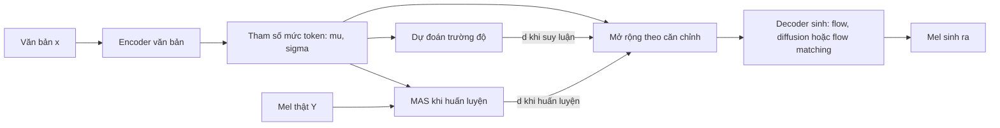

# Chương 23. Glow-TTS, Grad-TTS, Matcha-TTS

!!! abstract "Mục tiêu học tập"
    Sau chương này, bạn có thể:

    - **Mô tả** khung kiến trúc chung "encoder văn bản như tiên nghiệm + MAS + bộ dự đoán trường độ + decoder sinh" mà Glow-TTS, Grad-TTS và Matcha-TTS cùng chia sẻ.
    - **Suy ra** hàm mục tiêu hợp lý cực đại của Glow-TTS qua công thức đổi biến, chỉ ra vì sao MAS chỉ cần số hạng tiên nghiệm, và giải thích huấn luyện theo kiểu EM cứng.
    - **Cài đặt** ma trận log-likelihood tiên nghiệm của Glow-TTS bằng phép nhân ma trận và tính log-likelihood với một căn chỉnh cho trước.
    - **Suy ra** nghiệm đóng của quá trình khuếch tán thuận trong Grad-TTS, với phân phối cuối $\mathcal{N}(\tilde{\boldsymbol{\mu}}, \mathbf{I})$, và viết hàm mất mát cùng ODE ngược.
    - **Cài đặt** mất mát OT-CFM cho decoder mel và vòng lấy mẫu Euler của Matcha-TTS, và giải thích vì sao đường đi thẳng cho phép rất ít bước.
    - **Giải thích** khuếch tán nông (DiffSinger) và chưng cất tiến dần (ProDiff) như các cách giảm số bước.
    - **So sánh** các họ mô hình về chất lượng, tốc độ, bộ nhớ, độ bền vững và tính đa dạng để chọn mô hình cho một dự án tiếng Việt.

!!! info "Kiến thức cần có"
    - Normalizing flow, công thức đổi biến, ActNorm, tích chập 1×1 khả nghịch, affine coupling: [Chương 10](../phan-2-mo-hinh-sinh/ch10-normalizing-flows.md).
    - Mô hình khuếch tán, score matching, SDE và ODE dòng xác suất: [Chương 11](../phan-2-mo-hinh-sinh/ch11-diffusion.md).
    - Flow matching, CFM, đường đi OT với $\sigma_{\min}$, bộ giải ODE: [Chương 12](../phan-2-mo-hinh-sinh/ch12-flow-matching.md).
    - Monotonic Alignment Search: [Chương 21](ch21-alignment.md); FastSpeech, length regulator, bài toán một-nhiều: [Chương 22](ch22-fastspeech.md).

[Chương 22](ch22-fastspeech.md) kết thúc ở một ngã ba: mô hình không tự hồi quy nhanh và bền, nhưng hồi quy tất định cho mel "mờ" vì bài toán một-nhiều. Lối ra hiển nhiên là thay decoder hồi quy bằng một **mô hình sinh** biểu diễn được cả phân phối $p(\mathbf{Y} \mid \mathbf{x})$. Chương này kể câu chuyện đó qua ba mô hình nối tiếp nhau, mỗi mô hình dùng một họ mô hình sinh của Phần II: **Glow-TTS** (2020) với normalizing flow, **Grad-TTS** (2021) với khuếch tán, và **Matcha-TTS** (2024) với flow matching. Điều đáng chú ý là cả ba dùng chung một "bộ khung": encoder văn bản sinh tham số mức token, MAS tìm căn chỉnh khi huấn luyện, và một bộ dự đoán trường độ khi suy luận. Nắm được bộ khung này, bạn sẽ thấy rất nhiều hệ thống hiện đại — từ VITS ([Chương 27](../phan-7-e2e-bieu-cam/ch27-vits.md)) đến decoder flow matching của các hệ thống lai LM + flow ([Chương 34](../phan-8-mo-hinh-lon/ch34-he-thong-lai-hien-dai.md)) — chỉ là biến thể của nó.

## 23.1 Khung chung: encoder văn bản như một tiên nghiệm



Encoder văn bản (Transformer với mã hóa vị trí tương đối trong Glow-TTS và Grad-TTS, với RoPE trong Matcha-TTS) biến chuỗi token $\mathbf{x}$ thành ma trận $\mathbf{M} \in \mathbb{R}^{N \times F}$ — hàng $n$ là $\boldsymbol{\mu}_n$ — và (ở Glow-TTS) cả độ lệch chuẩn $\boldsymbol{\sigma}_n$. Với một căn chỉnh cứng $\mathbf{A} \in \{0,1\}^{N \times T}$, các tham số được **mở rộng** lên mức khung đúng như length regulator:

$$
\tilde{\mathbf{M}} = \mathbf{A}^\top \mathbf{M} \in \mathbb{R}^{T \times F}, \qquad \tilde{\boldsymbol{\mu}}_t = \boldsymbol{\mu}_{a(t)}.
$$

Ba mô hình khác nhau ở **vai trò** của $\tilde{\mathbf{M}}$:

| | Glow-TTS | Grad-TTS | Matcha-TTS |
|---|---|---|---|
| Họ mô hình sinh | Normalizing flow | Khuếch tán (SDE) | Flow matching (OT-CFM) |
| Vai trò của $\tilde{\mathbf{M}}$ | Trung bình của phân phối **ẩn** $\mathbf{Z}$ | Trung bình của phân phối **cuối** của quá trình khuếch tán, $\mathcal{N}(\tilde{\mathbf{M}}, \mathbf{I})$ | **Điều kiện** đưa vào mạng vận tốc; nguồn là $\mathcal{N}(\mathbf{0}, \mathbf{I})$ |
| Không gian của $\boldsymbol{\mu}_n$ | Không gian ẩn của flow | Không gian mel ($F$ kênh) | Không gian mel ($F$ kênh) |
| Số lượt tính decoder khi suy luận | 1 | Hàng chục (đánh đổi được) | Vài (khoảng 2–10) |

!!! warning "Ký hiệu"
    Các bài báo gốc dùng $\mathbf{x}$ hoặc $X$ cho mel (Glow-TTS: $x$ là mel, $c$ là văn bản; Grad-TTS: $X_t$ là trạng thái khuếch tán). Chương này theo [bảng ký hiệu](../gioi-thieu/ky-hieu.md) của sách: $\mathbf{x}$ là văn bản, $\mathbf{Y} \in \mathbb{R}^{T \times F}$ là mel, $\mathbf{Z}$ là biến ẩn của flow, và $\mathbf{Y}_t$ là trạng thái của mel dọc theo quá trình khuếch tán hay flow matching. Lưu ý **chiều thời gian ngược nhau**: trong Grad-TTS (quy ước khuếch tán) $\mathbf{Y}_0$ là dữ liệu và $\mathbf{Y}_1$ là nhiễu; trong Matcha-TTS (quy ước flow matching) $\mathbf{Y}_0$ là nhiễu và $\mathbf{Y}_1$ là dữ liệu. Mã minh họa dùng bố cục `(B, F, T)` cho decoder, như các bản cài đặt gốc.

## 23.2 Glow-TTS: flow và Monotonic Alignment Search

Glow-TTS (Kim và cộng sự, 2020) là mô hình đầu tiên kết hợp ba ý tưởng: **decoder là một normalizing flow** (song song, khả nghịch, có log-likelihood chính xác), **encoder văn bản cho tiên nghiệm Gauss** mức token, và **MAS** để tự tìm căn chỉnh — không cần attention, không cần mô hình thầy, không cần aligner ngoài.

### Mô hình xác suất

Decoder là một song ánh khả vi $f: \mathbf{Z} \mapsto \mathbf{Y}$ (gồm nhiều khối flow, [Chương 10](../phan-2-mo-hinh-sinh/ch10-normalizing-flows.md)). Biến ẩn $\mathbf{Z} = f^{-1}(\mathbf{Y}) \in \mathbb{R}^{T \times F}$ có cùng kích thước với mel. Với một căn chỉnh $\mathbf{A}$, tiên nghiệm phân rã theo khung:

$$
p_Z(\mathbf{Z} \mid \mathbf{x}, \mathbf{A}) = \prod_{t=1}^{T} \mathcal{N}\left(\mathbf{z}_t;\, \boldsymbol{\mu}_{a(t)},\, \operatorname{diag}(\boldsymbol{\sigma}^2_{a(t)})\right).
$$

Theo công thức đổi biến:

$$
\log p(\mathbf{Y} \mid \mathbf{x}, \mathbf{A}) = \underbrace{\log p_Z\left(f^{-1}(\mathbf{Y}) \mid \mathbf{x}, \mathbf{A}\right)}_{\text{phụ thuộc } \mathbf{A}} + \underbrace{\log \left\lvert \det \frac{\partial f^{-1}(\mathbf{Y})}{\partial \mathbf{Y}} \right\rvert}_{\text{không phụ thuộc } \mathbf{A}}.
$$

Số hạng log-định thức chỉ phụ thuộc decoder và mel, **không phụ thuộc căn chỉnh**. Đây là quan sát then chốt: muốn tìm căn chỉnh tốt nhất, ta chỉ cần số hạng tiên nghiệm, và số hạng này phân rã thành tổng theo khung — đúng dạng $\sum_t S_{a(t),t}$ mà MAS giải được ([Chương 21](ch21-alignment.md)) với

$$
S_{n,t} = \log \mathcal{N}\left(\mathbf{z}_t;\, \boldsymbol{\mu}_n,\, \operatorname{diag}(\boldsymbol{\sigma}^2_n)\right).
$$

### Huấn luyện kiểu EM cứng

Hàm mục tiêu "đúng" là log-likelihood biên $\log p(\mathbf{Y} \mid \mathbf{x}) = \log \sum_{\mathbf{A}} p(\mathbf{A}) \, p(\mathbf{Y} \mid \mathbf{x}, \mathbf{A})$. Với tiên nghiệm đều $p(\mathbf{A}) = 1 / \lvert \mathcal{S}_{N,T} \rvert$ trên các căn chỉnh hợp lệ, tổng lớn hơn số hạng lớn nhất của nó, nên

$$
\log p(\mathbf{Y} \mid \mathbf{x}) \;\ge\; \max_{\mathbf{A}} \log p(\mathbf{Y} \mid \mathbf{x}, \mathbf{A}) - \log \left\lvert \mathcal{S}_{N,T} \right\rvert.
$$

Số hạng cuối chỉ phụ thuộc $(N, T)$, không phụ thuộc tham số. Glow-TTS tối đa hóa cận dưới này theo cả tham số $\theta$ lẫn $\mathbf{A}$, xen kẽ hai bước:

1. **Bước căn chỉnh** (cố định $\theta$): tính $\mathbf{Z} = f^{-1}_\theta(\mathbf{Y})$, lập ma trận $\mathbf{S}$ và chạy MAS để được $\mathbf{A}^\star$. Bước này tối ưu chính xác theo $\mathbf{A}$, không có gradient.
2. **Bước tham số** (cố định $\mathbf{A}^\star$): một bước gradient tăng $\log p_\theta(\mathbf{Y} \mid \mathbf{x}, \mathbf{A}^\star)$ theo $\theta$ — cả encoder (qua $\boldsymbol{\mu}, \boldsymbol{\sigma}$) lẫn decoder (qua $\mathbf{Z}$ và log-định thức).

Đây là **EM cứng** (hay huấn luyện Viterbi): thay vì lấy kỳ vọng trên hậu nghiệm của căn chỉnh như EM thông thường, ta dùng căn chỉnh tốt nhất. Mỗi bước căn chỉnh không làm giảm mục tiêu; bước gradient thường làm tăng nó. Trong thực tế hai bước được làm trong **cùng một vòng huấn luyện**: tính MAS dưới `torch.no_grad()`, rồi dùng $\mathbf{A}^\star$ để tính mất mát.

Lập ma trận $\mathbf{S}$ một cách ngây thơ tốn bộ nhớ $O(NTF)$. Khai triển bình phương trong log-mật độ Gauss cho một cách tính chỉ cần hai phép nhân ma trận:

$$
S_{n,t} = \underbrace{\sum_{f} \left(-\tfrac{1}{2}\log 2\pi - \log \sigma_{n,f}\right)}_{\text{chỉ phụ thuộc } n}
\;-\; \tfrac{1}{2} \sum_{f} \frac{z_{t,f}^2}{\sigma_{n,f}^2}
\;+\; \sum_{f} \frac{\mu_{n,f}\, z_{t,f}}{\sigma_{n,f}^2}
\;-\; \underbrace{\tfrac{1}{2} \sum_{f} \frac{\mu_{n,f}^2}{\sigma_{n,f}^2}}_{\text{chỉ phụ thuộc } n}.
$$

Số hạng thứ hai là tích ma trận giữa $\boldsymbol{\sigma}^{-2}$ (kích thước $N \times F$) và $(\mathbf{Z}^{\odot 2})^\top$ ($F \times T$); số hạng thứ ba là tích giữa $\mathbf{M} \odot \boldsymbol{\sigma}^{-2}$ và $\mathbf{Z}^\top$. Bản cài đặt chính thức của Glow-TTS dùng đúng khai triển này. Đoạn mã dưới cài đặt nó, kiểm tra với cách tính ngây thơ, chạy MAS (bản gọn của [Chương 21](ch21-alignment.md)) và tính log-likelihood âm với căn chỉnh tìm được:

```python
import math
import torch


def log_likelihood_matrix(z, mu, log_sigma):
    """z: (T, F) biến ẩn = f^{-1}(Y); mu, log_sigma: (N, F) đầu ra encoder.
    Trả về S: (N, T) với S[n, t] = log N(z_t; mu_n, diag(sigma_n^2)), tính bằng 2 phép nhân ma trận."""
    inv_var = torch.exp(-2.0 * log_sigma)                                           # (N, F)
    s1 = torch.sum(-0.5 * math.log(2 * math.pi) - log_sigma, dim=1, keepdim=True)   # (N, 1)
    s2 = -0.5 * inv_var @ (z ** 2).T                                                # (N, T)
    s3 = (mu * inv_var) @ z.T                                                       # (N, T)
    s4 = torch.sum(-0.5 * mu ** 2 * inv_var, dim=1, keepdim=True)                    # (N, 1)
    return s1 + s2 + s3 + s4


@torch.no_grad()
def mas(S):
    """MAS gọn cho một câu (xem Chương 21); S: (N, T) -> A: (N, T) nhị phân."""
    N, T = S.shape
    Q = torch.full((N, T), -float("inf"), dtype=S.dtype)
    Q[0, 0] = S[0, 0]
    for t in range(1, T):
        move = torch.cat([Q.new_full((1,), -float("inf")), Q[:-1, t - 1]])
        Q[:, t] = S[:, t] + torch.maximum(Q[:, t - 1], move)
    A, n = torch.zeros(N, T, dtype=S.dtype), N - 1
    for t in range(T - 1, -1, -1):
        A[n, t] = 1
        if n > 0 and (n == t or Q[n - 1, t - 1] > Q[n, t - 1]):
            n -= 1
    return A


def prior_nll(z, mu, log_sigma, A):
    """-log p(Z | x, A) chia cho T*F. A: (N, T) cố định (không có gradient)."""
    mu_t, ls_t = A.T @ mu, A.T @ log_sigma                   # (T, F): mở rộng theo căn chỉnh
    nll = 0.5 * math.log(2 * math.pi) + ls_t + 0.5 * ((z - mu_t) * torch.exp(-ls_t)) ** 2
    return nll.mean()


torch.manual_seed(0)
N, F_DIM = 6, 80
mu = (3 * torch.randn(N, F_DIM)).requires_grad_()           # token khác biệt rõ để dễ kiểm tra
log_sigma = (-0.5 + 0.1 * torch.randn(N, F_DIM)).requires_grad_()
d_true = torch.tensor([3, 7, 2, 5, 4, 6])
z = (mu[torch.repeat_interleave(torch.arange(N), d_true)] +
     torch.exp(log_sigma[torch.repeat_interleave(torch.arange(N), d_true)]) *
     torch.randn(int(d_true.sum()), F_DIM)).detach()        # z "lấy mẫu" từ tiên nghiệm thật

S = log_likelihood_matrix(z, mu, log_sigma)
naive = torch.distributions.Normal(mu[:, None], log_sigma.exp()[:, None]).log_prob(z[None]).sum(-1)
assert torch.allclose(S, naive, atol=1e-3)                   # công thức khai triển = cách ngây thơ
A = mas(S.detach())
assert A.sum(1).long().tolist() == d_true.tolist()           # MAS khôi phục đúng trường độ
uniform = torch.repeat_interleave(torch.arange(N), torch.tensor([5, 5, 5, 4, 4, 4]))
A_unif = torch.zeros(N, len(z)); A_unif[uniform, torch.arange(len(z))] = 1
loss = prior_nll(z, mu, log_sigma, A)
assert loss < prior_nll(z, mu, log_sigma, A_unif)            # căn chỉnh MAS tốt hơn chia đều
loss.backward()                                              # gradient tới mu, log_sigma (không qua A)
print(f"NLL/dim với A*: {loss.item():.3f}; durations: {A.sum(1).long().tolist()}")
```

Ở đây $\mathbf{z}$ được sinh từ chính tiên nghiệm với trường độ thật, nên MAS khôi phục đúng $\mathbf{d} = (3, 7, 2, 5, 4, 6)$, và log-likelihood âm với $\mathbf{A}^\star$ thấp hơn với căn chỉnh chia đều. Gradient chảy tới $\boldsymbol{\mu}$ và $\log\boldsymbol{\sigma}$ nhưng không qua $\mathbf{A}$ — đúng tinh thần EM cứng. Trong mô hình thật, $\mathbf{z}$ còn phụ thuộc decoder, và mất mát còn có số hạng $-\log\lvert\det\rvert$ của flow. Bản cài đặt chính thức chuẩn hóa log-likelihood theo **tổng số phần tử** $T \times F$ để giá trị mất mát không phụ thuộc độ dài câu.

### Kiến trúc

- **Encoder văn bản**: một pre-net tích chập, các khối Transformer với biểu diễn vị trí tương đối (Shaw và cộng sự, 2018), và một lớp chiếu cuối ra $\boldsymbol{\mu}_n$ và $\log \boldsymbol{\sigma}_n$.
- **Decoder flow**: theo phong cách Glow (Kingma và Dhariwal, 2018), gồm nhiều khối, mỗi khối có ActNorm, tích chập 1×1 khả nghịch và affine coupling với mạng con kiểu WaveNet không nhân quả. Trước các khối, mel được "ép" (*squeeze*): gộp 2 khung liền kề thành một khung có gấp đôi số kênh, giúp coupling nhìn được tương quan thời gian ngắn. Để giảm chi phí, bản cài đặt chính thức áp dụng tích chập 1×1 khả nghịch trên từng nhóm nhỏ kênh thay vì toàn bộ.
- **Bộ dự đoán trường độ**: cấu trúc giống FastSpeech ([Chương 22](ch22-fastspeech.md)), học $\log d_n$ với $\mathbf{d} = \mathbf{A}^\star \mathbf{1}$ lấy từ MAS. Đầu vào của nó được **chặn gradient** (*stop-gradient*) để mất mát trường độ không làm méo encoder — vốn đang được tối ưu cho log-likelihood.

Mất mát toàn phần là $\mathcal{L} = -\frac{1}{TF}\log p(\mathbf{Y} \mid \mathbf{x}, \mathbf{A}^\star) + \mathcal{L}_{\text{dur}}$.

### Suy luận, nhiệt độ và tốc độ

Khi suy luận: (1) encoder sinh $\boldsymbol{\mu}_n, \boldsymbol{\sigma}_n$; (2) trường độ $\hat{d}_n = \lceil \alpha \exp(\hat{l}_n) \rceil$ với $\alpha$ là hệ số độ dài (Glow-TTS dùng hàm trần thay cho làm tròn, bảo đảm $\hat{d}_n \ge 1$); (3) mở rộng thành $\tilde{\boldsymbol{\mu}}_t, \tilde{\boldsymbol{\sigma}}_t$; (4) lấy mẫu

$$
\mathbf{z}_t = \tilde{\boldsymbol{\mu}}_t + \tau \, \tilde{\boldsymbol{\sigma}}_t \odot \boldsymbol{\epsilon}_t, \qquad \boldsymbol{\epsilon}_t \sim \mathcal{N}(\mathbf{0}, \mathbf{I});
$$

(5) $\mathbf{Y} = f(\mathbf{Z})$ trong **một lượt** song song. **Nhiệt độ** $\tau$ điều khiển sự đa dạng: $\tau = 0$ cho đầu ra "trung bình" tất định; $\tau = 1$ là lấy mẫu đúng mô hình nhưng thường kém sạch. Theo báo cáo gốc, nhiệt độ khoảng 0,33 cho chất lượng tốt nhất; thay đổi $\tau$ làm thay đổi ngữ điệu (đặc biệt là cao độ) của câu sinh ra.

Theo báo cáo gốc, Glow-TTS tổng hợp nhanh hơn Tacotron 2 khoảng một bậc độ lớn với chất lượng tương đương, bền vững hơn hẳn với câu dài, mở rộng được sang nhiều người nói, và — nhờ tính khả nghịch — có thể chuyển giọng: mã hóa mel của người nói A thành $\mathbf{Z}$ rồi giải mã với điều kiện người nói B.

**Hạn chế.** Ràng buộc khả nghịch và Jacobian dễ tính khiến flow cần nhiều tham số để đạt độ biểu đạt cao; chất lượng của Glow-TTS, dù vượt hồi quy tất định, vẫn bị các mô hình khuếch tán và flow matching sau này vượt qua. MAS là quyết định cứng nên có thể kẹt ở căn chỉnh kém lúc đầu. Và trường độ vẫn được dự đoán tất định, nên nhịp điệu vẫn "trung bình" — VITS sẽ giải quyết bằng bộ dự đoán trường độ ngẫu nhiên ([Chương 27](../phan-7-e2e-bieu-cam/ch27-vits.md)).

## 23.3 Grad-TTS: khuếch tán với phân phối cuối $\mathcal{N}(\tilde{\boldsymbol{\mu}}, \mathbf{I})$

Grad-TTS (Popov và cộng sự, 2021) giữ nguyên encoder, bộ dự đoán trường độ và MAS của Glow-TTS nhưng thay decoder flow bằng một **mô hình khuếch tán dựa trên score** theo khung SDE ([Chương 11](../phan-2-mo-hinh-sinh/ch11-diffusion.md)). Ý tưởng then chốt: thay vì khuếch tán dữ liệu về nhiễu chuẩn $\mathcal{N}(\mathbf{0}, \mathbf{I})$, Grad-TTS khuếch tán mel về $\mathcal{N}(\tilde{\mathbf{M}}, \mathbf{I})$ — một phân phối Gauss **tâm tại đầu ra của encoder**. Quá trình ngược vì thế xuất phát từ một "bản phác" của mel đúng nội dung, đúng nhịp, và chỉ cần **tinh chỉnh** nó thành mel chi tiết.

### Encoder trong không gian mel

Khác Glow-TTS, ở đây $\boldsymbol{\mu}_n \in \mathbb{R}^{F}$ nằm **trong không gian mel**. Encoder được huấn luyện để $\tilde{\boldsymbol{\mu}}_t$ gần mel thật, bằng log-likelihood Gauss với hiệp phương sai đơn vị:

$$
\mathcal{L}_{\text{enc}} = -\sum_{t=1}^{T} \log \mathcal{N}\left(\mathbf{y}_t;\, \tilde{\boldsymbol{\mu}}_t,\, \mathbf{I}\right) = \frac{1}{2}\sum_{t=1}^{T} \lVert \mathbf{y}_t - \tilde{\boldsymbol{\mu}}_t \rVert_2^2 + \text{hằng số}.
$$

Tức là một mất mát MSE kiểu FastSpeech; MAS được chạy trên chính ma trận điểm này để tìm $\mathbf{A}^\star$. Hệ quả: $\tilde{\mathbf{M}}$ trông như một mel-spectrogram **bị làm mượt** — đầu ra điển hình của hồi quy tất định ([Chương 22](ch22-fastspeech.md)). Decoder khuếch tán có nhiệm vụ khôi phục chi tiết bị mất.

### Quá trình thuận và nghiệm đóng

Với $t \in [0, 1]$, $\mathbf{Y}_0 = \mathbf{Y}$ là mel thật và lịch nhiễu $\beta_t > 0$, quá trình thuận là SDE

$$
d\mathbf{Y}_t = \frac{1}{2}\beta_t \left(\tilde{\mathbf{M}} - \mathbf{Y}_t\right) dt + \sqrt{\beta_t}\, d\mathbf{W}_t.
$$

(Bài báo gốc cho phép một ma trận hiệp phương sai tổng quát $\boldsymbol{\Sigma}$ trong số hạng trôi và trong phân phối cuối; các thí nghiệm dùng $\boldsymbol{\Sigma} = \mathbf{I}$, như ở đây.) Số hạng trôi kéo $\mathbf{Y}_t$ về phía $\tilde{\mathbf{M}}$ còn nhiễu Wiener thêm phương sai. Ta suy ra phân phối của $\mathbf{Y}_t$ khi biết $\mathbf{Y}_0$ từng bước:

*Bước 1 — đổi biến.* Đặt $\mathbf{U}_t = \mathbf{Y}_t - \tilde{\mathbf{M}}$ ($\tilde{\mathbf{M}}$ không đổi theo $t$): $d\mathbf{U}_t = -\frac{1}{2}\beta_t \mathbf{U}_t\, dt + \sqrt{\beta_t}\, d\mathbf{W}_t$ — một quá trình Ornstein–Uhlenbeck với hệ số phụ thuộc thời gian.

*Bước 2 — thừa số tích phân.* Gọi $B(t) = \int_0^t \beta_s\, ds$. Vì $e^{B(t)/2}$ là hàm tất định, quy tắc tích Itô không sinh số hạng phụ: $d\left(e^{B(t)/2}\mathbf{U}_t\right) = e^{B(t)/2}\sqrt{\beta_t}\, d\mathbf{W}_t$. Tích phân từ 0 đến $t$:

$$
\mathbf{U}_t = e^{-B(t)/2}\mathbf{U}_0 + \int_0^t e^{-(B(t) - B(s))/2} \sqrt{\beta_s}\, d\mathbf{W}_s.
$$

*Bước 3 — kỳ vọng và phương sai.* Tích phân Itô có kỳ vọng 0; theo đẳng thức đẳng cự Itô, phương sai mỗi chiều là $\int_0^t e^{-(B(t) - B(s))}\beta_s\, ds = \left[e^{-(B(t) - B(s))}\right]_{s=0}^{s=t} = 1 - e^{-B(t)}$. Do đó

$$
\mathbf{Y}_t \mid \mathbf{Y}_0 \sim \mathcal{N}\left(\boldsymbol{\rho}_t,\, \lambda_t \mathbf{I}\right), \qquad
\boldsymbol{\rho}_t = e^{-B(t)/2}\, \mathbf{Y}_0 + \left(1 - e^{-B(t)/2}\right)\tilde{\mathbf{M}}, \qquad
\lambda_t = 1 - e^{-B(t)}.
$$

Khi $B(1)$ đủ lớn, $\boldsymbol{\rho}_1 \approx \tilde{\mathbf{M}}$ và $\lambda_1 \approx 1$: **phân phối cuối xấp xỉ $\mathcal{N}(\tilde{\mathbf{M}}, \mathbf{I})$**, không phụ thuộc $\mathbf{Y}_0$. Với lịch tuyến tính $\beta_t = \beta_0 + (\beta_1 - \beta_0)t$ (bản cài đặt chính thức dùng $\beta_0 = 0.05$, $\beta_1 = 20$), $B(t) = \beta_0 t + \frac{1}{2}(\beta_1 - \beta_0)t^2$ và $B(1) \approx 10$, nên $e^{-B(1)/2} \approx 0.0067$.

### Hàm mất mát và quá trình ngược

Score của phân phối điều kiện là $\nabla_{\mathbf{Y}_t} \log p(\mathbf{Y}_t \mid \mathbf{Y}_0) = -(\mathbf{Y}_t - \boldsymbol{\rho}_t)/\lambda_t$. Viết $\mathbf{Y}_t = \boldsymbol{\rho}_t + \sqrt{\lambda_t}\,\boldsymbol{\xi}$ với $\boldsymbol{\xi} \sim \mathcal{N}(\mathbf{0}, \mathbf{I})$, score này bằng $-\boldsymbol{\xi}/\sqrt{\lambda_t}$. Mạng score $\mathbf{s}_\theta(\mathbf{Y}_t, \tilde{\mathbf{M}}, t)$ được huấn luyện bằng **denoising score matching** có trọng số $\lambda_t$:

$$
\mathcal{L}_{\text{diff}} = \mathbb{E}_{\mathbf{Y}_0,\, t,\, \boldsymbol{\xi}}\left[\lambda_t \left\lVert \mathbf{s}_\theta(\mathbf{Y}_t, \tilde{\mathbf{M}}, t) + \frac{\boldsymbol{\xi}}{\sqrt{\lambda_t}} \right\rVert_2^2\right]
= \mathbb{E}\left[\left\lVert \sqrt{\lambda_t}\, \mathbf{s}_\theta + \boldsymbol{\xi} \right\rVert_2^2\right],
$$

với $t$ lấy đều trên $[0, 1]$. Trọng số $\lambda_t$ cân bằng các mức nhiễu (score ở $t$ nhỏ có độ lớn cỡ $1/\sqrt{\lambda_t}$, rất lớn). Tổng mất mát là $\mathcal{L} = \mathcal{L}_{\text{dur}} + \mathcal{L}_{\text{enc}} + \mathcal{L}_{\text{diff}}$.

Khi suy luận, Grad-TTS giải **ODE dòng xác suất** ngược thời gian từ $t = 1$ về $t = 0$ (dạng SDE ngược cũng dùng được):

$$
d\mathbf{Y}_t = \frac{1}{2}\beta_t \left(\tilde{\mathbf{M}} - \mathbf{Y}_t - \mathbf{s}_\theta(\mathbf{Y}_t, \tilde{\mathbf{M}}, t)\right) dt,
\qquad \mathbf{Y}_1 \sim \mathcal{N}(\tilde{\mathbf{M}}, \mathbf{I}),
$$

bằng phương pháp Euler với $K$ bước đều (giá trị $t$ lấy ở điểm giữa mỗi bước). Bản cài đặt chính thức còn chia nhiễu khởi tạo cho một hệ số "nhiệt độ" $\tau > 1$ (ví dụ 1,5), tức xuất phát gần $\tilde{\mathbf{M}}$ hơn, và báo cáo điều này cải thiện chất lượng.

Đoạn mã đầu tiên kiểm tra nghiệm đóng bằng mô phỏng Euler–Maruyama trực tiếp SDE, và cài đặt mất mát:

```python
import torch

BETA0, BETA1 = 0.05, 20.0                     # lịch nhiễu tuyến tính như bản cài đặt Grad-TTS


def beta(t):
    return BETA0 + (BETA1 - BETA0) * t


def beta_integral(t):                          # B(t) = ∫_0^t β_s ds
    return BETA0 * t + 0.5 * (BETA1 - BETA0) * t ** 2


def forward_marginal(y0, mu, t):
    """Y_t | Y_0 ~ N(rho_t, lambda_t I): rho_t = e^{-B/2} y0 + (1 - e^{-B/2}) mu, lambda_t = 1 - e^{-B}."""
    e = torch.exp(-0.5 * beta_integral(t))
    return e * y0 + (1.0 - e) * mu, 1.0 - torch.exp(-beta_integral(t))


# Kiểm tra nghiệm đóng bằng mô phỏng Euler–Maruyama SDE: dY = ½ β (mu - Y) dt + sqrt(β) dW
torch.manual_seed(0)
y0, mu, t_end, K = 2.0, -1.0, 0.3, 1000
y = torch.full((20_000,), y0)
dt = t_end / K
for k in range(K):
    t = torch.tensor(k * dt)
    y = y + 0.5 * beta(t) * (mu - y) * dt + torch.sqrt(beta(t) * dt) * torch.randn_like(y)
m_cf, v_cf = forward_marginal(torch.tensor(y0), torch.tensor(mu), torch.tensor(t_end))
print(f"mô phỏng: mean={y.mean():.3f}, var={y.var():.3f} | nghiệm đóng: {m_cf:.3f}, {v_cf:.3f}")
assert abs(y.mean() - m_cf) < 0.02 and abs(y.var() - v_cf) < 0.02
m1, v1 = forward_marginal(torch.tensor(y0), torch.tensor(mu), torch.tensor(1.0))
print(f"t = 1: e^(-B/2) = {torch.exp(-0.5 * beta_integral(torch.tensor(1.0))):.4f}, var = {v1:.5f}")
assert abs(m1 - mu) < 0.01 * abs(y0 - mu) and abs(v1 - 1.0) < 1e-3   # gần như N(mu, I)


def grad_tts_loss(score_net, Y0, mu, mask):
    """Y0, mu: (B, F, T) mel thật và mu~ đã căn chỉnh; mask: (B, 1, T).
    lambda_t * || s + xi / sqrt(lambda_t) ||^2 = || sqrt(lambda_t) s + xi ||^2."""
    t = torch.rand(Y0.size(0), 1, 1).clamp(1e-5, 1 - 1e-5)
    mean, var = forward_marginal(Y0, mu, t)
    xi = torch.randn_like(Y0)
    Yt = (mean + var.sqrt() * xi) * mask
    s = score_net(Yt, mask, mu, t.view(-1))
    return (((var.sqrt() * s + xi) ** 2) * mask).sum() / (mask.sum() * Y0.size(1))


Y0, mu_b = torch.randn(2, 80, 50), torch.randn(2, 80, 50)          # (B, F, T)
mask = (torch.arange(50)[None, None] < torch.tensor([50, 37])[:, None, None]).float()
zero_net = lambda Yt, mask, mu, t: torch.zeros_like(Yt)             # "mạng" luôn trả về 0
prior_score = lambda Yt, mask, mu, t: (mu - Yt) * mask              # điểm số của N(mu, I)
print("loss (mạng 0):", round(grad_tts_loss(zero_net, Y0, mu_b, mask).item(), 3),
      "| loss (điểm số của N(mu, I)):", round(grad_tts_loss(prior_score, Y0, mu_b, mask).item(), 3))
```

Mô phỏng cho trung bình và phương sai khớp nghiệm đóng đến hai chữ số thập phân. Chú ý dòng cuối: một "mạng" chỉ trả về score của $\mathcal{N}(\tilde{\mathbf{M}}, \mathbf{I})$ đã cho mất mát thấp hơn hẳn mạng trả về 0. Lý do: với $\beta_1 = 20$, $B(t)$ tăng nhanh, nên ở phần lớn đoạn $t \in [0, 1]$ phân phối đã rất gần phân phối cuối — đây cũng là lý do thực tế cho thấy nhiều bước khuếch tán ở vùng $t$ lớn khá "dễ", và phần việc khó tập trung ở $t$ nhỏ.

### Số bước và chất lượng

Số bước $K$ là nút vặn đánh đổi trực tiếp **chất lượng và tốc độ**: chi phí suy luận tỉ lệ với $K$ (mỗi bước là một lượt qua U-Net). Để thấy vì sao ít bước thì sai, hãy xét trường hợp lý tưởng: dữ liệu chỉ là **một điểm** $\mathbf{y}^\star$, khi đó score đúng có dạng giải tích và ta loại bỏ được mọi sai số học — chỉ còn sai số rời rạc hóa của Euler:

```python
@torch.no_grad()
def grad_tts_sample(score_fn, mu, n_steps=10, temperature=1.0):
    """Giải ODE dòng xác suất ngược thời gian, t: 1 -> 0, bằng Euler (điểm giữa mỗi bước)."""
    y = mu + torch.randn_like(mu) / temperature            # Y_1 ~ N(mu, I / temperature^2)
    h = 1.0 / n_steps
    for i in range(n_steps):
        t = torch.tensor(1.0 - (i + 0.5) * h)
        dy = 0.5 * (mu - y - score_fn(y, mu, t)) * beta(t)  # dY/dt của ODE dòng xác suất
        y = y - dy * h                                      # bước NGƯỢC thời gian
    return y


# Điểm số CHÍNH XÁC khi "dữ liệu" là một điểm y_star: p_t = N(rho_t(y_star), lambda_t I)
y_star, mu_v = torch.full((4000,), 1.5), torch.full((4000,), -1.0)
exact_score = lambda y, mu, t: -(y - forward_marginal(y_star, mu, t)[0]) / forward_marginal(y_star, mu, t)[1]
for n in (2, 5, 10, 50):
    err = (grad_tts_sample(exact_score, mu_v, n) - y_star).abs().mean()
    print(f"{n:>3} bước Euler: sai số trung bình tới y* = {err:.3f}")
```

Kết quả (sai số trung bình tới $\mathbf{y}^\star$ khoảng 2,13 / 0,53 / 0,17 / 0,02 với 2 / 5 / 10 / 50 bước) cho thấy: ngay cả với score **hoàn hảo**, quỹ đạo ODE của Grad-TTS **cong** (hệ số trôi $\beta_t$ thay đổi mạnh theo $t$ và score lớn dần khi $t \to 0$), nên Euler cần hàng chục bước mới chính xác. Theo báo cáo gốc, Grad-TTS cạnh tranh được về MOS với các phương pháp tốt nhất thời điểm đó và cho phép đánh đổi tường minh giữa chất lượng và tốc độ qua số bước; trong thực tế, vài chục bước thường là điểm cân bằng hợp lý. Việc xuất phát từ $\tilde{\mathbf{M}}$ thay vì nhiễu thuần cũng giúp: dù ít bước, kết quả vẫn đúng nội dung và nhịp — chỉ thiếu chi tiết.

### Kiến trúc decoder

Mạng score của Grad-TTS là một **U-Net 2D** kiểu DDPM (Ho và cộng sự, 2020), coi mel như một ảnh $F \times T$; $\tilde{\mathbf{M}}$ được ghép như một kênh đầu vào bổ sung, thời gian $t$ được nhúng bằng embedding hình sin rồi đưa vào các khối, và có thể thêm embedding người nói. Để tiết kiệm bộ nhớ, bản cài đặt chính thức huấn luyện decoder trên các **đoạn mel cắt ngẫu nhiên** (khoảng 2 giây). U-Net 2D cho chất lượng tốt nhưng nặng về bộ nhớ và tính toán khi câu dài — một trong những điểm Matcha-TTS cải thiện.

## 23.4 Matcha-TTS: flow matching với đường đi tối ưu

Matcha-TTS (Mehta và cộng sự, 2024) giữ bộ khung encoder + trường độ + MAS (encoder dùng RoPE thay cho mã hóa vị trí tương đối, và bản cài đặt chính thức vẫn giữ mất mát tiên nghiệm $\mathcal{L}_{\text{enc}}$ của Grad-TTS), nhưng thay decoder khuếch tán bằng **flow matching có điều kiện với đường đi vận chuyển tối ưu** (OT-CFM; Lipman và cộng sự, 2023; Tong và cộng sự, 2024 — xem [Chương 12](../phan-2-mo-hinh-sinh/ch12-flow-matching.md)).

### OT-CFM cho mel

Với $\mathbf{Y}_1 = \mathbf{Y}$ là mel thật và $\mathbf{Y}_0 \sim \mathcal{N}(\mathbf{0}, \mathbf{I})$ là nhiễu (lưu ý: quy ước flow matching), đường đi có điều kiện là một đường **thẳng**:

$$
\mathbf{Y}_t = \left(1 - (1 - \sigma_{\min})\, t\right)\mathbf{Y}_0 + t\, \mathbf{Y}_1,
\qquad
\mathbf{u}_t = \frac{d\mathbf{Y}_t}{dt} = \mathbf{Y}_1 - (1 - \sigma_{\min})\mathbf{Y}_0,
$$

với $\sigma_{\min}$ rất nhỏ (bản cài đặt chính thức dùng $10^{-4}$). Vận tốc đích $\mathbf{u}_t$ **không đổi dọc đường đi**. Mạng vận tốc $\mathbf{v}_\theta(\mathbf{Y}_t, t; \tilde{\mathbf{M}})$ học bằng hồi quy:

$$
\mathcal{L}_{\text{CFM}} = \mathbb{E}_{t \sim \mathcal{U}[0,1],\, \mathbf{Y}_0,\, \mathbf{Y}_1}\left\lVert \mathbf{v}_\theta(\mathbf{Y}_t, t; \tilde{\mathbf{M}}) - \mathbf{u}_t \right\rVert_2^2.
$$

[Chương 12](../phan-2-mo-hinh-sinh/ch12-flow-matching.md) đã chứng minh gradient của mục tiêu này bằng gradient của mục tiêu flow matching biên — tức mạng học đúng trường vận tốc biên $\mathbf{v}(\mathbf{y}, t) = \mathbb{E}[\mathbf{u}_t \mid \mathbf{Y}_t = \mathbf{y}]$, sinh ra phân phối dữ liệu.

**Khác biệt tinh tế so với Grad-TTS.** Trong Matcha-TTS, nguồn là nhiễu chuẩn $\mathcal{N}(\mathbf{0}, \mathbf{I})$, còn $\tilde{\mathbf{M}}$ chỉ đóng vai trò **điều kiện** — được ghép kênh với $\mathbf{Y}_t$ ở đầu vào mạng vận tốc. Trong Grad-TTS, $\tilde{\mathbf{M}}$ là tâm của chính phân phối xuất phát. Cả hai cách đều đưa thông tin văn bản vào, nhưng cách của Matcha-TTS tách bạch "nhiễu" và "điều kiện", giống cách các hệ thống flow matching lớn sau này làm ([Chương 33](../phan-8-mo-hinh-lon/ch33-nar-quy-mo-lon.md), [Chương 34](../phan-8-mo-hinh-lon/ch34-he-thong-lai-hien-dai.md)).

### Kiến trúc và suy luận

Decoder của Matcha-TTS là một **U-Net 1D** — mel được xem như chuỗi $T$ véc-tơ $F$ chiều chứ không phải ảnh 2D — kết hợp các khối ResNet 1D với các khối **Transformer** ở mỗi mức phân giải; thời gian $t$ được nhúng hình sin. So với U-Net 2D của Grad-TTS, thiết kế này nhẹ hơn đáng kể về bộ nhớ và tính toán, đặc biệt với câu dài.

Khi suy luận: lấy $\mathbf{Y}_0 \sim \mathcal{N}(\mathbf{0}, \tau^2\mathbf{I})$ (nhiệt độ $\tau$), rồi tích phân $d\mathbf{Y}_t / dt = \mathbf{v}_\theta(\mathbf{Y}_t, t; \tilde{\mathbf{M}})$ từ $t = 0$ đến $t = 1$ bằng Euler với **rất ít bước** (bài báo đánh giá các cấu hình khoảng từ 2 đến 10 bước). Theo báo cáo gốc, so với các hệ thống đối chứng trong bài, Matcha-TTS có bộ nhớ nhỏ nhất, tốc độ ngang các mô hình nhanh nhất trên câu dài, và đạt MOS cao nhất trong thí nghiệm nghe — hãy kiểm tra cấu hình cụ thể trong bài trước khi so sánh với hệ thống của bạn.

### Cài đặt

Đoạn mã dưới định nghĩa một mạng vận tốc tí hon (thay cho U-Net 1D thật), mất mát OT-CFM có mặt nạ và vòng lấy mẫu Euler:

```python
import torch
import torch.nn as nn
import torch.nn.functional as F


class TinyEstimator(nn.Module):
    """Mạng vận tốc tí hon: Conv1d trên [Y_t ; mu~] + embedding thời gian. Bố cục (B, C, T).
    (Matcha-TTS thật dùng U-Net 1D với khối ResNet + Transformer.)"""

    def __init__(self, n_mels=80, C=128):
        super().__init__()
        self.t_mlp = nn.Sequential(nn.Linear(1, C), nn.SiLU(), nn.Linear(C, C))
        self.inp = nn.Conv1d(2 * n_mels, C, 3, padding=1)
        self.mid = nn.Conv1d(C, C, 3, padding=1)
        self.out = nn.Conv1d(C, n_mels, 3, padding=1)

    def forward(self, y_t, mask, mu, t):        # y_t, mu: (B, F, T); mask: (B, 1, T); t: (B,)
        h = self.inp(torch.cat([y_t, mu], dim=1)) + self.t_mlp(t[:, None]).unsqueeze(-1)
        h = self.mid(F.silu(h)) * mask
        return self.out(F.silu(h)) * mask       # (B, F, T)


def cfm_loss(estimator, y1, mask, mu, sigma_min=1e-4):
    """OT-CFM: Y_t = (1 - (1 - s) t) Y_0 + t Y_1, đích u = Y_1 - (1 - s) Y_0, với Y_0 ~ N(0, I)."""
    t = torch.rand(y1.size(0), 1, 1)                        # t ~ U[0, 1], mỗi câu một giá trị
    y0 = torch.randn_like(y1)                               # nguồn N(0, I) — KHÁC Grad-TTS
    y_t = (1 - (1 - sigma_min) * t) * y0 + t * y1
    u = y1 - (1 - sigma_min) * y0                           # vận tốc đích (hằng theo t)
    v = estimator(y_t, mask, mu, t.view(-1))
    return (((v - u) ** 2) * mask).sum() / (mask.sum() * y1.size(1))


@torch.no_grad()
def euler_sample(estimator, mu, mask, n_steps=10, temperature=1.0):
    """Tích phân dY/dt = v_theta(Y, t; mu~) từ t = 0 (nhiễu) tới t = 1 (mel)."""
    y = torch.randn_like(mu) * temperature                  # Y_0 ~ N(0, temperature^2 I)
    ts = torch.linspace(0.0, 1.0, n_steps + 1)
    for i in range(n_steps):
        dt = ts[i + 1] - ts[i]
        y = y + dt * estimator(y, mask, mu, ts[i].expand(mu.size(0)))
    return y * mask
```

### Vì sao chỉ cần vài bước? Một thí nghiệm có lời giải chính xác

Với dữ liệu gồm hữu hạn điểm, trường vận tốc biên có công thức đóng: nó là trung bình có trọng số của các vận tốc có điều kiện $(\mathbf{y}^{(k)}_1 - (1 - \sigma_{\min})\mathbf{y}) / (1 - (1 - \sigma_{\min})t)$, với trọng số là hậu nghiệm $p(\mathbf{Y}_1 = \mathbf{y}^{(k)}_1 \mid \mathbf{Y}_t = \mathbf{y})$. Nhờ vậy ta tách riêng được sai số của bộ giải ODE khỏi sai số học. Phần (a) của đoạn mã dưới dùng trường vận tốc chính xác; phần (b) huấn luyện mạng tí hon bằng `cfm_loss` để kiểm tra mất mát giảm và vòng lấy mẫu chạy đúng hình dạng.

```python
# --- (a) Trường vận tốc CHÍNH XÁC cho phân phối dữ liệu gồm K điểm (không cần huấn luyện) ---
def exact_velocity(points, sigma_min=1e-4):
    """points: (K, F, T) các 'mel' có thể (đồng xác suất). Trả về hàm v(y, mask, mu, t)."""
    def v(y, mask, mu, t):                               # y: (B, F, T); t: (B,)
        tt = t.view(-1, 1, 1, 1)
        s = 1 - (1 - sigma_min) * tt                     # độ lệch chuẩn của p_t(. | y1)
        diff = y[:, None] - tt * points[None]            # (B, K, F, T)
        logw = -(diff ** 2).sum((2, 3), keepdim=True) / (2 * s ** 2)
        w = torch.softmax(logw, dim=1)                   # hậu nghiệm p(y1 = điểm k | Y_t = y)
        u = (points[None] - (1 - sigma_min) * y[:, None]) / s   # vận tốc có điều kiện
        return (w * u).sum(1)                            # (B, F, T)
    return v


torch.manual_seed(0)
Fm, T = 16, 32
mu = torch.zeros(1, Fm, T).expand(256, Fm, T)            # mu~ (B, F, T)
mask = torch.ones(256, 1, T)
one = exact_velocity(torch.ones(1, Fm, T))               # dữ liệu chỉ có MỘT điểm
y = euler_sample(one, mu, mask, n_steps=1)
assert torch.allclose(y, torch.ones_like(y), atol=1e-3)  # đường thẳng: 1 bước Euler là đủ!
two = exact_velocity(torch.stack([torch.ones(Fm, T), -torch.ones(Fm, T)]))   # hai "cách nói"
for n in (1, 2, 4, 10):
    y = euler_sample(two, mu, mask, n_steps=n)
    print(f"{n:>2} bước: trung bình |Y_1| = {y.abs().mean():.3f}  (1.0 = sắc nét, 0.0 = trung bình mờ)")

# --- (b) Huấn luyện TinyEstimator bằng cfm_loss trên dữ liệu đồ chơi ---
est = TinyEstimator(n_mels=Fm, C=64)
opt = torch.optim.Adam(est.parameters(), lr=2e-3)
losses = []
for step in range(300):
    mu_b = torch.randn(16, Fm, 1).expand(16, Fm, T)                     # mu~ ngẫu nhiên
    y1 = mu_b + 0.5 * torch.randn(16, Fm, T)                            # "mel" quanh mu~
    loss = cfm_loss(est, y1, torch.ones(16, 1, T), mu_b)
    opt.zero_grad(); loss.backward(); opt.step()
    losses.append(loss.item())
print(f"CFM loss: {sum(losses[:30]) / 30:.3f} -> {sum(losses[-30:]) / 30:.3f}")
assert sum(losses[-30:]) < 0.7 * sum(losses[:30])   # CFM loss có "sàn" > 0, không về 0
sample = euler_sample(est, mu_b, torch.ones(16, 1, T), n_steps=10)
assert sample.shape == mu_b.shape
```

Kết quả của phần (a) rất đáng suy ngẫm:

- **Một điểm dữ liệu → một bước Euler là đủ.** Mọi đường đi đều thẳng và có vận tốc không đổi, nên Euler chính xác tuyệt đối. Hãy so với Grad-TTS ở trên: cũng dữ liệu một điểm, cũng score hoàn hảo, nhưng 10 bước vẫn còn sai số 0,17.
- **Hai "cách nói" → một bước cho đúng giá trị trung bình** (trung bình $\lvert \mathbf{Y}_1 \rvert$ bằng 0, tức nằm giữa hai mốt $\pm 1$). Tại $t = 0$, hậu nghiệm chưa phân biệt được hai điểm, nên $\mathbf{v}(\mathbf{y}, 0) = \mathbb{E}[\mathbf{Y}_1] - (1 - \sigma_{\min})\mathbf{y}$ và một bước Euler cho $\mathbf{Y}_1 \approx \mathbb{E}[\mathbf{Y}_1]$ — **đúng nghiệm của hồi quy MSE** ở [Chương 22](ch22-fastspeech.md)! Từ 2 bước trở lên, quỹ đạo "kịp" rẽ về một trong hai mốt, và mẫu sắc nét trở lại (0,98 với 2 bước, 1,00 với 4 bước).

Bài học kép: (i) flow matching với đường đi OT tổng quát hóa hồi quy — một bước là hồi quy, nhiều bước là mô hình sinh thật sự; (ii) số bước cần thiết phụ thuộc vào **độ cong** của trường vận tốc biên, vốn sinh ra từ tính đa mốt của dữ liệu. Với mel có điều kiện tốt (văn bản, trường độ, người nói đã biết), phân phối có điều kiện không quá đa mốt, nên vài bước thường đủ — điều Matcha-TTS khai thác.

## 23.5 Giảm số bước: khuếch tán nông và chưng cất

Song song với flow matching, cộng đồng khuếch tán cũng tìm cách giảm số bước cho mô hình âm học.

### DiffSinger và khuếch tán nông

DiffSinger (Liu và cộng sự, 2022) — ban đầu cho tổng hợp giọng hát, với phiên bản TTS gọi là DiffSpeech — quan sát rằng một decoder phụ đơn giản (kiểu FastSpeech 2, huấn luyện bằng L1) đã cho một mel $\tilde{\mathbf{Y}}$ "gần đúng nhưng mờ". Ý tưởng **khuếch tán nông** (*shallow diffusion*): khi khuếch tán thuận đủ sâu, phân phối của mel thật bị làm nhiễu $q(\mathbf{Y}_k \mid \mathbf{Y})$ và của mel mờ bị làm nhiễu $q(\mathbf{Y}_k \mid \tilde{\mathbf{Y}})$ gần như **trùng nhau** — nhiễu đã che mất khác biệt chi tiết giữa chúng. Vậy khi suy luận, thay vì bắt đầu từ nhiễu thuần ở bước $K$, ta:

1. Sinh $\tilde{\mathbf{Y}}$ bằng decoder phụ.
2. Khuếch tán thuận nó tới một bước trung gian $k < K$: $\tilde{\mathbf{Y}}_k \sim q(\mathbf{Y}_k \mid \tilde{\mathbf{Y}})$ (có nghiệm đóng).
3. Chạy quá trình ngược chỉ từ bước $k$ về 0.

Bước $k$ ("ranh giới") được chọn bằng một bộ phân loại phụ học phân biệt mel thật bị làm nhiễu với mel mờ bị làm nhiễu: $k$ là bước nhỏ nhất mà tại đó hai loại không còn phân biệt được. Kết quả là vừa ít bước hơn, vừa tận dụng được thông tin cấu trúc từ decoder phụ. Ý tưởng "xuất phát từ một bản phác thô" này họ hàng gần với việc Grad-TTS dùng $\mathcal{N}(\tilde{\mathbf{M}}, \mathbf{I})$ làm phân phối cuối.

### ProDiff và chưng cất tiến dần

ProDiff (Huang và cộng sự, 2022) kết hợp hai kỹ thuật. Thứ nhất, **tham số hóa dự đoán dữ liệu sạch**: mạng dự đoán trực tiếp mel sạch thay vì dự đoán nhiễu ([Chương 11](../phan-2-mo-hinh-sinh/ch11-diffusion.md) bàn về các tham số hóa $\boldsymbol{\epsilon}$, $\mathbf{x}_0$, $\mathbf{v}$), mà các tác giả lập luận là phù hợp hơn khi số bước rất ít. Thứ hai, **chưng cất tiến dần** (*progressive distillation*, Salimans và Ho, 2022): một mô hình học sinh học cách thực hiện hai bước của mô hình thầy trong một bước, lặp lại nhiều lần để giảm số bước theo cấp số nhân. Theo báo cáo gốc, ProDiff sinh mel chất lượng cao chỉ với khoảng 2 bước lặp. Các hướng gần đây hơn như *consistency models* đẩy xa hơn tới sinh một bước ([Chương 11](../phan-2-mo-hinh-sinh/ch11-diffusion.md)).

Cũng cần nhắc Diff-TTS (Jeong và cộng sự, 2021) — một trong những mô hình âm học khuếch tán đầu tiên, công bố cùng thời với Grad-TTS, dùng khung DDPM rời rạc có điều kiện trên văn bản.

## 23.6 So sánh: chất lượng, tốc độ, độ bền vững

Bảng dưới so sánh **định tính** (mức độ tương đối giữa các mô hình, không phải số đo): con số cụ thể phụ thuộc nhiều vào dữ liệu, kích thước mô hình, vocoder và phần cứng, và các bài báo khác nhau dùng điều kiện khác nhau.

| | FastSpeech 2 | Glow-TTS | Grad-TTS | Matcha-TTS | DiffSinger/DiffSpeech |
|---|---|---|---|---|---|
| Decoder | Hồi quy tất định | Normalizing flow | Khuếch tán (score, SDE) | Flow matching (OT-CFM) | Khuếch tán nông + decoder phụ |
| Căn chỉnh khi huấn luyện | Ngoài (MFA) | MAS | MAS | MAS | Ngoài (MFA) |
| Lượt tính decoder khi suy luận | 1 | 1 | Hàng chục | Vài | Ít hơn khuếch tán đầy đủ |
| Đa dạng (nhiều mẫu cho một câu) | Không | Có (nhiệt độ) | Có | Có | Có |
| Log-likelihood chính xác | Không | Có | Không (cận) | Không (qua ODE, tốn kém) | Không |
| Độ sắc nét của mel | Thấp (làm mượt quá mức) | Trung bình | Cao | Cao | Cao |
| Bộ nhớ, tham số | Nhỏ | Lớn (flow sâu) | Trung bình (U-Net 2D, nặng với câu dài) | Nhỏ (U-Net 1D) | Trung bình |
| Bền với câu dài | Tốt | Tốt | Tốt (nhưng tốn bộ nhớ) | Tốt | Tốt |

Một số nhận xét giúp đọc bảng:

- **Độ bền vững** chủ yếu đến từ **căn chỉnh cứng đơn điệu**, không phải từ loại decoder: mọi mô hình trong bảng đều không thể bỏ hoặc lặp token theo kiểu Tacotron.
- **Tốc độ thực** = số lượt tính × chi phí mỗi lượt. Một flow sâu một lượt có thể chậm hơn vài lượt của một U-Net 1D nhỏ. Hãy đo RTF trên phần cứng đích ([Chương 39](../phan-9-thuc-tien/ch39-trien-khai-production.md)).
- **Ngôn điệu** vẫn bị giới hạn bởi **bộ dự đoán trường độ tất định** chung của cả ba mô hình: decoder sinh làm mel sắc nét nhưng nhịp điệu vẫn "trung bình". Đây là động lực cho bộ dự đoán trường độ ngẫu nhiên của VITS ([Chương 27](../phan-7-e2e-bieu-cam/ch27-vits.md)) và cho các mô hình lớn bỏ hẳn trường độ tường minh ([Chương 33](../phan-8-mo-hinh-lon/ch33-nar-quy-mo-lon.md)).
- **Hệ sinh thái**: Matcha-TTS cùng ý tưởng "encoder cho $\tilde{\mathbf{M}}$ + decoder flow matching có điều kiện" là tiền thân trực tiếp của các decoder token-sang-mel trong hệ thống lai hiện đại như CosyVoice ([Chương 34](../phan-8-mo-hinh-lon/ch34-he-thong-lai-hien-dai.md)).

!!! note "Góc tiếng Việt"
    - **Chọn mô hình cho dữ liệu vừa và nhỏ.** Với một giọng đọc tiếng Việt vài giờ đến vài chục giờ, cả ba mô hình đều khả thi và không cần aligner ngoài nhờ MAS — một lợi thế lớn khi công cụ căn chỉnh cho tiếng Việt còn hạn chế ([Chương 21](ch21-alignment.md)). Matcha-TTS là điểm khởi đầu hợp lý nếu bạn cần chất lượng cao và suy luận nhanh; tính đến thời điểm biên soạn (2026), mã nguồn chính thức của cả ba mô hình đều được công bố, hãy kiểm tra giấy phép trước khi dùng cho sản phẩm.
    - **Token thanh điệu và MAS.** MAS đòi mọi token có ít nhất một khung. Nếu biểu diễn đầu vào tách thanh điệu thành token riêng ([Chương 18](../phan-4-frontend/ch18-g2p-bieu-dien-dau-vao.md)), token thanh sẽ "giành" một số khung — thường là khung của nguyên âm, làm méo trường độ. Các lựa chọn an toàn hơn: gắn thanh vào âm vị nguyên âm (mỗi nguyên âm × 6 thanh là một token), hoặc cộng embedding thanh điệu vào embedding của các âm vị trong âm tiết thay vì thêm token.
    - **Nhiệt độ và thanh điệu.** Nhiệt độ cao làm tăng đa dạng ngữ điệu nhưng với tiếng Việt cũng làm tăng nguy cơ đường F0 lệch khỏi đường nét thanh điệu chuẩn. Hãy dò nhiệt độ bằng bộ kiểm thử cặp tối thiểu thanh điệu, không chỉ bằng MOS chung.
    - **$\tilde{\mathbf{M}}$ như công cụ chẩn đoán.** Với Grad-TTS và Matcha-TTS, $\tilde{\mathbf{M}}$ là một mel mờ dễ vẽ. Nếu thanh điệu đã sai ngay trong $\tilde{\mathbf{M}}$ (ví dụ đường nét hỏi/ngã không thấy trên các họa âm thấp), lỗi nằm ở encoder hoặc biểu diễn đầu vào, không phải ở decoder.

## Lỗi thường gặp và mẹo thực hành

- **Nhầm chiều thời gian.** Grad-TTS: $t = 0$ là dữ liệu, $t = 1$ là nhiễu; Matcha-TTS: ngược lại. Trộn mã từ hai nguồn mà không để ý điều này là nguồn lỗi rất khó tìm (mô hình vẫn huấn luyện được nhưng sinh rác).
- **MAS kẹt ở căn chỉnh xấu lúc đầu.** Theo dõi trường độ từ MAS ở những bước đầu: nếu một token "nuốt" phần lớn khung, hãy kiểm tra khởi tạo encoder, cắt khoảng lặng, và cân nhắc thêm nhiễu vào ma trận điểm giai đoạn đầu như VITS2 ([Chương 27](../phan-7-e2e-bieu-cam/ch27-vits.md)).
- **Quên chặn gradient cho bộ dự đoán trường độ** (Glow-TTS): mất mát trường độ kéo encoder theo hướng khác log-likelihood, làm căn chỉnh và chất lượng xấu đi.
- **Chuẩn hóa mất mát theo độ dài.** Log-likelihood tổng tăng theo $T \times F$; nếu không chia, câu dài chi phối gradient và tốc độ học hiệu dụng thay đổi theo batch.
- **Độ dài không chia hết.** Flow có phép "ép" 2 khung (Glow-TTS) và U-Net có các tầng giảm mẫu (Grad-TTS, Matcha-TTS) đòi $T$ chia hết cho $2^k$; hãy đệm mel tới bội số phù hợp và che mặt nạ phần đệm — một lỗi kinh điển là quên mặt nạ trong mất mát của decoder.
- **Số bước và nhiệt độ được chọn trên tập kiểm định nhỏ.** Cả hai ảnh hưởng mạnh tới chất lượng và đa dạng; hãy dò chúng một cách có hệ thống với cùng tập câu, cùng hạt giống, và nghe kỹ thay vì chỉ nhìn mất mát (mất mát CFM/score không phản ánh trực tiếp chất lượng nghe).
- **Đánh giá decoder sinh bằng MSE so với mel thật.** Một mẫu sắc nét nhưng khác "cách nói" với bản ghi thật có MSE cao hơn trung bình mờ. Dùng thước đo phân phối và đánh giá nghe ([Chương 38](../phan-9-thuc-tien/ch38-danh-gia-tts.md)).
- **Lệch cấu hình mel giữa mô hình âm học và vocoder** — như mọi mô hình hai tầng ([Chương 14](../phan-3-tin-hieu-ngu-am/ch14-xu-ly-tin-hieu-so.md)). Matcha-TTS chính thức đi kèm HiFi-GAN; nếu đổi vocoder, hãy kiểm tra chuẩn hóa mel.

## Tóm tắt

- Glow-TTS, Grad-TTS và Matcha-TTS chia sẻ bộ khung: encoder văn bản sinh $\boldsymbol{\mu}_n$ mức token, MAS tìm căn chỉnh khi huấn luyện, bộ dự đoán log-trường độ dùng khi suy luận, và $\tilde{\mathbf{M}} = \mathbf{A}^\top \mathbf{M}$ là cầu nối sang decoder sinh.
- Glow-TTS dùng decoder normalizing flow; log-định thức không phụ thuộc căn chỉnh nên MAS chỉ cần ma trận log-likelihood tiên nghiệm $S_{n,t}$, tính hiệu quả bằng hai phép nhân ma trận; huấn luyện là EM cứng tối đa hóa một cận dưới của log-likelihood biên.
- Glow-TTS sinh mel trong một lượt với nhiệt độ $\tau$ điều khiển đa dạng, nhanh hơn Tacotron 2 khoảng một bậc độ lớn và bền với câu dài.
- Grad-TTS khuếch tán mel về $\mathcal{N}(\tilde{\mathbf{M}}, \mathbf{I})$; nghiệm đóng $\mathbf{Y}_t \mid \mathbf{Y}_0 \sim \mathcal{N}(\boldsymbol{\rho}_t, \lambda_t \mathbf{I})$ với $\lambda_t = 1 - e^{-B(t)}$; mất mát là denoising score matching có trọng số; suy luận giải ODE ngược với số bước đánh đổi chất lượng–tốc độ.
- Matcha-TTS thay khuếch tán bằng OT-CFM với nguồn $\mathcal{N}(\mathbf{0}, \mathbf{I})$ và $\tilde{\mathbf{M}}$ làm điều kiện; đường đi thẳng và U-Net 1D giúp sinh chất lượng cao với vài bước Euler, ít bộ nhớ.
- Một bước Euler của flow matching cho đúng trung bình có điều kiện — tức nghiệm hồi quy MSE; nhiều bước cho phép quỹ đạo rẽ về các mốt và khôi phục độ sắc nét.
- DiffSinger (khuếch tán nông) và ProDiff (dự đoán dữ liệu sạch + chưng cất tiến dần) giảm số bước của mô hình khuếch tán.
- Độ bền vững của cả họ đến từ căn chỉnh cứng đơn điệu; giới hạn còn lại về ngôn điệu nằm ở bộ dự đoán trường độ tất định.

## Bài tập

**Bài 1 [Cơ bản].** Với $\beta_0 = 0.05$, $\beta_1 = 20$: (a) tính $B(0{,}5)$ và $B(1)$; (b) tính $\lambda_t$ và hệ số $e^{-B(t)/2}$ của $\mathbf{Y}_0$ trong $\boldsymbol{\rho}_t$ tại $t = 0{,}1$; $0{,}5$; $1$; (c) nhận xét về việc lấy $t$ đều trên $[0, 1]$ khi huấn luyện.

??? success "Lời giải"
    (a) $B(t) = 0.05t + 9.975t^2$: $B(0.5) = 0.025 + 2.494 = 2.519$; $B(1) = 10.025$. (b) $t = 0.1$: $B = 0.1048$, $\lambda \approx 0.099$, $e^{-B/2} \approx 0.949$. $t = 0.5$: $\lambda \approx 0.920$, $e^{-B/2} \approx 0.284$. $t = 1$: $\lambda \approx 1.000$, $e^{-B/2} \approx 0.0067$. (c) Từ khoảng $t = 0.5$ trở đi, tín hiệu gốc chỉ còn dưới 30% và phương sai đã trên 90% mức cuối: một nửa số mẫu huấn luyện rơi vào vùng "gần như nhiễu", nơi nhiệm vụ khá dễ. Đây là lý do nhiều công trình sau dùng lịch lấy mẫu $t$ không đều hoặc trọng số mất mát khác.

**Bài 2 [Cơ bản].** Giải thích bằng lời vì sao MAS trong Glow-TTS không cần tính log-định thức Jacobian của flow, và vì sao điều đó vẫn đúng dù log-định thức phụ thuộc vào $\mathbf{Y}$.

??? tip "Gợi ý"
    So sánh hai căn chỉnh $\mathbf{A}$ và $\mathbf{A}'$ cho **cùng** một $\mathbf{Y}$: hiệu log-likelihood của chúng chỉ còn hiệu các số hạng tiên nghiệm, vì $\mathbf{Z} = f^{-1}(\mathbf{Y})$ và Jacobian giống hệt nhau.

**Bài 3 [Nâng cao].** Chứng minh cận $\log p(\mathbf{Y} \mid \mathbf{x}) \ge \max_{\mathbf{A}} \log p(\mathbf{Y} \mid \mathbf{x}, \mathbf{A}) - \log\lvert\mathcal{S}_{N,T}\rvert$ và tìm thêm một cận trên đơn giản của $\log p(\mathbf{Y} \mid \mathbf{x})$ theo cùng đại lượng $\max_{\mathbf{A}}$. Khi nào hai cận gần nhau? Liên hệ với forward-sum loss ([Chương 21](ch21-alignment.md)).

??? success "Lời giải"
    Với $p(\mathbf{A}) = 1/\lvert\mathcal{S}\rvert$: $\log p(\mathbf{Y} \mid \mathbf{x}) = \log \frac{1}{\lvert\mathcal{S}\rvert}\sum_{\mathbf{A}} p(\mathbf{Y} \mid \mathbf{x}, \mathbf{A})$. Tổng của các số không âm lớn hơn hoặc bằng số hạng lớn nhất (cận dưới) và nhỏ hơn hoặc bằng $\lvert\mathcal{S}\rvert$ lần số hạng lớn nhất (cận trên), nên $\max_{\mathbf{A}} \log p(\mathbf{Y} \mid \mathbf{x}, \mathbf{A}) - \log\lvert\mathcal{S}\rvert \le \log p(\mathbf{Y} \mid \mathbf{x}) \le \max_{\mathbf{A}} \log p(\mathbf{Y} \mid \mathbf{x}, \mathbf{A})$. Hai cận gần nhau khi hậu nghiệm của căn chỉnh tập trung vào một căn chỉnh (một số hạng áp đảo tổng). Forward-sum tính chính xác tổng (log-sum-exp), còn MAS tính max: chúng gần nhau đúng khi căn chỉnh "sắc" — điều mà binarization loss khuyến khích.

**Bài 4 [Nâng cao].** Từ SDE thuận của Grad-TTS, dùng công thức tổng quát của ODE dòng xác suất $d\mathbf{Y} = [\mathbf{f} - \frac{1}{2}g^2 \nabla \log p_t]\, dt$ ([Chương 11](../phan-2-mo-hinh-sinh/ch11-diffusion.md)) để suy ra ODE ngược đã nêu trong bài. Sau đó viết bước Euler ngược thời gian với bước $h$ và đối chiếu với hàm `grad_tts_sample`.

??? tip "Gợi ý"
    Ở đây $\mathbf{f}(\mathbf{Y}, t) = \frac{1}{2}\beta_t(\tilde{\mathbf{M}} - \mathbf{Y})$ và $g(t)^2 = \beta_t$. Bước Euler ngược: $\mathbf{Y}_{t-h} \approx \mathbf{Y}_t - h \cdot \frac{1}{2}\beta_t\left(\tilde{\mathbf{M}} - \mathbf{Y}_t - \mathbf{s}_\theta\right)$.

**Bài 5 [Nâng cao].** Với dữ liệu là hai điểm $\pm\mathbf{a}$ đồng xác suất và đường đi OT-CFM với $\sigma_{\min} \to 0$: (a) viết trọng số hậu nghiệm $w_{\pm}(\mathbf{y}, t)$; (b) chứng minh rằng tại $t = 0$ chúng bằng nhau với mọi $\mathbf{y}$; (c) giải thích vì sao một bước Euler cho $\mathbf{Y}_1 \approx \mathbf{0}$ còn hai bước thì không.

??? success "Lời giải"
    (a) Với $\sigma_{\min} \to 0$, $p_t(\mathbf{y} \mid \pm\mathbf{a}) = \mathcal{N}(\mathbf{y};\, \pm t\mathbf{a},\, (1-t)^2\mathbf{I})$, nên $w_{+} = \sigma\left(\frac{2t\, \mathbf{a}^\top \mathbf{y}}{(1-t)^2}\right)$ (hàm sigmoid), $w_- = 1 - w_+$. (b) Tại $t = 0$, đối số của sigmoid bằng 0 nên $w_\pm = 1/2$. (c) Một bước: $\mathbf{Y}_1 = \mathbf{Y}_0 + \mathbf{v}(\mathbf{Y}_0, 0) = \mathbf{Y}_0 + \frac{1}{2}(\mathbf{a} - \mathbf{Y}_0) + \frac{1}{2}(-\mathbf{a} - \mathbf{Y}_0) = \mathbf{0}$. Hai bước: tại $t = 1/2$, $\mathbf{Y}_{1/2} = \mathbf{Y}_0/2$ và $w_+ = \sigma(4\mathbf{a}^\top\mathbf{Y}_{1/2}) = \sigma(2\mathbf{a}^\top\mathbf{Y}_0)$, rất gần 0 hoặc 1 khi $\mathbf{a}^\top\mathbf{Y}_0$ không quá nhỏ (trong chiều cao điều này gần như luôn đúng) — quỹ đạo đã "chọn" một mốt.

**Bài 6 [Lập trình].** Thay bộ giải Euler trong `euler_sample` bằng phương pháp điểm giữa (*midpoint*, hai lần gọi mạng mỗi bước). Với trường vận tốc chính xác cho hai điểm dữ liệu, so sánh trung bình $\lvert\mathbf{Y}_1\rvert$ của Euler và điểm giữa ở **cùng số lần gọi mạng** (2, 4, 8). Phương pháp nào hiệu quả hơn ở đây?

??? tip "Gợi ý"
    Bước điểm giữa: `k1 = v(y, t)`; `y_mid = y + 0.5 * dt * k1`; `y = y + dt * v(y_mid, t + 0.5 * dt)`. Với cùng 2 lần gọi mạng, điểm giữa chỉ có 1 bước — và bước đầu tiên tại $t = 0$ vẫn "mù" về mốt. Hãy suy nghĩ vì sao.

**Bài 7 [Lập trình].** Viết hàm `glow_tts_infer(mu, log_sigma, log_d_hat, tau, alpha, flow)` mô phỏng suy luận Glow-TTS: trường độ $\lceil \alpha e^{\hat{l}_n} \rceil$, mở rộng $\boldsymbol{\mu}, \boldsymbol{\sigma}$ bằng length regulator, lấy mẫu $\mathbf{Z}$ với nhiệt độ $\tau$, và áp dụng một "flow" giả là phép affine khả nghịch theo kênh $\mathbf{y} = \mathbf{s} \odot \mathbf{z} + \mathbf{b}$. Kiểm tra: (a) hình dạng; (b) với $\tau = 0$, đầu ra tất định; (c) phép ngược của flow khôi phục $\mathbf{Z}$.

??? tip "Gợi ý"
    Tái sử dụng `length_regulator` của [Chương 22](ch22-fastspeech.md) hoặc dùng `torch.repeat_interleave`. Dùng `torch.ceil(alpha * torch.exp(log_d_hat)).long()`. Kiểm tra (c) bằng `torch.allclose((y - b) / s, z)`.

## Tài liệu tham khảo

1. Kim, J. và cộng sự (2020). *Glow-TTS: A Generative Flow for Text-to-Speech via Monotonic Alignment Search*. NeurIPS 2020.
2. Kingma, D. P., Dhariwal, P. (2018). *Glow: Generative Flow with Invertible 1x1 Convolutions*. NeurIPS 2018.
3. Shaw, P., Uszkoreit, J., Vaswani, A. (2018). *Self-Attention with Relative Position Representations*. NAACL 2018.
4. Popov, V. và cộng sự (2021). *Grad-TTS: A Diffusion Probabilistic Model for Text-to-Speech*. ICML 2021.
5. Song, Y. và cộng sự (2021). *Score-Based Generative Modeling through Stochastic Differential Equations*. ICLR 2021.
6. Ho, J., Jain, A., Abbeel, P. (2020). *Denoising Diffusion Probabilistic Models*. NeurIPS 2020.
7. Mehta, S. và cộng sự (2024). *Matcha-TTS: A Fast TTS Architecture with Conditional Flow Matching*. ICASSP 2024.
8. Lipman, Y. và cộng sự (2023). *Flow Matching for Generative Modeling*. ICLR 2023.
9. Tong, A. và cộng sự (2024). *Improving and Generalizing Flow-Based Generative Models with Minibatch Optimal Transport*. Transactions on Machine Learning Research.
10. Su, J. và cộng sự (2024). *RoFormer: Enhanced Transformer with Rotary Position Embedding*. Neurocomputing.
11. Ronneberger, O., Fischer, P., Brox, T. (2015). *U-Net: Convolutional Networks for Biomedical Image Segmentation*. MICCAI 2015.
12. Liu, J. và cộng sự (2022). *DiffSinger: Singing Voice Synthesis via Shallow Diffusion Mechanism*. AAAI 2022.
13. Huang, R. và cộng sự (2022). *ProDiff: Progressive Fast Diffusion Model for High-Quality Text-to-Speech*. ACM Multimedia 2022.
14. Salimans, T., Ho, J. (2022). *Progressive Distillation for Fast Sampling of Diffusion Models*. ICLR 2022.
15. Jeong, M. và cộng sự (2021). *Diff-TTS: A Denoising Diffusion Model for Text-to-Speech*. Interspeech 2021.
16. Kim, J., Kong, J., Son, J. (2021). *Conditional Variational Autoencoder with Adversarial Learning for End-to-End Text-to-Speech*. ICML 2021.
17. Ren, Y. và cộng sự (2021). *FastSpeech 2: Fast and High-Quality End-to-End Text to Speech*. ICLR 2021.
