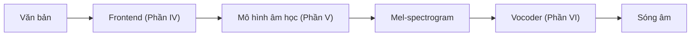

# Phần V. Mô hình âm học

Kiến trúc TTS neural kinh điển gồm hai tầng: **mô hình âm học** biến chuỗi văn bản/âm vị thành đặc trưng âm học trung gian (thường là mel-spectrogram), rồi **vocoder** biến đặc trưng đó thành sóng âm. Phần này đi qua lịch sử TTS và các thế hệ mô hình âm học — mỗi thế hệ giải quyết một điểm yếu của thế hệ trước.

## Các chương

| Chương | Nội dung | Vấn đề được giải quyết |
|---|---|---|
| [19. Lịch sử TTS](ch19-lich-su-tts.md) | Formant, ghép nối, chọn đơn vị, HMM, DNN, bước ngoặt neural | Bối cảnh và động lực của từng bước chuyển |
| [20. Tacotron và TTS dựa trên attention](ch20-tacotron.md) | Tacotron 1/2, location-sensitive attention, stop token | Học trực tiếp văn bản → mel, chất lượng gần giọng người |
| [21. Bài toán căn chỉnh](ch21-alignment.md) | Attention đơn điệu, forced alignment, MAS, học căn chỉnh không giám sát | Lỗi lặp/bỏ từ của attention |
| [22. FastSpeech và TTS không tự hồi quy](ch22-fastspeech.md) | Length regulator, variance adaptor (trường độ, cao độ, năng lượng) | Tốc độ, độ bền, khả năng điều khiển |
| [23. Glow-TTS, Grad-TTS, Matcha-TTS](ch23-glow-grad-matcha.md) | Bộ giải mã flow, diffusion và flow matching | Mel bị nhòe do hồi quy |

!!! info "Kiến thức cần có"
    Phần I, Phần II (đặc biệt Chương 7, 10, 11, 12), [Chương 14](../phan-3-tin-hieu-ngu-am/ch14-xu-ly-tin-hieu-so.md) và Phần IV.
