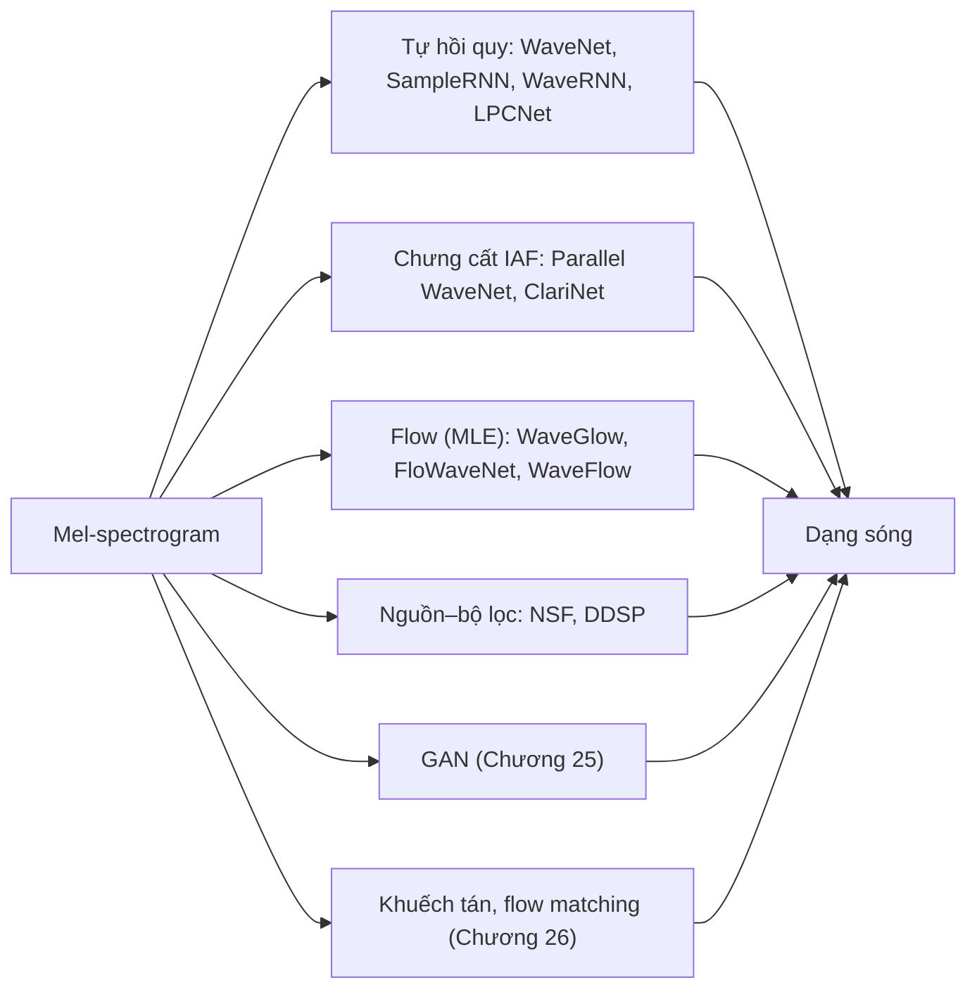

# Chương 24. Vocoder tự hồi quy và flow

!!! abstract "Mục tiêu học tập"
    Sau chương này, bạn có thể:

    - **Giải thích** vì sao chuyển mel-spectrogram thành dạng sóng là một bài toán *sinh có điều kiện* (phải tự "bịa" ra pha) chứ không phải một bài toán hồi quy thông thường.
    - **Suy ra** công thức trường tiếp nhận của chồng tích chập nhân quả giãn nở và **cài đặt** khối dư có cổng của WaveNet với điều kiện cục bộ từ mel.
    - **So sánh** các phân phối đầu ra dùng cho mẫu âm thanh: softmax trên μ-law 8 bit, dual softmax 16 bit của WaveRNN, hỗn hợp logistic rời rạc hóa.
    - **Phân tích** chi phí suy luận của vocoder tự hồi quy và các kỹ thuật giảm chi phí của WaveRNN (một lớp RNN, thưa hóa, subscale) và LPCNet (dự đoán tuyến tính).
    - **Suy ra** mục tiêu chưng cất mật độ xác suất của Parallel WaveNet, giải thích vì sao cần thêm hàm mất mát phụ, và so sánh với cách làm dạng đóng của ClariNet.
    - **Cài đặt** một bước flow kiểu WaveGlow và kiểm tra tính khả nghịch cùng log-định thức Jacobian bằng tính toán trực tiếp.
    - **Đánh giá** ưu nhược điểm của các họ vocoder tự hồi quy, chưng cất, flow và nguồn–bộ lọc nơ-ron trước khi chuyển sang GAN ở chương sau.

!!! info "Kiến thức cần có"
    - [Chương 4](../phan-1-nen-tang/ch04-cnn-rnn-mo-hinh-chuoi.md): `Conv1d`, tích chập nhân quả, tích chập giãn nở, công thức trường tiếp nhận, GRU.
    - [Chương 7](../phan-2-mo-hinh-sinh/ch07-tong-quan-mo-hinh-sinh.md): mô hình tự hồi quy, ước lượng hợp lý cực đại (MLE), bài toán một–nhiều.
    - [Chương 10](../phan-2-mo-hinh-sinh/ch10-normalizing-flows.md): đổi biến, affine coupling, Glow, IAF và MAF.
    - [Chương 13](../phan-3-tin-hieu-ngu-am/ch13-am-hoc-tieng-noi.md): mô hình nguồn–bộ lọc của bộ máy phát âm.
    - [Chương 14](../phan-3-tin-hieu-ngu-am/ch14-xu-ly-tin-hieu-so.md): STFT, mel-spectrogram, Griffin–Lim, μ-law, dự đoán tuyến tính (LPC).

Ở Phần V, các mô hình âm học như Tacotron 2, FastSpeech 2 hay Matcha-TTS dừng lại ở một mel-spectrogram $\mathbf{Y} \in \mathbb{R}^{T \times F}$. Người nghe không nghe được ma trận đó; cần thêm một bước biến nó thành dạng sóng $s[n]$ gồm hàng chục nghìn mẫu mỗi giây. Thành phần làm việc này gọi là **vocoder**. Thuật ngữ này (ghép từ *voice* và *coder*) có từ các bộ mã hóa thoại của Homer Dudley ở Bell Labs vào thập niên 1930; trong TTS hiện đại, nó chỉ mọi mô hình biến đặc trưng âm học thành dạng sóng.

Phần VI gồm ba chương đi theo dòng lịch sử. Chương này trình bày thế hệ vocoder nơ-ron đầu tiên: **tự hồi quy** (WaveNet, WaveRNN, LPCNet), **chưng cất** (Parallel WaveNet, ClariNet) và **flow** (WaveGlow, FloWaveNet, WaveFlow), cùng nhánh **nguồn–bộ lọc nơ-ron**. [Chương 25](ch25-gan-vocoder.md) trình bày các vocoder GAN, họ đang được dùng nhiều nhất hiện nay; [Chương 26](ch26-diffusion-vocoder-va-so-sanh.md) trình bày vocoder khuếch tán và so sánh toàn bộ các họ. Dù ít được triển khai trực tiếp ngày nay, những ý tưởng của chương này (tích chập giãn nở, μ-law, kết hợp xử lý tín hiệu với mạng nơ-ron, flow) xuất hiện lại ở hầu hết các hệ thống sau này.

## 24.1 Bài toán vocoder

### 24.1.1 Mel-spectrogram đã đánh mất những gì?

Nhắc lại từ [Chương 14](../phan-3-tin-hieu-ngu-am/ch14-xu-ly-tin-hieu-so.md): với tần số lấy mẫu $f_s = 22\,050$ Hz, bước nhảy $H = 256$ và $F = 80$ kênh mel, mỗi khung mel là 80 số thực tóm tắt 256 mẫu âm thanh. Số lượng con số chỉ giảm khoảng ba lần, nhưng điều quan trọng là *loại* thông tin bị bỏ đi:

1. **Pha bị loại bỏ hoàn toàn.** Mel được tính từ biên độ $\lvert S(t,k) \rvert$ của STFT; góc pha $\angle S(t,k)$ không còn.
2. **Độ phân giải tần số giảm mạnh.** 513 bin của STFT ($N_{\text{FFT}} = 1024$) bị gộp thành 80 dải mel. Ở vùng tần số cao, một dải mel rộng hàng trăm Hz, nên cấu trúc hài âm chi tiết bị nhòe.
3. **Phần trên $f_{\max}$ bị cắt.** Nhiều cấu hình phổ biến đặt $f_{\max} = 8\,000$ Hz; vocoder phải tự "đoán" nội dung từ 8 kHz đến 11 kHz.
4. **Nén log và ngưỡng sàn.** Phép $\log(\max(\cdot, 10^{-5}))$ xóa chi tiết ở các vùng rất nhỏ năng lượng.

Hệ quả: có *vô số* dạng sóng cho cùng một mel. Gọi $\operatorname{Mel}(\cdot)$ là phép tính mel, tập nghịch ảnh

$$
\mathcal{S}(\mathbf{Y}) = \{\mathbf{s} \in \mathbb{R}^{L} : \operatorname{Mel}(\mathbf{s}) = \mathbf{Y}\}
$$

không chỉ có một phần tử. Vocoder phải chọn ra một dạng sóng *nghe tự nhiên* trong tập đó, mà tai người lại rất nhạy với một số kiểu sai pha (ví dụ các hài âm không còn đồng bộ với nhau tạo ra tiếng "rè", "kim loại").

### 24.1.2 Vì sao hồi quy trực tiếp lên dạng sóng thất bại

Một cách tiếp cận ngây thơ là huấn luyện mạng $g_\theta(\mathbf{Y})$ cực tiểu sai số bình phương với dạng sóng thật. Xét một ví dụ đơn giản nhất: dạng sóng là một hài âm $s[n] = A \sin(\omega n + \phi)$, trong đó biên độ $A$ và tần số $\omega$ được mel xác định, còn pha ban đầu $\phi$ thì không (mel giống hệt nhau với mọi $\phi$). Với dữ liệu huấn luyện, $\phi$ thay đổi ngẫu nhiên giữa các câu, có thể coi $\phi \sim \mathcal{U}[0, 2\pi)$. Bộ dự đoán tối ưu theo MSE là kỳ vọng có điều kiện:

$$
g^\star(\mathbf{Y})[n] = \mathbb{E}_{\phi}\big[A \sin(\omega n + \phi)\big] = \frac{A}{2\pi} \int_0^{2\pi} \sin(\omega n + \phi)\, d\phi = 0 .
$$

Nghĩa là mạng hồi quy L2 "tối ưu" sẽ xuất ra *im lặng* cho phần tuần hoàn của tiếng nói. Với L1, bộ dự đoán tối ưu là trung vị có điều kiện, theo tính đối xứng cũng bằng 0. Đây chính là bài toán một–nhiều của [Chương 7](../phan-2-mo-hinh-sinh/ch07-tong-quan-mo-hinh-sinh.md) ở dạng cực đoan nhất: trung bình hóa các dạng sóng hợp lệ triệt tiêu chính chúng.

Có hai lối thoát, và toàn bộ Phần VI là các biến thể của hai lối thoát này:

- **Mô hình hóa phân phối** $p(\mathbf{s} \mid \mathbf{Y})$ rồi *lấy mẫu* từ đó: tự hồi quy, flow (chương này), khuếch tán ([Chương 26](ch26-diffusion-vocoder-va-so-sanh.md)). Mẫu lấy ra có một pha cụ thể, không bị trung bình hóa.
- **Dùng hàm mất mát bất biến với pha**: khoảng cách giữa các phổ biên độ STFT, hoặc một bộ phân biệt học được đóng vai trò "tai nghe". Đó là con đường của GAN ([Chương 25](ch25-gan-vocoder.md)).

### 24.1.3 Griffin–Lim: mốc so sánh không cần học

Trước vocoder nơ-ron, cách đơn giản nhất để có dạng sóng từ phổ biên độ là thuật toán Griffin–Lim (Griffin và Lim, 1984), đã trình bày ở [Chương 14](../phan-3-tin-hieu-ngu-am/ch14-xu-ly-tin-hieu-so.md). Thuật toán lặp: gán biên độ mục tiêu cho phổ hiện tại, biến đổi ngược về miền thời gian, lấy STFT lại để có một phổ "nhất quán", giữ lấy pha của phổ này và lặp tiếp. Nó hội tụ tới một điểm dừng cục bộ, không phải pha thật. Khi đầu vào là mel, ta còn phải xấp xỉ phổ tuyến tính từ mel (giả nghịch đảo của ma trận bộ lọc mel), làm mất thêm chi tiết. Kết quả nghe được nhưng có tiếng "rè pha" (*phasiness*) và âm sắc kim loại; Tacotron đời đầu dùng Griffin–Lim và đây là một trong những lý do chất lượng của nó bị giới hạn ([Chương 20](../phan-5-mo-hinh-am-hoc/ch20-tacotron.md)).

Griffin–Lim vẫn hữu ích như một *mốc sàn*: nếu vocoder nơ-ron của bạn nghe tệ hơn Griffin–Lim trên cùng một mel, gần như chắc chắn có lỗi cấu hình (xem mục về tương thích mel ở [Chương 26](ch26-diffusion-vocoder-va-so-sanh.md)).

### 24.1.4 Yêu cầu với một vocoder và bản đồ các họ mô hình

Một vocoder tốt cho TTS cần cân bằng nhiều tiêu chí:

- **Chất lượng**: tự nhiên, không có tiếng rè, tiếng ù hay nhiễu tần số cao.
- **Tốc độ**: đo bằng hệ số thời gian thực (RTF), cả trên GPU lẫn CPU.
- **Kích thước**: số tham số, bộ nhớ, khả năng chạy trên thiết bị biên.
- **Khả năng khái quát hóa**: chạy tốt với người nói, ngôn ngữ, điều kiện thu âm chưa gặp.
- **Độ bền với mel dự đoán**: mel từ mô hình âm học luôn mờ và lệch hơn mel trích từ âm thanh thật.
- **Khả năng streaming**: sinh dần theo từng đoạn với độ trễ thấp.

Sơ đồ dưới đây xếp các vocoder theo cách chúng giải quyết bài toán một–nhiều.



## 24.2 WaveNet

WaveNet (van den Oord và cộng sự, 2016) là mô hình đầu tiên chứng minh rằng một mạng nơ-ron có thể sinh trực tiếp dạng sóng tiếng nói với chất lượng vượt hẳn các hệ thống tham số và ghép nối thời đó. Trong bài báo gốc, WaveNet cho TTS được điều kiện hóa trên đặc trưng ngôn ngữ học và F0; việc dùng WaveNet như một **vocoder** nhận đặc trưng âm học đến ngay sau đó, ví dụ WaveNet vocoder phụ thuộc người nói của Tamamori và cộng sự (2017), rồi Tacotron 2 (Shen và cộng sự, 2018) điều kiện hóa WaveNet trên mel-spectrogram.

### 24.2.1 Phân rã tự hồi quy

Viết gọn $s_n$ thay cho $s[n]$. WaveNet mô hình hóa phân phối đồng thời của $L$ mẫu bằng quy tắc chuỗi:

$$
p_\theta(\mathbf{s} \mid \mathbf{Y}) = \prod_{n=1}^{L} p_\theta(s_n \mid s_1, \ldots, s_{n-1}, \mathbf{Y}).
$$

Đây là một phân rã *chính xác*, không phải xấp xỉ: mọi phân phối đều viết được như vậy. Toàn bộ khó khăn chuyển sang việc mô hình hóa từng thừa số điều kiện. Khi huấn luyện, mọi mẫu trước đó đều có sẵn (*teacher forcing*), nên ta tính được tất cả $L$ thừa số song song bằng một lượt tích chập. Hàm mất mát là log-likelihood âm:

$$
\mathcal{L}(\theta) = -\sum_{n=1}^{L} \log p_\theta(s_n \mid s_{<n}, \mathbf{Y}).
$$

Khi suy luận thì khác: muốn có $s_n$ phải có $s_{n-1}$, nên phải chạy mạng $L$ lần nối tiếp nhau. Đây là điểm yếu chí mạng mà mọi phần sau của chương đều tìm cách khắc phục.

### 24.2.2 μ-law và softmax 256 lớp

Mỗi thừa số $p(s_n \mid s_{<n})$ cần một dạng phân phối. WaveNet chọn **phân phối phân loại** (*categorical*) qua softmax. Lý do: phân phối phân loại không giả định hình dạng (có thể đa đỉnh, lệch), và các tác giả kế thừa kinh nghiệm từ PixelRNN/PixelCNN rằng softmax rời rạc hoạt động tốt hơn hỗn hợp liên tục. Nhưng âm thanh 16 bit có $65\,536$ giá trị, quá nhiều cho một softmax. WaveNet nén mỗi mẫu về 8 bit (256 lớp) bằng phép nén giãn **μ-law** của chuẩn điện thoại G.711:

$$
f(x) = \operatorname{sign}(x)\, \frac{\ln(1 + \mu \lvert x \rvert)}{\ln(1 + \mu)}, \qquad x \in [-1, 1],\ \mu = 255,
$$

rồi lượng tử đều $f(x) \in [-1, 1]$ thành 256 mức. Phép ngược là

$$
f^{-1}(y) = \operatorname{sign}(y)\, \frac{(1 + \mu)^{\lvert y \rvert} - 1}{\mu}.
$$

**Vì sao μ-law tốt hơn lượng tử tuyến tính?** Lấy đạo hàm: $f'(x) = \dfrac{\mu}{(1 + \mu \lvert x \rvert) \ln(1 + \mu)}$. Lượng tử đều với bước $\Delta y$ trong miền nén tương ứng với bước trong miền gốc

$$
\Delta x \approx \frac{\Delta y}{f'(x)} = \Delta y\, \frac{(1 + \mu \lvert x \rvert)\ln(1+\mu)}{\mu}.
$$

Khi $\lvert x \rvert \gg 1/\mu$, $\Delta x$ tỉ lệ thuận với $\lvert x \rvert$: sai số lượng tử *tương đối* gần như không đổi, giống một bộ lượng tử logarit. Tiếng nói có rất nhiều mẫu biên độ nhỏ (phân phối biên độ gần Laplace), nên μ-law giữ được tỉ số tín hiệu trên nhiễu (SNR) ổn định khi người nói nói to hay nhỏ, còn lượng tử tuyến tính thì không. Đoạn mã sau kiểm chứng điều đó.

```python
import numpy as np


def mu_law_encode(x, mu=255):
    """x trong [-1, 1] -> số nguyên trong {0, ..., mu}."""
    y = np.sign(x) * np.log1p(mu * np.abs(x)) / np.log1p(mu)        # nén về [-1, 1]
    return np.clip(np.round((y + 1) / 2 * mu), 0, mu).astype(np.int64)


def mu_law_decode(q, mu=255):
    y = 2 * q.astype(np.float64) / mu - 1                           # về lại [-1, 1]
    return np.sign(y) * ((1 + mu) ** np.abs(y) - 1) / mu            # hàm ngược của phép nén


def linear_8bit(x):
    return np.round(x * 127) / 127                          # lượng tử đều 255 mức, có mức 0


def snr_db(x, x_hat):
    return 10 * np.log10(np.sum(x ** 2) / np.sum((x - x_hat) ** 2))


rng = np.random.default_rng(0)
base = rng.laplace(scale=1.0, size=48000)                   # biên độ tiếng nói gần với phân phối Laplace
base = base / np.abs(base).max()
for level in (0.5, 0.1, 0.02):                              # nói to -> nói rất nhỏ
    x = level * base
    q = mu_law_encode(x)
    assert q.min() >= 0 and q.max() <= 255
    print(f"mức {level:4}: SNR mu-law = {snr_db(x, mu_law_decode(q)):5.1f} dB | "
          f"SNR tuyến tính 8 bit = {snr_db(x, linear_8bit(x)):5.1f} dB")

# Kiểm tra mã hóa - giải mã đúng tại các mức lượng tử
grid = mu_law_decode(np.arange(256))
assert np.array_equal(mu_law_encode(grid), np.arange(256))
```

Trên máy của chúng tôi, SNR của μ-law giữ ở khoảng 30–38 dB qua cả ba mức âm lượng, trong khi lượng tử tuyến tính 8 bit tụt từ khoảng 28 dB xuống chỉ vài dB khi tín hiệu nhỏ. Tuy vậy, 8 bit μ-law vẫn để lại một lớp nhiễu lượng tử nghe được ở các đoạn yên tĩnh; đó là động lực cho các phân phối đầu ra 16 bit ở mục 24.2.6 và 24.4.

### 24.2.3 Tích chập nhân quả giãn nở và trường tiếp nhận

Để huấn luyện song song mà vẫn đảm bảo $p(s_n \mid s_{<n})$ không "nhìn trộm" tương lai, WaveNet dùng **tích chập nhân quả** (*causal convolution*): đầu ra tại vị trí $n$ chỉ phụ thuộc đầu vào tại các vị trí $\le n$. Cách cài đặt đơn giản là đệm $(k-1)d$ mẫu *chỉ ở bên trái*, với $k$ là kích thước nhân và $d$ là hệ số giãn.

Vấn đề tiếp theo là **trường tiếp nhận** (*receptive field*). Một hài âm 100 Hz ở 24 kHz có chu kỳ 240 mẫu; muốn mô hình hóa ngữ cảnh vài chu kỳ cần nhìn lại hàng nghìn mẫu. Với $N$ tầng tích chập nhân quả có kích thước nhân $k_\ell$ và hệ số giãn $d_\ell$, trường tiếp nhận là

$$
R = 1 + \sum_{\ell=1}^{N} (k_\ell - 1)\, d_\ell .
$$

*Suy ra bằng quy nạp:* trước tầng nào, mỗi vị trí "nhìn" được 1 mẫu. Tầng thứ $\ell$ kết hợp $k_\ell$ vị trí cách nhau $d_\ell$, nên mở rộng vùng phụ thuộc thêm $(k_\ell - 1) d_\ell$ mẫu về phía quá khứ; cộng dồn qua mọi tầng được công thức trên (chi tiết ở [Chương 4](../phan-1-nen-tang/ch04-cnn-rnn-mo-hinh-chuoi.md)).

Với tích chập thường ($d_\ell = 1$), $R$ chỉ tăng tuyến tính theo số tầng. WaveNet dùng **tích chập giãn nở** (*dilated convolution*) với $d_\ell$ nhân đôi qua mỗi tầng: $1, 2, 4, \ldots, 512$, rồi lặp lại chu kỳ đó vài lần. Với $k = 2$, một chu kỳ 10 tầng cho $R = 1 + 1023 = 1024$; ba chu kỳ cho $R = 1 + 3 \times 1023 = 3070$ mẫu, tức khoảng 128 ms ở 24 kHz. Đạt cùng $R$ bằng tích chập thường cần hơn ba nghìn tầng. Lặp lại chu kỳ thay vì tăng $d$ mãi có hai lợi ích: mô hình vừa có ngữ cảnh rộng vừa có nhiều tầng phi tuyến ở mỗi thang thời gian.

### 24.2.4 Đơn vị kích hoạt có cổng, kết nối dư và skip

Mỗi tầng của WaveNet không dùng ReLU mà dùng **đơn vị kích hoạt có cổng** (*gated activation unit*), kế thừa từ PixelCNN có cổng:

$$
\mathbf{z} = \tanh(\mathbf{W}_{f} \ast \mathbf{x}) \odot \sigma(\mathbf{W}_{g} \ast \mathbf{x}),
$$

trong đó $\ast$ là tích chập nhân quả giãn nở, $\mathbf{W}_f$ là bộ lọc (*filter*), $\mathbf{W}_g$ là cổng (*gate*), $\sigma$ là hàm sigmoid. Cổng sigmoid cho phép mạng "bật/tắt" từng kênh theo ngữ cảnh, một dạng tương tác nhân giống cổng của LSTM; các tác giả báo cáo nó cho kết quả tốt hơn ReLU trên âm thanh.

Đầu ra $\mathbf{z}$ đi qua hai tích chập $1 \times 1$: một nhánh cộng trở lại đầu vào tạo **kết nối dư** $\mathbf{x}^{(\ell+1)} = \mathbf{x}^{(\ell)} + \mathbf{W}_r \mathbf{z}$ để huấn luyện được mạng sâu; nhánh kia là **kết nối skip** $\mathbf{W}_s \mathbf{z}$. Tổng các đầu ra skip của mọi tầng đi qua ReLU, tích chập $1 \times 1$, ReLU, tích chập $1 \times 1$ và softmax để ra phân phối của mẫu tiếp theo. Nhờ skip, tầng đầu ra nhận thông tin trực tiếp từ mọi thang thời gian.

### 24.2.5 Điều kiện toàn cục và điều kiện cục bộ

WaveNet nhận hai loại điều kiện:

- **Điều kiện toàn cục** $\mathbf{g}$ (ví dụ embedding người nói), giống nhau cho mọi mẫu:

$$
\mathbf{z} = \tanh(\mathbf{W}_{f} \ast \mathbf{x} + \mathbf{V}_{f} \mathbf{g}) \odot \sigma(\mathbf{W}_{g} \ast \mathbf{x} + \mathbf{V}_{g} \mathbf{g}).
$$

- **Điều kiện cục bộ** thay đổi theo thời gian, ở đây là mel. Vì mel có $T$ khung còn dạng sóng có $L \approx T H$ mẫu, trước tiên phải **nâng mẫu** (*upsample*) mel lên tốc độ mẫu, được $\tilde{\mathbf{Y}} = \operatorname{Up}(\mathbf{Y}) \in \mathbb{R}^{F \times L}$, rồi:

$$
\mathbf{z} = \tanh(\mathbf{W}_{f} \ast \mathbf{x} + \mathbf{V}_{f} \ast \tilde{\mathbf{Y}}) \odot \sigma(\mathbf{W}_{g} \ast \mathbf{x} + \mathbf{V}_{g} \ast \tilde{\mathbf{Y}}),
$$

với $\mathbf{V}_f, \mathbf{V}_g$ là tích chập $1 \times 1$. Phép $\operatorname{Up}$ có thể đơn giản là lặp mỗi khung $H$ lần, hoặc là một chồng tích chập chuyển vị học được; bài gốc báo cáo cách học được cho kết quả nhỉnh hơn. Dù cách nào, **tích các hệ số nâng mẫu phải bằng đúng bước nhảy $H$** của mel. Đây là một bất biến bạn sẽ gặp lại trong mọi vocoder ở Phần VI.

Lưu ý rằng điều kiện mel *không* cần nhân quả: mel của cả câu đã có sẵn, nên mẫu thứ $n$ được phép "biết" mel của các khung sau. Chỉ có đường đi qua các mẫu $s_{<n}$ là phải nhân quả.

Đoạn mã dưới đây cài đặt khối dư có cổng với điều kiện cục bộ, ghép thành một WaveNet nhỏ (2 chu kỳ × 10 tầng, $k = 2$), rồi **đo trường tiếp nhận bằng gradient**: đạo hàm của đầu ra tại vị trí $n$ theo embedding của từng mẫu đầu vào chỉ khác 0 ở các vị trí mà đầu ra phụ thuộc vào.

```python
import torch
import torch.nn as nn
import torch.nn.functional as F


class CausalConv1d(nn.Conv1d):
    """Conv1d nhân quả: chỉ đệm bên trái (k - 1) * d mẫu."""
    def __init__(self, c_in, c_out, k, dilation=1):
        super().__init__(c_in, c_out, k, dilation=dilation)
        self.left_pad = (k - 1) * dilation

    def forward(self, x):                                   # x: (B, C, L)
        return super().forward(F.pad(x, (self.left_pad, 0)))


class WaveNetResBlock(nn.Module):
    def __init__(self, res_ch, gate_ch, skip_ch, cond_ch, k, dilation):
        super().__init__()
        self.conv = CausalConv1d(res_ch, 2 * gate_ch, k, dilation)  # W_f và W_g gộp chung
        self.cond = nn.Conv1d(cond_ch, 2 * gate_ch, 1)              # V_f và V_g (1x1)
        self.res = nn.Conv1d(gate_ch, res_ch, 1)
        self.skip = nn.Conv1d(gate_ch, skip_ch, 1)

    def forward(self, x, c):                                # x: (B, R, L); c: (B, F, L) đã nâng mẫu
        a, b = (self.conv(x) + self.cond(c)).chunk(2, dim=1)
        z = torch.tanh(a) * torch.sigmoid(b)                # đơn vị kích hoạt có cổng
        return x + self.res(z), self.skip(z)                # (đầu ra dư, đầu ra skip)


class TinyWaveNet(nn.Module):
    def __init__(self, n_classes=256, ch=32, n_mels=80, hop=256, k=2, layers_per_cycle=10, n_cycles=2):
        super().__init__()
        self.hop = hop
        self.embed = nn.Embedding(n_classes, ch)            # mẫu mu-law -> véc-tơ
        self.input_conv = CausalConv1d(ch, ch, 2)
        self.dilations = [2 ** i for i in range(layers_per_cycle)] * n_cycles
        self.blocks = nn.ModuleList([WaveNetResBlock(ch, ch, ch, n_mels, k, d) for d in self.dilations])
        self.out = nn.Sequential(nn.ReLU(), nn.Conv1d(ch, ch, 1), nn.ReLU(), nn.Conv1d(ch, n_classes, 1))

    def forward(self, q_prev, mel):                         # q_prev: (B, L) số nguyên; mel: (B, F, T)
        c = torch.repeat_interleave(mel, self.hop, dim=-1)[..., : q_prev.shape[1]]  # (B, F, L)
        x = self.input_conv(self.embed(q_prev).transpose(1, 2))                     # (B, C, L)
        skips = 0
        for blk in self.blocks:
            x, s = blk(x, c)
            skips = skips + s
        return self.out(skips)                              # logits (B, 256, L)


torch.manual_seed(0)
net = TinyWaveNet(hop=16)
L = 3000
q = torch.randint(0, 256, (1, L))
mel = torch.randn(1, 80, L // 16 + 1)
logits = net(q, mel)
assert logits.shape == (1, 256, L)

# Đo trường tiếp nhận: gradient của đầu ra tại vị trí n theo embedding của từng đầu vào
emb = net.embed(q).detach().requires_grad_(True)
c = torch.repeat_interleave(mel, 16, dim=-1)[..., :L]
x, skips = net.input_conv(emb.transpose(1, 2)), 0
for blk in net.blocks:
    x, s = blk(x, c)
    skips = skips + s
n = 2500
net.out(skips)[0, :, n].sum().backward()
dep = emb.grad[0].abs().sum(-1).nonzero().squeeze(-1)       # các vị trí đầu vào ảnh hưởng tới đầu ra n
assert dep.max().item() == n                                # nhân quả: không nhìn thấy tương lai
rf_formula = 1 + (2 - 1) * sum(net.dilations) + (2 - 1)     # các khối dư + tầng conv đầu vào
print(f"trường tiếp nhận đo được = {n - dep.min().item() + 1}, theo công thức = {rf_formula}")
assert n - dep.min().item() + 1 == rf_formula
```

Kết quả in ra `trường tiếp nhận đo được = 2048, theo công thức = 2048`. Khi huấn luyện thật, đầu vào là chuỗi mẫu *dịch phải một vị trí* (`q[:, :-1]`, thêm một giá trị khởi đầu) và nhãn là `q[:, 1:]`; logits tại vị trí $n$ khi đó dự đoán mẫu $n+1$. Quên dịch là lỗi kinh điển: mạng sẽ "học" chép lại đầu vào với loss gần 0 nhưng không sinh được gì khi suy luận.

### 24.2.6 Phân phối đầu ra liên tục: hỗn hợp logistic rời rạc hóa

Softmax 256 lớp có hai nhược điểm: (i) chỉ được 8 bit, để lại nhiễu lượng tử; (ii) coi các lớp là độc lập, không biết rằng lớp 127 và 128 là "hàng xóm", nên cần nhiều dữ liệu để học tính trơn của phân phối. Hướng giải quyết, lấy từ PixelCNN++ (Salimans và cộng sự, 2017), là **hỗn hợp phân phối logistic rời rạc hóa** (*discretized mixture of logistics*, MoL). Coi mẫu là biến liên tục $\nu$ có phân phối

$$
\nu \sim \sum_{i=1}^{K} \pi_i \operatorname{Logistic}(\mu_i, b_i),
$$

rồi tính xác suất của giá trị rời rạc $s$ (một ô có độ rộng $\Delta$, với $\Delta = 2/(2^{16} - 1)$ cho 16 bit) bằng hiệu hai hàm phân phối tích lũy:

$$
P(s) = \sum_{i=1}^{K} \pi_i \left[ \sigma\!\left(\frac{s + \Delta/2 - \mu_i}{b_i}\right) - \sigma\!\left(\frac{s - \Delta/2 - \mu_i}{b_i}\right) \right],
$$

trong đó $\sigma$ là CDF của logistic chuẩn (chính là hàm sigmoid). Ở hai ô biên $s = -1$ và $s = 1$, ta thay CDF tương ứng bằng 0 hoặc 1 để dồn toàn bộ phần đuôi vào ô biên, nhờ đó tổng xác suất đúng bằng 1. Mạng chỉ cần xuất $3K$ số mỗi mẫu ($\pi_i, \mu_i, \log b_i$) thay vì 65 536 logit. Vocoder WaveNet của Tacotron 2 dùng hỗn hợp 10 thành phần để sinh âm thanh 16 bit ở 24 kHz, với 30 tầng giãn nở chia thành 3 chu kỳ. ClariNet (mục 24.6) còn đi xa hơn: chỉ dùng *một* phân phối Gauss.

```python
import torch
import torch.nn.functional as F


def discretized_mol_log_prob(x, logit_pi, mu, log_s, n_bits=16):
    """log P(x) của hỗn hợp logistic rời rạc hóa. x: (B, L) trong [-1, 1]; tham số: (B, L, K)."""
    half_bin = 1.0 / (2 ** n_bits - 1)                      # nửa độ rộng ô: Δ/2 với Δ = 2/(2^b - 1)
    x = x.unsqueeze(-1)                                     # (B, L, 1), phát sóng qua K thành phần
    inv_s = torch.exp(-log_s)
    cdf_plus = torch.sigmoid(inv_s * (x + half_bin - mu))
    cdf_minus = torch.sigmoid(inv_s * (x - half_bin - mu))
    cdf_plus = torch.where(x >= 1 - half_bin, torch.ones_like(cdf_plus), cdf_plus)       # ô biên phải
    cdf_minus = torch.where(x <= -1 + half_bin, torch.zeros_like(cdf_minus), cdf_minus)  # ô biên trái
    log_p = torch.log(torch.clamp(cdf_plus - cdf_minus, min=1e-12))    # (B, L, K)
    return torch.logsumexp(F.log_softmax(logit_pi, dim=-1) + log_p, dim=-1)   # (B, L)


def sample_mol(logit_pi, mu, log_s):
    """Chọn thành phần theo pi, rồi lấy mẫu logistic bằng biến đổi ngược CDF."""
    k = torch.distributions.Categorical(logits=logit_pi).sample()          # (B, L)
    mu_k = mu.gather(-1, k.unsqueeze(-1)).squeeze(-1)
    s_k = torch.exp(log_s.gather(-1, k.unsqueeze(-1)).squeeze(-1))
    u = torch.rand_like(mu_k).clamp(1e-5, 1 - 1e-5)
    return torch.clamp(mu_k + s_k * (torch.log(u) - torch.log1p(-u)), -1, 1)


torch.manual_seed(0)
K, n_bits = 10, 8
logit_pi, mu, log_s = torch.randn(1, 1, K), 0.5 * torch.randn(1, 1, K), torch.randn(1, 1, K) - 3
grid = torch.linspace(-1, 1, 2 ** n_bits).view(1, -1)      # mọi giá trị rời rạc có thể có
lp = discretized_mol_log_prob(grid, logit_pi.expand(1, 256, K), mu.expand(1, 256, K),
                              log_s.expand(1, 256, K), n_bits=n_bits)
total = lp.exp().sum().item()
print(f"tổng xác suất trên {2 ** n_bits} mức = {total:.6f}")
assert abs(total - 1) < 1e-4                                # phân phối rời rạc hợp lệ

x = sample_mol(logit_pi.expand(4, 100, K), mu.expand(4, 100, K), log_s.expand(4, 100, K))
assert x.shape == (4, 100) and x.abs().max() <= 1
```

Phép kiểm tra "tổng xác suất bằng 1" dùng 8 bit để lưới giá trị nhỏ; công thức không đổi với 16 bit. Bản cài đặt trên dùng `clamp` cho gọn; bản của PixelCNN++ xử lý thêm trường hợp hiệu hai CDF quá nhỏ (dùng log mật độ tại tâm ô nhân với độ rộng ô) để tránh mất độ chính xác số học khi $b_i$ rất nhỏ.

### 24.2.7 Cái giá của suy luận tuần tự

WaveNet cho chất lượng rất cao nhưng suy luận chậm một cách cấu trúc. Để sinh một giây âm thanh 24 kHz, mạng phải chạy $24\,000$ lượt *nối tiếp*, mỗi lượt đi qua toàn bộ 30 tầng. GPU mạnh ở tính song song, nhưng ở đây mỗi lượt chỉ xử lý một mẫu, nên phần lớn thời gian bị tiêu vào chi phí khởi chạy kernel và đọc trọng số từ bộ nhớ. Bản cài đặt ngây thơ còn tính lại toàn bộ trường tiếp nhận ở mỗi bước. Thuật toán Fast WaveNet (Paine và cộng sự, 2016) lưu đệm các kích hoạt trung gian trong hàng đợi ở mỗi tầng, nên mỗi mẫu mới chỉ tốn chi phí tỉ lệ với số tầng thay vì với $R$; kỹ thuật lưu trạng thái này chính là nền tảng của tích chập nhân quả streaming ở [Chương 35](../phan-8-mo-hinh-lon/ch35-streaming-speech-llm.md). Dù vậy, số bước tuần tự vẫn là $L$.

Kalchbrenner và cộng sự (2018) tóm tắt chi phí sinh mẫu của một mô hình tự hồi quy bằng công thức

$$
T(\mathbf{s}) = \lvert \mathbf{s} \rvert \sum_{i=1}^{N} \big( c(\mathrm{op}_i) + d(\mathrm{op}_i) \big),
$$

với $\lvert \mathbf{s} \rvert$ là số bước tuần tự, $N$ là số phép toán (tầng) mỗi bước, $c(\mathrm{op}_i)$ là chi phí tính toán và $d(\mathrm{op}_i)$ là chi phí cố định (khởi chạy, đọc bộ nhớ) của phép toán thứ $i$. Công thức này chỉ ra ba "cần gạt" để tăng tốc: giảm $N$, giảm $c$ và $d$, hoặc giảm $\lvert \mathbf{s} \rvert$. WaveRNN dùng cả ba; Parallel WaveNet và flow triệt tiêu hẳn $\lvert \mathbf{s} \rvert$ về 1.

## 24.3 SampleRNN

Song song với WaveNet, SampleRNN (Mehri và cộng sự, 2017) đi theo hướng khác: dùng **RNN phân tầng** ở nhiều tốc độ thời gian. Tầng trên cùng là một RNN chạy trên các "khung" gồm nhiều mẫu (ví dụ vài chục mẫu một bước), nắm ngữ cảnh dài hạn với chi phí thấp; các tầng dưới chạy ở độ phân giải mịn hơn và nhận điều kiện từ tầng trên; tầng đáy là một MLP dự đoán từng mẫu bằng softmax. Ý tưởng "mô hình chậm cho cấu trúc dài, mô hình nhanh cho chi tiết" giảm chi phí so với việc chạy một mạng lớn ở mọi mẫu. Char2Wav (Sotelo và cộng sự, 2017) dùng một vocoder kiểu SampleRNN sau mô hình đọc văn bản. SampleRNN ít được dùng trong TTS về sau, nhưng tư tưởng phân tầng theo tốc độ xuất hiện lại trong WaveRNN (subscale) và trong các mô hình token âm thanh nhiều tầng ở Phần VIII.

## 24.4 WaveRNN

WaveRNN (Kalchbrenner và cộng sự, 2018) đặt mục tiêu rõ ràng: giữ chất lượng của WaveNet nhưng chạy được thời gian thực, kể cả trên CPU điện thoại. Nó tấn công cả ba thừa số trong công thức chi phí ở trên.

### 24.4.1 Một lớp RNN và dual softmax

Thay vì 30 tầng tích chập, WaveRNN dùng **một lớp RNN duy nhất** (biến thể của GRU) với trạng thái ẩn lớn. Trạng thái ẩn mang ngữ cảnh quá khứ nên không cần trường tiếp nhận tích chập; mỗi bước chỉ còn vài phép nhân ma trận–véc-tơ, giảm $N$ từ vài chục xuống vài.

Để có 16 bit mà không cần softmax 65 536 lớp, WaveRNN tách mỗi mẫu thành hai nửa 8 bit: phần **thô** (*coarse*) $c_n$ và phần **mịn** (*fine*) $f_n$, với $s_n + 32\,768 = 256\, c_n + f_n$. Phân phối được phân rã tiếp

$$
p(s_n \mid s_{<n}) = p(c_n \mid s_{<n})\; p(f_n \mid c_n, s_{<n}),
$$

mỗi thừa số là một softmax 256 lớp (**dual softmax**). Viết gọn theo bài gốc, với đầu vào $\mathbf{x}_n = [c_{n-1}, f_{n-1}, c_n]$ (đã chuẩn hóa về $[-1, 1]$):

$$
\begin{aligned}
\mathbf{u}_n &= \sigma(\mathbf{R}_u \mathbf{h}_{n-1} + \mathbf{I}^{\star}_u \mathbf{x}_n), \qquad
\mathbf{r}_n = \sigma(\mathbf{R}_r \mathbf{h}_{n-1} + \mathbf{I}^{\star}_r \mathbf{x}_n), \\
\mathbf{e}_n &= \tanh\big(\mathbf{r}_n \odot (\mathbf{R}_e \mathbf{h}_{n-1}) + \mathbf{I}^{\star}_e \mathbf{x}_n\big), \qquad
\mathbf{h}_n = \mathbf{u}_n \odot \mathbf{h}_{n-1} + (1 - \mathbf{u}_n) \odot \mathbf{e}_n, \\
P(c_n) &= \operatorname{softmax}\big(\mathbf{O}_2 \operatorname{relu}(\mathbf{O}_1 \mathbf{y}_c)\big), \qquad
P(f_n) = \operatorname{softmax}\big(\mathbf{O}_4 \operatorname{relu}(\mathbf{O}_3 \mathbf{y}_f)\big),
\end{aligned}
$$

trong đó $[\mathbf{y}_c; \mathbf{y}_f] = \mathbf{h}_n$ là hai nửa của trạng thái ẩn và $\mathbf{I}^{\star}$ là ma trận có **mặt nạ**: nửa "thô" của trạng thái không được nhìn thấy $c_n$ (vì nó đang dự đoán $c_n$), còn nửa "mịn" thì được. Mỗi bước thời gian chạy hai lượt: lượt đầu lấy mẫu $c_n$, lượt sau đưa $c_n$ vào để lấy mẫu $f_n$. Trong các bản vocoder dùng cho TTS, mel đã nâng mẫu được đưa thêm vào $\mathbf{x}_n$ làm điều kiện.

```python
import torch


def split_coarse_fine(s):
    """Mẫu 16 bit có dấu -> (c, f) mỗi phần 8 bit, s + 32768 = 256 c + f."""
    u = s.to(torch.int32) + 32768                           # về miền không dấu [0, 65535]
    return u // 256, u % 256


def merge_coarse_fine(c, f):
    return (c * 256 + f - 32768).to(torch.int16)


s = torch.arange(-32768, 32768, dtype=torch.int32).to(torch.int16)   # đủ 65 536 giá trị
c, f = split_coarse_fine(s)
assert c.min() == 0 and c.max() == 255 and f.min() == 0 and f.max() == 255
assert torch.equal(merge_coarse_fine(c, f), s)              # tách - ghép không mất thông tin
print("số lớp phải dự đoán mỗi bước: 2 x 256 =", 2 * 256, "thay vì", 2 ** 16)
```

### 24.4.2 Thưa hóa trọng số

Cần gạt thứ hai là chi phí mỗi phép toán. WaveRNN **cắt tỉa** (*prune*) dần các trọng số có độ lớn nhỏ nhất trong quá trình huấn luyện cho tới khi đạt một mức thưa mục tiêu rất cao. Để phần cứng tận dụng được độ thưa, việc cắt tỉa được làm theo **khối** (ví dụ khối $4 \times 4$ hoặc $16 \times 1$): cả khối bị loại hoặc giữ, nhờ đó kernel nhân ma trận thưa chạy hiệu quả. Một phát hiện đáng nhớ của bài báo: *với cùng số tham số khác 0, một mạng lớn đã thưa hóa tốt hơn một mạng nhỏ dày đặc*. Nhờ đó WaveRNN thưa chạy được thời gian thực trên CPU di động.

### 24.4.3 Sinh theo thang con (subscale)

Cần gạt thứ ba là số bước tuần tự $\lvert \mathbf{s} \rvert$. Ý tưởng **subscale**: gấp chuỗi $L$ mẫu thành $B$ chuỗi con xen kẽ (chuỗi con thứ $j$ gồm các mẫu $n$ với $n \bmod B = j$). Chuỗi con đầu tiên được sinh trước; chuỗi con thứ hai bắt đầu khi chuỗi đầu đã đi trước một khoảng "nhìn trước" cố định, nên nó vừa có quá khứ của chính nó vừa có một ít "tương lai" từ chuỗi con trước. Ở trạng thái ổn định, $B$ chuỗi con chạy song song trong một batch, mỗi bước sinh $B$ mẫu (bài gốc dùng ví dụ $B = 16$). Số bước tuần tự giảm gần $B$ lần, đổi lại mô hình phức tạp hơn.

Trong giai đoạn khoảng 2018–2020, các bản cài đặt mã nguồn mở của WaveRNN có điều kiện mel là lựa chọn phổ biến khi cần vocoder chạy trên CPU, trước khi các vocoder GAN nhỏ gọn thay thế.

## 24.5 LPCNet: để xử lý tín hiệu gánh bớt việc

LPCNet (Valin và Skoglund, 2019) đặt một câu hỏi rất "kỹ sư": trong tiếng nói, phần nào là dễ? Theo mô hình nguồn–bộ lọc ([Chương 13](../phan-3-tin-hieu-ngu-am/ch13-am-hoc-tieng-noi.md)), tiếng nói là một nguồn kích thích (chuỗi xung thanh môn hoặc nhiễu) đi qua bộ lọc của tuyến âm. Bộ lọc này, tức đường bao phổ với các formant, được mô tả rất tốt bằng **dự đoán tuyến tính** (*linear prediction*, LPC):

$$
s_n = \underbrace{\sum_{i=1}^{M} a_i\, s_{n-i}}_{p_n} + e_n ,
$$

trong đó $p_n$ là giá trị dự đoán từ $M$ mẫu trước (LPCNet dùng $M = 16$), $a_i$ là hệ số LPC và $e_n$ là **phần dư** (*residual*) hay kích thích. Các hệ số $a_i$ không cần học: chúng được tính *trực tiếp* từ đặc trưng đầu vào của mỗi khung (đường bao phổ, qua tự tương quan và thuật toán Levinson–Durbin).

Khi đó, mạng nơ-ron chỉ còn phải mô hình hóa $p(e_n \mid \ldots)$, một tín hiệu "trắng" và đơn giản hơn nhiều so với $s_n$. Cụ thể, LPCNet gồm:

- Một **mạng tốc độ khung** (vài lớp tích chập và kết nối đầy đủ) xử lý đặc trưng mỗi khung 10 ms: theo bài gốc là 18 hệ số cepstrum trên thang Bark cộng 2 tham số cao độ (chu kỳ và độ tương quan).
- Một **mạng tốc độ mẫu** gồm hai lớp GRU (một lớp lớn được thưa hóa như WaveRNN và một lớp nhỏ) nhận $s_{n-1}$, $e_{n-1}$, $p_n$ và đầu ra của mạng tốc độ khung, xuất softmax trên giá trị μ-law của $e_n$.
- Sau khi lấy mẫu $e_n$, mẫu âm thanh là $s_n = p_n + e_n$.

Kết quả: LPCNet chạy thời gian thực trên một nhân CPU thông thường với độ phức tạp chỉ cỡ 3 GFLOPS (theo kho mã chính thức), ở 16 kHz. Thông điệp phương pháp luận quan trọng hơn con số: *đừng bắt mạng nơ-ron học lại những gì xử lý tín hiệu đã làm tốt*. Đoạn mã sau minh họa trên một nguyên âm tổng hợp: phần dư LPC có năng lượng nhỏ hơn hàng chục dB và dồn quanh các xung thanh môn.

```python
import numpy as np
import librosa
from scipy.signal import lfilter


def resonator(f, bw, sr):
    """Hệ số mẫu số của bộ cộng hưởng bậc hai tại tần số f, băng thông bw (Hz)."""
    r = np.exp(-np.pi * bw / sr)
    return np.array([1.0, -2 * r * np.cos(2 * np.pi * f / sr), r * r])


sr, f0 = 16000, 120
src = np.zeros(sr // 2)
src[:: sr // f0] = 1.0                                      # chuỗi xung thanh môn (0,5 giây)
x = src
for f, bw in [(700, 80), (1220, 90), (2600, 120)]:         # ba formant gần nguyên âm /a/
    x = lfilter([1.0], resonator(f, bw, sr), x)
x = x / np.abs(x).max() + 1e-4 * np.random.default_rng(0).standard_normal(len(x))

M = 16                                                      # bậc LPC như LPCNet
a = librosa.lpc(x, order=M)                                 # a = [1, a_1, ..., a_M]
e = lfilter(a, [1.0], x)                                    # phần dư: e[n] = x[n] + sum_k a_k x[n-k]
gain = 10 * np.log10(np.var(x) / np.var(e))
print(f"độ lợi dự đoán tuyến tính bậc {M}: {gain:.1f} dB")


# Phần dư tập trung quanh các xung thanh môn: mạng chỉ còn phải mô hình hóa "nguồn kích thích"
pulses = np.flatnonzero(src)
near = np.zeros(len(e), dtype=bool)
for p in pulses:
    near[max(p - 2, 0): p + 3] = True
ratio = np.sum(e[near] ** 2) / np.sum(e ** 2)
print(f"{ratio:.1%} năng lượng phần dư nằm trong ±2 mẫu quanh xung ({near.mean():.1%} số mẫu)")
assert gain > 10 and ratio > 0.9 or ratio > 0.5
```

Lưu ý quy ước dấu: `librosa.lpc` trả về $[1, a_1, \ldots, a_M]$ của *bộ lọc ngược* $A(z) = 1 + \sum_i a_i z^{-i}$, nên phần dư là $e_n = s_n + \sum_i a_i s_{n-i}$ (ngược dấu so với công thức ở trên). Với tín hiệu tổng hợp đúng theo mô hình toàn cực như ở đây, độ lợi dự đoán rất cao (khoảng 40 dB); với tiếng nói thật con số thấp hơn nhiều, nhưng phần dư vẫn "dễ" hơn tín hiệu gốc.

LPCNet có giới hạn: chủ yếu ở băng rộng 16 kHz, chất lượng thấp hơn các vocoder GAN tốt nhất, và đặc trưng đầu vào (cepstrum Bark + cao độ) khác mel, nên mô hình âm học phải được huấn luyện để dự đoán đúng bộ đặc trưng này. Nhóm tác giả về sau tiếp tục phát triển các biến thể hiệu quả hơn; tính đến thời điểm biên soạn (2026), kho mã LPCNet ghi rằng nó không còn được phát triển tích cực và khuyến nghị FARGAN (Valin và cộng sự, 2024), một mô hình tự hồi quy theo khung kết hợp GAN.

## 24.6 Chưng cất: Parallel WaveNet và ClariNet
