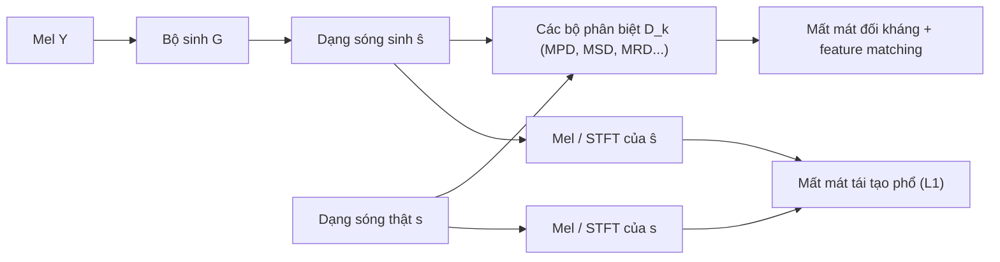
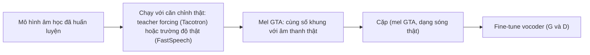

# Chương 25. Vocoder dựa trên GAN

!!! abstract "Mục tiêu học tập"
    Sau chương này, bạn có thể:

    - **Giải thích** vì sao công thức "bộ sinh một lượt + nhiều bộ phân biệt + mất mát phổ" giải quyết được cả bài toán tốc độ lẫn bài toán một–nhiều của vocoder.
    - **Suy ra** và **cài đặt** hàm mất mát STFT đa phân giải (spectral convergence + log-magnitude), phân tích vai trò bổ sung của hai thành phần.
    - **Cài đặt** đầy đủ bộ sinh HiFi-GAN (nâng mẫu bằng tích chập chuyển vị + Multi-Receptive-Field fusion) cho ba cấu hình V1, V2, V3, kiểm tra hình dạng và số tham số so với bài gốc.
    - **Cài đặt** bộ phân biệt đa chu kỳ (MPD) với phép định hình lại theo chu kỳ và bộ phân biệt đa thang (MSD); **giải thích** vì sao chu kỳ được chọn là số nguyên tố.
    - **Viết đúng** các hàm mất mát LSGAN, feature matching, mel L1 với trọng số như bài gốc và một bước huấn luyện GAN hoàn chỉnh.
    - **So sánh** MelGAN, Parallel WaveGAN, Multi-band MelGAN, UnivNet, BigVGAN, iSTFTNet và Vocos theo vấn đề mà mỗi mô hình giải quyết.
    - **Chẩn đoán** các lỗi âm thanh thường gặp (tiếng kim loại, tiếng ù, nhiễu tần số cao, tiếng lách cách) và **áp dụng** fine-tune trên mel "ground-truth aligned".

!!! info "Kiến thức cần có"
    - [Chương 9](../phan-2-mo-hinh-sinh/ch09-gan.md): trò chơi minimax, LSGAN, hinge loss, feature matching, spectral normalization.
    - [Chương 3](../phan-1-nen-tang/ch03-toi-uu-va-ky-thuat-huan-luyen.md): AdamW, weight normalization, spectral normalization, lịch tốc độ học.
    - [Chương 4](../phan-1-nen-tang/ch04-cnn-rnn-mo-hinh-chuoi.md): tích chập giãn nở, trường tiếp nhận, tích chập chuyển vị và hiện tượng bàn cờ (*checkerboard*), khối ConvNeXt.
    - [Chương 14](../phan-3-tin-hieu-ngu-am/ch14-xu-ly-tin-hieu-so.md): STFT, đánh đổi thời gian–tần số, mel-spectrogram, iSTFT và điều kiện COLA.
    - [Chương 24](ch24-vocoder-tu-hoi-quy-va-flow.md): bài toán vocoder, vì sao hồi quy thẳng lên dạng sóng thất bại.

[Chương 24](ch24-vocoder-tu-hoi-quy-va-flow.md) kết thúc với một danh sách mong ước: một vocoder sinh mọi mẫu *trong một lượt*, nhỏ gọn, không cần giáo viên, không bị ràng buộc khả nghịch, mà vẫn không bị trung bình hóa thành tín hiệu "câm". Các vocoder dựa trên mạng đối sinh (GAN) đáp ứng gần như toàn bộ danh sách đó, và từ khoảng năm 2020, HiFi-GAN cùng các hậu duệ của nó trở thành lựa chọn mặc định trong phần lớn hệ thống TTS, từ FastSpeech 2 tới VITS và nhiều hệ thống LM + flow hiện đại.

Chương này đi theo trục thời gian nhưng tập trung vào HiFi-GAN: bạn sẽ đủ chi tiết để tự cài đặt lại nó (và dùng lại trong [Dự án 2](../phan-10-du-an/du-an-2-fastspeech2-hifigan.md)). Các mô hình khác được trình bày qua câu hỏi: *nó sửa điểm yếu nào của mô hình trước?*

## 25.1 Vì sao GAN hợp với bài toán vocoder

Một vocoder GAN gồm **bộ sinh** $G$ biến mel $\mathbf{Y}$ thành dạng sóng $\hat{\mathbf{s}} = G(\mathbf{Y})$ bằng một chồng tích chập (không tự hồi quy, không khả nghịch), và một hoặc nhiều **bộ phân biệt** $D_k$ cố gắng phân biệt $\hat{\mathbf{s}}$ với dạng sóng thật $\mathbf{s}$. Hàm mất mát của bộ sinh thường có dạng chung

$$
\mathcal{L}_G = \sum_{k} \Big[ \mathcal{L}_{\text{adv}}(G; D_k) + \lambda_{\text{fm}} \mathcal{L}_{\text{fm}}(G; D_k) \Big] + \lambda_{\text{rec}} \mathcal{L}_{\text{rec}}(G),
$$

với ba thành phần đóng ba vai trò khác nhau:

- **Mất mát đối kháng** $\mathcal{L}_{\text{adv}}$ thưởng cho $G$ khi $\hat{\mathbf{s}}$ nằm *trên* đa tạp tiếng nói thật, bất kể nó chọn pha nào. Đây chính là lối thoát khỏi hiện tượng trung bình hóa ở mục 24.1.2: bộ phân biệt không đòi $\hat{\mathbf{s}}$ trùng mẫu-theo-mẫu với $\mathbf{s}$, chỉ đòi nó "nghe như thật".
- **Mất mát tái tạo** $\mathcal{L}_{\text{rec}}$ tính trên *biên độ* phổ (STFT đa phân giải hoặc mel), nên bất biến với pha. Nó buộc $\hat{\mathbf{s}}$ đúng nội dung (đúng âm, đúng cao độ, đúng âm lượng) và làm quá trình huấn luyện ổn định ngay từ đầu.
- **Feature matching** $\mathcal{L}_{\text{fm}}$ so khớp các đặc trưng trung gian của bộ phân biệt giữa âm thanh thật và giả, biến bộ phân biệt thành một "hàm mất mát cảm thụ học được".

Khó khăn nằm ở chỗ dạng sóng là tín hiệu 1-D rất dài (hàng chục nghìn mẫu mỗi giây) với cấu trúc ở nhiều thang: chu kỳ cao độ vài mili-giây, formant, đường bao năng lượng, nhiễu ma sát. Một bộ phân biệt đơn lẻ khó "nghe" hết. Lịch sử các vocoder GAN phần lớn là lịch sử **thiết kế bộ phân biệt** và **thiết kế mất mát phổ**. Sơ đồ sau tóm tắt một bước huấn luyện điển hình.



Các dạng hàm mất mát đối kháng (bản gốc, LSGAN, hinge) đã được trình bày ở [Chương 9](../phan-2-mo-hinh-sinh/ch09-gan.md); vocoder GAN chủ yếu dùng **LSGAN** (Parallel WaveGAN, HiFi-GAN, BigVGAN, Vocos) hoặc **hinge** (MelGAN). Một chi tiết đáng chú ý: phần lớn vocoder GAN *không* đưa nhiễu ngẫu nhiên vào bộ sinh (MelGAN báo cáo nhiễu không giúp ích), nên $G$ thực chất là một ánh xạ tất định từ mel sang dạng sóng. Nó không mô hình hóa sự đa dạng của pha, mà chỉ cần chọn ra *một* pha hợp lý và nhất quán; với vocoder, như vậy là đủ.

## 25.2 MelGAN

MelGAN (Kumar và cộng sự, 2019) là vocoder GAN đầu tiên đạt chất lượng chấp nhận được với tốc độ rất cao và mô hình chỉ vài triệu tham số. Nhiều quyết định thiết kế của nó vẫn còn trong HiFi-GAN.

**Bộ sinh.** Mel đi qua một tích chập (nhân 7) rồi bốn tầng nâng mẫu bằng tích chập chuyển vị với hệ số $8, 8, 2, 2$ (tích bằng $H = 256$). Sau mỗi tầng nâng mẫu là một **chồng khối dư** gồm các tích chập giãn nở với hệ số $1, 3, 9$, để mỗi mẫu đầu ra có trường tiếp nhận rộng, nắm được tương quan dài giữa các mẫu. Đầu ra đi qua $\tanh$. Hai lựa chọn nhỏ nhưng quan trọng:

- **Kích thước nhân bằng hai lần stride** cho tích chập chuyển vị. Khi nhân không chia hết cho stride, các vị trí đầu ra nhận số lượng đóng góp không đều nhau và sinh ra mẫu hình "bàn cờ" tuần hoàn (Odena và cộng sự, 2016), nghe như một tiếng ù ở tần số cố định ([Chương 4](../phan-1-nen-tang/ch04-cnn-rnn-mo-hinh-chuoi.md)).
- **Weight normalization** cho mọi tầng thay vì batch normalization. Batch norm làm đầu ra phụ thuộc thống kê của batch, gây méo âm thanh; weight norm chỉ tái tham số hóa $\mathbf{w} = g\, \mathbf{v}/\lVert \mathbf{v} \rVert$, cải thiện điều kiện tối ưu mà không giới hạn sức biểu diễn ([Chương 3](../phan-1-nen-tang/ch03-toi-uu-va-ky-thuat-huan-luyen.md)).

**Bộ phân biệt đa thang (MSD).** Ba bộ phân biệt cùng kiến trúc chạy trên âm thanh gốc, âm thanh đã hạ mẫu 2 lần và 4 lần (bằng average pooling). Bộ ở thang thô thấy cấu trúc dài hạn và vùng tần số thấp; bộ ở thang gốc thấy chi tiết tần số cao. Mỗi bộ là chồng tích chập 1-D có stride lớn và **tích chập nhóm** (*grouped convolution*) để giữ số tham số nhỏ dù nhân rộng. Đầu ra không phải một con số mà là một *chuỗi* điểm số, mỗi điểm số đánh giá một cửa sổ cục bộ (giống PatchGAN trong xử lý ảnh): bộ phân biệt tập trung vào "kết cấu" âm thanh và chạy được trên đoạn có độ dài bất kỳ.

**Hàm mất mát.** MelGAN dùng hinge loss và feature matching với hệ số $\lambda = 10$:

$$
\begin{aligned}
\mathcal{L}_{D_k} &= \mathbb{E}\big[\max(0, 1 - D_k(\mathbf{s}))\big] + \mathbb{E}\big[\max(0, 1 + D_k(G(\mathbf{Y})))\big], \\
\mathcal{L}_{G} &= \sum_{k} \Big( -\mathbb{E}\big[D_k(G(\mathbf{Y}))\big] \Big) + \lambda\, \mathcal{L}_{\text{fm}}.
\end{aligned}
$$

MelGAN *không* có mất mát phổ tường minh: feature matching là nguồn tín hiệu "tái tạo" duy nhất. Điều này làm nó kém ổn định và chất lượng còn thua WaveNet hay WaveGlow trong các so sánh sau đó. Hai mô hình tiếp theo sửa đúng điểm này.

## 25.3 Parallel WaveGAN và mất mát STFT đa phân giải

### 25.3.1 Kiến trúc

Parallel WaveGAN (Yamamoto, Song và Kim, 2020) dùng một bộ sinh kiểu **WaveNet không nhân quả**: đầu vào là nhiễu Gauss dài $L$ mẫu, điều kiện là mel đã nâng mẫu (cấu hình công khai cho LJSpeech dùng các hệ số $4, 4, 4, 4$), 30 tầng tích chập giãn nở chia 3 chu kỳ. Vì không nhân quả và không tự hồi quy, mọi mẫu được tính song song. Bộ phân biệt là 10 tầng tích chập giãn nở 1-D. Mất mát đối kháng là LSGAN. Đóng góp lớn nhất của bài báo không nằm ở kiến trúc, mà ở **mất mát STFT đa phân giải** (*multi-resolution STFT loss*), một thành phần về sau xuất hiện trong rất nhiều vocoder và codec.

### 25.3.2 Định nghĩa

Gọi $\mathbf{A} = \lvert \operatorname{STFT}(\mathbf{s}) \rvert$ và $\hat{\mathbf{A}} = \lvert \operatorname{STFT}(\hat{\mathbf{s}}) \rvert$ là hai ma trận biên độ (khung × bin tần số) với một cấu hình STFT cho trước. Hai thành phần là

$$
\mathcal{L}_{\text{sc}}(\mathbf{s}, \hat{\mathbf{s}}) = \frac{\lVert \mathbf{A} - \hat{\mathbf{A}} \rVert_F}{\lVert \mathbf{A} \rVert_F},
\qquad
\mathcal{L}_{\text{mag}}(\mathbf{s}, \hat{\mathbf{s}}) = \frac{1}{N} \big\lVert \log \mathbf{A} - \log \hat{\mathbf{A}} \big\rVert_1 ,
$$

trong đó $\lVert \cdot \rVert_F$ là chuẩn Frobenius và $N$ là số phần tử. $\mathcal{L}_{\text{sc}}$ gọi là **hội tụ phổ** (*spectral convergence*), $\mathcal{L}_{\text{mag}}$ là **sai số log-biên độ**. Với $M$ cấu hình STFT khác nhau,

$$
\mathcal{L}_{\text{aux}}(G) = \frac{1}{M} \sum_{m=1}^{M} \Big( \mathcal{L}_{\text{sc}}^{(m)} + \mathcal{L}_{\text{mag}}^{(m)} \Big),
\qquad
\mathcal{L}_G = \mathcal{L}_{\text{aux}} + \lambda_{\text{adv}} \mathcal{L}_{\text{adv}},
$$

với $\lambda_{\text{adv}} = 4$ trong bài gốc. Ba cấu hình (cho âm thanh 24 kHz trong bài báo; cấu hình LJSpeech 22,05 kHz công khai dùng lại y nguyên) là:

| Độ phân giải | $N_{\text{FFT}}$ | Độ dài cửa sổ $W$ | Bước nhảy $H$ |
|---|---|---|---|
| 1 | 1024 | 600 | 120 |
| 2 | 2048 | 1200 | 240 |
| 3 | 512 | 240 | 50 |

### 25.3.3 Phân tích: vì sao cần cả hai thành phần và nhiều độ phân giải?

**(a) Bất biến với pha.** Cả hai thành phần chỉ phụ thuộc vào biên độ STFT. Một dạng sóng có pha khác nhưng phổ biên độ giống hệt không bị phạt, nên không xảy ra trung bình hóa như hồi quy L2 trên dạng sóng.

**(b) Hội tụ phổ nhấn mạnh các thành phần lớn.** Lấy đạo hàm theo một phần tử $\hat{A}_{tk}$ (với $\hat{\mathbf{A}} \neq \mathbf{A}$):

$$
\frac{\partial \mathcal{L}_{\text{sc}}}{\partial \hat{A}_{tk}} = \frac{\hat{A}_{tk} - A_{tk}}{\lVert \mathbf{A} \rVert_F \, \lVert \mathbf{A} - \hat{\mathbf{A}} \rVert_F}.
$$

Gradient tỉ lệ với *sai số tuyệt đối* của từng bin. Các bin năng lượng lớn (đỉnh hài âm, formant của nguyên âm) có sai số tuyệt đối lớn nên chi phối gradient. Phép chia cho $\lVert \mathbf{A} \rVert_F$ làm $\mathcal{L}_{\text{sc}}$ **bất biến theo thang đo**: nhân cả $\mathbf{s}$ lẫn $\hat{\mathbf{s}}$ với cùng hằng số không đổi giá trị, nên câu nói to và câu nói nhỏ đóng góp như nhau.

**(c) Log-biên độ nhấn mạnh các thành phần nhỏ.** Với $\mathcal{L}_{\text{mag}}$,

$$
\frac{\partial \mathcal{L}_{\text{mag}}}{\partial \hat{A}_{tk}} = -\frac{1}{N} \cdot \frac{\operatorname{sign}\big(\log A_{tk} - \log \hat{A}_{tk}\big)}{\hat{A}_{tk}} .
$$

Gradient tỉ lệ nghịch với $\hat{A}_{tk}$: các bin năng lượng *nhỏ* (thung lũng giữa các hài, vùng tần số cao, phụ âm xát, khoảng lặng) được chú ý mạnh. Hai thành phần vì thế **bổ sung** cho nhau: một bên lo cho "đỉnh", một bên lo cho "đáy" của phổ. Đây cũng là lý do phải chặn dưới biên độ (ví dụ $\sqrt{\max(\cdot, 10^{-7})}$) trước khi lấy log, nếu không gradient bùng nổ tại các bin gần 0.

**(d) Nhiều độ phân giải chống "học tủ" một biểu diễn.** Theo nguyên lý bất định Gabor, một cửa sổ dài $W$ cho độ phân giải tần số khoảng $f_s/W$ nhưng làm nhòe thời gian trong khoảng $W/f_s$ ([Chương 14](../phan-3-tin-hieu-ngu-am/ch14-xu-ly-tin-hieu-so.md)). Nếu chỉ dùng một cấu hình, bộ sinh có thể khớp hoàn hảo biểu diễn đó nhưng vẫn để lại tạp âm ở thang mà cấu hình không nhìn rõ (ví dụ tiếng "lách cách" ngắn hơn cửa sổ, hoặc sai lệch hài âm hẹp hơn độ phân giải tần số). Ba cấu hình từ cửa sổ 240 mẫu (10 ms ở 24 kHz) đến 1200 mẫu (50 ms) phủ cả hai phía.

**(e) Khởi động bằng mất mát phổ.** Cấu hình công khai của Parallel WaveGAN chỉ bật bộ phân biệt sau 100 nghìn bước đầu: bộ sinh học đường bao phổ bằng $\mathcal{L}_{\text{aux}}$ trước, rồi GAN mới tinh chỉnh chi tiết. Chỉ dùng mất mát phổ thường cho âm thanh nghe "rè", hơi "robot", vì pha giữa các hài âm trong một khung không bị ràng buộc; bộ phân biệt sửa đúng phần này.

Đoạn mã sau cài đặt mất mát STFT đa phân giải và kiểm chứng ba tính chất: bằng 0 khi hai tín hiệu trùng nhau, không đổi khi đảo dấu (mọi pha lệch $\pi$), gần như không đổi khi trễ vài mẫu, trong khi L1 trên dạng sóng thay đổi lớn; và $\mathcal{L}_{\text{sc}}$ bất biến theo thang đo.

```python
import math
import torch
import torch.nn.functional as F


def stft_mag(x, n_fft, hop, win):                           # x: (B, L)
    spec = torch.stft(x, n_fft, hop, win, torch.hann_window(win, device=x.device),
                      return_complex=True)                  # (B, n_fft/2 + 1, T)
    return torch.sqrt(torch.clamp(spec.real ** 2 + spec.imag ** 2, min=1e-7))


def mr_stft_loss(x_hat, x, resolutions=((1024, 120, 600), (2048, 240, 1200), (512, 50, 240))):
    """Trả về (L_sc, L_mag) trung bình trên M độ phân giải (n_fft, hop, win) như Parallel WaveGAN."""
    l_sc = l_mag = 0.0
    for n_fft, hop, win in resolutions:
        S_hat, S = stft_mag(x_hat, n_fft, hop, win), stft_mag(x, n_fft, hop, win)
        l_sc = l_sc + torch.linalg.norm(S - S_hat) / torch.linalg.norm(S)   # chuẩn Frobenius
        l_mag = l_mag + F.l1_loss(torch.log(S_hat), torch.log(S))
    M = len(resolutions)
    return l_sc / M, l_mag / M


torch.manual_seed(0)
sr = 24000
t = torch.arange(sr // 2) / sr                              # 0,5 giây
x = (0.3 * torch.sin(2 * math.pi * 200 * t) + 0.1 * torch.sin(2 * math.pi * 1300 * t)).unsqueeze(0)
x = x + 0.01 * torch.randn_like(x)

sc, mag = mr_stft_loss(x, x)
assert sc < 1e-6 and mag < 1e-6                             # tín hiệu trùng nhau -> mất mát bằng 0

# Đảo dấu: mọi pha lệch π, biên độ STFT giữ nguyên
sc, mag = mr_stft_loss(-x, x)
print(f"đảo dấu   : L1 sóng = {F.l1_loss(-x, x):.4f} | L_sc = {sc:.2e}, L_mag = {mag:.2e}")

# Trễ 3 mẫu (0,125 ms): sai khác mẫu-theo-mẫu lớn nhưng phổ biên độ gần như không đổi
x_shift = torch.roll(x, shifts=3, dims=1)
sc, mag = mr_stft_loss(x_shift, x)
print(f"trễ 3 mẫu : L1 sóng = {F.l1_loss(x_shift, x):.4f} | L_sc = {sc:.4f}, L_mag = {mag:.4f}")

# L_sc bất biến khi nhân cả hai tín hiệu với cùng một hằng số
y = x + 0.05 * torch.randn_like(x)
a, _ = mr_stft_loss(y, x)
b, _ = mr_stft_loss(10 * y, 10 * x)
print(f"L_sc gốc = {a:.4f}, sau khi nhân 10 = {b:.4f}")
assert abs(a - b) < 1e-3
```

Khi đảo dấu, L1 trên dạng sóng xấp xỉ 0,39 (gấp đôi biên độ trung bình) trong khi cả hai mất mát phổ bằng đúng 0. Khi trễ 3 mẫu, L1 trên dạng sóng khoảng 0,067, còn $\mathcal{L}_{\text{sc}}$ chỉ khoảng 0,04. Để ý rằng $\mathcal{L}_{\text{mag}}$ trong trường hợp trễ lớn hơn $\mathcal{L}_{\text{sc}}$: phần nhiễu nền năng lượng thấp thay đổi theo khung, và log phóng đại đúng những bin nhỏ đó, minh họa cho điểm (c).

## 25.4 HiFi-GAN

HiFi-GAN (Kong, Kim và Bae, 2020) kết hợp những bài học trên thành một công thức đơn giản, hiệu quả, và đến nay vẫn là vocoder "ngựa thồ" của lĩnh vực. Bốn thành phần chính:

1. **Bộ sinh** gồm các tầng nâng mẫu bằng tích chập chuyển vị, mỗi tầng theo sau bởi một mô-đun **Multi-Receptive-Field fusion (MRF)**.
2. **Bộ phân biệt đa chu kỳ (MPD)**, thành phần mới quan trọng nhất, chuyên "nghe" các cấu trúc tuần hoàn.
3. **Bộ phân biệt đa thang (MSD)** kế thừa từ MelGAN.
4. **Hàm mất mát** gồm LSGAN, feature matching và **mel L1**, với trọng số $\lambda_{\text{fm}} = 2$, $\lambda_{\text{mel}} = 45$.

Các khối mã trong mục này **nối tiếp nhau** (khối sau dùng lớp và hàm của khối trước); hãy chạy chúng theo thứ tự trong cùng một phiên Python.

### 25.4.1 Bộ sinh: nâng mẫu và MRF


**Tầng vào.** Mel $(B, F, T)$ đi qua tích chập nhân 7 để thành $h_u$ kênh ($h_u = 512$ ở V1).

**Các tầng nâng mẫu.** Tầng thứ $i$ gồm LeakyReLU (độ dốc 0,1) rồi tích chập chuyển vị với stride $u_i$, kích thước nhân $k_{u,i}$, padding $(k_{u,i} - u_i)/2$, và giảm số kênh đi một nửa. Độ dài đầu ra của tích chập chuyển vị là

$$
L_{\text{out}} = (L_{\text{in}} - 1)\, u - 2 \cdot \frac{k - u}{2} + k = u \, L_{\text{in}},
$$

nên mỗi tầng nhân độ dài lên đúng $u_i$ lần khi $k - u$ chẵn. Sau tất cả các tầng, độ dài là $T \prod_i u_i$, và vì dạng sóng phải có $L = T \cdot H$ mẫu, ta có ràng buộc cứng

$$
\prod_{i} u_i = H .
$$

V1 dùng $u = (8, 8, 2, 2)$ và $k_u = (16, 16, 4, 4)$: tích bằng 256 và kích thước nhân luôn bằng hai lần stride, như MelGAN, để mọi mẫu đầu ra nhận số đóng góp bằng nhau và giảm hiện tượng bàn cờ.

**Mô-đun MRF.** Sau mỗi tầng nâng mẫu, tín hiệu đi song song qua $\lvert k_r \rvert$ khối dư với các kích thước nhân $k_r = (3, 7, 11)$ khác nhau; đầu ra của chúng được cộng lại (bản cài đặt chính thức chia cho $\lvert k_r \rvert$, tức lấy trung bình). Mỗi khối dư loại 1 (`ResBlock1`) gồm ba tầng con, mỗi tầng là: LeakyReLU → tích chập giãn nở với hệ số $d \in (1, 3, 5)$ → LeakyReLU → tích chập hệ số giãn 1 → cộng nối tắt. Trường tiếp nhận của một khối (tính bằng công thức ở [Chương 24](ch24-vocoder-tu-hoi-quy-va-flow.md), ở tốc độ mẫu của tầng đó) là

$$
R = 1 + (k - 1)\big[(1 + 1) + (3 + 1) + (5 + 1)\big] = 1 + 12 (k - 1),
$$

tức 25, 73 và 121 mẫu cho $k = 3, 7, 11$. Ba nhánh có trường tiếp nhận khác nhau quan sát mẫu hình ở các độ dài khác nhau, và việc *trộn* (fusion) chúng ở mọi tầng là nguồn gốc cái tên MRF. Đây là một lựa chọn rẻ hơn nhiều so với xếp chồng thật sâu để có trường tiếp nhận lớn.

**Tầng ra.** LeakyReLU, tích chập nhân 7 về 1 kênh, rồi $\tanh$ để giới hạn biên độ trong $(-1, 1)$. Một chi tiết nhỏ dễ bỏ sót: LeakyReLU cuối cùng trong mã chính thức gọi `F.leaky_relu(x)` với độ dốc mặc định 0,01 chứ không phải 0,1. Mã nguồn chính thức cũng khởi tạo trọng số các tầng tích chập (trừ tầng vào) theo $\mathcal{N}(0, 0{,}01^2)$, và bọc mọi tầng bằng weight normalization; khi suy luận có thể "gỡ" weight norm (gộp $g$ và $\mathbf{v}$ thành một trọng số) để chạy nhanh hơn một chút.

Ba cấu hình trong bài báo:

| Cấu hình | $h_u$ | $u$ | $k_u$ | $k_r$ | Hệ số giãn $D_r$ | Loại khối |
|---|---|---|---|---|---|---|
| V1 | 512 | (8, 8, 2, 2) | (16, 16, 4, 4) | (3, 7, 11) | (1, 3, 5) cho cả ba nhánh | ResBlock1 |
| V2 | 128 | (8, 8, 2, 2) | (16, 16, 4, 4) | (3, 7, 11) | (1, 3, 5) cho cả ba nhánh | ResBlock1 |
| V3 | 256 | (8, 8, 4) | (16, 16, 8) | (3, 5, 7) | (1, 2), (2, 6), (3, 12) | ResBlock2 |

`ResBlock2` của V3 nhẹ hơn: mỗi tầng con chỉ có một tích chập giãn nở. Đoạn mã dưới đây cài đặt hai loại khối dư.

```python
import math
import torch
import torch.nn as nn
import torch.nn.functional as F
from torch.nn.utils.parametrizations import weight_norm

LRELU_SLOPE = 0.1


def get_padding(k: int, d: int = 1) -> int:
    # padding "same" cho Conv1d stride 1: độ dài ra bằng độ dài vào
    return (k * d - d) // 2


class ResBlock1(nn.Module):
    """Khối dư loại 1 (V1, V2): mỗi tầng = conv giãn nở d rồi conv d = 1."""
    def __init__(self, ch, k=3, dilations=(1, 3, 5), wn=weight_norm):
        super().__init__()
        self.convs1 = nn.ModuleList(
            [wn(nn.Conv1d(ch, ch, k, dilation=d, padding=get_padding(k, d))) for d in dilations])
        self.convs2 = nn.ModuleList(
            [wn(nn.Conv1d(ch, ch, k, padding=get_padding(k, 1))) for _ in dilations])

    def forward(self, x):                                   # x: (B, C, L)
        for c1, c2 in zip(self.convs1, self.convs2):
            xt = c1(F.leaky_relu(x, LRELU_SLOPE))
            xt = c2(F.leaky_relu(xt, LRELU_SLOPE))
            x = x + xt                                      # nối tắt, vẫn (B, C, L)
        return x


class ResBlock2(nn.Module):
    """Khối dư loại 2 (V3): mỗi tầng chỉ một conv giãn nở."""
    def __init__(self, ch, k=3, dilations=(1, 3), wn=weight_norm):
        super().__init__()
        self.convs = nn.ModuleList(
            [wn(nn.Conv1d(ch, ch, k, dilation=d, padding=get_padding(k, d))) for d in dilations])

    def forward(self, x):                                   # x: (B, C, L)
        for c in self.convs:
            x = x + c(F.leaky_relu(x, LRELU_SLOPE))
        return x
```

Tiếp theo là bộ sinh hoàn chỉnh. Phép `assert` trong hàm khởi tạo bắt lỗi chọn kích thước nhân sai, còn thuộc tính `hop` ghi lại tích các hệ số nâng mẫu để đối chiếu với cấu hình mel.

```python
class HiFiGANGenerator(nn.Module):
    def __init__(self, n_mels=80, up_init_ch=512, up_rates=(8, 8, 2, 2),
                 up_kernels=(16, 16, 4, 4), rb_kernels=(3, 7, 11),
                 rb_dilations=((1, 3, 5),) * 3, resblock="1", use_wn=True):
        super().__init__()
        wn = weight_norm if use_wn else (lambda m: m)
        RB = ResBlock1 if resblock == "1" else ResBlock2
        self.hop = math.prod(up_rates)                      # tích hệ số nâng mẫu = bước nhảy H
        self.conv_pre = wn(nn.Conv1d(n_mels, up_init_ch, 7, padding=3))
        self.ups, self.mrfs = nn.ModuleList(), nn.ModuleList()
        ch = up_init_ch
        for u, k in zip(up_rates, up_kernels):
            assert (k - u) % 2 == 0, "cần k - u chẵn để độ dài ra đúng bằng u lần độ dài vào"
            self.ups.append(wn(nn.ConvTranspose1d(ch, ch // 2, k, stride=u, padding=(k - u) // 2)))
            ch //= 2                                        # số kênh giảm một nửa sau mỗi tầng
            self.mrfs.append(nn.ModuleList(
                [RB(ch, kr, dr, wn) for kr, dr in zip(rb_kernels, rb_dilations)]))
        self.conv_post = wn(nn.Conv1d(ch, 1, 7, padding=3))

    def forward(self, mel):                                 # mel: (B, F, T)
        x = self.conv_pre(mel)                              # (B, C0, T)
        for up, mrf in zip(self.ups, self.mrfs):
            x = up(F.leaky_relu(x, LRELU_SLOPE))            # (B, C/2, T * u)
            x = sum(rb(x) for rb in mrf) / len(mrf)         # MRF: trung bình các nhánh
        x = self.conv_post(F.leaky_relu(x))                 # bản gốc dùng độ dốc mặc định 0.01 ở đây
        return torch.tanh(x)                                # (B, 1, T * H), biên độ trong (-1, 1)
```

Kiểm tra ba cấu hình: độ dài đầu ra phải đúng $T \cdot 256$, và số tham số (đếm khi không có weight norm) nên khớp với bảng của bài báo.

```python
CONFIGS = {
    "V1": dict(up_init_ch=512),
    "V2": dict(up_init_ch=128),
    "V3": dict(up_init_ch=256, up_rates=(8, 8, 4), up_kernels=(16, 16, 8),
               rb_kernels=(3, 5, 7), rb_dilations=((1, 2), (2, 6), (3, 12)), resblock="2"),
}
torch.manual_seed(0)
mel = torch.randn(2, 80, 12)                                # (B, F, T) = 12 khung
for name, cfg in CONFIGS.items():
    g = HiFiGANGenerator(**cfg, use_wn=False)               # đếm tham số khi đã gỡ weight norm
    n_params = sum(p.numel() for p in g.parameters())
    with torch.no_grad():
        wav = g(mel)
    assert g.hop == 256 and wav.shape == (2, 1, 12 * 256), wav.shape
    print(f"{name}: {n_params / 1e6:.2f} triệu tham số, đầu ra {tuple(wav.shape)}")
```

Kết quả: V1 khoảng 13,93 triệu, V2 khoảng 0,93 triệu, V3 khoảng 1,46 triệu tham số, khớp với các con số 13,92 / 0,92 / 1,46 triệu mà bài gốc báo cáo (sai khác ở chữ số cuối do làm tròn). Khớp số tham số là một phép kiểm tra rất mạnh rằng bạn đã cài đặt đúng kiến trúc. Điều đáng nói: bộ sinh V2 chưa tới một triệu tham số, nhỏ hơn WaveGlow gần trăm lần.

### 25.4.2 Bộ phân biệt đa chu kỳ (MPD)

**Động cơ.** Tiếng nói hữu thanh là tổng của các thành phần tuần hoàn với nhiều chu kỳ khác nhau. Các bộ phân biệt của MelGAN nhìn vào các mẫu *liên tiếp* (ở vài tốc độ lấy mẫu) và theo các tác giả HiFi-GAN, chúng chưa nắm tốt các mẫu hình tuần hoàn này. MPD gồm nhiều bộ phân biệt con, mỗi bộ chỉ nhìn các mẫu **cách đều nhau một chu kỳ $p$**.

**Phép định hình lại.** Cho dạng sóng $s[n]$ dài $L$ (đệm phản xạ thêm cho tới khi chia hết cho $p$), bộ phân biệt con thứ $p$ xếp nó thành ma trận 2-D kích thước $(L/p) \times p$:

$$
\mathbf{X}^{(p)}_{i, j} = s[i\,p + j], \qquad i = 0, \ldots, L/p - 1, \quad j = 0, \ldots, p - 1 .
$$

Cột $j$ chứa các mẫu $s[j], s[j + p], s[j + 2p], \ldots$, tức là dạng sóng **lấy mẫu thưa** với hệ số $p$ và độ lệch $j$. Sau đó là các tích chập 2-D với nhân kích thước $(5, 1)$ và stride $(3, 1)$: nhân có chiều rộng 1 nên chỉ trượt dọc trục thời gian của từng cột, **mỗi cột được xử lý độc lập với cùng bộ trọng số**, và gradient từ MPD lan tới *mọi* mẫu của dạng sóng. Kênh tăng dần $1 \to 32 \to 128 \to 512 \to 1024$, rồi một tích chập stride 1 với 1024 kênh, cuối cùng một tích chập $(3, 1)$ ra 1 kênh. Mọi tầng dùng weight norm và LeakyReLU 0,1.

**Vì sao chu kỳ là $2, 3, 5, 7, 11$?** Đây là các số nguyên tố, chọn để các bộ con **ít trùng lặp** nhất. Nếu có cả chu kỳ 2 và 4, mọi cột của bộ chu kỳ 4 (các mẫu $n \equiv j \pmod 4$) là tập con của một cột của bộ chu kỳ 2, nên bộ chu kỳ 4 gần như dư thừa. Với hai số nguyên tố $p \neq q$, hai cách chia cột chỉ "đồng bộ" lại sau mỗi $pq$ mẫu.

**Một cách hiểu sâu hơn.** Chu kỳ cao độ của tiếng nói là hàng chục đến hàng trăm mẫu, lớn hơn nhiều so với 2–11, nên MPD *không* đơn giản là "khớp chu kỳ cao độ". Một cách nhìn hữu ích: mỗi cột là một thành phần đa pha (*polyphase*) của tín hiệu; lấy mẫu thưa không lọc chống răng cưa làm phổ bị gập lại, và các cột khác nhau là các phiên bản gập với độ lệch pha khác nhau. Với tiếng nói thật, các thành phần này có quan hệ pha rất nhất quán với nhau; các lỗi điển hình của bộ sinh (sai pha giữa các hài, nhiễu tuần hoàn do nâng mẫu) phá vỡ sự nhất quán đó. Cơ chế chính xác vẫn là một câu hỏi mở; điều chắc chắn là thí nghiệm loại bỏ trong bài báo cho thấy bỏ MPD làm chất lượng giảm rõ rệt.

```python
class DiscriminatorP(nn.Module):
    """Bộ phân biệt con của MPD với chu kỳ p."""
    def __init__(self, period, use_sn=False):
        super().__init__()
        self.period = period
        norm = torch.nn.utils.parametrizations.spectral_norm if use_sn else weight_norm
        chs = [1, 32, 128, 512, 1024]
        self.convs = nn.ModuleList(
            [norm(nn.Conv2d(chs[i], chs[i + 1], (5, 1), (3, 1), padding=(2, 0))) for i in range(4)]
            + [norm(nn.Conv2d(1024, 1024, (5, 1), 1, padding=(2, 0)))])
        self.conv_post = norm(nn.Conv2d(1024, 1, (3, 1), 1, padding=(1, 0)))

    def forward(self, x):                                   # x: (B, 1, L)
        b, c, n = x.shape
        if n % self.period != 0:                            # đệm phản xạ cho L chia hết cho p
            pad = self.period - n % self.period
            x = F.pad(x, (0, pad), mode="reflect")
            n = n + pad
        x = x.view(b, c, n // self.period, self.period)     # (B, 1, L/p, p): cột j = các mẫu n ≡ j (mod p)
        fmap = []
        for conv in self.convs:
            x = F.leaky_relu(conv(x), LRELU_SLOPE)          # nhân (5, 1): chỉ trộn theo trục thời gian
            fmap.append(x)
        x = self.conv_post(x)
        fmap.append(x)
        return torch.flatten(x, 1), fmap                    # điểm số (B, số "mảnh"), danh sách đặc trưng


class MultiPeriodDiscriminator(nn.Module):
    def __init__(self, periods=(2, 3, 5, 7, 11)):
        super().__init__()
        self.discs = nn.ModuleList([DiscriminatorP(p) for p in periods])

    def forward(self, x):                                   # trả về list điểm số và list fmap
        outs = [d(x) for d in self.discs]
        return [o[0] for o in outs], [o[1] for o in outs]
```

Phép thử dưới đây in hình dạng các bản đồ đặc trưng và kiểm chứng tính độc lập theo cột: thay đổi một mẫu thuộc cột $j = 1$ chỉ làm đổi đặc trưng ở cột 1.

```python
torch.manual_seed(0)
d3 = DiscriminatorP(period=3)
x = torch.randn(1, 1, 8192)                                 # một đoạn huấn luyện 8192 mẫu
score, fmap = d3(x)
print("điểm số:", tuple(score.shape), "| fmap:", [tuple(f.shape) for f in fmap])

# Kiểm tra tính "độc lập theo cột": nhiễu một mẫu thuộc cột j chỉ đổi đặc trưng ở cột j
x2 = x.clone()
x2[0, 0, 3 * 1000 + 1] += 1.0                               # mẫu n = 3001, n mod 3 = 1
_, fmap2 = d3(x2)
diff = (fmap2[-2] - fmap[-2]).abs().sum(dim=(0, 1, 2))      # tổng thay đổi theo từng cột, (p,)
print("thay đổi theo cột:", diff.tolist())
assert diff[1] > 0 and diff[0] == 0 and diff[2] == 0
```

Với đoạn 8192 mẫu và $p = 3$: đệm 1 mẫu thành 8193, ma trận $2731 \times 3$; sau bốn tầng stride 3, chiều cao còn $911 \to 304 \to 102 \to 34$, và điểm số cuối cùng là $34 \times 3 = 102$ giá trị, mỗi giá trị đánh giá một "mảnh" của một cột.

### 25.4.3 Bộ phân biệt đa thang (MSD)

MPD chỉ nhìn các mẫu rời rạc cách nhau $p$; để đánh giá các mẫu *liên tiếp* và cấu trúc dài hạn, HiFi-GAN giữ lại MSD của MelGAN: ba bộ con trên âm thanh gốc, âm thanh hạ mẫu 2 lần và 4 lần (average pooling nhân 4, stride 2). Bộ con ở thang gốc dùng **spectral normalization** (bài báo cho biết điều này làm huấn luyện ổn định hơn), hai bộ còn lại dùng weight norm. Mỗi bộ con là chồng tích chập 1-D nhóm với nhân 41 và stride lớn.

```python
from torch.nn.utils.parametrizations import spectral_norm


class DiscriminatorS(nn.Module):
    """Bộ phân biệt con của MSD (kế thừa từ MelGAN): conv 1-D có stride và nhóm."""
    def __init__(self, use_sn=False):
        super().__init__()
        norm = spectral_norm if use_sn else weight_norm
        cfg = [(1, 128, 15, 1, 1), (128, 128, 41, 2, 4), (128, 256, 41, 2, 16),
               (256, 512, 41, 4, 16), (512, 1024, 41, 4, 16),
               (1024, 1024, 41, 1, 16), (1024, 1024, 5, 1, 1)]  # (C_in, C_out, k, stride, groups)
        self.convs = nn.ModuleList([norm(nn.Conv1d(i, o, k, s, groups=g, padding=(k - 1) // 2))
                                    for i, o, k, s, g in cfg])
        self.conv_post = norm(nn.Conv1d(1024, 1, 3, 1, padding=1))

    def forward(self, x):                                   # x: (B, 1, L)
        fmap = []
        for conv in self.convs:
            x = F.leaky_relu(conv(x), LRELU_SLOPE)
            fmap.append(x)
        x = self.conv_post(x)                               # (B, 1, L/64)
        fmap.append(x)
        return torch.flatten(x, 1), fmap


class MultiScaleDiscriminator(nn.Module):
    def __init__(self):
        super().__init__()
        # thang đo gốc dùng spectral norm, hai thang đo hạ mẫu dùng weight norm
        self.discs = nn.ModuleList([DiscriminatorS(use_sn=True), DiscriminatorS(), DiscriminatorS()])
        self.pool = nn.AvgPool1d(4, 2, padding=2)

    def forward(self, x):                                   # x: (B, 1, L)
        scores, fmaps = [], []
        for i, d in enumerate(self.discs):
            if i > 0:
                x = self.pool(x)                            # L -> L/2 -> L/4
            s, f = d(x)
            scores.append(s)
            fmaps.append(f)
        return scores, fmaps
```

Tổng cộng HiFi-GAN có $5 + 3 = 8$ bộ phân biệt con. Bộ phân biệt lớn hơn bộ sinh nhiều lần (đặc biệt so với V2), nhưng chỉ dùng khi huấn luyện; khi suy luận chỉ còn bộ sinh.

### 25.4.4 Hàm mất mát

Gọi $\phi(\cdot)$ là phép tính log-mel. Với LSGAN, mất mát của một bộ phân biệt con $D$ và của bộ sinh là

$$
\mathcal{L}_{\text{Adv}}(D; G) = \mathbb{E}_{(\mathbf{s}, \mathbf{Y})}\Big[ \big(D(\mathbf{s}) - 1\big)^2 + \big(D(G(\mathbf{Y}))\big)^2 \Big],
\qquad
\mathcal{L}_{\text{Adv}}(G; D) = \mathbb{E}_{\mathbf{Y}}\Big[ \big(D(G(\mathbf{Y})) - 1\big)^2 \Big].
$$

Mất mát mel và feature matching là

$$
\mathcal{L}_{\text{Mel}}(G) = \mathbb{E}_{(\mathbf{s}, \mathbf{Y})}\Big[ \big\lVert \phi(\mathbf{s}) - \phi(G(\mathbf{Y})) \big\rVert_1 \Big],
\qquad
\mathcal{L}_{\text{FM}}(G; D) = \mathbb{E}_{(\mathbf{s}, \mathbf{Y})}\left[ \sum_{i=1}^{T_D} \frac{1}{N_i} \big\lVert D^i(\mathbf{s}) - D^i(G(\mathbf{Y})) \big\rVert_1 \right],
$$

với $D^i$ là bản đồ đặc trưng ở tầng thứ $i$ của bộ phân biệt, $T_D$ là số tầng và $N_i$ là số phần tử của tầng đó. Gọi $D_1, \ldots, D_8$ là các bộ phân biệt con của MPD và MSD, hàm mục tiêu cuối cùng là

$$
\mathcal{L}_G = \sum_{k=1}^{8} \Big[ \mathcal{L}_{\text{Adv}}(G; D_k) + \lambda_{\text{fm}} \mathcal{L}_{\text{FM}}(G; D_k) \Big] + \lambda_{\text{mel}} \mathcal{L}_{\text{Mel}}(G),
\qquad
\mathcal{L}_D = \sum_{k=1}^{8} \mathcal{L}_{\text{Adv}}(D_k; G),
$$

với $\lambda_{\text{fm}} = 2$ và $\lambda_{\text{mel}} = 45$.

**Vì sao $\lambda_{\text{mel}}$ lớn như vậy?** Mất mát mel là L1 trên log-mel, sau khi hội tụ thường chỉ cỡ vài phần mười; tổng 8 số hạng LSGAN cũng cỡ vài đơn vị. Hệ số 45 làm mất mát mel chiếm ưu thế, nhất là giai đoạn đầu: bộ sinh nhanh chóng học đúng đường bao phổ (đúng âm, đúng cao độ), và các tác giả lập luận rằng mất mát này vừa ổn định quá trình đối kháng từ sớm, vừa tập trung vào chất lượng cảm thụ vì thang mel gần với thính giác. Mất mát đối kháng và feature matching sau đó lo phần chi tiết mịn và pha. Nếu bạn đổi định nghĩa $\phi$ (ví dụ log10 thay cho log tự nhiên, hoặc chuẩn hóa mel), thang đo của $\mathcal{L}_{\text{Mel}}$ đổi theo và hệ số 45 không còn đúng nghĩa nữa.

**Hai chi tiết cài đặt quan trọng:**

- Mel *đầu vào* của bộ sinh dùng $f_{\max} = 8\,000$ Hz, nhưng mel dùng trong *mất mát* lấy toàn dải tới $f_s/2$ (`fmax_for_loss: null` trong cấu hình chính thức). Nhờ vậy vùng 8–11 kHz vẫn được giám sát dù bộ sinh không "thấy" nó ở đầu vào.
- Trong mã chính thức, feature matching lấy trung bình trên từng tầng (ứng với $1/N_i$), cộng qua các tầng và các bộ con, rồi nhân 2; mất mát LSGAN lấy trung bình trên các vị trí của chuỗi điểm số.

```python
def discriminator_loss(real_scores, fake_scores):
    # LSGAN cho D: đẩy D(x) về 1, D(G(s)) về 0; cộng qua mọi bộ phân biệt con
    return sum(torch.mean((1 - dr) ** 2) + torch.mean(dg ** 2)
               for dr, dg in zip(real_scores, fake_scores))


def generator_adv_loss(fake_scores):
    # LSGAN cho G: đẩy D(G(s)) về 1
    return sum(torch.mean((1 - dg) ** 2) for dg in fake_scores)


def feature_matching_loss(fmaps_real, fmaps_fake):
    # L1 giữa đặc trưng từng tầng; torch.mean ứng với hệ số 1/N_i trong công thức
    return sum(torch.mean(torch.abs(r.detach() - g))
               for fr, fg in zip(fmaps_real, fmaps_fake) for r, g in zip(fr, fg))


class LogMel(nn.Module):
    """Log-mel kiểu HiFi-GAN: đệm phản xạ (n_fft - hop)/2, center=False, biên độ (không bình phương)."""
    def __init__(self, sr=22050, n_fft=1024, hop=256, win=1024, n_mels=80, fmin=0, fmax=8000):
        super().__init__()
        import librosa
        fb = librosa.filters.mel(sr=sr, n_fft=n_fft, n_mels=n_mels, fmin=fmin, fmax=fmax)
        self.register_buffer("fb", torch.from_numpy(fb).float())      # (F, n_fft/2 + 1)
        self.register_buffer("window", torch.hann_window(win))
        self.n_fft, self.hop, self.win = n_fft, hop, win

    def forward(self, y):                                   # y: (B, L)
        p = (self.n_fft - self.hop) // 2
        y = F.pad(y.unsqueeze(1), (p, p), mode="reflect").squeeze(1)
        spec = torch.stft(y, self.n_fft, self.hop, self.win, self.window,
                          center=False, return_complex=True)          # (B, n_fft/2 + 1, T)
        mag = torch.sqrt(spec.real ** 2 + spec.imag ** 2 + 1e-9)
        return torch.log(torch.clamp(self.fb @ mag, min=1e-5))        # (B, F, T), T = L / hop
```

Cách đệm $(N_{\text{FFT}} - H)/2$ ở hai đầu với `center=False` cho đúng $T = L/H$ khung khi $L$ chia hết cho $H$, đồng nhất với bộ sinh. Đây là một trong những quy ước mà mô hình âm học và vocoder *phải* giống hệt nhau ([Chương 26](ch26-diffusion-vocoder-va-so-sanh.md)).

Cuối cùng, một bước huấn luyện hoàn chỉnh: cập nhật bộ phân biệt với $G(\mathbf{Y})$ đã tách khỏi đồ thị tính toán (`detach`), rồi cập nhật bộ sinh với tổng có trọng số của ba loại mất mát. Để chạy nhanh trên CPU, ta dùng một bộ sinh rất nhỏ và đoạn chỉ 2048 mẫu; các bộ phân biệt giữ nguyên kích thước thật.

```python
torch.manual_seed(0)
G = HiFiGANGenerator(up_init_ch=32)                         # bản rất nhỏ để chạy nhanh trên CPU
mpd, msd = MultiPeriodDiscriminator(), MultiScaleDiscriminator()
mel_in, mel_loss_fn = LogMel(fmax=8000), LogMel(fmax=None)  # fmax của đầu vào khác của hàm mất mát
betas = (0.8, 0.99)
opt_g = torch.optim.AdamW(G.parameters(), lr=2e-4, betas=betas, weight_decay=0.01)
opt_d = torch.optim.AdamW([*mpd.parameters(), *msd.parameters()], lr=2e-4, betas=betas, weight_decay=0.01)
LAMBDA_FM, LAMBDA_MEL = 2.0, 45.0

t = torch.arange(2048) / 22050
wav = (0.5 * torch.sin(2 * math.pi * 220 * t)).unsqueeze(0)  # (B, L) = (1, 2048)
mel = mel_in(wav)                                           # (1, 80, 8)
real = wav.unsqueeze(1)                                     # (1, 1, 2048)
fake = G(mel)                                               # (1, 1, 2048)
assert fake.shape == real.shape

# Bước 1: cập nhật bộ phân biệt (G(s) được detach)
loss_d = 0.0
for D in (mpd, msd):
    s_real, _ = D(real)
    s_fake, _ = D(fake.detach())
    loss_d = loss_d + discriminator_loss(s_real, s_fake)
opt_d.zero_grad(); loss_d.backward(); opt_d.step()

# Bước 2: cập nhật bộ sinh
loss_mel = F.l1_loss(mel_loss_fn(fake.squeeze(1)), mel_loss_fn(wav))
loss_adv = loss_fm = 0.0
for D in (mpd, msd):
    s_real, f_real = D(real)
    s_fake, f_fake = D(fake)
    loss_adv = loss_adv + generator_adv_loss(s_fake)
    loss_fm = loss_fm + feature_matching_loss(f_real, f_fake)
loss_g = loss_adv + LAMBDA_FM * loss_fm + LAMBDA_MEL * loss_mel
opt_g.zero_grad(); loss_g.backward(); opt_g.step()
print(f"L_D={loss_d.item():.3f} | L_adv={loss_adv.item():.3f} L_fm={loss_fm.item():.4f} "
      f"L_mel={loss_mel.item():.3f} | L_G={loss_g.item():.2f}")
```

Ở bước đầu tiên, $\mathcal{L}_D$ xấp xỉ 8 (mỗi bộ con đóng góp khoảng 1 khi điểm số gần 0) và số hạng $45 \cdot \mathcal{L}_{\text{Mel}}$ chiếm gần hết $\mathcal{L}_G$, đúng như phân tích ở trên.

### 25.4.5 Cấu hình huấn luyện của bài gốc

| Hạng mục | Giá trị (cấu hình V1 công khai) |
|---|---|
| Dữ liệu, tần số lấy mẫu | LJSpeech, 22 050 Hz |
| STFT | $N_{\text{FFT}} = 1024$, $W = 1024$, $H = 256$, cửa sổ Hann |
| Mel | 80 kênh, $f_{\min} = 0$, $f_{\max} = 8000$ Hz (đầu vào), toàn dải (mất mát) |
| Đoạn huấn luyện | 8192 mẫu (32 khung), cắt ngẫu nhiên |
| Batch | 16 |
| Bộ tối ưu | AdamW, $\beta_1 = 0{,}8$, $\beta_2 = 0{,}99$, weight decay 0,01 |
| Tốc độ học | $2 \times 10^{-4}$, nhân 0,999 sau mỗi epoch |
| Cập nhật | Luân phiên D rồi G ở mỗi bước |

$\beta_1 = 0{,}8$ thấp hơn mặc định 0,9: quán tính nhỏ hơn giúp bộ tối ưu phản ứng nhanh với mục tiêu luôn thay đổi của trò chơi đối kháng (MelGAN còn dùng $\beta_1 = 0{,}5$). Bài báo huấn luyện các mô hình trong *hàng triệu bước*; khi fine-tune từ một checkpoint có sẵn, thường chỉ cần một phần nhỏ số bước đó (kinh nghiệm thực tế, phụ thuộc dữ liệu).

### 25.4.6 V1, V2, V3 và kết quả

Theo báo cáo gốc, trên LJSpeech, MOS của V1 rất gần bản ghi thật và cao hơn WaveNet (MoL), WaveGlow và MelGAN trong cùng thí nghiệm, trong khi tổng hợp nhanh hơn thời gian thực nhiều lần trên GPU. V2 đánh đổi một phần chất lượng để có mô hình dưới một triệu tham số; V3 dùng ít tầng nâng mẫu hơn và khối dư nhẹ hơn, nhắm tới tốc độ. Bài báo cũng cho thấy HiFi-GAN khái quát hóa tốt sang người nói chưa gặp (thí nghiệm trên VCTK) và có thể ghép với Tacotron 2 sau khi fine-tune trên mel do Tacotron 2 sinh ra (mục 25.9.2). Con số MOS cụ thể phụ thuộc thí nghiệm nghe; bạn nên đọc bảng gốc thay vì dựa vào một con số trích lại.

## 25.5 Multi-band MelGAN

Multi-band MelGAN (Yang và cộng sự, 2021) tăng tốc MelGAN bằng một kỹ thuật kinh điển của mã hóa âm thanh: **băng lọc PQMF** (*pseudo-quadrature mirror filter bank*). Tín hiệu được tách thành $N$ dải con (thường $N = 4$) bằng các bộ lọc điều chế cosin từ một bộ lọc thông thấp nguyên mẫu $h[n]$ có $N_h + 1$ hệ số:

$$
h_k[n] = 2\, h[n] \cos\!\left( (2k + 1)\frac{\pi}{2N}\Big(n - \frac{N_h}{2}\Big) + (-1)^k \frac{\pi}{4} \right), \qquad k = 0, \ldots, N - 1,
$$

mỗi dải con được hạ mẫu $N$ lần. Bộ sinh chỉ cần xuất $N$ kênh ở tốc độ $L/N$ (bỏ được tầng nâng mẫu cuối, vốn đắt nhất), rồi băng lọc tổng hợp (cùng dạng, với dấu của số hạng $\pi/4$ đảo lại) ghép chúng thành dạng sóng toàn dải. Cấu hình công khai cho 22,05 kHz dùng nâng mẫu $8 \times 4 \times 2 = 64$ cộng 4 dải con, tổng cộng 256. Mô hình còn mở rộng trường tiếp nhận của bộ sinh và thay feature matching bằng mất mát STFT đa phân giải trên cả toàn dải lẫn từng dải con. Kết quả là một vocoder rất nhanh trên CPU, từng được dùng nhiều trong các hệ thống cần chạy trên thiết bị.

## 25.6 UnivNet và bộ phân biệt đa phân giải

UnivNet (Jang và cộng sự, 2021) nhắm tới **vocoder phổ quát** (*universal*): một mô hình chạy tốt cho nhiều người nói, kể cả người chưa gặp. Hai đóng góp:

- **Bộ phân biệt phổ đa phân giải** (*multi-resolution spectrogram discriminator*, MRD): thay vì nhìn dạng sóng, mỗi bộ con nhận *phổ biên độ tuyến tính* ở một cấu hình STFT và xử lý bằng tích chập 2-D. Các tác giả lập luận rằng mất mát phổ đơn thuần làm phổ vùng tần số cao bị "là phẳng" (*over-smoothing*), và một bộ phân biệt trong miền phổ ở nhiều độ phân giải sửa được điều đó. MRD dùng cùng với MPD.
- **Bộ sinh dùng tích chập biến đổi theo vị trí** (*location-variable convolution*, LVC, Zeng và cộng sự, 2021): một mạng con dự đoán nhân tích chập *riêng cho từng đoạn* từ mel, nên điều kiện mel điều khiển trực tiếp phép lọc thay vì chỉ được cộng vào.

MRD trở thành một thành phần chuẩn: BigVGAN và Vocos đều dùng cặp MPD + MRD.

## 25.7 BigVGAN: hàm kích hoạt tuần hoàn và chống răng cưa

BigVGAN (Lee và cộng sự, 2023) đặt câu hỏi: làm sao để một vocoder huấn luyện trên tiếng nói đọc sạch vẫn chạy tốt với người nói, ngôn ngữ, điều kiện thu âm, thậm chí giọng hát và nhạc cụ chưa gặp? Câu trả lời gồm ba phần: thiên kiến quy nạp tuần hoàn, chống răng cưa, và quy mô.

### 25.7.1 Hàm kích hoạt Snake

Mạng ReLU/LeakyReLU là hàm tuyến tính từng khúc: ra ngoài vùng dữ liệu huấn luyện, chúng ngoại suy *tuyến tính*, không *tuần hoàn*. Ziyin, Hartwig và Ueda (2020) đề xuất hàm **Snake**:

$$
\operatorname{Snake}_\alpha(x) = x + \frac{1}{\alpha} \sin^2(\alpha x),
$$

với $\alpha > 0$ học được (BigVGAN dùng một $\alpha$ cho mỗi kênh). Một vài tính chất dễ kiểm chứng:

- Đạo hàm $\frac{d}{dx}\operatorname{Snake}_\alpha(x) = 1 + 2\sin(\alpha x)\cos(\alpha x) = 1 + \sin(2\alpha x) \in [0, 2]$, nên Snake **đơn điệu không giảm**: không tạo ra các vùng "phẳng" chết gradient trên diện rộng như ReLU.
- Khi $\alpha x$ nhỏ, $\sin^2(\alpha x)/\alpha \approx \alpha x^2$, nên Snake gần $x + \alpha x^2$; khi $\alpha$ lớn, thành phần dao động có tần số cao hơn. Mỗi kênh tự chọn "tần số" phù hợp.
- Thành phần $\sin^2$ cho mạng một thiên kiến sẵn có về tính tuần hoàn, giúp mô hình hóa và *ngoại suy* các dạng sóng tuần hoàn, ví dụ cao độ nằm ngoài phạm vi huấn luyện.

BigVGAN-v2 (2024) dùng biến thể SnakeBeta $x + \frac{1}{\beta}\sin^2(\alpha x)$ với $\alpha$ và $\beta$ tách riêng, tham số hóa theo thang log.

```python
import numpy as np
import torch
import torch.nn as nn
from scipy.signal import resample_poly


class Snake(nn.Module):
    """Snake(x) = x + sin^2(alpha x) / alpha, mỗi kênh một alpha học được."""
    def __init__(self, channels, alpha_init=1.0):
        super().__init__()
        self.alpha = nn.Parameter(alpha_init * torch.ones(1, channels, 1))

    def forward(self, x):                                   # x: (B, C, L)
        return x + torch.sin(self.alpha * x) ** 2 / (self.alpha + 1e-9)


act = Snake(channels=2)
with torch.no_grad():
    act.alpha[0, 1, 0] = 5.0                                # kênh 1: tần số tuần hoàn cao hơn
x = torch.linspace(-6, 6, 2001).repeat(1, 2, 1).requires_grad_(True)   # (1, 2, 2001)
y = act(x)
(grad,) = torch.autograd.grad(y.sum(), x)
assert grad.min() >= -1e-6 and grad.max() <= 2 + 1e-6       # đạo hàm 1 + sin(2 alpha x) nằm trong [0, 2]
print("Snake đơn điệu không giảm; đạo hàm trong", (round(grad.min().item(), 3), round(grad.max().item(), 3)))


# Răng cưa (aliasing) do phi tuyến: so với tham chiếu tính ở tần số lấy mẫu rất cao
def snake_np(v, alpha=1.0):
    return v + np.sin(alpha * v) ** 2 / alpha


fs, f0 = 22050, 9000.0
n = np.arange(4096)
sig = 0.8 * np.sin(2 * np.pi * f0 * n / fs)                 # gần Nyquist (11 025 Hz)


def act_oversampled(v, r):
    if r == 1:
        return snake_np(v)                                  # áp phi tuyến trực tiếp
    up = resample_poly(v, r, 1)                             # nâng mẫu ×r (có lọc thông thấp)
    return resample_poly(snake_np(up), 1, r)                # phi tuyến rồi lọc + hạ mẫu ×r


ref = act_oversampled(sig, 16)                              # coi như "không răng cưa"
core = slice(512, -512)                                     # bỏ vùng biên của bộ lọc
for r in (1, 2, 4):
    err = act_oversampled(sig, r) - ref
    snr = 10 * np.log10(np.sum(ref[core] ** 2) / np.sum(err[core] ** 2))
    print(f"phi tuyến ở ×{r}: SNR so với tham chiếu = {snr:5.1f} dB")
```

### 25.7.2 Chống răng cưa: mô-đun AMP

Phần thứ hai của đoạn mã trên minh họa một vấn đề tinh tế. Một hàm phi tuyến áp lên từng mẫu tạo ra các **hài mới**: $\sin^2(\alpha x)$ với $x$ chứa thành phần tần số $f$ sinh ra thành phần $2f$, $4f$, v.v. Nếu $2f$ vượt tần số Nyquist $f_s/2$, nó không biến mất mà **gập ngược** (*alias*) về một tần số sai: với $f = 9$ kHz ở $f_s = 22{,}05$ kHz, thành phần 18 kHz gập về $22{,}05 - 18 = 4{,}05$ kHz, giữa vùng tiếng nói, và không có quan hệ hài nào với $f$. Trong vocoder, các thành phần lạc này nghe như tiếng rè, tiếng kim loại.

Cách chữa, mượn từ StyleGAN3 (Karras và cộng sự, 2021), là áp phi tuyến ở **tần số lấy mẫu cao hơn**: nâng mẫu 2 lần (có lọc thông thấp), áp Snake, lọc thông thấp rồi hạ mẫu 2 lần. Thành phần 18 kHz giờ nằm dưới Nyquist mới (22,05 kHz) và bị bộ lọc loại bỏ thay vì gập về. BigVGAN gọi khối này là **anti-aliased multi-periodicity composition (AMP)**, dùng các bộ lọc sinc có cửa sổ Kaiser (12 hệ số trong mã chính thức). Kết quả đo ở trên: so với tham chiếu gần lý tưởng, SNR tăng từ khoảng 11 dB (áp trực tiếp) lên khoảng 35 dB ở ×2 và hơn 90 dB ở ×4. Hệ số ×2 không loại hết răng cưa (hài bậc 4 ở 36 kHz vẫn gập về sau khi nâng mẫu), nhưng các hài bậc cao có biên độ nhỏ hơn nhiều, nên ×2 là điểm cân bằng hợp lý giữa chất lượng và chi phí.

### 25.7.3 Quy mô và khả năng khái quát hóa

Bộ sinh BigVGAN giữ khung HiFi-GAN (tích chập chuyển vị + khối dư đa nhân) nhưng thay LeakyReLU bằng AMP, và dùng MPD + MRD thay cho MPD + MSD. Bản lớn có khoảng 112 triệu tham số, bản "base" khoảng 14 triệu (theo kho mã chính thức), làm việc ở 24 kHz với 100 kênh mel, $f_{\max} = 12$ kHz và các hệ số nâng mẫu $(4, 4, 2, 2, 2, 2)$. Mô hình chỉ được huấn luyện trên LibriTTS, nhưng theo bài báo, nó tổng hợp tốt cả người nói, ngôn ngữ và điều kiện thu âm chưa gặp, thậm chí giọng hát và nhạc cụ. Các tác giả cũng ghi nhận huấn luyện ở quy mô lớn kém ổn định hơn và phải hạ tốc độ học (cấu hình công khai dùng $10^{-4}$).

Tính đến thời điểm biên soạn (2026), **BigVGAN-v2** (2024) bổ sung nhân CUDA hợp nhất cho khối chống răng cưa để tăng tốc suy luận, bộ phân biệt dựa trên biến đổi Q-hằng (CQT) theo dải con (Gu và cộng sự, 2024), mất mát mel đa thang (như codec DAC của Kumar và cộng sự, 2023), dữ liệu huấn luyện đa dạng hơn (nhiều ngôn ngữ, âm thanh môi trường, nhạc cụ) và các checkpoint lên tới 44 kHz. Hãy kiểm tra kho mã chính thức cho cấu hình và giấy phép mới nhất.

## 25.8 iSTFTNet và Vocos: để biến đổi Fourier làm phần nâng mẫu

### 25.8.1 Ý tưởng

Trong HiFi-GAN, các tầng nâng mẫu cuối cùng chạy ở độ phân giải thời gian cao nhất nên chiếm phần lớn khối lượng tính toán. Nhưng biến đổi ngược từ "khung" về "mẫu" đã có một lời giải rẻ, tuyến tính và hoàn toàn xác định: **iSTFT**. Thay vì học tầng nâng mẫu cuối từ đầu, ta để mạng dự đoán *biên độ và pha* của một phổ STFT, rồi dùng iSTFT để có dạng sóng.

**iSTFTNet** (Kaneko và cộng sự, 2022) thay vài tầng nâng mẫu cuối của HiFi-GAN bằng iSTFT. Ví dụ: giữ hai tầng nâng mẫu $\times 8$ (từ tốc độ khung lên tốc độ $64\times$), rồi dự đoán phổ với $N_{\text{FFT}} = 16$ và bước nhảy 4 ở tốc độ đó; iSTFT nhân thêm 4 lần, tổng cộng $8 \times 8 \times 4 = 256$. Theo bài gốc, thay càng nhiều tầng bằng iSTFT thì càng nhanh nhưng chất lượng giảm dần, vì dự đoán pha ở độ phân giải thô khó hơn. Bộ sinh HiFT trong cấu hình công khai của CosyVoice dùng đúng phép tính này (nâng mẫu $8 \times 8$ rồi iSTFT với $N_{\text{FFT}} = 16$, bước nhảy 4), kết hợp với nguồn sin kiểu NSF ([Chương 24](ch24-vocoder-tu-hoi-quy-va-flow.md)).

**Vocos** (Siuzdak, 2023) đi đến cùng: **bỏ hoàn toàn nâng mẫu**. Mọi tầng chạy ở tốc độ khung; cuối cùng một "đầu" dự đoán phổ STFT đầy đủ ($N_{\text{FFT}} = 1024$, bước nhảy 256) và iSTFT làm toàn bộ việc chuyển sang tốc độ mẫu.

### 25.8.2 Kiến trúc Vocos

- **Thân mạng** (*backbone*): tích chập nhúng mel vào $C$ kênh, rồi một chồng khối **ConvNeXt** 1-D: tích chập depthwise nhân 7 → LayerNorm → MLP mở rộng (GELU) → nhân với hệ số "layer scale" → cộng nối tắt. Cấu hình công khai cho mel 24 kHz dùng $C = 512$, chiều trung gian 1536, 8 khối.
- **Đầu iSTFT**: một tầng tuyến tính biến mỗi khung thành $N_{\text{FFT}} + 2$ số, chia đôi thành log-biên độ $\mathbf{m}$ và góc $\mathbf{p}$ cho $N_{\text{FFT}}/2 + 1$ bin. Phổ phức là

$$
S_{t,k} = \exp(m_{t,k}) \cdot \big(\cos p_{t,k} + j \sin p_{t,k}\big),
$$

rồi $\hat{\mathbf{s}} = \operatorname{iSTFT}(\mathbf{S})$.

**Vì sao biểu diễn pha qua $(\cos p, \sin p)$?** Pha là đại lượng *tuần hoàn*: $-\pi$ và $\pi$ là cùng một điểm. Hồi quy góc pha trực tiếp tạo ra bước nhảy giả $2\pi$ ở ranh giới; còn ánh xạ một số thực không ràng buộc $p$ lên đường tròn đơn vị bằng $\cos$ và $\sin$ làm biểu diễn tự động "quấn" đúng, và mạng có thể xuất bất kỳ giá trị nào mà không bị phạt sai. Biên độ được chặn trên (ví dụ $\le 100$) để tránh bùng nổ khi lấy mũ.

Vocos dùng MPD + MRD, feature matching và mất mát mel L1 (hệ số 45 trong cấu hình công khai; mất mát đối kháng của MRD có hệ số 0,1). Vì mọi phép tính ở tốc độ khung (ít hơn 256 lần số vị trí so với tốc độ mẫu), Vocos nhanh hơn đáng kể so với các vocoder nâng mẫu trong miền thời gian có chất lượng tương đương, đặc biệt trên CPU. F5-TTS dùng Vocos làm vocoder mặc định (tính đến thời điểm biên soạn, theo kho mã của F5-TTS); Vocos cũng có biến thể tái tạo âm thanh từ token của codec EnCodec ([Chương 31](../phan-8-mo-hinh-lon/ch31-audio-codec-speech-token.md)).

Đoạn mã sau dựng một mô hình kiểu Vocos với đúng cấu hình công khai, đếm tham số, kiểm tra hình dạng, và kiểm chứng đầu iSTFT: nếu "mạng" dự đoán đúng log-biên độ và góc pha của một tín hiệu thật, iSTFT khôi phục tín hiệu đó gần như hoàn hảo.

```python
import math
import torch
import torch.nn as nn
import torch.nn.functional as F


class ConvNeXtBlock(nn.Module):
    """Khối ConvNeXt 1-D: depthwise conv -> LayerNorm -> MLP (GELU) -> layer scale -> nối tắt."""
    def __init__(self, dim, inter_dim, layer_scale=1.0 / 8):
        super().__init__()
        self.dwconv = nn.Conv1d(dim, dim, 7, padding=3, groups=dim)
        self.norm = nn.LayerNorm(dim, eps=1e-6)
        self.pw1, self.pw2 = nn.Linear(dim, inter_dim), nn.Linear(inter_dim, dim)
        self.gamma = nn.Parameter(layer_scale * torch.ones(dim))

    def forward(self, x):                                   # x: (B, C, T)
        h = self.dwconv(x).transpose(1, 2)                  # (B, T, C)
        h = self.gamma * self.pw2(F.gelu(self.pw1(self.norm(h))))
        return x + h.transpose(1, 2)                        # (B, C, T)


class ISTFTHead(nn.Module):
    """Dự đoán log-biên độ và góc pha cho mỗi khung, rồi iSTFT ra dạng sóng."""
    def __init__(self, dim, n_fft=1024, hop=256):
        super().__init__()
        self.n_fft, self.hop = n_fft, hop
        self.out = nn.Linear(dim, n_fft + 2)                # 2 x (n_fft/2 + 1) giá trị mỗi khung
        self.register_buffer("window", torch.hann_window(n_fft))

    def spec_to_wav(self, log_mag, phase):                  # mỗi tensor: (B, n_fft/2 + 1, T)
        mag = torch.exp(log_mag).clamp(max=1e2)             # chặn trên để tránh bùng nổ
        S = mag * torch.complex(torch.cos(phase), torch.sin(phase))   # pha "tự quấn" trên đường tròn
        return torch.istft(S, self.n_fft, self.hop, self.n_fft, self.window, center=True)

    def forward(self, h):                                   # h: (B, T, C)
        log_mag, phase = self.out(h).transpose(1, 2).chunk(2, dim=1)
        return self.spec_to_wav(log_mag, phase)             # (B, (T - 1) * hop)


class VocosLike(nn.Module):
    def __init__(self, n_mels=100, dim=512, inter_dim=1536, n_layers=8, n_fft=1024, hop=256):
        super().__init__()
        self.embed = nn.Conv1d(n_mels, dim, 7, padding=3)
        self.norm, self.final_norm = nn.LayerNorm(dim, eps=1e-6), nn.LayerNorm(dim, eps=1e-6)
        self.blocks = nn.ModuleList([ConvNeXtBlock(dim, inter_dim, 1.0 / n_layers) for _ in range(n_layers)])
        self.head = ISTFTHead(dim, n_fft, hop)

    def forward(self, mel):                                 # mel: (B, F, T)
        x = self.norm(self.embed(mel).transpose(1, 2)).transpose(1, 2)   # (B, C, T): mọi tầng ở tốc độ khung
        for blk in self.blocks:
            x = blk(x)
        return self.head(self.final_norm(x.transpose(1, 2)))   # (B, L)


torch.manual_seed(0)
model = VocosLike()
print(f"số tham số: {sum(p.numel() for p in model.parameters()) / 1e6:.1f} triệu")
mel = torch.randn(2, 100, 50)                               # (B, F, T)
with torch.no_grad():
    wav = model(mel)
assert wav.shape == (2, (50 - 1) * 256), wav.shape

# Kiểm tra đầu iSTFT: nếu "mạng" dự đoán đúng log|S| và góc pha thật, ta khôi phục tín hiệu gốc
x = torch.randn(1, 24000)
S = torch.stft(x, 1024, 256, 1024, torch.hann_window(1024), center=True, return_complex=True)
x_rec = model.head.spec_to_wav(torch.log(S.abs() + 1e-12), torch.angle(S))
err = (x_rec - x[:, : x_rec.shape[1]]).abs().max().item()
print(f"độ dài khôi phục {x_rec.shape[1]} mẫu, sai số lớn nhất {err:.1e}")
assert err < 1e-4
```

Mô hình có khoảng 13,5 triệu tham số, cùng cỡ HiFi-GAN V1, nhưng mọi tầng chạy trên $T$ khung thay vì trên tới $L = 256\,T$ mẫu. Phép kiểm tra khôi phục cho sai số cỡ $10^{-6}$. Lưu ý độ dài: với `center=True`, $T$ khung cho $(T - 1) H$ mẫu; bản cài đặt chính thức của Vocos có thêm chế độ đệm "same" tự viết để kiểm soát chính xác độ dài, vì `torch.istft` chỉ hỗ trợ đệm kiểu `center`.

Một nhược điểm cố hữu của nhánh iSTFT: lỗi dự đoán pha nghe như tiếng "vang" hoặc "rè pha", và các quy ước khung/đệm của iSTFT phải khớp chính xác với mel đầu vào. Ngược lại, vì làm việc theo khung và tái tạo bằng chồng–cộng (*overlap-add*), nhánh này khá thuận lợi cho streaming ([Chương 35](../phan-8-mo-hinh-lon/ch35-streaming-speech-llm.md)).

## 25.9 Huấn luyện vocoder GAN trong thực tế

### 25.9.1 Đoạn huấn luyện và batch

Vocoder GAN không huấn luyện trên cả câu mà trên các **đoạn cắt ngẫu nhiên** (8192 mẫu cho HiFi-GAN ở 22,05 kHz; cấu hình Vocos dùng 16 384 mẫu ở 24 kHz). Đoạn phải là bội số của $H$ và được cắt **thẳng hàng với ranh giới khung**: cắt mel tại khung $t_0$ thì cắt âm thanh tại mẫu $t_0 H$. Đoạn ngắn tiết kiệm bộ nhớ nhưng giới hạn ngữ cảnh mà bộ phân biệt nhìn thấy; với giọng nam trầm (chu kỳ cao độ dài), đoạn quá ngắn chỉ chứa vài chu kỳ.

### 25.9.2 Fine-tune trên mel "ground-truth aligned" (GTA)

Vocoder thường được huấn luyện trên mel tính từ âm thanh thật, nhưng khi chạy trong hệ thống TTS, nó nhận mel do **mô hình âm học dự đoán**: mờ hơn, mượt hơn, đôi khi lệch thống kê. Sự lệch phân phối này là nguồn gốc của nhiều tiếng rè và tiếng kim loại. Cách khắc phục chuẩn là fine-tune vocoder trên các cặp (mel dự đoán, âm thanh thật) **thẳng hàng theo khung**:



"Ground-truth aligned" nghĩa là mel dự đoán có *đúng* $T$ khung tương ứng một–một với âm thanh thật, nhờ dùng căn chỉnh thật thay vì căn chỉnh mô hình tự dự đoán: teacher forcing với mô hình tự hồi quy như Tacotron 2, hoặc trường độ trích từ bộ căn chỉnh với FastSpeech 2 ([Chương 22](../phan-5-mo-hinh-am-hoc/ch22-fastspeech.md)). Nếu số khung lệch dù chỉ một, phải dừng lại kiểm tra chứ không cắt/đệm cho khớp. Bài HiFi-GAN báo cáo fine-tune trên mel của Tacotron 2 cải thiện rõ chất lượng của chuỗi hai giai đoạn. Với các mô hình end-to-end như VITS ([Chương 27](../phan-7-e2e-bieu-cam/ch27-vits.md)), bước này không cần vì bộ giải mã được huấn luyện chung.

### 25.9.3 Từ checkpoint phổ quát đến giọng đích

Trong thực tế, ít ai huấn luyện vocoder từ đầu cho mỗi giọng. Quy trình phổ biến: lấy một checkpoint huấn luyện trên dữ liệu nhiều người nói (với **đúng cấu hình mel** của bạn), fine-tune trên dữ liệu người nói đích (âm thanh thật, rồi GTA nếu có), giữ cả bộ phân biệt đã huấn luyện nếu có sẵn để tránh giai đoạn đầu bất ổn. Hãy chọn checkpoint dựa trên cấu hình mel trước, chất lượng sau: một vocoder tốt với cấu hình mel lệch sẽ cho kết quả tệ hơn một vocoder vừa phải với cấu hình khớp.

### 25.9.4 Bảng chẩn đoán lỗi âm thanh

| Triệu chứng | Nguyên nhân thường gặp | Cách xử lý |
|---|---|---|
| Âm sắc kim loại, rè trên nguyên âm | Lệch phân phối mel (huấn luyện trên mel thật, chạy trên mel dự đoán); lệch cấu hình mel; răng cưa do phi tuyến | Fine-tune GTA; kiểm tra cấu hình mel; dùng hàm kích hoạt chống răng cưa (AMP) |
| Tiếng ù ở một tần số cố định, vạch ngang trên phổ | Hiện tượng bàn cờ của tích chập chuyển vị (tần số liên quan tới $f_s/u$) | Kích thước nhân là bội của stride; hoặc nâng mẫu lân cận gần nhất + tích chập |
| Nhiễu xì vùng tần số cao, hoặc ngược lại "đục", thiếu cao tần | Giám sát yếu ở vùng trên $f_{\max}$; mất mát mel bị giới hạn $f_{\max}$; bộ phân biệt yếu ở cao tần | Mất mát mel toàn dải; thêm MRD; huấn luyện lâu hơn |
| Phụ âm xát (s, x) bị "rè" thành có thanh | Bộ sinh áp cấu trúc tuần hoàn lên vùng vô thanh | Dữ liệu huấn luyện đủ phụ âm xát; kiểm tra cân bằng mất mát; huấn luyện lâu hơn |
| Tiếng lách cách ở đầu/cuối câu hoặc ranh giới đoạn | Đệm không nhất quán; suy luận theo đoạn không chồng lấp | Đệm phản xạ nhất quán; chồng–cộng có cửa sổ khi ghép đoạn |
| Vang, "rè pha" (vocoder kiểu iSTFT) | Dự đoán pha chưa tốt; lệch quy ước đệm của iSTFT | Huấn luyện thêm với MPD/MRD; kiểm tra đệm và cửa sổ |
| Âm lượng sai hoặc méo, bão hòa | Quy ước chuẩn hóa dạng sóng khác nhau; $\tanh$ bão hòa | Thống nhất chuẩn hóa biên độ; kiểm tra dải giá trị đầu vào |
| Mất mát D về 0, G sinh ra nhiễu | Tốc độ học quá lớn; bộ phân biệt áp đảo; NaN khi dùng fp16 | Giảm tốc độ học; khởi động bằng mất mát phổ; kiểm tra NaN/Inf |

**Theo dõi huấn luyện.** Mất mát của G và D trong GAN dao động và *không* phản ánh chất lượng một cách đơn điệu. Chỉ số đơn giản đáng tin nhất là **L1 log-mel trên tập kiểm định**; kèm theo đó, hãy định kỳ nghe mẫu và xem ảnh phổ, đặc biệt vùng trên 4 kHz và các đoạn vô thanh.

!!! note "Góc tiếng Việt"
    - **Thanh điệu và giọng cót két.** MPD giúp vocoder giữ cấu trúc tuần hoàn, nhưng thanh ngã và thanh nặng có đoạn chu kỳ thanh môn bất thường (tắc thanh hầu, giọng cót két). Nếu dữ liệu huấn luyện vocoder (thường là tiếng Anh) ít hiện tượng này, vocoder có xu hướng "là phẳng" chúng thành giọng đều. Fine-tune trên dữ liệu tiếng Việt, kể cả chỉ là âm thanh thật của người nói đích, thường cải thiện rõ.
    - **Đường F0 trong một âm tiết.** Thanh hỏi và thanh ngã có đường F0 đổi hướng nhanh trong vài chục mili-giây; một vocoder làm trễ hoặc làm mượt F0 có thể khiến thanh hỏi nghe gần thanh huyền. Hãy so đường F0 trước và sau copy-synthesis trên các cặp tối thiểu (chỉ số ở [Chương 26](ch26-diffusion-vocoder-va-so-sanh.md)).
    - **Tần số lấy mẫu.** Nhiều bộ dữ liệu tiếng Việt công khai thu ở 16 kHz hoặc 22,05 kHz, trong khi nhiều checkpoint phổ quát làm việc ở 24 kHz. Đừng nâng mẫu dữ liệu 16 kHz lên 24 kHz rồi coi như dữ liệu 24 kHz đầy đủ: vùng 8–12 kHz trống trơn và vocoder sẽ học rằng giọng đích "không có cao tần". Hãy chọn cấu hình vocoder theo băng thông thật của dữ liệu.

## Lỗi thường gặp và mẹo thực hành

- **Tích hệ số nâng mẫu khác bước nhảy.** Luôn `assert math.prod(up_rates) == hop_size`, và kiểm tra `wav.shape[-1] == T * hop_size` với một mel ngẫu nhiên trước khi huấn luyện.
- **Quên `detach` khi cập nhật D.** Gradient của $\mathcal{L}_D$ chảy ngược vào G, vừa tốn bộ nhớ vừa làm sai cập nhật (nếu bộ tối ưu của G bị gọi nhầm). Ngược lại, khi cập nhật G thì *không* được `detach` đầu ra của G.
- **Mel mất mát dùng chung $f_{\max}$ với mel đầu vào.** Nếu cả hai đều 8 kHz, vùng cao tần không được giám sát và thường sinh nhiễu xì.
- **Hệ số 45 với mel khác định nghĩa.** Hệ số mel được chỉnh cho log tự nhiên của mel biên độ; đổi sang log10 hay mel đã chuẩn hóa thì phải chỉnh lại $\lambda_{\text{mel}}$.
- **Cắt đoạn lệch khung.** Đoạn âm thanh và đoạn mel phải bắt đầu ở cùng ranh giới khung; lệch vài mẫu đủ làm vocoder học sai pha giữa mel và dạng sóng.
- **Đánh giá trên mel thật rồi kết luận cho hệ thống TTS.** Một vocoder tốt trên mel thật có thể tệ trên mel dự đoán; luôn đánh giá cả hai điều kiện.
- **Chạy suy luận ở chế độ huấn luyện.** Gọi `model.eval()` và `torch.inference_mode()`; với HiFi-GAN có thể gỡ weight norm sau khi tải checkpoint.
- **Ghép đoạn khi suy luận câu dài.** Bộ sinh tích chập có trường tiếp nhận hữu hạn; nếu chia mel thành đoạn, phải cho các đoạn chồng lấp ít nhất một nửa trường tiếp nhận ở mỗi phía rồi cắt bỏ, nếu không sẽ có tiếng lách cách ở ranh giới.
- **Huấn luyện fp16 cho vocoder GAN.** Bộ phân biệt với nhiều tầng 1024 kênh dễ tràn số; dùng bf16 nếu phần cứng hỗ trợ, hoặc giữ phép tính STFT/mel ở fp32.

## Tóm tắt

- Vocoder GAN sinh mọi mẫu trong một lượt; mất mát đối kháng tránh trung bình hóa pha, mất mát phổ bất biến với pha giữ đúng nội dung và ổn định huấn luyện, feature matching biến bộ phân biệt thành mất mát cảm thụ học được.
- MelGAN đặt nền móng: tích chập chuyển vị với nhân bằng hai lần stride, khối dư giãn nở, weight norm, bộ phân biệt đa thang theo cửa sổ.
- Parallel WaveGAN đưa vào mất mát STFT đa phân giải: hội tụ phổ nhấn mạnh các bin lớn và bất biến theo thang đo, log-biên độ nhấn mạnh các bin nhỏ, nhiều cấu hình STFT chống học tủ một biểu diễn.
- Bộ sinh HiFi-GAN gồm các tầng nâng mẫu với $\prod_i u_i = H$ và mô-đun MRF trộn các khối dư có trường tiếp nhận khác nhau; ba cấu hình V1/V2/V3 có khoảng 13,9 / 0,9 / 1,5 triệu tham số.
- MPD định hình lại dạng sóng thành ma trận $(L/p) \times p$ và xử lý từng cột bằng nhân $(5, 1)$; các chu kỳ $2, 3, 5, 7, 11$ là số nguyên tố để giảm trùng lặp. MSD bổ sung góc nhìn trên các mẫu liên tiếp ở ba thang.
- Hàm mục tiêu của HiFi-GAN: LSGAN + $2 \cdot$ feature matching + $45 \cdot$ mel L1 (mel mất mát lấy toàn dải); AdamW $(0{,}8;\ 0{,}99)$, tốc độ học $2 \times 10^{-4}$ giảm theo epoch.
- UnivNet đưa vào bộ phân biệt phổ đa phân giải (MRD); BigVGAN dùng Snake, khối chống răng cưa AMP và quy mô lớn để có vocoder phổ quát.
- iSTFTNet và Vocos thay phần nâng mẫu đắt đỏ bằng iSTFT; Vocos chạy toàn bộ ở tốc độ khung với ConvNeXt và biểu diễn pha qua $(\cos p, \sin p)$.
- Trong thực tế, fine-tune trên mel GTA và khớp tuyệt đối cấu hình mel là hai yếu tố quyết định chất lượng của vocoder trong chuỗi TTS.

## Bài tập

1. **[Cơ bản]** Bạn cần một vocoder HiFi-GAN cho âm thanh 24 kHz với bước nhảy $H = 300$ (12,5 ms). Hãy đề xuất các hệ số nâng mẫu $u_i$ và kích thước nhân $k_{u,i}$ (theo quy tắc $k = 2u$), kiểm tra công thức độ dài đầu ra, và cho biết có thể dùng nguyên các bộ phân biệt MPD, MSD không.

    ??? success "Lời giải"
        Ví dụ $u = (5, 5, 4, 3)$ với $k_u = (10, 10, 8, 6)$: tích bằng 300 và $k - u$ đều chẵn ($5, 5, 4, 3$ có $k - u = 5, 5, 4, 3$, chú ý $5$ và $3$ là số *lẻ*). Vậy cần chọn khác: với $u$ lẻ, dùng $k = 2u + 1$ sẽ cho $k - u = u + 1$ chẵn; ví dụ $u = (5, 5, 4, 3)$, $k_u = (11, 11, 8, 7)$, padding $(k - u)/2 = (3, 3, 2, 2)$, độ dài ra $(L - 1)u - 2 \cdot \frac{k-u}{2} + k = uL$. MPD và MSD không phụ thuộc $H$ nên dùng nguyên được; chỉ cần độ dài đoạn huấn luyện là bội của 300.

2. **[Cơ bản]** Với MPD chu kỳ $p = 3$ và một đoạn $L = 10$ mẫu $s[0], \ldots, s[9]$: cần đệm bao nhiêu mẫu, ma trận 2-D có kích thước bao nhiêu, và cột $j = 2$ chứa những mẫu nào?

    ??? success "Lời giải"
        $10 \bmod 3 = 1$, đệm phản xạ $3 - 1 = 2$ mẫu (là $s[8], s[7]$ theo phản xạ quanh $s[9]$) thành 12 mẫu; ma trận $4 \times 3$. Cột $j = 2$ gồm $s[2], s[5], s[8]$ và mẫu đệm thứ hai (bằng $s[7]$).

3. **[Nâng cao]** (a) Chứng minh $\mathcal{L}_{\text{sc}}(c\,\hat{\mathbf{s}}, c\,\mathbf{s}) = \mathcal{L}_{\text{sc}}(\hat{\mathbf{s}}, \mathbf{s})$ với mọi $c \neq 0$. (b) $\mathcal{L}_{\text{mag}}$ có bất biến theo thang đo không? (c) Giả sử $\hat{\mathbf{s}} = \mathbf{s} + \boldsymbol{\epsilon}$ với nhiễu trắng nhỏ. Thành phần nào bị chi phối bởi các bin có năng lượng thấp? Liên hệ với nhiễu nền trong các đoạn lặng.

    ??? tip "Gợi ý"
        (a) STFT tuyến tính nên $\lvert \operatorname{STFT}(c\mathbf{s}) \rvert = \lvert c \rvert\, \mathbf{A}$; tử và mẫu cùng nhân $\lvert c \rvert$. (b) Có: $\log(\lvert c \rvert A) - \log(\lvert c \rvert \hat{A}) = \log A - \log \hat{A}$ (bỏ qua ngưỡng chặn). (c) Ở bin có $A$ nhỏ, nhiễu làm thay đổi tương đối lớn nên $\lvert \log A - \log \hat{A} \rvert$ lớn; $\mathcal{L}_{\text{mag}}$ do đó rất nhạy với nhiễu nền trong đoạn lặng, còn $\mathcal{L}_{\text{sc}}$ gần như không thấy.

4. **[Nâng cao]** Giải thích vì sao MPD không có chu kỳ 4, 6, 8. Tổng quát hơn, với hai chu kỳ $p$ và $q$, hai mẫu $s[n]$ và $s[m]$ nằm cùng cột ở *cả hai* bộ con khi nào? Vì sao số nguyên tố là lựa chọn "ít dư thừa" nhất?

    ??? tip "Gợi ý"
        Cùng cột ở bộ $p$ khi $n \equiv m \pmod p$. Cùng cột ở cả hai khi $n \equiv m \pmod{\operatorname{lcm}(p, q)}$. Với $p \mid q$ (ví dụ 2 và 4), mọi cặp cùng cột ở bộ $q$ cũng cùng cột ở bộ $p$. Với các số nguyên tố khác nhau, $\operatorname{lcm}(p, q) = pq$ là lớn nhất có thể.

5. **[Nâng cao]** (a) Chứng minh Snake đơn điệu không giảm và tìm các điểm mà đạo hàm bằng 0. (b) Chứng minh rằng nếu $x(t) = \sin(2\pi f t)$ thì $\sin^2(\alpha x(t))$ chỉ chứa các hài *chẵn* của $f$ (gợi ý: khai triển $\sin^2 u = (1 - \cos 2u)/2$ và dùng khai triển Jacobi–Anger). (c) Với $f_s = 22{,}05$ kHz và $f = 7$ kHz, các hài $2f$, $4f$ gập về những tần số nào?

    ??? success "Lời giải"
        (a) Đạo hàm $1 + \sin(2\alpha x) \ge 0$, bằng 0 khi $2\alpha x = -\pi/2 + 2\pi m$. (b) $\cos(2\alpha \sin\theta) = J_0(2\alpha) + 2\sum_{m \ge 1} J_{2m}(2\alpha) \cos(2m\theta)$ chỉ có các hài chẵn. (c) $2f = 14$ kHz gập về $22{,}05 - 14 = 8{,}05$ kHz; $4f = 28$ kHz gập về $28 - 22{,}05 = 5{,}95$ kHz. Cả hai đều rơi vào vùng nghe rõ và không có quan hệ hài với 7 kHz.

6. **[Lập trình]** Dùng các lớp trong mục 25.4, huấn luyện một bộ sinh HiFi-GAN nhỏ (`up_init_ch=64`) để "overfit" một đoạn tín hiệu tổng hợp 1 giây (ví dụ một nguyên âm tổng hợp với F0 thay đổi như ở [Chương 13](../phan-3-tin-hieu-ngu-am/ch13-am-hoc-tieng-noi.md)). Vẽ đường cong L1 log-mel theo số bước trong hai trường hợp: chỉ dùng mất mát mel, và dùng đủ ba thành phần. Nghe và mô tả khác biệt.

7. **[Lập trình]** Cài đặt bộ phân biệt phổ đa phân giải (MRD): với mỗi cấu hình STFT trong bảng mục 25.3.2, tính phổ biên độ $(B, 1, T, N_{\text{FFT}}/2 + 1)$ và đưa qua vài tầng `Conv2d` có stride theo trục tần số. Ghép nó vào bước huấn luyện ở mục 25.4.4 thay cho MSD và kiểm tra hình dạng các bản đồ đặc trưng.

8. **[Lập trình]** Viết một bộ sinh kiểu iSTFTNet: giữ hai tầng nâng mẫu $\times 8$ của HiFi-GAN (với MRF), rồi một tích chập xuất $2 \times 9$ kênh (biên độ qua hàm mũ, pha qua $\cos/\sin$ như Vocos) cho iSTFT với $N_{\text{FFT}} = 16$, bước nhảy 4. Kiểm tra độ dài đầu ra bằng $T \cdot 256$ (chú ý quy ước đệm của `torch.istft`), và so số tham số với HiFi-GAN V1.

## Tài liệu tham khảo

1. Goodfellow, I. và cộng sự (2014). *Generative Adversarial Nets*. NeurIPS.
2. Mao, X. và cộng sự (2017). *Least Squares Generative Adversarial Networks*. ICCV.
3. Kumar, K. và cộng sự (2019). *MelGAN: Generative Adversarial Networks for Conditional Waveform Synthesis*. NeurIPS. arXiv:1910.06711.
4. Yamamoto, R., Song, E. và Kim, J.-M. (2020). *Parallel WaveGAN: A Fast Waveform Generation Model Based on Generative Adversarial Networks with Multi-Resolution Spectrogram*. ICASSP. arXiv:1910.11480.
5. Kong, J., Kim, J. và Bae, J. (2020). *HiFi-GAN: Generative Adversarial Networks for Efficient and High Fidelity Speech Synthesis*. NeurIPS. arXiv:2010.05646.
6. Yang, G. và cộng sự (2021). *Multi-band MelGAN: Faster Waveform Generation for High-Quality Text-to-Speech*. IEEE SLT. arXiv:2005.05106.
7. Nguyen, T. Q. (1994). *Near-Perfect-Reconstruction Pseudo-QMF Banks*. IEEE Transactions on Signal Processing.
8. Jang, W., Lim, D., Yoon, J., Kim, B. và Kim, J. (2021). *UnivNet: A Neural Vocoder with Multi-Resolution Spectrogram Discriminators for High-Fidelity Waveform Generation*. Interspeech. arXiv:2106.07889.
9. Zeng, Z., Wang, J., Cheng, N. và Xiao, J. (2021). *LVCNet: Efficient Condition-Dependent Modeling Network for Waveform Generation*. ICASSP.
10. Lee, S.-g., Ping, W., Ginsburg, B., Catanzaro, B. và Yoon, S. (2023). *BigVGAN: A Universal Neural Vocoder with Large-Scale Training*. ICLR. arXiv:2206.04658.
11. Ziyin, L., Hartwig, T. và Ueda, M. (2020). *Neural Networks Fail to Learn Periodic Functions and How to Fix It*. NeurIPS. arXiv:2006.08195.
12. Karras, T. và cộng sự (2021). *Alias-Free Generative Adversarial Networks*. NeurIPS.
13. Gu, Y. và cộng sự (2024). *Multi-Scale Sub-Band Constant-Q Transform Discriminator for High-Fidelity Vocoder*. ICASSP. arXiv:2311.14957.
14. Kumar, R. và cộng sự (2023). *High-Fidelity Audio Compression with Improved RVQGAN*. NeurIPS. arXiv:2306.06546.
15. Kaneko, T., Tanaka, K., Kameoka, H. và Seki, S. (2022). *iSTFTNet: Fast and Lightweight Mel-Spectrogram Vocoder Incorporating Inverse Short-Time Fourier Transform*. ICASSP. arXiv:2203.02395.
16. Siuzdak, H. (2023). *Vocos: Closing the Gap Between Time-Domain and Fourier-Based Neural Vocoders for High-Quality Audio Synthesis*. arXiv:2306.00814.
17. Liu, Z. và cộng sự (2022). *A ConvNet for the 2020s*. CVPR.
18. Li, Y. A. và cộng sự (2023). *HiFTNet: A Fast High-Quality Neural Vocoder with Harmonic-plus-Noise Filter and Inverse Short Time Fourier Transform*. arXiv:2309.09493.
19. Salimans, T. và Kingma, D. P. (2016). *Weight Normalization: A Simple Reparameterization to Accelerate Training of Deep Neural Networks*. NeurIPS.
20. Miyato, T., Kataoka, T., Koyama, M. và Yoshida, Y. (2018). *Spectral Normalization for Generative Adversarial Networks*. ICLR.
21. Odena, A., Dumoulin, V. và Olah, C. (2016). *Deconvolution and Checkerboard Artifacts*. Distill.
22. Isola, P., Zhu, J.-Y., Zhou, T. và Efros, A. A. (2017). *Image-to-Image Translation with Conditional Adversarial Networks*. CVPR.
