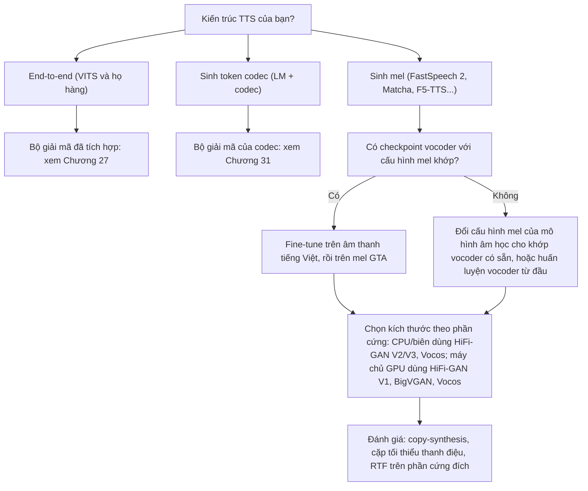

# Chương 26. Vocoder khuếch tán và so sánh

!!! abstract "Mục tiêu học tập"
    Sau chương này, bạn có thể:

    - **Viết** quá trình khuếch tán thuận và nghịch cho dạng sóng có điều kiện mel, cùng hàm mất mát dự đoán nhiễu, và **giải thích** vì sao vocoder khuếch tán chỉ cần ít bước.
    - **Giải thích** cơ chế điều kiện hóa bằng mức nhiễu liên tục của WaveGrad và vì sao nó cho phép đổi số bước suy luận mà không huấn luyện lại.
    - **Cài đặt** một mô hình kiểu DiffWave, bước huấn luyện, và lấy mẫu nhanh 6 bước bằng cách ánh xạ lịch nhiễu suy luận sang các bước huấn luyện "thực".
    - **Suy ra** hàm mất mát Mahalanobis của PriorGrad từ prior phụ thuộc dữ liệu và **cài đặt** prior từ năng lượng mel.
    - **So sánh** các họ vocoder theo chất lượng, tốc độ, kích thước, độ bền, độ khó huấn luyện, khả năng streaming; **đo** RTF đúng cách.
    - **Chẩn đoán** các lệch cấu hình mel giữa mô hình âm học và vocoder.
    - **Đánh giá** vocoder bằng các chỉ số khách quan phù hợp (đặc biệt chỉ số cao độ cho tiếng Việt) và **chọn** vocoder cho một dự án TTS tiếng Việt.

!!! info "Kiến thức cần có"
    - [Chương 11](../phan-2-mo-hinh-sinh/ch11-diffusion.md): DDPM, phân phối dạng đóng $q(\mathbf{x}_k \mid \mathbf{x}_0)$, mất mát dự đoán nhiễu, lịch nhiễu, DDIM.
    - [Chương 12](../phan-2-mo-hinh-sinh/ch12-flow-matching.md): flow matching, đường đi tối ưu vận chuyển, bộ giải ODE.
    - [Chương 14](../phan-3-tin-hieu-ngu-am/ch14-xu-ly-tin-hieu-so.md): cấu hình STFT/mel, HTK và Slaney, trích xuất F0.
    - [Chương 24](ch24-vocoder-tu-hoi-quy-va-flow.md) và [Chương 25](ch25-gan-vocoder.md): các họ vocoder tự hồi quy, flow và GAN.

Hai chương trước đã đi qua ba cách giải bài toán vocoder: mô hình hóa phân phối bằng tự hồi quy hoặc flow, và học một hàm mất mát cảm thụ bằng GAN. Chương này hoàn tất bức tranh với họ thứ tư, **mô hình khuếch tán**, rồi lùi lại nhìn toàn cục: so sánh mọi họ vocoder, những cái bẫy khi ghép vocoder vào một hệ thống, cách đánh giá, và cuối cùng là cách chọn vocoder cho một dự án tiếng Việt cụ thể.

## 26.1 Khuếch tán cho dạng sóng

### 26.1.1 Đặt bài toán

Ký hiệu $\mathbf{s}_0 \in \mathbb{R}^{L}$ là dạng sóng sạch (một đoạn $L$ mẫu), $\mathbf{Y}$ là mel tương ứng, $K$ là số bước khuếch tán rời rạc với lịch nhiễu $\beta_1, \ldots, \beta_K$, $\alpha_k = 1 - \beta_k$ và $\bar{\alpha}_k = \prod_{i=1}^{k} \alpha_i$. Chỉ số $k$ ở đây là bước khuếch tán, không phải mẫu âm thanh; $\mathbf{s}_k$ là *cả dạng sóng* sau $k$ bước thêm nhiễu. Như ở [Chương 11](../phan-2-mo-hinh-sinh/ch11-diffusion.md), quá trình thuận có dạng đóng

$$
q(\mathbf{s}_k \mid \mathbf{s}_0) = \mathcal{N}\big(\sqrt{\bar{\alpha}_k}\, \mathbf{s}_0,\ (1 - \bar{\alpha}_k)\mathbf{I}\big),
\qquad
\mathbf{s}_k = \sqrt{\bar{\alpha}_k}\, \mathbf{s}_0 + \sqrt{1 - \bar{\alpha}_k}\, \boldsymbol{\epsilon},\ \ \boldsymbol{\epsilon} \sim \mathcal{N}(\mathbf{0}, \mathbf{I}).
$$

Quá trình nghịch được tham số hóa bằng một mạng dự đoán nhiễu $\boldsymbol{\epsilon}_\theta(\mathbf{s}_k, k, \mathbf{Y})$, có điều kiện mel:

$$
p_\theta(\mathbf{s}_{k-1} \mid \mathbf{s}_k, \mathbf{Y}) = \mathcal{N}\big(\boldsymbol{\mu}_\theta(\mathbf{s}_k, k, \mathbf{Y}),\ \tilde{\sigma}_k^2 \mathbf{I}\big),
\qquad
\boldsymbol{\mu}_\theta = \frac{1}{\sqrt{\alpha_k}}\left( \mathbf{s}_k - \frac{\beta_k}{\sqrt{1 - \bar{\alpha}_k}}\, \boldsymbol{\epsilon}_\theta(\mathbf{s}_k, k, \mathbf{Y}) \right),
$$

với $\tilde{\sigma}_k^2 = \frac{1 - \bar{\alpha}_{k-1}}{1 - \bar{\alpha}_k} \beta_k$. Huấn luyện bằng mất mát đơn giản hóa từ ELBO:

$$
\mathcal{L}(\theta) = \mathbb{E}_{k, \mathbf{s}_0, \boldsymbol{\epsilon}} \Big[ \big\lVert \boldsymbol{\epsilon} - \boldsymbol{\epsilon}_\theta\big(\sqrt{\bar{\alpha}_k}\, \mathbf{s}_0 + \sqrt{1 - \bar{\alpha}_k}\, \boldsymbol{\epsilon},\ k,\ \mathbf{Y}\big) \big\rVert_2^2 \Big].
$$

### 26.1.2 Vì sao khuếch tán, và vì sao chỉ cần ít bước?

So với GAN, khuếch tán có những điểm mạnh rõ ràng: hàm mất mát là một hồi quy L2 đơn giản, *không có bộ phân biệt*, huấn luyện ổn định; mục tiêu xuất phát từ ELBO nên mô hình có xu hướng phủ toàn bộ phân phối thay vì sụp về một mốt; bài toán một–nhiều được giải bằng *lấy mẫu* như flow hay tự hồi quy. Cái giá là mỗi lần tổng hợp phải chạy mạng $K$ lần, mỗi lần trên toàn bộ dạng sóng ở tốc độ mẫu.

Trong sinh ảnh, DDPM gốc cần hàng trăm đến hàng nghìn bước. Vocoder khuếch tán lại cho kết quả tốt với chỉ khoảng 6 bước (như WaveGrad và DiffWave báo cáo). Một trực giác giải thích điều này: mel là một điều kiện **rất giàu thông tin**. Phân phối $p(\mathbf{s} \mid \mathbf{Y})$ hẹp hơn nhiều so với phân phối ảnh vô điều kiện; phần bất định còn lại chủ yếu là pha và chi tiết mịn. Quá trình nghịch không cần "phát minh" nội dung, chỉ cần "đánh bóng" một tín hiệu mà đường bao đã gần như được mel quyết định, nên vài bước lớn là đủ. Toàn bộ phần còn lại của mục này là các kỹ thuật làm cho "vài bước" trở thành hiện thực.

## 26.2 WaveGrad

WaveGrad (Chen và cộng sự, 2021) là một trong hai vocoder khuếch tán đầu tiên, công bố cùng thời với DiffWave.

**Kiến trúc.** Mạng làm việc ở hai chiều độ phân giải ngược nhau. Nhánh mel đi qua các khối **UBlock** nâng mẫu dần từ tốc độ khung lên tốc độ mẫu (theo bài gốc, các hệ số $5, 5, 3, 2, 2$ cho tích bằng bước nhảy 300 mẫu ở 24 kHz). Nhánh dạng sóng nhiễu $\mathbf{s}_k$ đi qua các khối **DBlock** hạ mẫu theo chiều ngược lại. Ở mỗi độ phân giải, một mô-đun **FiLM** (Perez và cộng sự, 2018) biến đặc trưng của dạng sóng nhiễu cùng với mã hóa vị trí của mức nhiễu thành hai véc-tơ $(\boldsymbol{\gamma}, \boldsymbol{\delta})$ điều biến đặc trưng mel: $\mathbf{h} \mapsto \boldsymbol{\gamma} \odot \mathbf{h} + \boldsymbol{\delta}$. Cấu trúc này giống một U-Net 1-D trong đó mel là "xương sống" và dạng sóng nhiễu là tín hiệu điều khiển.

**Điều kiện hóa bằng mức nhiễu liên tục.** Đây là ý tưởng đáng nhớ nhất của WaveGrad. Thay vì đưa chỉ số bước rời rạc $k$ vào mạng, WaveGrad đưa trực tiếp **mức nhiễu** $\sqrt{\bar{\alpha}}$, và khi huấn luyện, $\sqrt{\bar{\alpha}}$ được lấy *liên tục*: chọn $k \sim \mathcal{U}\{1, \ldots, K\}$ rồi lấy $\sqrt{\bar{\alpha}} \sim \mathcal{U}\big(\sqrt{\bar{\alpha}_{k}}, \sqrt{\bar{\alpha}_{k-1}}\big)$. Mất mát là

$$
\mathcal{L}(\theta) = \mathbb{E}\Big[ \big\lVert \boldsymbol{\epsilon} - \boldsymbol{\epsilon}_\theta\big(\sqrt{\bar{\alpha}}\, \mathbf{s}_0 + \sqrt{1 - \bar{\alpha}}\, \boldsymbol{\epsilon},\ \mathbf{Y},\ \sqrt{\bar{\alpha}}\big) \big\rVert_1 \Big],
$$

với chuẩn L1 thay cho L2 (lựa chọn của bài gốc). Vì mạng đã thấy mọi mức nhiễu trong một khoảng liên tục, khi suy luận ta có thể dùng **bất kỳ lịch nhiễu nào**, với bất kỳ số bước nào, mà không cần huấn luyện lại. Các tác giả tìm một lịch 6 bước bằng tìm kiếm lưới và báo cáo chất lượng gần với lịch nhiều bước hơn nhiều. WaveGrad 2 (Chen và cộng sự, 2021b) mở rộng ý tưởng thành mô hình sinh thẳng dạng sóng từ chuỗi âm vị.

## 26.3 DiffWave

DiffWave (Kong và cộng sự, 2021) chọn một kiến trúc quen thuộc hơn: một **WaveNet không nhân quả** làm mạng dự đoán nhiễu.

### 26.3.1 Kiến trúc

Theo cấu hình "base" của kho mã chính thức:

- **Đầu vào**: dạng sóng nhiễu $\mathbf{s}_k$ $(B, L)$ qua tích chập $1 \times 1$ thành $C = 64$ kênh.
- **Nhúng bước khuếch tán**: $k$ được mã hóa bằng 128 hàm sin/cos, rồi qua hai tầng kết nối đầy đủ với SiLU thành véc-tơ 512 chiều. Mỗi khối dư có một phép chiếu tuyến tính riêng của véc-tơ này, *cộng* vào đầu vào của khối.
- **Nâng mẫu mel**: hai tích chập chuyển vị 2-D (trên mặt phẳng kênh mel × thời gian), mỗi cái nhân trục thời gian lên 16 lần, tổng cộng $16 \times 16 = 256 = H$.
- **30 khối dư**, hệ số giãn lặp chu kỳ $1, 2, \ldots, 512$ (chu kỳ 10), nhân 3, **không nhân quả** (mọi mẫu của $\mathbf{s}_k$ đã có sẵn, không cần tự hồi quy). Trong mỗi khối, mel (sau tích chập $1 \times 1$) được cộng vào đầu ra của tích chập giãn nở, rồi qua cổng $\tanh \odot \sigma$ như WaveNet. Đầu ra tách thành nhánh dư (chia $\sqrt{2}$ để giữ phương sai) và nhánh skip.
- **Đầu ra**: tổng các skip chia $\sqrt{30}$, qua tích chập, ReLU, và tích chập cuối được **khởi tạo bằng 0** (ban đầu mạng dự đoán nhiễu bằng 0, một điểm xuất phát ổn định).

Với cấu hình này, mô hình chỉ khoảng 2,6 triệu tham số (chúng tôi đếm lại từ cấu hình công khai). Lịch nhiễu base dùng $K = 50$ với $\beta_k$ tăng tuyến tính từ $10^{-4}$ đến $0{,}05$. Bài báo dùng mất mát L2 như DDPM; kho mã chính thức phổ biến dùng L1, một khác biệt nhỏ nên biết khi so sánh kết quả.

DiffWave còn cho thấy một điều mà vocoder GAN thời đó không làm được: **sinh vô điều kiện** (không có mel), ví dụ sinh các từ đọc số tiếng Anh từ nhiễu thuần túy, minh họa sức mạnh của khuếch tán như một mô hình sinh thực thụ chứ không chỉ một bộ "dịch" mel.

### 26.3.2 Lấy mẫu nhanh: ánh xạ lịch nhiễu suy luận vào bước huấn luyện

DiffWave huấn luyện với $K = 50$ bước rời rạc nhưng muốn suy luận với $S = 6$ bước theo một lịch nhiễu khác, $\eta_1, \ldots, \eta_S$ (kho mã chính thức dùng $10^{-4}, 10^{-3}, 10^{-2}, 0{,}05, 0{,}2, 0{,}5$), với $\gamma_s = 1 - \eta_s$ và $\bar{\gamma}_s = \prod_{i \le s} \gamma_i$. Vấn đề: mạng chỉ biết các bước $k = 1, \ldots, K$, mỗi bước ứng với một mức nhiễu $\sqrt{\bar{\alpha}_k}$; bước suy luận thứ $s$ có mức nhiễu $\sqrt{\bar{\gamma}_s}$ thường nằm *giữa* hai mức huấn luyện. Lời giải: tìm $k$ sao cho $\bar{\alpha}_{k+1} \le \bar{\gamma}_s \le \bar{\alpha}_k$, rồi nội suy tuyến tính trên thang $\sqrt{\bar{\alpha}}$ để được một bước "thực" (có phần lẻ):

$$
k_s = k + \frac{\sqrt{\bar{\alpha}_k} - \sqrt{\bar{\gamma}_s}}{\sqrt{\bar{\alpha}_k} - \sqrt{\bar{\alpha}_{k+1}}} .
$$

Mạng nhận $k_s$ (nhúng sin/cos của một số thực hoàn toàn xác định), còn công thức cập nhật dùng các hệ số $\eta_s, \gamma_s, \bar{\gamma}_s$ của lịch suy luận:

$$
\mathbf{s}_{s-1} = \frac{1}{\sqrt{\gamma_s}}\left( \mathbf{s}_s - \frac{\eta_s}{\sqrt{1 - \bar{\gamma}_s}}\, \boldsymbol{\epsilon}_\theta(\mathbf{s}_s, k_s, \mathbf{Y}) \right) + \tilde{\sigma}_s \mathbf{z},
\qquad
\tilde{\sigma}_s^2 = \frac{1 - \bar{\gamma}_{s-1}}{1 - \bar{\gamma}_s}\, \eta_s ,
$$

với $\mathbf{z} \sim \mathcal{N}(\mathbf{0}, \mathbf{I})$ và không thêm nhiễu ở bước cuối. Đây chính là tinh thần "mức nhiễu liên tục" của WaveGrad, nhưng thực hiện lúc suy luận thay vì lúc huấn luyện. Hai khối mã sau cài đặt một DiffWave thu nhỏ (hai khối nối tiếp nhau; khối sau dùng lớp của khối trước).

```python
import math
import torch
import torch.nn as nn
import torch.nn.functional as F


class StepEmbedding(nn.Module):
    """Nhúng bước khuếch tán k (cho phép k thực) bằng sin/cos rồi qua 2 tầng FC + SiLU."""
    def __init__(self, dim=128, out=256):
        super().__init__()
        self.dim = dim
        self.mlp = nn.Sequential(nn.Linear(dim, out), nn.SiLU(), nn.Linear(out, out), nn.SiLU())

    def forward(self, k):                                   # k: (B,) số thực
        freqs = 10.0 ** (torch.arange(self.dim // 2, device=k.device) * 4.0 / (self.dim // 2 - 1))
        ang = k[:, None] * freqs[None]                      # (B, dim/2)
        return self.mlp(torch.cat([ang.sin(), ang.cos()], dim=-1))   # (B, out)


class ResLayer(nn.Module):
    def __init__(self, ch, n_mels, emb_dim, dilation):
        super().__init__()
        self.step_proj = nn.Linear(emb_dim, ch)
        self.dil_conv = nn.Conv1d(ch, 2 * ch, 3, padding=dilation, dilation=dilation)  # không nhân quả
        self.cond_proj = nn.Conv1d(n_mels, 2 * ch, 1)
        self.out_proj = nn.Conv1d(ch, 2 * ch, 1)

    def forward(self, x, emb, c):                           # x: (B, C, L); emb: (B, E); c: (B, F, L)
        y = self.dil_conv(x + self.step_proj(emb)[:, :, None]) + self.cond_proj(c)
        gate, filt = y.chunk(2, dim=1)
        y = self.out_proj(torch.sigmoid(gate) * torch.tanh(filt))
        res, skip = y.chunk(2, dim=1)
        return (x + res) / math.sqrt(2.0), skip             # chia sqrt(2) để giữ phương sai


class TinyDiffWave(nn.Module):
    def __init__(self, n_mels=80, ch=32, n_layers=6, cycle=3, up=(4, 4)):
        super().__init__()
        self.hop = math.prod(up)
        self.inp = nn.Conv1d(1, ch, 1)
        self.emb = StepEmbedding()
        # nâng mẫu mel bằng ConvTranspose2d trên mặt phẳng (tần số mel, thời gian), như DiffWave
        self.ups = nn.ModuleList([nn.ConvTranspose2d(1, 1, (3, 2 * u), (1, u), padding=(1, u // 2))
                                  for u in up])
        self.layers = nn.ModuleList([ResLayer(ch, n_mels, 256, 2 ** (i % cycle)) for i in range(n_layers)])
        self.skip_proj, self.out = nn.Conv1d(ch, ch, 1), nn.Conv1d(ch, 1, 1)
        nn.init.zeros_(self.out.weight)                     # đầu ra bằng 0 lúc khởi tạo

    def forward(self, s_k, k, mel):                         # s_k: (B, L); k: (B,); mel: (B, F, T)
        c = mel.unsqueeze(1)                                # (B, 1, F, T)
        for up in self.ups:
            c = F.leaky_relu(up(c), 0.4)
        c = c.squeeze(1)                                    # (B, F, T * hop)
        x, emb, skip = F.relu(self.inp(s_k.unsqueeze(1))), self.emb(k), 0
        for layer in self.layers:
            x, sk = layer(x, emb, c)
            skip = skip + sk
        x = F.relu(self.skip_proj(skip / math.sqrt(len(self.layers))))
        return self.out(x).squeeze(1)                       # dự đoán epsilon: (B, L)
```

```python
betas = torch.linspace(1e-4, 0.05, 50)                      # lịch huấn luyện K = 50 (cấu hình "base")
alpha_bar = torch.cumprod(1 - betas, dim=0)


def train_step(model, opt, s0, mel):
    B = s0.shape[0]
    k = torch.randint(0, len(betas), (B,))                  # bước k ~ U{1..K} (đánh chỉ số từ 0)
    eps = torch.randn_like(s0)
    ab = alpha_bar[k][:, None]
    s_k = ab.sqrt() * s0 + (1 - ab).sqrt() * eps            # lấy mẫu q(s_k | s_0) dạng đóng
    loss = F.mse_loss(model(s_k, k.float(), mel), eps)      # mất mát dự đoán nhiễu
    opt.zero_grad(); loss.backward(); opt.step()
    return loss.item()


def align_schedule(train_betas, infer_betas):
    """Ánh xạ mỗi mức nhiễu suy luận sang một bước huấn luyện "thực" (có phần lẻ), như DiffWave."""
    t_ab, i_ab = torch.cumprod(1 - train_betas, 0), torch.cumprod(1 - infer_betas, 0)
    steps = []
    for a in i_ab:
        for t in range(len(t_ab) - 1):
            if t_ab[t + 1] <= a <= t_ab[t]:
                frac = (t_ab[t].sqrt() - a.sqrt()) / (t_ab[t].sqrt() - t_ab[t + 1].sqrt())
                steps.append(t + frac.item())
                break
    return torch.tensor(steps)


@torch.no_grad()
def sample(model, mel, infer_betas):
    alphas = 1 - infer_betas
    ab = torch.cumprod(alphas, 0)
    k_cont = align_schedule(betas, infer_betas)
    s = torch.randn(mel.shape[0], mel.shape[-1] * model.hop)   # bắt đầu từ nhiễu trắng
    for n in reversed(range(len(infer_betas))):
        eps = model(s, k_cont[n].expand(s.shape[0]), mel)
        s = (s - infer_betas[n] / (1 - ab[n]).sqrt() * eps) / alphas[n].sqrt()   # trung bình hậu nghiệm
        if n > 0:
            sigma = ((1 - ab[n - 1]) / (1 - ab[n]) * infer_betas[n]).sqrt()
            s = s + sigma * torch.randn_like(s)
    return s.clamp(-1, 1)


torch.manual_seed(0)
model = TinyDiffWave()
opt = torch.optim.Adam(model.parameters(), lr=2e-4)
mel = torch.randn(2, 80, 32)                                # (B, F, T)
s0 = 0.5 * torch.sin(torch.linspace(0, 200, 32 * 16)).expand(2, -1)   # (B, L) đồ chơi
losses = [train_step(model, opt, s0, mel) for _ in range(5)]
fast = torch.tensor([1e-4, 1e-3, 1e-2, 5e-2, 2e-1, 5e-1])   # lịch 6 bước suy luận
k_cont = align_schedule(betas, fast)
print("bước huấn luyện tương ứng:", [round(v, 2) for v in k_cont.tolist()])
assert len(k_cont) == 6 and torch.all(k_cont[1:] > k_cont[:-1])
wav = sample(model, mel, fast)
assert wav.shape == (2, 32 * 16)
print("loss:", [round(v, 3) for v in losses], "| dạng sóng sinh ra:", tuple(wav.shape))
```

Các bước "thực" in ra là khoảng $0;\ 0{,}89;\ 4{,}09;\ 10{,}45;\ 22{,}99;\ 42{,}92$ (chỉ số từ 0): lịch 6 bước nhảy cóc qua lịch huấn luyện, dày ở vùng nhiễu nhỏ (cuối quá trình nghịch, lúc tinh chỉnh chi tiết) và thưa ở vùng nhiễu lớn. Mô hình thu nhỏ ở đây chỉ để kiểm tra hình dạng và luồng tính toán; huấn luyện thật cần hàng trăm nghìn bước trên dữ liệu tiếng nói.

## 26.4 PriorGrad: prior phụ thuộc dữ liệu

### 26.4.1 Động cơ

Prior chuẩn $\mathcal{N}(\mathbf{0}, \mathbf{I})$ không biết gì về mel: khoảng lặng và nguyên âm to đều bắt đầu từ cùng một mức nhiễu, và quá trình nghịch phải tự "khắc" ra đường bao năng lượng từ nhiễu trắng. PriorGrad (Lee và cộng sự, 2022) đề xuất dùng một prior **phụ thuộc điều kiện**: $\mathcal{N}(\mathbf{0}, \boldsymbol{\Sigma}_{\mathbf{Y}})$ với $\boldsymbol{\Sigma}_{\mathbf{Y}} = \operatorname{diag}(\sigma_1^2, \ldots, \sigma_L^2)$, trong đó $\sigma_n$ lấy từ năng lượng của khung mel chứa mẫu $n$, chuẩn hóa về $[\sigma_{\min}, 1]$ (kho mã chính thức dùng $\sigma_{\min} = 0{,}1$). Điểm xuất phát của quá trình nghịch vì thế đã có đường bao năng lượng gần đúng; khoảng cách từ prior đến phân phối dữ liệu ngắn lại.

### 26.4.2 Suy ra hàm mất mát

Quá trình thuận giờ dùng nhiễu có hiệp phương sai $\boldsymbol{\Sigma}$ (viết gọn $\boldsymbol{\Sigma}$ cho $\boldsymbol{\Sigma}_{\mathbf{Y}}$):

$$
\mathbf{s}_k = \sqrt{\bar{\alpha}_k}\, \mathbf{s}_0 + \sqrt{1 - \bar{\alpha}_k}\, \boldsymbol{\epsilon}, \qquad \boldsymbol{\epsilon} \sim \mathcal{N}(\mathbf{0}, \boldsymbol{\Sigma}),
$$

nên khi $\bar{\alpha}_K \to 0$, $\mathbf{s}_K$ xấp xỉ $\mathcal{N}(\mathbf{0}, \boldsymbol{\Sigma})$. Lặp lại từng bước suy luận của DDPM ([Chương 11](../phan-2-mo-hinh-sinh/ch11-diffusion.md)) với $\mathbf{I}$ thay bằng $\boldsymbol{\Sigma}$:

1. Mọi phân phối Gauss của quá trình thuận đều có hiệp phương sai tỉ lệ với $\boldsymbol{\Sigma}$, kể cả hậu nghiệm $q(\mathbf{s}_{k-1} \mid \mathbf{s}_k, \mathbf{s}_0) = \mathcal{N}(\tilde{\boldsymbol{\mu}}_k, \tilde{\beta}_k \boldsymbol{\Sigma})$, với $\tilde{\boldsymbol{\mu}}_k$ có *cùng* công thức như trường hợp đẳng hướng.
2. Chọn $p_\theta(\mathbf{s}_{k-1} \mid \mathbf{s}_k) = \mathcal{N}(\boldsymbol{\mu}_\theta, \tilde{\beta}_k \boldsymbol{\Sigma})$. KL giữa hai Gauss cùng hiệp phương sai $\tilde{\beta}_k \boldsymbol{\Sigma}$ là

$$
D_{\mathrm{KL}}\big(q(\mathbf{s}_{k-1} \mid \mathbf{s}_k, \mathbf{s}_0) \,\Vert\, p_\theta(\mathbf{s}_{k-1} \mid \mathbf{s}_k)\big) = \frac{1}{2\tilde{\beta}_k} (\tilde{\boldsymbol{\mu}}_k - \boldsymbol{\mu}_\theta)^\top \boldsymbol{\Sigma}^{-1} (\tilde{\boldsymbol{\mu}}_k - \boldsymbol{\mu}_\theta).
$$

3. Với tham số hóa dự đoán nhiễu, $\tilde{\boldsymbol{\mu}}_k - \boldsymbol{\mu}_\theta = \frac{\beta_k}{\sqrt{\alpha_k}\sqrt{1 - \bar{\alpha}_k}} (\boldsymbol{\epsilon}_\theta - \boldsymbol{\epsilon})$, nên mỗi số hạng KL tỉ lệ với $(\boldsymbol{\epsilon} - \boldsymbol{\epsilon}_\theta)^\top \boldsymbol{\Sigma}^{-1} (\boldsymbol{\epsilon} - \boldsymbol{\epsilon}_\theta)$. Bỏ trọng số theo $k$ như DDPM, ta được

$$
\mathcal{L}_{\text{PriorGrad}}(\theta) = \mathbb{E}_{k, \mathbf{s}_0, \boldsymbol{\epsilon}} \Big[ \big(\boldsymbol{\epsilon} - \boldsymbol{\epsilon}_\theta(\mathbf{s}_k, k, \mathbf{Y})\big)^\top \boldsymbol{\Sigma}^{-1} \big(\boldsymbol{\epsilon} - \boldsymbol{\epsilon}_\theta(\mathbf{s}_k, k, \mathbf{Y})\big) \Big].
$$

Đây là **khoảng cách Mahalanobis**: sai số ở các mẫu thuộc khung yên tĩnh ($\sigma_n$ nhỏ) bị phạt nặng hơn tương ứng với phương sai nhỏ của chúng. Khi lấy mẫu, xuất phát từ $\mathcal{N}(\mathbf{0}, \boldsymbol{\Sigma})$ và nhiễu thêm vào mỗi bước là $\tilde{\sigma}_k \boldsymbol{\Sigma}^{1/2} \mathbf{z}$. Bài báo phân tích rằng (dưới một số giả thiết) prior càng gần hiệp phương sai của dữ liệu thì bài toán của mạng càng dễ, và báo cáo hội tụ nhanh hơn cùng chất lượng tốt hơn ở cùng số bước. Ý tưởng tương tự cũng được áp dụng cho mô hình âm học, với prior lấy từ thống kê theo từng âm vị.

Khối mã sau (dùng mô hình và lịch nhiễu từ hai khối trên) tính độ lệch chuẩn của prior từ log-mel và hàm mất mát Mahalanobis.

```python
def priorgrad_std(log_mel, hop, e_min, e_max, std_min=0.1):
    """Độ lệch chuẩn của prior theo từng mẫu, suy từ năng lượng khung của log-mel (PriorGrad)."""
    energy = torch.exp(log_mel).sum(dim=1).sqrt()           # (B, T): năng lượng mỗi khung
    std = ((energy - e_min) / (e_max - e_min)).clamp(min=std_min, max=1.0)   # chuẩn hóa về [std_min, 1]
    return torch.repeat_interleave(std, hop, dim=-1)        # (B, L)


def priorgrad_loss(model, s0, mel, std):
    k = torch.randint(0, len(betas), (s0.shape[0],))
    eps = torch.randn_like(s0) * std                        # nhiễu ~ N(0, Sigma), Sigma = diag(std^2)
    ab = alpha_bar[k][:, None]
    s_k = ab.sqrt() * s0 + (1 - ab).sqrt() * eps
    err = (model(s_k, k.float(), mel) - eps) / std          # chuẩn Mahalanobis với Sigma^{-1}
    return (err ** 2).mean()


torch.manual_seed(0)
log_mel = torch.full((1, 80, 32), -11.5)                    # khoảng lặng: log(1e-5)
log_mel[:, :, 8:24] = torch.randn(1, 80, 16) - 1.0          # đoạn có tiếng nói ở giữa
std = priorgrad_std(log_mel, hop=16, e_min=0.0, e_max=float(torch.exp(log_mel).sum(1).sqrt().max()))
assert std.shape == (1, 32 * 16)
print(f"std ở khoảng lặng = {std[0, 0]:.2f}, std lớn nhất ở vùng tiếng nói = {std.max():.2f}")
loss = priorgrad_loss(model, torch.zeros(1, 512), log_mel, std)
loss.backward()
print(f"PriorGrad loss = {loss.item():.3f}")
```

Trong thực tế, $e_{\min}$ và $e_{\max}$ được tính một lần trên toàn tập huấn luyện (kho mã chính thức lưu chúng thành tệp thống kê), không phải trên từng câu như ví dụ đồ chơi này.

## 26.5 Các biến thể giảm số bước khác

Nhiều công trình tiếp theo tấn công cùng một mục tiêu: chất lượng cao với rất ít bước. Một số hướng tiêu biểu (chi tiết nên đọc bài gốc):

- **FastDiff** (Huang và cộng sự, 2022): mạng dự đoán nhiễu dùng tích chập biến đổi theo vị trí có nhận biết bước khuếch tán, kèm một bộ dự đoán lịch nhiễu để lấy mẫu với rất ít bước (bài gốc nhắm tới khoảng 4 bước).
- **SpecGrad** (Koizumi và cộng sự, 2022): tổng quát hóa PriorGrad, không chỉ điều chỉnh *năng lượng* mà cả *hình dạng phổ* của nhiễu theo đường bao phổ suy ra từ mel, thay đổi theo thời gian.
- **Lịch nhiễu học được**, ví dụ BDDM (Lam và cộng sự, 2022), huấn luyện thêm một mạng chọn lịch cho số bước nhỏ.
- **Chưng cất** một mô hình nhiều bước thành mô hình ít bước hoặc một bước (chưng cất tiến dần, mô hình nhất quán; xem [Chương 11](../phan-2-mo-hinh-sinh/ch11-diffusion.md)), đôi khi kết hợp thêm mất mát đối kháng.

Một quan sát chung: càng giảm số bước, các vocoder khuếch tán càng "mượn" công cụ của GAN (bộ phân biệt, mất mát phổ đa phân giải), và ranh giới giữa hai họ mờ dần.

## 26.6 Vocoder flow matching

Flow matching ([Chương 12](../phan-2-mo-hinh-sinh/ch12-flow-matching.md)) học một trường vận tốc $\mathbf{v}_\theta(\mathbf{s}_t, t, \mathbf{Y})$ đưa nhiễu tới dữ liệu theo các đường đi gần thẳng, nên thường cần ít bước giải ODE hơn khuếch tán cổ điển. Áp dụng vào vocoder là bước tự nhiên. Tính đến thời điểm biên soạn (2026), một số công trình tiêu biểu:

- **PeriodWave** (Lee và cộng sự, 2025): mạng ước lượng vận tốc có cấu trúc đa chu kỳ lấy cảm hứng từ MPD, cùng các biến thể "Turbo" ít bước được tinh chỉnh thêm bằng mất mát đối kháng; các tác giả báo cáo chất lượng vượt các vocoder GAN mạnh trong thí nghiệm của họ.
- **RFWave** (arXiv:2403.05010, 2024): rectified flow sinh phổ phức theo từng khung và nhiều dải con, khoảng 10 bước lấy mẫu theo mô tả của tác giả.

Đây là một hướng đang phát triển; hãy đọc kỹ điều kiện thí nghiệm (dữ liệu, số bước, phần cứng) trước khi so sánh. Một thực tế đáng chú ý: trong nhiều hệ thống TTS lớn hiện nay, flow matching hoặc khuếch tán được dùng để sinh **mel hay biểu diễn ẩn**, còn bước mel → dạng sóng vẫn do một vocoder GAN một lượt đảm nhận. Ví dụ theo các kho mã công khai: Matcha-TTS dùng HiFi-GAN, F5-TTS dùng Vocos, CosyVoice dùng bộ sinh HiFT ([Chương 23](../phan-5-mo-hinh-am-hoc/ch23-glow-grad-matcha.md), [Chương 33](../phan-8-mo-hinh-lon/ch33-nar-quy-mo-lon.md), [Chương 34](../phan-8-mo-hinh-lon/ch34-he-thong-lai-hien-dai.md)). Lý do: phần "khó" của bài toán một–nhiều (ngôn điệu, âm sắc) đã được giải ở tầng trên, và với mel đã tốt, vocoder GAN gần như "trong suốt" với chi phí chỉ một lượt.

## 26.7 So sánh toàn diện các họ vocoder

### 26.7.1 Mô hình chi phí

Hệ số thời gian thực được định nghĩa là

$$
\mathrm{RTF} = \frac{t_{\text{tổng hợp}}}{t_{\text{âm thanh}}},
$$

$\mathrm{RTF} < 1$ nghĩa là nhanh hơn thời gian thực. Một số bài báo báo cáo nghịch đảo "nhanh hơn thời gian thực $X$ lần" ($X = 1/\mathrm{RTF}$); hãy để ý khi đọc. Bỏ qua chi tiết kiến trúc, chi phí tổng hợp một giây âm thanh của từng họ có thể ước lượng như sau:

| Họ | Số lượt chạy mạng | Độ phân giải mỗi lượt | Tính song song |
|---|---|---|---|
| Tự hồi quy (WaveNet, WaveRNN) | $f_s$ lượt (mỗi mẫu một lượt) | 1 mẫu | Tuần tự |
| Flow coupling, IAF | 1 | Tốc độ mẫu | Song song |
| GAN miền thời gian (HiFi-GAN, BigVGAN) | 1 | Tăng dần từ tốc độ khung lên tốc độ mẫu | Song song |
| GAN + iSTFT (Vocos) | 1 | Tốc độ khung ($f_s / H$) | Song song |
| Khuếch tán, flow matching | $K$ (thường 4–50) | Tốc độ mẫu | Song song trong mỗi lượt |

Đo RTF đúng cách quan trọng không kém con số: phải **khởi động** (lần chạy đầu tốn thời gian cấp phát bộ nhớ và chọn kernel), **đồng bộ GPU** trước khi bấm giờ (GPU chạy bất đồng bộ với CPU), tắt tính gradient, lặp nhiều lần và báo cáo trung vị, ghi rõ phần cứng, số luồng CPU, kích thước batch và độ dài câu.

```python
import statistics
import time
import torch
import torch.nn as nn


@torch.inference_mode()
def measure_rtf(fn, audio_seconds, n_warmup=2, n_runs=5, device="cpu"):
    """RTF = thời gian tổng hợp / thời lượng âm thanh. Trả về (trung vị, tốt nhất)."""
    def sync():
        if device.startswith("cuda"):
            torch.cuda.synchronize()                        # GPU chạy bất đồng bộ: phải đồng bộ trước khi bấm giờ
    for _ in range(n_warmup):                               # khởi động: cấp phát bộ nhớ, chọn kernel...
        fn()
    sync()
    times = []
    for _ in range(n_runs):
        sync()
        t0 = time.perf_counter()
        fn()
        sync()
        times.append(time.perf_counter() - t0)
    return statistics.median(times) / audio_seconds, min(times) / audio_seconds


torch.manual_seed(0)
sr, hop, dur = 16000, 16, 0.25
mel = torch.randn(1, 80, int(sr * dur) // hop)              # 0,25 giây âm thanh (giữ phép đo nhanh)
gan_like = nn.Sequential(                                   # bộ sinh một lượt, nâng mẫu 4 x 4 = 16
    nn.Conv1d(80, 64, 7, padding=3), nn.LeakyReLU(0.1),
    nn.ConvTranspose1d(64, 32, 8, 4, padding=2), nn.LeakyReLU(0.1),
    nn.ConvTranspose1d(32, 16, 8, 4, padding=2), nn.LeakyReLU(0.1),
    nn.Conv1d(16, 1, 7, padding=3), nn.Tanh()).eval()
diff = TinyDiffWave().eval()
assert gan_like(mel).shape[-1] == diff(torch.zeros(1, 4000), torch.zeros(1), mel).shape[-1] == 4000

print(f"số luồng CPU: {torch.get_num_threads()}")
for name, fn in [("GAN 1 lượt", lambda: gan_like(mel)),
                 ("khuếch tán 6 bước", lambda: sample(diff, mel, fast)),
                 ("khuếch tán 50 bước", lambda: sample(diff, mel, betas))]:
    med, best = measure_rtf(fn, audio_seconds=dur, n_warmup=1, n_runs=3)
    print(f"{name:20s} RTF trung vị = {med:.3f} (tốt nhất {best:.3f})")
```

Khối mã này dùng `TinyDiffWave`, `sample`, `fast` và `betas` từ mục 26.3. Trên một CPU hai luồng, chúng tôi đo được RTF cỡ $10^{-3}$ cho mạng "GAN" một lượt, cỡ vài phần mười cho khuếch tán 6 bước, và lớn hơn 1 (chậm hơn thời gian thực) cho 50 bước; con số cụ thể thay đổi theo máy và lần chạy. Hai mạng ở đây có kiến trúc khác nhau nên so sánh trực tiếp chỉ mang tính minh họa; điều đáng rút ra là chi phí khuếch tán **tỉ lệ tuyến tính với số bước**, và mỗi bước lại chạy trên toàn bộ dạng sóng ở tốc độ mẫu.

### 26.7.2 Bảng so sánh định tính

Bảng dưới tổng hợp các nhận định *định tính*, dựa trên báo cáo của các bài gốc và kinh nghiệm cộng đồng; với từng cặp mô hình cụ thể, thứ hạng có thể đảo ngược tùy dữ liệu, cấu hình và cách đánh giá. Số tham số lấy theo các bài báo và kho mã chính thức (hoặc đếm lại từ cấu hình công khai), làm tròn.

| Họ / đại diện | Chất lượng (khi cấu hình tốt) | Tốc độ GPU | Tốc độ CPU | Kích thước | Độ khó huấn luyện | Streaming |
|---|---|---|---|---|---|---|
| WaveNet (MoL) | Cao | Rất chậm (tuần tự) | Rất chậm | Trung bình | Dễ (MLE) | Tự nhiên, nhưng chậm |
| WaveRNN, LPCNet | Khá đến cao | Chậm | Thời gian thực khi tối ưu kỹ | Nhỏ | Trung bình | Tự nhiên |
| WaveGlow | Khá | Nhanh | Chậm | Rất lớn (khoảng 88 triệu) | Dễ nhưng tốn bộ nhớ | Khó |
| HiFi-GAN V1 / V2 | Cao / khá | Rất nhanh | Nhanh (V2 rất nhanh) | Khoảng 14 triệu / dưới 1 triệu | Trung bình (công thức đã ổn định) | Được, chia đoạn có chồng lấp |
| BigVGAN | Rất cao, bền với dữ liệu lạ | Nhanh | Chậm hơn đáng kể | Khoảng 112 triệu (base: 14 triệu) | Khó hơn ở quy mô lớn | Được, chia đoạn |
| Vocos | Cao | Rất nhanh | Rất nhanh | Khoảng 13,5 triệu | Trung bình | Thuận lợi (chồng–cộng theo khung) |
| DiffWave, WaveGrad, PriorGrad | Cao | Trung bình (K lượt) | Chậm | Nhỏ (DiffWave base khoảng 2,6 triệu) | Dễ, ổn định | Khó (K lượt cho mỗi đoạn) |
| Vocoder flow matching | Cao theo các báo cáo gần đây | Trung bình (vài lượt) | Chậm đến trung bình | Tùy mô hình | Ổn định | Đang được nghiên cứu |

### 26.7.3 Độ bền và khả năng khái quát hóa

Câu hỏi thực tế quan trọng nhất thường không phải "vocoder nào tốt nhất trên LJSpeech", mà là "vocoder nào ít hỏng nhất khi gặp thứ nó chưa thấy": người nói mới, F0 ngoài phạm vi huấn luyện, mel dự đoán bị mờ, điều kiện thu âm khác, ngôn ngữ khác. Một vài quy luật thực nghiệm (không tuyệt đối):

- Vocoder huấn luyện trên **một người nói** thường suy giảm rõ với người nói khác; huấn luyện trên dữ liệu **nhiều người nói** cải thiện mạnh khả năng khái quát hóa.
- Các thiên kiến quy nạp tuần hoàn (MPD, Snake) và chống răng cưa giúp với F0 lạ; BigVGAN được thiết kế chính cho mục tiêu này.
- Vocoder GAN phản ứng với mel lệch phân phối bằng các tạp âm đặc trưng (rè, kim loại); vocoder khuếch tán có xu hướng suy giảm "mềm" hơn, nhưng cũng không miễn nhiễm. Fine-tune GTA ([Chương 25](ch25-gan-vocoder.md)) vẫn là cách khắc phục hiệu quả nhất.

### 26.7.4 Độ khó huấn luyện và streaming

Huấn luyện bằng MLE (tự hồi quy, flow) hay hồi quy nhiễu (khuếch tán, flow matching) **ổn định và dễ đoán**: loss giảm đơn điệu, ít siêu tham số nhạy cảm. GAN đòi hỏi cân bằng bộ sinh và bộ phân biệt, nhưng với công thức HiFi-GAN đã được kiểm chứng rộng rãi, rủi ro trong thực tế thấp hơn nhiều so với GAN tổng quát. Về streaming ([Chương 35](../phan-8-mo-hinh-lon/ch35-streaming-speech-llm.md)): vocoder tích chập có trường tiếp nhận hữu hạn nên có thể xử lý từng đoạn mel với phần chồng lấp đủ rộng, hoặc dùng biến thể nhân quả kèm bộ đệm trạng thái; Vocos ghép đoạn tự nhiên bằng chồng–cộng; vocoder khuếch tán phải chạy $K$ lượt cho mỗi đoạn, nên độ trễ đoạn đầu tiên tăng theo $K$.

## 26.8 Vocoder phổ quát

**Vocoder phổ quát** (*universal vocoder*) là vocoder huấn luyện trên dữ liệu đủ đa dạng (nhiều người nói, nhiều ngôn ngữ, nhiều điều kiện thu, đôi khi cả giọng hát và âm thanh phi tiếng nói) để dùng ngay cho người nói mới mà không cần fine-tune. UnivNet và BigVGAN (kể cả BigVGAN-v2) là các ví dụ tiêu biểu ([Chương 25](ch25-gan-vocoder.md)). Lợi ích với các ngôn ngữ ít tài nguyên như tiếng Việt là rõ ràng: vocoder chỉ học quan hệ *âm học* giữa mel và dạng sóng, gần như không phụ thuộc ngôn ngữ, nên một checkpoint phổ quát tốt thường đã cho kết quả chấp nhận được.

Giới hạn cần nhớ:

- "Phổ quát" chỉ trong **phạm vi một cấu hình mel**. Một checkpoint 24 kHz / 100 kênh mel không dùng được cho mô hình âm học 22,05 kHz / 80 kênh.
- Các vùng dữ liệu hiếm trong tập huấn luyện (trẻ em, giọng rất cao, thì thầm, giọng cót két kéo dài, môi trường vang) vẫn có thể suy giảm.
- Mô hình phổ quát lớn (hàng trăm triệu tham số) có thể quá nặng cho CPU hoặc thiết bị biên.
- Giấy phép của mã nguồn và của trọng số có thể khác nhau; hãy kiểm tra cả hai trước khi dùng cho sản phẩm.

Chiến lược thường hiệu quả nhất là **khởi đầu từ checkpoint phổ quát có cấu hình mel khớp, rồi fine-tune** trên dữ liệu đích: trước tiên với âm thanh thật của người nói đích, sau đó với mel GTA từ mô hình âm học.

## 26.9 Bẫy tương thích cấu hình mel

Mô hình âm học và vocoder giao tiếp qua một "hợp đồng" là mel-spectrogram. Chỉ cần lệch *một* tham số, hệ thống vẫn chạy, không báo lỗi, nhưng âm thanh hỏng theo những cách khó chẩn đoán. Đây là nguồn lỗi phổ biến nhất khi ghép một mô hình âm học với một vocoder có sẵn.

| Tham số | Giá trị thường gặp | Triệu chứng khi lệch |
|---|---|---|
| Tần số lấy mẫu $f_s$ | 16 000, 22 050, 24 000, 44 100 | Cao độ và tốc độ sai, giọng "chuột chít" hoặc trầm |
| $N_{\text{FFT}}$, $W$, $H$ | 1024 / 1024 / 256 | Sai độ dài, lệch thời gian, giọng méo |
| Số kênh mel $F$ | 80, 100, 128 | Lỗi hình dạng, hoặc (nếu ép) giọng rè vô nghĩa |
| $f_{\min}$, $f_{\max}$ | 0 hoặc 80 Hz; 8000 Hz hoặc $f_s/2$ | Formant lệch, âm sắc lạ, rè kim loại |
| Thang mel và chuẩn hóa bộ lọc | Slaney + chuẩn hóa diện tích (librosa), HTK không chuẩn hóa (mặc định torchaudio) | Âm sắc sai, mức năng lượng sai giữa các dải |
| Biên độ hay công suất | $\lvert S \rvert$ hoặc $\lvert S \rvert^2$ | Giọng quá to hoặc méo, dải động sai |
| Cơ số log và ngưỡng chặn | $\ln$ với $10^{-5}$; $\log_{10}$ với $10^{-10}$; dB | Giọng méo, nhiễu nền, khoảng lặng có tiếng rè |
| Chuẩn hóa mel | Không; chuẩn hóa trung bình/phương sai; co giãn về $[-4, 4]$ | Gần như chắc chắn ra nhiễu hoặc tiếng rè |
| Căn khung và đệm | `center=True`; đệm phản xạ $(N_{\text{FFT}} - H)/2$ với `center=False` | Lệch nửa khung, số khung khác 1, tiếng lách cách ở biên |
| Xử lý dạng sóng | Chuẩn hóa đỉnh, nhấn trước (*pre-emphasis*), đổi tần số lấy mẫu | Âm sắc sáng/tối bất thường, âm lượng sai |

Đoạn mã sau so sánh mel kiểu HiFi-GAN với mel theo mặc định của `torchaudio` trên cùng một tín hiệu, cho thấy số khung, giá trị và bộ lọc đều khác nhau, rồi đưa ra một hàm liệt kê các khóa cấu hình không khớp.

```python
import librosa
import torch
import torch.nn.functional as F
import torchaudio

sr, n_fft, hop, n_mels = 22050, 1024, 256, 80
torch.manual_seed(0)
wav = 0.1 * torch.randn(1, sr)                              # 1 giây (chỉ để so sánh cấu hình)

# (a) Kiểu HiFi-GAN: Slaney mel, fmax = 8000, biên độ, ln, đệm (n_fft - hop)/2, center=False
fb_slaney = torch.from_numpy(librosa.filters.mel(sr=sr, n_fft=n_fft, n_mels=n_mels, fmin=0, fmax=8000)).float()
p = (n_fft - hop) // 2
y = F.pad(wav.unsqueeze(1), (p, p), mode="reflect").squeeze(1)
S = torch.stft(y, n_fft, hop, n_fft, torch.hann_window(n_fft), center=False, return_complex=True)
mel_a = torch.log(torch.clamp(fb_slaney @ S.abs(), min=1e-5))

# (b) Mặc định của torchaudio: HTK mel, không chuẩn hóa diện tích, power = 2, center=True, fmax = sr/2
mel_b_lin = torchaudio.transforms.MelSpectrogram(sample_rate=sr, n_fft=n_fft, hop_length=hop, n_mels=n_mels)(wav)
mel_b = torch.log10(torch.clamp(mel_b_lin, min=1e-10))      # nhiều kho mã dùng log10

print("số khung:", mel_a.shape[-1], "vs", mel_b.shape[-1])  # center=True thêm 1 khung
print(f"giá trị trung bình: {mel_a.mean():.2f} vs {mel_b.mean():.2f}")

# Bộ lọc torchaudio trùng với librosa chỉ khi đặt đúng norm và mel_scale
fb_ta = torchaudio.functional.melscale_fbanks(n_fft // 2 + 1, 0.0, 8000.0, n_mels, sr,
                                              norm="slaney", mel_scale="slaney").T   # (F, n_fft/2 + 1)
fb_htk = torchaudio.functional.melscale_fbanks(n_fft // 2 + 1, 0.0, 8000.0, n_mels, sr).T
print(f"chênh lệch bộ lọc: slaney-slaney = {(fb_ta - fb_slaney).abs().max():.1e}, "
      f"htk-slaney = {(fb_htk - fb_slaney).abs().max():.1e}")
assert torch.allclose(fb_ta, fb_slaney, atol=1e-6)


def check_mel_compat(cfg_acoustic, cfg_vocoder):
    """Liệt kê mọi khóa cấu hình mel không khớp giữa mô hình âm học và vocoder."""
    keys = sorted(set(cfg_acoustic) | set(cfg_vocoder))
    return [(k, cfg_acoustic.get(k), cfg_vocoder.get(k)) for k in keys
            if cfg_acoustic.get(k) != cfg_vocoder.get(k)]


hifigan_cfg = dict(sr=22050, n_fft=1024, hop=256, win=1024, n_mels=80, fmin=0, fmax=8000,
                   mel_scale="slaney", mel_norm="slaney", magnitude="abs", log="ln", clamp=1e-5,
                   center=False, wav_peak_norm=None)
acoustic_cfg = dict(hifigan_cfg, fmax=None, log="log10", center=True)
for k, a, b in check_mel_compat(acoustic_cfg, hifigan_cfg):
    print(f"  LỆCH {k}: mô hình âm học = {a}, vocoder = {b}")
```

Kết quả: 86 khung so với 87 khung cho cùng một giây âm thanh, giá trị trung bình khác hẳn nhau (khoảng $-2{,}6$ so với $1{,}2$), và hai bộ lọc chỉ trùng nhau khi đặt `norm="slaney", mel_scale="slaney"` cho `torchaudio`. Hàm `check_mel_compat` liệt kê ba khóa lệch.

!!! tip "Phép thử vàng: copy-synthesis"
    Trước khi ghép vocoder vào hệ thống, lấy một tệp âm thanh *thật* của người nói, tính mel **bằng đúng đường ống của mô hình âm học**, rồi đưa thẳng vào vocoder. Kết quả phải nghe gần như bản gốc. Nếu không, vấn đề nằm ở hợp đồng mel hoặc ở vocoder, chưa liên quan gì tới mô hình âm học. Phép thử này mất năm phút và tiết kiệm hàng ngày gỡ lỗi; nó là bước bắt buộc trong [Dự án 2](../phan-10-du-an/du-an-2-fastspeech2-hifigan.md).

## 26.10 Đánh giá vocoder

### 26.10.1 Hai điều kiện đánh giá

Cần tách bạch hai điều kiện:

- **Copy-synthesis** (phân tích–tổng hợp): mel tính từ âm thanh thật, đưa vào vocoder. Đo *giới hạn trên* của vocoder, và vì dạng sóng sinh ra thẳng hàng với bản gốc, có thể dùng các chỉ số so sánh trực tiếp từng khung.
- **Trong chuỗi TTS**: mel do mô hình âm học dự đoán. Đo *độ bền* của vocoder với mel không hoàn hảo; thường chỉ dùng được đánh giá chủ quan và các chỉ số không cần tham chiếu thẳng hàng.

Nên tách thêm người nói **đã thấy** và **chưa thấy** khi huấn luyện vocoder.

### 26.10.2 Chủ quan

MOS, CMOS và MUSHRA được trình bày chi tiết ở [Chương 38](../phan-9-thuc-tien/ch38-danh-gia-tts.md). Với vocoder, khác biệt giữa các hệ thống tốt thường nhỏ, nên **so sánh cặp** (CMOS) hoặc **MUSHRA** (có tham chiếu ẩn và mốc neo) thường nhạy hơn MOS tuyệt đối.

### 26.10.3 Khách quan

- **Khoảng cách log-mel** (L1 hoặc L2) trong copy-synthesis: đơn giản và tương quan khá với chất lượng, nhưng *thiên vị* các mô hình dùng chính nó làm hàm mất mát (như HiFi-GAN).
- **MCD** (*mel-cepstral distortion*): $\mathrm{MCD} = \frac{10}{\ln 10} \sqrt{2 \sum_{d=1}^{D} (c_d - \hat{c}_d)^2}$, lấy trung bình qua các khung (dB). Trong copy-synthesis không cần DTW vì đã thẳng hàng. Quy ước (bỏ $c_0$ hay không, số hệ số $D$, cách trích cepstrum) khác nhau giữa các công cụ, nên chỉ so sánh trong cùng một công cụ.
- **PESQ** (ITU-T P.862, bản băng rộng P.862.2 ở 16 kHz): thiết kế cho codec thoại; hữu ích để phát hiện suy giảm nặng nhưng tương quan không hoàn hảo với độ tự nhiên của tiếng nói tổng hợp.
- **Chỉ số cao độ**, đặc biệt quan trọng với ngôn ngữ có thanh điệu:
    - **RMSE F0 theo cent** trên các khung hữu thanh ở cả hai bên, với $1200 \log_2(\hat{f}_0 / f_0)$ cent (100 cent = một nửa cung).
    - **F1 của quyết định hữu thanh/vô thanh** (V/UV).
    - **Sai số tính tuần hoàn** (*periodicity error*) như trong CARGAN (Morrison và cộng sự, 2022), dùng độ tuần hoàn ước lượng bởi một mạng trích cao độ.
- **Bộ dự đoán MOS tự động** như UTMOS (Saeki và cộng sự, 2022): tiện để theo dõi, nhưng chủ yếu được huấn luyện trên tiếng Anh; với tiếng Việt chỉ nên dùng như tín hiệu phụ.
- **Tốc độ và bộ nhớ**: RTF trên phần cứng đích (mục 26.7.1), bộ nhớ đỉnh, độ trễ đoạn đầu tiên nếu streaming.

Đoạn mã sau cài đặt các chỉ số cao độ trên các đường F0 đã trích (bằng bất kỳ bộ trích nào; xem [Chương 14](../phan-3-tin-hieu-ngu-am/ch14-xu-ly-tin-hieu-so.md)) và minh họa vì sao một chỉ số là không đủ: ba "lỗi vocoder" giả lập cho ba hồ sơ chỉ số rất khác nhau.

```python
import numpy as np


def vuv_f1(f0_ref, f0_hat):
    """F1 của quyết định hữu thanh (f0 > 0) so với tham chiếu."""
    r, h = f0_ref > 0, f0_hat > 0
    tp, fp, fn = np.sum(r & h), np.sum(~r & h), np.sum(r & ~h)
    return 2 * tp / (2 * tp + fp + fn)


def f0_rmse_cents(f0_ref, f0_hat):
    """RMSE cao độ (cent) trên các khung mà cả hai đều hữu thanh. 100 cent = 1 nửa cung."""
    both = (f0_ref > 0) & (f0_hat > 0)
    cents = 1200 * np.log2(f0_hat[both] / f0_ref[both])
    return float(np.sqrt(np.mean(cents ** 2)))


def contour_corr(f0_ref, f0_hat):
    """Tương quan Pearson của đường log-F0: đo "hình dáng" thanh điệu, bỏ qua độ lệch tổng thể."""
    both = (f0_ref > 0) & (f0_hat > 0)
    return float(np.corrcoef(np.log(f0_ref[both]), np.log(f0_hat[both]))[0, 1])


def range_ratio(f0_ref, f0_hat):
    """Tỉ số biên độ dao động log-F0: < 1 nghĩa là đường F0 bị "là phẳng"."""
    both = (f0_ref > 0) & (f0_hat > 0)
    return float(np.ptp(np.log(f0_hat[both])) / np.ptp(np.log(f0_ref[both])))


rng = np.random.default_rng(0)
x = np.linspace(0, 1, 60)
ref = 200 - 60 * np.sin(np.pi * x) + 30 * x                 # đường F0 kiểu thanh hỏi (khung 10 ms)
ref[:6] = 0                                                 # phụ âm đầu vô thanh

shifted = np.where(ref > 0, ref * 2 ** (50 / 1200), 0)      # cả đường cao lên 50 cent, hình dáng giữ nguyên
flat = np.where(ref > 0, ref.mean() + 0.2 * (ref - ref.mean()), 0)   # đường bị "là phẳng"
jitter = np.where(ref > 0, ref * 2 ** (rng.normal(0, 20, 60) / 1200), 0)
jitter[6:9] = 0                                             # vocoder làm mất tính hữu thanh 3 khung đầu

for name, hat in [("lệch 50 cent", shifted), ("là phẳng", flat), ("rung + mất hữu thanh", jitter)]:
    print(f"{name:20s} V/UV F1 = {vuv_f1(ref, hat):.3f} | RMSE = {f0_rmse_cents(ref, hat):5.1f} cent"
          f" | tương quan = {contour_corr(ref, hat):.3f} | tỉ số dải = {range_ratio(ref, hat):.2f}")
assert abs(f0_rmse_cents(ref, shifted) - 50) < 1e-6 and contour_corr(ref, shifted) > 0.999
```

Kết quả đáng suy ngẫm. Đường F0 bị *là phẳng* (biên độ dao động chỉ còn khoảng 0,23 lần) vẫn có **tương quan gần 1**, vì tương quan bất biến với phép co giãn tuyến tính; chỉ RMSE (khoảng 200 cent) và tỉ số dải mới bắt được lỗi. Đường *lệch đều 50 cent* có RMSE 50 cent nhưng hình dáng hoàn hảo, một lỗi ít nguy hiểm cho thanh điệu hơn nhiều so với là phẳng. Trường hợp *rung nhẹ và mất hữu thanh* có RMSE nhỏ nhất nhưng là trường hợp duy nhất làm giảm V/UV F1. Bài học: hãy báo cáo một **bộ** chỉ số, và hiểu mỗi chỉ số nhạy với loại lỗi nào.

!!! note "Góc tiếng Việt"
    - **Đo theo âm tiết, không chỉ theo câu.** Thanh điệu là thuộc tính của âm tiết, nên các chỉ số F0 trung bình trên cả câu dễ che giấu lỗi cục bộ. Nếu có căn chỉnh âm tiết (từ bộ căn chỉnh cưỡng bức, [Chương 21](../phan-5-mo-hinh-am-hoc/ch21-alignment.md)), hãy tính RMSE, tương quan và tỉ số dải *cho từng âm tiết*, rồi tổng hợp theo từng thanh. Thanh hỏi và thanh ngã, với đường F0 đổi hướng nhanh, thường lộ lỗi rõ nhất.
    - **Bộ thử cặp tối thiểu.** Chuẩn bị các bộ như *ma/mà/má/mả/mã/mạ*, *ba/bà/bá/bả/bã/bạ* đọc bởi người nói đích, chạy copy-synthesis và so đường F0 cùng với nghe thử. Bộ này nhỏ nhưng phát hiện được phần lớn lỗi thanh điệu do vocoder.
    - **Cẩn thận với bộ trích F0 trên giọng cót két.** Ở thanh ngã và thanh nặng, nhiều bộ trích F0 đánh dấu nhầm vô thanh hoặc nhảy bát độ. Một "lỗi V/UV" có thể là lỗi của bộ trích chứ không phải của vocoder; hãy kiểm tra thủ công vài trường hợp trước khi kết luận.
    - **Phương ngữ.** Cách hiện thực thanh điệu khác nhau giữa các vùng (ví dụ giọng Nam thường không phân biệt hỏi và ngã như giọng Bắc). Tập đánh giá nên khớp phương ngữ của dữ liệu huấn luyện.

## 26.11 Chọn vocoder cho dự án TTS tiếng Việt

Quyết định chọn vocoder thường đi theo trình tự sau.



Một vài khuyến nghị cụ thể (mang tính kinh nghiệm, cần kiểm chứng trên dữ liệu của bạn):

1. **Chốt hợp đồng mel thật sớm**, và ưu tiên *khớp với một vocoder công khai mạnh* hơn là tự chế cấu hình. Đổi cấu hình mel của mô hình âm học trước khi huấn luyện gần như không tốn gì; huấn luyện lại vocoder thì tốn nhiều ngày GPU. Hãy lấy cấu hình chính xác từ kho mã của vocoder định dùng (tính đến thời điểm biên soạn, HiFi-GAN dùng 22,05 kHz / 80 kênh / $f_{\max} = 8$ kHz; Vocos và BigVGAN 24 kHz dùng 100 kênh, nhưng hãy kiểm tra lại từng checkpoint).
2. **Tận dụng âm thanh không có văn bản.** Vocoder không cần bản ghi chữ, nên có thể fine-tune trên nhiều giờ âm thanh tiếng Việt sạch (sách nói, podcast) mà không cần căn chỉnh, miễn là giấy phép cho phép và chất lượng thu âm tốt ([Chương 36](../phan-9-thuc-tien/ch36-du-lieu-tts.md)). Đây là một lợi thế lớn cho ngôn ngữ ít dữ liệu.
3. **Fine-tune hai giai đoạn**: từ checkpoint phổ quát, fine-tune trên âm thanh thật của người nói đích, rồi trên mel GTA từ mô hình âm học ([Chương 25](ch25-gan-vocoder.md)).
4. **Đánh giá thanh điệu riêng**, như trong hộp "Góc tiếng Việt" ở trên, chứ không chỉ nhìn MOS tổng thể.
5. **Đo RTF trên phần cứng đích** (máy chủ, CPU, điện thoại) với độ dài câu thực tế, kể cả độ trễ đoạn đầu nếu streaming ([Chương 39](../phan-9-thuc-tien/ch39-trien-khai-production.md)).
6. **Kiểm tra giấy phép** của cả mã nguồn lẫn trọng số trước khi đưa vào sản phẩm.

## Lỗi thường gặp và mẹo thực hành

- **Ghép mô hình âm học và vocoder có cấu hình mel lệch.** Luôn chạy phép thử copy-synthesis và một hàm kiểm tra cấu hình như `check_mel_compat` trong quy trình CI của dự án.
- **So sánh RTF không công bằng.** Không khởi động, không đồng bộ GPU, đo một lần duy nhất, hoặc so sánh batch 1 với batch 16. Ghi rõ phần cứng, số luồng, batch và độ dài câu.
- **Dùng sai lịch nhiễu khi lấy mẫu nhanh.** Đưa chỉ số bước suy luận $s$ (0–5) thẳng vào mạng được huấn luyện với $k$ (0–49) cho kết quả rất tệ; phải ánh xạ sang bước "thực" như mục 26.3.2, hoặc dùng điều kiện mức nhiễu liên tục như WaveGrad.
- **Quên bỏ nhiễu ở bước cuối** của quá trình nghịch, hoặc quên kẹp đầu ra về $[-1, 1]$: nghe thấy một lớp nhiễu nền mỏng.
- **Thống kê năng lượng của PriorGrad tính sai phạm vi.** $e_{\min}, e_{\max}$ phải tính trên tập huấn luyện và dùng nguyên khi suy luận; tính lại theo từng câu làm prior không nhất quán.
- **Đánh giá vocoder chỉ bằng copy-synthesis.** Một vocoder tốt trên mel thật có thể rất tệ trên mel dự đoán. Luôn đánh giá cả trong chuỗi TTS.
- **Tin tuyệt đối vào một chỉ số.** Tương quan đường F0 không bắt được hiện tượng là phẳng; log-mel L1 thiên vị mô hình huấn luyện bằng nó; PESQ không đo độ tự nhiên. Dùng một bộ chỉ số và luôn nghe thử.
- **Nâng tần số lấy mẫu "giả".** Nâng dữ liệu 16 kHz lên 24 kHz để khớp vocoder là được, nhưng phải hiểu rằng vùng trên 8 kHz trống; khi fine-tune, vocoder có thể học rằng giọng đích không có cao tần.

## Tóm tắt

- Vocoder khuếch tán mô hình hóa $p(\mathbf{s} \mid \mathbf{Y})$ bằng quá trình khử nhiễu có điều kiện mel, huấn luyện bằng hồi quy nhiễu đơn giản và ổn định; vì mel là điều kiện giàu thông tin, chỉ cần ít bước (khoảng 6) để có chất lượng tốt.
- WaveGrad điều kiện hóa trên mức nhiễu liên tục $\sqrt{\bar{\alpha}}$ nên đổi được lịch nhiễu lúc suy luận; DiffWave dùng WaveNet không nhân quả và ánh xạ lịch suy luận sang bước huấn luyện "thực" bằng nội suy trên thang $\sqrt{\bar{\alpha}}$.
- PriorGrad thay prior đẳng hướng bằng $\mathcal{N}(\mathbf{0}, \boldsymbol{\Sigma}_{\mathbf{Y}})$ từ năng lượng mel, dẫn tới hàm mất mát Mahalanobis; SpecGrad mở rộng sang hình dạng phổ của nhiễu.
- Flow matching là hướng mới cho vocoder ít bước, nhưng trong nhiều hệ thống lớn hiện nay, khuếch tán/flow matching sinh mel còn vocoder GAN một lượt tạo dạng sóng.
- Chi phí vocoder tỉ lệ với số lượt chạy mạng nhân với độ phân giải mỗi lượt: tự hồi quy $f_s$ lượt tuần tự, GAN một lượt, Vocos một lượt ở tốc độ khung, khuếch tán $K$ lượt. Đo RTF phải khởi động, đồng bộ GPU và báo cáo trung vị.
- Vocoder phổ quát khái quát hóa tốt trong phạm vi một cấu hình mel; với tiếng Việt, khởi đầu từ checkpoint phổ quát rồi fine-tune là chiến lược hiệu quả.
- Lệch cấu hình mel (tần số lấy mẫu, $f_{\max}$, thang mel, log, đệm, chuẩn hóa) là lỗi phổ biến nhất khi ghép hệ thống; phép thử copy-synthesis phát hiện nó trong vài phút.
- Đánh giá vocoder cần cả chủ quan và một bộ chỉ số khách quan; với tiếng Việt, các chỉ số cao độ theo âm tiết và bộ cặp tối thiểu thanh điệu là bắt buộc.

## Bài tập

1. **[Cơ bản]** Với lịch huấn luyện $\beta_k$ tuyến tính từ $10^{-4}$ đến $0{,}05$, $K = 50$, tính $\bar{\alpha}_K$. Prior $\mathcal{N}(\mathbf{0}, \mathbf{I})$ có xấp xỉ tốt $q(\mathbf{s}_K \mid \mathbf{s}_0)$ không? Nếu thay $\beta_K$ cuối bằng $0{,}02$ thì sao?

    ??? tip "Gợi ý"
        Tính $\log \bar{\alpha}_K = \sum_k \log(1 - \beta_k) \approx -\sum_k \beta_k$. Với lịch tuyến tính, $\sum_k \beta_k \approx K (\beta_1 + \beta_K)/2 \approx 1{,}25$, nên $\bar{\alpha}_K \approx e^{-1{,}25} \approx 0{,}29$ (tính chính xác bằng tích sẽ hơi khác). Như vậy $\sqrt{\bar{\alpha}_K} \approx 0{,}53$: tín hiệu sạch vẫn còn rõ trong $\mathbf{s}_K$ và prior đẳng hướng *không* khớp $q(\mathbf{s}_K \mid \mathbf{s}_0)$. Điều này chấp nhận được với vocoder vì mel cung cấp phần lớn thông tin, nhưng nên ý thức về khoảng cách prior–dữ liệu này (một động cơ nữa của PriorGrad). Với $\beta_K = 0{,}02$ khoảng cách còn lớn hơn.

2. **[Cơ bản]** Một vocoder có RTF $= 0{,}02$ trên GPU với batch 1. (a) Tổng hợp một cuốn sách nói 10 giờ mất bao lâu? (b) Nếu đây là vocoder khuếch tán 6 bước và bạn chuyển sang 50 bước, RTF xấp xỉ bao nhiêu (bỏ qua chi phí ngoài mạng)? (c) Liệt kê ba yếu tố có thể làm RTF đo được trên máy của bạn khác xa con số trong bài báo.

3. **[Nâng cao]** Trong DiffWave, giả sử lịch suy luận có một mức $\bar{\gamma}_s$ *lớn hơn* $\bar{\alpha}_1$ (nhiễu nhỏ hơn bước huấn luyện nhỏ nhất) hoặc *nhỏ hơn* $\bar{\alpha}_K$. Hàm `align_schedule` xử lý thế nào? Đề xuất cách sửa và giải thích vì sao lịch suy luận nên nằm trong phạm vi của lịch huấn luyện.

    ??? success "Lời giải"
        Vòng lặp không tìm thấy khoảng chứa $\bar{\gamma}_s$ nên không thêm phần tử nào, danh sách bước "thực" ngắn hơn lịch suy luận và việc đánh chỉ số về sau bị lệch (một lỗi im lặng). Có thể kẹp $k_s$ về $[0, K - 1]$ và cảnh báo, hoặc kiểm tra trước bằng `assert` rằng $\bar{\alpha}_K \le \bar{\gamma}_S$ và $\bar{\gamma}_1 \le \bar{\alpha}_1$. Ngoài phạm vi đó, mạng chưa từng thấy mức nhiễu tương ứng nên dự đoán không đáng tin (ngoại suy).

4. **[Nâng cao]** Hoàn thiện suy dẫn của mục 26.4.2: chứng minh rằng nếu $q(\mathbf{s}_k \mid \mathbf{s}_{k-1}) = \mathcal{N}(\sqrt{\alpha_k}\mathbf{s}_{k-1}, \beta_k \boldsymbol{\Sigma})$ thì hậu nghiệm $q(\mathbf{s}_{k-1} \mid \mathbf{s}_k, \mathbf{s}_0)$ có hiệp phương sai $\tilde{\beta}_k \boldsymbol{\Sigma}$ với cùng $\tilde{\beta}_k = \frac{1 - \bar{\alpha}_{k-1}}{1 - \bar{\alpha}_k}\beta_k$ như trường hợp đẳng hướng, và trung bình không đổi.

    ??? tip "Gợi ý"
        Đổi biến $\mathbf{u}_k = \boldsymbol{\Sigma}^{-1/2} \mathbf{s}_k$. Vì $\boldsymbol{\Sigma}$ cố định (chỉ phụ thuộc $\mathbf{Y}$), quá trình $\mathbf{u}_k$ là DDPM đẳng hướng chuẩn với dữ liệu $\boldsymbol{\Sigma}^{-1/2}\mathbf{s}_0$. Áp dụng kết quả đã biết rồi đổi biến ngược lại.

5. **[Nâng cao]** Giải thích vì sao tương quan Pearson của đường log-F0 bất biến với phép biến đổi $\log \hat{f}_0 = a \log f_0 + b$ với $a > 0$. Đề xuất một chỉ số duy nhất phạt cả lệch đều, là phẳng và sai hình dáng, và thảo luận ưu nhược điểm so với việc báo cáo nhiều chỉ số riêng.

6. **[Lập trình]** Huấn luyện `TinyDiffWave` trên dữ liệu đồ chơi: các đoạn sin có tần số ngẫu nhiên trong 100–400 Hz ở 8 kHz, với "mel" thay bằng một kênh điều kiện chứa tần số chuẩn hóa (lặp theo khung). Sau vài nghìn bước, so sánh mẫu sinh ra bằng lịch 50 bước và lịch 6 bước (tần số trội qua FFT, sai số biên độ). Lặp lại với prior PriorGrad dùng đường bao biên độ làm $\boldsymbol{\Sigma}$.

7. **[Lập trình]** Mở rộng `check_mel_compat` thành một công cụ dòng lệnh: đọc hai tệp cấu hình (YAML hoặc JSON) của mô hình âm học và vocoder, chuẩn hóa tên khóa (ví dụ `hop_size`, `hop_length`, `hop_samples`), và *tính thử* mel của một tệp âm thanh theo cả hai cấu hình để báo cáo chênh lệch số khung và giá trị. Thử với cấu hình công khai của HiFi-GAN và của một mô hình âm học bất kỳ.

8. **[Lập trình]** Viết một kịch bản đánh giá thanh điệu cho copy-synthesis: với một danh sách tệp âm thanh và căn chỉnh âm tiết, trích F0 (ví dụ `librosa.pyin`) cho bản gốc và bản tổng hợp lại, tính bốn chỉ số ở mục 26.10.3 cho từng âm tiết, rồi tổng hợp theo sáu thanh. Báo cáo thanh nào bị ảnh hưởng nhiều nhất.

## Tài liệu tham khảo

1. Ho, J., Jain, A. và Abbeel, P. (2020). *Denoising Diffusion Probabilistic Models*. NeurIPS.
2. Chen, N., Zhang, Y., Zen, H., Weiss, R. J., Norouzi, M. và Chan, W. (2021). *WaveGrad: Estimating Gradients for Waveform Generation*. ICLR. arXiv:2009.00713.
3. Chen, N. và cộng sự (2021b). *WaveGrad 2: Iterative Refinement for Text-to-Speech Synthesis*. Interspeech.
4. Kong, Z., Ping, W., Huang, J., Zhao, K. và Catanzaro, B. (2021). *DiffWave: A Versatile Diffusion Model for Audio Synthesis*. ICLR. arXiv:2009.09761.
5. Lee, S.-g. và cộng sự (2022). *PriorGrad: Improving Conditional Denoising Diffusion Models with Data-Dependent Adaptive Prior*. ICLR. arXiv:2106.06406.
6. Huang, R. và cộng sự (2022). *FastDiff: A Fast Conditional Diffusion Model for High-Quality Speech Synthesis*. IJCAI. arXiv:2204.09934.
7. Koizumi, Y. và cộng sự (2022). *SpecGrad: Diffusion Probabilistic Model based Neural Vocoder with Adaptive Noise Spectral Shaping*. Interspeech. arXiv:2203.16749.
8. Lam, M. W. Y., Wang, J., Su, D. và Yu, D. (2022). *BDDM: Bilateral Denoising Diffusion Models for Fast and High-Quality Speech Synthesis*. ICLR.
9. Perez, E., Strub, F., de Vries, H., Dumoulin, V. và Courville, A. (2018). *FiLM: Visual Reasoning with a General Conditioning Layer*. AAAI.
10. Lipman, Y., Chen, R. T. Q., Ben-Hamu, H., Nickel, M. và Le, M. (2023). *Flow Matching for Generative Modeling*. ICLR.
11. Lee, S.-H. và cộng sự (2025). *PeriodWave: Multi-Period Flow Matching for High-Fidelity Waveform Generation*. ICLR. arXiv:2408.07547.
12. Kong, J., Kim, J. và Bae, J. (2020). *HiFi-GAN: Generative Adversarial Networks for Efficient and High Fidelity Speech Synthesis*. NeurIPS. arXiv:2010.05646.
13. Lee, S.-g., Ping, W., Ginsburg, B., Catanzaro, B. và Yoon, S. (2023). *BigVGAN: A Universal Neural Vocoder with Large-Scale Training*. ICLR. arXiv:2206.04658.
14. Siuzdak, H. (2023). *Vocos: Closing the Gap Between Time-Domain and Fourier-Based Neural Vocoders for High-Quality Audio Synthesis*. arXiv:2306.00814.
15. Jang, W., Lim, D., Yoon, J., Kim, B. và Kim, J. (2021). *UnivNet: A Neural Vocoder with Multi-Resolution Spectrogram Discriminators for High-Fidelity Waveform Generation*. Interspeech. arXiv:2106.07889.
16. Prenger, R., Valle, R. và Catanzaro, B. (2019). *WaveGlow: A Flow-based Generative Network for Speech Synthesis*. ICASSP. arXiv:1811.00002.
17. Morrison, M. và cộng sự (2022). *Chunked Autoregressive GAN for Conditional Waveform Synthesis*. ICLR.
18. Kubichek, R. (1993). *Mel-Cepstral Distance Measure for Objective Speech Quality Assessment*. IEEE Pacific Rim Conference on Communications, Computers and Signal Processing.
19. ITU-T (2001). *Recommendation P.862: Perceptual Evaluation of Speech Quality (PESQ)*; và ITU-T *P.862.2* (bản mở rộng băng rộng).
20. ITU-R (2015). *Recommendation BS.1534-3: Method for the Subjective Assessment of Intermediate Quality Level of Audio Systems (MUSHRA)*.
21. Saeki, T. và cộng sự (2022). *UTMOS: UTokyo-SaruLab System for VoiceMOS Challenge 2022*. Interspeech.
22. Mehta, S. và cộng sự (2024). *Matcha-TTS: A Fast TTS Architecture with Conditional Flow Matching*. ICASSP.
23. Chen, Y. và cộng sự (2024). *F5-TTS: A Fairytaler that Fakes Fluent and Faithful Speech with Flow Matching*. arXiv:2410.06885.
24. Du, Z. và cộng sự (2024). *CosyVoice: A Scalable Multilingual Zero-shot Text-to-Speech Synthesizer based on Supervised Semantic Tokens*. arXiv:2407.05407.
