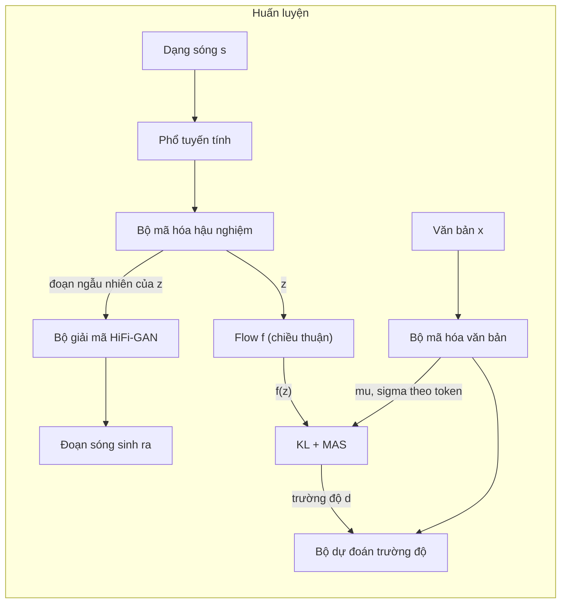
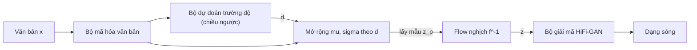

# Chương 27. VITS và họ end-to-end

!!! abstract "Mục tiêu học tập"
    Sau chương này, bạn có thể:

    - **Giải thích** vì sao hệ thống hai giai đoạn (mô hình âm học + vocoder) gặp giới hạn và VITS gộp chúng thành một mô hình huấn luyện một lần như thế nào.
    - **Suy ra** cận dưới ELBO của VITS như một VAE có điều kiện (CVAE) với prior được tăng cường bằng normalizing flow, và **viết ra** đúng số hạng KL mà mã nguồn chính thức tính.
    - **Phân biệt** rõ mô-đun nào hoạt động ở lúc huấn luyện, mô-đun nào ở lúc suy luận, và dữ liệu đi qua mô-đun theo chiều nào ($\mathbf{z} \to f_\theta(\mathbf{z})$ hay ngược lại).
    - **Trình bày** ý tưởng bộ dự đoán trường độ ngẫu nhiên (*stochastic duration predictor*): khử lượng tử hóa biến phân và tăng cường dữ liệu biến phân.
    - **Cài đặt** hàm mất mát KL, flow bảo toàn thể tích, ma trận log-likelihood cho MAS, cắt đoạn ngẫu nhiên và đường suy luận của VITS, kèm kiểm thử.
    - **So sánh** VITS với VITS2, JETS, NaturalSpeech, MB-iSTFT-VITS và Piper; **đánh giá** khi nào VITS là lựa chọn hợp lý cho tiếng Việt.

!!! info "Kiến thức cần có"
    - VAE, ELBO, thủ thuật tham số hóa lại, KL giữa hai phân phối Gauss: [Chương 8](../phan-2-mo-hinh-sinh/ch08-vae.md).
    - GAN, LSGAN, feature matching: [Chương 9](../phan-2-mo-hinh-sinh/ch09-gan.md).
    - Normalizing flow, affine coupling, đổi biến: [Chương 10](../phan-2-mo-hinh-sinh/ch10-normalizing-flows.md).
    - Monotonic Alignment Search (MAS): [Chương 21](../phan-5-mo-hinh-am-hoc/ch21-alignment.md); Glow-TTS: [Chương 23](../phan-5-mo-hinh-am-hoc/ch23-glow-grad-matcha.md).
    - HiFi-GAN (bộ sinh MRF, bộ phân biệt MPD/MSD): [Chương 25](../phan-6-vocoder/ch25-gan-vocoder.md).
    - Biểu diễn đầu vào, chèn token trống (*blank*): [Chương 18](../phan-4-frontend/ch18-g2p-bieu-dien-dau-vao.md).

## 27.1. Từ hai giai đoạn đến một giai đoạn

Ở Phần V và Phần VI, chúng ta đã xây một hệ thống TTS theo kiểu **hai giai đoạn**: mô hình âm học (Tacotron 2, FastSpeech 2, Glow-TTS…) sinh mel-spectrogram từ văn bản, rồi vocoder (HiFi-GAN…) biến mel thành dạng sóng. Cách chia này dễ huấn luyện vì mỗi mô hình giải một bài toán nhỏ hơn, nhưng nó để lại ba vấn đề:

1. **Lệch phân phối giữa hai giai đoạn.** Vocoder học trên mel thật nhưng lúc suy luận nhận mel *dự đoán*, vốn mờ hơn và có sai số hệ thống. Cách vá thông dụng là tinh chỉnh (*fine-tune*) vocoder trên mel sinh bằng teacher forcing (GTA, xem [Chương 25](../phan-6-vocoder/ch25-gan-vocoder.md)), tức là thêm một vòng huấn luyện nữa và phải huấn luyện tuần tự.
2. **Nút thắt do con người thiết kế.** Mel-spectrogram 80 kênh là một biểu diễn trung gian cố định. Nó bỏ đi pha và một phần chi tiết tần số cao; mô hình không được phép tự học một biểu diễn trung gian tốt hơn cho chính nhiệm vụ của mình.
3. **Sai số lan truyền.** Lỗi của giai đoạn một (mel quá trơn, sai cao độ) không thể được giai đoạn hai sửa, vì hai mô hình được tối ưu riêng rẽ.

Các mô hình end-to-end đầu tiên như FastSpeech 2s hay EATS đã sinh dạng sóng trực tiếp từ văn bản, nhưng chất lượng còn thua hệ thống hai giai đoạn tốt nhất. **VITS** (*Variational Inference with adversarial learning for end-to-end Text-to-Speech*; Kim và cộng sự, 2021) là mô hình đầu tiên được công bố rộng rãi vượt qua cặp Glow-TTS + HiFi-GAN đã tinh chỉnh, trong khi vẫn huấn luyện **một lần** và sinh **song song**. Theo báo cáo gốc, trên LJSpeech, VITS đạt MOS xấp xỉ 4,43 so với 4,46 của ghi âm thật; phép thử CMOS ở phụ lục cho thấy người nghe vẫn hơi nghiêng về ghi âm thật, nên không nên hiểu là "ngang con người" tuyệt đối.

Ý tưởng cốt lõi của VITS là ghép bốn mảnh ghép quen thuộc vào một khung xác suất duy nhất:

| Mảnh ghép | Vai trò trong VITS | Học ở chương |
|---|---|---|
| VAE có điều kiện (CVAE) | Biến ẩn $\mathbf{z}$ nối "phía văn bản" và "phía âm thanh" | [Chương 8](../phan-2-mo-hinh-sinh/ch08-vae.md) |
| Normalizing flow | Làm prior $p_\theta(\mathbf{z} \mid \mathbf{x})$ đủ linh hoạt | [Chương 10](../phan-2-mo-hinh-sinh/ch10-normalizing-flows.md) |
| MAS | Tìm căn chỉnh cứng token–khung, không cần bộ căn chỉnh ngoài | [Chương 21](../phan-5-mo-hinh-am-hoc/ch21-alignment.md) |
| GAN (HiFi-GAN) | Bộ giải mã $\mathbf{z} \to$ dạng sóng, huấn luyện đối kháng | [Chương 25](../phan-6-vocoder/ch25-gan-vocoder.md) |

Ngoài ra, VITS đề xuất **bộ dự đoán trường độ ngẫu nhiên** dựa trên flow để giải quyết bài toán một–nhiều về nhịp điệu: cùng một câu có thể được đọc nhanh, chậm, ngắt khác nhau.

### Sơ đồ tổng quát





Hãy để ý sự bất đối xứng: lúc huấn luyện, bộ mã hóa hậu nghiệm và bộ phân biệt là trung tâm; lúc suy luận, cả hai **biến mất**, và flow chạy theo **chiều ngược**. Phần lớn nhầm lẫn khi đọc mã VITS đến từ đây, nên chúng ta sẽ đi chậm.

!!! note "Về ký hiệu"
    Bài báo gốc dùng $x$ cho tiếng nói và $c$ cho văn bản. Chương này theo [bảng ký hiệu](../gioi-thieu/ky-hieu.md) của sách: $\mathbf{x} = (x_1, \ldots, x_N)$ là chuỗi token văn bản, $\mathbf{s}$ là dạng sóng, $\mathbf{S}$ là phổ biên độ tuyến tính (*linear spectrogram*), $\mathbf{Y}$ là log-mel-spectrogram, $\mathbf{z} = (\mathbf{z}_1, \ldots, \mathbf{z}_T) \in \mathbb{R}^{C \times T}$ là biến ẩn theo khung với $C$ kênh (VITS dùng $C = 192$), $\mathbf{A} \in \{0,1\}^{N \times T}$ là ma trận căn chỉnh cứng và $\mathbf{d}$ là trường độ.

## 27.2. VITS như một VAE có điều kiện

### 27.2.1. Trực giác

Hãy hình dung biến ẩn $\mathbf{z}$ là một "bản nháp âm thanh" theo từng khung: nó mang đủ thông tin để bộ giải mã dựng lại dạng sóng, nhưng được ép phải gần với những gì có thể dự đoán từ văn bản. Có hai cách để tạo ra $\mathbf{z}$:

- **Từ âm thanh thật** (bộ mã hóa hậu nghiệm): nhìn phổ của câu nói thật, nén thành $\mathbf{z}$. Cách này chỉ có ở lúc huấn luyện, và cho phép bộ giải mã học dựng sóng chất lượng cao.
- **Từ văn bản** (prior): chỉ nhìn văn bản, dự đoán một phân phối trên $\mathbf{z}$. Đây là cách duy nhất có ở lúc suy luận.

Số hạng KL trong ELBO kéo hai cách này lại gần nhau. Nếu kéo thành công, ta có thể lấy mẫu $\mathbf{z}$ từ prior lúc suy luận và bộ giải mã vẫn "nhận ra" nó như một $\mathbf{z}$ đến từ âm thanh thật. Đây chính là lời giải cho vấn đề lệch phân phối giữa hai giai đoạn: thay vì mel cố định, ranh giới giữa hai nửa là một biến ẩn **được học**, và hai nửa được tối ưu đồng thời.

### 27.2.2. Hình thức hóa: cận dưới ELBO có điều kiện

Ta muốn cực đại hóa log-likelihood có điều kiện $\log p_\theta(\mathbf{s} \mid \mathbf{x})$. Đưa vào biến ẩn $\mathbf{z}$ và giả định rằng, **khi biết $\mathbf{z}$, tiếng nói không còn phụ thuộc văn bản** (bộ giải mã không nhìn văn bản):

$$
p_\theta(\mathbf{s} \mid \mathbf{x}) = \int p_\theta(\mathbf{s} \mid \mathbf{z})\, p_\theta(\mathbf{z} \mid \mathbf{x})\, d\mathbf{z}.
$$

Tích phân này không tính được. Nhân và chia cho một phân phối xấp xỉ $q_\phi(\mathbf{z} \mid \mathbf{s})$ rồi áp dụng bất đẳng thức Jensen cho hàm lõm $\log$:

$$
\log p_\theta(\mathbf{s} \mid \mathbf{x})
= \log \mathbb{E}_{q_\phi(\mathbf{z} \mid \mathbf{s})}\!\left[\frac{p_\theta(\mathbf{s} \mid \mathbf{z})\, p_\theta(\mathbf{z} \mid \mathbf{x})}{q_\phi(\mathbf{z} \mid \mathbf{s})}\right]
\ge \mathbb{E}_{q_\phi(\mathbf{z} \mid \mathbf{s})}\!\left[\log p_\theta(\mathbf{s} \mid \mathbf{z}) - \log \frac{q_\phi(\mathbf{z} \mid \mathbf{s})}{p_\theta(\mathbf{z} \mid \mathbf{x})}\right].
$$

Vế phải là ELBO. Số hạng thứ hai, lấy kỳ vọng, chính là $D_{\mathrm{KL}}\big(q_\phi(\mathbf{z} \mid \mathbf{s}) \,\Vert\, p_\theta(\mathbf{z} \mid \mathbf{x})\big)$. Như đã chứng minh ở [Chương 8](../phan-2-mo-hinh-sinh/ch08-vae.md), khoảng cách giữa hai vế bằng $D_{\mathrm{KL}}\big(q_\phi(\mathbf{z} \mid \mathbf{s}) \,\Vert\, p_\theta(\mathbf{z} \mid \mathbf{s}, \mathbf{x})\big)$, tức là cận càng chặt khi bộ mã hóa hậu nghiệm càng gần hậu nghiệm thật. Hàm mất mát là âm ELBO, gồm hai phần:

$$
\mathcal{L}_{\text{vae}} = \underbrace{-\log p_\theta(\mathbf{s} \mid \mathbf{z})}_{\text{tái tạo}} + \underbrace{\log q_\phi(\mathbf{z} \mid \mathbf{s}) - \log p_\theta(\mathbf{z} \mid \mathbf{x}, \mathbf{A})}_{\text{KL (một mẫu)}}, \qquad \mathbf{z} \sim q_\phi(\mathbf{z} \mid \mathbf{s}).
$$

Có ba điểm khác với VAE "sách giáo khoa":

- **Prior có điều kiện và có flow.** Prior không còn là $\mathcal{N}(\mathbf{0}, \mathbf{I})$ mà phụ thuộc văn bản và căn chỉnh $\mathbf{A}$, lại được biến đổi qua một normalizing flow (Mục 27.3).
- **Căn chỉnh $\mathbf{A}$ không được lấy tích phân.** $\mathbf{A}$ là một phần của điều kiện, được chọn bằng cách *cực đại* ELBO (Mục 27.4), giống tinh thần huấn luyện Viterbi hay EM cứng, chứ không lấy tổng trên mọi căn chỉnh.
- **Bộ mã hóa hậu nghiệm nhìn phổ tuyến tính**, không nhìn mel. $\mathbf{S}$ là hàm tất định của $\mathbf{s}$ nên việc viết $q_\phi(\mathbf{z} \mid \mathbf{S})$ thay cho $q_\phi(\mathbf{z} \mid \mathbf{s})$ không vi phạm khung biến phân. Lý do chọn phổ tuyến tính (513 bin với $N_{\text{FFT}} = 1024$) là để cung cấp thông tin độ phân giải cao hơn; ablation trong bài báo gốc cho thấy thay bằng mel làm MOS giảm khoảng 0,19.

### 27.2.3. Mất mát tái tạo: L1 trên mel như một likelihood Laplace

Bộ giải mã $G$ sinh dạng sóng $\hat{\mathbf{s}} = G(\mathbf{z})$. VITS không đo likelihood trực tiếp trên dạng sóng mà biến $\hat{\mathbf{s}}$ thành mel $\hat{\mathbf{Y}}$ bằng STFT và bộ lọc mel (không có tham số học), rồi giả định mỗi phần tử mel thật phân phối Laplace quanh giá trị dự đoán:

$$
p_\theta(\mathbf{Y} \mid \mathbf{z}) = \prod_{t,f} \frac{1}{2b} \exp\!\left(-\frac{|Y_{t,f} - \hat{Y}_{t,f}|}{b}\right)
\;\Rightarrow\;
-\log p_\theta(\mathbf{Y} \mid \mathbf{z}) = \frac{1}{b}\lVert \mathbf{Y} - \hat{\mathbf{Y}} \rVert_1 + \text{hằng số}.
$$

Như vậy L1 trên mel chính là cực đại likelihood dưới giả định Laplace (liên hệ L1 ↔ Laplace đã gặp ở [Chương 1](../phan-1-nen-tang/ch01-toan-nen-tang.md)). Chọn miền mel vì nó gần với cảm nhận thính giác. Trong mã chính thức, L1 được lấy **trung bình** trên mọi phần tử mel và nhân hệ số $c_{\text{mel}} = 45$ (kế thừa từ HiFi-GAN); bạn có thể đọc hệ số này như $1/b$, tức là một lựa chọn về "độ tin" của likelihood, và nó quyết định cán cân giữa tái tạo với KL.

!!! warning "Mất mát tái tạo chỉ trên một đoạn"
    Bộ giải mã HiFi-GAN quá nặng để chạy trên toàn bộ $\mathbf{z}$ của cả batch. VITS chỉ giải mã một **đoạn ngẫu nhiên** dài 32 khung (8192 mẫu với $H = 256$) của mỗi câu, và mất mát tái tạo chỉ tính trên đoạn đó (*windowed generator training*, Mục 27.6). Về mặt xác suất, đây là ước lượng không chệch (sai khác hệ số) của tổng log-likelihood theo khung nếu vị trí đoạn được chọn đều.

## 27.3. Prior có flow và số hạng KL

### 27.3.1. Vì sao prior Gauss đơn giản là không đủ

Bộ mã hóa văn bản (Transformer với mã hóa vị trí tương đối) sinh ra, cho mỗi token $i$, một trung bình $\boldsymbol{\mu}_i \in \mathbb{R}^C$ và độ lệch chuẩn $\boldsymbol{\sigma}_i \in \mathbb{R}^C$. Sau khi có căn chỉnh $\mathbf{A}$, mỗi khung $t$ được gán cho token $a(t)$, và một prior "ngây thơ" sẽ là

$$
p(\mathbf{z} \mid \mathbf{x}, \mathbf{A}) = \prod_{t=1}^{T} \mathcal{N}\big(\mathbf{z}_t;\, \boldsymbol{\mu}_{a(t)},\, \operatorname{diag}(\boldsymbol{\sigma}_{a(t)}^2)\big).
$$

Prior này nói rằng mọi khung thuộc cùng một token có **cùng** phân phối và **độc lập** với nhau. Nhưng $\mathbf{z}$ từ âm thanh thật thì thay đổi liên tục bên trong một âm vị (chuyển tiếp formant, đường nét cao độ, nhất là thanh điệu tiếng Việt vốn là một *đường cong* F0 trải trên cả vần). Ép một hậu nghiệm giàu cấu trúc như vậy về một prior "bậc thang" sẽ buộc $\mathbf{z}$ phải nghèo thông tin, và bộ giải mã nhận một $\mathbf{z}$ nghèo nàn thì sinh âm thanh kém.

Lời giải của VITS: đặt một normalizing flow $f_\theta$ (khả nghịch) giữa $\mathbf{z}$ và prior Gauss. Theo công thức đổi biến ([Chương 10](../phan-2-mo-hinh-sinh/ch10-normalizing-flows.md)):

$$
p_\theta(\mathbf{z} \mid \mathbf{x}, \mathbf{A}) = \mathcal{N}\big(f_\theta(\mathbf{z});\, \boldsymbol{\mu}_\theta(\mathbf{x}, \mathbf{A}),\, \boldsymbol{\sigma}_\theta(\mathbf{x}, \mathbf{A})\big)\,\left|\det \frac{\partial f_\theta(\mathbf{z})}{\partial \mathbf{z}}\right|.
$$

Nói cách khác, flow "gỡ" bớt sự phức tạp của $\mathbf{z}$: sau khi đi qua $f_\theta$, các khung trong cùng một token mới cần trông giống nhau. Flow gồm các lớp affine coupling với mạng con là khối WaveNet không nhân quả, nên có trường tiếp nhận theo thời gian và mô hình hóa được tương quan giữa các khung kề nhau. Ablation trong bài báo gốc cho thấy bỏ flow khỏi prior làm MOS tụt khoảng 1,52 điểm, mức giảm lớn nhất trong mọi thí nghiệm của bài. Đây là bằng chứng rõ nhất cho nhận định "độ linh hoạt của prior quyết định chất lượng".

### 27.3.2. Flow bảo toàn thể tích

VITS chọn một thiết kế đơn giản: mỗi lớp coupling chỉ **dịch** (*mean-only*), không co giãn. Chia kênh của $\mathbf{z}$ thành hai nửa $(\mathbf{z}^a, \mathbf{z}^b)$:

$$
\tilde{\mathbf{z}}^a = \mathbf{z}^a, \qquad \tilde{\mathbf{z}}^b = \mathbf{z}^b + m_\theta(\mathbf{z}^a).
$$

Jacobian là ma trận tam giác khối với đường chéo toàn số 1, nên $\log|\det J| = 0$ (*volume-preserving*). Giữa các lớp coupling có một phép đảo thứ tự kênh (`Flip`) để nửa kia cũng được biến đổi. Cấu hình gốc dùng 4 lớp coupling, mỗi lớp có 4 khối WaveNet. Phép nghịch đảo tầm thường: $\mathbf{z}^b = \tilde{\mathbf{z}}^b - m_\theta(\tilde{\mathbf{z}}^a)$.

Một chi tiết cài đặt quan trọng: lớp chiếu cuối của $m_\theta$ được **khởi tạo bằng 0**, nên lúc bắt đầu huấn luyện flow là ánh xạ đồng nhất và VITS khởi đầu như một CVAE với prior Gauss thường. Mã dưới đây cài đặt flow này và kiểm tra hai tính chất: khả nghịch và $\log|\det J| = 0$.

```python
import torch
import torch.nn as nn

class MeanOnlyCoupling(nn.Module):
    """Coupling bảo toàn thể tích (mean_only) như trong flow của prior VITS."""
    def __init__(self, channels, hidden=32, kernel_size=5):
        super().__init__()
        self.half = channels // 2
        self.net = nn.Sequential(
            nn.Conv1d(self.half, hidden, kernel_size, padding=kernel_size // 2), nn.GELU(),
            nn.Conv1d(hidden, channels - self.half, kernel_size, padding=kernel_size // 2))
        # Khởi tạo lớp cuối bằng 0 -> flow ban đầu là ánh xạ đồng nhất (giống mã gốc)
        nn.init.zeros_(self.net[-1].weight)
        nn.init.zeros_(self.net[-1].bias)

    def forward(self, z, mask, reverse=False):          # z: (B, C, T), mask: (B, 1, T)
        za, zb = z[:, :self.half], z[:, self.half:]
        shift = self.net(za * mask) * mask               # chỉ dịch, không co giãn
        zb = zb - shift if reverse else zb + shift       # => log|det J| = 0
        return torch.cat([za, zb], dim=1) * mask

class Flip(nn.Module):
    def forward(self, z, mask, reverse=False):
        return torch.flip(z, dims=[1])                   # đảo kênh để nửa kia cũng được biến đổi

class PriorFlow(nn.Module):
    def __init__(self, channels, n_flows=4):
        super().__init__()
        self.layers = nn.ModuleList()
        for _ in range(n_flows):
            self.layers.extend([MeanOnlyCoupling(channels), Flip()])

    def forward(self, z, mask, reverse=False):
        layers = reversed(self.layers) if reverse else self.layers
        for layer in layers:
            z = layer(z, mask, reverse=reverse)
        return z

torch.manual_seed(0)
flow = PriorFlow(channels=4)
for p in flow.parameters():                              # phá khởi tạo 0 để kiểm thử thật sự
    nn.init.normal_(p, std=0.3)
B, C, T = 2, 4, 7
mask = torch.ones(B, 1, T)
z = torch.randn(B, C, T) * mask
z_p = flow(z, mask)                                      # huấn luyện: z -> z_p = f(z)
z_back = flow(z_p, mask, reverse=True)                   # suy luận:  z_p -> z = f^{-1}(z_p)
assert torch.allclose(z, z_back, atol=1e-5)

# Kiểm tra det J = 1 bằng Jacobian số trên một câu nhỏ
m1 = torch.ones(1, 1, 3)
fn = lambda v: flow(v.view(1, C, 3), m1).flatten()
J = torch.autograd.functional.jacobian(fn, torch.randn(C * 3))   # (12, 12)
logdet = torch.linalg.slogdet(J).logabsdet
print("log|det J| =", float(logdet))
assert abs(float(logdet)) < 1e-4
```

Vì sao bảo toàn thể tích là đủ? Mục tiêu của flow ở đây không phải là biến một phân phối phức tạp thành $\mathcal{N}(\mathbf{0}, \mathbf{I})$ như trong Glow, vì phần "co giãn" đã có $\boldsymbol{\sigma}_\theta$ của bộ mã hóa văn bản đảm nhận. Flow chỉ cần *bẻ cong* không gian để hậu nghiệm khớp với prior bậc thang. Bài báo gốc nói rõ đây là lựa chọn "cho đơn giản"; VITS2 (Mục 27.9) vẫn giữ nguyên tinh thần này và chỉ thêm khối Transformer vào mạng con.

### 27.3.3. Suy ra số hạng KL như mã chính thức tính

Đây là phần dễ nhầm nhất. Ta sẽ đi từng bước từ định nghĩa đến đúng dòng mã.

**Bước 1: log hậu nghiệm.** Bộ mã hóa hậu nghiệm cho $q_\phi(\mathbf{z} \mid \mathbf{S}) = \prod_{c,t} \mathcal{N}(z_{c,t};\, \mu^{q}_{c,t}, (\sigma^{q}_{c,t})^2)$. Lấy mẫu bằng tham số hóa lại $z_{c,t} = \mu^{q}_{c,t} + \sigma^{q}_{c,t}\,\epsilon_{c,t}$ với $\epsilon_{c,t} \sim \mathcal{N}(0, 1)$. Khi đó

$$
\log q_\phi(\mathbf{z} \mid \mathbf{S}) = \sum_{c,t}\Big[-\log \sigma^{q}_{c,t} - \tfrac{1}{2}\log 2\pi - \tfrac{1}{2}\epsilon_{c,t}^2\Big].
$$

**Bước 2: log prior.** Đặt $\tilde{\mathbf{z}} = f_\theta(\mathbf{z})$ (trong mã gọi là `z_p`) và gọi $\mu^{p}_{c,t}, \sigma^{p}_{c,t}$ là tham số prior của token $a(t)$ đã được "mở rộng" theo căn chỉnh. Từ công thức đổi biến:

$$
\log p_\theta(\mathbf{z} \mid \mathbf{x}, \mathbf{A}) = \sum_{c,t}\Big[-\log \sigma^{p}_{c,t} - \tfrac{1}{2}\log 2\pi - \frac{(\tilde{z}_{c,t} - \mu^{p}_{c,t})^2}{2(\sigma^{p}_{c,t})^2}\Big] + \log\left|\det \frac{\partial f_\theta}{\partial \mathbf{z}}\right|.
$$

**Bước 3: lấy hiệu.** Hằng số $\log 2\pi$ triệt tiêu:

$$
\log q_\phi - \log p_\theta = \sum_{c,t}\Big[\log \sigma^{p}_{c,t} - \log \sigma^{q}_{c,t} - \tfrac{1}{2}\epsilon_{c,t}^2 + \frac{(\tilde{z}_{c,t} - \mu^{p}_{c,t})^2}{2(\sigma^{p}_{c,t})^2}\Big] - \log\left|\det \frac{\partial f_\theta}{\partial \mathbf{z}}\right|.
$$

**Bước 4: thay phần entropy bằng giá trị giải tích.** Số hạng $-\tfrac{1}{2}\epsilon^2$ chỉ phụ thuộc nhiễu, và $\mathbb{E}[\epsilon^2] = 1$. Thay nó bằng kỳ vọng $-\tfrac{1}{2}$ nghĩa là tính **chính xác** phần $\mathbb{E}_q[\log q] = -H(q)$ (âm entropy của Gauss), và chỉ dùng Monte Carlo một mẫu cho phần entropy chéo $-\mathbb{E}_q[\log p]$. Ước lượng thu được vẫn **không chệch** cho KL.

**Bước 5: flow bảo toàn thể tích.** Với coupling chỉ dịch, $\log|\det J| = 0$. Ta được đúng công thức trong hàm `kl_loss` của mã chính thức:

$$
\hat{\mathcal{L}}_{\text{kl}} = \frac{1}{\sum_t m_t}\sum_{t} m_t \sum_{c=1}^{C}\Big[\log \sigma^{p}_{c,t} - \log \sigma^{q}_{c,t} - \tfrac{1}{2} + \tfrac{1}{2}(\tilde{z}_{c,t} - \mu^{p}_{c,t})^2 (\sigma^{p}_{c,t})^{-2}\Big],
$$

trong đó $m_t \in \{0, 1\}$ là mặt nạ khung hợp lệ. Chú ý mẫu số: tổng của mặt nạ có hình dạng `(B, 1, T)`, tức là **số khung** chứ không phải số phần tử $C \times T$. Vậy KL được **cộng theo 192 kênh** rồi **lấy trung bình theo khung**. Nếu bạn tự viết lại và lỡ chia cho $C \cdot T$, KL sẽ nhỏ đi 192 lần so với mất mát mel và cán cân của ELBO thay đổi hoàn toàn.

Mã dưới đây cài đặt đúng công thức trên và kiểm chứng tính không chệch: khi $f$ là ánh xạ đồng nhất, trung bình của ước lượng qua nhiều mẫu phải khớp với KL giải tích giữa hai Gauss.

```python
import torch

def kl_loss(z_p, logs_q, m_p, logs_p, z_mask):
    """Số hạng KL của VITS, đúng như cách mã chính thức tính.
    z_p    : f_theta(z) với z lấy mẫu từ hậu nghiệm   # (B, C, T)
    logs_q : log sigma của hậu nghiệm q(z|S)         # (B, C, T)
    m_p    : trung bình prior đã mở rộng theo A      # (B, C, T)
    logs_p : log sigma prior đã mở rộng theo A       # (B, C, T)
    z_mask : mặt nạ khung hợp lệ                     # (B, 1, T)
    """
    z_p, logs_q, m_p, logs_p, z_mask = (t.float() for t in (z_p, logs_q, m_p, logs_p, z_mask))
    kl = logs_p - logs_q - 0.5                                   # -0.5 = E[-eps^2/2]
    kl = kl + 0.5 * (z_p - m_p) ** 2 * torch.exp(-2.0 * logs_p)  # số hạng entropy chéo (MC)
    return torch.sum(kl * z_mask) / torch.sum(z_mask)            # chia cho số KHUNG hợp lệ

def kl_closed_form(m_q, logs_q, m_p, logs_p, z_mask):
    """KL giải tích giữa hai Gauss chéo (chỉ đúng khi f là ánh xạ đồng nhất)."""
    kl = logs_p - logs_q - 0.5 + 0.5 * (torch.exp(2 * logs_q) + (m_q - m_p) ** 2) * torch.exp(-2 * logs_p)
    return torch.sum(kl * z_mask) / torch.sum(z_mask)

torch.manual_seed(0)
B, C, T, S = 2, 4, 6, 4000                       # S: số mẫu Monte Carlo
m_q, logs_q = torch.randn(B, C, T), 0.3 * torch.randn(B, C, T)
m_p, logs_p = torch.randn(B, C, T), 0.3 * torch.randn(B, C, T)
z_mask = torch.ones(B, 1, T)
z_mask[1, :, 4:] = 0                             # câu thứ hai chỉ dài 4 khung

est = []
for _ in range(S):
    z = m_q + torch.exp(logs_q) * torch.randn(B, C, T)   # tham số hóa lại
    est.append(kl_loss(z, logs_q, m_p, logs_p, z_mask))  # f = id nên z_p = z
est = torch.stack(est)
ref = kl_closed_form(m_q, logs_q, m_p, logs_p, z_mask)
se = est.std() / S ** 0.5                                # sai số chuẩn của trung bình
print(f"MC: {est.mean():.4f} ± {se:.4f} | dạng đóng: {ref:.4f}")
assert abs(est.mean() - ref) < 4 * se                    # ước lượng không chệch
```

!!! tip "Gradient của KL đi đâu?"
    Số hạng KL nhận gradient theo **ba** hướng cùng lúc: (1) về bộ mã hóa hậu nghiệm qua `logs_q` và qua `z` (nhờ tham số hóa lại); (2) về flow qua `z_p`; (3) về bộ mã hóa văn bản qua `m_p`, `logs_p`. Riêng ma trận căn chỉnh $\mathbf{A}$ dùng để mở rộng `m_p`, `logs_p` thì được tính dưới `torch.no_grad()` nên không có gradient. Nhờ vậy, KL vừa kéo prior về phía hậu nghiệm, vừa kéo hậu nghiệm về phía những gì văn bản dự đoán được. Đây là cơ chế "điều chuẩn" khiến $\mathbf{z}$ không mang quá nhiều thông tin mà văn bản không thể đoán.

!!! note "Nếu flow không bảo toàn thể tích"
    Với một flow affine đầy đủ (có co giãn $\exp(\mathbf{s}_\theta)$), bạn phải trừ thêm $\log|\det J| = \sum \mathbf{s}_\theta$ khỏi `kl` trước khi lấy tổng. Quên số hạng này là một lỗi kinh điển khi "nâng cấp" flow của VITS: mô hình sẽ học cách phình co giãn để làm KL nhỏ đi một cách giả tạo (xem Bài tập 3).

## 27.4. Căn chỉnh bằng MAS trong không gian ẩn

### 27.4.1. Từ ELBO đến bài toán MAS

Glow-TTS ([Chương 23](../phan-5-mo-hinh-am-hoc/ch23-glow-grad-matcha.md)) tìm căn chỉnh cực đại log-likelihood chính xác của mel. VITS không có likelihood chính xác mà chỉ có ELBO, nên câu hỏi là: căn chỉnh nào cực đại ELBO? Viết ELBO một mẫu như một hàm của $\hat{\mathbf{A}}$:

$$
\log p_\theta(\mathbf{Y} \mid \mathbf{z}) - \log q_\phi(\mathbf{z} \mid \mathbf{S}) + \log p_\theta(\mathbf{z} \mid \mathbf{x}, \hat{\mathbf{A}}).
$$

Hai số hạng đầu **không phụ thuộc** $\hat{\mathbf{A}}$ (bộ giải mã và hậu nghiệm không nhìn văn bản). Trong số hạng cuối, Jacobian của flow cũng không phụ thuộc $\hat{\mathbf{A}}$. Vậy

$$
\arg\max_{\hat{\mathbf{A}}} \text{ELBO} = \arg\max_{\hat{\mathbf{A}}} \sum_{t=1}^{T} \log \mathcal{N}\big(\tilde{\mathbf{z}}_t;\, \boldsymbol{\mu}_{a(t)},\, \boldsymbol{\sigma}_{a(t)}\big), \qquad \tilde{\mathbf{z}} = f_\theta(\mathbf{z}).
$$

Đây đúng là bài toán của Glow-TTS, chỉ thay mel đã qua flow bằng $\tilde{\mathbf{z}}$. Ràng buộc đơn điệu và không nhảy cóc giữ nguyên, nên ta dùng lại nguyên thuật toán quy hoạch động MAS mà [Chương 21](../phan-5-mo-hinh-am-hoc/ch21-alignment.md) đã dẫn xuất, với độ phức tạp $O(NT)$.

### 27.4.2. Tính ma trận log-likelihood hiệu quả

MAS cần ma trận $P_{t,i} = \sum_{c} \log \mathcal{N}(\tilde{z}_{c,t}; \mu_{c,i}, \sigma_{c,i})$ cho mọi cặp khung–token. Tính ngây thơ bằng broadcast tạo ra tensor $(B, C, T, N)$, với $C = 192$, $T$ vài trăm, $N$ vài trăm, tốn rất nhiều bộ nhớ. VITS khai triển bình phương:

$$
P_{t,i} = \underbrace{\sum_c \big(-\tfrac{1}{2}\log 2\pi - \log\sigma_{c,i}\big)}_{\text{chỉ phụ thuộc } i}
\;\underbrace{-\tfrac{1}{2}\sum_c \tilde{z}_{c,t}^2\, \sigma_{c,i}^{-2}}_{\text{tích ma trận}}
\;+\underbrace{\sum_c \tilde{z}_{c,t}\, \mu_{c,i}\, \sigma_{c,i}^{-2}}_{\text{tích ma trận}}
\;\underbrace{-\tfrac{1}{2}\sum_c \mu_{c,i}^2\, \sigma_{c,i}^{-2}}_{\text{chỉ phụ thuộc } i}.
$$

Hai số hạng giữa là phép nhân ma trận $(T \times C)(C \times N)$, chạy rất nhanh trên GPU và chỉ cần bộ nhớ $(B, T, N)$. Mã dưới đây cài đặt khai triển này, so sánh với cách tính ngây thơ, rồi chạy MAS (bản rút gọn của Chương 21) trên một ví dụ tổng hợp mà ta biết trước trường độ đúng.

```python
import math
import numpy as np
import torch

def log_likelihood_matrix(z_p, m_p, logs_p):
    """P[b, t, i] = sum_c log N(z_p[b,c,t]; m_p[b,c,i], exp(logs_p[b,c,i])^2), khai triển như VITS.
    z_p: (B, C, T) ; m_p, logs_p: (B, C, N)  ->  (B, T, N)"""
    s_p_sq_r = torch.exp(-2.0 * logs_p)                                          # 1/sigma^2, (B, C, N)
    t1 = torch.sum(-0.5 * math.log(2 * math.pi) - logs_p, dim=1, keepdim=True)  # (B, 1, N)
    t2 = torch.matmul(-0.5 * (z_p ** 2).transpose(1, 2), s_p_sq_r)              # (B, T, N)
    t3 = torch.matmul(z_p.transpose(1, 2), m_p * s_p_sq_r)                       # (B, T, N)
    t4 = torch.sum(-0.5 * m_p ** 2 * s_p_sq_r, dim=1, keepdim=True)              # (B, 1, N)
    return t1 + t2 + t3 + t4

def mas(logp):
    """MAS cho một câu (bản rút gọn; dẫn xuất ở Chương 21). logp: (N, T) -> A: (N, T)."""
    N, T = logp.shape
    Q = np.full((N, T), -np.inf)
    Q[0, 0] = logp[0, 0]
    for j in range(1, T):
        move = np.concatenate([[-np.inf], Q[:-1, j - 1]])      # đến từ token i-1
        Q[:, j] = np.maximum(Q[:, j - 1], move) + logp[:, j]   # hoặc ở lại token i
    A, i = np.zeros((N, T)), N - 1
    for j in range(T - 1, -1, -1):                              # truy vết ngược
        A[i, j] = 1
        if i > 0 and (i == j or Q[i, j - 1] < Q[i - 1, j - 1]):
            i -= 1
    return A

torch.manual_seed(0)
C, N = 8, 5
d_true = torch.tensor([3, 1, 4, 2, 5])                        # trường độ thật (khung)
T = int(d_true.sum())
m_p = 2.0 * torch.randn(1, C, N)                              # mỗi token một "tâm" riêng
logs_p = torch.full((1, C, N), -1.0)
token_of_frame = torch.repeat_interleave(torch.arange(N), d_true)            # (T,)
z_p = m_p[:, :, token_of_frame] + 0.3 * torch.randn(1, C, T)                 # (1, C, T)

with torch.no_grad():                                         # MAS không nhận gradient
    P = log_likelihood_matrix(z_p, m_p, logs_p)               # (1, T, N)
naive = torch.distributions.Normal(m_p[:, :, None, :], logs_p.exp()[:, :, None, :]) \
    .log_prob(z_p[:, :, :, None]).sum(1)                      # (1, T, N), tốn bộ nhớ hơn
assert torch.allclose(P, naive, atol=1e-4)

A = torch.from_numpy(mas(P[0].T.numpy())).float()[None]       # (1, N, T)
d_hat = A.sum(-1)                                             # trường độ = tổng theo hàng
print("trường độ tìm được:", d_hat.long().tolist())
assert torch.equal(d_hat[0].long(), d_true)
assert torch.all(A.sum(1) == 1)                               # mỗi khung thuộc đúng một token
m_p_exp = torch.bmm(m_p, A)                                   # (1, C, N) x (1, N, T) -> (1, C, T)
assert m_p_exp.shape == (1, C, T)
```

Trong mã thật, MAS được viết bằng Cython (hoặc Numba) và chạy song song trên batch; phần quy hoạch động không có gradient. Sau khi có $\mathbf{A}$, trường độ của token $i$ là $d_i = \sum_t A_{i,t}$, và tham số prior được mở rộng bằng phép nhân ma trận $\boldsymbol{\mu}_\theta \mathbf{A}$ như dòng cuối của mã.

!!! tip "MAS và token trống"
    VITS chèn một token trống (*blank*, chỉ số 0) giữa mọi cặp ký hiệu, giống Glow-TTS (cờ `add_blank`). Token trống cho MAS một chỗ để "gửi" các khung chuyển tiếp giữa hai âm vị, nhờ đó căn chỉnh ổn định hơn, đổi lại chuỗi văn bản dài gần gấp đôi. Nếu bật `add_blank` khi huấn luyện, **bắt buộc** phải bật y hệt khi suy luận; đây là lỗi rất hay gặp khi tự viết mã suy luận. VITS2 cho thấy có thể bỏ token trống khi các thành phần khác được cải tiến (Mục 27.9).

## 27.5. Bộ dự đoán trường độ ngẫu nhiên

### 27.5.1. Vì sao trường độ cần là ngẫu nhiên

Lúc suy luận không có âm thanh, nên không có MAS; ta cần dự đoán $\mathbf{d}$ từ văn bản. Cách của Glow-TTS và FastSpeech là hồi quy tất định log-trường độ bằng MSE (VITS gọi biến thể này là *DDP*, *deterministic duration predictor*). Nhưng nhịp điệu là một hiện tượng một–nhiều: hồi quy MSE cho ra "trung bình có điều kiện", nên mọi lần đọc đều cùng độ dài và cùng nhịp. Bài báo gốc minh họa bằng cách tổng hợp 100 lần một câu: Glow-TTS cho đúng một độ dài, còn VITS cho một phân phối độ dài giống Tacotron 2.

Mô hình hóa phân phối $p_\theta(\mathbf{d} \mid \mathbf{x})$ bằng một flow gặp hai trở ngại:

1. **$d_i$ là số nguyên.** Flow liên tục đặt mật độ lên $\mathbb{R}$; cực đại mật độ tại các điểm nguyên rời rạc là bài toán suy biến (mô hình có thể đẩy mật độ về vô cùng).
2. **$d_i$ là một vô hướng.** Coupling cần ít nhất hai chiều để chia đôi; một chuỗi vô hướng không đủ "chỗ" cho các phép biến đổi khả nghịch giàu biểu diễn.

### 27.5.2. Khử lượng tử hóa biến phân và tăng cường dữ liệu biến phân

VITS giải hai trở ngại bằng hai biến phụ có cùng độ dài $N$ với $\mathbf{d}$:

- $\mathbf{u} \in [0, 1)^N$ cho **khử lượng tử hóa biến phân** (*variational dequantization*, Ho và cộng sự, 2019): thay vì mô hình $\mathbf{d}$, mô hình $\mathbf{d} - \mathbf{u}$, một chuỗi số thực dương.
- $\boldsymbol{\nu} \in \mathbb{R}^N$ cho **tăng cường dữ liệu biến phân** (*variational data augmentation*, Chen và cộng sự, 2020): ghép $\boldsymbol{\nu}$ theo kênh với $\mathbf{d} - \mathbf{u}$ để có biểu diễn hai kênh.

Gọi $p_\theta(\mathbf{d} - \mathbf{u}, \boldsymbol{\nu} \mid \mathbf{x})$ là mật độ liên tục do flow định nghĩa. Xác suất rời rạc của $\mathbf{d}$ được định nghĩa bằng cách "lấy tích phân trên ô đơn vị" và lấy biên theo $\boldsymbol{\nu}$:

$$
P_\theta(\mathbf{d} \mid \mathbf{x}) = \int_{[0,1)^N}\!\int p_\theta(\mathbf{d} - \mathbf{u}, \boldsymbol{\nu} \mid \mathbf{x})\, d\boldsymbol{\nu}\, d\mathbf{u}.
$$

Các ô $\{\mathbf{d} - \mathbf{u} : \mathbf{u} \in [0,1)^N\}$ với $\mathbf{d}$ nguyên không chồng lên nhau, nên đây là một phân phối rời rạc hợp lệ. Đưa vào một hậu nghiệm xấp xỉ $q_\phi(\mathbf{u}, \boldsymbol{\nu} \mid \mathbf{d}, \mathbf{x})$ và lặp lại lập luận Jensen như ở Mục 27.2.2:

$$
\log P_\theta(\mathbf{d} \mid \mathbf{x}) \ge \mathbb{E}_{q_\phi(\mathbf{u}, \boldsymbol{\nu} \mid \mathbf{d}, \mathbf{x})}\Big[\log p_\theta(\mathbf{d} - \mathbf{u}, \boldsymbol{\nu} \mid \mathbf{x}) - \log q_\phi(\mathbf{u}, \boldsymbol{\nu} \mid \mathbf{d}, \mathbf{x})\Big].
$$

Hàm mất mát trường độ $\mathcal{L}_{\text{dur}}$ là âm của cận này. Trong cài đặt:

- $q_\phi$ là một flow nhỏ biến nhiễu Gauss hai kênh thành $(\mathbf{z}_u, \boldsymbol{\nu})$ (có điều kiện theo $\mathbf{d}$ và văn bản), rồi $\mathbf{u} = \operatorname{sigmoid}(\mathbf{z}_u)$ để ép vào $(0, 1)$. Log-mật độ $\log q_\phi$ gồm log-mật độ Gauss của nhiễu trừ log-định thức Jacobian của flow và của hàm sigmoid ($\log\sigma(z) + \log\sigma(-z)$ cho mỗi phần tử).
- $p_\theta$ là flow chính. Trước khi vào các lớp coupling, kênh trường độ được lấy log: flow thực chất mô hình hóa $\log(\mathbf{d} - \mathbf{u})$, và Jacobian của phép log đóng góp $-\sum_i \log(d_i - u_i)$ vào log-định thức.
- Các lớp coupling dùng **neural spline flow** (spline hữu tỷ bậc hai đơn điệu; Durkan và cộng sự, 2019) thay cho affine, với khối tích chập giãn nở tách sâu (*DDSConv*) để tiết kiệm tham số mà vẫn có trường tiếp nhận rộng.
- Đầu vào điều kiện $\mathbf{h}^{\text{text}}$ được **chặn gradient** (*stop-gradient*, trong mã là `torch.detach`): huấn luyện bộ dự đoán trường độ không được làm ảnh hưởng đến bộ mã hóa văn bản. Lý do: trường độ chỉ là "khách hàng" của biểu diễn văn bản; nếu cho phép gradient chảy ngược, bộ mã hóa văn bản có thể hy sinh chất lượng prior để làm trường độ dễ đoán hơn.

### 27.5.3. Suy luận trường độ: vì sao làm tròn lên

Lúc suy luận, lấy nhiễu Gauss hai kênh nhân với hệ số `noise_scale_w` (mặc định 0,8 trong bài báo), chạy flow chính theo **chiều ngược** (bỏ qua flow hậu nghiệm), lấy kênh đầu làm $\log \hat{\mathbf{w}}$ và bỏ $\boldsymbol{\nu}$. Sau đó

$$
\hat{d}_i = \big\lceil \exp(\log \hat{w}_i) \cdot \alpha \big\rceil,
$$

với $\alpha$ là `length_scale` (tốc độ đọc: $\alpha > 1$ là chậm hơn). Vì sao **làm tròn lên** mà không làm tròn thông thường? Vì flow học phân phối của $d_i - u_i \in (d_i - 1, d_i]$; lấy trần của một mẫu trong khoảng này trả về đúng $d_i$. Chi tiết nhỏ này là hệ quả trực tiếp của phép khử lượng tử hóa.

!!! example "SDP hay DDP?"
    Theo báo cáo gốc, VITS với DDP đạt MOS thấp hơn một chút so với SDP (4,39 so với 4,43 trên LJSpeech) nhưng nhanh hơn. Trong thực tế, nhiều người huấn luyện VITS cho tiếng Việt vẫn dùng SDP mặc định, rồi tinh chỉnh `noise_scale_w` khi suy luận: giảm về 0,3–0,6 nếu nhịp điệu quá "phiêu" với văn bản tin tức, giữ khoảng 0,8 cho văn kể chuyện. Đây là kinh nghiệm thực hành, không phải quy tắc; hãy nghe thử trên tập kiểm tra của chính bạn.
