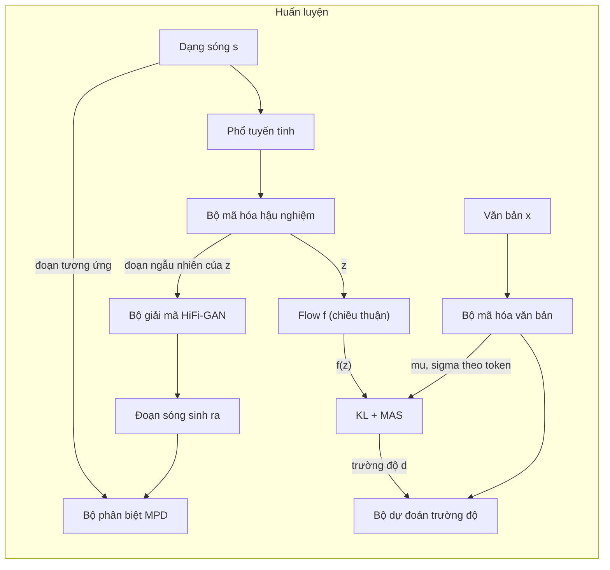

# Chương 27. VITS và họ end-to-end

!!! abstract "Mục tiêu học tập"
    Sau chương này, bạn có thể:

    - **Giải thích** vì sao hệ thống hai giai đoạn (mô hình âm học + vocoder) gặp giới hạn và VITS gộp chúng thành một mô hình huấn luyện một lần như thế nào.
    - **Suy ra** cận dưới ELBO của VITS như một VAE có điều kiện (CVAE) với prior được tăng cường bằng normalizing flow, và **viết ra** đúng số hạng KL mà mã nguồn chính thức tính.
    - **Phân biệt** rõ mô-đun nào hoạt động ở lúc huấn luyện, mô-đun nào ở lúc suy luận, và dữ liệu đi qua mô-đun theo chiều nào ($\mathbf{z} \to f_\theta(\mathbf{z})$ hay ngược lại).
    - **Trình bày** ý tưởng bộ dự đoán trường độ ngẫu nhiên (*stochastic duration predictor*): khử lượng tử hóa biến phân và tăng cường dữ liệu biến phân.
    - **Cài đặt** hàm mất mát KL, flow bảo toàn thể tích, ma trận log-likelihood cho MAS, cắt đoạn ngẫu nhiên và đường suy luận của VITS, kèm kiểm thử.
    - **So sánh** VITS với VITS2, JETS, NaturalSpeech, MB-iSTFT-VITS và Piper; **đánh giá** khi nào VITS là lựa chọn hợp lý cho tiếng Việt.

!!! info "Kiến thức cần có"
    - VAE, ELBO, thủ thuật tham số hóa lại, KL giữa hai phân phối Gauss: [Chương 8](../phan-2-mo-hinh-sinh/ch08-vae.md).
    - GAN, LSGAN, feature matching: [Chương 9](../phan-2-mo-hinh-sinh/ch09-gan.md).
    - Normalizing flow, affine coupling, đổi biến: [Chương 10](../phan-2-mo-hinh-sinh/ch10-normalizing-flows.md).
    - Monotonic Alignment Search (MAS): [Chương 21](../phan-5-mo-hinh-am-hoc/ch21-alignment.md); Glow-TTS: [Chương 23](../phan-5-mo-hinh-am-hoc/ch23-glow-grad-matcha.md).
    - HiFi-GAN (bộ sinh MRF, bộ phân biệt MPD/MSD): [Chương 25](../phan-6-vocoder/ch25-gan-vocoder.md).
    - Biểu diễn đầu vào, chèn token trống (*blank*): [Chương 18](../phan-4-frontend/ch18-g2p-bieu-dien-dau-vao.md).

## 27.1. Từ hai giai đoạn đến một giai đoạn

Ở Phần V và Phần VI, chúng ta đã xây một hệ thống TTS theo kiểu **hai giai đoạn**: mô hình âm học (Tacotron 2, FastSpeech 2, Glow-TTS…) sinh mel-spectrogram từ văn bản, rồi vocoder (HiFi-GAN…) biến mel thành dạng sóng. Cách chia này dễ huấn luyện vì mỗi mô hình giải một bài toán nhỏ hơn, nhưng nó để lại ba vấn đề:

1. **Lệch phân phối giữa hai giai đoạn.** Vocoder học trên mel thật nhưng lúc suy luận nhận mel *dự đoán*, vốn mờ hơn và có sai số hệ thống. Cách vá thông dụng là tinh chỉnh (*fine-tune*) vocoder trên mel sinh bằng teacher forcing (GTA, xem [Chương 25](../phan-6-vocoder/ch25-gan-vocoder.md)), tức là thêm một vòng huấn luyện nữa và phải huấn luyện tuần tự.
2. **Nút thắt do con người thiết kế.** Mel-spectrogram 80 kênh là một biểu diễn trung gian cố định. Nó bỏ đi pha và một phần chi tiết tần số cao; mô hình không được phép tự học một biểu diễn trung gian tốt hơn cho chính nhiệm vụ của mình.
3. **Sai số lan truyền.** Lỗi của giai đoạn một (mel quá trơn, sai cao độ) không thể được giai đoạn hai sửa, vì hai mô hình được tối ưu riêng rẽ.

Các mô hình end-to-end đầu tiên như FastSpeech 2s hay EATS đã sinh dạng sóng trực tiếp từ văn bản, nhưng chất lượng còn thua hệ thống hai giai đoạn tốt nhất. **VITS** (*Variational Inference with adversarial learning for end-to-end Text-to-Speech*; Kim và cộng sự, 2021) là mô hình end-to-end song song có ảnh hưởng lớn nhất trong giai đoạn này: theo đánh giá của chính bài báo, nó vượt các hệ thống hai giai đoạn công khai tốt nhất lúc đó (kể cả cặp Glow-TTS + HiFi-GAN đã tinh chỉnh), trong khi vẫn huấn luyện **một lần** và sinh **song song**. Theo báo cáo gốc, trên LJSpeech, VITS đạt MOS xấp xỉ 4,43 so với 4,46 của ghi âm thật; phép thử CMOS ở phụ lục cho thấy người nghe vẫn hơi nghiêng về ghi âm thật, nên không nên hiểu là "ngang con người" tuyệt đối.

Ý tưởng cốt lõi của VITS là ghép bốn mảnh ghép quen thuộc vào một khung xác suất duy nhất:

| Mảnh ghép | Vai trò trong VITS | Học ở chương |
|---|---|---|
| VAE có điều kiện (CVAE) | Biến ẩn $\mathbf{z}$ nối "phía văn bản" và "phía âm thanh" | [Chương 8](../phan-2-mo-hinh-sinh/ch08-vae.md) |
| Normalizing flow | Làm prior $p_\theta(\mathbf{z} \mid \mathbf{x})$ đủ linh hoạt | [Chương 10](../phan-2-mo-hinh-sinh/ch10-normalizing-flows.md) |
| MAS | Tìm căn chỉnh cứng token–khung, không cần bộ căn chỉnh ngoài | [Chương 21](../phan-5-mo-hinh-am-hoc/ch21-alignment.md) |
| GAN (HiFi-GAN) | Bộ giải mã $\mathbf{z} \to$ dạng sóng, huấn luyện đối kháng | [Chương 25](../phan-6-vocoder/ch25-gan-vocoder.md) |

Ngoài ra, VITS đề xuất **bộ dự đoán trường độ ngẫu nhiên** dựa trên flow để giải quyết bài toán một–nhiều về nhịp điệu: cùng một câu có thể được đọc nhanh, chậm, ngắt khác nhau.

### Sơ đồ tổng quát




Hãy để ý sự bất đối xứng: lúc huấn luyện, bộ mã hóa hậu nghiệm và bộ phân biệt là trung tâm; lúc suy luận, cả hai **biến mất**, và flow chạy theo **chiều ngược**. Phần lớn nhầm lẫn khi đọc mã VITS đến từ đây, nên chúng ta sẽ đi chậm.

!!! note "Về ký hiệu"
    Bài báo gốc dùng $x$ cho tiếng nói và $c$ cho văn bản. Chương này theo [bảng ký hiệu](../gioi-thieu/ky-hieu.md) của sách: $\mathbf{x} = (x_1, \ldots, x_N)$ là chuỗi token văn bản, $\mathbf{s}$ là dạng sóng, $\mathbf{S}$ là phổ biên độ tuyến tính (*linear spectrogram*), $\mathbf{Y}$ là log-mel-spectrogram, $\mathbf{z} = (\mathbf{z}_1, \ldots, \mathbf{z}_T) \in \mathbb{R}^{C \times T}$ là biến ẩn theo khung với $C$ kênh (VITS dùng $C = 192$), $\mathbf{A} \in \{0,1\}^{N \times T}$ là ma trận căn chỉnh cứng và $\mathbf{d}$ là trường độ.

## 27.2. VITS như một VAE có điều kiện

### 27.2.1. Trực giác

Hãy hình dung biến ẩn $\mathbf{z}$ là một "bản nháp âm thanh" theo từng khung: nó mang đủ thông tin để bộ giải mã dựng lại dạng sóng, nhưng được ép phải gần với những gì có thể dự đoán từ văn bản. Có hai cách để tạo ra $\mathbf{z}$:

- **Từ âm thanh thật** (bộ mã hóa hậu nghiệm): nhìn phổ của câu nói thật, nén thành $\mathbf{z}$. Cách này chỉ có ở lúc huấn luyện, và cho phép bộ giải mã học dựng sóng chất lượng cao.
- **Từ văn bản** (prior): chỉ nhìn văn bản, dự đoán một phân phối trên $\mathbf{z}$. Đây là cách duy nhất có ở lúc suy luận.

Số hạng KL trong ELBO kéo hai cách này lại gần nhau. Nếu kéo thành công, ta có thể lấy mẫu $\mathbf{z}$ từ prior lúc suy luận và bộ giải mã vẫn "nhận ra" nó như một $\mathbf{z}$ đến từ âm thanh thật. Đây chính là lời giải cho vấn đề lệch phân phối giữa hai giai đoạn: thay vì mel cố định, ranh giới giữa hai nửa là một biến ẩn **được học**, và hai nửa được tối ưu đồng thời.

### 27.2.2. Hình thức hóa: cận dưới ELBO có điều kiện

Ta muốn cực đại hóa log-likelihood có điều kiện $\log p_\theta(\mathbf{s} \mid \mathbf{x})$. Đưa vào biến ẩn $\mathbf{z}$ và giả định rằng, **khi biết $\mathbf{z}$, tiếng nói không còn phụ thuộc văn bản** (bộ giải mã không nhìn văn bản):

$$
p_\theta(\mathbf{s} \mid \mathbf{x}) = \int p_\theta(\mathbf{s} \mid \mathbf{z})\, p_\theta(\mathbf{z} \mid \mathbf{x})\, d\mathbf{z}.
$$

Tích phân này không tính được. Nhân và chia cho một phân phối xấp xỉ $q_\phi(\mathbf{z} \mid \mathbf{s})$ rồi áp dụng bất đẳng thức Jensen cho hàm lõm $\log$:

$$
\log p_\theta(\mathbf{s} \mid \mathbf{x})
= \log \mathbb{E}_{q_\phi(\mathbf{z} \mid \mathbf{s})}\!\left[\frac{p_\theta(\mathbf{s} \mid \mathbf{z})\, p_\theta(\mathbf{z} \mid \mathbf{x})}{q_\phi(\mathbf{z} \mid \mathbf{s})}\right]
\ge \mathbb{E}_{q_\phi(\mathbf{z} \mid \mathbf{s})}\!\left[\log p_\theta(\mathbf{s} \mid \mathbf{z}) - \log \frac{q_\phi(\mathbf{z} \mid \mathbf{s})}{p_\theta(\mathbf{z} \mid \mathbf{x})}\right].
$$

Vế phải là ELBO. Số hạng thứ hai, lấy kỳ vọng, chính là $D_{\mathrm{KL}}\big(q_\phi(\mathbf{z} \mid \mathbf{s}) \,\Vert\, p_\theta(\mathbf{z} \mid \mathbf{x})\big)$. Như đã chứng minh ở [Chương 8](../phan-2-mo-hinh-sinh/ch08-vae.md), khoảng cách giữa hai vế bằng $D_{\mathrm{KL}}\big(q_\phi(\mathbf{z} \mid \mathbf{s}) \,\Vert\, p_\theta(\mathbf{z} \mid \mathbf{s}, \mathbf{x})\big)$, tức là cận càng chặt khi bộ mã hóa hậu nghiệm càng gần hậu nghiệm thật. Hàm mất mát là âm ELBO, gồm hai phần:

$$
\mathcal{L}_{\text{vae}} = \underbrace{-\log p_\theta(\mathbf{s} \mid \mathbf{z})}_{\text{tái tạo}} + \underbrace{\log q_\phi(\mathbf{z} \mid \mathbf{s}) - \log p_\theta(\mathbf{z} \mid \mathbf{x}, \mathbf{A})}_{\text{KL (một mẫu)}}, \qquad \mathbf{z} \sim q_\phi(\mathbf{z} \mid \mathbf{s}).
$$

Có ba điểm khác với VAE "sách giáo khoa":

- **Prior có điều kiện và có flow.** Prior không còn là $\mathcal{N}(\mathbf{0}, \mathbf{I})$ mà phụ thuộc văn bản và căn chỉnh $\mathbf{A}$, lại được biến đổi qua một normalizing flow (Mục 27.3).
- **Căn chỉnh $\mathbf{A}$ không được lấy tích phân.** $\mathbf{A}$ là một phần của điều kiện, được chọn bằng cách *cực đại* ELBO (Mục 27.4), giống tinh thần huấn luyện Viterbi hay EM cứng, chứ không lấy tổng trên mọi căn chỉnh.
- **Bộ mã hóa hậu nghiệm nhìn phổ tuyến tính**, không nhìn mel. $\mathbf{S}$ là hàm tất định của $\mathbf{s}$ nên việc viết $q_\phi(\mathbf{z} \mid \mathbf{S})$ thay cho $q_\phi(\mathbf{z} \mid \mathbf{s})$ không vi phạm khung biến phân. Lý do chọn phổ tuyến tính (513 bin với $N_{\text{FFT}} = 1024$) là để cung cấp thông tin độ phân giải cao hơn; ablation trong bài báo gốc cho thấy thay bằng mel làm MOS giảm khoảng 0,19.

### 27.2.3. Mất mát tái tạo: L1 trên mel như một likelihood Laplace

Bộ giải mã $G$ sinh dạng sóng $\hat{\mathbf{s}} = G(\mathbf{z})$. VITS không đo likelihood trực tiếp trên dạng sóng mà biến $\hat{\mathbf{s}}$ thành mel $\hat{\mathbf{Y}}$ bằng STFT và bộ lọc mel (không có tham số học), rồi giả định mỗi phần tử mel thật phân phối Laplace quanh giá trị dự đoán:

$$
p_\theta(\mathbf{Y} \mid \mathbf{z}) = \prod_{t,f} \frac{1}{2b} \exp\!\left(-\frac{|Y_{t,f} - \hat{Y}_{t,f}|}{b}\right)
\;\Rightarrow\;
-\log p_\theta(\mathbf{Y} \mid \mathbf{z}) = \frac{1}{b}\lVert \mathbf{Y} - \hat{\mathbf{Y}} \rVert_1 + \text{hằng số}.
$$

Như vậy L1 trên mel chính là cực đại likelihood dưới giả định Laplace (liên hệ L1 ↔ Laplace đã gặp ở [Chương 1](../phan-1-nen-tang/ch01-toan-nen-tang.md)). Chọn miền mel vì nó gần với cảm nhận thính giác. Trong mã chính thức, L1 được lấy **trung bình** trên mọi phần tử mel và nhân hệ số $c_{\text{mel}} = 45$ (kế thừa từ HiFi-GAN); bạn có thể đọc hệ số này như $1/b$, tức là một lựa chọn về "độ tin" của likelihood, và nó quyết định cán cân giữa tái tạo với KL.

!!! warning "Mất mát tái tạo chỉ trên một đoạn"
    Bộ giải mã HiFi-GAN quá nặng để chạy trên toàn bộ $\mathbf{z}$ của cả batch. VITS chỉ giải mã một **đoạn ngẫu nhiên** dài 32 khung (8192 mẫu với $H = 256$) của mỗi câu, và mất mát tái tạo chỉ tính trên đoạn đó (*windowed generator training*, Mục 27.6). Có thể xem đây là một ước lượng ngẫu nhiên (xấp xỉ, sai khác một hệ số tỉ lệ) của mất mát trên toàn câu; các khung sát hai đầu câu được chọn ít hơn một chút vì đoạn cắt phải nằm trọn trong câu.

## 27.3. Prior có flow và số hạng KL

### 27.3.1. Vì sao prior Gauss đơn giản là không đủ

Bộ mã hóa văn bản (Transformer với mã hóa vị trí tương đối) sinh ra, cho mỗi token $i$, một trung bình $\boldsymbol{\mu}_i \in \mathbb{R}^C$ và độ lệch chuẩn $\boldsymbol{\sigma}_i \in \mathbb{R}^C$. Sau khi có căn chỉnh $\mathbf{A}$, mỗi khung $t$ được gán cho token $a(t)$, và một prior "ngây thơ" sẽ là

$$
p(\mathbf{z} \mid \mathbf{x}, \mathbf{A}) = \prod_{t=1}^{T} \mathcal{N}\big(\mathbf{z}_t;\, \boldsymbol{\mu}_{a(t)},\, \operatorname{diag}(\boldsymbol{\sigma}_{a(t)}^2)\big).
$$

Prior này nói rằng mọi khung thuộc cùng một token có **cùng** phân phối và **độc lập** với nhau. Nhưng $\mathbf{z}$ từ âm thanh thật thì thay đổi liên tục bên trong một âm vị (chuyển tiếp formant, đường nét cao độ, nhất là thanh điệu tiếng Việt vốn là một *đường cong* F0 trải trên cả vần). Ép một hậu nghiệm giàu cấu trúc như vậy về một prior "bậc thang" sẽ buộc $\mathbf{z}$ phải nghèo thông tin, và bộ giải mã nhận một $\mathbf{z}$ nghèo nàn thì sinh âm thanh kém.

Lời giải của VITS: đặt một normalizing flow $f_\theta$ (khả nghịch) giữa $\mathbf{z}$ và prior Gauss. Theo công thức đổi biến ([Chương 10](../phan-2-mo-hinh-sinh/ch10-normalizing-flows.md)):

$$
p_\theta(\mathbf{z} \mid \mathbf{x}, \mathbf{A}) = \mathcal{N}\big(f_\theta(\mathbf{z});\, \boldsymbol{\mu}_\theta(\mathbf{x}, \mathbf{A}),\, \boldsymbol{\sigma}_\theta(\mathbf{x}, \mathbf{A})\big)\,\left|\det \frac{\partial f_\theta(\mathbf{z})}{\partial \mathbf{z}}\right|.
$$

Nói cách khác, flow "gỡ" bớt sự phức tạp của $\mathbf{z}$: sau khi đi qua $f_\theta$, các khung trong cùng một token mới cần trông giống nhau. Flow gồm các lớp affine coupling với mạng con là khối WaveNet không nhân quả, nên có trường tiếp nhận theo thời gian và mô hình hóa được tương quan giữa các khung kề nhau. Ablation trong bài báo gốc cho thấy bỏ flow khỏi prior làm MOS tụt khoảng 1,52 điểm, mức giảm lớn nhất trong các thí nghiệm ablation của bài. Đây là bằng chứng rõ nhất cho nhận định "độ linh hoạt của prior quyết định chất lượng".

### 27.3.2. Flow bảo toàn thể tích

VITS chọn một thiết kế đơn giản: mỗi lớp coupling chỉ **dịch** (*mean-only*), không co giãn. Chia kênh của $\mathbf{z}$ thành hai nửa $(\mathbf{z}^a, \mathbf{z}^b)$:

$$
\tilde{\mathbf{z}}^a = \mathbf{z}^a, \qquad \tilde{\mathbf{z}}^b = \mathbf{z}^b + m_\theta(\mathbf{z}^a).
$$

Jacobian là ma trận tam giác khối với đường chéo toàn số 1, nên $\log|\det J| = 0$ (*volume-preserving*). Giữa các lớp coupling có một phép đảo thứ tự kênh (`Flip`) để nửa kia cũng được biến đổi. Cấu hình gốc dùng 4 lớp coupling, mỗi lớp có 4 khối WaveNet. Phép nghịch đảo tầm thường: $\mathbf{z}^b = \tilde{\mathbf{z}}^b - m_\theta(\tilde{\mathbf{z}}^a)$.

Một chi tiết cài đặt quan trọng: lớp chiếu cuối của $m_\theta$ được **khởi tạo bằng 0**, nên lúc bắt đầu huấn luyện flow là ánh xạ đồng nhất và VITS khởi đầu như một CVAE với prior Gauss thường. Mã dưới đây cài đặt flow này và kiểm tra hai tính chất: khả nghịch và $\log|\det J| = 0$.

```python
import torch
import torch.nn as nn

class MeanOnlyCoupling(nn.Module):
    """Coupling bảo toàn thể tích (mean_only) như trong flow của prior VITS."""
    def __init__(self, channels, hidden=32, kernel_size=5):
        super().__init__()
        self.half = channels // 2
        self.net = nn.Sequential(
            nn.Conv1d(self.half, hidden, kernel_size, padding=kernel_size // 2), nn.GELU(),
            nn.Conv1d(hidden, channels - self.half, kernel_size, padding=kernel_size // 2))
        # Khởi tạo lớp cuối bằng 0 -> flow ban đầu là ánh xạ đồng nhất (giống mã gốc)
        nn.init.zeros_(self.net[-1].weight)
        nn.init.zeros_(self.net[-1].bias)

    def forward(self, z, mask, reverse=False):          # z: (B, C, T), mask: (B, 1, T)
        za, zb = z[:, :self.half], z[:, self.half:]
        shift = self.net(za * mask) * mask               # chỉ dịch, không co giãn
        zb = zb - shift if reverse else zb + shift       # => log|det J| = 0
        return torch.cat([za, zb], dim=1) * mask

class Flip(nn.Module):
    def forward(self, z, mask, reverse=False):
        return torch.flip(z, dims=[1])                   # đảo kênh để nửa kia cũng được biến đổi

class PriorFlow(nn.Module):
    def __init__(self, channels, n_flows=4):
        super().__init__()
        self.layers = nn.ModuleList()
        for _ in range(n_flows):
            self.layers.extend([MeanOnlyCoupling(channels), Flip()])

    def forward(self, z, mask, reverse=False):
        layers = reversed(self.layers) if reverse else self.layers
        for layer in layers:
            z = layer(z, mask, reverse=reverse)
        return z

torch.manual_seed(0)
flow = PriorFlow(channels=4)
for p in flow.parameters():                              # phá khởi tạo 0 để kiểm thử thật sự
    nn.init.normal_(p, std=0.3)
B, C, T = 2, 4, 7
mask = torch.ones(B, 1, T)
z = torch.randn(B, C, T) * mask
z_p = flow(z, mask)                                      # huấn luyện: z -> z_p = f(z)
z_back = flow(z_p, mask, reverse=True)                   # suy luận:  z_p -> z = f^{-1}(z_p)
assert torch.allclose(z, z_back, atol=1e-5)

# Kiểm tra det J = 1 bằng Jacobian số trên một câu nhỏ
m1 = torch.ones(1, 1, 3)
fn = lambda v: flow(v.view(1, C, 3), m1).flatten()
J = torch.autograd.functional.jacobian(fn, torch.randn(C * 3))   # (12, 12)
logdet = torch.linalg.slogdet(J).logabsdet
print("log|det J| =", float(logdet))
assert abs(float(logdet)) < 1e-4
```

Vì sao bảo toàn thể tích là đủ? Mục tiêu của flow ở đây không phải là biến một phân phối phức tạp thành $\mathcal{N}(\mathbf{0}, \mathbf{I})$ như trong Glow, vì phần "co giãn" đã có $\boldsymbol{\sigma}_\theta$ của bộ mã hóa văn bản đảm nhận. Flow chỉ cần *bẻ cong* không gian để hậu nghiệm khớp với prior bậc thang. Bài báo gốc nói rõ đây là lựa chọn "cho đơn giản", và nó có thêm một lợi ích thực tế: không có số hạng co giãn nên không có nguy cơ $\exp(\cdot)$ của hệ số co giãn bùng nổ khi huấn luyện fp16. VITS2 (Mục 27.9) cải tiến flow theo hướng khác: tăng sức biểu diễn của mạng con bằng khối Transformer.

### 27.3.3. Suy ra số hạng KL như mã chính thức tính

Đây là phần dễ nhầm nhất. Ta sẽ đi từng bước từ định nghĩa đến đúng dòng mã.

**Bước 1: log hậu nghiệm.** Bộ mã hóa hậu nghiệm cho $q_\phi(\mathbf{z} \mid \mathbf{S}) = \prod_{c,t} \mathcal{N}(z_{c,t};\, \mu^{q}_{c,t}, (\sigma^{q}_{c,t})^2)$. Lấy mẫu bằng tham số hóa lại $z_{c,t} = \mu^{q}_{c,t} + \sigma^{q}_{c,t}\,\epsilon_{c,t}$ với $\epsilon_{c,t} \sim \mathcal{N}(0, 1)$. Khi đó

$$
\log q_\phi(\mathbf{z} \mid \mathbf{S}) = \sum_{c,t}\Big[-\log \sigma^{q}_{c,t} - \tfrac{1}{2}\log 2\pi - \tfrac{1}{2}\epsilon_{c,t}^2\Big].
$$

**Bước 2: log prior.** Đặt $\tilde{\mathbf{z}} = f_\theta(\mathbf{z})$ (trong mã gọi là `z_p`) và gọi $\mu^{p}_{c,t}, \sigma^{p}_{c,t}$ là tham số prior của token $a(t)$ đã được "mở rộng" theo căn chỉnh. Từ công thức đổi biến:

$$
\log p_\theta(\mathbf{z} \mid \mathbf{x}, \mathbf{A}) = \sum_{c,t}\Big[-\log \sigma^{p}_{c,t} - \tfrac{1}{2}\log 2\pi - \frac{(\tilde{z}_{c,t} - \mu^{p}_{c,t})^2}{2(\sigma^{p}_{c,t})^2}\Big] + \log\left|\det \frac{\partial f_\theta}{\partial \mathbf{z}}\right|.
$$

**Bước 3: lấy hiệu.** Hằng số $\log 2\pi$ triệt tiêu:

$$
\log q_\phi - \log p_\theta = \sum_{c,t}\Big[\log \sigma^{p}_{c,t} - \log \sigma^{q}_{c,t} - \tfrac{1}{2}\epsilon_{c,t}^2 + \frac{(\tilde{z}_{c,t} - \mu^{p}_{c,t})^2}{2(\sigma^{p}_{c,t})^2}\Big] - \log\left|\det \frac{\partial f_\theta}{\partial \mathbf{z}}\right|.
$$

**Bước 4: thay phần entropy bằng giá trị giải tích.** Số hạng $-\tfrac{1}{2}\epsilon^2$ chỉ phụ thuộc nhiễu, và $\mathbb{E}[\epsilon^2] = 1$. Thay nó bằng kỳ vọng $-\tfrac{1}{2}$ nghĩa là tính **chính xác** phần $\mathbb{E}_q[\log q] = -H(q)$ (âm entropy của Gauss), và chỉ dùng Monte Carlo một mẫu cho phần entropy chéo $-\mathbb{E}_q[\log p]$. Ước lượng thu được vẫn **không chệch** cho KL.

**Bước 5: flow bảo toàn thể tích.** Với coupling chỉ dịch, $\log|\det J| = 0$. Ta được đúng công thức trong hàm `kl_loss` của mã chính thức:

$$
\hat{\mathcal{L}}_{\text{kl}} = \frac{1}{\sum_t m_t}\sum_{t} m_t \sum_{c=1}^{C}\Big[\log \sigma^{p}_{c,t} - \log \sigma^{q}_{c,t} - \tfrac{1}{2} + \tfrac{1}{2}(\tilde{z}_{c,t} - \mu^{p}_{c,t})^2 (\sigma^{p}_{c,t})^{-2}\Big],
$$

trong đó $m_t \in \{0, 1\}$ là mặt nạ khung hợp lệ. Chú ý mẫu số: tổng của mặt nạ có hình dạng `(B, 1, T)`, tức là **số khung** chứ không phải số phần tử $C \times T$. Vậy KL được **cộng theo 192 kênh** rồi **lấy trung bình theo khung**. Nếu bạn tự viết lại và lỡ chia cho $C \cdot T$, KL sẽ nhỏ đi 192 lần so với mất mát mel và cán cân của ELBO thay đổi hoàn toàn.

Mã dưới đây cài đặt đúng công thức trên và kiểm chứng tính không chệch: khi $f$ là ánh xạ đồng nhất, trung bình của ước lượng qua nhiều mẫu phải khớp với KL giải tích giữa hai Gauss.

```python
import torch

def kl_loss(z_p, logs_q, m_p, logs_p, z_mask):
    """Số hạng KL của VITS, đúng như cách mã chính thức tính.
    z_p    : f_theta(z) với z lấy mẫu từ hậu nghiệm   # (B, C, T)
    logs_q : log sigma của hậu nghiệm q(z|S)         # (B, C, T)
    m_p    : trung bình prior đã mở rộng theo A      # (B, C, T)
    logs_p : log sigma prior đã mở rộng theo A       # (B, C, T)
    z_mask : mặt nạ khung hợp lệ                     # (B, 1, T)
    """
    z_p, logs_q, m_p, logs_p, z_mask = (t.float() for t in (z_p, logs_q, m_p, logs_p, z_mask))
    kl = logs_p - logs_q - 0.5                                   # -0.5 = E[-eps^2/2]
    kl = kl + 0.5 * (z_p - m_p) ** 2 * torch.exp(-2.0 * logs_p)  # số hạng entropy chéo (MC)
    return torch.sum(kl * z_mask) / torch.sum(z_mask)            # chia cho số KHUNG hợp lệ

def kl_closed_form(m_q, logs_q, m_p, logs_p, z_mask):
    """KL giải tích giữa hai Gauss chéo (chỉ đúng khi f là ánh xạ đồng nhất)."""
    kl = logs_p - logs_q - 0.5 + 0.5 * (torch.exp(2 * logs_q) + (m_q - m_p) ** 2) * torch.exp(-2 * logs_p)
    return torch.sum(kl * z_mask) / torch.sum(z_mask)

torch.manual_seed(0)
B, C, T, S = 2, 4, 6, 4000                       # S: số mẫu Monte Carlo
m_q, logs_q = torch.randn(B, C, T), 0.3 * torch.randn(B, C, T)
m_p, logs_p = torch.randn(B, C, T), 0.3 * torch.randn(B, C, T)
z_mask = torch.ones(B, 1, T)
z_mask[1, :, 4:] = 0                             # câu thứ hai chỉ dài 4 khung

est = []
for _ in range(S):
    z = m_q + torch.exp(logs_q) * torch.randn(B, C, T)   # tham số hóa lại
    est.append(kl_loss(z, logs_q, m_p, logs_p, z_mask))  # f = id nên z_p = z
est = torch.stack(est)
ref = kl_closed_form(m_q, logs_q, m_p, logs_p, z_mask)
se = est.std() / S ** 0.5                                # sai số chuẩn của trung bình
print(f"MC: {est.mean():.4f} ± {se:.4f} | dạng đóng: {ref:.4f}")
assert abs(est.mean() - ref) < 4 * se                    # ước lượng không chệch
```

!!! tip "Gradient của KL đi đâu?"
    Số hạng KL nhận gradient theo **ba** hướng cùng lúc: (1) về bộ mã hóa hậu nghiệm qua `logs_q` và qua `z` (nhờ tham số hóa lại); (2) về flow qua `z_p`; (3) về bộ mã hóa văn bản qua `m_p`, `logs_p`. Riêng ma trận căn chỉnh $\mathbf{A}$ dùng để mở rộng `m_p`, `logs_p` thì được tính dưới `torch.no_grad()` nên không có gradient. Nhờ vậy, KL vừa kéo prior về phía hậu nghiệm, vừa kéo hậu nghiệm về phía những gì văn bản dự đoán được. Đây là cơ chế "điều chuẩn" khiến $\mathbf{z}$ không mang quá nhiều thông tin mà văn bản không thể đoán.

!!! note "Nếu flow không bảo toàn thể tích"
    Với một flow affine đầy đủ (có co giãn $\exp(\mathbf{s}_\theta)$), bạn phải trừ thêm $\log|\det J| = \sum \mathbf{s}_\theta$ khỏi `kl` trước khi lấy tổng. Quên số hạng này là một lỗi kinh điển khi "nâng cấp" flow của VITS: mô hình sẽ học cách phình co giãn để làm KL nhỏ đi một cách giả tạo (xem Bài tập 3).

## 27.4. Căn chỉnh bằng MAS trong không gian ẩn

### 27.4.1. Từ ELBO đến bài toán MAS

Glow-TTS ([Chương 23](../phan-5-mo-hinh-am-hoc/ch23-glow-grad-matcha.md)) tìm căn chỉnh cực đại log-likelihood chính xác của mel. VITS không có likelihood chính xác mà chỉ có ELBO, nên câu hỏi là: căn chỉnh nào cực đại ELBO? Viết ELBO một mẫu như một hàm của $\hat{\mathbf{A}}$:

$$
\log p_\theta(\mathbf{Y} \mid \mathbf{z}) - \log q_\phi(\mathbf{z} \mid \mathbf{S}) + \log p_\theta(\mathbf{z} \mid \mathbf{x}, \hat{\mathbf{A}}).
$$

Hai số hạng đầu **không phụ thuộc** $\hat{\mathbf{A}}$ (bộ giải mã và hậu nghiệm không nhìn văn bản). Trong số hạng cuối, Jacobian của flow cũng không phụ thuộc $\hat{\mathbf{A}}$. Vậy

$$
\arg\max_{\hat{\mathbf{A}}} \text{ELBO} = \arg\max_{\hat{\mathbf{A}}} \sum_{t=1}^{T} \log \mathcal{N}\big(\tilde{\mathbf{z}}_t;\, \boldsymbol{\mu}_{a(t)},\, \boldsymbol{\sigma}_{a(t)}\big), \qquad \tilde{\mathbf{z}} = f_\theta(\mathbf{z}).
$$

Đây đúng là bài toán của Glow-TTS, chỉ thay mel đã qua flow bằng $\tilde{\mathbf{z}}$. Ràng buộc đơn điệu và không nhảy cóc giữ nguyên, nên ta dùng lại nguyên thuật toán quy hoạch động MAS mà [Chương 21](../phan-5-mo-hinh-am-hoc/ch21-alignment.md) đã dẫn xuất, với độ phức tạp $O(NT)$.

### 27.4.2. Tính ma trận log-likelihood hiệu quả

MAS cần ma trận $P_{t,i} = \sum_{c} \log \mathcal{N}(\tilde{z}_{c,t}; \mu_{c,i}, \sigma_{c,i})$ cho mọi cặp khung–token. Tính ngây thơ bằng broadcast tạo ra tensor $(B, C, T, N)$, với $C = 192$, $T$ vài trăm, $N$ vài trăm, tốn rất nhiều bộ nhớ. VITS khai triển bình phương:

$$
P_{t,i} = \underbrace{\sum_c \big(-\tfrac{1}{2}\log 2\pi - \log\sigma_{c,i}\big)}_{\text{chỉ phụ thuộc } i}
\;\underbrace{-\tfrac{1}{2}\sum_c \tilde{z}_{c,t}^2\, \sigma_{c,i}^{-2}}_{\text{tích ma trận}}
\;+\underbrace{\sum_c \tilde{z}_{c,t}\, \mu_{c,i}\, \sigma_{c,i}^{-2}}_{\text{tích ma trận}}
\;\underbrace{-\tfrac{1}{2}\sum_c \mu_{c,i}^2\, \sigma_{c,i}^{-2}}_{\text{chỉ phụ thuộc } i}.
$$

Hai số hạng giữa là phép nhân ma trận $(T \times C)(C \times N)$, chạy rất nhanh trên GPU và chỉ cần bộ nhớ $(B, T, N)$. Mã dưới đây cài đặt khai triển này, so sánh với cách tính ngây thơ, rồi chạy MAS (bản rút gọn của Chương 21) trên một ví dụ tổng hợp mà ta biết trước trường độ đúng.

```python
import math
import numpy as np
import torch

def log_likelihood_matrix(z_p, m_p, logs_p):
    """P[b, t, i] = sum_c log N(z_p[b,c,t]; m_p[b,c,i], exp(logs_p[b,c,i])^2), khai triển như VITS.
    z_p: (B, C, T) ; m_p, logs_p: (B, C, N)  ->  (B, T, N)"""
    s_p_sq_r = torch.exp(-2.0 * logs_p)                                          # 1/sigma^2, (B, C, N)
    t1 = torch.sum(-0.5 * math.log(2 * math.pi) - logs_p, dim=1, keepdim=True)  # (B, 1, N)
    t2 = torch.matmul(-0.5 * (z_p ** 2).transpose(1, 2), s_p_sq_r)              # (B, T, N)
    t3 = torch.matmul(z_p.transpose(1, 2), m_p * s_p_sq_r)                       # (B, T, N)
    t4 = torch.sum(-0.5 * m_p ** 2 * s_p_sq_r, dim=1, keepdim=True)              # (B, 1, N)
    return t1 + t2 + t3 + t4

def mas(logp):
    """MAS cho một câu (bản rút gọn; dẫn xuất ở Chương 21). logp: (N, T) -> A: (N, T)."""
    N, T = logp.shape
    Q = np.full((N, T), -np.inf)
    Q[0, 0] = logp[0, 0]
    for j in range(1, T):
        move = np.concatenate([[-np.inf], Q[:-1, j - 1]])      # đến từ token i-1
        Q[:, j] = np.maximum(Q[:, j - 1], move) + logp[:, j]   # hoặc ở lại token i
    A, i = np.zeros((N, T)), N - 1
    for j in range(T - 1, -1, -1):                              # truy vết ngược
        A[i, j] = 1
        if i > 0 and (i == j or Q[i, j - 1] < Q[i - 1, j - 1]):
            i -= 1
    return A

torch.manual_seed(0)
C, N = 8, 5
d_true = torch.tensor([3, 1, 4, 2, 5])                        # trường độ thật (khung)
T = int(d_true.sum())
m_p = 2.0 * torch.randn(1, C, N)                              # mỗi token một "tâm" riêng
logs_p = torch.full((1, C, N), -1.0)
token_of_frame = torch.repeat_interleave(torch.arange(N), d_true)            # (T,)
z_p = m_p[:, :, token_of_frame] + 0.3 * torch.randn(1, C, T)                 # (1, C, T)

with torch.no_grad():                                         # MAS không nhận gradient
    P = log_likelihood_matrix(z_p, m_p, logs_p)               # (1, T, N)
naive = torch.distributions.Normal(m_p[:, :, None, :], logs_p.exp()[:, :, None, :]) \
    .log_prob(z_p[:, :, :, None]).sum(1)                      # (1, T, N), tốn bộ nhớ hơn
assert torch.allclose(P, naive, atol=1e-4)

A = torch.from_numpy(mas(P[0].T.numpy())).float()[None]       # (1, N, T)
d_hat = A.sum(-1)                                             # trường độ = tổng theo hàng
print("trường độ tìm được:", d_hat.long().tolist())
assert torch.equal(d_hat[0].long(), d_true)
assert torch.all(A.sum(1) == 1)                               # mỗi khung thuộc đúng một token
m_p_exp = torch.bmm(m_p, A)                                   # (1, C, N) x (1, N, T) -> (1, C, T)
assert m_p_exp.shape == (1, C, T)
```

Trong mã thật, MAS được viết bằng Cython (hoặc Numba) và chạy song song trên batch; phần quy hoạch động không có gradient. Sau khi có $\mathbf{A}$, trường độ của token $i$ là $d_i = \sum_t A_{i,t}$, và tham số prior được mở rộng bằng phép nhân ma trận $\boldsymbol{\mu}_\theta \mathbf{A}$ như dòng cuối của mã.

!!! tip "MAS và token trống"
    VITS chèn một token trống (*blank*, chỉ số 0) giữa mọi cặp ký hiệu, giống Glow-TTS (cờ `add_blank`). Token trống cho MAS một chỗ để "gửi" các khung chuyển tiếp giữa hai âm vị, nhờ đó căn chỉnh ổn định hơn, đổi lại chuỗi văn bản dài gần gấp đôi. Nếu bật `add_blank` khi huấn luyện, **bắt buộc** phải bật y hệt khi suy luận; đây là lỗi rất hay gặp khi tự viết mã suy luận. VITS2 cho thấy có thể bỏ token trống khi các thành phần khác được cải tiến (Mục 27.9).

## 27.5. Bộ dự đoán trường độ ngẫu nhiên

### 27.5.1. Vì sao trường độ cần là ngẫu nhiên

Lúc suy luận không có âm thanh, nên không có MAS; ta cần dự đoán $\mathbf{d}$ từ văn bản. Cách của Glow-TTS và FastSpeech là hồi quy tất định log-trường độ bằng MSE (VITS gọi biến thể này là *DDP*, *deterministic duration predictor*). Nhưng nhịp điệu là một hiện tượng một–nhiều: hồi quy MSE cho ra "trung bình có điều kiện", nên mọi lần đọc đều cùng độ dài và cùng nhịp. Bài báo gốc minh họa bằng cách tổng hợp 100 lần một câu: Glow-TTS cho đúng một độ dài, còn VITS cho một phân phối độ dài giống Tacotron 2.

Mô hình hóa phân phối $p_\theta(\mathbf{d} \mid \mathbf{x})$ bằng một flow gặp hai trở ngại:

1. **$d_i$ là số nguyên.** Flow liên tục đặt mật độ lên $\mathbb{R}$; cực đại mật độ tại các điểm nguyên rời rạc là bài toán suy biến (mô hình có thể đẩy mật độ về vô cùng).
2. **$d_i$ là một vô hướng.** Coupling cần ít nhất hai chiều để chia đôi; một chuỗi vô hướng không đủ "chỗ" cho các phép biến đổi khả nghịch giàu biểu diễn.

### 27.5.2. Khử lượng tử hóa biến phân và tăng cường dữ liệu biến phân

VITS giải hai trở ngại bằng hai biến phụ có cùng độ dài $N$ với $\mathbf{d}$:

- $\mathbf{u} \in [0, 1)^N$ cho **khử lượng tử hóa biến phân** (*variational dequantization*, Ho và cộng sự, 2019): thay vì mô hình $\mathbf{d}$, mô hình $\mathbf{d} - \mathbf{u}$, một chuỗi số thực dương.
- $\boldsymbol{\nu} \in \mathbb{R}^N$ cho **tăng cường dữ liệu biến phân** (*variational data augmentation*, Chen và cộng sự, 2020): ghép $\boldsymbol{\nu}$ theo kênh với $\mathbf{d} - \mathbf{u}$ để có biểu diễn hai kênh.

Gọi $p_\theta(\mathbf{d} - \mathbf{u}, \boldsymbol{\nu} \mid \mathbf{x})$ là mật độ liên tục do flow định nghĩa. Xác suất rời rạc của $\mathbf{d}$ được định nghĩa bằng cách "lấy tích phân trên ô đơn vị" và lấy biên theo $\boldsymbol{\nu}$:

$$
P_\theta(\mathbf{d} \mid \mathbf{x}) = \int_{[0,1)^N}\!\int p_\theta(\mathbf{d} - \mathbf{u}, \boldsymbol{\nu} \mid \mathbf{x})\, d\boldsymbol{\nu}\, d\mathbf{u}.
$$

Các ô $\{\mathbf{d} - \mathbf{u} : \mathbf{u} \in [0,1)^N\}$ với $\mathbf{d}$ nguyên không chồng lên nhau, nên đây là một phân phối rời rạc hợp lệ. Đưa vào một hậu nghiệm xấp xỉ $q_\phi(\mathbf{u}, \boldsymbol{\nu} \mid \mathbf{d}, \mathbf{x})$ và lặp lại lập luận Jensen như ở Mục 27.2.2:

$$
\log P_\theta(\mathbf{d} \mid \mathbf{x}) \ge \mathbb{E}_{q_\phi(\mathbf{u}, \boldsymbol{\nu} \mid \mathbf{d}, \mathbf{x})}\Big[\log p_\theta(\mathbf{d} - \mathbf{u}, \boldsymbol{\nu} \mid \mathbf{x}) - \log q_\phi(\mathbf{u}, \boldsymbol{\nu} \mid \mathbf{d}, \mathbf{x})\Big].
$$

Hàm mất mát trường độ $\mathcal{L}_{\text{dur}}$ là âm của cận này. Trong cài đặt:

- $q_\phi$ là một flow nhỏ biến nhiễu Gauss hai kênh thành $(\mathbf{z}_u, \boldsymbol{\nu})$ (có điều kiện theo $\mathbf{d}$ và văn bản), rồi $\mathbf{u} = \operatorname{sigmoid}(\mathbf{z}_u)$ để ép vào $(0, 1)$. Log-mật độ $\log q_\phi$ gồm log-mật độ Gauss của nhiễu trừ log-định thức Jacobian của flow và của hàm sigmoid ($\log\sigma(z) + \log\sigma(-z)$ cho mỗi phần tử).
- $p_\theta$ là flow chính. Trước khi vào các lớp coupling, kênh trường độ được lấy log: flow thực chất mô hình hóa $\log(\mathbf{d} - \mathbf{u})$, và Jacobian của phép log đóng góp $-\sum_i \log(d_i - u_i)$ vào log-định thức.
- Các lớp coupling dùng **neural spline flow** (spline hữu tỷ bậc hai đơn điệu; Durkan và cộng sự, 2019) thay cho affine, với khối tích chập giãn nở tách sâu (*DDSConv*) để tiết kiệm tham số mà vẫn có trường tiếp nhận rộng.
- Đầu vào điều kiện $\mathbf{h}^{\text{text}}$ được **chặn gradient** (*stop-gradient*, trong mã là `torch.detach`): huấn luyện bộ dự đoán trường độ không được làm ảnh hưởng đến bộ mã hóa văn bản. Lý do: trường độ chỉ là "khách hàng" của biểu diễn văn bản; nếu cho phép gradient chảy ngược, bộ mã hóa văn bản có thể hy sinh chất lượng prior để làm trường độ dễ đoán hơn.

### 27.5.3. Suy luận trường độ: vì sao làm tròn lên

Lúc suy luận, lấy nhiễu Gauss hai kênh nhân với hệ số `noise_scale_w` (mặc định 0,8 trong bài báo), chạy flow chính theo **chiều ngược** (bỏ qua flow hậu nghiệm), lấy kênh đầu làm $\log \hat{\mathbf{w}}$ và bỏ $\boldsymbol{\nu}$. Sau đó

$$
\hat{d}_i = \big\lceil \exp(\log \hat{w}_i) \cdot \alpha \big\rceil,
$$

với $\alpha$ là `length_scale` (tốc độ đọc: $\alpha > 1$ là chậm hơn). Vì sao **làm tròn lên** mà không làm tròn thông thường? Vì flow học phân phối của $d_i - u_i \in (d_i - 1, d_i]$; lấy trần của một mẫu trong khoảng này trả về đúng $d_i$. Chi tiết nhỏ này là hệ quả trực tiếp của phép khử lượng tử hóa.

!!! example "SDP hay DDP?"
    Theo báo cáo gốc, VITS với DDP đạt MOS thấp hơn một chút so với SDP (4,39 so với 4,43 trên LJSpeech) nhưng nhanh hơn. Trong thực tế, nhiều người huấn luyện VITS cho tiếng Việt vẫn dùng SDP mặc định, rồi tinh chỉnh `noise_scale_w` khi suy luận: giảm về 0,3–0,6 nếu nhịp điệu quá "phiêu" với văn bản tin tức, giữ khoảng 0,8 cho văn kể chuyện. Đây là kinh nghiệm thực hành, không phải quy tắc; hãy nghe thử trên tập kiểm tra của chính bạn.

## 27.6. Bộ giải mã, huấn luyện theo cửa sổ và huấn luyện đối kháng

### 27.6.1. Bộ giải mã là bộ sinh HiFi-GAN

Bộ giải mã $G$ về cơ bản là bộ sinh HiFi-GAN V1 ([Chương 25](../phan-6-vocoder/ch25-gan-vocoder.md)): một chuỗi tích chập chuyển vị tăng mẫu (hệ số $8 \times 8 \times 2 \times 2 = 256 = H$), mỗi tầng theo sau là khối MRF. Khác biệt duy nhất về giao diện: đầu vào là $\mathbf{z}$ có 192 kênh thay vì mel 80 kênh. Điều này có ý nghĩa sâu: bộ giải mã không bị buộc phải đi qua mel, nên $\mathbf{z}$ có thể mang những thông tin mà mel đã vứt bỏ (ví dụ một phần cấu trúc pha), miễn là có ích cho việc dựng sóng.

### 27.6.2. Huấn luyện theo cửa sổ

Chạy HiFi-GAN trên cả câu dài 10 giây với batch 64 là không khả thi về bộ nhớ. VITS chọn ngẫu nhiên một đoạn 32 khung của $\mathbf{z}$ cho mỗi câu, giải mã thành 8192 mẫu, và cắt đoạn sóng thật **tương ứng** (vị trí bắt đầu nhân với $H$) làm mục tiêu cho cả mất mát mel lẫn bộ phân biệt. Điều quan trọng là đoạn $\mathbf{z}$ lấy từ **hậu nghiệm**: bộ giải mã chỉ bao giờ thấy $\mathbf{z}$ sinh từ âm thanh thật khi huấn luyện. Mã dưới đây cài đặt phép cắt và kiểm tra hai đoạn (ẩn và sóng) thật sự khớp nhau về thời gian.

```python
import torch

def slice_segments(x, ids_str, segment_size):
    """Cắt đoạn dài segment_size bắt đầu từ ids_str[b]. x: (B, C, T) -> (B, C, segment_size)."""
    idx = ids_str[:, None] + torch.arange(segment_size, device=x.device)[None, :]   # (B, S)
    return torch.gather(x, 2, idx[:, None, :].expand(-1, x.size(1), -1))

def rand_slice_segments(x, x_lengths, segment_size):
    """Chọn ngẫu nhiên vị trí bắt đầu sao cho đoạn cắt nằm trọn trong phần hợp lệ."""
    ids_str_max = (x_lengths - segment_size + 1).clamp(min=1)                  # (B,)
    ids_str = (torch.rand(x.size(0), device=x.device) * ids_str_max).long()
    return slice_segments(x, ids_str, segment_size), ids_str

torch.manual_seed(0)
hop, seg_frames = 256, 32                      # segment_size = 32 * 256 = 8192 mẫu
B, C, T = 3, 192, 100
lengths = torch.tensor([100, 64, 40])          # số khung hợp lệ của từng câu
# Gán "nhãn thời gian" để kiểm chứng: khung t có giá trị t, mẫu n có giá trị n // hop
z = torch.arange(T).float().expand(B, C, T).clone()                  # (B, C, T)
wav = (torch.arange(T * hop) // hop).float().expand(B, 1, -1).clone()  # (B, 1, L)

z_slice, ids = rand_slice_segments(z, lengths, seg_frames)           # (B, 192, 32)
wav_slice = slice_segments(wav, ids * hop, seg_frames * hop)         # (B, 1, 8192)
assert z_slice.shape == (B, C, seg_frames) and wav_slice.shape == (B, 1, seg_frames * hop)
assert torch.all(ids + seg_frames <= lengths)                        # không cắt vào vùng đệm
# Mẫu đầu của mỗi hop trong đoạn sóng phải "thuộc" đúng khung tương ứng của đoạn ẩn
assert torch.equal(wav_slice[:, 0, ::hop], z_slice[:, 0, :])
print("vị trí bắt đầu (khung):", ids.tolist())
```

!!! warning "Mel của đoạn sinh ra phải có đúng 32 khung"
    Mất mát mel so sánh mel cắt từ câu thật (32 khung) với mel tính lại từ 8192 mẫu sinh ra. Để hai bên có cùng số khung và cùng căn lề, mã gốc **không** dùng `center=True` của STFT mà tự đệm phản xạ $(N_{\text{FFT}} - H)/2$ mẫu mỗi bên rồi gọi STFT với `center=False`, cho đúng $L/H$ khung. Nếu bạn thay hàm mel bằng một hàm khác (librosa, torchaudio với tham số mặc định), mel mục tiêu và mel sinh ra có thể lệch nhau nửa khung hoặc khác số khung, và mất mát mel sẽ âm thầm phạt sai (xem [Chương 14](../phan-3-tin-hieu-ngu-am/ch14-xu-ly-tin-hieu-so.md) về các khác biệt mặc định giữa thư viện).

### 27.6.3. Bộ phân biệt và mất mát đối kháng

VITS dùng bộ phân biệt đa chu kỳ (MPD) của HiFi-GAN với các chu kỳ $[2, 3, 5, 7, 11]$, cộng thêm **một** bộ phân biệt đa thang đo trên sóng gốc (bỏ hai bộ trên sóng đã lấy trung bình gộp để tiết kiệm). Có thể xem nó như MPD với chu kỳ $[1, 2, 3, 5, 7, 11]$. Hàm mất mát là LSGAN cộng feature matching:

$$
\mathcal{L}_{\text{adv}}(D) = \sum_k \mathbb{E}\big[(D_k(\mathbf{s}) - 1)^2 + D_k(G(\mathbf{z}))^2\big], \qquad
\mathcal{L}_{\text{adv}}(G) = \sum_k \mathbb{E}\big[(D_k(G(\mathbf{z})) - 1)^2\big],
$$

$$
\mathcal{L}_{\text{fm}}(G) = \sum_k \sum_{l} \frac{1}{N_l}\big\lVert D_k^{l}(\mathbf{s}) - D_k^{l}(G(\mathbf{z})) \big\rVert_1,
$$

với $D_k^l$ là bản đồ đặc trưng tầng $l$ của bộ phân biệt con $k$ và $N_l$ là số phần tử. Bài báo VITS chỉ ra một cách hiểu đẹp: feature matching là một **mất mát tái tạo đo trong không gian đặc trưng học được** của bộ phân biệt, thay cho mất mát từng phần tử của VAE (Larsen và cộng sự, 2016). Nói cách khác, GAN ở đây không chỉ "làm đẹp" âm thanh mà còn bù đắp cho giả định Laplace quá thô của $p_\theta(\mathbf{Y} \mid \mathbf{z})$.

## 27.7. Tổng hợp hàm mất mát và một bước huấn luyện

Hàm mất mát của bộ sinh (mọi mô-đun trừ bộ phân biệt) là

$$
\mathcal{L}_G = c_{\text{mel}}\,\mathcal{L}_{\text{recon}} + c_{\text{kl}}\,\mathcal{L}_{\text{kl}} + \mathcal{L}_{\text{dur}} + \mathcal{L}_{\text{adv}}(G) + \mathcal{L}_{\text{fm}}(G),
$$

với $c_{\text{mel}} = 45$, $c_{\text{kl}} = 1$ trong cấu hình gốc; trong mã, $\mathcal{L}_{\text{fm}}$ còn được nhân 2 (kế thừa từ HiFi-GAN). Bộ phân biệt được tối ưu riêng với $\mathcal{L}_{\text{adv}}(D)$. Bảng sau tóm tắt từng số hạng tác động lên đâu:

| Số hạng | Ý nghĩa | Mô-đun nhận gradient |
|---|---|---|
| $\mathcal{L}_{\text{recon}}$ (L1 mel, ×45) | Tái tạo, likelihood Laplace | Bộ giải mã, bộ mã hóa hậu nghiệm |
| $\mathcal{L}_{\text{kl}}$ | Kéo hậu nghiệm và prior lại gần nhau | Hậu nghiệm, flow, bộ mã hóa văn bản |
| $\mathcal{L}_{\text{dur}}$ | Âm cận dưới log-likelihood trường độ | Chỉ bộ dự đoán trường độ (đầu vào bị chặn gradient) |
| $\mathcal{L}_{\text{adv}}(G)$, $\mathcal{L}_{\text{fm}}$ | Độ chân thực của dạng sóng | Bộ giải mã, bộ mã hóa hậu nghiệm |
| $\mathcal{L}_{\text{adv}}(D)$ | Phân biệt thật/giả | Chỉ bộ phân biệt |

Một nhận xét đáng giá: bộ mã hóa văn bản **chỉ** nhận gradient từ KL (vì MAS không có gradient và bộ dự đoán trường độ bị chặn gradient). Mọi thứ prior học được về âm thanh đều đi qua "cửa" KL. Đó là lý do khi KL không giảm, phía văn bản gần như không học gì.

Siêu tham số theo bài báo gốc: AdamW với $\beta_1 = 0{,}8$, $\beta_2 = 0{,}99$, weight decay 0,01, tốc độ học ban đầu $2 \times 10^{-4}$ giảm theo hệ số $0{,}999^{1/8}$ sau mỗi epoch; huấn luyện độ chính xác hỗn hợp trên 4 GPU V100, batch 64 mỗi GPU, tới khoảng 800 nghìn bước. Phác thảo dưới đây (không chạy độc lập, vì thiếu mạng `net_g`, `net_d` và bộ nạp dữ liệu) cho thấy thứ tự cập nhật theo đúng cấu trúc tệp huấn luyện gốc; các hàm `slice_segments` và `kl_loss` là của các khối mã trước.

```python
# PHÁC THẢO (pseudo-code có cú pháp Python): một bước huấn luyện VITS
for x, x_len, spec, spec_len, wav, wav_len in loader:
    # ---- Lan truyền xuôi của bộ sinh: hậu nghiệm, flow, MAS, SDP, giải mã một đoạn ----
    wav_hat, l_dur, ids_slice, z_mask, (z, z_p, m_p, logs_p, m_q, logs_q) = \
        net_g(x, x_len, spec, spec_len)                          # wav_hat: (B, 1, 8192)
    mel_slice = slice_segments(spec_to_mel(spec), ids_slice, 32)          # (B, F, 32)
    mel_hat = wav_to_mel(wav_hat.squeeze(1))                              # (B, F, 32)
    wav_slice = slice_segments(wav, ids_slice * hop, 32 * hop)            # (B, 1, 8192)

    # ---- Bước 1: cập nhật bộ phân biệt trên đoạn sinh đã tách gradient ----
    d_real, d_fake, _, _ = net_d(wav_slice, wav_hat.detach())
    loss_d = sum(((1 - r) ** 2).mean() + (f ** 2).mean() for r, f in zip(d_real, d_fake))
    opt_d.zero_grad(); loss_d.backward(); opt_d.step()

    # ---- Bước 2: cập nhật bộ sinh ----
    d_real, d_fake, fmap_real, fmap_fake = net_d(wav_slice, wav_hat)
    loss_adv = sum(((1 - f) ** 2).mean() for f in d_fake)
    loss_fm = 2 * sum((r.detach() - f).abs().mean()
                      for fr, ff in zip(fmap_real, fmap_fake) for r, f in zip(fr, ff))
    loss_mel = 45 * (mel_hat - mel_slice).abs().mean()
    loss_kl = kl_loss(z_p, logs_q, m_p, logs_p, z_mask)
    loss_g = loss_adv + loss_fm + loss_mel + loss_kl + l_dur.sum()
    opt_g.zero_grad(); loss_g.backward(); opt_g.step()
```

## 27.8. Đường suy luận

### 27.8.1. Các bước

Lúc suy luận, chỉ còn bộ mã hóa văn bản, bộ dự đoán trường độ, flow (chiều ngược) và bộ giải mã:

1. Bộ mã hóa văn bản sinh $\mathbf{h}^{\text{text}}$, $\boldsymbol{\mu}_\theta$, $\log\boldsymbol{\sigma}_\theta$ cho từng token.
2. Bộ dự đoán trường độ chạy ngược từ nhiễu (nhân `noise_scale_w`), cho $\log\hat{\mathbf{w}}$; tính $\hat{d}_i = \lceil \exp(\log \hat{w}_i) \cdot \alpha \rceil$.
3. Từ $\hat{\mathbf{d}}$ dựng ma trận căn chỉnh cứng $\hat{\mathbf{A}}$ (hàm `generate_path`), mở rộng $\boldsymbol{\mu}$, $\boldsymbol{\sigma}$ thành chuỗi theo khung.
4. Lấy mẫu $\tilde{\mathbf{z}} = \boldsymbol{\mu} + \boldsymbol{\sigma} \odot \boldsymbol{\epsilon} \cdot \tau$, với $\tau$ là `noise_scale` (mặc định 0,667 trong bài báo).
5. Chạy flow **ngược**: $\mathbf{z} = f_\theta^{-1}(\tilde{\mathbf{z}})$.
6. Bộ giải mã sinh dạng sóng từ **toàn bộ** $\mathbf{z}$ (không cắt đoạn).

Hệ số $\tau$ đóng vai trò giống "nhiệt độ" trong Glow-TTS: $\tau$ nhỏ cho giọng ổn định nhưng phẳng hơn, $\tau = 1$ cho nhiều biến thiên nhưng dễ sinh lỗi âm thanh. Mã dưới đây cài đặt các bước 2–5 (dùng lại lớp `PriorFlow` ở Mục 27.3.2) và kiểm tra tính hợp lệ của ma trận căn chỉnh.

```python
import torch

def sequence_mask(lengths, max_len):
    return torch.arange(max_len, device=lengths.device)[None, :] < lengths[:, None]   # (B, max_len)

def generate_path(w_ceil, x_mask):
    """Trường độ nguyên -> ma trận căn chỉnh cứng. w_ceil, x_mask: (B, N) -> A: (B, N, T)."""
    cum = torch.cumsum(w_ceil, dim=1).long()                          # (B, N) vị trí kết thúc
    T = int(cum.max())
    path = sequence_mask(cum.flatten(), T).view(*cum.shape, T).float()  # 1 nếu t < cum[i]
    path = path - torch.nn.functional.pad(path, (0, 0, 1, 0))[:, :-1]   # trừ hàng i-1
    return path * x_mask[:, :, None]

@torch.no_grad()
def infer_latent(m_p, logs_p, logw, x_mask, flow, noise_scale=0.667, length_scale=1.0):
    """m_p, logs_p: (B, C, N); logw: (B, N) là log-trường độ do SDP sinh ra."""
    w_ceil = torch.ceil(torch.exp(logw) * x_mask * length_scale)      # (B, N), làm tròn LÊN
    y_lengths = w_ceil.sum(1).clamp(min=1).long()                     # (B,)
    A = generate_path(w_ceil, x_mask)                                 # (B, N, T)
    y_mask = sequence_mask(y_lengths, A.size(-1)).unsqueeze(1).float()   # (B, 1, T)
    m = torch.bmm(m_p, A)                                             # (B, C, T)
    logs = torch.bmm(logs_p, A)                                       # (B, C, T)
    z_p = (m + torch.randn_like(m) * logs.exp() * noise_scale) * y_mask  # lấy mẫu từ prior
    z = flow(z_p, y_mask, reverse=True)                               # f^{-1}: z_p -> z
    return z, y_mask, A                                               # z đưa vào bộ giải mã

torch.manual_seed(0)
B, C, N = 2, 4, 6
x_mask = torch.tensor([[1.] * 6, [1.] * 4 + [0.] * 2])                # câu 2 có 4 token
m_p, logs_p = torch.randn(B, C, N), -torch.rand(B, C, N)
logw = torch.randn(B, N) * 0.5 + 1.0                                  # giả lập đầu ra SDP
z, y_mask, A = infer_latent(m_p, logs_p, logw, x_mask, PriorFlow(C))
assert torch.all(A.sum(1)[y_mask[:, 0] > 0] == 1)                     # khung hợp lệ: đúng 1 token
assert torch.equal(A.sum(-1), torch.ceil(torch.exp(logw) * x_mask))   # tổng hàng = trường độ
print("z:", tuple(z.shape), "| số khung mỗi câu:", y_mask.sum((1, 2)).long().tolist())
```

### 27.8.2. Cái gì ở đâu: bảng đối chiếu huấn luyện và suy luận

| Mô-đun | Lúc huấn luyện | Lúc suy luận |
|---|---|---|
| Bộ mã hóa văn bản | Sinh $\boldsymbol{\mu}, \boldsymbol{\sigma}$ cho MAS và KL; $\mathbf{h}^{\text{text}}$ (chặn gradient) cho SDP | Sinh $\boldsymbol{\mu}, \boldsymbol{\sigma}, \mathbf{h}^{\text{text}}$ |
| Bộ mã hóa hậu nghiệm | Phổ tuyến tính $\to \mathbf{z}$ | **Không dùng** (trừ chuyển đổi giọng) |
| Flow $f_\theta$ | Chiều thuận: $\mathbf{z} \to f_\theta(\mathbf{z})$ | Chiều ngược: $\tilde{\mathbf{z}} \to f_\theta^{-1}(\tilde{\mathbf{z}})$ |
| MAS | Tìm $\mathbf{A}$ (không gradient) | **Không dùng**; $\mathbf{A}$ dựng từ trường độ dự đoán |
| Bộ dự đoán trường độ | Chiều thuận: tính cận dưới cho $\mathbf{d}$ từ MAS | Chiều ngược: nhiễu $\to \log\hat{\mathbf{w}}$ |
| Bộ giải mã | Đoạn 32 khung của $\mathbf{z}$ **hậu nghiệm** | Toàn bộ $\mathbf{z}$ từ **prior** |
| Bộ phân biệt, hàm mel | Dùng cho mất mát | **Không dùng** |

Dòng "bộ giải mã" là mấu chốt: bộ giải mã chưa từng thấy một $\mathbf{z}$ sinh từ prior khi huấn luyện. Toàn bộ chất lượng suy luận dựa vào việc KL đã làm $f_\theta^{-1}$ (mẫu prior) giống $\mathbf{z}$ hậu nghiệm đến mức nào. Đây là một dạng lệch huấn luyện–suy luận còn sót lại mà NaturalSpeech (Mục 27.10) cố gắng giảm.

### 27.8.3. Đa người nói và chuyển đổi giọng

Với dữ liệu nhiều người nói, VITS thêm embedding người nói $\mathbf{g}$ (bảng tra, 256 chiều trong cấu hình VCTK) vào bộ mã hóa hậu nghiệm và flow (điều kiện toàn cục trong các khối WaveNet), vào đầu vào bộ giải mã (qua một lớp tuyến tính, cộng vào $\mathbf{z}$) và vào đầu vào bộ dự đoán trường độ. **Bộ mã hóa văn bản không nhận $\mathbf{g}$**, nên $\boldsymbol{\mu}, \boldsymbol{\sigma}$ là biểu diễn không phụ thuộc người nói. Hệ quả thú vị (phụ lục của bài báo gốc): ta có thể chuyển đổi giọng nói của người A sang người B mà không cần văn bản:

$$
\mathbf{z} \sim q_\phi(\mathbf{z} \mid \mathbf{S}, \mathbf{g}_A), \qquad \mathbf{e} = f_\theta(\mathbf{z} \mid \mathbf{g}_A), \qquad \hat{\mathbf{z}} = f_\theta^{-1}(\mathbf{e} \mid \mathbf{g}_B), \qquad \hat{\mathbf{s}} = G(\hat{\mathbf{z}}, \mathbf{g}_B).
$$

Flow đóng vai trò "gỡ" thông tin người nói khỏi $\mathbf{z}$ để được $\mathbf{e}$, rồi "gắn" người nói mới vào. Các kỹ thuật điều kiện hóa người nói chi tiết hơn (FiLM, LayerNorm có điều kiện, bộ mã hóa người nói) được trình bày ở [Chương 28](ch28-da-nguoi-noi-voice-cloning.md).

## 27.9. VITS2: những gì được cải tiến

VITS2 (Kong và cộng sự, 2023) chỉ ra các điểm yếu của VITS: thỉnh thoảng có đoạn kém tự nhiên, bộ dự đoán trường độ tốn tính toán, định dạng đầu vào phức tạp (token trống), độ giống người nói chưa đủ trong mô hình nhiều người nói, huấn luyện chậm và phụ thuộc mạnh vào chuyển đổi âm vị. Bốn cải tiến chính:

1. **Bộ dự đoán trường độ huấn luyện đối kháng.** Thay flow phức tạp bằng một bộ sinh nhận $\mathbf{h}^{\text{text}}$ và nhiễu $\mathbf{z}_d$, cùng một **bộ phân biệt có điều kiện theo từng bước thời gian** (phân biệt trường độ của từng token, vì độ dài chuỗi thay đổi). Mất mát gồm LSGAN và MSE trên log-trường độ. Bộ dự đoán này được huấn luyện riêng ở giai đoạn cuối (theo báo cáo, khoảng 30 nghìn bước so với 800 nghìn bước của phần còn lại), giảm tổng thời gian huấn luyện.
2. **MAS có nhiễu Gauss.** Sau khi MAS chốt một căn chỉnh, mô hình được tối ưu cho căn chỉnh đó và ít có cơ hội khám phá căn chỉnh khác tốt hơn. VITS2 cộng nhiễu vào các giá trị $Q$ của quy hoạch động: nhiễu chuẩn nhân với độ lệch chuẩn của ma trận log-likelihood và một hệ số bắt đầu ở 0,01, giảm $2 \times 10^{-6}$ mỗi bước. Như vậy nhiễu chỉ tồn tại trong vài nghìn bước đầu.
3. **Flow có khối Transformer.** Mạng con của coupling vốn là tích chập, chỉ nhìn được lân cận; VITS2 thêm một khối Transformer nhỏ có kết nối tắt để flow nắm được phụ thuộc xa khi biến đổi phân phối.
4. **Bộ mã hóa văn bản có điều kiện người nói.** Embedding người nói được đưa vào khối Transformer thứ ba của bộ mã hóa văn bản, vì cách phát âm và ngữ điệu riêng của mỗi người cũng nên ảnh hưởng tới biểu diễn văn bản. Đổi lại, $\boldsymbol{\mu}, \boldsymbol{\sigma}$ không còn hoàn toàn độc lập với người nói như ở VITS.

Ngoài ra, VITS2 dùng mel thay cho phổ tuyến tính làm đầu vào của bộ mã hóa hậu nghiệm và **bỏ token trống**. Theo báo cáo gốc trên LJSpeech, VITS2 đạt CMOS khoảng +0,2 so với VITS và cải thiện độ giống người nói (SMOS) trên VCTK; thí nghiệm với văn bản đã chuẩn hóa (không chuyển âm vị) cho thấy CER giảm rõ so với VITS, tức là bớt phụ thuộc vào G2P. Theo hiểu biết của chúng tôi, nhóm tác giả không phát hành mã chính thức; các bản cài đặt cộng đồng có thể khác bài báo ở chi tiết, nên hãy đọc kỹ trước khi so sánh kết quả.

## 27.10. Họ hàng end-to-end của VITS

| Mô hình | Căn chỉnh | Trường độ | Bộ giải mã | Điểm mạnh | Hạn chế |
|---|---|---|---|---|---|
| VITS (2021) | MAS trên $f_\theta(\mathbf{z})$ | Flow ngẫu nhiên (SDP) | HiFi-GAN | Chất lượng cao, một giai đoạn, đa dạng nhịp điệu | Huấn luyện lâu; khó điều khiển tường minh cao độ |
| VITS2 (2023) | MAS có nhiễu | Bộ sinh đối kháng | HiFi-GAN | Tự nhiên hơn, ít phụ thuộc G2P | Không có mã chính thức |
| JETS (2022) | Học căn chỉnh (forward-sum) | Hồi quy (FastSpeech 2) | HiFi-GAN | Điều khiển được cao độ/năng lượng, không cần bộ căn chỉnh ngoài | Không có biến ẩn ngẫu nhiên, đa dạng thấp hơn |
| NaturalSpeech (2022) | Bộ trường độ khả vi | Khả vi | Kiểu HiFi-GAN | Không khác biệt có ý nghĩa thống kê so với ghi âm (LJSpeech, CMOS) | Phức tạp, cần tiền huấn luyện âm vị quy mô lớn |
| MB-iSTFT-VITS (2023) | Như VITS | Như VITS | Đa băng + iSTFT | Nhanh hơn nhiều trên CPU | Thêm siêu tham số băng con |

**JETS** (Lim và cộng sự, 2022) đi theo hướng ngược lại với VITS: không dùng VAE, mà huấn luyện chung FastSpeech 2 với HiFi-GAN trên các đoạn ngẫu nhiên, thay bộ căn chỉnh ngoài bằng khung học căn chỉnh của Badlani và cộng sự (2022) (mất mát forward-sum kiểu CTC cộng mất mát nhị phân hóa; xem [Chương 21](../phan-5-mo-hinh-am-hoc/ch21-alignment.md)). Ưu điểm là giữ được bộ điều chỉnh phương sai (*variance adaptor*) của FastSpeech 2 với cao độ và năng lượng tường minh ([Chương 22](../phan-5-mo-hinh-am-hoc/ch22-fastspeech.md)), rất tiện khi cần điều khiển; nhược điểm là vẫn là mô hình hồi quy, nên tính đa dạng thấp hơn.

**NaturalSpeech** (Tan và cộng sự, 2022) giữ khung VAE end-to-end của VITS và thêm bốn thành phần nhằm làm prior "mạnh" hơn và hậu nghiệm "đơn giản" hơn: tiền huấn luyện bộ mã hóa âm vị trên dữ liệu văn bản lớn, bộ trường độ khả vi (bỏ MAS cứng), mô-đun prior/hậu nghiệm hai chiều dựa trên flow, và VAE có bộ nhớ. Theo báo cáo gốc, trên LJSpeech, CMOS so với ghi âm thật xấp xỉ −0,01 với kiểm định Wilcoxon không cho thấy khác biệt có ý nghĩa. Các thế hệ sau (NaturalSpeech 2, 3) chuyển sang khuếch tán trên codec và thuộc về [Chương 33](../phan-8-mo-hinh-lon/ch33-nar-quy-mo-lon.md).

**MB-iSTFT-VITS** (Kawamura và cộng sự, 2023) xuất phát từ quan sát rằng bộ giải mã HiFi-GAN là phần tốn kém nhất khi suy luận. Họ thay các tầng tăng mẫu cuối bằng một phép iSTFT (mạng chỉ cần dự đoán biên độ và pha ở độ phân giải thời gian thô) và sinh nhiều băng con song song rồi tổng hợp bằng bộ lọc PQMF cố định hoặc bộ lọc tổng hợp học được (biến thể MS-iSTFT-VITS). Theo báo cáo gốc, mô hình đạt RTF khoảng 0,066 trên một CPU Intel Core i7, nhanh khoảng 4,1 lần so với VITS mà độ tự nhiên tương đương. Ý tưởng iSTFT-head được bàn kỹ ở [Chương 25](../phan-6-vocoder/ch25-gan-vocoder.md) (iSTFTNet, Vocos).

**Piper** là một hệ thống TTS cục bộ, nhanh, do Michael Hansen phát triển trong hệ sinh thái Rhasspy: mô hình là VITS, được xuất sang ONNX và chạy bằng ONNX Runtime trên CPU, kể cả thiết bị nhúng; đầu vào là âm vị do espeak-ng sinh ra. Các giọng được chia mức chất lượng (`x_low`, `low`, `medium`, `high`). Tính đến thời điểm biên soạn (2026), kho giọng công khai có ba giọng tiếng Việt: `vi_VN-vais1000-medium` (22 050 Hz, một người nói, thẻ mô hình ghi là được tinh chỉnh từ một giọng tiếng Anh và dữ liệu VAIS-1000 theo giấy phép CC BY 4.0), `vi_VN-25hours_single-low` và `vi_VN-vivos-x_low` (nhiều người nói). Tệp cấu hình đi kèm mỗi giọng lưu sẵn `noise_scale = 0.667`, `length_scale = 1`, `noise_w = 0.8`, khớp với các giá trị trong bài báo VITS. Mã nguồn Piper đã đổi kho lưu trữ và giấy phép trong quá trình phát triển, nên hãy kiểm tra giấy phép hiện hành của cả mã lẫn từng giọng trước khi dùng thương mại. [Dự án 3](../phan-10-du-an/du-an-3-vits-tieng-viet.md) hướng dẫn huấn luyện và xuất mô hình kiểu Piper cho tiếng Việt.

Cuối cùng, dự án **MMS** của Meta (Pratap và cộng sự, 2023) huấn luyện các mô hình VITS riêng cho hơn một nghìn ngôn ngữ, trong đó có tiếng Việt (`facebook/mms-tts-vie`, khoảng 36 triệu tham số, giấy phép CC BY-NC 4.0 tính đến thời điểm biên soạn, tức là **không** dùng thương mại). Đây là điểm xuất phát nhanh để thử nghiệm, nhưng chất lượng thường thấp hơn một mô hình được huấn luyện cẩn thận trên dữ liệu phòng thu.

## 27.11. Vì sao VITS phổ biến cho tiếng Việt

VITS trở thành lựa chọn mặc định của rất nhiều dự án TTS tiếng Việt, từ nghiên cứu đến sản phẩm. Lý do không phải vì nó tốt nhất tuyệt đối, mà vì nó **khớp với ràng buộc** của bối cảnh này:

- **Một mô hình, một lần huấn luyện.** Không cần huấn luyện vocoder riêng rồi tinh chỉnh GTA; nhóm nhỏ ít GPU dễ vận hành hơn.
- **Không cần bộ căn chỉnh ngoài.** MAS học căn chỉnh nội tại. Với tiếng Việt, mô hình căn chỉnh cưỡng bức dựng sẵn ít và chất lượng không đồng đều, nên đây là lợi thế thật.
- **Dữ liệu vừa phải.** Một người nói với dữ liệu sạch cỡ vài giờ đến vài chục giờ thường đủ cho chất lượng tốt, đặc biệt khi tinh chỉnh từ một checkpoint đã huấn luyện trước (kể cả checkpoint tiếng Anh, như giọng Piper `vais1000` ở trên). Đây là kinh nghiệm cộng đồng, không phải ngưỡng cứng; chất lượng phụ thuộc mạnh vào độ sạch và độ nhất quán của dữ liệu ([Chương 36](../phan-9-thuc-tien/ch36-du-lieu-tts.md)).
- **Chữ viết gần với âm vị.** Chữ Quốc ngữ ghi âm khá sát, có ghi thanh điệu, nên VITS học được ngay cả từ ký tự (sau chuẩn hóa văn bản và NFC), hoặc từ một bộ G2P quy tắc đơn giản ([Chương 18](../phan-4-frontend/ch18-g2p-bieu-dien-dau-vao.md)).
- **Suy luận nhanh, triển khai dễ.** Không tự hồi quy, xuất ONNX được, chạy thời gian thực trên CPU.

Nhưng cũng cần nói rõ giới hạn: VITS **không nhân bản giọng zero-shot** (cần dữ liệu của chính người nói), ngôn điệu đường dài (đọc sách, văn bản dài) có xu hướng đều đều vì mô hình chỉ nhìn từng câu, và phát âm từ nước ngoài phụ thuộc hoàn toàn vào frontend ([Chương 30](ch30-da-ngon-ngu-code-switching.md)).

!!! note "Góc tiếng Việt: chọn ký hiệu đầu vào cho VITS"
    Với đầu vào là ký tự, mỗi tổ hợp nguyên âm + dấu thanh dựng sẵn (ví dụ "ế", "ề", "ể", "ễ", "ệ") là **một ký hiệu riêng**. Bộ ký hiệu vì thế có hơn một trăm nguyên âm mang thanh, và mỗi ký hiệu có ít mẫu huấn luyện hơn. Cách thay thế là tách thanh điệu thành một token riêng (ví dụ `t o a n` + `<sắc>`), giúp mô hình chia sẻ thông tin giữa các vần cùng nguyên âm, đổi lại chuỗi dài hơn và mô hình phải tự học vị trí tác động của thanh. Hai cách đều chạy được với VITS; điều bắt buộc là **nhất quán** giữa huấn luyện và suy luận: cùng chuẩn NFC, cùng quy tắc đặt dấu (hòa/hoà), cùng `add_blank`, cùng thứ tự bảng ký hiệu. Phân tích chi tiết ở [Chương 18](../phan-4-frontend/ch18-g2p-bieu-dien-dau-vao.md).

!!! note "Góc tiếng Việt: `noise_scale` và thanh điệu"
    Thanh điệu tiếng Việt được mã hóa trong hình dạng đường F0 và chất giọng (thanh ngã, nặng có đặc trưng thanh quản hóa). Với VITS, phần lớn biến thiên cao độ nằm trong $\mathbf{z}$, nên `noise_scale` quá lớn có thể làm méo đường nét thanh, nghe như lẫn hỏi/ngã hoặc sắc/hỏi. Kinh nghiệm thực hành là giữ `noise_scale` quanh 0,5–0,7 và đánh giá bằng một bộ câu kiểm tra cặp tối thiểu về thanh điệu ([Chương 38](../phan-9-thuc-tien/ch38-danh-gia-tts.md)). Hãy coi đây là gợi ý để thử, không phải kết luận đã được kiểm chứng rộng rãi.

## Lỗi thường gặp và mẹo thực hành

- **Chẩn đoán bằng "tái tạo hậu nghiệm".** Đây là mẹo hữu ích nhất khi gỡ lỗi VITS. Lấy một câu trong tập kiểm tra, chạy bộ mã hóa hậu nghiệm rồi giải mã thẳng $G(\mathbf{z}_{\text{post}})$. Nếu âm thanh tái tạo tốt mà âm thanh suy luận từ văn bản tệ, lỗi nằm ở phía văn bản: prior, KL, căn chỉnh hoặc trường độ. Nếu tái tạo đã tệ, lỗi nằm ở bộ giải mã, bộ phân biệt, cấu hình mel hoặc dữ liệu.
- **KL tính sai đơn vị.** Chia KL cho $C \cdot T$ thay vì cho số khung, hoặc quên mặt nạ, làm lệch cán cân giữa KL và mel. Giữ đúng hàm `kl_loss` gốc, và tính nó ở `float32` (mã gốc ép kiểu): $\exp(-2\log\sigma_p)$ dễ tràn số trong fp16.
- **Không khớp frontend.** `add_blank`, bảng ký hiệu, chuẩn Unicode, bộ làm sạch văn bản (*cleaner*) và quy tắc chuẩn hóa số phải giống hệt nhau giữa huấn luyện và suy luận. Một ký hiệu bị lệch chỉ số có thể làm cả câu nói "lơ lớ".
- **Cấu hình STFT/mel lệch nhau.** `segment_size` phải chia hết cho `hop_length`; hàm mel cho mục tiêu và cho đầu ra phải là một (Mục 27.6.2). Nếu đổi tần số lấy mẫu (ví dụ 22 050 → 24 000 Hz) mà giữ hệ số tăng mẫu của bộ giải mã, tích các hệ số tăng mẫu phải bằng `hop_length` mới.
- **Khoảng lặng đầu/cuối câu.** MAS sẽ gán khoảng lặng dài cho token đầu hoặc cuối, làm trường độ của chúng phình ra và bộ dự đoán học sai. Hãy cắt lặng nhất quán và cân nhắc thêm token dấu câu để mô hình có chỗ đặt các khoảng ngừng ([Chương 36](../phan-9-thuc-tien/ch36-du-lieu-tts.md)).
- **Câu quá dài gây tràn bộ nhớ.** MAS và attention tỉ lệ với $N \times T$. Lọc bỏ câu quá dài (thường trên khoảng 15–20 giây) hoặc dùng batch theo bucket độ dài ([Chương 6](../phan-1-nen-tang/ch06-pytorch-cho-tieng-noi.md)).
- **Đọc đường cong mất mát.** Mất mát mel nên giảm đều; KL thường có thể tăng ở giai đoạn đầu (khi hậu nghiệm học mã hóa nhiều thông tin hơn) rồi ổn định; các mất mát đối kháng dao động là bình thường. Đừng chọn checkpoint theo tổng mất mát của bộ sinh: hãy nghe mẫu và đo CER/WER bằng ASR ([Chương 38](../phan-9-thuc-tien/ch38-danh-gia-tts.md)).
- **Tinh chỉnh từ checkpoint có sẵn.** Khi bảng ký hiệu khác nhau (ví dụ từ tiếng Anh sang tiếng Việt), chỉ khởi tạo lại embedding của các ký hiệu mới và giữ phần còn lại; dùng tốc độ học nhỏ hơn huấn luyện từ đầu. Bộ giải mã và bộ phân biệt đã học sẵn giúp hội tụ nhanh hơn nhiều.
- **Suy luận chậm trên CPU.** Bộ giải mã chiếm phần lớn thời gian. Gỡ `weight_norm` trước khi xuất ONNX, cân nhắc biến thể iSTFT (MB-iSTFT-VITS) và chia văn bản dài thành câu để xử lý ([Chương 39](../phan-9-thuc-tien/ch39-trien-khai-production.md)).

## Tóm tắt

- VITS là một **VAE có điều kiện** nối văn bản và dạng sóng qua biến ẩn theo khung $\mathbf{z}$; huấn luyện một lần, sinh song song, không cần mel trung gian cố định.
- Mất mát gồm: L1 trên mel (likelihood Laplace, hệ số 45), KL giữa hậu nghiệm và prior có flow, mất mát trường độ, LSGAN và feature matching.
- Prior là Gauss theo token, được mở rộng theo căn chỉnh và tăng cường bằng **flow bảo toàn thể tích**; flow là thành phần quan trọng nhất theo ablation gốc.
- KL được ước lượng bằng một mẫu cho phần entropy chéo và giá trị giải tích cho phần entropy; trong mã gốc là `logs_p - logs_q - 0.5 + 0.5 (z_p - m_p)^2 exp(-2 logs_p)`, cộng theo kênh, chia cho số khung.
- Căn chỉnh tìm bằng **MAS** trên $f_\theta(\mathbf{z})$ vì cực đại ELBO theo $\mathbf{A}$ quy về cực đại $\log p_\theta(\mathbf{z} \mid \mathbf{x}, \mathbf{A})$; ma trận log-likelihood tính bằng khai triển thành phép nhân ma trận.
- **Bộ dự đoán trường độ ngẫu nhiên** dùng khử lượng tử hóa và tăng cường dữ liệu biến phân; lúc suy luận lấy trần của $\exp(\log\hat{w})$.
- Khi huấn luyện, bộ giải mã chỉ thấy đoạn 32 khung của $\mathbf{z}$ hậu nghiệm; khi suy luận, nó nhận toàn bộ $f_\theta^{-1}$ của mẫu prior. Bộ mã hóa hậu nghiệm và bộ phân biệt chỉ dùng khi huấn luyện.
- VITS2, JETS, NaturalSpeech, MB-iSTFT-VITS, Piper và MMS là các nhánh phát triển theo hướng tự nhiên hơn, điều khiển được hơn, hoặc nhanh hơn.
- VITS phù hợp với tiếng Việt nhờ không cần bộ căn chỉnh ngoài, dữ liệu vừa phải, chữ viết gần âm vị và triển khai nhẹ; nó không giải quyết nhân bản giọng zero-shot.

## Bài tập

**Bài 1 [Cơ bản].** Không nhìn lại bảng ở Mục 27.8.2, hãy liệt kê các mô-đun của VITS và cho biết mỗi mô-đun được dùng lúc huấn luyện, lúc suy luận hay cả hai; với flow, nêu rõ chiều biến đổi ở mỗi giai đoạn.

??? tip "Gợi ý"
    Tự hỏi: lúc suy luận có âm thanh thật không? Nếu không, mô-đun nào cần âm thanh thật thì không thể chạy.

**Bài 2 [Cơ bản].** Trong hàm `kl_loss`, (a) hằng số $-0{,}5$ đến từ đâu? (b) Nếu chia cho $C \cdot T$ thay vì số khung $T$ (với $C = 192$), KL thay đổi bao nhiêu lần, và điều này tương đương với việc thay đổi hệ số nào trong $\mathcal{L}_G$?

??? success "Lời giải"
    (a) Từ $\mathbb{E}[-\tfrac{1}{2}\epsilon^2] = -\tfrac{1}{2}$ với $\epsilon \sim \mathcal{N}(0,1)$: phần $\log q$ được thay bằng kỳ vọng giải tích (âm entropy của Gauss). (b) KL nhỏ đi 192 lần, tương đương đặt $c_{\text{kl}} = 1/192$ thay vì 1, tức là gần như bỏ ràng buộc KL; hậu nghiệm sẽ mã hóa quá nhiều thông tin mà prior không theo kịp, và chất lượng suy luận từ văn bản giảm mạnh dù tái tạo hậu nghiệm vẫn tốt.

**Bài 3 [Nâng cao].** Giả sử thay flow bảo toàn thể tích bằng affine coupling đầy đủ $\tilde{\mathbf{z}}^b = \mathbf{z}^b \odot \exp(\mathbf{s}_\theta(\mathbf{z}^a)) + \mathbf{m}_\theta(\mathbf{z}^a)$. (a) Viết lại ước lượng KL. (b) Nếu quên số hạng log-định thức, mô hình có thể "gian lận" thế nào để giảm KL?

??? success "Lời giải"
    (a) $\hat{\mathcal{L}}_{\text{kl}}$ như Mục 27.3.3 trừ thêm $\sum_{\text{lớp}}\sum_{c,t} m_t\, s_{\theta,c,t}$ (chuẩn hóa cùng mẫu số). (b) Không có số hạng này, mô hình có thể chọn $\mathbf{s}_\theta$ rất âm để co mọi $\tilde{\mathbf{z}}$ về gần $\boldsymbol{\mu}_p$, làm số hạng bình phương gần 0. KL "trông" nhỏ nhưng prior không còn là một mật độ hợp lệ của $\mathbf{z}$; mẫu prior sau $f^{-1}$ sẽ bị giãn ra rất mạnh và âm thanh suy luận hỏng.

**Bài 4 [Nâng cao].** (a) Chứng minh rằng nếu chọn $q(\mathbf{u}) = \text{Uniform}[0,1)^N$ (không học, bỏ $\boldsymbol{\nu}$) thì cận ở Mục 27.5.2 trở thành $\int_{[0,1)^N} \log p_\theta(\mathbf{d} - \mathbf{u} \mid \mathbf{x})\, d\mathbf{u} \le \log P_\theta(\mathbf{d} \mid \mathbf{x})$. (b) Giải thích vì sao khử lượng tử hóa *biến phân* (học $q$) cho cận chặt hơn. (c) Vì sao lúc suy luận dùng $\lceil\cdot\rceil$ chứ không dùng làm tròn gần nhất?

??? tip "Gợi ý"
    (a) Jensen với $\log$ và $q = 1$ trên ô đơn vị. (b) Khoảng cách của cận bằng KL giữa $q$ và hậu nghiệm thật $p(\mathbf{u} \mid \mathbf{d}) \propto p(\mathbf{d} - \mathbf{u})$ trên ô; phân phối đều chỉ tối ưu khi mật độ phẳng trong ô. (c) Mẫu thuộc khoảng $(d_i - 1, d_i]$.

**Bài 5 [Nâng cao].** Chứng minh rằng $\arg\max_{\hat{\mathbf{A}}}$ của ELBO một mẫu không phụ thuộc bộ giải mã và bộ mã hóa hậu nghiệm. Nếu (giả định) bộ giải mã nhận thêm $\mathbf{h}^{\text{text}}$ mở rộng theo $\hat{\mathbf{A}}$, kết luận này còn đúng không? Hệ quả với MAS là gì?

??? tip "Gợi ý"
    Viết ra ba số hạng của ELBO và kiểm tra số hạng nào chứa $\hat{\mathbf{A}}$. Khi số hạng tái tạo phụ thuộc $\hat{\mathbf{A}}$, bài toán không còn tách thành tổng theo khung của các số hạng cục bộ, nên quy hoạch động MAS đơn giản không còn cho lời giải chính xác.

**Bài 6 [Lập trình].** Mở rộng `MeanOnlyCoupling` thành affine coupling có co giãn (trả về thêm `logdet`), sửa `kl_loss` để nhận `logdet`, rồi kiểm chứng bằng Monte Carlo như ở Mục 27.3.3 rằng ước lượng vẫn khớp với $D_{\mathrm{KL}}$ chính xác. Gợi ý: với flow affine theo từng phần tử và không phụ thuộc dữ liệu (ví dụ $f(\mathbf{z}) = a\mathbf{z} + b$), bạn có thể tính KL chính xác bằng công thức Gauss sau khi đổi biến.

**Bài 7 [Lập trình].** Thêm điều kiện người nói vào `PriorFlow`: mạng con của coupling nhận thêm một véc-tơ $\mathbf{g}$ (cộng sau lớp tích chập đầu). Viết hàm `voice_convert(z, g_src, g_tgt)` theo Mục 27.8.3 (bỏ qua bộ giải mã) và kiểm tra bằng `assert` rằng chuyển từ một người nói sang **chính người đó** trả lại đúng $\mathbf{z}$ ban đầu.

## Tài liệu tham khảo

1. Kim, J., Kong, J., và Son, J. (2021). *Conditional Variational Autoencoder with Adversarial Learning for End-to-End Text-to-Speech*. ICML 2021. arXiv:2106.06103.
2. Kong, J., Park, J., Kim, B., Kim, J., Kong, D., và Kim, S. (2023). *VITS2: Improving Quality and Efficiency of Single-Stage Text-to-Speech with Adversarial Learning and Architecture Design*. Interspeech 2023. arXiv:2307.16430.
3. Kim, J., Kim, S., Kong, J., và Yoon, S. (2020). *Glow-TTS: A Generative Flow for Text-to-Speech via Monotonic Alignment Search*. NeurIPS 2020.
4. Kong, J., Kim, J., và Bae, J. (2020). *HiFi-GAN: Generative Adversarial Networks for Efficient and High Fidelity Speech Synthesis*. NeurIPS 2020. arXiv:2010.05646.
5. Kingma, D. P. và Welling, M. (2014). *Auto-Encoding Variational Bayes*. ICLR 2014.
6. Rezende, D. và Mohamed, S. (2015). *Variational Inference with Normalizing Flows*. ICML 2015.
7. Ho, J., Chen, X., Srinivas, A., Duan, Y., và Abbeel, P. (2019). *Flow++: Improving Flow-Based Generative Models with Variational Dequantization and Architecture Design*. ICML 2019.
8. Chen, J., Lu, C., Chenli, B., Zhu, J., và Tian, T. (2020). *VFlow: More Expressive Generative Flows with Variational Data Augmentation*. ICML 2020.
9. Durkan, C., Bekasov, A., Murray, I., và Papamakarios, G. (2019). *Neural Spline Flows*. NeurIPS 2019.
10. Mao, X., Li, Q., Xie, H., Lau, R. Y., Wang, Z., và Smolley, S. P. (2017). *Least Squares Generative Adversarial Networks*. ICCV 2017.
11. Larsen, A. B. L., Sønderby, S. K., Larochelle, H., và Winther, O. (2016). *Autoencoding beyond Pixels Using a Learned Similarity Metric*. ICML 2016.
12. Ren, Y. và cộng sự (2021). *FastSpeech 2: Fast and High-Quality End-to-End Text to Speech*. ICLR 2021.
13. Donahue, J., Dieleman, S., Bińkowski, M., Elsen, E., và Simonyan, K. (2021). *End-to-End Adversarial Text-to-Speech*. ICLR 2021.
14. Lim, D., Jung, S., và Kim, E. (2022). *JETS: Jointly Training FastSpeech2 and HiFi-GAN for End to End Text to Speech*. Interspeech 2022. arXiv:2203.16852.
15. Badlani, R., Łańcucki, A., Shih, K. J., Valle, R., Ping, W., và Catanzaro, B. (2022). *One TTS Alignment to Rule Them All*. ICASSP 2022.
16. Tan, X. và cộng sự (2022). *NaturalSpeech: End-to-End Text to Speech Synthesis with Human-Level Quality*. arXiv:2205.04421.
17. Kawamura, M., Shirahata, Y., Yamamoto, R., và Tachibana, K. (2023). *Lightweight and High-Fidelity End-to-End Text-to-Speech with Multi-Band Generation and Inverse Short-Time Fourier Transform*. ICASSP 2023. arXiv:2210.15975.
18. Pratap, V. và cộng sự (2023). *Scaling Speech Technology to 1,000+ Languages*. arXiv:2305.13516.
19. Shaw, P., Uszkoreit, J., và Vaswani, A. (2018). *Self-Attention with Relative Position Representations*. NAACL 2018.
20. Hansen, M. và cộng đồng Rhasspy. *Piper: A Fast, Local Neural Text to Speech System* (phần mềm mã nguồn mở và kho giọng `rhasspy/piper-voices`). Truy cập 2026; kiểm tra kho lưu trữ và giấy phép hiện hành.
