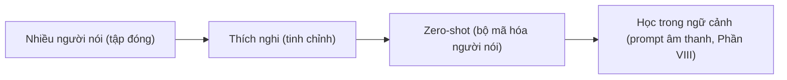
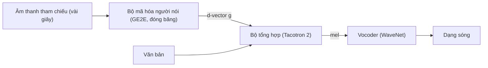

# Chương 28. Đa người nói và nhân bản giọng

!!! abstract "Mục tiêu học tập"
    Sau chương này, bạn có thể:

    - **Phân biệt** bốn bài toán: TTS nhiều người nói (tập đóng), thích nghi người nói (*speaker adaptation*), TTS zero-shot và chuyển đổi giọng (*voice conversion*).
    - **So sánh** các cách đưa thông tin người nói vào mô hình: nối, cộng, FiLM, LayerNorm có điều kiện, điều kiện toàn cục trong khối WaveNet; **chứng minh** "nối rồi chiếu tuyến tính" tương đương với cộng một độ lệch.
    - **Suy ra** các hàm mất mát học embedding người nói (GE2E, AM-softmax, AAM-softmax) và **giải thích** vì sao lề góc giúp tách người nói.
    - **Trình bày** ý tưởng chuyển giao SV2TTS và các kỹ thuật thích nghi tiết kiệm tham số (AdaSpeech, adapter, LoRA).
    - **Cài đặt** LayerNorm có điều kiện, đầu AAM-softmax, mất mát GE2E, lớp LoRA và phép đo SECS/EER, kèm kiểm thử.
    - **Thiết kế** một quy trình đánh giá độ giống người nói không bị thiên lệch, và **chẩn đoán** các vấn đề dữ liệu nhiều người nói (mất cân bằng, nhiễu kênh, lẫn phương ngữ).

!!! info "Kiến thức cần có"
    - VITS và cách nó nhận embedding người nói: [Chương 27](ch27-vits.md).
    - FiLM, AdaLN và các cơ chế điều kiện hóa trong Transformer: [Chương 5](../phan-1-nen-tang/ch05-transformer.md).
    - FastSpeech 2 (bộ điều chỉnh phương sai): [Chương 22](../phan-5-mo-hinh-am-hoc/ch22-fastspeech.md).
    - Entropy chéo, softmax, chuẩn hóa: [Chương 2](../phan-1-nen-tang/ch02-hoc-may-va-mang-no-ron.md), [Chương 3](../phan-1-nen-tang/ch03-toi-uu-va-ky-thuat-huan-luyen.md).
    - Tùy chọn: VAE ([Chương 8](../phan-2-mo-hinh-sinh/ch08-vae.md)) để hiểu các bộ mã hóa phong cách ở [Chương 29](ch29-prosody-cam-xuc-phong-cach.md).

## 28.1. Bài toán: từ một giọng đến nhiều giọng

Một mô hình TTS một người nói học phân phối $p_\theta(\mathbf{Y} \mid \mathbf{x})$: với văn bản $\mathbf{x}$, sinh đặc trưng âm học $\mathbf{Y}$ *của đúng một giọng*. Khi muốn nhiều giọng, ta thêm một biến điều kiện toàn cục $\mathbf{g}$ mô tả người nói và học

$$
p_\theta(\mathbf{Y} \mid \mathbf{x}, \mathbf{g}).
$$

Toàn bộ chương này xoay quanh hai câu hỏi: **$\mathbf{g}$ đến từ đâu** (bảng tra học được, hay một bộ mã hóa nhìn âm thanh tham chiếu?) và **$\mathbf{g}$ được đưa vào mạng thế nào** (ở tầng nào, bằng phép toán nào?). Câu trả lời khác nhau tạo ra bốn bài toán với yêu cầu dữ liệu rất khác nhau:

| Bài toán | Người nói lúc suy luận | Dữ liệu của người nói mới | Nguồn của $\mathbf{g}$ |
|---|---|---|---|
| TTS nhiều người nói (tập đóng) | Chỉ những người có trong dữ liệu huấn luyện | Không cần thêm | Bảng tra embedding |
| Thích nghi người nói | Người mới | Vài phút đến vài giờ, có văn bản | Embedding mới + tinh chỉnh một phần mô hình |
| TTS zero-shot | Người mới | Vài giây âm thanh, không cần văn bản | Bộ mã hóa người nói, hoặc lời nhắc âm thanh (*prompt*) |
| Chuyển đổi giọng | Người mới (đích) | Tùy phương pháp | Bộ mã hóa người nói hoặc embedding |

"Nhân bản giọng nói" (*voice cloning*) là tên gọi chung cho hai hàng giữa: tạo ra giọng của một người cụ thể từ một lượng dữ liệu hạn chế của họ.



Vì sao huấn luyện chung nhiều người nói lại có lợi, ngay cả khi ta chỉ cần một giọng? Vì phần lớn tri thức cần cho TTS (cách đọc chữ, cách ghép âm, cấu trúc phổ của nguyên âm, cách đặt thanh điệu) là **chung** giữa mọi người nói. Một mô hình nhiều người nói gộp dữ liệu của tất cả để học phần chung, còn $\mathbf{g}$ chỉ phải mang phần riêng: âm sắc, cao độ trung bình, tốc độ đọc, thói quen phát âm. Đây là lý do một giọng chỉ có 30 phút dữ liệu thường nghe tốt hơn nhiều khi được huấn luyện cùng hàng chục giờ của người khác.

## 28.2. Điều kiện hóa người nói

### 28.2.1. Bảng tra embedding

Cách đơn giản nhất: gán mỗi người nói $k \in \{1, \ldots, K\}$ một véc-tơ học được $\mathbf{g}_k = \mathbf{E}[k] \in \mathbb{R}^{D}$ (một `nn.Embedding`). Véc-tơ này được học đồng thời với mô hình bằng lan truyền ngược, giống embedding từ. Kích thước thường từ 64 đến 512; VITS (Kim và cộng sự, 2021) trên VCTK dùng 256. Ưu điểm là đơn giản và hiệu quả khi mỗi người nói có đủ dữ liệu; nhược điểm là **không tổng quát hóa** sang người nói chưa thấy (không có hàng nào trong bảng cho họ).

### 28.2.2. Đưa $\mathbf{g}$ vào mạng: các phép toán

Gọi $\mathbf{h}_t \in \mathbb{R}^{C}$ là biểu diễn ẩn tại bước $t$ của một tầng nào đó. Các lựa chọn phổ biến:

**Nối (concatenate) rồi chiếu.** $\mathbf{h}'_t = \mathbf{W}[\mathbf{h}_t; \mathbf{g}] + \mathbf{b}$. Tacotron 2 nhiều người nói và SV2TTS dùng cách này (nối embedding vào mọi bước của đầu ra bộ mã hóa).

**Cộng.** $\mathbf{h}'_t = \mathbf{h}_t + \mathbf{V}\mathbf{g}$. Rất phổ biến (FastSpeech 2 nhiều người nói, đầu vào bộ giải mã của VITS).

Hai cách này thực ra **tương đương**. Tách ma trận $\mathbf{W} = [\mathbf{W}_h, \mathbf{W}_g]$ theo khối cột:

$$
\mathbf{W}[\mathbf{h}_t; \mathbf{g}] + \mathbf{b} = \mathbf{W}_h \mathbf{h}_t + \underbrace{(\mathbf{W}_g \mathbf{g} + \mathbf{b})}_{\text{độ lệch phụ thuộc người nói}}.
$$

Nối rồi chiếu tuyến tính chỉ là cộng một **độ lệch** (*bias*) phụ thuộc người nói, giống nhau ở mọi bước thời gian. Phép toán này chỉ *dịch* biểu diễn; nó không thể *khuếch đại* hay *tắt* một kênh tùy người nói. Muốn có tương tác nhân, ta cần các cách dưới đây.

**FiLM** (*Feature-wise Linear Modulation*; Perez và cộng sự, 2018):

$$
\mathbf{h}'_t = \boldsymbol{\gamma}(\mathbf{g}) \odot \mathbf{h}_t + \boldsymbol{\beta}(\mathbf{g}),
$$

với $\boldsymbol{\gamma}, \boldsymbol{\beta}$ là các hàm (thường tuyến tính) của $\mathbf{g}$. Giờ người nói có thể điều chỉnh độ lớn của từng kênh đặc trưng.

**LayerNorm có điều kiện** (*conditional LayerNorm*, AdaSpeech; tương tự *Style-Adaptive LayerNorm* của StyleSpeech và AdaIN trong chuyển phong cách ảnh): chuẩn hóa trước, rồi FiLM:

$$
\mathbf{h}'_t = \boldsymbol{\gamma}(\mathbf{g}) \odot \frac{\mathbf{h}_t - \mu_t}{\sigma_t} + \boldsymbol{\beta}(\mathbf{g}), \qquad \mu_t = \frac{1}{C}\sum_c h_{t,c}, \quad \sigma_t^2 = \frac{1}{C}\sum_c (h_{t,c} - \mu_t)^2.
$$

Trực giác: phép chuẩn hóa xóa thống kê "cũ" (thang và độ dịch) của $\mathbf{h}_t$, sau đó người nói "vẽ lại" thang và độ dịch của riêng mình. Vì LayerNorm có mặt ở *mọi* khối Transformer, thay $\boldsymbol{\gamma}, \boldsymbol{\beta}$ cố định bằng hàm của $\mathbf{g}$ cho phép người nói tác động sâu vào toàn bộ mạng với rất ít tham số. Đây cũng là họ hàng gần của AdaLN trong DiT/F5-TTS ([Chương 5](../phan-1-nen-tang/ch05-transformer.md)).

**AdaIN** (*Adaptive Instance Normalization*; Huang và Belongie, 2017) giống công thức trên nhưng chuẩn hóa theo **thời gian** cho từng kênh (trung bình và độ lệch chuẩn của mỗi kênh trên toàn câu) thay vì theo kênh tại mỗi bước. Vì thống kê theo thời gian của một kênh mang nhiều thông tin "phong cách toàn cục", AdaIN hay được dùng trong chuyển đổi giọng và StyleTTS ([Chương 29](ch29-prosody-cam-xuc-phong-cach.md)).

**Điều kiện toàn cục trong khối WaveNet** (VITS, WaveNet gốc): trong đơn vị cổng $\tanh(\mathbf{W}_f * \mathbf{h} + \mathbf{V}_f\mathbf{g}) \odot \sigma(\mathbf{W}_c * \mathbf{h} + \mathbf{V}_c\mathbf{g})$, người nói được cộng vào *trước* các phi tuyến cổng, nên tác động không còn chỉ là dịch tuyến tính.

Mã dưới đây cài đặt FiLM và LayerNorm có điều kiện. Một chi tiết thực hành quan trọng: khởi tạo sao cho $\boldsymbol{\gamma} = \mathbf{1}$, $\boldsymbol{\beta} = \mathbf{0}$, để lúc bắt đầu, lớp mới hoạt động y hệt LayerNorm thường. Nhờ vậy ta có thể chèn nó vào một mô hình một người nói đã huấn luyện mà không phá hỏng mô hình.

```python
import torch
import torch.nn as nn
import torch.nn.functional as F

class FiLM(nn.Module):
    """h' = gamma(g) * h + beta(g); khởi tạo sao cho ban đầu là ánh xạ đồng nhất."""
    def __init__(self, cond_dim, channels):
        super().__init__()
        self.to_gamma = nn.Linear(cond_dim, channels)
        self.to_beta = nn.Linear(cond_dim, channels)
        for lin, b0 in ((self.to_gamma, 1.0), (self.to_beta, 0.0)):
            nn.init.zeros_(lin.weight)
            nn.init.constant_(lin.bias, b0)

    def forward(self, h, g):                       # h: (B, T, C), g: (B, D)
        gamma = self.to_gamma(g).unsqueeze(1)      # (B, 1, C)
        beta = self.to_beta(g).unsqueeze(1)        # (B, 1, C)
        return gamma * h + beta

class ConditionalLayerNorm(nn.Module):
    """LayerNorm có điều kiện kiểu AdaSpeech: chuẩn hóa không affine rồi FiLM theo người nói."""
    def __init__(self, cond_dim, channels, eps=1e-5):
        super().__init__()
        self.eps = eps
        self.film = FiLM(cond_dim, channels)

    def forward(self, h, g):                       # h: (B, T, C)
        h_norm = F.layer_norm(h, h.shape[-1:], eps=self.eps)   # không có gamma/beta cố định
        return self.film(h_norm, g)

torch.manual_seed(0)
B, T, C, D, n_spk = 3, 7, 16, 8, 10
spk_table = nn.Embedding(n_spk, D)                 # bảng tra embedding người nói
cln = ConditionalLayerNorm(D, C)
h = torch.randn(B, T, C)
g = spk_table(torch.tensor([0, 1, 1]))             # (B, D)

out0 = cln(h, g)                                   # lúc khởi tạo: đúng bằng LayerNorm thường
assert torch.allclose(out0, F.layer_norm(h, (C,)), atol=1e-6)

for p in cln.parameters():                         # giả lập sau huấn luyện
    nn.init.normal_(p, std=0.5)
out = cln(h, g)
assert out.shape == (B, T, C)
assert torch.allclose(out[1:2], cln(h[1:2], g[2:3]), atol=1e-5)  # cùng người nói, cùng h -> cùng kết quả
assert not torch.allclose(out[0], cln(h[0:1], g[1:2])[0])  # đổi người nói -> kết quả khác
n_adapt = sum(p.numel() for p in cln.parameters())
print("tham số điều kiện của một lớp CLN:", n_adapt)        # 2 * (D * C + C)
```

### 28.2.3. Đưa vào ở đâu

Không có câu trả lời duy nhất, nhưng có vài nguyên tắc:

- **Càng gần đầu ra âm học, ảnh hưởng tới âm sắc càng trực tiếp.** Âm sắc chủ yếu nằm ở bộ giải mã và vocoder; nếu vocoder dùng chung nhiều người nói (hoặc như VITS, bộ giải mã là một phần mô hình), nên đưa $\mathbf{g}$ vào đó.
- **Đưa vào bộ dự đoán trường độ/cao độ** để mô hình học tốc độ đọc và vùng cao độ riêng của từng người. Một giọng nữ cao và một giọng nam trầm có phân phối F0 rất khác nhau; bộ dự đoán cao độ không biết người nói sẽ dự đoán "giọng trung bình".
- **Có nên đưa vào bộ mã hóa văn bản?** VITS không làm vậy, để biểu diễn văn bản độc lập với người nói (cho phép chuyển đổi giọng, [Chương 27](ch27-vits.md)). VITS2 lại đưa vào để bắt được thói quen phát âm riêng. Đây là đánh đổi giữa *tách bạch* (*disentanglement*) và *độ giống*.
- **Đưa vào nhiều chỗ** thường tốt hơn một chỗ, với chi phí tham số rất nhỏ.

## 28.3. Bộ mã hóa người nói từ bài toán xác minh người nói

Bảng tra không xử lý được người nói mới. Ý tưởng then chốt của TTS zero-shot thế hệ đầu là: **mượn** một mạng đã được huấn luyện để *nhận diện* người nói, và dùng embedding của nó làm $\mathbf{g}$.

### 28.3.1. Bài toán xác minh người nói

Xác minh người nói (*speaker verification*, SV) trả lời câu hỏi: hai đoạn âm thanh có cùng một người nói không? Một hệ SV hiện đại gồm bộ mã hóa $e_\psi$ biến đoạn âm thanh có độ dài bất kỳ thành một véc-tơ có độ dài cố định (*speaker embedding*), và một hàm chấm điểm, thường là độ tương đồng cosine:

$$
\text{score}(a, b) = \cos\big(e_\psi(a), e_\psi(b)\big) = \frac{e_\psi(a)^\top e_\psi(b)}{\lVert e_\psi(a) \rVert\,\lVert e_\psi(b) \rVert}.
$$

So với ngưỡng để quyết định "cùng/khác". Bộ mã hóa này được huấn luyện trên dữ liệu **rất nhiều người nói** (hàng nghìn), thường lấy từ nguồn "tự nhiên" như video phỏng vấn, không cần văn bản, có nhiễu và kênh thu đa dạng. Chính sự đa dạng đó làm embedding tổng quát hóa sang người lạ, đúng thứ TTS zero-shot cần.

### 28.3.2. Các kiến trúc

- **d-vector** (Variani và cộng sự, 2014; Wan và cộng sự, 2018): mạng nơ-ron (về sau là LSTM nhiều tầng) chạy trên log-mel, embedding là trung bình (hoặc trạng thái cuối) của đầu ra được chuẩn hóa $\ell_2$. Phiên bản LSTM huấn luyện bằng GE2E chính là bộ mã hóa người nói của SV2TTS.
- **x-vector** (Snyder và cộng sự, 2018): các tầng TDNN (tích chập 1-D giãn nở) theo khung, tiếp theo là **gộp thống kê** (*statistics pooling*: nối trung bình và độ lệch chuẩn theo thời gian), rồi các tầng mức đoạn; embedding lấy từ tầng sau gộp. Huấn luyện bằng softmax phân loại người nói với tăng cường dữ liệu (nhiễu, vang).
- **ECAPA-TDNN** (Desplanques và cộng sự, 2020): cải tiến x-vector với khối SE-Res2Net (cơ chế *squeeze-excitation* theo kênh), tổng hợp đặc trưng nhiều tầng, và **gộp thống kê có attention** phụ thuộc kênh và ngữ cảnh; huấn luyện bằng AAM-softmax. Đây là lựa chọn mặc định phổ biến trong nhiều bộ công cụ, kể cả để đo độ giống trong TTS.
- **Dựa trên mô hình tự giám sát** (WavLM; Chen và cộng sự, 2022): lấy tổng có trọng số học được của các tầng ẩn của WavLM làm đặc trưng đầu vào, rồi đặt một bộ mã hóa kiểu ECAPA-TDNN lên trên. Biến thể này thường được gọi là "WavLM-TDNN" và được dùng rộng rãi để đo độ giống người nói trong các bài báo TTS zero-shot ([Chương 38](../phan-9-thuc-tien/ch38-danh-gia-tts.md)).

Điểm chung: một bước **gộp theo thời gian** biến chuỗi độ dài thay đổi thành véc-tơ cố định. Gộp thống kê (trung bình + độ lệch chuẩn) mạnh hơn trung bình đơn thuần vì độ lệch chuẩn của đặc trưng theo thời gian cũng mang thông tin về giọng.

### 28.3.3. Hàm mất mát: GE2E

Mất mát *Generalized End-to-End* (GE2E; Wan và cộng sự, 2018) được thiết kế để tối ưu trực tiếp độ tương đồng cosine. Mỗi batch gồm $N$ người nói, mỗi người $M$ câu; gọi $\mathbf{e}_{ji}$ là embedding (đã chuẩn hóa) của câu $i$ của người $j$. Tâm của người $k$ là $\mathbf{c}_k = \frac{1}{M}\sum_{m}\mathbf{e}_{km}$. Khi so $\mathbf{e}_{ji}$ với tâm của chính người $j$, ta dùng **tâm loại trừ** (bỏ chính câu đó) để tránh lời giải tầm thường:

$$
\mathbf{c}_j^{(-i)} = \frac{1}{M-1}\sum_{m \ne i}\mathbf{e}_{jm}.
$$

Ma trận tương đồng có tham số tỉ lệ học được $w > 0$ và độ lệch $b$:

$$
S_{ji,k} =
\begin{cases}
w \cos\big(\mathbf{e}_{ji}, \mathbf{c}_j^{(-i)}\big) + b & \text{nếu } k = j,\\
w \cos\big(\mathbf{e}_{ji}, \mathbf{c}_k\big) + b & \text{nếu } k \ne j.
\end{cases}
$$

Biến thể softmax coi mỗi hàng $S_{ji,\cdot}$ là logit của bài toán phân loại "câu này thuộc tâm nào":

$$
\mathcal{L}(\mathbf{e}_{ji}) = -S_{ji,j} + \log\sum_{k=1}^{N}\exp(S_{ji,k}).
$$

So với softmax phân loại thông thường trên toàn bộ $K$ người nói của tập huấn luyện, GE2E chỉ so với $N$ người trong batch và dùng chính dữ liệu để tạo "đại diện lớp" (các tâm), nên không cần ma trận trọng số $K \times D$ và trực tiếp tối ưu đại lượng mà ta dùng lúc chấm điểm. Bài báo gốc khởi tạo $(w, b) = (10, -5)$ và ràng buộc $w > 0$.

```python
import torch
import torch.nn.functional as F

def ge2e_softmax_loss(E, w, b):
    """Mất mát GE2E (biến thể softmax). E: (N người nói, M câu, D) -> vô hướng."""
    N, M, D = E.shape
    E = F.normalize(E, dim=-1)
    centroids = F.normalize(E.mean(1), dim=-1)                       # (N, D)
    excl = F.normalize((E.sum(1, keepdim=True) - E) / (M - 1), dim=-1)  # tâm "loại trừ" câu đang xét
    cos = torch.einsum("nmd,kd->nmk", E, centroids)                  # (N, M, N)
    own = (E * excl).sum(-1)                                         # (N, M): cos tới tâm loại trừ
    idx = torch.arange(N)
    mask = torch.zeros(N, 1, N, dtype=torch.bool)
    mask[idx, 0, idx] = True                                         # vị trí "đúng người nói"
    cos = torch.where(mask, own.unsqueeze(-1), cos)                  # thay bằng tâm loại trừ
    S = w * cos + b                                                  # ma trận tương đồng có tỉ lệ
    return (-S[idx, :, idx] + torch.logsumexp(S, dim=-1)).mean()     # S[idx,:,idx]: (N, M)

torch.manual_seed(0)
N, M, D = 4, 5, 32
w, b = torch.tensor(10.0), torch.tensor(-5.0)                        # khởi tạo như bài báo GE2E
spk = torch.randn(N, 1, D)
good = spk + 0.1 * torch.randn(N, M, D)                              # câu cùng người nói gần nhau
bad = torch.randn(N, M, D)                                           # embedding ngẫu nhiên
l_good, l_bad = ge2e_softmax_loss(good, w, b), ge2e_softmax_loss(bad, w, b)
print(f"GE2E: tách tốt {l_good:.3f} | ngẫu nhiên {l_bad:.3f}")
assert l_good < l_bad
```

### 28.3.4. Hàm mất mát: từ softmax đến lề góc (AM-softmax, AAM-softmax)

Một hướng khác là huấn luyện phân loại $K$ người nói rồi bỏ tầng phân loại, giữ embedding. Softmax thường có logit $\mathbf{w}_k^\top\mathbf{e} + b_k$. Nếu chuẩn hóa cả $\mathbf{w}_k$ lẫn $\mathbf{e}$ và bỏ $b_k$, logit thành $s\cos\theta_k$, với $\theta_k$ là góc giữa embedding và véc-tơ đại diện của lớp $k$, còn $s$ là hệ số tỉ lệ (cần thiết vì $\cos\theta \in [-1, 1]$ quá hẹp để softmax đạt xác suất gần 1). Khi đó việc phân loại chỉ phụ thuộc vào **góc**, khớp với việc chấm điểm bằng cosine lúc dùng.

Softmax trên cosine chỉ đòi $\theta_y < \theta_k$ cho lớp đúng $y$, tức là ranh giới quyết định "sát nút". Để embedding của cùng người nói **co cụm** và của người khác **tách xa**, ta thêm một lề (*margin*) $m$ làm khó lớp đúng, theo kiểu AM-softmax (Wang và cộng sự, 2018) hoặc AAM-softmax, còn gọi là ArcFace (Deng và cộng sự, 2019):

$$
\text{AM-softmax:}\quad \ell_y = s(\cos\theta_y - m), \qquad
\text{AAM-softmax (ArcFace):}\quad \ell_y = s\cos(\theta_y + m),
$$

các lớp khác giữ $\ell_k = s\cos\theta_k$, rồi lấy entropy chéo. Với AAM-softmax, để lớp đúng thắng, mô hình phải đạt $\theta_y + m < \theta_k$, tức là embedding phải nằm trong một "nón" hẹp hơn $m$ radian quanh véc-tơ lớp của nó. Lề cộng trên **góc** có diễn giải hình học rõ ràng (khoảng cách trắc địa trên mặt cầu đơn vị), còn lề trên cosine thì không đều theo góc. Giá trị hay dùng trong xác minh người nói là $m \approx 0{,}2$ và $s \approx 30$, nhưng nên coi là điểm khởi đầu để dò.

Một chi tiết cài đặt: khi $\theta_y + m > \pi$, hàm $\cos(\theta_y + m)$ không còn giảm đơn điệu theo $\theta_y$, và gradient đổi chiều. Các cài đặt chuẩn thay bằng một hàm tuyến tính trong vùng đó, như trong mã dưới.

```python
import math
import torch
import torch.nn as nn
import torch.nn.functional as F

class AAMSoftmax(nn.Module):
    """Additive Angular Margin softmax (ArcFace): logit đích = s * cos(theta_y + m)."""
    def __init__(self, emb_dim, n_classes, margin=0.2, scale=30.0):
        super().__init__()
        self.W = nn.Parameter(torch.randn(n_classes, emb_dim) * 0.01)   # (K, D) véc-tơ đại diện lớp
        self.m, self.s = margin, scale
        self.th = math.cos(math.pi - margin)        # ngưỡng: theta + m <= pi
        self.mm = math.sin(math.pi - margin) * margin

    def forward(self, emb, labels):                 # emb: (B, D), labels: (B,)
        cos = F.linear(F.normalize(emb), F.normalize(self.W))   # (B, K) = cos(theta)
        sin = torch.sqrt((1.0 - cos ** 2).clamp(min=1e-7))
        phi = cos * math.cos(self.m) - sin * math.sin(self.m)    # cos(theta + m)
        phi = torch.where(cos > self.th, phi, cos - self.mm)     # giữ đơn điệu khi theta + m > pi
        target = F.one_hot(labels, cos.size(1)).bool()
        logits = self.s * torch.where(target, phi, cos)          # chỉ phạt lớp đúng
        return F.cross_entropy(logits, labels), logits

torch.manual_seed(0)
K, D, B = 4, 16, 64
head = AAMSoftmax(D, K, margin=0.2, scale=30.0)
emb = torch.randn(B, D)
labels = torch.randint(0, K, (B,))

# (1) margin = 0 thì AAM-softmax suy biến thành softmax trên cosine nhân s
head0 = AAMSoftmax(D, K, margin=0.0)
head0.W.data = head.W.data.clone()
_, logits0 = head0(emb, labels)
assert torch.allclose(logits0, 30.0 * F.linear(F.normalize(emb), F.normalize(head.W)), atol=1e-5)
# (2) có margin thì mất mát lớn hơn: bài toán "khó" hơn, buộc các cụm phải tách xa hơn
assert head(emb, labels)[0] > head0(emb, labels)[0]

# (3) Huấn luyện đồng thời một bộ mã hóa tuyến tính nhỏ trên dữ liệu tổng hợp có cấu trúc lớp
centers = torch.randn(K, 8) * 2
x = centers[labels] + 0.5 * torch.randn(B, 8)
encoder = nn.Linear(8, D)
opt = torch.optim.Adam(list(encoder.parameters()) + list(head.parameters()), lr=1e-2)
first = None
for step in range(150):
    loss, _ = head(encoder(x), labels)
    first = loss.item() if first is None else first
    opt.zero_grad(); loss.backward(); opt.step()
print(f"mất mát: {first:.2f} -> {loss.item():.2f}")
assert loss.item() < 0.5 * first
```

!!! tip "Embedding cho xác minh có phải là embedding tốt nhất cho TTS?"
    Không hẳn. Bộ mã hóa SV được huấn luyện để **bất biến** với nội dung, kênh thu, cảm xúc, những thứ TTS đôi khi lại muốn giữ (ví dụ chất giọng khi đọc to hay nói thầm). Ngược lại, nó nhạy với những chi tiết phân biệt người nói mà tai người ít để ý. Vì thế các hệ zero-shot về sau thường **tinh chỉnh** bộ mã hóa cùng TTS, hoặc thay bằng bộ mã hóa phong cách học từ đầu ([Chương 29](ch29-prosody-cam-xuc-phong-cach.md)), hoặc bỏ hẳn embedding cố định để dùng lời nhắc âm thanh ([Phần VIII](../phan-8-mo-hinh-lon/ch32-codec-language-model.md)).

## 28.4. SV2TTS: học chuyển giao từ xác minh người nói

SV2TTS (Jia và cộng sự, 2018) là công trình đặt nền móng cho TTS zero-shot với bộ mã hóa người nói. Hệ thống gồm **ba mạng huấn luyện độc lập**:

1. **Bộ mã hóa người nói**: LSTM nhiều tầng huấn luyện bằng GE2E trên một tập dữ liệu xác minh người nói lớn, nhiều nhiễu, không có văn bản.
2. **Bộ tổng hợp** (*synthesizer*): Tacotron 2, với d-vector của câu tham chiếu được nối vào đầu ra bộ mã hóa văn bản ở mọi bước. Bộ mã hóa người nói được **đóng băng** khi huấn luyện bộ tổng hợp.
3. **Vocoder**: WaveNet, sinh dạng sóng từ mel.



Vì sao tách rời lại tốt? Vì hai loại dữ liệu có tính chất trái ngược: dữ liệu SV có **nhiều người** nhưng bẩn và không có văn bản; dữ liệu TTS **sạch, có văn bản** nhưng ít người. Huấn luyện riêng cho phép mỗi phần tận dụng loại dữ liệu phù hợp. Bài báo cho thấy những điều đáng nhớ: (i) số người nói dùng để huấn luyện bộ mã hóa ảnh hưởng mạnh đến khả năng tổng quát hóa sang người mới; (ii) với người nói chưa thấy, độ tự nhiên vẫn tốt nhưng độ giống thấp hơn rõ so với người đã thấy; (iii) lấy mẫu embedding ngẫu nhiên trên mặt cầu đơn vị tạo ra những giọng "hư cấu" khác với mọi người trong dữ liệu huấn luyện.

Điểm (ii) là giới hạn cơ bản của cách tiếp cận "một véc-tơ cố định": cả giọng nói của một người bị nén vào vài trăm chiều, và bộ tổng hợp chỉ thấy vài trăm đến vài nghìn người khi huấn luyện, nên không thể nội suy chính xác mọi giọng.

## 28.5. Thích nghi người nói

Khi có vài phút đến vài giờ dữ liệu *có văn bản* của người nói đích, ta có thể **tinh chỉnh** một mô hình nhiều người nói đã huấn luyện trước. Câu hỏi là tinh chỉnh **bao nhiêu** tham số.

### 28.5.1. Phổ các lựa chọn

| Cách thích nghi | Tham số học thêm cho mỗi người nói | Dữ liệu cần | Rủi ro |
|---|---|---|---|
| Chỉ học embedding mới | $D$ (vài trăm) | Rất ít | Độ giống bị giới hạn bởi "không gian giọng" đã học |
| Tinh chỉnh bộ giải mã/vocoder | Hàng triệu | Vừa | Quá khớp khi dữ liệu ít |
| Tinh chỉnh toàn bộ | Toàn bộ mô hình | Nhiều nhất | Quên kiến thức cũ (*catastrophic forgetting*), phải lưu một bản sao mô hình cho mỗi người |
| LayerNorm có điều kiện (AdaSpeech) | Vài nghìn đến vài chục nghìn | Ít | Cần thiết kế kiến trúc từ đầu |
| Adapter / LoRA | Vài phần trăm hoặc ít hơn | Ít đến vừa | Chọn hạng và vị trí chèn |

Với hệ thống phục vụ hàng nghìn giọng tùy biến, cột "tham số mỗi người nói" quyết định chi phí lưu trữ và chuyển đổi giữa các giọng, chứ không chỉ chất lượng.

### 28.5.2. AdaSpeech

AdaSpeech (Chen và cộng sự, 2021) nhắm vào bài toán "giọng tùy biến" trên đám mây với hai quan sát. Thứ nhất, dữ liệu thích nghi thường có điều kiện âm học (micro, phòng, phong cách) khác dữ liệu huấn luyện trước, nên họ thêm **mô hình hóa điều kiện âm học** ở mức câu (một véc-tơ từ mel tham chiếu) và mức âm vị (véc-tơ theo từng âm vị, lúc suy luận được dự đoán từ văn bản). Thứ hai, để mỗi giọng tốn ít tham số, các LayerNorm trong bộ giải mã được thay bằng **LayerNorm có điều kiện**: thang và độ dịch được sinh từ embedding người nói qua hai lớp tuyến tính nhỏ. Khi thích nghi, chỉ những lớp tuyến tính này và embedding người nói được cập nhật; phần còn lại đóng băng. Khối mã ở Mục 28.2.2 chính là một lớp như vậy.

### 28.5.3. Adapter và LoRA

Hai kỹ thuật tinh chỉnh tiết kiệm tham số đến từ NLP được dùng ngày càng nhiều cho TTS, đặc biệt với các mô hình TTS dựa trên mô hình ngôn ngữ lớn ([Chương 34](../phan-8-mo-hinh-lon/ch34-he-thong-lai-hien-dai.md), [Chương 37](../phan-9-thuc-tien/ch37-huan-luyen-va-debug.md)):

- **Adapter** (Houlsby và cộng sự, 2019): chèn một khối "thắt cổ chai" nhỏ $\mathbf{h} \mapsto \mathbf{h} + \mathbf{W}_{\text{up}}\,\phi(\mathbf{W}_{\text{down}}\mathbf{h})$ vào mỗi tầng; chỉ học khối này.
- **LoRA** (Hu và cộng sự, 2022): với một ma trận trọng số đóng băng $\mathbf{W}_0 \in \mathbb{R}^{d_{\text{out}} \times d_{\text{in}}}$, học một cập nhật hạng thấp

$$
\mathbf{W} = \mathbf{W}_0 + \frac{\alpha}{r}\mathbf{B}\mathbf{A}, \qquad \mathbf{A} \in \mathbb{R}^{r \times d_{\text{in}}},\; \mathbf{B} \in \mathbb{R}^{d_{\text{out}} \times r},\; r \ll \min(d_{\text{in}}, d_{\text{out}}).
$$

Số tham số học là $r(d_{\text{in}} + d_{\text{out}})$ thay vì $d_{\text{in}}d_{\text{out}}$. $\mathbf{B}$ khởi tạo bằng 0 nên ban đầu mô hình không đổi. Sau khi học, có thể **gộp** $\mathbf{B}\mathbf{A}$ vào $\mathbf{W}_0$, nên suy luận không tốn thêm phép tính; hoặc giữ riêng để chuyển nhanh giữa nhiều giọng trên cùng một mô hình gốc.

```python
import torch
import torch.nn as nn

class LoRALinear(nn.Module):
    """y = W x + (alpha / r) * B A x, với W đóng băng; chỉ A, B được học."""
    def __init__(self, base: nn.Linear, r=4, alpha=8.0):
        super().__init__()
        self.base = base.requires_grad_(False)
        self.A = nn.Parameter(torch.randn(r, base.in_features) / r)   # (r, in)
        self.B = nn.Parameter(torch.zeros(base.out_features, r))     # (out, r), khởi tạo 0
        self.scale = alpha / r

    def forward(self, x):                                            # x: (..., in)
        return self.base(x) + (x @ self.A.T @ self.B.T) * self.scale

    @torch.no_grad()
    def merged(self):
        """Gộp nhánh LoRA vào W để suy luận không tốn thêm phép tính."""
        lin = nn.Linear(self.base.in_features, self.base.out_features)
        lin.weight.copy_(self.base.weight + self.scale * self.B @ self.A)
        lin.bias.copy_(self.base.bias)
        return lin

torch.manual_seed(0)
base = nn.Linear(256, 256)
lora = LoRALinear(base, r=4)
x = torch.randn(2, 10, 256)                                         # (B, T, C)
assert torch.allclose(lora(x), base(x))                             # B = 0: ban đầu không đổi gì
n_train = sum(p.numel() for p in lora.parameters() if p.requires_grad)
print("tham số học:", n_train, "so với toàn bộ:", base.weight.numel() + base.bias.numel())
nn.init.normal_(lora.B, std=0.1)                                    # giả lập sau thích nghi
assert torch.allclose(lora(x), lora.merged()(x), atol=1e-5)         # gộp trọng số cho cùng kết quả
```

!!! warning "Thích nghi với ít dữ liệu: quá khớp đến rất nhanh"
    Với vài phút dữ liệu, tinh chỉnh vài nghìn bước có thể đủ để mô hình bắt đầu "học thuộc" các câu thích nghi: câu trong tập thích nghi nghe rất giống, nhưng câu mới bị méo, sai thanh điệu hoặc mất ổn định. Luôn giữ riêng vài câu kiểm tra (không dùng để huấn luyện), lưu checkpoint thường xuyên và chọn checkpoint theo CER trên câu kiểm tra cộng với nghe thử, chứ không theo mất mát huấn luyện.

## 28.6. TTS nhiều người nói zero-shot

Cách tiếp cận SV2TTS đã mở ra một dòng mô hình: thay bảng tra bằng một bộ mã hóa nhìn âm thanh tham chiếu, rồi cải tiến để tăng độ giống với người lạ.

**YourTTS** (Casanova và cộng sự, 2022) xây trên VITS với ba bổ sung chính: (i) embedding người nói lấy từ một bộ mã hóa người nói huấn luyện trước, đưa vào các thành phần của VITS như ở [Chương 27](ch27-vits.md); (ii) **mất mát nhất quán người nói** (*Speaker Consistency Loss*): đưa âm thanh sinh ra qua bộ mã hóa người nói và phạt nếu cosine với embedding của âm thanh thật thấp; (iii) embedding ngôn ngữ để huấn luyện đa ngôn ngữ ([Chương 30](ch30-da-ngon-ngu-code-switching.md)). Mô hình làm được TTS zero-shot nhiều người nói, đa ngôn ngữ và chuyển đổi giọng zero-shot; bài báo cũng cho thấy tinh chỉnh với chưa đầy một phút dữ liệu có thể cải thiện thêm độ giống.

Mất mát nhất quán người nói đáng được viết ra vì nó là một mẫu thiết kế chung:

$$
\mathcal{L}_{\text{SCL}} = -\frac{\lambda}{B}\sum_{b=1}^{B}\cos\big(e_\psi(\hat{\mathbf{s}}_b),\, e_\psi(\mathbf{s}_b)\big),
$$

với $e_\psi$ là bộ mã hóa người nói đóng băng. Ta dùng một mạng *phân biệt người nói* làm "người chấm điểm" có thể lấy đạo hàm. Cái giá: mô hình có thể học cách "lừa" chính bộ mã hóa đó, nên không được dùng cùng bộ mã hóa ấy để **đánh giá** (Mục 28.8).

**Meta-StyleSpeech** (Min và cộng sự, 2021) đi theo hướng khác: một bộ mã hóa phong cách học từ đầu cùng TTS (không mượn từ SV), đưa vào bộ sinh qua **Style-Adaptive LayerNorm** (SALN, một dạng LayerNorm có điều kiện), và huấn luyện theo **từng tập** (*episodic meta-learning*): trong mỗi bước, mô phỏng tình huống "chỉ có một câu tham chiếu của người lạ" và dùng thêm bộ phân biệt phong cách và bộ phân biệt âm vị để ép giọng sinh ra vừa đúng người, vừa đúng nội dung.

Giới hạn chung của dòng này: độ giống với người lạ phụ thuộc mạnh vào **số lượng và độ đa dạng người nói** trong dữ liệu huấn luyện (hàng trăm người là ít; các hệ thống hiện đại dùng hàng chục nghìn), và một véc-tơ toàn cục khó nắm được các đặc điểm chi tiết như cách nhấn, cách kéo dài âm. Từ khoảng 2023, hướng chủ đạo chuyển sang **nhân bản trong ngữ cảnh**: coi vài giây âm thanh tham chiếu là "lời nhắc" (*prompt*) cho một mô hình sinh lớn (VALL-E, Voicebox, F5-TTS, CosyVoice…), để mô hình tự "tiếp tục" giọng đó. Phần VIII trình bày chi tiết: [Chương 32](../phan-8-mo-hinh-lon/ch32-codec-language-model.md), [Chương 33](../phan-8-mo-hinh-lon/ch33-nar-quy-mo-lon.md), [Chương 34](../phan-8-mo-hinh-lon/ch34-he-thong-lai-hien-dai.md).

## 28.7. Liên hệ với chuyển đổi giọng

Chuyển đổi giọng (VC) giữ nguyên **nội dung** của một câu nói và đổi **người nói**. Nó dùng chung bộ công cụ với TTS nhiều người nói, chỉ khác đầu vào nội dung là âm thanh thay vì văn bản. Mọi phương pháp VC đều phải giải bài toán *tách bạch*: lấy ra một biểu diễn nội dung không chứa thông tin người nói. Một vài hướng tiêu biểu (chỉ điểm qua):

- **Qua biến ẩn của TTS**: như VITS, flow "gỡ" người nói khỏi $\mathbf{z}$ rồi "gắn" người nói mới ([Chương 27](ch27-vits.md), Mục 27.8.3).
- **Qua đặc trưng tự giám sát**: đặc trưng của các mô hình như WavLM chứa nhiều thông tin ngữ âm. kNN-VC (Baas và cộng sự, 2023) thay từng khung đặc trưng của câu nguồn bằng trung bình các khung gần nhất trong âm thanh của người đích, rồi dùng vocoder sinh sóng; không cần huấn luyện thêm cho người mới.
- **Qua thắt cổ chai thông tin**: ép biểu diễn nội dung qua một nút thắt hẹp hoặc lượng tử hóa để thông tin người nói không lọt qua được.

VC cũng là một công cụ **tăng cường dữ liệu**: chuyển dữ liệu của người nói nhiều dữ liệu sang giọng của người ít dữ liệu. Với tiếng Việt, khi thiếu dữ liệu phong cách hoặc cảm xúc cho một giọng, đây là hướng đáng thử, kèm điều kiện có sự đồng ý của người nói ([Chương 40](../phan-9-thuc-tien/ch40-dao-duc-an-toan.md)).

## 28.8. Đánh giá độ giống người nói

### 28.8.1. Chỉ số khách quan: SECS và cosine của embedding

Chỉ số khách quan phổ biến nhất là **độ tương đồng cosine giữa embedding** của câu tổng hợp và của âm thanh tham chiếu thật, thường gọi là SECS (*Speaker Encoder Cosine Similarity*) hoặc SIM:

$$
\text{SECS} = \frac{1}{|\mathcal{P}|}\sum_{(\hat{\mathbf{s}}, \mathbf{s}) \in \mathcal{P}} \cos\big(e_\psi(\hat{\mathbf{s}}),\, e_\psi(\mathbf{s})\big),
$$

với $\mathcal{P}$ là các cặp (câu tổng hợp, câu tham chiếu thật của cùng người nói). Ba điều cần nhớ:

1. **Giá trị tuyệt đối phụ thuộc bộ mã hóa.** SECS đo bằng Resemblyzer, ECAPA-TDNN hay WavLM-TDNN cho các thang khác nhau. Không so sánh con số giữa các bài báo dùng bộ mã hóa khác nhau.
2. **Luôn báo cáo kèm mốc tham chiếu.** Mốc trên: cosine giữa hai câu thật *khác nhau* của cùng người nói (giới hạn thực tế, vì một người cũng không bao giờ nói giống hệt mình). Mốc dưới: cosine giữa câu thật của hai người khác nhau.
3. **Không đánh giá bằng chính bộ mã hóa đã dùng để huấn luyện.** Nếu mô hình được điều kiện hóa hoặc tối ưu (như mất mát nhất quán người nói) bằng bộ mã hóa $e_\psi$, SECS đo bằng $e_\psi$ bị thổi phồng. Hãy dùng một bộ mã hóa độc lập.

Ngoài ra, **EER** (*Equal Error Rate*) dùng để đánh giá *chất lượng của chính bộ mã hóa người nói*: với tập các cặp thử "cùng người" và "khác người", quét ngưỡng quyết định; EER là tỉ lệ lỗi tại ngưỡng mà tỉ lệ chấp nhận nhầm (FAR) bằng tỉ lệ từ chối nhầm (FRR). Bộ mã hóa có EER thấp trên dữ liệu gần với miền của bạn (ví dụ tiếng Việt) mới đáng tin để đo SECS. Mã dưới đây tính SECS kèm khoảng tin cậy 95% và hai mốc tham chiếu, rồi tính EER, trên embedding tổng hợp.

```python
import numpy as np

def cosine(a, b):
    a = a / np.linalg.norm(a, axis=-1, keepdims=True)
    b = b / np.linalg.norm(b, axis=-1, keepdims=True)
    return np.sum(a * b, axis=-1)

def eer(scores, labels):
    """Equal Error Rate. scores: (K,), labels: 1 = cùng người nói, 0 = khác người nói."""
    order = np.argsort(-scores)                       # ngưỡng giảm dần
    lab = labels[order]
    n_tar, n_non = lab.sum(), (1 - lab).sum()
    far = np.cumsum(1 - lab) / n_non                  # chấp nhận nhầm người lạ
    frr = 1 - np.cumsum(lab) / n_tar                  # từ chối nhầm người thật
    i = np.argmin(np.abs(far - frr))
    return 0.5 * (far[i] + frr[i])

rng = np.random.default_rng(0)
n_spk, n_utt, D = 20, 6, 64
centers = rng.normal(size=(n_spk, D))
real = centers[:, None] + 1.2 * rng.normal(size=(n_spk, n_utt, D))   # embedding ghi âm thật
synth = centers[:, None] + 1.5 * rng.normal(size=(n_spk, n_utt, D))  # embedding giọng tổng hợp

# SECS: so câu tổng hợp với một câu tham chiếu thật của cùng người nói
ref = real[:, 0]                                                     # (n_spk, D)
secs_synth = cosine(synth, ref[:, None]).ravel()
secs_real = cosine(real[:, 1:], ref[:, None]).ravel()                # mốc trên: thật vs thật
secs_other = cosine(real[:, 1:], np.roll(ref, 1, axis=0)[:, None]).ravel()  # mốc dưới: khác người
for name, v in [("thật-thật", secs_real), ("tổng hợp", secs_synth), ("khác người", secs_other)]:
    ci = 1.96 * v.std(ddof=1) / np.sqrt(len(v))
    print(f"SECS {name:10s}: {v.mean():.3f} ± {ci:.3f}")
assert secs_other.mean() < secs_synth.mean() < secs_real.mean()

# EER của chính bộ mã hóa trên các cặp thử thật (đánh giá chất lượng embedding)
scores = np.concatenate([secs_real, secs_other])
labels = np.concatenate([np.ones_like(secs_real), np.zeros_like(secs_other)])
print(f"EER = {100 * eer(scores, labels):.1f}%")
assert eer(np.array([0.9, 0.8, 0.1, 0.2]), np.array([1, 1, 0, 0])) == 0.0   # tách hoàn hảo
```

Khoảng tin cậy trong mã giả định các cặp độc lập; trong thực tế các câu của cùng một người nói tương quan với nhau, nên khoảng tin cậy đúng đắn hơn là bootstrap theo **người nói** ([Chương 38](../phan-9-thuc-tien/ch38-danh-gia-tts.md)).

### 28.8.2. Đánh giá chủ quan: SMOS

Chỉ số khách quan chỉ là đại diện. Đánh giá chuẩn vẫn là **SMOS** (*Similarity MOS*): người nghe nghe một câu thật của người nói (tham chiếu) và một câu tổng hợp, chấm độ giống trên thang 5 mức. Nên trộn cả cặp "thật–thật" làm mốc và cặp "khác người" làm bẫy để phát hiện người chấm cẩu thả. Với tiếng Việt, người chấm nên cùng vùng phương ngữ với người nói, vì người nghe khác vùng thường chấm theo giọng địa phương nhiều hơn theo âm sắc.

## 28.9. Dữ liệu nhiều người nói

Chất lượng mô hình nhiều người nói phụ thuộc vào dữ liệu nhiều hơn vào kiến trúc. Những vấn đề hay gặp:

- **Mất cân bằng.** Vài người nói chiếm phần lớn dữ liệu, nhiều người chỉ có vài phút. Lấy mẫu đều theo câu khiến mô hình thiên về người nhiều dữ liệu. Cách thường dùng là lấy mẫu theo người nói với xác suất $p_k \propto n_k^{\alpha}$, trong đó $n_k$ là lượng dữ liệu của người $k$ và $\alpha \in [0, 1]$ ($\alpha = 1$: theo câu; $\alpha = 0$: đều theo người; giá trị trung gian là thỏa hiệp). Cùng công thức này dùng cho cân bằng ngôn ngữ ở [Chương 30](ch30-da-ngon-ngu-code-switching.md).
- **Nhiễu kênh bị học thành "giọng".** Nếu mỗi người nói được thu bằng một micro, một phòng riêng, embedding sẽ mã hóa cả kênh thu. Khi nhân bản, mô hình sao chép luôn tiếng vang và nhiễu của câu tham chiếu. Tiền xử lý (khử nhiễu, chuẩn hóa độ to) và tăng cường dữ liệu theo kênh giúp giảm hiện tượng này ([Chương 36](../phan-9-thuc-tien/ch36-du-lieu-tts.md)).
- **Nhãn người nói sai hoặc lẫn.** Dữ liệu thu thập từ video, podcast có thể chứa nhiều người trong một tệp hoặc cùng người dưới nhiều nhãn. Dùng bộ mã hóa người nói để phân cụm và kiểm tra độ tinh khiết (*speaker purity*) trước khi huấn luyện.
- **Rò rỉ người nói giữa các tập.** Khi đánh giá zero-shot, người nói trong tập kiểm tra phải **không** xuất hiện trong tập huấn luyện, kể cả dưới nhãn khác.

!!! note "Góc tiếng Việt: người nói và phương ngữ dính vào nhau"
    Trong dữ liệu tiếng Việt nhiều người nói, danh tính người nói gần như trùng khớp với **phương ngữ**: người Hà Nội đọc giọng Bắc, người Sài Gòn đọc giọng Nam. Nếu frontend luôn sinh âm vị theo chuẩn phương ngữ Bắc ([Chương 18](../phan-4-frontend/ch18-g2p-bieu-dien-dau-vao.md)), embedding người nói buộc phải "gánh" cả phần chuyển âm Bắc → Nam (ví dụ hòa nhập thanh hỏi/ngã, đổi phụ âm đầu, âm cuối $-n/-ng$). Có hai cách xử lý: (1) đưa vào văn bản **âm vị đúng theo phương ngữ của từng người nói** (bộ G2P theo phương ngữ), hoặc (2) thêm một **embedding phương ngữ** riêng, tách khỏi embedding người nói, để có thể ghép "giọng của người A" với "phương ngữ B" (dù kết quả ghép chéo thường kém tự nhiên nếu dữ liệu không có người nói đa phương ngữ). Khi đánh giá, kiểm tra riêng các cặp tối thiểu nhạy phương ngữ.

!!! note "Góc tiếng Việt: dữ liệu công khai còn mỏng"
    Tính đến thời điểm biên soạn (2026), dữ liệu tiếng Việt nhiều người nói chất lượng phòng thu còn ít. Các nguồn thường được nhắc đến gồm VIVOS (vốn dành cho ASR, thu âm không ở chuẩn phòng thu), Common Voice tiếng Việt và một số bộ dữ liệu cộng đồng được xây từ sách nói và video; kích thước và giấy phép thay đổi theo thời gian, cần kiểm tra trực tiếp ([Chương 36](../phan-9-thuc-tien/ch36-du-lieu-tts.md)). Thực tế này là một lý do khiến hướng "huấn luyện trước trên dữ liệu lớn đa ngôn ngữ rồi thích nghi" và hướng nhân bản trong ngữ cảnh ([Dự án 4](../phan-10-du-an/du-an-4-zero-shot-tts.md)) hấp dẫn với tiếng Việt.

!!! warning "Đạo đức"
    Nhân bản giọng nói là công nghệ có nguy cơ lạm dụng cao: mạo danh để lừa đảo, tạo thông tin sai lệch, quấy rối. Chỉ nhân bản giọng khi có **sự đồng ý rõ ràng** của chủ giọng, ghi lại bằng chứng đồng ý, và cân nhắc các biện pháp như thủy vân (*watermarking*) và kiểm soát truy cập. Chi tiết ở [Chương 40](../phan-9-thuc-tien/ch40-dao-duc-an-toan.md).

## Lỗi thường gặp và mẹo thực hành

- **Embedding người nói bị "bỏ qua".** Nếu mô hình đủ mạnh để học giọng trung bình mà vẫn đạt mất mát thấp (ví dụ dữ liệu bị một người nói chi phối), nó có thể phớt lờ $\mathbf{g}$. Kiểm tra: tổng hợp cùng một câu với nhiều $\mathbf{g}$ khác nhau và đo SECS giữa chúng; nếu gần như giống hệt, $\mathbf{g}$ chưa được dùng. Cách sửa: cân bằng lấy mẫu, đưa $\mathbf{g}$ vào nhiều chỗ hơn, dùng FiLM/LayerNorm có điều kiện thay vì cộng.
- **Rò rỉ người nói qua đường khác.** Trong mô hình có bộ mã hóa tham chiếu (phong cách, ngôn điệu), thông tin người nói có thể lọt qua đó, làm embedding người nói vô dụng và gây "nhân bản nhầm" khi tham chiếu là của người khác. Hãy thử chéo: người nói A với tham chiếu phong cách của người B.
- **Câu tham chiếu quá ngắn hoặc bẩn.** Embedding từ 1–2 giây âm thanh rất nhiễu. Nên dùng tham chiếu 5–10 giây, sạch, hoặc lấy trung bình embedding của vài câu. Cắt khoảng lặng trước khi tính embedding.
- **Đo SECS sai cách.** Dùng chính bộ mã hóa đã huấn luyện cùng mô hình; so câu tổng hợp với *chính câu tham chiếu* đã dùng làm điều kiện (thổi phồng điểm); quên báo cáo mốc thật–thật. Hãy đo với câu tham chiếu khác câu đã làm điều kiện.
- **Lấy mẫu cân bằng quá tay.** Đặt $\alpha = 0$ khi có người nói chỉ vài phút dữ liệu sẽ khiến các câu của họ bị lặp lại rất nhiều lần mỗi epoch, gây quá khớp. Bắt đầu với $\alpha$ khoảng 0,3–0,5 và theo dõi chất lượng của nhóm ít dữ liệu.
- **Tinh chỉnh với tốc độ học quá lớn.** Thích nghi người nói thường cần tốc độ học nhỏ hơn huấn luyện gốc vài lần đến một bậc độ lớn; đóng băng bộ mã hóa văn bản giúp giữ khả năng đọc đúng.
- **Chuẩn hóa cao độ theo người nói.** Khi mô hình có bộ dự đoán cao độ tường minh (FastSpeech 2), chuẩn hóa F0 theo trung bình và độ lệch chuẩn **của từng người nói** giúp bộ dự đoán học hình dạng đường nét chung, còn mức và biên độ do $\mathbf{g}$ quyết định. Với tiếng Việt, cách này giúp hình dạng thanh điệu được chia sẻ giữa giọng nam và nữ.

## Tóm tắt

- TTS nhiều người nói học $p_\theta(\mathbf{Y} \mid \mathbf{x}, \mathbf{g})$; bốn bài toán (tập đóng, thích nghi, zero-shot, chuyển đổi giọng) khác nhau ở nguồn của $\mathbf{g}$ và lượng dữ liệu của người mới.
- Nối rồi chiếu tuyến tính tương đương với cộng một độ lệch theo người nói; FiLM, LayerNorm có điều kiện, AdaIN và điều kiện toàn cục trong khối cổng cho tương tác nhân mạnh hơn.
- Bộ mã hóa người nói (d-vector, x-vector, ECAPA-TDNN, WavLM-TDNN) học từ bài toán xác minh trên dữ liệu rất nhiều người nói; bước gộp theo thời gian cho véc-tơ cố định.
- GE2E tối ưu trực tiếp cosine tới tâm của người nói; AM/AAM-softmax thêm lề trên cosine hoặc trên góc để các cụm co lại và tách xa.
- SV2TTS chứng minh có thể chuyển giao bộ mã hóa xác minh sang TTS zero-shot; độ giống với người lạ bị giới hạn bởi số người nói huấn luyện và bởi nút thắt của một véc-tơ cố định.
- Thích nghi tiết kiệm tham số (LayerNorm có điều kiện của AdaSpeech, adapter, LoRA) cho phép phục vụ nhiều giọng với chi phí lưu trữ thấp; LoRA có thể gộp vào trọng số khi suy luận.
- YourTTS, Meta-StyleSpeech là đại diện zero-shot dựa trên embedding; hướng hiện đại là nhân bản trong ngữ cảnh bằng lời nhắc âm thanh (Phần VIII).
- Đánh giá độ giống bằng SECS với bộ mã hóa độc lập và mốc tham chiếu, cộng SMOS; dữ liệu cần cân bằng, sạch kênh, đúng nhãn; với tiếng Việt, tách phương ngữ khỏi người nói.

## Bài tập

**Bài 1 [Cơ bản].** Chứng minh rằng một lớp tuyến tính áp lên $[\mathbf{h}_t; \mathbf{g}]$ tương đương với cộng một véc-tơ phụ thuộc $\mathbf{g}$ vào $\mathbf{W}_h\mathbf{h}_t$. Hỏi: nếu sau phép nối có một phi tuyến và một lớp tuyến tính nữa (MLP hai tầng), kết luận còn đúng không?

??? success "Lời giải"
    Phần đầu xem Mục 28.2.2. Với MLP hai tầng $\mathbf{W}_2\,\phi(\mathbf{W}_h\mathbf{h}_t + \mathbf{W}_g\mathbf{g} + \mathbf{b})$, $\mathbf{g}$ vẫn chỉ dịch đầu vào của phi tuyến, nhưng sau phi tuyến, ảnh hưởng của $\mathbf{g}$ lên đầu ra không còn là phép cộng: nó thay đổi "điểm làm việc" của $\phi$, nên có thể khuếch đại hoặc triệt tiêu từng đơn vị (ví dụ với ReLU, $\mathbf{g}$ có thể tắt hẳn một nơ-ron). Vậy MLP hai tầng có tương tác phi tuyến, nhưng kém trực tiếp và kém hiệu quả tham số hơn FiLM.

**Bài 2 [Cơ bản].** Một hệ thống cần phục vụ 5 000 giọng tùy biến trên cùng một mô hình gốc có 50 triệu tham số. So sánh chi phí lưu trữ (số tham số) khi (a) tinh chỉnh toàn bộ, (b) dùng LoRA hạng 8 trên 40 ma trận $512 \times 512$, (c) dùng LayerNorm có điều kiện với 12 lớp, $C = 512$, chỉ lưu embedding $D = 256$ của mỗi người nói.

??? tip "Gợi ý"
    (a) $5\,000 \times 5 \times 10^7$. (b) Mỗi ma trận $8 \times (512 + 512)$ tham số. (c) Lớp tuyến tính sinh $\boldsymbol{\gamma}, \boldsymbol{\beta}$ là chung cho mọi người nói nếu chỉ embedding được học riêng; còn nếu tinh chỉnh cả các lớp đó cho từng người (như AdaSpeech), hãy tính thêm $12 \times 2 \times (256 \times 512 + 512)$.

**Bài 3 [Nâng cao].** Với AAM-softmax, xét một embedding có góc $\theta_y$ tới lớp đúng và $\theta_k$ tới lớp sai gần nhất. (a) Viết điều kiện để logit lớp đúng lớn hơn logit lớp sai. (b) Giải thích vì sao cần nhánh thay thế khi $\theta_y + m > \pi$. (c) Vì sao hệ số $s$ cần đủ lớn, và điều gì xảy ra nếu $s = 1$?

??? success "Lời giải"
    (a) $\cos(\theta_y + m) > \cos\theta_k \Leftrightarrow \theta_y + m < \theta_k$ (với các góc trong $[0, \pi]$). (b) Khi $\theta_y + m > \pi$, $\cos(\theta_y + m)$ tăng khi $\theta_y$ tăng, nên gradient đẩy embedding *ra xa* lớp đúng; nhánh tuyến tính $\cos\theta_y - m\sin m$ giữ tính đơn điệu. (c) Logit nằm trong $[-s, s]$; với $s = 1$, xác suất softmax lớn nhất bị chặn trên khá thấp (với $K$ lớp, cỡ $e/(e + (K-1)e^{-1})$), mất mát không thể giảm về gần 0 và gradient không bao giờ tắt, làm huấn luyện kém ổn định.

**Bài 4 [Nâng cao].** Giải thích vì sao SECS đo bằng chính bộ mã hóa người nói đã được dùng trong mất mát nhất quán người nói (YourTTS) là một ước lượng thiên lệch. Đề xuất một quy trình đánh giá gồm ít nhất ba thành phần để báo cáo độ giống người nói đáng tin cậy.

??? tip "Gợi ý"
    Liên hệ với hiện tượng "quá khớp với thước đo" (định luật Goodhart) và với mẫu đối kháng: bộ sinh có thể tạo các đặc trưng làm bộ mã hóa cụ thể đó "tin" mà tai người không nghe thấy. Quy trình: bộ mã hóa độc lập; mốc thật–thật và khác người; SMOS có cặp bẫy; khoảng tin cậy bootstrap theo người nói.

**Bài 5 [Lập trình].** Mở rộng `AAMSoftmax` thành một hàm huấn luyện nhỏ trên dữ liệu tổng hợp với $K = 10$ "người nói" trong không gian 2 chiều (đầu ra bộ mã hóa $D = 2$), rồi vẽ (matplotlib) các embedding đã chuẩn hóa trên đường tròn đơn vị với $m = 0$ và $m = 0{,}3$. Quan sát và giải thích sự khác biệt về độ co cụm.

**Bài 6 [Lập trình].** Viết hàm `balanced_speaker_sampler(durations_by_speaker, alpha)` trả về xác suất lấy mẫu theo người nói $p_k \propto n_k^\alpha$ và một bộ lấy mẫu chỉ số câu (chọn người nói theo $p_k$, rồi chọn đều một câu của người đó). Kiểm tra bằng `assert` rằng với $\alpha = 1$, xác suất chọn mỗi câu xấp xỉ đều trên toàn bộ dữ liệu (khi $n_k$ là số câu), còn với $\alpha = 0$, mỗi người nói được chọn xấp xỉ đều.

**Bài 7 [Lập trình].** Viết `bootstrap_secs_ci(secs, speaker_ids, n_boot=1000)` tính khoảng tin cậy 95% của SECS trung bình bằng bootstrap **theo người nói** (lấy mẫu lại người nói có hoàn lại, giữ mọi câu của người được chọn). So sánh độ rộng với khoảng tin cậy ngây thơ ở Mục 28.8.1 khi các câu của cùng một người nói tương quan mạnh.

## Tài liệu tham khảo

1. Jia, Y. và cộng sự (2018). *Transfer Learning from Speaker Verification to Multispeaker Text-To-Speech Synthesis*. NeurIPS 2018. arXiv:1806.04558.
2. Wan, L., Wang, Q., Papir, A., và Lopez Moreno, I. (2018). *Generalized End-to-End Loss for Speaker Verification*. ICASSP 2018. arXiv:1710.10467.
3. Variani, E., Lei, X., McDermott, E., Lopez Moreno, I., và Gonzalez-Dominguez, J. (2014). *Deep Neural Networks for Small Footprint Text-Dependent Speaker Verification*. ICASSP 2014.
4. Snyder, D., Garcia-Romero, D., Sell, G., Povey, D., và Khudanpur, S. (2018). *X-Vectors: Robust DNN Embeddings for Speaker Recognition*. ICASSP 2018.
5. Desplanques, B., Thienpondt, J., và Demuynck, K. (2020). *ECAPA-TDNN: Emphasized Channel Attention, Propagation and Aggregation in TDNN Based Speaker Verification*. Interspeech 2020. arXiv:2005.07143.
6. Chen, S. và cộng sự (2022). *WavLM: Large-Scale Self-Supervised Pre-Training for Full Stack Speech Processing*. IEEE Journal of Selected Topics in Signal Processing. arXiv:2110.13900.
7. Wang, F., Cheng, J., Liu, W., và Liu, H. (2018). *Additive Margin Softmax for Face Verification*. IEEE Signal Processing Letters.
8. Deng, J., Guo, J., Xue, N., và Zafeiriou, S. (2019). *ArcFace: Additive Angular Margin Loss for Deep Face Recognition*. CVPR 2019. arXiv:1801.07698.
9. Perez, E., Strub, F., de Vries, H., Dumoulin, V., và Courville, A. (2018). *FiLM: Visual Reasoning with a General Conditioning Layer*. AAAI 2018.
10. Chen, M. và cộng sự (2021). *AdaSpeech: Adaptive Text to Speech for Custom Voice*. ICLR 2021. arXiv:2103.00993.
11. Houlsby, N. và cộng sự (2019). *Parameter-Efficient Transfer Learning for NLP*. ICML 2019.
12. Hu, E. J. và cộng sự (2022). *LoRA: Low-Rank Adaptation of Large Language Models*. ICLR 2022. arXiv:2106.09685.
13. Casanova, E. và cộng sự (2022). *YourTTS: Towards Zero-Shot Multi-Speaker TTS and Zero-Shot Voice Conversion for Everyone*. ICML 2022. arXiv:2112.02418.
14. Min, D., Lee, D. B., Yang, E., và Hwang, S. J. (2021). *Meta-StyleSpeech: Multi-Speaker Adaptive Text-to-Speech Generation*. ICML 2021. arXiv:2106.03153.
15. Kim, J., Kong, J., và Son, J. (2021). *Conditional Variational Autoencoder with Adversarial Learning for End-to-End Text-to-Speech*. ICML 2021.
16. Huang, X. và Belongie, S. (2017). *Arbitrary Style Transfer in Real-Time with Adaptive Instance Normalization*. ICCV 2017.
17. Baas, M., van Niekerk, B., và Kamper, H. (2023). *Voice Conversion with Just Nearest Neighbors*. Interspeech 2023.
