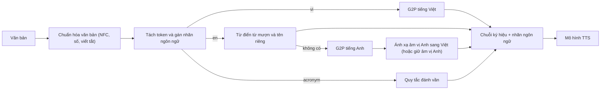

# Chương 30. Đa ngôn ngữ và trộn mã Việt–Anh

!!! abstract "Mục tiêu học tập"
    Sau chương này, bạn có thể:

    - **So sánh** các cách biểu diễn đầu vào cho TTS đa ngôn ngữ (ký hiệu riêng theo ngôn ngữ, IPA dùng chung, byte, BPE) và **chọn** cách phù hợp cho một hệ thống có tiếng Việt.
    - **Giải thích** vì sao người nói và ngôn ngữ bị dính vào nhau trong dữ liệu, và **cài đặt** bộ phân loại đối kháng với lớp đảo gradient để tách chúng.
    - **Chẩn đoán** các vấn đề của ngôn ngữ có thanh điệu trong mô hình đa ngôn ngữ và **áp dụng** các biện pháp: token thanh điệu, lấy mẫu cân bằng ngôn ngữ, đánh giá riêng thanh điệu.
    - **Thiết kế** một pipeline xử lý trộn mã Việt–Anh hoàn chỉnh: nhận diện token tiếng Anh, chính sách phát âm, từ điển từ mượn, ánh xạ âm vị Anh→Việt, G2P hỗn hợp.
    - **Cài đặt** bộ nhận diện ngôn ngữ mức token dựa trên ràng buộc âm tiết tiếng Việt và bộ xấp xỉ phát âm tiếng Anh theo kiểu Việt, kèm kiểm thử.
    - **Xây dựng** bộ kiểm thử trộn mã và các chỉ số đánh giá theo từng ngôn ngữ.

!!! info "Kiến thức cần có"
    - Cấu trúc âm tiết, thanh điệu, quy tắc chính tả tiếng Việt: [Chương 15](../phan-3-tin-hieu-ngu-am/ch15-ngu-am-tieng-viet.md).
    - Chuẩn hóa văn bản (số, viết tắt, NFC): [Chương 17](../phan-4-frontend/ch17-chuan-hoa-van-ban.md); G2P và biểu diễn đầu vào: [Chương 18](../phan-4-frontend/ch18-g2p-bieu-dien-dau-vao.md).
    - Điều kiện hóa người nói, embedding người nói: [Chương 28](ch28-da-nguoi-noi-voice-cloning.md); VITS: [Chương 27](ch27-vits.md).
    - Cách đánh giá bằng ASR (CER/WER): [Chương 38](../phan-9-thuc-tien/ch38-danh-gia-tts.md).

## 30.1. Vì sao cần TTS đa ngôn ngữ

Có ít nhất bốn động lực, và với tiếng Việt cả bốn đều có thật:

1. **Văn bản thực tế là văn bản trộn.** Báo chí công nghệ, tin nhắn, kịch bản chăm sóc khách hàng tiếng Việt chứa đầy từ tiếng Anh: *email, deadline, app, update*, tên thương hiệu, tên sản phẩm. Một hệ thống chỉ biết tiếng Việt sẽ đọc chúng sai hoặc đánh vần từng chữ cái.
2. **Chuyển giao cho ngôn ngữ ít tài nguyên.** Tiếng Việt có ít dữ liệu TTS chất lượng cao so với tiếng Anh hay tiếng Trung. Mô hình học chung nhiều ngôn ngữ có thể chia sẻ tri thức về âm học, về cách ghép âm, về vocoder.
3. **Một giọng, nhiều ngôn ngữ.** Một thương hiệu muốn cùng một giọng đọc nói được cả tiếng Việt lẫn tiếng Anh; một người dùng muốn nghe giọng mình nói tiếng nước ngoài.
4. **Vận hành.** Một mô hình đa ngôn ngữ dễ triển khai hơn nhiều mô hình riêng lẻ.

Nhưng đa ngôn ngữ cũng đặt ra những vấn đề mà mô hình một ngôn ngữ không gặp: các ngôn ngữ dùng **hệ ký hiệu** khác nhau, dữ liệu **mất cân bằng** nghiêm trọng, và trong dữ liệu, **người nói gần như luôn trùng với ngôn ngữ** (người Anh đọc tiếng Anh, người Việt đọc tiếng Việt). Phần đầu của chương xử lý những vấn đề này; phần sau đi sâu vào bài toán thực tế nhất đối với tiếng Việt: **trộn mã** (*code-switching*) Việt–Anh.

## 30.2. Biểu diễn đầu vào cho nhiều ngôn ngữ

### 30.2.1. Bốn lựa chọn

| Biểu diễn | Ý tưởng | Ưu điểm | Nhược điểm |
|---|---|---|---|
| Ký hiệu riêng theo ngôn ngữ | Mỗi ngôn ngữ một bảng ký tự/âm vị, không chồng lấn | Không nhầm lẫn giữa ngôn ngữ | Không chia sẻ tri thức; bảng ký hiệu phình to |
| IPA dùng chung | Mọi ngôn ngữ đưa về âm vị IPA qua G2P | Chia sẻ âm giống nhau (/m/, /a/…), hỗ trợ chuyển giao | Cần G2P tốt cho mọi ngôn ngữ; cùng ký hiệu IPA nhưng thực tế phát âm có thể khác |
| Byte UTF-8 | Đầu vào là chuỗi byte, bảng 256 ký hiệu | Không cần G2P, phủ mọi chữ viết | Chuỗi dài; mô hình phải tự học cách đọc |
| BPE trên văn bản thô | Token con học từ dữ liệu văn bản lớn | Hợp với TTS dựa trên mô hình ngôn ngữ lớn | Phát âm hoàn toàn học từ dữ liệu; token hiếm đọc kém |

Zhang và cộng sự (2019) cho thấy dùng **đầu vào âm vị** là một yếu tố then chốt để mô hình chia sẻ năng lực giữa các ngôn ngữ, so với ký tự riêng. Li và cộng sự (2019) đi theo hướng ngược lại với mô hình dùng **byte** cho cả nhận dạng và tổng hợp đa ngôn ngữ: bỏ hẳn G2P và bảng ký hiệu riêng, đổi lại mô hình phải tự học quan hệ chữ–âm. Các hệ thống lớn hiện đại ([Chương 34](../phan-8-mo-hinh-lon/ch34-he-thong-lai-hien-dai.md)) thường dùng BPE trên văn bản thô và dựa vào lượng dữ liệu khổng lồ.

### 30.2.2. IPA dùng chung: chia sẻ có giới hạn

IPA dùng chung nghe có vẻ lý tưởng, nhưng "cùng ký hiệu" không có nghĩa là "cùng âm". Ví dụ: /t/ tiếng Anh ở đầu từ có bật hơi, /t/ tiếng Việt thì không; nguyên âm /a/ của hai ngôn ngữ khác nhau về độ dài và vị trí. Nếu dùng chung ký hiệu mà không cho mô hình biết đang ở ngôn ngữ nào, mô hình sẽ "trung bình hóa", sinh ra giọng lơ lớ cả hai phía. Cách làm phổ biến là **IPA dùng chung + embedding ngôn ngữ** (Mục 30.3), để mô hình vừa chia sẻ được, vừa điều chỉnh được.

Hai quyết định riêng cho tiếng Việt khi đưa vào hệ IPA dùng chung:

- **Biểu diễn thanh điệu.** Có thể dùng chữ cái thanh điệu IPA (như ˧˥), số theo thang Chao, hoặc một token thanh riêng cho mỗi âm tiết ([Chương 18](../phan-4-frontend/ch18-g2p-bieu-dien-dau-vao.md)). Nếu trong hệ có ngôn ngữ thanh điệu khác (tiếng Quan Thoại, tiếng Quảng Đông, tiếng Thái), **không nên** dùng chung token thanh giữa các ngôn ngữ chỉ vì cùng tên hay cùng số: hệ thanh khác nhau về số lượng, đường nét và chất giọng. Gắn nhãn ngôn ngữ vào token thanh (ví dụ `vi_T3`, `zh_T3`) là cách an toàn.
- **Phương ngữ.** G2P phải chọn phương ngữ đích (Bắc, Nam…) và nhất quán với giọng đọc trong dữ liệu ([Chương 15](../phan-3-tin-hieu-ngu-am/ch15-ngu-am-tieng-viet.md)).

### 30.2.3. Byte và BPE: chuẩn hóa Unicode trở thành vấn đề sống còn

Với đầu vào byte hoặc BPE, **cách mã hóa Unicode** quyết định chuỗi đầu vào. Cùng một chữ "ế" ở dạng dựng sẵn (NFC) là 3 byte UTF-8, nhưng ở dạng tổ hợp (NFD) là 5 byte (chữ "e", dấu mũ, dấu sắc). Văn bản thu thập từ web thường trộn cả hai dạng. Nếu không chuẩn hóa, mô hình thấy hai chuỗi byte khác nhau cho cùng một chữ, phải học hai lần, và dạng hiếm hơn sẽ bị đọc kém. Quy tắc: **chuẩn hóa NFC và thống nhất cách đặt dấu (hòa/hoà) trước mọi bước token hóa**, ở cả huấn luyện lẫn suy luận ([Chương 17](../phan-4-frontend/ch17-chuan-hoa-van-ban.md)). Khối mã ở Mục 30.5 minh họa con số byte này.

## 30.3. Kiến trúc cho TTS đa ngôn ngữ

### 30.3.1. Embedding ngôn ngữ

Cách đơn giản và hiệu quả nhất: thêm một embedding ngôn ngữ $\mathbf{g}_{\text{lang}}$ (bảng tra theo mã ngôn ngữ) và đưa vào mô hình bằng đúng các cơ chế điều kiện hóa đã học ở [Chương 28](ch28-da-nguoi-noi-voice-cloning.md): cộng vào embedding ký hiệu, cộng vào đầu ra bộ mã hóa, hoặc FiLM. Trong văn bản trộn mã, embedding ngôn ngữ nên đặt **theo từng token** chứ không theo câu: mỗi token mang nhãn ngôn ngữ của chính nó, nhờ đó mô hình biết đoạn nào cần "chế độ tiếng Anh". YourTTS (Casanova và cộng sự, 2022) dùng embedding ngôn ngữ kiểu này trên nền VITS.

### 30.3.2. Bộ mã hóa riêng theo ngôn ngữ và sinh tham số theo ngữ cảnh

Một mức cao hơn là dùng **bộ mã hóa văn bản riêng** cho mỗi ngôn ngữ và một bộ giải mã chung. Cách này cô lập tốt nhưng số tham số tăng tuyến tính theo số ngôn ngữ và không chia sẻ được tri thức ở phía văn bản. Nekvinda và Dušek (2020) đề xuất một thỏa hiệp: **sinh tham số theo ngữ cảnh** (*contextual parameter generation*), trong đó tham số của bộ mã hóa được một mạng nhỏ sinh ra từ embedding ngôn ngữ. Các ngôn ngữ dùng chung "bộ sinh tham số", nên chia sẻ được tri thức, nhưng mỗi ngôn ngữ vẫn có bộ mã hóa thực sự khác nhau.

### 30.3.3. Người nói và ngôn ngữ: vấn đề dính nhau

Trong dữ liệu đa ngôn ngữ điển hình, mỗi người nói chỉ nói một ngôn ngữ. Từ góc nhìn của mô hình, nhãn người nói **hoàn toàn dự đoán được** ngôn ngữ và ngược lại. Hệ quả: nếu ta yêu cầu "giọng người Anh A đọc câu tiếng Việt", mô hình chưa từng thấy tổ hợp đó, và thông tin ngôn ngữ có thể đã bị "giấu" trong embedding người nói hoặc ngược lại. Kết quả thường là giọng sai, đọc lắp, hoặc giữ nguyên ngữ âm của ngôn ngữ gốc.

Zhang và cộng sự (2019) giải quyết bằng **học đối kháng miền** (*domain adversarial training*; Ganin và cộng sự, 2016): đặt một bộ phân loại người nói lên biểu diễn văn bản $\mathbf{h}^{\text{text}}$, nhưng nối qua một **lớp đảo gradient** (*gradient reversal layer*, GRL). Gọi $\theta_e$ là tham số bộ mã hóa văn bản, $\psi$ là tham số bộ phân loại. Mục tiêu là

$$
\min_{\theta_e,\,\theta_{\text{khác}}}\;\Big[\mathcal{L}_{\text{TTS}} - \lambda\,\mathcal{L}_{\text{spk}}(\theta_e, \psi^\ast)\Big], \qquad \psi^\ast = \arg\min_{\psi}\mathcal{L}_{\text{spk}}(\theta_e, \psi),
$$

trong đó $\mathcal{L}_{\text{spk}}$ là entropy chéo của bộ phân loại người nói. Bộ phân loại cố gắng đoán người nói từ $\mathbf{h}^{\text{text}}$; bộ mã hóa cố gắng làm cho việc đoán đó **thất bại**, tức là loại thông tin người nói khỏi biểu diễn văn bản. GRL hiện thực trò chơi min–max này trong một lần lan truyền ngược duy nhất: lan truyền xuôi là ánh xạ đồng nhất, lan truyền ngược nhân gradient với $-\lambda$. Như vậy $\psi$ nhận gradient bình thường (học phân loại tốt hơn), còn $\theta_e$ nhận gradient đã đảo dấu (học để "giấu" người nói).

Kết hợp với đầu vào âm vị và một bộ mã hóa dư (*residual encoder*, kiểu VAE) giúp ổn định attention, mô hình của Zhang và cộng sự tổng hợp được tiếng Tây Ban Nha và tiếng Quan Thoại trôi chảy bằng giọng của người nói tiếng Anh mà không cần dữ liệu song ngữ. Mã dưới đây cài đặt GRL và bộ phân loại đối kháng (dự đoán người nói ở **mọi token**), rồi kiểm chứng gradient tới bộ mã hóa đúng bằng $-\lambda$ lần gradient thông thường.

```python
import torch
import torch.nn as nn
import torch.nn.functional as F

class GradReverse(torch.autograd.Function):
    """Lan truyền xuôi: đồng nhất. Lan truyền ngược: nhân gradient với -lambda."""
    @staticmethod
    def forward(ctx, x, lam):
        ctx.lam = lam
        return x.view_as(x)

    @staticmethod
    def backward(ctx, grad_out):
        return -ctx.lam * grad_out, None

class SpeakerAdversary(nn.Module):
    """Bộ phân loại người nói đặt trên biểu diễn văn bản, nối qua lớp đảo gradient."""
    def __init__(self, channels, n_speakers, lam=1.0):
        super().__init__()
        self.lam = lam
        self.clf = nn.Sequential(nn.Linear(channels, 128), nn.ReLU(), nn.Linear(128, n_speakers))

    def forward(self, h_text, mask, spk):             # h_text: (B, N, C), mask: (B, N), spk: (B,)
        logits = self.clf(GradReverse.apply(h_text, self.lam))           # (B, N, K)
        loss = F.cross_entropy(logits.transpose(1, 2), spk[:, None].expand_as(mask), reduction="none")
        return (loss * mask).sum() / mask.sum()        # dự đoán người nói ở MỌI token

torch.manual_seed(0)
B, N, C, K = 4, 9, 32, 6
h = torch.randn(B, N, C, requires_grad=True)          # giả lập đầu ra bộ mã hóa văn bản
mask = torch.ones(B, N)
spk = torch.randint(0, K, (B,))
adv = SpeakerAdversary(C, K, lam=0.5)

loss = adv(h, mask, spk)
loss.backward()
g_rev = h.grad.clone()
h.grad = None
adv.lam = 0.0                                         # tắt đảo để so sánh: lam = 0 thì không có gradient
adv(h, mask, spk).backward()
assert torch.allclose(h.grad, torch.zeros_like(h))
h.grad = None
# So với gradient "thường" (không đảo): phải đúng bằng -lam lần
logits = adv.clf(h)
F.cross_entropy(logits.transpose(1, 2), spk[:, None].expand(B, N)).backward()
assert torch.allclose(g_rev, -0.5 * h.grad, atol=1e-6)
print("gradient tới bộ mã hóa đã bị đảo dấu và nhân 0.5")
```

!!! tip "Đối kháng không phải là phép màu"
    Bộ phân loại đối kháng chỉ loại được thông tin mà *chính nó* đọc ra được. Một bộ phân loại yếu sẽ "thua" sớm và bộ mã hóa vẫn giấu người nói ở dạng mà bộ phân loại không thấy. Ngược lại, $\lambda$ quá lớn làm biểu diễn văn bản mất cả thông tin ngữ âm cần thiết (vì một phần thông tin ngữ âm tương quan với ngôn ngữ, mà ngôn ngữ lại tương quan với người nói). Hãy tăng $\lambda$ dần theo lịch huấn luyện, theo dõi độ chính xác của bộ phân loại (mong muốn: gần mức đoán ngẫu nhiên) song song với CER của câu tổng hợp.

## 30.4. Ngôn ngữ có thanh điệu trong mô hình đa ngôn ngữ

Khi tiếng Việt chỉ là một phần nhỏ trong một mô hình đa ngôn ngữ do tiếng Anh chi phối, lỗi thanh điệu là triệu chứng đầu tiên và nghiêm trọng nhất. Lý do nằm ở bản chất khác nhau của F0 trong hai loại ngôn ngữ:

- Trong tiếng Anh, F0 mang **ngữ điệu** và trọng âm; biến thiên F0 trong một âm tiết phần lớn không khu biệt nghĩa từ. Mô hình học từ dữ liệu tiếng Anh sẽ coi đường nét F0 như "biến thiên tự do" có thể làm trơn.
- Trong tiếng Việt, F0 (cùng với chất giọng) **khu biệt nghĩa từ** ở từng âm tiết. Một độ dốc sai là một từ sai.

Nếu biểu diễn dùng chung (IPA, byte) và dữ liệu tiếng Việt chiếm vài phần trăm, các tham số dùng chung sẽ bị tối ưu chủ yếu cho kiểu F0 của tiếng Anh. Các triệu chứng thường gặp trong thực tế: thanh hỏi và ngã bị san bằng, thanh sắc thiếu độ lên, ngữ điệu câu kiểu tiếng Anh (nhấn và lên cao ở cuối câu hỏi) đè lên thanh của âm tiết cuối. Các biện pháp:

1. **Biểu diễn thanh tường minh**: token thanh riêng của tiếng Việt (Mục 30.2.2), không dùng chung với ngôn ngữ khác.
2. **Embedding ngôn ngữ theo token**, để mô hình chuyển "chế độ F0".
3. **Cân bằng lượng dữ liệu** bằng lấy mẫu theo nhiệt độ (Mục 30.5).
4. **Chuẩn hóa F0 theo người nói** (trong miền log) khi mô hình có bộ dự đoán cao độ tường minh, để hình dạng thanh được học tách khỏi mức giọng ([Chương 29](ch29-prosody-cam-xuc-phong-cach.md)).
5. **Đánh giá thanh điệu riêng**, bằng bộ câu cặp tối thiểu, thay vì chỉ nhìn CER tổng thể ([Chương 38](../phan-9-thuc-tien/ch38-danh-gia-tts.md)). CER thấp vẫn có thể che giấu lỗi thanh nếu mô hình ASR dùng để đo tự "sửa" theo ngữ cảnh.

## 30.5. Chuyển giao cho ngôn ngữ ít tài nguyên

### 30.5.1. Huấn luyện trước rồi tinh chỉnh

Chiến lược đơn giản và hiệu quả nhất cho tiếng Việt là **huấn luyện trước trên ngôn ngữ nhiều dữ liệu, rồi tinh chỉnh trên tiếng Việt**. Phần lớn tri thức của bộ giải mã và vocoder (cách tạo dạng sóng, cấu trúc phổ) không phụ thuộc ngôn ngữ. Một ví dụ cụ thể và kiểm chứng được: thẻ mô hình của giọng Piper tiếng Việt `vi_VN-vais1000-medium` ghi rằng nó được tinh chỉnh từ một giọng tiếng Anh ([Chương 27](ch27-vits.md)). Khi bảng ký hiệu thay đổi, có ba cách khởi tạo embedding cho ký hiệu mới: ngẫu nhiên; sao chép từ ký hiệu "gần nhất" ở ngôn ngữ nguồn (ví dụ /ɗ/ tiếng Việt lấy từ /d/); hoặc, nếu dùng IPA dùng chung, phần lớn ký hiệu đã có sẵn. Cách thứ hai thường giúp hội tụ nhanh hơn trong những bước đầu.

### 30.5.2. Mô hình đa ngôn ngữ quy mô lớn

Một hướng khác là dùng sẵn các mô hình được huấn luyện cho rất nhiều ngôn ngữ. Dự án MMS (Pratap và cộng sự, 2023) huấn luyện các mô hình VITS (Kim và cộng sự, 2021) riêng cho hơn một nghìn ngôn ngữ, có tiếng Việt (giấy phép không dùng thương mại tính đến thời điểm biên soạn; xem [Chương 27](ch27-vits.md)). Các mô hình zero-shot lớn dựa trên mô hình ngôn ngữ ([Phần VIII](../phan-8-mo-hinh-lon/ch34-he-thong-lai-hien-dai.md)) trong nhiều trường hợp không có tiếng Việt trong danh sách ngôn ngữ chính thức của bản phát hành gốc (tính đến thời điểm biên soạn), hoặc hỗ trợ ở mức hạn chế, nên cộng đồng thường tinh chỉnh chúng trên dữ liệu tiếng Việt ([Dự án 4](../phan-10-du-an/du-an-4-zero-shot-tts.md)). Danh sách ngôn ngữ được hỗ trợ thay đổi theo phiên bản; hãy kiểm tra thẻ mô hình.

### 30.5.3. Cân bằng ngôn ngữ khi huấn luyện chung

Khi trộn dữ liệu nhiều ngôn ngữ với lượng rất chênh lệch, lấy mẫu theo câu sẽ khiến ngôn ngữ ít dữ liệu gần như bị bỏ qua. Cách chuẩn (dùng rộng rãi trong các mô hình ngôn ngữ đa ngữ, ví dụ XLM-R của Conneau và cộng sự, 2020, với $\alpha = 0{,}3$) là lấy mẫu ngôn ngữ $l$ với xác suất

$$
p_l = \frac{n_l^{\alpha}}{\sum_{l'} n_{l'}^{\alpha}}, \qquad \alpha \in [0, 1],
$$

với $n_l$ là lượng dữ liệu (giờ hoặc số câu). $\alpha = 1$ là lấy theo tỉ lệ dữ liệu, $\alpha = 0$ là đều giữa các ngôn ngữ. Giá trị trung gian tăng tần suất của ngôn ngữ ít dữ liệu, đổi lại dữ liệu của chúng bị **lặp lại** nhiều lần hơn (nguy cơ quá khớp). Mã dưới đây tính các xác suất này cho một ví dụ giả định (500 giờ tiếng Anh, 300 giờ tiếng Trung, 20 giờ tiếng Việt), kèm hệ số lặp lại, và minh họa con số byte ở Mục 30.2.3.

```python
import unicodedata
import numpy as np

# (1) Biểu diễn byte: cùng một chữ "ế" nhưng số byte UTF-8 phụ thuộc dạng chuẩn hóa
for form in ("NFC", "NFD"):
    s = unicodedata.normalize(form, "Tiếng Việt")
    print(form, len(s), "ký tự,", len(s.encode("utf-8")), "byte")
assert len(unicodedata.normalize("NFC", "ế").encode("utf-8")) == 3
assert len(unicodedata.normalize("NFD", "ế").encode("utf-8")) == 5

# (2) Lấy mẫu cân bằng ngôn ngữ: p_l tỉ lệ với n_l ** alpha
def language_sampling_probs(hours, alpha):
    n = np.array(list(hours.values()), dtype=float)
    p = n ** alpha
    return dict(zip(hours, p / p.sum()))

hours = {"en": 500.0, "zh": 300.0, "vi": 20.0}
for alpha in (1.0, 0.5, 0.3, 0.0):
    p = language_sampling_probs(hours, alpha)
    boost = (p["vi"] / hours["vi"]) / (p["en"] / hours["en"])   # dữ liệu vi được lặp lại gấp bao nhiêu lần en
    print(f"alpha={alpha}: " + ", ".join(f"{k}={v:.3f}" for k, v in p.items()) + f" | vi lặp x{boost:.1f}")
assert abs(language_sampling_probs(hours, 1.0)["vi"] - 20 / 820) < 1e-12
assert abs(language_sampling_probs(hours, 0.0)["vi"] - 1 / 3) < 1e-12
```

Với $\alpha = 0{,}3$, tiếng Việt chiếm khoảng 17% số mẫu thay vì 2,4%, nhưng mỗi câu tiếng Việt được nhìn thấy nhiều gấp khoảng 9,5 lần một câu tiếng Anh. Với chỉ 20 giờ, mức lặp này dễ dẫn tới quá khớp; hãy theo dõi chất lượng trên tập kiểm tra tiếng Việt riêng.

## 30.6. Trộn mã Việt–Anh trong thực tế

Đây là phần mang tính thực hành nhất của chương. Mục tiêu: một hệ thống TTS tiếng Việt đọc được văn bản như "Em gửi file báo cáo qua email trước deadline nhé" một cách tự nhiên, nhất quán và đúng ý người dùng.

### 30.6.1. Phân loại hiện tượng

Không phải mọi từ "có gốc tiếng Anh" đều là trộn mã. Phân biệt rõ giúp chọn đúng cách xử lý:

| Loại | Ví dụ | Xử lý |
|---|---|---|
| Từ mượn đã Việt hóa chữ viết | cà phê, xe buýt, ti vi, phô mai, sô-cô-la | Là tiếng Việt; G2P tiếng Việt bình thường |
| Từ tiếng Anh giữ nguyên chữ viết, chen trong câu | email, deadline, file, meeting, update | Trộn mã thật sự: cần nhận diện + chính sách phát âm |
| Tên riêng, thương hiệu, sản phẩm | Facebook, YouTube, iPhone 15 Pro Max, Grab | Từ điển tên riêng ưu tiên; cách đọc theo thói quen phổ biến |
| Từ viết tắt tiếng Anh | AI, CEO, USB, GPS | Chính sách đánh vần (tên chữ cái Việt hay Anh) hoặc đọc như từ |
| Từ viết tắt tiếng Việt | UBND, TP.HCM, THPT | Chuẩn hóa văn bản ([Chương 17](../phan-4-frontend/ch17-chuan-hoa-van-ban.md)) |
| Token trộn chữ và số | 5G, COVID-19, H5N1, mp3 | Chuẩn hóa văn bản trước, rồi xử lý từng phần |
| Câu/cụm tiếng Anh hoàn chỉnh | "Thank you so much", tên bài hát | Phát âm tiếng Anh (nếu mô hình có khả năng) hoặc Việt hóa |

Nhiều loại trong bảng (từ viết tắt, token trộn chữ và số) là các *từ không chuẩn* (*non-standard words*) theo phân loại của Sproat và cộng sự (2001), nên được xử lý ở bước chuẩn hóa văn bản trước khi bàn đến chuyện ngôn ngữ.

### 30.6.2. Nhận diện token tiếng Anh

Bước đầu tiên là gán nhãn ngôn ngữ cho từng token. Với cặp Việt–Anh, ta có một lợi thế lớn: **cấu trúc âm tiết tiếng Việt rất chặt** ([Chương 15](../phan-3-tin-hieu-ngu-am/ch15-ngu-am-tieng-viet.md)). Một token có thể được xác định là tiếng Việt hay không bằng các tín hiệu sau, theo thứ tự độ tin cậy:

1. **Dấu tiếng Việt.** Có dấu thanh hoặc các chữ ă, â, đ, ê, ô, ơ, ư: gần như chắc chắn là tiếng Việt.
2. **Chữ cái ngoài bảng chữ cái tiếng Việt.** Có f, j, w, z: không phải âm tiết tiếng Việt thuần (tên riêng mượn có thể có, nhưng cũng nên xử lý như từ nước ngoài).
3. **Không phân tích được thành âm tiết tiếng Việt.** Tiếng Việt không có cụm phụ âm đầu (*str-, bl-, gr-*), chỉ cho phép một tập nhỏ âm cuối (c, ch, m, n, ng, nh, p, t và bán âm), và có quy tắc chính tả c/k, g/gh, ng/ngh. "laptop", "check", "team", "email" đều vi phạm.
4. **Ràng buộc thanh điệu của âm tiết tắc.** Một âm tiết tiếng Việt kết thúc bằng p, t, c, ch **chỉ** mang thanh sắc hoặc nặng, nên phải có dấu. Vì vậy một token *không dấu* như "chat", "top", "bit" không thể là âm tiết tiếng Việt viết đúng chính tả. Đây là một quy tắc mạnh mà nhiều bộ nhận diện bỏ qua.
5. **Chữ hoa giữa từ** (iPhone, YouTube): tiếng Việt không có.
6. **Mơ hồ thật sự.** Những token hợp lệ ở cả hai ngôn ngữ ("con", "ban", "tin", "an", "me") cần **ngữ cảnh**: nhìn nhãn của các token chắc chắn gần nhất. Trong một câu tiếng Việt, mặc định là tiếng Việt.

Mã dưới đây cài đặt bộ nhận diện theo đúng các tín hiệu trên. Nó không cần dữ liệu huấn luyện, chạy rất nhanh, và có thể làm *đặc trưng* hoặc *nhãn yếu* cho một bộ phân loại học máy về sau.

```python
import re
import unicodedata

VI_LETTERS = set("aăâbcdđeêghiklmnoôơpqrstuưvxy")        # không có f, j, w, z
TONE_MARKS = "".join(map(chr, (0x300, 0x301, 0x303, 0x309, 0x323)))  # huyền, sắc, ngã, hỏi, nặng (NFD)
ONSETS = ["ngh", "ng", "nh", "ch", "gh", "gi", "kh", "ph", "th", "tr", "qu",
          "b", "c", "d", "g", "h", "k", "l", "m", "n", "p", "r", "s", "t", "v", "x", ""]
NUCLEI = {"a", "e", "i", "o", "u", "y", "ai", "ao", "au", "ay", "eo", "ia", "iu", "oa", "oe",
          "oi", "ua", "ui", "uy", "oai", "oay", "oeo", "uya", "uyu"}   # vần không dấu mũ/móc
NO_CODA = {"ai", "ao", "au", "ay", "eo", "iu", "oi", "ui", "oai", "oay", "oeo", "uyu", "ia", "ua", "uya"}
CODAS = ["ng", "nh", "ch", "c", "m", "n", "p", "t", ""]
EN_COMMON = {"the", "an", "to", "in", "on", "me", "do", "can", "ban", "tin", "con"}  # trùng dạng với âm tiết Việt

def split_tone(w):
    """Bỏ dấu thanh (giữ ă, â, ê, ô, ơ, ư, đ). Trả về (chữ còn lại, có dấu thanh không)."""
    nfd = unicodedata.normalize("NFD", w)
    base = "".join(c for c in nfd if c not in TONE_MARKS)
    return unicodedata.normalize("NFC", base), len(base) < len(nfd)

def is_plain_vi_syllable(w):
    """w viết thường, không dấu: có thể là một âm tiết tiếng Việt mang thanh ngang không?"""
    for on in ONSETS:
        if not w.startswith(on):
            continue
        rest = w[len(on):]
        for co in CODAS:
            if not rest.endswith(co) or len(rest) == len(co):
                continue
            nu = rest[:len(rest) - len(co)]
            if nu not in NUCLEI or (co and nu in NO_CODA):
                continue
            if co in ("c", "ch", "p", "t"):          # âm tiết tắc chỉ mang thanh sắc/nặng => phải có dấu
                continue
            if co in ("ch", "nh") and nu not in ("a", "i", "oa", "uy"):
                continue
            front = nu[0] in "eiy"
            if (on in ("k", "gh", "ngh") and not front) or (on in ("c", "g", "ng") and front):
                continue                             # quy tắc chính tả c/k, g/gh, ng/ngh
            return True
    return False

def token_lang(tok):
    if re.fullmatch(r"[^\w]+", tok):
        return "punct"
    if any(ch.isdigit() for ch in tok):
        return "num"                                 # để chuẩn hóa văn bản xử lý (Chương 17)
    if len(tok) >= 2 and tok.isupper():
        return "acronym"
    if re.search(r"[a-z][A-Z]", tok):                # chữ hoa giữa từ: iPhone, YouTube
        return "en"
    base, has_tone = split_tone(tok.lower())
    if not set(base) <= VI_LETTERS:
        return "en"                                  # có chữ cái ngoài bảng chữ cái tiếng Việt
    if has_tone or set(base) & set("ăâđêôơư"):
        return "vi"                                  # có dấu tiếng Việt
    if not is_plain_vi_syllable(base):
        return "en"                                  # không thể là âm tiết tiếng Việt
    return "vi?" if base in EN_COMMON else "vi"      # hợp lệ cả hai: để ngữ cảnh quyết định

def tag_sentence(text):
    toks = re.findall(r"\w+|[^\w\s]", text)
    labs = [token_lang(t) for t in toks]
    sure = [i for i, lab in enumerate(labs) if lab in ("vi", "en")]
    out = []
    for i, lab in enumerate(labs):                   # token mơ hồ: xem token chắc chắn gần nhất hai bên
        if lab == "vi?":
            ctx = [labs[j] for j in sure if j < i][-1:] + [labs[j] for j in sure if j > i][:1]
            lab = "en" if ctx and all(c == "en" for c in ctx) else "vi"
        out.append(lab)
    return list(zip(toks, out))

tags = dict(tag_sentence("Em gửi file báo cáo qua email cho anh trước deadline nhé."))
assert tags["file"] == tags["email"] == tags["deadline"] == "en" and tags["gửi"] == "vi"
tags = dict(tag_sentence("Tải app Grab trên iPhone 15 Pro Max để chat với AI"))
assert [tags[w] for w in ["app", "Grab", "iPhone", "Pro", "Max", "chat"]] == ["en"] * 6
assert tags["15"] == "num" and tags["AI"] == "acronym" and tags["trên"] == "vi"
assert dict(tag_sentence("Chính phủ ban hành lệnh cấm"))["ban"] == "vi"
assert dict(tag_sentence("The ban was lifted"))["ban"] == "en"
assert token_lang("hoa") == "vi" and token_lang("team") == "en" and token_lang("café") == "en"
print(tag_sentence("Em check mail rồi update lên team nhé"))
```

Bộ nhận diện này có những giới hạn cần biết. Văn bản tiếng Việt **không dấu** (gõ vội, tin nhắn) sẽ bị gán nhầm thành tiếng Anh, vì bài toán khôi phục dấu là một bài toán riêng. Tên riêng tiếng Việt viết không dấu ("Nguyen") cũng vậy. Các từ hợp lệ ở cả hai ngôn ngữ được giải quyết bằng ngữ cảnh rất thô. Trong sản phẩm, nên dùng bộ quy tắc này làm tầng đầu, kết hợp **từ điển** (danh sách từ tiếng Anh phổ biến trong văn bản tiếng Việt, tên thương hiệu) và một **bộ phân loại học máy** nhỏ (ví dụ mô hình n-gram ký tự hoặc một bộ gán nhãn chuỗi) huấn luyện trên dữ liệu gán nhãn tay từ đúng miền văn bản của bạn.

### 30.6.3. Chính sách phát âm

Sau khi biết token nào là tiếng Anh, câu hỏi quan trọng nhất **không phải kỹ thuật** mà là sản phẩm: *đọc nó thế nào?* Có ba chính sách:

1. **Việt hóa** (*Vietnamized*): đọc theo hệ âm vị tiếng Việt, như phần lớn người Việt nói hằng ngày: "email" → "i-meo", "laptop" → "láp-tóp", "Facebook" → "phây-búc", "online" → "on-lai". Ưu điểm: tự nhiên với đa số người nghe, mô hình chỉ cần âm vị tiếng Việt. Nhược điểm: có thể nghe "quê" với người nghe trẻ, thành thạo tiếng Anh hoặc trong bối cảnh trang trọng; tên riêng bị biến dạng.
2. **Tiếng Anh** (*English*): đọc như người bản ngữ hoặc gần như vậy. Ưu điểm: chính xác, hợp với nội dung giáo dục, tên riêng nước ngoài. Nhược điểm: mô hình cần âm vị tiếng Anh và dữ liệu tiếng Anh (lý tưởng là của cùng người nói); chuyển "chế độ" giữa câu dễ nghe giật cục.
3. **Lai**: một **từ điển** cố định cho các từ thông dụng (theo thói quen phổ biến, thường là Việt hóa), các từ còn lại xử lý theo một trong hai cách trên.

Lựa chọn phụ thuộc **đối tượng người nghe** và **miền nội dung**: tổng đài chăm sóc khách hàng đại chúng thường hợp với Việt hóa; ứng dụng học tiếng Anh cần phát âm tiếng Anh; tin tức công nghệ có thể dùng lai. Điều quan trọng nhất là **nhất quán**: cùng một từ phải được đọc giống nhau trong toàn hệ thống, và phải khớp với cách giọng đọc trong dữ liệu huấn luyện đã đọc các từ đó.

!!! note "Góc tiếng Việt: cách đọc Việt hóa không có chuẩn duy nhất"
    Cách đọc Việt hóa thay đổi theo vùng miền, thế hệ và lĩnh vực: "video" có thể là "vi-đê-ô" (dấu vết tiếng Pháp) hay "vi-đi-ô"; "Google" có người đọc gần tiếng Anh, có người đọc kiểu Việt hóa mạnh; từ viết tắt "AI" có thể đọc "ây-ai" (tên chữ cái tiếng Anh) hay "a-i" (tên chữ cái tiếng Việt). Không có "đáp án đúng" chung; hãy quyết định bằng một bảng chính sách được nhóm sản phẩm thống nhất, ghi rõ trong tài liệu, và cho người đọc trong phòng thu đọc theo đúng bảng đó. Các ví dụ cách đọc trong chương này chỉ mang tính minh họa.

### 30.6.4. Từ điển từ mượn và ánh xạ âm vị Anh→Việt

Với chính sách Việt hóa, phần lõi là một **từ điển từ mượn** (ánh xạ từ tiếng Anh → chuỗi âm tiết tiếng Việt) cho vài nghìn từ thông dụng nhất trong miền của bạn. Từ điển này nên được biên soạn và duyệt bởi người, vì nó quyết định trải nghiệm. Với những từ ngoài từ điển, ta cần một phương án dự phòng tự động: lấy phát âm tiếng Anh (từ CMUdict hoặc một mô hình G2P tiếng Anh, [Chương 18](../phan-4-frontend/ch18-g2p-bieu-dien-dau-vao.md)) rồi **ánh xạ âm vị Anh→Việt** theo các ràng buộc âm tiết tiếng Việt. Bảng dưới đây tóm tắt các ánh xạ thường gặp (dạng chữ viết tiếng Việt cho dễ đọc; giá trị âm thật phụ thuộc phương ngữ):

| Âm tiếng Anh | Ví dụ | Xấp xỉ tiếng Việt | Ghi chú |
|---|---|---|---|
| /f/ | file | ph | Có sẵn trong tiếng Việt |
| /θ/, /ð/ | thank, the | th, đ | Mất tính xát |
| /ʃ/ | show | s | Phương ngữ Bắc không phân biệt s/x |
| /dʒ/, /ʒ/ | job | gi | |
| /tʃ/ | chat | ch | |
| /w/ đầu âm tiết | wifi | âm đệm o/u ("oai") | |
| /j/ + /uː/ | YouTube | d + "iu" ("diu") | |
| /æ/ | app, laptop | a | |
| /ʌ/, /ə/, /ɜː/ | cup, burger | â, ơ | |
| /eɪ/, /aɪ/, /oʊ/ | Facebook, file, video | ây, ai, ô | |
| /l/ cuối âm tiết | email, file | bán âm o/u, hoặc bỏ | Tiếng Việt không có /l/ cuối |
| /s/, /z/, /v/, /f/ cuối | bus, five | bỏ, hoặc đổi thành âm tắc | |
| /b/, /d/, /g/ cuối | grab, bad | p, t, c | Âm cuối tiếng Việt là âm tắc vô thanh |
| Cụm phụ âm đầu | grab, stress | chèn nguyên âm: "gờ", "xì" | Tiếng Việt không có cụm phụ âm đầu |

Ngoài âm đoạn, còn phải **gán thanh điệu**, vì mỗi âm tiết tiếng Việt bắt buộc mang một thanh. Ba quy tắc kinh nghiệm cho kết quả nghe khá tự nhiên: (1) âm tiết kết thúc bằng âm tắc p, t, c nhận **thanh sắc** (ràng buộc âm vị học, như ở Mục 30.6.2); (2) âm tiết được chèn thêm do cụm phụ âm nhận **thanh huyền** ("gờ", "xì"); (3) các âm tiết còn lại nhận **thanh ngang**. Trọng âm tiếng Anh có thể dùng để tinh chỉnh thêm (âm tiết mang trọng âm chính đôi khi được Việt hóa bằng thanh sắc), nhưng đó là quy tắc mềm.

Mã dưới đây là một bộ ánh xạ **đồ chơi** cài đặt đúng các quy tắc trên: âm tiết hóa chuỗi ARPAbet (mỗi nguyên âm là một hạt nhân, phụ âm cuối cùng trước nguyên âm làm âm đầu), ánh xạ âm đầu, vần, âm cuối, áp quy tắc chính tả c/k, g/gh, rồi gán thanh. Phát âm tiếng Anh được ghi cứng cho vài từ để khối mã chạy độc lập; trong thực tế, hãy tra CMUdict hoặc chạy một mô hình G2P tiếng Anh.

```python
import unicodedata

# Phát âm kiểu CMUdict (ARPAbet, số = trọng âm). Thực tế: tra CMUdict hoặc chạy G2P tiếng Anh.
CMU = {"laptop": "L AE1 P T AA2 P", "email": "IY1 M EY2 L", "facebook": "F EY1 S B UH2 K",
       "online": "AA1 N L AY2 N", "file": "F AY1 L", "video": "V IH1 D IY0 OW0",
       "youtube": "Y UW1 T UW2 B", "grab": "G R AE1 B", "wifi": "W AY1 F AY2",
       "deadline": "D EH1 D L AY2 N", "check": "CH EH1 K", "team": "T IY1 M"}
VOWEL = {"AA": "o", "AE": "a", "AH": "ơ", "AO": "o", "AW": "ao", "AY": "ai", "EH": "e", "ER": "ơ",
         "EY": "ây", "IH": "i", "IY": "i", "OW": "ô", "OY": "oi", "UH": "u", "UW": "u"}
ONSET = {"B": "b", "CH": "ch", "D": "đ", "DH": "đ", "F": "ph", "G": "g", "HH": "h", "JH": "gi",
         "K": "c", "L": "l", "M": "m", "N": "n", "NG": "ng", "P": "p", "R": "r", "S": "x", "SH": "s",
         "T": "t", "TH": "th", "V": "v", "W": "", "Y": "d", "Z": "d", "ZH": "gi"}
CODA = {"P": "p", "B": "p", "T": "t", "D": "t", "K": "c", "G": "c", "M": "m", "N": "n", "NG": "ng"}
STOPS = {"p", "t", "c"}
MARK = {"sắc": chr(0x301), "huyền": chr(0x300), "ngang": ""}   # dấu thanh dạng kết hợp (NFD)

def add_tone(syl, tone):
    """Đặt dấu thanh lên nguyên âm đầu tiên của vần (đủ cho các vần sinh ra ở đây)."""
    for i, ch in enumerate(syl):
        if ch in "aăâeêioôơuưy":
            return unicodedata.normalize("NFC", syl[:i + 1] + MARK[tone] + syl[i + 1:])
    return syl

def syllabify(phones):
    """Mỗi nguyên âm là một hạt nhân; phụ âm cuối cùng trước nguyên âm làm âm đầu, phần dư làm âm cuối."""
    nuclei = [i for i, p in enumerate(phones) if p[-1].isdigit()]
    syls = []
    for k, v in enumerate(nuclei):
        start = nuclei[k - 1] + 1 if k else 0
        end = nuclei[k + 1] if k + 1 < len(nuclei) else len(phones)
        cons_before, cons_after = phones[start:v], phones[v + 1:end]
        if k + 1 < len(nuclei):                      # phụ âm giữa hai nguyên âm: chừa 1 cho âm tiết sau
            cons_after = cons_after[:-1]
        extra = cons_before[:-1] if k == 0 else []   # cụm phụ âm đầu từ (vd. G R) -> thêm âm tiết
        syls.append((extra, cons_before[-1:], phones[v][:-1], cons_after))
    return syls

def approx_vi(word):
    out = []
    for extra, onset, vowel, coda in syllabify(CMU[word.lower()].split()):
        for c in extra:                              # chèn nguyên âm: "gờ", "xì"
            out.append("xì" if c == "S" else add_tone(ONSET[c] + "ơ", "huyền"))
        on = ONSET[onset[0]] if onset else ""
        nu = VOWEL[vowel]
        if onset == ["W"]:
            nu = "o" + nu                            # w + ai -> oai
        if onset == ["Y"] and vowel in ("UW", "UH"):
            nu = "iu"                                # you -> diu
        co = next((CODA[c] for c in coda if c in CODA), "")   # giữ âm cuối hợp lệ đầu tiên
        if not co and "L" in coda and nu in ("ây", "e"):
            nu = "eo"                                # /l/ cuối -> bán âm: email -> "meo"
        if co and len(nu) > 1 and nu[-1] in "iuyo":  # vần đã có bán âm cuối: bỏ âm cuối
            co = ""
        if co == "c" and nu in ("i", "ê"):
            co = "ch"                                # chính tả: ích, ếch
        if nu[0] in "eêiy":                          # chính tả c/k, g/gh trước e, ê, i
            on = {"c": "k", "g": "gh", "ng": "ngh"}.get(on, on)
        tone = "sắc" if co in STOPS else "ngang"     # âm tiết tắc bắt buộc thanh sắc/nặng
        out.append(add_tone(on + nu + co, tone))
    return " ".join(out)

expected = {"laptop": "láp tóp", "email": "i meo", "facebook": "phây búc", "online": "on lai",
            "file": "phai", "youtube": "diu túp", "grab": "gờ ráp", "wifi": "oai phai",
            "deadline": "đét lai", "check": "chéc", "team": "tim", "video": "vi đi ô"}
for w, ref in expected.items():
    got = approx_vi(w)
    print(f"{w:9s} -> {got}")
    assert got == ref, (w, got)
```

Hãy để ý kết quả "video" → "vi đi ô": bộ ánh xạ đi theo phát âm tiếng Anh, trong khi nhiều người Việt quen đọc "vi-đê-ô". Đó chính là lý do **từ điển từ mượn phải được tra trước**, và bộ ánh xạ tự động chỉ là phương án dự phòng. Tương tự, "laptop" ra "láp tóp" trong khi nhiều người viết và đọc "láp tốp"; cả hai đều chấp nhận được, nhưng hệ thống phải chọn một.

### 30.6.5. Pipeline G2P hỗn hợp

Ghép các mảnh lại, một frontend xử lý trộn mã có dạng:



Tùy chính sách phát âm, đầu ra của frontend có hai dạng, kéo theo hai yêu cầu dữ liệu khác nhau:

- **(i) Toàn bộ là âm vị tiếng Việt** (chính sách Việt hóa): mô hình TTS không cần biết tiếng Anh. Chỉ cần dữ liệu huấn luyện có đủ các âm tiết "lạ" sinh ra từ từ mượn (ví dụ "phây", "diu", âm đầu /p/ vốn hiếm trong từ thuần Việt). Nên thêm vào kịch bản thu âm vài trăm câu chứa các từ mượn thông dụng, được đọc theo đúng bảng chính sách.
- **(ii) Hợp của hai bộ âm vị, kèm nhãn ngôn ngữ theo token**: mô hình phải học âm vị tiếng Anh. Lý tưởng nhất là người đọc song ngữ thu thêm dữ liệu tiếng Anh. Nếu không, dùng huấn luyện đa người nói, đa ngôn ngữ với kỹ thuật tách người nói (Mục 30.3.3) để "mượn" âm vị tiếng Anh từ người nói khác; chất lượng phụ thuộc mạnh vào mức độ tách bạch đạt được, và thường vẫn còn giọng lơ lớ.

Với **từ viết tắt**, cần một bảng chính sách riêng: đọc theo tên chữ cái tiếng Việt ("VTV" → "vê-tê-vê"), theo tên chữ cái tiếng Anh ("CEO" thường được đọc theo tên chữ cái tiếng Anh), hay như một từ ("NASA"). Các từ viết tắt tiếng Việt cần khai triển thành từ đầy đủ ("UBND" → "ủy ban nhân dân") thuộc về chuẩn hóa văn bản ([Chương 17](../phan-4-frontend/ch17-chuan-hoa-van-ban.md)).

### 30.6.6. Mô hình lớn xử lý trộn mã một cách ngầm định

Các hệ thống TTS dựa trên mô hình ngôn ngữ lớn, huấn luyện trên hàng chục nghìn giờ dữ liệu "tự nhiên" với đầu vào là văn bản thô (BPE), có thể đọc trộn mã **mà không cần frontend riêng**: nếu dữ liệu tiếng Việt của chúng có nhiều câu chứa "email", "deadline", mô hình học luôn cách đọc phổ biến nhất. Ưu điểm là tự nhiên, ngữ điệu liền mạch qua ranh giới ngôn ngữ. Nhưng có những rủi ro thực tế:

- **Không nhất quán**: cùng một từ có thể lúc Việt hóa lúc tiếng Anh, tùy ngữ cảnh và tùy lần lấy mẫu.
- **Từ hiếm đọc sai**: tên thương hiệu mới, thuật ngữ chuyên ngành ít gặp trong dữ liệu.
- **Lời nhắc âm thanh chi phối**: với mô hình nhân bản giọng, giọng tham chiếu là người nói tiếng Việt thì phần tiếng Anh cũng thường mang giọng Việt, và ngược lại.

Một kỹ thuật kiểm soát đơn giản và hiệu quả là **viết lại văn bản đầu vào**: thay từ tiếng Anh bằng cách viết Việt hóa trong từ điển ("i-meo") khi muốn ép cách đọc Việt hóa, hoặc giữ nguyên chữ viết tiếng Anh khi muốn mô hình đọc theo kiểu tiếng Anh. Đây là một dạng "G2P ở mức lời nhắc", tận dụng chính pipeline ở Mục 30.6.5 nhưng xuất ra chữ viết thay vì âm vị ([Chương 34](../phan-8-mo-hinh-lon/ch34-he-thong-lai-hien-dai.md)).

## 30.7. Đánh giá trộn mã

Đánh giá một hệ thống trộn mã cần tách theo **ngôn ngữ** và theo **loại hiện tượng**, vì một chỉ số tổng hợp sẽ che giấu đúng những lỗi ta quan tâm.

**Bộ kiểm thử.** Xây một tập câu kiểm thử riêng (vài trăm câu là khởi đầu tốt) bao phủ các loại ở bảng Mục 30.6.1, mỗi loại có các mức độ khó: từ tiếng Anh thông dụng, từ hiếm, tên thương hiệu, từ viết tắt, token trộn số, cụm tiếng Anh dài, và **các token mơ hồ** ("con", "ban"). Ghi sẵn cách đọc mong muốn theo bảng chính sách cho từng câu.

**Chỉ số khách quan.**

- **CER/WER theo từng ngôn ngữ**: chạy ASR trên câu tổng hợp, căn chỉnh với văn bản tham chiếu, rồi tính lỗi riêng trên các token tiếng Việt và các token tiếng Anh. Với cặp Trung–Anh, cộng đồng hay dùng *mixed error rate* (ký tự cho tiếng Trung, từ cho tiếng Anh); với tiếng Việt, đơn vị âm tiết và từ tiếng Anh đều đã cách nhau bởi khoảng trắng nên WER trên token là tự nhiên.
- **Chuẩn hóa trước khi chấm**: ASR có thể viết "email" thành "i meo" hoặc ngược lại. Hãy đưa cả tham chiếu lẫn giả thuyết về một **dạng chuẩn** bằng chính từ điển từ mượn (ánh xạ mọi biến thể về một khóa), nếu không, chỉ số sẽ phạt oan những cách đọc đúng chính sách ([Chương 38](../phan-9-thuc-tien/ch38-danh-gia-tts.md)).
- **Giới hạn của ASR**: bản thân ASR cũng yếu với trộn mã. Một ASR chỉ học tiếng Việt sẽ không nhận ra từ tiếng Anh dù được đọc chuẩn. Nên kiểm tra ASR trên ghi âm thật của chính bộ kiểm thử trước khi dùng nó để chấm TTS.

**Đánh giá chủ quan.** Hỏi người nghe hai câu riêng biệt: (1) từ tiếng Anh có được đọc **đúng chính sách** không (đúng/sai/chấp nhận được), và (2) câu có **liền mạch** không, hay nghe như hai giọng ghép lại. Chọn người nghe đại diện cho người dùng đích: một tổng đài cho đại chúng nên được người nghe đại chúng chấm, không chỉ kỹ sư thạo tiếng Anh. Với các câu chứa từ tiếng Anh, vẫn kiểm tra **thanh điệu** của các âm tiết tiếng Việt xung quanh: một lỗi phổ biến là ngữ điệu kiểu tiếng Anh "lan" sang âm tiết tiếng Việt kế bên.

!!! note "Góc tiếng Việt: dữ liệu huấn luyện quyết định tất cả"
    Dù chọn chính sách nào, mô hình chỉ đọc được những gì nó đã nghe. Nếu kịch bản thu âm hoàn toàn là văn bản "thuần Việt" (như nhiều bộ dữ liệu đọc tin tức, văn học), mô hình sẽ lúng túng với các âm tiết Việt hóa hiếm ("phây", "diu", "oai") và với âm đầu /p/. Khi thiết kế kịch bản ([Chương 36](../phan-9-thuc-tien/ch36-du-lieu-tts.md)), hãy dành một phần cho câu trộn mã thực tế của miền ứng dụng, đọc theo bảng chính sách. Đồng thời, **văn bản chuyển ngữ** (*transcript*) của các câu này phải được chuẩn hóa đúng như frontend sẽ làm lúc suy luận: nếu transcript ghi "email" mà frontend lúc suy luận lại sinh "i meo", mô hình sẽ thấy hai đầu vào khác nhau cho cùng một âm thanh.

## Lỗi thường gặp và mẹo thực hành

- **Không chuẩn hóa Unicode trước khi token hóa.** NFC/NFD và cách đặt dấu lẫn lộn tạo ra các chuỗi byte/BPE khác nhau cho cùng một chữ. Chuẩn hóa ở cả dữ liệu huấn luyện lẫn suy luận.
- **Dùng chung token thanh giữa các ngôn ngữ có thanh điệu.** Thanh 3 của tiếng Quan Thoại không phải thanh hỏi; gắn nhãn ngôn ngữ cho token thanh.
- **Nhãn ngôn ngữ theo câu thay vì theo token.** Trong câu trộn mã, nhãn ngôn ngữ mức câu khiến mô hình đọc từ tiếng Anh bằng "chế độ tiếng Việt" (hoặc ngược lại). Gán nhãn theo token.
- **Bộ nhận diện ngôn ngữ phá văn bản tiếng Việt không dấu.** Nếu nguồn văn bản có thể thiếu dấu, phải khôi phục dấu trước, hoặc ít nhất phát hiện câu không dấu và xử lý riêng; nếu không, cả câu bị đọc như tiếng Anh.
- **Từ điển từ mượn không đồng bộ với dữ liệu.** Người đọc trong phòng thu đọc "vi-đê-ô" nhưng từ điển ghi "vi-đi-ô": mô hình học một đằng, frontend đưa một nẻo. Cho người đọc dùng chính bảng chính sách khi thu âm.
- **Lạm dụng lấy mẫu cân bằng.** $\alpha$ quá nhỏ làm dữ liệu ngôn ngữ ít tài nguyên lặp lại quá nhiều, quá khớp và nghe "đọc thuộc lòng". Bắt đầu với $\alpha \approx 0{,}3$–$0{,}5$ và giám sát tập kiểm tra theo từng ngôn ngữ.
- **Đánh giá chỉ bằng CER tổng.** Lỗi trên vài token tiếng Anh bị pha loãng bởi hàng trăm âm tiết tiếng Việt đúng. Luôn báo cáo theo từng ngôn ngữ và từng loại hiện tượng.
- **Chuyển giọng xuyên ngôn ngữ nhưng giữ âm sắc nhầm.** Khi tách người nói khỏi biểu diễn văn bản quá mạnh, giọng tổng hợp có thể mất cả đặc trưng người nói. Đo đồng thời độ giống người nói (SECS, [Chương 28](ch28-da-nguoi-noi-voice-cloning.md)) và độ dễ hiểu.

## Tóm tắt

- TTS đa ngôn ngữ giúp xử lý văn bản trộn mã, chuyển giao cho ngôn ngữ ít tài nguyên như tiếng Việt và cho phép một giọng nói nhiều thứ tiếng.
- Biểu diễn đầu vào: ký hiệu riêng (an toàn, không chia sẻ), IPA dùng chung (chia sẻ, cần G2P), byte hoặc BPE (không cần G2P, cần chuẩn hóa Unicode chặt chẽ và nhiều dữ liệu).
- Embedding ngôn ngữ theo token là cơ chế cơ bản; bộ mã hóa riêng hoặc sinh tham số theo ngữ cảnh là các mức cô lập cao hơn.
- Người nói và ngôn ngữ dính nhau trong dữ liệu; bộ phân loại người nói đối kháng với lớp đảo gradient giúp loại thông tin người nói khỏi biểu diễn văn bản.
- Thanh điệu tiếng Việt dễ bị "làm trơn" trong mô hình do ngôn ngữ không thanh điệu chi phối; cần token thanh riêng, embedding ngôn ngữ, cân bằng dữ liệu $p_l \propto n_l^\alpha$ và đánh giá thanh riêng.
- Nhận diện token tiếng Anh trong văn bản tiếng Việt có thể dựa trên ràng buộc âm tiết tiếng Việt (dấu, chữ cái, cấu trúc âm tiết, âm tiết tắc bắt buộc thanh sắc/nặng), kết hợp từ điển và ngữ cảnh.
- Chính sách phát âm (Việt hóa, tiếng Anh, lai) là quyết định sản phẩm; nhất quán giữa từ điển, dữ liệu huấn luyện và frontend là yếu tố quyết định.
- Ánh xạ âm vị Anh→Việt cần âm tiết hóa, xử lý cụm phụ âm, âm cuối không hợp lệ và gán thanh; từ điển từ mượn luôn được ưu tiên trước ánh xạ tự động.
- Đánh giá trộn mã theo từng ngôn ngữ và từng loại hiện tượng, chuẩn hóa biến thể cách viết trước khi tính lỗi, và kiểm tra cả chính ASR dùng để chấm.

## Bài tập

**Bài 1 [Cơ bản].** Phân loại các token sau theo bảng ở Mục 30.6.1 và đề xuất cách đọc theo chính sách Việt hóa: "ti vi", "smartphone", "Shopee", "GPS", "4G", "OK", "sô-cô-la", "Thank you".

??? tip "Gợi ý"
    "ti vi", "sô-cô-la" là từ mượn đã Việt hóa chữ viết. "4G" là token trộn số: chuẩn hóa văn bản trước ("bốn" + "G"), rồi quyết định đọc "G" theo tên chữ cái nào. "OK" thường được xử lý bằng từ điển ("ô-kê").

**Bài 2 [Cơ bản].** Giải thích vì sao token không dấu "chat" chắc chắn không phải một âm tiết tiếng Việt viết đúng chính tả, trong khi "chan" có thể là. Liệt kê thêm ba token tiếng Anh thông dụng bị loại bởi cùng quy tắc.

??? success "Lời giải"
    "chat" có âm cuối /t/ là âm tắc; âm tiết tiếng Việt có âm cuối tắc (p, t, c, ch) chỉ mang thanh sắc hoặc nặng, nên khi viết đúng chính tả luôn có dấu ("chát", "chạt"). "chan" có âm cuối mũi, có thể mang thanh ngang nên không cần dấu. Ví dụ khác: "top", "hot", "bit", "pop", "set", "tap".

**Bài 3 [Nâng cao].** Chứng minh rằng với lớp đảo gradient, cập nhật bằng gradient của $\mathcal{L}_{\text{TTS}} + \mathcal{L}_{\text{spk}}$ (qua GRL) tương đương với một bước giảm gradient đồng thời của bài toán min–max ở Mục 30.3.3 (với $\psi$ giảm $\mathcal{L}_{\text{spk}}$, $\theta_e$ giảm $\mathcal{L}_{\text{TTS}} - \lambda\mathcal{L}_{\text{spk}}$). Điều gì xảy ra nếu đặt GRL *trước* bộ mã hóa văn bản thay vì sau?

??? tip "Gợi ý"
    Viết gradient theo $\psi$ (không đi qua GRL) và theo $\theta_e$ (đi qua GRL, nhân $-\lambda$). Đặt GRL trước bộ mã hóa thì gradient đảo dấu sẽ áp lên *đầu vào* (embedding ký hiệu) chứ không lên tham số bộ mã hóa, nên bộ mã hóa lại được huấn luyện để *giúp* bộ phân loại.

**Bài 4 [Nâng cao].** Với dữ liệu 500 giờ tiếng Anh, 300 giờ tiếng Trung, 20 giờ tiếng Việt và ngân sách huấn luyện là 400 nghìn bước, mỗi bước 32 câu dài trung bình 6 giây: (a) tính số lần mỗi câu tiếng Việt được thấy trung bình với $\alpha = 1$ và $\alpha = 0{,}3$; (b) bình luận về nguy cơ quá khớp và đề xuất cách giảm nguy cơ.

??? tip "Gợi ý"
    Tổng số câu được lấy mẫu là $400\,000 \times 32$. Số câu tiếng Việt khác nhau là $20 \times 3600 / 6$. Nhân tổng số mẫu với $p_{\text{vi}}$ rồi chia cho số câu tiếng Việt. Cách giảm: tăng cường dữ liệu, đóng băng một phần mô hình, dừng sớm theo tập kiểm tra tiếng Việt, hoặc lịch $\alpha$ thay đổi theo thời gian.

**Bài 5 [Nâng cao].** Thiết kế một bộ kiểm thử trộn mã 200 câu cho một tổng đài ngân hàng: liệt kê các loại hiện tượng, số câu mỗi loại, cách ghi cách đọc mong muốn, chỉ số khách quan và câu hỏi đánh giá chủ quan. Giải thích cách bạn xử lý trường hợp ASR viết lại từ tiếng Anh theo kiểu Việt hóa.

**Bài 6 [Lập trình].** Mở rộng `approx_vi` để: (a) tra một từ điển từ mượn `LOANWORDS` trước khi ánh xạ; (b) xử lý âm cuối /s/ sau âm tắc bằng cách bỏ đi (ví dụ "chips"); (c) dùng trọng âm chính (chữ số 1 trong ARPAbet) để gán thanh sắc cho âm tiết mở mang trọng âm chính, nếu một cờ `stress_to_sac=True` được bật. Viết kiểm thử cho ít nhất 10 từ.

**Bài 7 [Lập trình].** Ghép `tag_sentence` và `approx_vi` thành hàm `vietnamize(text, loanwords)` trả về câu đã thay mọi token tiếng Anh bằng cách đọc Việt hóa (từ điển trước, ánh xạ sau, đánh vần nếu không có trong CMU). Thêm kiểm thử cho các câu ở Mục 30.6.2, và kiểm tra rằng mọi token tiếng Việt được giữ nguyên.

## Tài liệu tham khảo

1. Zhang, Y., Weiss, R. J., Zen, H., Wu, Y., Chen, Z., Skerry-Ryan, R. J., Jia, Y., Rosenberg, A., và Ramabhadran, B. (2019). *Learning to Speak Fluently in a Foreign Language: Multilingual Speech Synthesis and Cross-Language Voice Cloning*. Interspeech 2019. arXiv:1907.04448.
2. Li, B., Zhang, Y., Sainath, T., Wu, Y., và Chan, W. (2019). *Bytes Are All You Need: End-to-End Multilingual Speech Recognition and Synthesis with Bytes*. ICASSP 2019. arXiv:1811.09021.
3. Nekvinda, T. và Dušek, O. (2020). *One Model, Many Languages: Meta-Learning for Multilingual Text-to-Speech*. Interspeech 2020. arXiv:2008.00768.
4. Ganin, Y. và cộng sự (2016). *Domain-Adversarial Training of Neural Networks*. Journal of Machine Learning Research, 17.
5. Casanova, E. và cộng sự (2022). *YourTTS: Towards Zero-Shot Multi-Speaker TTS and Zero-Shot Voice Conversion for Everyone*. ICML 2022. arXiv:2112.02418.
6. Pratap, V. và cộng sự (2023). *Scaling Speech Technology to 1,000+ Languages*. arXiv:2305.13516.
7. Conneau, A. và cộng sự (2020). *Unsupervised Cross-lingual Representation Learning at Scale*. ACL 2020.
8. Kim, J., Kong, J., và Son, J. (2021). *Conditional Variational Autoencoder with Adversarial Learning for End-to-End Text-to-Speech*. ICML 2021.
9. Sproat, R., Black, A. W., Chen, S., Kumar, S., Ostendorf, M., và Richards, C. (2001). *Normalization of Non-Standard Words*. Computer Speech and Language, 15(3).
10. Weide, R. L. *The CMU Pronouncing Dictionary* (CMUdict). Carnegie Mellon University. Truy cập 2026.
