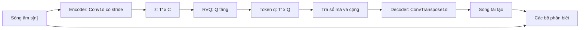

# Chương 31. Neural audio codec và speech token

!!! abstract "Mục tiêu học tập"
    Sau chương này, bạn có thể:

    - **Giải thích** vì sao các hệ thống TTS thời mô hình lớn biến tiếng nói thành chuỗi token rời rạc, và cái giá phải trả về chất lượng lẫn độ dài chuỗi.
    - **Hình thức hóa** lượng tử hóa véc-tơ dư (RVQ), suy ra dung lượng bit và **tính** tốc độ bit (*bitrate*), số token mỗi giây của một codec bất kỳ.
    - **Chẩn đoán** hiện tượng sụp đổ sổ mã (*codebook collapse*) và chọn biện pháp phù hợp: EMA, khởi tạo theo dữ liệu, khởi động lại mã chết, mã chiều thấp chuẩn hóa $\ell_2$, FSQ.
    - **So sánh** kiến trúc, bộ phân biệt và hàm mất mát của SoundStream, EnCodec và DAC.
    - **Phân biệt** token ngữ nghĩa (*semantic token*) với token âm học (*acoustic token*); giải thích các thiết kế lai như SpeechTokenizer, Mimi và token ngữ nghĩa có giám sát.
    - **Cài đặt** RVQ với straight-through, commitment loss, cập nhật EMA, khởi động lại mã chết, quantizer dropout; cài đặt FSQ.
    - **Đánh giá** một codec bằng các chỉ số khách quan phù hợp, kể cả các phép kiểm tra riêng cho tiếng Việt có thanh điệu.

!!! info "Kiến thức cần có"
    - [Chương 8](../phan-2-mo-hinh-sinh/ch08-vae.md): VQ-VAE cơ bản — sổ mã, straight-through estimator, commitment loss, cập nhật EMA. Chương này xây tiếp trên nền đó.
    - [Chương 9](../phan-2-mo-hinh-sinh/ch09-gan.md) và [Chương 25](../phan-6-vocoder/ch25-gan-vocoder.md): GAN, bộ phân biệt đa thang/đa chu kỳ, feature matching, mất mát STFT đa độ phân giải. Bộ giải mã của codec thực chất là một vocoder GAN.
    - [Chương 14](../phan-3-tin-hieu-ngu-am/ch14-xu-ly-tin-hieu-so.md): STFT, mel-spectrogram, tần số lấy mẫu.
    - [Chương 5](../phan-1-nen-tang/ch05-transformer.md): Transformer và mô hình ngôn ngữ tự hồi quy — để hiểu vì sao người ta muốn có token.

Ở các Phần V–VII, mô hình âm học sinh ra mel-spectrogram — một ma trận số thực — rồi vocoder biến nó thành sóng âm. Từ năm 2023, phần lớn các hệ thống TTS quy mô lớn lại đi một con đường khác: **nén tiếng nói thành chuỗi số nguyên**, giống hệt cách văn bản được tách thành token, rồi dùng mô hình ngôn ngữ để "viết" ra chuỗi số nguyên đó. Công cụ thực hiện việc nén là **neural audio codec** (bộ mã hóa–giải mã âm thanh thần kinh). Chương này trả lời ba câu hỏi: vì sao cần token rời rạc, token được tạo ra như thế nào, và token nào tốt cho TTS.

## 31.1. Vì sao cần token rời rạc?

### Bài toán một-nhiều và sức mạnh của phân phối phân loại

Nhớ lại [Chương 7](../phan-2-mo-hinh-sinh/ch07-tong-quan-mo-hinh-sinh.md): với cùng một câu văn bản, có vô số cách đọc hợp lệ (nhanh/chậm, cao/thấp, vui/buồn). Nếu ta hồi quy mel bằng mất mát L2, mô hình học được **trung bình có điều kiện** $\mathbb{E}[\mathbf{Y} \mid \mathbf{x}]$ — trung bình của nhiều cách đọc là một cách đọc "nhòe", thiếu chi tiết. Đó là hiện tượng *over-smoothing*.

Nếu đầu ra là **token rời rạc** $q \in \{1, \ldots, V\}$, mô hình dự đoán cả một phân phối phân loại $p_\theta(q \mid \text{ngữ cảnh}) = \operatorname{softmax}(\mathbf{o})$ với $V$ xác suất tự do. Phân phối này có thể **đa đỉnh** tùy ý: dồn 40% khối xác suất vào một token, 35% vào token khác ở xa, mà không phải "lấy trung bình" chúng. Khi suy luận, ta **lấy mẫu** từ phân phối thay vì lấy giá trị kỳ vọng, nên kết quả là một cách đọc cụ thể, sắc nét. Đây là lý do sâu xa khiến token rời rạc hấp dẫn: hàm mất mát entropy chéo trên token là MLE của một mô hình sinh thực thụ, không cần GAN, flow hay diffusion.

### Tái sử dụng toàn bộ "đồ nghề" của mô hình ngôn ngữ

Ngoài lý do xác suất, có những lý do rất thực dụng:

1. **Hạ tầng LLM dùng được ngay.** Dự đoán token kế tiếp, KV cache, các chiến lược lấy mẫu (top-k, top-p), song song hóa huấn luyện, lượng tử hóa và các engine phục vụ — tất cả đều được tối ưu kỹ cho chuỗi số nguyên.
2. **Học trong ngữ cảnh (*in-context learning*).** Đặt vài giây token của giọng mẫu làm tiền tố (*prompt*), mô hình "nói tiếp" bằng đúng giọng đó — nhân bản giọng zero-shot mà không cần embedding người nói riêng ([Chương 28](../phan-7-e2e-bieu-cam/ch28-da-nguoi-noi-voice-cloning.md)).
3. **Hợp nhất văn bản và tiếng nói.** Một bộ từ vựng chung chứa cả token chữ lẫn token tiếng, cho phép khởi tạo từ một LLM văn bản đã huấn luyện sẵn ([Chương 34](ch34-he-thong-lai-hien-dai.md), [Chương 35](ch35-streaming-speech-llm.md)).
4. **Tách bạch trách nhiệm.** Codec lo phần "nghe hay" (chất lượng cảm nhận, do huấn luyện đối kháng đảm bảo); mô hình ngôn ngữ lo phần "nói đúng, nói tự nhiên" (nội dung, ngôn điệu, giọng).
5. **Nén dữ liệu.** Một trăm nghìn giờ âm thanh có thể được mã hóa trước thành token một lần, lưu gọn dưới dạng mảng số nguyên, và nạp rất nhanh khi huấn luyện.

### Cái giá phải trả

Token không miễn phí:

- **Trần chất lượng.** Chất lượng âm thanh cuối cùng không thể vượt chất lượng tái tạo của codec. Nếu codec làm méo F0 thì mô hình ngôn ngữ dù hoàn hảo cũng sinh ra F0 méo.
- **Chuỗi rất dài.** Văn bản tiếng Việt chỉ có cỡ vài âm tiết mỗi giây, nhưng một codec phổ biến sinh ra hàng trăm token mỗi giây (xem Mục 31.3). Độ dài chuỗi quyết định chi phí của Transformer.
- **Cấu trúc hai chiều.** Codec dùng nhiều tầng lượng tử tạo ra một *lưới* token $T' \times Q$ thay vì một chuỗi; sắp xếp lưới này thành chuỗi là cả một bài toán ([Chương 32](ch32-codec-language-model.md)).
- **Mọi thứ bị trộn lẫn.** Token âm học mã hóa cả nội dung, giọng, cảm xúc, tiếng ồn, độ vang phòng — mô hình ngôn ngữ phải mô hình hóa tất cả.

### Ba tiêu chí của một bộ tách token tiếng nói

Khi so sánh các *speech tokenizer*, hãy luôn hỏi ba câu:

| Tiêu chí | Câu hỏi | Đo bằng |
|---|---|---|
| **Tái tạo** (*reconstruction*) | Giải mã ngược ra sóng âm có giống bản gốc không? | PESQ, ViSQOL, mel distance, WER, độ tương đồng người nói |
| **Gọn** (*compactness*) | Bao nhiêu token mỗi giây, sổ mã lớn đến đâu? | tốc độ khung, số tầng, bitrate |
| **Dễ mô hình hóa** (*modelability*) | Mô hình ngôn ngữ có dễ dự đoán chuỗi token không? | chất lượng TTS dùng token đó, khả năng phân biệt âm vị |

Ba tiêu chí này thường **xung đột**: token giữ mọi chi tiết thì tái tạo tốt nhưng khó mô hình hóa; token chỉ giữ nội dung thì dễ mô hình hóa nhưng không tái tạo được giọng. Phần lớn lịch sử phát triển trong chương này là lịch sử tìm điểm cân bằng giữa ba đỉnh tam giác đó.

## 31.2. Nhắc lại lượng tử hóa véc-tơ

Một codec thần kinh gồm ba khối: bộ mã hóa (*encoder*) $E$ biến dạng sóng $s[n]$ thành chuỗi véc-tơ liên tục $\mathbf{z}_1, \ldots, \mathbf{z}_{T'} \in \mathbb{R}^{C}$ ở tốc độ khung thấp; bộ lượng tử hóa biến mỗi $\mathbf{z}_t$ thành số nguyên; bộ giải mã (*decoder*) $G$ dựng lại sóng âm từ véc-tơ đã lượng tử hóa.

Với **một** sổ mã $\mathcal{C} = \{\mathbf{e}_1, \ldots, \mathbf{e}_V\} \subset \mathbb{R}^{C}$, lượng tử hóa véc-tơ (VQ) chọn từ mã gần nhất:

$$
q_t = \arg\min_{k \in \{1, \ldots, V\}} \lVert \mathbf{z}_t - \mathbf{e}_k \rVert_2^2, \qquad \hat{\mathbf{z}}_t = \mathbf{e}_{q_t}.
$$

Phép $\arg\min$ không khả vi, nên ta dùng **straight-through estimator**: ở lượt xuôi dùng $\hat{\mathbf{z}}_t$, ở lượt ngược coi $\partial \hat{\mathbf{z}}_t / \partial \mathbf{z}_t = \mathbf{I}$. Trong mã, điều này viết gọn là $\hat{\mathbf{z}}_t^{\text{ST}} = \mathbf{z}_t + \operatorname{sg}(\hat{\mathbf{z}}_t - \mathbf{z}_t)$, với $\operatorname{sg}$ là phép dừng gradient (`.detach()`). Hàm mất mát VQ-VAE gồm hai số hạng phụ (van den Oord và cộng sự, 2017):

$$
\mathcal{L}_{\text{VQ}} = \underbrace{\lVert \operatorname{sg}(\mathbf{z}_t) - \mathbf{e}_{q_t} \rVert_2^2}_{\text{codebook loss}} + \beta \underbrace{\lVert \mathbf{z}_t - \operatorname{sg}(\mathbf{e}_{q_t}) \rVert_2^2}_{\text{commitment loss}}.
$$

Số hạng thứ nhất kéo từ mã về phía đầu ra encoder; số hạng thứ hai giữ encoder "cam kết" ở gần từ mã đã chọn để không trôi tự do (bài báo gốc dùng $\beta = 0{,}25$). Chi tiết đầy đủ, kể cả cập nhật EMA, xem [Chương 8](../phan-2-mo-hinh-sinh/ch08-vae.md).

**Giới hạn của một sổ mã.** Mỗi khung mang đúng $\log_2 V$ bit. Muốn đạt 6 kbps ở 75 khung/giây, mỗi khung cần 80 bit, tức $V = 2^{80}$ từ mã — không thể lưu, càng không thể tìm láng giềng gần nhất. Ta cần một bộ lượng tử hóa **có cấu trúc**, đạt số tổ hợp khổng lồ với bộ nhớ nhỏ. Có ba hướng chính: chia véc-tơ thành nhóm và lượng tử hóa từng nhóm (*product/group VQ*), lượng tử hóa nhiều tầng trên phần dư (*residual VQ*), và lượng tử hóa vô hướng trên lưới cố định (FSQ). RVQ là lựa chọn của SoundStream, EnCodec, DAC và trở thành "chuẩn" của thế hệ codec đầu tiên.

## 31.3. Lượng tử hóa véc-tơ dư (RVQ)

### Trực giác: xấp xỉ liên tiếp

Hãy nghĩ đến cách viết số $\pi$ trong hệ thập phân: $3{,}14159\ldots = 3 + 0{,}1 + 0{,}04 + 0{,}001 + \ldots$ Chữ số đầu cho giá trị thô; mỗi chữ số sau mô tả **phần sai lệch còn lại** của các chữ số trước với độ phân giải mịn hơn. RVQ làm đúng như vậy với véc-tơ: tầng 1 lượng tử hóa $\mathbf{z}_t$ một cách thô; tầng 2 lượng tử hóa **phần dư** (sai số) của tầng 1; tầng 3 lượng tử hóa phần dư của tầng 2, cứ thế. Ý tưởng lượng tử hóa nhiều tầng đã có từ thời mã hóa tiếng nói cổ điển (Juang và Gray, 1982); SoundStream đưa nó vào khung huấn luyện đầu-cuối.

### Hình thức hóa

Cho $Q$ sổ mã $\mathcal{C}^{(j)} = \{\mathbf{e}^{(j)}_1, \ldots, \mathbf{e}^{(j)}_V\}$, $j = 1, \ldots, Q$. Với mỗi khung $t$ (ta bỏ chỉ số $t$ cho gọn):

$$
\mathbf{r}^{(0)} = \mathbf{z}, \qquad
q_{j} = \arg\min_{k} \big\lVert \mathbf{r}^{(j-1)} - \mathbf{e}^{(j)}_k \big\rVert_2^2, \qquad
\mathbf{r}^{(j)} = \mathbf{r}^{(j-1)} - \mathbf{e}^{(j)}_{q_j},
$$

và véc-tơ tái tạo là tổng các từ mã đã chọn:

$$
\hat{\mathbf{z}} = \sum_{j=1}^{Q} \mathbf{e}^{(j)}_{q_j}.
$$

Đầu ra của RVQ cho khung $t$ là bộ $Q$ số nguyên $(q_{t,1}, \ldots, q_{t,Q})$; với cả câu, ta được ma trận token $\mathbf{q} \in \{1, \ldots, V\}^{T' \times Q}$ đúng như trong [bảng ký hiệu](../gioi-thieu/ky-hieu.md).

**Tính chất 1 — sai số là phần dư cuối.** Cộng dồn định nghĩa $\mathbf{e}^{(j)}_{q_j} = \mathbf{r}^{(j-1)} - \mathbf{r}^{(j)}$ cho $j = 1, \ldots, Q$, tổng rút gọn (*telescoping sum*) cho:

$$
\hat{\mathbf{z}} = \sum_{j=1}^{Q} \big(\mathbf{r}^{(j-1)} - \mathbf{r}^{(j)}\big) = \mathbf{r}^{(0)} - \mathbf{r}^{(Q)} = \mathbf{z} - \mathbf{r}^{(Q)}
\quad\Longrightarrow\quad
\mathbf{z} - \hat{\mathbf{z}} = \mathbf{r}^{(Q)}.
$$

Sai số lượng tử hóa chính là phần dư sau tầng cuối cùng.

**Tính chất 2 — sai số không tăng nếu sổ mã chứa véc-tơ 0.** Nếu $\mathbf{0} \in \mathcal{C}^{(j)}$ thì vì $q_j$ là $\arg\min$, ta có $\lVert \mathbf{r}^{(j)} \rVert = \min_k \lVert \mathbf{r}^{(j-1)} - \mathbf{e}^{(j)}_k \rVert \le \lVert \mathbf{r}^{(j-1)} - \mathbf{0} \rVert = \lVert \mathbf{r}^{(j-1)} \rVert$. Sổ mã học được không nhất thiết chứa đúng véc-tơ 0, nhưng khi mỗi sổ mã $\mathcal{C}^{(j)}$ được huấn luyện để xấp xỉ phân phối của phần dư $\mathbf{r}^{(j-1)}$, sai số **trung bình** giảm dần theo số tầng — ta sẽ kiểm chứng bằng mã.

**Tính chất 3 — dung lượng.** $Q$ sổ mã, mỗi sổ $V$ từ mã, chỉ tốn bộ nhớ $Q \cdot V$ véc-tơ nhưng biểu diễn được tới $V^Q$ véc-tơ tái tạo khác nhau, tức $Q \log_2 V$ bit mỗi khung. Với $Q = 8$, $V = 1024$: 80 bit/khung từ 8192 véc-tơ lưu trữ, thay vì $2^{80}$.

**Tính chất 4 — phân cấp thô đến mịn.** Tầng đầu mang phần lớn năng lượng và thông tin; các tầng sau chỉ tinh chỉnh. Tính chất này cực kỳ quan trọng cho TTS: VALL-E dùng mô hình tự hồi quy cho tầng 1 (nơi chứa nội dung và nhịp điệu) và mô hình song song cho các tầng còn lại ([Chương 32](ch32-codec-language-model.md)).

!!! note "RVQ là thuật toán tham lam"
    Mỗi tầng chọn từ mã tốt nhất **cho riêng nó**, không xét tầng sau. Tìm kiếm đồng thời trên mọi tổ hợp (ví dụ beam search qua các tầng) có thể cho sai số nhỏ hơn, nhưng đắt hơn. Các codec phổ biến dùng phương án tham lam vì nhanh và đủ tốt khi encoder được huấn luyện cùng.

### Gradient và hàm mất mát cho nhiều tầng

Toàn khối RVQ được coi như một hàm đồng nhất ở lượt ngược: $\hat{\mathbf{z}}^{\text{ST}} = \mathbf{z} + \operatorname{sg}(\hat{\mathbf{z}} - \mathbf{z})$, nên gradient từ bộ giải mã chảy thẳng về encoder. Mỗi tầng đóng góp một cặp số hạng VQ trên phần dư mà nó nhận:

$$
\mathcal{L}_{\text{RVQ}} = \sum_{j=1}^{Q} \Big( \big\lVert \operatorname{sg}(\mathbf{r}^{(j-1)}) - \mathbf{e}^{(j)}_{q_j} \big\rVert_2^2 + \beta \big\lVert \mathbf{r}^{(j-1)} - \operatorname{sg}(\mathbf{e}^{(j)}_{q_j}) \big\rVert_2^2 \Big).
$$

Khi sổ mã được cập nhật bằng EMA (mục sau), số hạng codebook loss bị bỏ và chỉ giữ commitment loss.

### Quantizer dropout và bitrate co giãn

SoundStream (Zeghidour và cộng sự, 2021) đề xuất một mẹo đơn giản mà sâu sắc: trong mỗi bước huấn luyện, **chọn ngẫu nhiên** $n_q \sim \mathcal{U}\{1, \ldots, Q\}$ và chỉ dùng $n_q$ tầng đầu, bỏ các tầng sau. Bộ giải mã vì thế phải học cách tái tạo từ **mọi** tổng riêng phần $\sum_{j \le n_q} \mathbf{e}^{(j)}_{q_j}$. Hai hệ quả:

1. **Một mô hình, nhiều bitrate.** Khi suy luận, chỉ cần cắt bớt tầng là giảm bitrate, không phải huấn luyện mô hình riêng cho từng mức.
2. **Thứ tự quan trọng được ép buộc.** Vì tầng 1 thường xuyên phải "gánh một mình", nó buộc phải mã hóa cấu trúc quan trọng nhất; tầng 2 mã hóa điều quan trọng thứ nhì trong phần còn lại, v.v. Đây cùng tinh thần với *nested dropout* (Rippel và cộng sự, 2014), vốn được chứng minh (trong trường hợp tuyến tính) là khôi phục đúng các thành phần chính theo thứ tự như PCA.

Tuy nhiên, luôn bật quantizer dropout có thể làm giảm chất lượng ở bitrate đầy đủ, vì mô hình phải chia năng lực cho mọi mức. DAC (Kumar và cộng sự, 2023) báo cáo rằng chỉ áp dụng nó với một xác suất (theo bài báo gốc là 0,5) cho cân bằng tốt hơn.

### Tính bitrate và số token mỗi giây

Gọi $M$ là **tổng bước giảm mẫu** (*total stride*, tích các stride của encoder). Tốc độ khung là $f_{\text{frame}} = f_s / M$. Mỗi khung mang $\sum_j \log_2 V_j$ bit, nên:

$$
R = \frac{f_s}{M} \sum_{j=1}^{Q} \log_2 V_j \quad \text{(bit/giây)}, \qquad
\text{token/giây} = \frac{f_s}{M} \cdot Q.
$$

Ví dụ EnCodec 24 kHz: các stride $(2, 4, 5, 8)$ cho $M = 320$, nên $f_{\text{frame}} = 24\,000 / 320 = 75$ Hz. Với 8 tầng, mỗi tầng $V = 1024$ (10 bit): $R = 75 \times 80 = 6000$ bit/giây = 6 kbps, tương ứng **600 token mỗi giây**. So với PCM 16 bit ở 24 kHz (384 kbps), đó là tỉ lệ nén 64 lần. Đoạn mã sau tính các con số này cho vài cấu hình tiêu biểu.

```python
import math

def codec_rates(sample_rate, hop, codebook_sizes):
    """Trả về (tốc độ khung Hz, token/giây, bitrate bps) của một codec RVQ."""
    frame_rate = sample_rate / hop                      # f_frame = f_s / M
    bits_per_frame = sum(math.log2(v) for v in codebook_sizes)
    tokens_per_sec = frame_rate * len(codebook_sizes)   # mỗi tầng một token/khung
    return frame_rate, tokens_per_sec, frame_rate * bits_per_frame

configs = {
    # tên: (f_s, M, danh sách kích thước sổ mã) — cấu hình minh họa, xem chú thích
    "EnCodec 24kHz, 8 tầng":  (24_000, 320, [1024] * 8),
    "EnCodec 24kHz, 32 tầng": (24_000, 320, [1024] * 32),
    "DAC 44.1kHz, 9 tầng":    (44_100, 512, [1024] * 9),
    "Mimi, 8 tầng":           (24_000, 1920, [2048] * 8),
    "Một sổ mã 65536, 50 Hz": (16_000, 320, [65536]),
}
pcm_bps = 24_000 * 16                                   # PCM 16 bit, 24 kHz
for name, (sr, hop, books) in configs.items():
    fr, tps, bps = codec_rates(sr, hop, books)
    print(f"{name:26s} khung={fr:6.2f} Hz  token/s={tps:7.1f}  "
          f"bitrate={bps / 1000:6.2f} kbps")

fr, tps, bps = codec_rates(24_000, 320, [1024] * 8)
assert abs(bps - 6000) < 1e-6 and tps == 600
print("Tỉ lệ nén so với PCM 24 kHz/16 bit:", pcm_bps / bps)   # 64.0
```

Kết quả: EnCodec 8 tầng cho 75 Hz, 600 token/s, 6 kbps; DAC 44,1 kHz với 9 tầng cho khoảng 86 Hz và xấp xỉ 7,75 kbps (bài báo gọi là "8 kbps"); cấu hình kiểu Mimi (12,5 Hz, 8 tầng, sổ mã 2048) cho 100 token/s và 1,1 kbps; một codec một sổ mã 65 536 từ ở 50 Hz chỉ có 50 token/s.

!!! warning "Về các con số cấu hình"
    Các cấu hình trên lấy theo báo cáo gốc của từng bài báo tại thời điểm công bố. Bản phát hành có thể có nhiều biến thể (số tầng, tần số lấy mẫu khác). Tính đến thời điểm biên soạn (2026), hãy luôn đọc tệp cấu hình của checkpoint bạn thực sự dùng thay vì tin vào con số trong sách.

Cột "token/giây" quan trọng hơn bitrate đối với TTS: chi phí của mô hình ngôn ngữ tăng theo độ dài chuỗi (và attention tăng theo bình phương). Một câu 10 giây ở 600 token/s là 6000 token — dài hơn nhiều so với một đoạn văn bản thông thường. Đó là lý do xu hướng 2024–2026 là **giảm tốc độ khung** (75 → 50 → 25 → 12,5 Hz) và **giảm số tầng** (8 → 1).

## 31.4. Sụp đổ sổ mã và cách khắc phục

### Hiện tượng

Huấn luyện VQ thường gặp tình trạng chỉ một phần nhỏ từ mã được dùng; phần còn lại là **mã chết** (*dead codes*) — không bao giờ là láng giềng gần nhất của bất kỳ đầu vào nào. Cơ chế là một vòng luẩn quẩn: codebook loss chỉ cập nhật từ mã **được chọn**; từ mã không được chọn không nhận gradient nên đứng yên; encoder càng học, phân phối $\mathbf{z}$ càng dịch chuyển khỏi vùng chứa các mã chết, nên chúng càng không bao giờ được chọn. Nguyên nhân thường gặp: khởi tạo ngẫu nhiên xa đa tạp dữ liệu, phân phối đầu ra encoder trôi mạnh đầu quá trình huấn luyện, số chiều cao (khoảng cách trở nên "đồng đều", khó phân biệt), sổ mã quá lớn.

Hai chỉ số theo dõi đơn giản:

- **Tỉ lệ sử dụng**: số từ mã khác nhau xuất hiện trong một tập kiểm tra, chia cho $V$.
- **Perplexity của phân phối sử dụng**: với $p_k$ là tần suất từ mã $k$,

$$
\operatorname{PPL} = \exp\Big(-\sum_{k=1}^{V} p_k \log p_k\Big) \in [1, V].
$$

$\operatorname{PPL} = V$ khi mọi mã được dùng đều nhau; $\operatorname{PPL}$ nhỏ báo hiệu sụp đổ. Nên theo dõi **riêng từng tầng** RVQ, vì các tầng sau (phần dư nhỏ, gần nhiễu) thường sụp đổ trước.

### Cập nhật EMA: k-means trực tuyến

Thay vì học từ mã bằng gradient, ta có thể coi mỗi sổ mã là tâm cụm của k-means. Hàm mục tiêu k-means $\sum_i \lVert \mathbf{z}_i - \mathbf{e}_{q_i} \rVert^2$ đạt cực tiểu theo $\mathbf{e}_k$ khi $\mathbf{e}_k$ là **trung bình** các véc-tơ được gán cho nó:

$$
\frac{\partial}{\partial \mathbf{e}_k} \sum_{i: q_i = k} \lVert \mathbf{z}_i - \mathbf{e}_k \rVert^2 = -2 \sum_{i: q_i = k} (\mathbf{z}_i - \mathbf{e}_k) = 0
\quad\Longrightarrow\quad
\mathbf{e}_k = \frac{1}{n_k} \sum_{i: q_i = k} \mathbf{z}_i .
$$

Phiên bản trực tuyến dùng trung bình trượt hàm mũ với hệ số $\gamma$ (thường $0{,}99$) cho cả **số lượng** và **tổng**:

$$
N_k \leftarrow \gamma N_k + (1-\gamma)\, n_k, \qquad
\mathbf{m}_k \leftarrow \gamma \mathbf{m}_k + (1-\gamma) \sum_{i: q_i = k} \mathbf{z}_i, \qquad
\mathbf{e}_k \leftarrow \frac{\mathbf{m}_k}{N_k},
$$

trong đó $n_k$ là số véc-tơ của batch hiện tại gán cho mã $k$. Tỉ số hai trung bình trượt là ước lượng trượt của tâm cụm. Trong thực tế người ta thêm *làm trơn Laplace* cho $N_k$ để tránh chia cho 0. SoundStream và EnCodec đều dùng EMA. Ưu điểm: cập nhật ổn định, không phụ thuộc tốc độ học của bộ tối ưu.

### Khởi tạo theo dữ liệu và khởi động lại mã chết

- **Khởi tạo bằng k-means**: SoundStream chạy k-means trên các véc-tơ của batch huấn luyện đầu tiên để khởi tạo sổ mã, nhờ đó mọi từ mã bắt đầu *trong* vùng dữ liệu. Phiên bản rẻ hơn (dùng trong mã bên dưới) là lấy ngẫu nhiên các véc-tơ của batch đầu.
- **Khởi động lại mã chết** (*dead-code restart*): nếu một mã không được gán cho véc-tơ nào trong một số batch (với EMA: $N_k$ nhỏ hơn ngưỡng), thay nó bằng một véc-tơ đầu vào ngẫu nhiên của batch hiện tại. SoundStream mô tả đúng cơ chế này; Jukebox (Dhariwal và cộng sự, 2020) cũng dùng "random restart" cho sổ mã.

### Mã chiều thấp và chuẩn hóa $\ell_2$

DAC kế thừa hai thủ thuật từ ViT-VQGAN (Yu và cộng sự, 2022):

1. **Mã phân rã** (*factorized codes*): chiếu $\mathbf{z} \in \mathbb{R}^{C}$ xuống một không gian rất thấp chiều $\mathbb{R}^{c}$ (theo bài báo DAC, $c = 8$) để tra cứu, rồi chiếu ngược lên $\mathbb{R}^{C}$. Trong không gian thấp chiều, khoảng cách Euclid có ý nghĩa hơn và các từ mã "chen chúc" ít hơn.
2. **Chuẩn hóa $\ell_2$**: chuẩn hóa cả véc-tơ truy vấn lẫn từ mã về độ dài 1, nên khoảng cách Euclid tương đương **độ tương tự cosine**: $\lVert \mathbf{a} - \mathbf{b} \rVert^2 = 2 - 2\cos(\mathbf{a}, \mathbf{b})$ khi $\lVert \mathbf{a} \rVert = \lVert \mathbf{b} \rVert = 1$. Không còn tình trạng vài từ mã nằm gần tâm phân phối (chuẩn nhỏ) "thắng" phần lớn các lần so khoảng cách; các mã chỉ cạnh tranh về hướng.

Theo báo cáo gốc, hai thủ thuật này giúp DAC sử dụng sổ mã đầy đủ hơn hẳn mà không cần EMA.

### FSQ: bỏ hẳn sổ mã học được

Finite Scalar Quantization (Mentzer và cộng sự, 2023) đặt câu hỏi: nếu sổ mã hay sụp đổ, sao không **cố định** nó? FSQ chiếu $\mathbf{z}$ xuống $d$ chiều (rất nhỏ, ví dụ 4–8), chặn mỗi chiều $i$ vào một khoảng hữu hạn, rồi **làm tròn** về một trong $L_i$ mức (ký hiệu $L_i$ theo bài báo gốc, không liên quan đến số mẫu âm thanh $L$):

$$
\hat{z}_i = \operatorname{round}\big(f_i(z_i)\big), \qquad f_i: \mathbb{R} \to \Big[-\tfrac{L_i - 1}{2}, \tfrac{L_i - 1}{2}\Big],
$$

ví dụ $f_i(z) = \lfloor L_i / 2 \rfloor \tanh(z)$ với $L_i$ lẻ (bài báo gốc thêm một độ dịch nhỏ để xử lý $L_i$ chẵn). Gradient đi qua phép làm tròn bằng straight-through: $\hat{z}_i^{\text{ST}} = f_i(z_i) + \operatorname{sg}(\hat{z}_i - f_i(z_i))$. Sổ mã **ngầm** là lưới tích Descartes của các mức, kích thước

$$
|\mathcal{C}| = \prod_{i=1}^{d} L_i,
$$

và chỉ số của một điểm lưới được tính theo hệ cơ số hỗn hợp. Bài báo gốc gợi ý, chẳng hạn, các mức $[8, 5, 5, 5]$ cho $|\mathcal{C}| = 1000 \approx 2^{10}$.

Vì sao FSQ không sụp đổ? Không có từ mã nào để "chết": mọi điểm lưới luôn tồn tại và đầu ra encoder chỉ cần rơi vào ô tương ứng; không cần codebook loss, commitment loss hay EMA. Cái giá là nút thắt rất hẹp ($d$ nhỏ), nên các lớp chiếu trước và sau phải đủ mạnh. FSQ đặc biệt hợp với **sổ mã ngầm rất lớn** (hàng chục nghìn mã) — đúng thứ mà các bộ tách token một sổ mã cần (Mục 31.7). Cũng có những phương án "không tra cứu" tương tự, như LFQ (Yu và cộng sự, 2023) lượng tử hóa mỗi chiều về $\{-1, +1\}$.

Mã dưới đây cài một biến thể FSQ đơn giản: dùng sigmoid để chặn mỗi chiều vào $(0, L_i - 1)$ — hoạt động với cả $L_i$ chẵn lẫn lẻ, khác chút ít so với hàm $\tanh$ có dịch chuyển của bài báo gốc nhưng cùng nguyên lý.

```python
import torch
import torch.nn as nn


class FSQ(nn.Module):
    """Finite Scalar Quantization (biến thể đơn giản dùng sigmoid để chặn miền)."""

    def __init__(self, levels):                       # ví dụ levels = [8, 5, 5, 5]
        super().__init__()
        L = torch.tensor(levels)
        self.register_buffer("L", L)
        # cơ số hỗn hợp: chỉ số = sum_i k_i * prod_{i'<i} L_{i'}
        basis = torch.cumprod(torch.cat([torch.ones(1, dtype=L.dtype), L[:-1]]), 0)
        self.register_buffer("basis", basis)
        self.codebook_size = int(L.prod())

    def forward(self, z):                             # z: (B, T, d), d = len(levels)
        u = (self.L - 1) * torch.sigmoid(z)           # chặn vào (0, L-1)
        k = torch.round(u)                            # số nguyên 0..L-1
        u_q = u + (k - u).detach()                    # straight-through
        z_q = 2 * u_q / (self.L - 1) - 1              # đưa về [-1, 1] cho decoder
        idx = (k.long() * self.basis).sum(-1)         # (B, T) chỉ số trong sổ mã ngầm
        return z_q, idx

    def indices_to_codes(self, idx):                  # (B, T) -> (B, T, d)
        k = (idx[..., None] // self.basis) % self.L
        return 2 * k.float() / (self.L - 1) - 1


torch.manual_seed(0)
fsq = FSQ([8, 5, 5, 5])
print("kích thước sổ mã ngầm:", fsq.codebook_size)             # 1000
z = (torch.randn(4, 500, 4) * 1.5).requires_grad_()
z_q, idx = fsq(z)
assert z_q.shape == z.shape and idx.min() >= 0 and idx.max() < fsq.codebook_size
assert torch.allclose(fsq.indices_to_codes(idx), z_q.detach())  # giải mã chỉ số khớp
z_q.sum().backward()                                            # gradient đi qua STE
assert z.grad is not None and z.grad.abs().sum() > 0
used = torch.unique(idx).numel()
print(f"số mã được dùng: {used}/{fsq.codebook_size}")
```

Với 2000 véc-tơ ngẫu nhiên, khoảng 70% trong 1000 điểm lưới đã được dùng ngay từ đầu mà không cần huấn luyện gì — so sánh với VQ học được, nơi tỉ lệ này có thể rất thấp nếu khởi tạo kém.

## 31.5. Cài đặt RVQ hoàn chỉnh

Bây giờ ta ghép các mảnh lại: một lớp `VectorQuantizer` hỗ trợ cả hai chế độ (gradient hoặc EMA), khởi tạo theo dữ liệu, khởi động lại mã chết; và lớp `ResidualVQ` xếp chồng $Q$ tầng với quantizer dropout. Bố cục tensor là `(B, T, C)`.

```python
import torch
import torch.nn as nn
import torch.nn.functional as F


class VectorQuantizer(nn.Module):
    """Một tầng VQ: láng giềng gần nhất + straight-through + (tùy chọn) EMA."""

    def __init__(self, dim, codebook_size, use_ema=True, decay=0.99,
                 eps=1e-5, dead_threshold=0.1):
        super().__init__()
        self.use_ema, self.decay, self.eps = use_ema, decay, eps
        self.dead_threshold = dead_threshold
        embed = torch.randn(codebook_size, dim) * 0.1
        if use_ema:   # sổ mã là buffer, cập nhật bằng k-means trực tuyến
            self.register_buffer("embed", embed)
            self.register_buffer("cluster_size", torch.ones(codebook_size))
            self.register_buffer("embed_sum", embed.clone())
        else:         # sổ mã là tham số, học bằng gradient (codebook loss)
            self.embed = nn.Parameter(embed)
        self.register_buffer("initted", torch.tensor(False))

    def forward(self, r):                                   # r: (B, T, C)
        flat = r.reshape(-1, r.shape[-1])                   # (B*T, C)
        if self.training and not self.initted:              # khởi tạo từ dữ liệu
            self._init_from(flat.detach())
        dist = (flat.pow(2).sum(1, keepdim=True)
                - 2 * flat @ self.embed.t()
                + self.embed.pow(2).sum(1)[None])           # (B*T, V)
        idx = dist.argmin(dim=1)                            # (B*T,)
        e = self.embed[idx].view_as(r)                      # (B, T, C)
        commit = F.mse_loss(r, e.detach())                  # ||r - sg(e)||^2
        if self.use_ema:
            codebook = torch.zeros((), device=r.device)
            if self.training:
                self._ema_update(flat.detach(), idx)
        else:
            codebook = F.mse_loss(e, r.detach())            # ||sg(r) - e||^2
        return e, idx.view(r.shape[:-1]), commit, codebook

    @torch.no_grad()
    def _init_from(self, flat):
        # Cách rẻ thay cho k-means: lấy ngẫu nhiên các véc-tơ của batch đầu
        pick = flat[torch.randint(0, flat.shape[0], (self.embed.shape[0],))]
        self.embed.data.copy_(pick)
        if self.use_ema:
            self.embed_sum.copy_(pick)
        self.initted.fill_(True)

    @torch.no_grad()
    def _ema_update(self, flat, idx):
        V = self.embed.shape[0]
        onehot = F.one_hot(idx, V).type(flat.dtype)         # (B*T, V)
        self.cluster_size.mul_(self.decay).add_(onehot.sum(0), alpha=1 - self.decay)
        self.embed_sum.mul_(self.decay).add_(onehot.t() @ flat, alpha=1 - self.decay)
        n = self.cluster_size.sum()                         # làm trơn Laplace
        size = (self.cluster_size + self.eps) / (n + V * self.eps) * n
        self.embed.copy_(self.embed_sum / size[:, None])
        dead = self.cluster_size < self.dead_threshold      # mã "chết"
        if dead.any():                                      # khởi động lại
            new = flat[torch.randint(0, flat.shape[0], (int(dead.sum()),))]
            self.embed[dead] = new
            self.embed_sum[dead] = new
            self.cluster_size[dead] = 1.0
```

Lớp RVQ và một thử nghiệm nhỏ (chạy tiếp ngay sau khối trên). Để tách bạch, ta không dùng encoder: "đầu ra encoder" là dữ liệu Gaussian có phương sai không đều giữa các chiều. Ở chế độ EMA, sổ mã tự học chỉ bằng các lượt xuôi — không cần bộ tối ưu.

```python
class ResidualVQ(nn.Module):
    """RVQ gồm Q tầng VQ nối tiếp, có quantizer dropout."""

    def __init__(self, dim, n_q, codebook_size, quantizer_dropout=0.5,
                 beta=0.25, **vq_kwargs):
        super().__init__()
        self.layers = nn.ModuleList(
            [VectorQuantizer(dim, codebook_size, **vq_kwargs) for _ in range(n_q)])
        self.quantizer_dropout, self.beta = quantizer_dropout, beta

    def forward(self, z, n_q=None):                         # z: (B, T, C)
        n_q = n_q or len(self.layers)
        if self.training and torch.rand(()) < self.quantizer_dropout:
            n_q = int(torch.randint(1, len(self.layers) + 1, ()))
        residual, z_hat = z, torch.zeros_like(z)
        codes, loss = [], torch.zeros((), device=z.device)
        for layer in self.layers[:n_q]:
            e, idx, commit, codebook = layer(residual)
            z_hat = z_hat + e.detach()                      # tổng các từ mã
            residual = residual - e.detach()                # r^(j) = r^(j-1) - e
            codes.append(idx)
            loss = loss + self.beta * commit + codebook
        z_hat_st = z + (z_hat - z).detach()                 # straight-through cho cả khối
        return z_hat_st, torch.stack(codes, dim=-1), loss   # codes: (B, T, n_q)


def codebook_perplexity(codes, V):
    """exp(entropy) của phân bố sử dụng mã; tối đa bằng V."""
    p = torch.bincount(codes.flatten(), minlength=V).float()
    p = p / p.sum()
    return torch.exp(-(p[p > 0] * p[p > 0].log()).sum()).item()


# --- Thử nghiệm: "encoder" giả là dữ liệu có cấu trúc, không cần mạng ---
torch.manual_seed(0)
B, T, C, Q, V = 16, 32, 8, 4, 64
scales = torch.linspace(2.0, 0.2, C)                         # phương sai không đều
rvq = ResidualVQ(C, n_q=Q, codebook_size=V, quantizer_dropout=0.5)
rvq.train()
for step in range(300):                                     # EMA tự học, không cần optimizer
    z = torch.randn(B, T, C) * scales
    rvq(z)

rvq.eval()
z = torch.randn(B, T, C) * scales
errs = []
for n in range(1, Q + 1):
    z_hat, codes, _ = rvq(z, n_q=n)
    errs.append(F.mse_loss(z_hat, z).item())
print("MSE theo số tầng:", [round(e, 4) for e in errs])
assert codes.shape == (B, T, Q) and int(codes.max()) < V
assert all(a > b for a, b in zip(errs, errs[1:])), "sai số phải giảm dần"
print("perplexity tầng 1:", round(codebook_perplexity(codes[..., 0], V), 1), "/", V)

# Kiểm tra straight-through: gradient đi thẳng từ z_hat về z
z = (torch.randn(2, 5, C) * scales).requires_grad_()
z_hat, _, vq_loss = rvq(z)
(z_hat.sum() + vq_loss).backward()
assert z.grad is not None and z.grad.shape == z.shape
```

Trên máy của người biên soạn, sai số MSE theo số tầng là khoảng $0{,}43 \to 0{,}17 \to 0{,}07 \to 0{,}03$: mỗi tầng thêm vào giảm sai số còn chừng một nửa hoặc ít hơn — đúng hình ảnh "xấp xỉ liên tiếp". Perplexity tầng 1 gần 58 trên 64, tức sổ mã được dùng gần đều. Ba chi tiết cài đặt đáng chú ý:

- Phần dư truyền sang tầng sau dùng `e.detach()`: các tầng không đẩy gradient lẫn nhau, còn commitment loss của **mọi** tầng vẫn kéo encoder (qua $\mathbf{r}^{(j-1)}$, vốn phụ thuộc $\mathbf{z}$).
- Straight-through áp dụng **một lần cho cả khối** (`z + (z_hat - z).detach()`), đúng với công thức ở Mục 31.3.
- Thay `use_ema=False` để chuyển sang học sổ mã bằng gradient; khi đó cần một bộ tối ưu cho `rvq.parameters()` (Bài tập 6).

## 31.6. Kiến trúc codec: SoundStream, EnCodec, DAC

### Bức tranh chung: VQ-VAE gặp vocoder GAN

Mọi codec thế hệ đầu đều theo cùng một khuôn:



Encoder là chồng các khối tích chập: mỗi khối gồm vài *residual unit* với tích chập giãn (*dilated convolution*, ví dụ giãn 1, 3, 9) rồi một tích chập có stride để giảm mẫu, số kênh tăng gấp đôi sau mỗi lần giảm mẫu. Decoder đối xứng, dùng tích chập chuyển vị để tăng mẫu. Nếu bạn đã đọc [Chương 25](../phan-6-vocoder/ch25-gan-vocoder.md), bạn sẽ nhận ra decoder chính là một **vocoder GAN**, chỉ khác là điều kiện đầu vào là $\hat{\mathbf{z}}$ thay vì mel-spectrogram. Vì thế codec kế thừa toàn bộ kinh nghiệm của vocoder: bộ phân biệt đa thang/đa chu kỳ, mất mát phổ đa độ phân giải, feature matching.

**Tính nhân quả và độ trễ.** Nếu mọi tích chập đều nhân quả (chỉ đệm bên trái), codec có thể chạy theo luồng: độ trễ thuật toán tối thiểu là một khung, $M / f_s$. Với $M = 320$ ở 24 kHz, đó là $320 / 24\,000 \approx 13{,}3$ ms. Với codec 12,5 Hz, một khung đã là 80 ms. Đây là đánh đổi cơ bản giữa tốc độ khung thấp (chuỗi ngắn) và độ trễ (xem [Chương 35](ch35-streaming-speech-llm.md)).

### Hàm mất mát tổng quát

Hàm mất mát của bộ sinh (encoder + RVQ + decoder) có dạng tổng có trọng số:

$$
\mathcal{L}_G = \lambda_{\text{rec}} \mathcal{L}_{\text{rec}} + \lambda_{\text{adv}} \mathcal{L}_{\text{adv}} + \lambda_{\text{feat}} \mathcal{L}_{\text{feat}} + \lambda_{\text{vq}} \mathcal{L}_{\text{RVQ}}.
$$

- **Mất mát tái tạo** $\mathcal{L}_{\text{rec}}$: thường là khoảng cách giữa mel-spectrogram (hoặc phổ biên độ) của $s$ và $\hat{s}$ ở **nhiều** kích thước cửa sổ. Dạng của SoundStream (theo Gritsenko và cộng sự, 2020) với $\mathcal{S}_w$ là mel ở cửa sổ $w$:

    $$
    \mathcal{L}_{\text{rec}} = \sum_{w \in \mathcal{W}} \Big( \big\lVert \mathcal{S}_w(s) - \mathcal{S}_w(\hat{s}) \big\rVert_1 + \alpha_w \big\lVert \log \mathcal{S}_w(s) - \log \mathcal{S}_w(\hat{s}) \big\rVert_2 \Big).
    $$

    Nhiều cửa sổ giúp ràng buộc đồng thời độ phân giải thời gian và tần số (nhắc lại đánh đổi thời gian–tần số ở [Chương 14](../phan-3-tin-hieu-ngu-am/ch14-xu-ly-tin-hieu-so.md)). EnCodec thêm cả mất mát L1 trên miền thời gian.

- **Mất mát đối kháng** $\mathcal{L}_{\text{adv}}$: SoundStream và EnCodec dùng dạng *hinge*. Với $N_D$ bộ phân biệt $D_k$, $k = 1, \ldots, N_D$:

    $$
    \mathcal{L}_D = \frac{1}{N_D}\sum_{k} \Big( \mathbb{E}\big[\max(0, 1 - D_k(s))\big] + \mathbb{E}\big[\max(0, 1 + D_k(\hat{s}))\big] \Big), \qquad
    \mathcal{L}_{\text{adv}} = \frac{1}{N_D}\sum_k \mathbb{E}\big[\max(0, 1 - D_k(\hat{s}))\big].
    $$

- **Feature matching** $\mathcal{L}_{\text{feat}}$: khoảng cách L1 giữa các đặc trưng trung gian của bộ phân biệt trên $s$ và $\hat{s}$ ([Chương 9](../phan-2-mo-hinh-sinh/ch09-gan.md)).

Vì sao cần GAN? Ở bitrate thấp, codec **không thể** giữ đúng dạng sóng (pha) — thông tin đơn giản là không đủ. Mất mát tái tạo thuần túy sẽ cho âm thanh "đục". Bộ phân biệt cho phép decoder sinh ra chi tiết **hợp lý về mặt cảm nhận** dù không trùng mẫu với bản gốc. Hệ quả: các chỉ số đo sai khác dạng sóng như SI-SDR thường thấp ở codec GAN dù người nghe đánh giá cao (Mục 31.8).

### SoundStream (2021)

SoundStream (Zeghidour và cộng sự, 2021) là một trong những codec thần kinh đầu-cuối đầu tiên dùng RVQ và đạt chất lượng cạnh tranh với codec truyền thống:

- Encoder/decoder **hoàn toàn tích chập và nhân quả**, ở 24 kHz với các stride $(2, 4, 5, 8)$, tức 75 khung/giây.
- RVQ với quantizer dropout cho bitrate co giãn trong một mô hình (bài báo báo cáo dải 3–18 kbps); sổ mã khởi tạo bằng k-means, cập nhật EMA, khởi động lại mã chết.
- Hai loại bộ phân biệt: trên dạng sóng ở nhiều độ phân giải (kiểu MelGAN) và trên **STFT phức** (dùng cả phần thực và phần ảo, nên "nhìn thấy" được pha).
- Một điều kiện FiLM cho phép cùng một mô hình vừa nén vừa khử nhiễu.

Theo đánh giá chủ quan trong bài báo gốc, SoundStream ở 3 kbps được nghe tốt hơn Opus ở 12 kbps.

### EnCodec (2022)

EnCodec (Défossez và cộng sự, 2022) đi theo cùng khuôn, với vài khác biệt đáng nhớ:

- Thêm hai lớp **LSTM** ở cuối encoder và đầu decoder để mô hình hóa ngữ cảnh dài hơn trường tiếp nhận của tích chập.
- Mô hình 24 kHz (nhân quả, chạy theo luồng) với các mức 1,5 / 3 / 6 / 12 / 24 kbps, tương ứng 2 / 4 / 8 / 16 / 32 tầng RVQ, mỗi tầng 1024 mã; ngoài ra có mô hình 48 kHz stereo (không nhân quả).
- Bộ phân biệt **MS-STFT**: nhiều bộ phân biệt 2D trên STFT phức ở các kích thước cửa sổ khác nhau.
- **Bộ cân bằng mất mát** (*loss balancer*): thay vì để trọng số $\lambda_i$ nhân trực tiếp vào mất mát (khiến ý nghĩa của $\lambda_i$ phụ thuộc độ lớn gradient của từng mất mát), EnCodec chuẩn hóa gradient của mỗi mất mát theo đầu ra $\hat{s}$. Với $\mathbf{g}_i = \partial \mathcal{L}_i / \partial \hat{s}$ và $\langle \lVert \mathbf{g}_i \rVert_2 \rangle_\beta$ là trung bình trượt của chuẩn gradient, gradient thực sự được lan truyền là

    $$
    \tilde{\mathbf{g}} = \sum_i R \, \frac{\lambda_i}{\sum_{i'} \lambda_{i'}} \, \frac{\mathbf{g}_i}{\langle \lVert \mathbf{g}_i \rVert_2 \rangle_\beta},
    $$

    với $R$ là một chuẩn tham chiếu. Nhờ vậy $\lambda_i$ được hiểu đơn giản là **tỉ lệ phần trăm** của gradient tổng mà mất mát $i$ đóng góp — dễ tinh chỉnh hơn nhiều.
- Tùy chọn một mô hình ngôn ngữ Transformer nhỏ cùng mã hóa số học (*arithmetic coding*) để nén thêm token mà không mất thông tin.

EnCodec 24 kHz ở 6 kbps (8 tầng × 1024, 75 Hz) chính là bộ tách token của VALL-E, nên nó trở thành điểm tham chiếu kinh điển cho TTS dựa trên codec.

### DAC — Improved RVQGAN (2023)

DAC (Kumar và cộng sự, 2023) nhắm tới âm thanh tổng quát (tiếng nói, nhạc, âm thanh môi trường) ở 44,1 kHz:

- Tổng stride 512, khoảng 86 khung/giây, 9 tầng × 1024 mã, xấp xỉ 8 kbps — theo báo cáo gốc, tỉ lệ nén khoảng 90 lần.
- Hàm kích hoạt **Snake** (từ BigVGAN, [Chương 25](../phan-6-vocoder/ch25-gan-vocoder.md)) giúp mô hình hóa tín hiệu tuần hoàn tốt hơn.
- **Mã chiều thấp + chuẩn hóa $\ell_2$** (Mục 31.4) thay cho EMA, cho tỉ lệ sử dụng sổ mã cao.
- Quantizer dropout chỉ áp dụng với một xác suất thay vì luôn luôn.
- Bộ phân biệt đa chu kỳ (MPD, từ HiFi-GAN) cộng bộ phân biệt STFT phức **đa thang, đa băng** (chia phổ thành các dải tần riêng).
- Mất mát mel đa thang với nhiều kích thước cửa sổ, kể cả cửa sổ rất ngắn để giữ chuyển tiếp nhanh.

### So sánh

| | SoundStream | EnCodec | DAC |
|---|---|---|---|
| Năm | 2021 | 2022 | 2023 |
| Tần số lấy mẫu chính | 24 kHz | 24 kHz (và 48 kHz) | 44,1 kHz (và các bản khác) |
| Tốc độ khung | 75 Hz | 75 Hz | ≈ 86 Hz |
| Chống sụp đổ sổ mã | k-means + EMA + restart | EMA + restart | mã chiều thấp + $\ell_2$ |
| Bộ phân biệt | dạng sóng + STFT phức | MS-STFT phức | MPD + STFT đa băng |
| Điểm riêng | FiLM khử nhiễu, nhân quả | LSTM, loss balancer, LM nén | Snake, âm thanh tổng quát |

Bảng trên tóm tắt theo các bài báo gốc; các bản phát hành có thể khác. Điều quan trọng hơn con số là **xu hướng**: từ tái tạo tốt (mục tiêu của codec truyền thông) dần dịch sang token tốt cho mô hình sinh — chủ đề của mục tiếp theo.

## 31.7. Token ngữ nghĩa và token âm học

### Token âm học: giữ tất cả, trộn tất cả

Token của EnCodec, DAC được tối ưu thuần túy cho **tái tạo**. Chúng mã hóa nội dung ngữ âm, giọng người nói, ngôn điệu, tiếng ồn nền, độ vang phòng, thậm chí đặc tính micro. Với TTS, điều đó vừa tốt (nhân bản được mọi đặc điểm của giọng mẫu) vừa xấu: mô hình ngôn ngữ phải dự đoán cả những biến thiên "vô nghĩa" về mặt ngôn ngữ. Một quan sát quan trọng của AudioLM (Borsos và cộng sự, 2023): mô hình ngôn ngữ chỉ huấn luyện trên token âm học sinh ra âm thanh có chất lượng âm học tốt nhưng **nội dung kém mạch lạc** — dễ thành "nói líu lo" không rõ từ, vì cấu trúc ngôn ngữ dài hạn bị chìm trong chi tiết âm học.

### Token ngữ nghĩa từ học tự giám sát

Các mô hình học tự giám sát (*self-supervised learning*, SSL) như HuBERT (Hsu và cộng sự, 2021), w2v-BERT (Chung và cộng sự, 2021) hay WavLM học biểu diễn tiếng nói từ âm thanh không nhãn. Biểu diễn ở các **lớp giữa** của chúng tương quan mạnh với âm vị. Công thức tạo token ngữ nghĩa rất đơn giản:

1. Chạy mô hình SSL, lấy đặc trưng ở một lớp giữa (HuBERT có tốc độ khung 50 Hz).
2. Chạy k-means trên đặc trưng của một tập dữ liệu lớn (thường vài trăm đến khoảng một nghìn cụm).
3. Token của mỗi khung là chỉ số cụm gần nhất.

Kết quả là **một** chuỗi token (không có tầng), mang chủ yếu thông tin ngữ âm và khá bất biến với người nói, kênh truyền. Nhiều hệ thống còn **gộp các token lặp liên tiếp** (*deduplication*), ví dụ `5 5 5 12 12 7` thành `5 12 7`, như trong GSLM (Lakhotia và cộng sự, 2021) — chuỗi ngắn hơn nhưng mất thông tin trường độ.

AudioLM so sánh hai loại token và rút ra một quan sát then chốt: token ngữ nghĩa (từ w2v-BERT) có **khả năng phân biệt âm vị** cao nhưng **tái tạo kém**; token âm học (từ SoundStream) thì ngược lại. Từ đó sinh ra thiết kế phân cấp: sinh token ngữ nghĩa trước để có cấu trúc nội dung, rồi sinh token âm học có điều kiện để có chi tiết âm thanh ([Chương 32](ch32-codec-language-model.md)). Hầu hết hệ thống hiện đại — dù dùng mô hình ngôn ngữ, flow matching hay cả hai — đều là biến thể của ý tưởng "ngữ nghĩa trước, âm học sau" này.

Có thể nhìn vấn đề qua lăng kính thông tin. Gọi tín hiệu tiếng nói là hàm của nội dung $c$, người nói $\mathbf{g}$, ngôn điệu $p$ và kênh/nhiễu $n$. Token âm học cố gắng giữ toàn bộ $(c, \mathbf{g}, p, n)$; token ngữ nghĩa lý tưởng chỉ giữ $c$ (và một phần $p$). Một mô hình TTS dự đoán token ngữ nghĩa từ văn bản chỉ phải "đoán" phần thông tin không có trong văn bản là ngôn điệu và trường độ — entropy có điều kiện thấp hơn nhiều so với khi phải đoán cả giọng và nhiễu. Đó là ý nghĩa định lượng của "dễ mô hình hóa".

!!! note "Góc tiếng Việt: thanh điệu là nội dung, không phải ngôn điệu"
    Với tiếng Anh, F0 chủ yếu mang ngữ điệu, nên một bộ tách token "ngữ nghĩa" bỏ bớt thông tin cao độ là chấp nhận được — thậm chí có lợi vì bớt biến thiên. Các nghiên cứu về mô hình ngôn ngữ tiếng nói không văn bản từng phải bổ sung một luồng F0 riêng để khôi phục ngôn điệu (Kharitonov và cộng sự, 2022), cho thấy đơn vị k-means trên đặc trưng SSL tiếng Anh không giữ cao độ đầy đủ. Nhưng với tiếng Việt, **thanh điệu là thông tin từ vựng**: *ma, má, mà, mả, mã, mạ* là sáu từ khác nhau ([Chương 15](../phan-3-tin-hieu-ngu-am/ch15-ngu-am-tieng-viet.md)). Một bộ tách token đánh rơi đường nét F0 (và chất giọng kẹt của thanh ngã, nặng) là đánh rơi **nội dung**. Trước khi dùng một bộ tách token ngữ nghĩa cho tiếng Việt, hãy kiểm tra: (1) nó có được huấn luyện trên dữ liệu đa ngôn ngữ có ngôn ngữ thanh điệu không; (2) trên các cặp tối thiểu chỉ khác thanh, token có khác nhau rõ rệt không; (3) giải mã ngược lại, người nghe có nhận đúng thanh không. Đây là giả thuyết thiết kế hợp lý, nhưng mức độ nghiêm trọng phụ thuộc từng bộ tách token cụ thể — cần đo, không nên đoán.

### SpeechTokenizer: chưng cất ngữ nghĩa vào tầng RVQ đầu

SpeechTokenizer (Zhang và cộng sự, 2024) hỏi: có thể có **một** bộ tách token vừa ngữ nghĩa vừa âm học không? Ý tưởng là huấn luyện một codec RVQ-GAN như EnCodec, nhưng thêm mất mát **chưng cất** (*distillation*) buộc đầu ra của tầng RVQ thứ nhất khớp với biểu diễn của HuBERT. Dạng tổng quát của mất mát (bài báo gốc thử vài biến thể dựa trên độ tương tự cosine):

$$
\mathcal{L}_{\text{distill}} = -\frac{1}{T'} \sum_{t=1}^{T'} \cos\big(\mathbf{A}\, \mathbf{e}^{(1)}_{q_{t,1}},\ \mathbf{h}^{\text{SSL}}_t\big),
$$

với $\mathbf{A}$ là phép chiếu học được và $\mathbf{h}^{\text{SSL}}_t$ là đặc trưng HuBERT đã căn về cùng tốc độ khung. Vì tầng 1 bị "chiếm" bởi nội dung, cấu trúc RVQ tự đẩy các thông tin còn lại (âm sắc, chi tiết âm học) xuống các tầng sau. Kết quả: tầng 1 hành xử như token ngữ nghĩa, tổng các tầng tái tạo được âm thanh đầy đủ. Thiết kế này khớp hoàn hảo với kiến trúc kiểu VALL-E (tự hồi quy trên tầng 1, song song trên các tầng sau).

### Mimi: tách luồng ngữ nghĩa và âm học, tốc độ khung thấp

Mimi là codec của hệ hội thoại Moshi (Défossez và cộng sự, 2024). Theo báo cáo gốc, Mimi mã hóa âm thanh 24 kHz ở **12,5 khung/giây**, dùng 8 sổ mã (mỗi sổ 2048 mã), tổng cộng khoảng 1,1 kbps và 100 token/giây. Các điểm thiết kế đáng học:

- **Tốc độ khung rất thấp**: thêm các lớp Transformer ở nút thắt của encoder và decoder để bù cho việc mỗi khung phải tóm tắt 80 ms âm thanh.
- **RVQ tách đôi** (*split RVQ*): thay vì chưng cất ngữ nghĩa vào tầng đầu của **cùng một** chuỗi dư như SpeechTokenizer, Mimi dùng một VQ thường cho luồng ngữ nghĩa (chưng cất từ WavLM) **song song** với một RVQ nhiều tầng cho luồng âm học, rồi cộng hai đầu ra. Lý do: khi ép tầng đầu của chuỗi dư phục vụ mục tiêu ngữ nghĩa, nó có thể xung đột với mục tiêu tái tạo của các tầng sau; tách luồng giảm xung đột này.
- **Nhân quả** hoàn toàn, nên chạy theo luồng được — thiết yếu cho hội thoại thời gian thực ([Chương 35](ch35-streaming-speech-llm.md)).
- Bài báo cũng báo cáo rằng huấn luyện chỉ với mất mát đối kháng và feature matching (bỏ mất mát tái tạo) cải thiện chất lượng nghe chủ quan dù làm giảm các chỉ số khách quan — một minh họa nữa cho khoảng cách giữa "giống dạng sóng" và "nghe hay".

### Codec một sổ mã, tốc độ thấp

Nếu mỗi khung chỉ có **một** token, lưới $T' \times Q$ trở về một chuỗi đơn như văn bản, và TTS trở thành bài toán của một LLM decoder-only bình thường — không cần mẫu xen kẽ phức tạp nào ([Chương 32](ch32-codec-language-model.md)). Thách thức: một token phải chứa đủ thông tin cho cả khung, nên cần sổ mã lớn, decoder mạnh và thường phải trộn thêm đặc trưng ngữ nghĩa. Các đại diện, mô tả theo báo cáo gốc và cần kiểm tra lại chi tiết:

- **WavTokenizer** (Ji và cộng sự, 2024): một bộ lượng tử hóa duy nhất, khoảng 40–75 token/giây cho âm thanh 24 kHz, decoder kiểu Vocos (dự đoán phổ rồi STFT ngược) có thêm attention.
- **X-codec 2** (giới thiệu trong bài báo Llasa, Ye và cộng sự, 2025): một sổ mã FSQ rất lớn (cỡ 65 nghìn mã), 50 token/giây, kết hợp đặc trưng ngữ nghĩa từ một mô hình SSL với đặc trưng âm học.

Đánh đổi chung: ở cùng số token mỗi giây, codec một sổ mã thường tái tạo kém hơn codec nhiều tầng có bitrate cao hơn, nhưng **dễ mô hình hóa** hơn hẳn. Với TTS, nơi mô hình ngôn ngữ là nút thắt, đánh đổi này ngày càng được chấp nhận.

### Token ngữ nghĩa có giám sát

Một hướng khác bỏ học tự giám sát: lấy token từ **mô hình nhận dạng tiếng nói (ASR)**. CosyVoice (Du và cộng sự, 2024) chèn một lớp lượng tử hóa vào giữa encoder của một mô hình ASR đa ngôn ngữ, rồi huấn luyện với mục tiêu ASR. Vì token phải đủ để nhận dạng đúng văn bản, chúng **bám chặt nội dung** theo cấu trúc; vì ASR được huấn luyện để bất biến với người nói, thông tin giọng phần lớn bị loại. Theo báo cáo gốc, token có tốc độ khoảng 25 Hz với một sổ mã cỡ vài nghìn mã. Giọng nói và chi tiết âm học được khôi phục ở giai đoạn sau bằng flow matching có điều kiện trên giọng mẫu ([Chương 34](ch34-he-thong-lai-hien-dai.md)).

Ưu điểm: token rất dễ mô hình hóa, căn chỉnh tốt với văn bản. Nhược điểm: cần nhiều dữ liệu ASR có nhãn; một phần thông tin cận ngôn ngữ (cảm xúc, ngữ điệu tinh tế) có thể bị mất; và — quan trọng với chúng ta — chất lượng phụ thuộc mô hình ASR có bao phủ tốt ngôn ngữ đích hay không. Với tiếng Việt, một bộ tách token có giám sát chỉ có ích nếu encoder ASR gốc nhận dạng tiếng Việt tốt; ngược lại, vì ASR **phải** phân biệt thanh điệu để nhận dạng đúng, token có giám sát từ một ASR tiếng Việt tốt sẽ tự nhiên mã hóa thanh điệu.

### Bảng tổng hợp các loại token

| Loại token | Ví dụ | Số luồng/khung | Tái tạo | Dễ mô hình hóa | Ghi chú cho TTS |
|---|---|---|---|---|---|
| Âm học RVQ | EnCodec, DAC | nhiều tầng | tốt | khó (chuỗi dài, nhiều tầng) | cần mẫu xen kẽ hoặc AR + NAR |
| Ngữ nghĩa SSL | HuBERT/w2v-BERT + k-means | 1 | kém | tốt | cần tầng thứ hai sinh âm học |
| Lai chưng cất | SpeechTokenizer, Mimi | nhiều tầng, tầng đầu ngữ nghĩa | tốt | khá | khớp kiến trúc AR tầng đầu + NAR |
| Một sổ mã tốc độ thấp | WavTokenizer, X-codec 2 | 1 | khá | tốt | LLM decoder-only thuần |
| Ngữ nghĩa có giám sát | token của CosyVoice | 1 | kém (cần tầng sau) | rất tốt | LM + flow matching |

## 31.8. Đánh giá codec và bộ tách token

### Chỉ số tái tạo

- **Mức tín hiệu**: khoảng cách mel/STFT, SI-SDR. Lưu ý SI-SDR phạt sai lệch pha, nên codec GAN (vốn không giữ pha) thường có SI-SDR thấp dù nghe tốt — đừng dùng nó làm chỉ số chính.
- **Chất lượng cảm nhận khách quan**: PESQ (Rix và cộng sự, 2001; vốn thiết kế cho thoại băng hẹp/băng rộng ở 8/16 kHz, cần lấy mẫu lại), ViSQOL (Hines và cộng sự, 2015), dự đoán MOS tự động như UTMOS (Saeki và cộng sự, 2022).
- **Độ dễ hiểu**: STOI (Taal và cộng sự, 2011); WER/CER khi chạy ASR trên âm thanh đã tái tạo — chỉ số trực tiếp nhất cho câu hỏi "nội dung có còn nguyên không".
- **Danh tính người nói**: độ tương tự cosine giữa embedding người nói của bản gốc và bản tái tạo ([Chương 28](../phan-7-e2e-bieu-cam/ch28-da-nguoi-noi-voice-cloning.md)).
- **Cao độ**: sai số F0 (RMSE theo cent) và lỗi hữu thanh/vô thanh giữa bản gốc và bản tái tạo — đặc biệt quan trọng với tiếng Việt.
- **Chủ quan**: MUSHRA là chuẩn cho so sánh codec (xem [Chương 38](../phan-9-thuc-tien/ch38-danh-gia-tts.md)).

### Chỉ số ở mức token

- Tốc độ khung, số tầng, token/giây, bitrate (Mục 31.3).
- Perplexity sử dụng sổ mã từng tầng (Mục 31.4).
- Khả năng phân biệt âm vị (ví dụ phép thử ABX) — đại diện cho "tính ngữ nghĩa".
- **Chất lượng hạ nguồn**: thước đo thuyết phục nhất là huấn luyện cùng một mô hình TTS trên các bộ tách token khác nhau và so sánh WER, độ tương đồng giọng, MOS. Các bộ benchmark codec như Codec-SUPERB (Wu và cộng sự, 2024) đang cố chuẩn hóa việc này, nhưng tính đến thời điểm biên soạn chưa có một chuẩn duy nhất được công nhận rộng rãi.

!!! tip "Quy trình đánh giá nhanh một codec cho tiếng Việt"
    1. Chuẩn bị 100–200 câu tiếng Việt đa dạng: ba vùng phương ngữ, nam/nữ, phòng thu và thu ngoài đời, có số đếm và từ mượn.
    2. Mã hóa rồi giải mã ở **mọi** mức bitrate định dùng; lấy mẫu lại đúng tần số mà codec yêu cầu.
    3. Đo CER bằng một mô hình ASR tiếng Việt tốt (so với CER trên bản gốc, không phải giá trị tuyệt đối), độ tương đồng người nói, UTMOS hoặc một bộ dự đoán MOS khác, sai số F0.
    4. Nghe kỹ các cặp tối thiểu chỉ khác thanh và các âm tiết thanh ngã, thanh nặng (chất giọng kẹt dễ bị codec làm mượt).
    5. Ghi lại token/giây — chỉ số này quyết định chi phí của mô hình ngôn ngữ phía sau.

## Lỗi thường gặp và mẹo thực hành

- **Sai tần số lấy mẫu đầu vào.** Đưa âm thanh 16 kHz vào codec 24 kHz mà không lấy mẫu lại cho kết quả méo, cao độ sai. Kiểm tra `sample_rate` của checkpoint, không dựa vào tên tệp.
- **Nhầm bản nhân quả và không nhân quả.** Một số codec có cả hai; bản không nhân quả thường tốt hơn chút nhưng không dùng được cho luồng. Chọn sai sẽ gây "click" ở ranh giới chunk khi phát theo luồng.
- **Nhầm thứ tự chiều của tensor token.** Các thư viện có thể trả về `(B, Q, T')` hoặc `(B, T', Q)`. Viết `assert` hình dạng ngay sau bước mã hóa; nhầm trục sẽ cho ra tiếng rè mà không báo lỗi.
- **Trùng chỉ số khi làm phẳng nhiều tầng.** Nếu ghép token của nhiều tầng vào **một** từ vựng chung, phải cộng độ lệch $j \cdot V$ cho tầng $j$; nếu không, token 17 của tầng 1 và token 17 của tầng 5 bị coi là một.
- **Theo dõi sụp đổ sổ mã theo từng tầng.** Ghi perplexity của từng tầng trong TensorBoard; tầng cuối hay sụp trước. Nếu perplexity của một tầng tụt về vài chục trên hàng nghìn, kiểm tra khởi tạo, ngưỡng khởi động lại và $\beta$.
- **Chọn $\beta$.** $\beta$ quá lớn kéo encoder co cụm quanh từ mã hiện có, làm giảm biểu diễn; quá nhỏ khiến encoder trôi, từ mã đuổi theo không kịp. Giá trị khởi đầu phổ biến là $0{,}25$, nhưng nên thử nghiệm.
- **Bộ phân biệt áp đảo sớm.** Khi huấn luyện codec từ đầu, nhiều nhóm làm ấm (*warm-up*) bằng mất mát tái tạo trước khi bật mất mát đối kháng; xem thêm các mẹo GAN ở [Chương 25](../phan-6-vocoder/ch25-gan-vocoder.md) và [Chương 37](../phan-9-thuc-tien/ch37-huan-luyen-va-debug.md).
- **Lưu token đúng kiểu dữ liệu.** Mã hóa trước dữ liệu lớn thành token tiết kiệm rất nhiều thời gian. Sổ mã ≤ 32 768 mã vừa `int16`; sổ mã 65 536 mã cần `uint16` (hoặc `int32` nếu framework không hỗ trợ `uint16`). Lưu kèm phiên bản codec: đổi checkpoint codec là phải mã hóa lại toàn bộ.
- **Đừng chỉ nhìn PESQ.** PESQ và SI-SDR có thể xếp hạng ngược với người nghe ở codec GAN. Luôn kèm CER, độ tương đồng giọng và một phép nghe.
- **Giấy phép.** Giấy phép mã nguồn và giấy phép trọng số của codec có thể khác nhau (một số chỉ cho nghiên cứu, phi thương mại). Tính đến thời điểm biên soạn, hãy kiểm tra trực tiếp trong kho mã trước khi dùng cho sản phẩm.

## Tóm tắt

- Token rời rạc biến TTS thành mô hình hóa ngôn ngữ: phân phối phân loại đa đỉnh tránh over-smoothing, và toàn bộ hạ tầng LLM (lấy mẫu, KV cache, in-context learning) dùng lại được.
- Một bộ tách token tốt cân bằng ba tiêu chí: tái tạo, gọn (token/giây) và dễ mô hình hóa — ba tiêu chí này thường xung đột.
- RVQ lượng tử hóa phần dư qua $Q$ tầng: sai số bằng phần dư cuối, dung lượng $Q \log_2 V$ bit/khung với bộ nhớ chỉ $Q \cdot V$ véc-tơ, và có cấu trúc thô đến mịn.
- Quantizer dropout cho bitrate co giãn và ép tầng đầu mang thông tin quan trọng nhất. Bitrate $= (f_s / M) \sum_j \log_2 V_j$; token/giây $= (f_s/M) \cdot Q$.
- Sụp đổ sổ mã được khắc phục bằng EMA (k-means trực tuyến), khởi tạo theo dữ liệu, khởi động lại mã chết, mã chiều thấp chuẩn hóa $\ell_2$, hoặc bỏ hẳn sổ mã học được với FSQ.
- SoundStream, EnCodec, DAC đều là "VQ-VAE + vocoder GAN": encoder tích chập có stride, RVQ, decoder tích chập chuyển vị, bộ phân biệt trên dạng sóng/STFT phức, mất mát phổ đa thang.
- Token âm học tái tạo tốt nhưng khó mô hình hóa; token ngữ nghĩa (SSL + k-means, hoặc có giám sát từ ASR) dễ mô hình hóa nhưng tái tạo kém — dẫn tới thiết kế "ngữ nghĩa trước, âm học sau".
- Các thiết kế lai (SpeechTokenizer, Mimi) và codec một sổ mã tốc độ thấp (WavTokenizer, X-codec 2) phản ánh xu hướng giảm token/giây và đơn giản hóa cấu trúc token.
- Với tiếng Việt, thanh điệu là thông tin từ vựng: phải kiểm tra bộ tách token có giữ đường nét F0 và chất giọng của các thanh hay không.

## Bài tập

1. **[Cơ bản]** Một codec ở 16 kHz có các stride $(2, 4, 5, 8)$, dùng 12 tầng RVQ, mỗi tầng 1024 mã. Tính tốc độ khung, bitrate, số token cho một câu dài 8 giây, và tỉ lệ nén so với PCM 16 bit. Nếu chỉ dùng 4 tầng đầu thì sao?

    ??? success "Lời giải"
        $M = 2 \cdot 4 \cdot 5 \cdot 8 = 320$, nên $f_{\text{frame}} = 16\,000 / 320 = 50$ Hz. Mỗi khung có $12 \times 10 = 120$ bit, bitrate $= 50 \times 120 = 6000$ bps = 6 kbps. Câu 8 giây có $50 \times 8 = 400$ khung, tức $400 \times 12 = 4800$ token. PCM 16 bit ở 16 kHz là 256 kbps, tỉ lệ nén $256 / 6 \approx 42{,}7$ lần. Với 4 tầng: 2 kbps, 1600 token, tỉ lệ nén 128 lần.

2. **[Cơ bản]** Chứng minh rằng với RVQ, $\mathbf{z} - \hat{\mathbf{z}} = \mathbf{r}^{(Q)}$, và nếu mọi sổ mã chứa véc-tơ $\mathbf{0}$ thì $\lVert \mathbf{r}^{(Q)} \rVert \le \lVert \mathbf{r}^{(Q-1)} \rVert \le \cdots \le \lVert \mathbf{z} \rVert$. Cho một ví dụ một chiều với sổ mã **không** chứa 0 mà sai số tăng sau một tầng.

    ??? tip "Gợi ý"
        Phần chứng minh xem Mục 31.3. Ví dụ phản chứng: $z = 0{,}1$, sổ mã tầng 2 là $\{1, -1\}$ (không có 0). Nếu tầng 1 cho phần dư $r^{(1)} = 0{,}1$ thì tầng 2 buộc phải trừ $1$ hoặc $-1$, phần dư thành $-0{,}9$ hoặc $1{,}1$ — lớn hơn.

3. **[Nâng cao]** Giả sử phân phối của các véc-tơ được gán cho mã $k$ là dừng với trung bình $\boldsymbol{\mu}_k$, và số véc-tơ gán cho mã $k$ mỗi batch có kỳ vọng $\bar{n}_k > 0$. Chứng minh rằng với cập nhật EMA ở Mục 31.4, $\mathbb{E}[N_k] \to \bar{n}_k$ và $\mathbb{E}[\mathbf{m}_k] \to \bar{n}_k \boldsymbol{\mu}_k$ khi số bước tiến tới vô cùng. Vì sao tỉ số $\mathbf{m}_k / N_k$ vì thế là một ước lượng hợp lý của tâm cụm? Điều gì xảy ra khi $\bar{n}_k = 0$?

    ??? tip "Gợi ý"
        Lấy kỳ vọng hai vế của phương trình truy hồi $N_k^{(s+1)} = \gamma N_k^{(s)} + (1-\gamma) n_k^{(s)}$ để được $\mathbb{E}[N_k^{(s)}] = \gamma^s N_k^{(0)} + (1 - \gamma^s)\bar{n}_k$. Tương tự cho $\mathbf{m}_k$ với $\mathbb{E}[\sum_{i: q_i = k} \mathbf{z}_i] = \bar{n}_k \boldsymbol{\mu}_k$. Khi $\bar{n}_k = 0$, $N_k \to 0$ theo cấp số nhân — chính là dấu hiệu dùng để phát hiện mã chết.

4. **[Nâng cao]** Giải thích vì sao quantizer dropout tạo ra biểu diễn "có thứ tự" (tầng đầu quan trọng nhất). Hãy liên hệ với PCA: nếu encoder và decoder đều tuyến tính, dữ liệu Gaussian, và ta thay RVQ bằng việc giữ lại $n_q$ thành phần đầu của một phép chiếu trực giao, thì nghiệm tối ưu khi $n_q$ được lấy ngẫu nhiên là gì? Thiết kế một thí nghiệm bằng mã của Mục 31.5 để kiểm chứng hiện tượng thứ tự.

    ??? tip "Gợi ý"
        Với mỗi $n_q$, sai số tái tạo tối ưu đạt được khi $n_q$ thành phần đầu trùng với $n_q$ véc-tơ riêng lớn nhất của ma trận hiệp phương sai; vì mục tiêu là trung bình theo $n_q$, nghiệm phải đồng thời tối ưu cho mọi $n_q$, tức là các thành phần được sắp theo trị riêng giảm dần. Thí nghiệm: huấn luyện RVQ với và không có quantizer dropout, so sánh MSE khi chỉ dùng tầng 1.

5. **[Nâng cao]** Bạn cần chọn bộ tách token cho một hệ TTS tiếng Việt zero-shot. Hãy lập luận ưu nhược của (a) token âm học RVQ 75 Hz × 8 tầng, (b) token ngữ nghĩa HuBERT tiếng Anh + k-means, (c) token có giám sát từ một ASR đa ngôn ngữ có tiếng Việt, (d) codec một sổ mã 50 Hz. Thiết kế một phép thử nhỏ với các cặp tối thiểu thanh điệu để loại bỏ ứng viên không phù hợp.

    ??? tip "Gợi ý"
        Xét ba tiêu chí của Mục 31.1 cộng thêm "giữ thanh điệu". Phép thử: thu (hoặc lấy) các bộ sáu âm tiết cùng vần khác thanh do cùng người đọc; mã hóa thành token; đo khoảng cách chỉnh sửa (*edit distance*) giữa chuỗi token của các âm tiết khác thanh so với giữa hai lần đọc cùng một âm tiết; với các phương án tái tạo được, cho người nghe hoặc một ASR tiếng Việt nhận dạng thanh sau khi giải mã.

6. **[Lập trình]** Dùng mã ở Mục 31.5: (a) huấn luyện phiên bản `use_ema=False` bằng Adam và so sánh đường cong MSE theo số tầng với phiên bản EMA; (b) tắt khởi động lại mã chết (đặt `dead_threshold=0`) và khởi tạo sổ mã ở xa dữ liệu (ví dụ cộng thêm 5 vào mọi từ mã, bỏ bước `_init_from`), rồi theo dõi perplexity từng tầng theo số bước.

    ??? tip "Gợi ý"
        Với (b), bạn sẽ thấy perplexity tầng 1 rất thấp (chỉ vài mã gần dữ liệu nhất được chọn). Bật lại khởi động lại mã chết, perplexity tăng nhanh sau vài chục bước. Ghi chú rằng ở chế độ gradient cần gọi `opt.zero_grad()`, `loss.backward()`, `opt.step()` mỗi bước, với `loss` là mất mát VQ trả về.

7. **[Lập trình]** Cài đặt FSQ theo đúng bài báo gốc với hàm chặn dựa trên $\tanh$ (có độ dịch cho số mức chẵn) và so sánh tỉ lệ sử dụng mã với biến thể sigmoid ở Mục 31.4 trên cùng dữ liệu. Sau đó ghép FSQ vào một autoencoder nhỏ trên dữ liệu đồ chơi (ví dụ các đoạn sóng sin ngẫu nhiên) và so sánh với VQ có cùng kích thước sổ mã.

8. **[Lập trình]** Vẽ đường cong tốc độ–méo (*rate–distortion*): trục hoành là số bit mỗi khung ($n_q \log_2 V$), trục tung là MSE, cho RVQ có và không có quantizer dropout, khi suy luận với $n_q = 1, \ldots, Q$. Giải thích hình dạng hai đường cong.

## Tài liệu tham khảo

1. van den Oord, A., Vinyals, O., Kavukcuoglu, K. (2017). *Neural Discrete Representation Learning*. NeurIPS.
2. Juang, B.-H., Gray, A. H. (1982). *Multiple Stage Vector Quantization for Speech Coding*. ICASSP.
3. Zeghidour, N., Luebs, A., Omran, A., Skoglund, J., Tagliasacchi, M. (2021). *SoundStream: An End-to-End Neural Audio Codec*. IEEE/ACM Transactions on Audio, Speech, and Language Processing (2022). arXiv:2107.03312.
4. Défossez, A., Copet, J., Synnaeve, G., Adi, Y. (2022). *High Fidelity Neural Audio Compression*. Transactions on Machine Learning Research (2023). arXiv:2210.13438.
5. Kumar, R., Seetharaman, P., Luebs, A., Kumar, I., Kumar, K. (2023). *High-Fidelity Audio Compression with Improved RVQGAN*. NeurIPS. arXiv:2306.06546.
6. Mentzer, F., Minnen, D., Agustsson, E., Tschannen, M. (2023). *Finite Scalar Quantization: VQ-VAE Made Simple*. ICLR 2024. arXiv:2309.15505.
7. Yu, J. và cộng sự (2022). *Vector-quantized Image Modeling with Improved VQGAN*. ICLR.
8. Yu, L. và cộng sự (2023). *Language Model Beats Diffusion — Tokenizer is Key to Visual Generation*. ICLR 2024.
9. Rippel, O., Gelbart, M., Adams, R. (2014). *Learning Ordered Representations with Nested Dropout*. ICML.
10. Dhariwal, P., Jun, H., Payne, C., Kim, J. W., Radford, A., Sutskever, I. (2020). *Jukebox: A Generative Model for Music*. arXiv.
11. Gritsenko, A., Salimans, T., van den Berg, R., Snoek, J., Kalchbrenner, N. (2020). *A Spectral Energy Distance for Parallel Speech Synthesis*. NeurIPS.
12. Borsos, Z. và cộng sự (2023). *AudioLM: A Language Modeling Approach to Audio Generation*. IEEE/ACM Transactions on Audio, Speech, and Language Processing. arXiv:2209.03143.
13. Hsu, W.-N., Bolte, B., Tsai, Y.-H. H., Lakhotia, K., Salakhutdinov, R., Mohamed, A. (2021). *HuBERT: Self-Supervised Speech Representation Learning by Masked Prediction of Hidden Units*. IEEE/ACM Transactions on Audio, Speech, and Language Processing. arXiv:2106.07447.
14. Chung, Y.-A. và cộng sự (2021). *w2v-BERT: Combining Contrastive Learning and Masked Language Modeling for Self-Supervised Speech Pre-Training*. IEEE ASRU.
15. Lakhotia, K. và cộng sự (2021). *On Generative Spoken Language Modeling from Raw Audio*. Transactions of the Association for Computational Linguistics.
16. Kharitonov, E. và cộng sự (2022). *Text-Free Prosody-Aware Generative Spoken Language Modeling*. ACL.
17. Zhang, X., Zhang, D., Li, S., Zhou, Y., Qiu, X. (2024). *SpeechTokenizer: Unified Speech Tokenizer for Speech Large Language Models*. ICLR. arXiv:2308.16692.
18. Défossez, A. và cộng sự (2024). *Moshi: a speech-text foundation model for real-time dialogue*. Báo cáo kỹ thuật Kyutai. arXiv:2410.00037.
19. Ji, S. và cộng sự (2024). *WavTokenizer: an Efficient Acoustic Discrete Codec Tokenizer for Audio Language Modeling*. arXiv (bản hội nghị: ICLR 2025).
20. Ye, Z. và cộng sự (2025). *Llasa: Scaling Train-Time and Inference-Time Compute for Llama-based Speech Synthesis*. arXiv.
21. Du, Z. và cộng sự (2024). *CosyVoice: A Scalable Multilingual Zero-shot Text-to-speech Synthesizer based on Supervised Semantic Tokens*. arXiv:2407.05407.
22. Rix, A. W., Beerends, J. G., Hollier, M. P., Hekstra, A. P. (2001). *Perceptual Evaluation of Speech Quality (PESQ) — a New Method for Speech Quality Assessment of Telephone Networks and Codecs*. ICASSP.
23. Hines, A., Skoglund, J., Kokaram, A., Harte, N. (2015). *ViSQOL: an Objective Speech Quality Model*. EURASIP Journal on Audio, Speech, and Music Processing.
24. Taal, C. H., Hendriks, R. C., Heusdens, R., Jensen, J. (2011). *An Algorithm for Intelligibility Prediction of Time–Frequency Weighted Noisy Speech*. IEEE Transactions on Audio, Speech, and Language Processing.
25. Saeki, T. và cộng sự (2022). *UTMOS: UTokyo-SaruLab System for VoiceMOS Challenge 2022*. Interspeech.
26. Wu, H. và cộng sự (2024). *Codec-SUPERB: An In-Depth Analysis of Sound Codec Models*. Findings of ACL.
