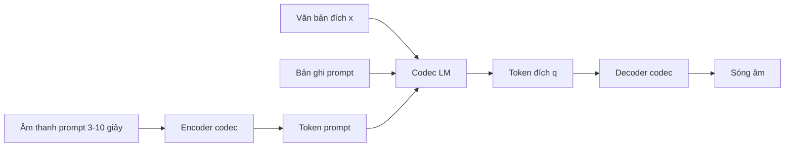
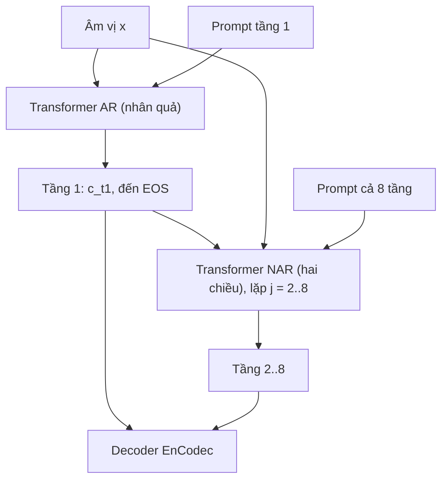

# Chương 32. Codec language model (VALL-E và họ hàng)

!!! abstract "Mục tiêu học tập"
    Sau chương này, bạn có thể:

    - **Phát biểu** TTS như bài toán mô hình hóa ngôn ngữ có điều kiện trên token codec, và giải thích vì sao "prompt" thay thế được embedding người nói.
    - **Phân tích** kiến trúc phân cấp ngữ nghĩa → âm học thô → âm học mịn của AudioLM và cách SPEAR-TTS gắn thêm văn bản.
    - **Suy ra** phân rã xác suất của VALL-E (tự hồi quy cho tầng 1, không tự hồi quy cho các tầng sau) và chỉ ra giả thiết độc lập nằm ở đâu.
    - **So sánh** các mẫu sắp xếp token nhiều tầng (làm phẳng, song song, trễ, thô trước, Transformer hai cấp) theo chi phí và mức độ giữ phụ thuộc.
    - **Mô tả** Tortoise, XTTS, BASE TTS và xu hướng LLM decoder-only trên codec một sổ mã.
    - **Chẩn đoán** các lỗi đặc trưng của codec LM (ảo giác, lặp, bỏ từ, không dừng, trôi khi đọc dài) và chọn biện pháp phù hợp.
    - **Cài đặt** mẫu trễ (*delay pattern*), các chiến lược lấy mẫu có phạt lặp, và một codec LM tự hồi quy thu nhỏ với mặt nạ nhân quả.

!!! info "Kiến thức cần có"
    - [Chương 31](ch31-audio-codec-speech-token.md): RVQ, token âm học và token ngữ nghĩa — chương này dùng chúng làm "từ vựng".
    - [Chương 5](../phan-1-nen-tang/ch05-transformer.md): Transformer decoder-only, mặt nạ nhân quả, KV cache, các chiến lược lấy mẫu (nhiệt độ, top-k, top-p, phạt lặp).
    - [Chương 7](../phan-2-mo-hinh-sinh/ch07-tong-quan-mo-hinh-sinh.md): mô hình tự hồi quy, teacher forcing, exposure bias.
    - [Chương 28](../phan-7-e2e-bieu-cam/ch28-da-nguoi-noi-voice-cloning.md): bài toán nhân bản giọng zero-shot.

Năm 2023, VALL-E cho thấy một điều bất ngờ: chỉ cần coi tiếng nói là chuỗi token codec, huấn luyện một mô hình ngôn ngữ trên vài chục nghìn giờ dữ liệu, là có thể nhân bản giọng nói của một người lạ từ 3 giây âm thanh — không cần bộ mã hóa người nói, không cần căn chỉnh, không cần trường độ. Chương này giải phẫu ý tưởng đó: từ tổ tiên AudioLM, qua VALL-E và các mẫu sắp xếp token, đến các hệ thống dựa trên LLM ngày nay, cùng những "căn bệnh" đặc trưng của hướng tiếp cận tự hồi quy và cách chữa.

## 32.1. TTS như mô hình hóa ngôn ngữ

### Phát biểu bài toán

Cho văn bản $\mathbf{x} = (x_1, \ldots, x_N)$ (âm vị, ký tự hoặc token BPE), một đoạn âm thanh mẫu (*prompt*) đã được mã hóa thành token $\tilde{\mathbf{q}} \in \{1, \ldots, V\}^{\tilde{T}' \times Q}$ (thường kèm bản ghi $\tilde{\mathbf{x}}$ của nó), ta cần sinh token $\mathbf{q} \in \{1, \ldots, V\}^{T' \times Q}$ của câu đích, rồi dùng decoder của codec để ra sóng âm. Mô hình học phân phối có điều kiện

$$
p_\theta(\mathbf{q} \mid \mathbf{x}, \tilde{\mathbf{q}})
$$

bằng MLE, tức là cực tiểu hóa entropy chéo trên token — y hệt mô hình ngôn ngữ văn bản.

Điểm then chốt là **học trong ngữ cảnh** (*in-context learning*): khi huấn luyện, prompt và đích là hai đoạn của **cùng một** bản ghi (cùng người nói, cùng phòng thu). Mô hình buộc phải học cách "sao chép" mọi đặc tính không có trong văn bản — âm sắc, tốc độ, cảm xúc, độ vang, thậm chí tiếng ồn nền — từ prompt sang phần tiếp theo. Khi suy luận, đổi prompt là đổi giọng. Không cần embedding người nói hay bất kỳ nhãn nào khác ngoài văn bản.



### Vì sao hướng này hiệu quả ở quy mô lớn

- **Bài toán một-nhiều được giải tự nhiên**: phân phối phân loại trên token đa đỉnh, lấy mẫu cho ra một cách đọc cụ thể ([Chương 31](ch31-audio-codec-speech-token.md)).
- **Dữ liệu "bẩn" dùng được**: vì mô hình học sao chép điều kiện âm học từ prompt, nó chịu được dữ liệu thu ngoài đời với đủ loại micro và phòng — miễn là có bản ghi (thường do ASR tạo ra). Điều này mở khóa hàng chục đến hàng trăm nghìn giờ dữ liệu, so với vài chục giờ dữ liệu phòng thu của TTS truyền thống.
- **Mở rộng quy mô theo công thức LLM**: thêm dữ liệu và tham số thường cải thiện chất lượng một cách có thể dự đoán.

Nhưng có một trở ngại cấu trúc: token codec là một **lưới** $T' \times Q$, không phải một chuỗi. Với EnCodec 6 kbps, một giây là $75 \times 8 = 600$ token. Mô hình hóa lưới này thế nào cho vừa chính xác vừa rẻ là sợi chỉ đỏ xuyên suốt chương.

## 32.2. AudioLM và SPEAR-TTS: phân cấp ngữ nghĩa → âm học

### AudioLM

AudioLM (Borsos và cộng sự, 2023) không phải hệ TTS — nó **nói tiếp** một đoạn âm thanh mà không cần văn bản — nhưng nó đặt nền móng cho cách phân rã bài toán. Như đã thấy ở [Chương 31](ch31-audio-codec-speech-token.md), token ngữ nghĩa (từ w2v-BERT + k-means) có cấu trúc nội dung tốt nhưng tái tạo kém, còn token âm học (từ SoundStream) thì ngược lại. AudioLM kết hợp cả hai qua **ba giai đoạn**, mỗi giai đoạn là một Transformer decoder-only riêng:

1. **Mô hình ngữ nghĩa**: $p(\mathbf{s})$ trên chuỗi token ngữ nghĩa $\mathbf{s}$ — học cấu trúc dài hạn (âm vị, từ, cú pháp).
2. **Mô hình âm học thô**: $p(\mathbf{q}_{:,1:Q'} \mid \mathbf{s})$ — sinh $Q'$ tầng RVQ đầu, có điều kiện trên token ngữ nghĩa; đây là nơi giọng nói và điều kiện thu âm được xác định.
3. **Mô hình âm học mịn**: $p(\mathbf{q}_{:,Q'+1:Q} \mid \mathbf{q}_{:,1:Q'})$ — sinh các tầng còn lại, chủ yếu là chi tiết cục bộ.

Tổng hợp lại:

$$
p(\mathbf{s}, \mathbf{q}) = p(\mathbf{s}) \; p(\mathbf{q}_{:,1:Q'} \mid \mathbf{s}) \; p(\mathbf{q}_{:,Q'+1:Q} \mid \mathbf{q}_{:,1:Q'}).
$$

Hai giai đoạn âm học làm phẳng các tầng RVQ thành chuỗi (Mục 32.4). Theo báo cáo gốc, token ngữ nghĩa ở 25 Hz, SoundStream ở 50 Hz với 12 tầng, trong đó 4 tầng đầu được coi là "thô". Với một prompt vài giây, AudioLM nói tiếp giữ được giọng và điều kiện âm học của prompt — chính là học trong ngữ cảnh.

### SPEAR-TTS: thêm văn bản vào phân cấp

SPEAR-TTS (Kharitonov và cộng sự, 2023) biến AudioLM thành TTS bằng cách tách hai nhiệm vụ:

- **"Đọc"** (*reading*): văn bản → token ngữ nghĩa, một bài toán seq2seq giống dịch máy.
- **"Nói"** (*speaking*): token ngữ nghĩa → token âm học, kiểu AudioLM, có prompt để giữ giọng.

Cái hay của cách tách này là giai đoạn "nói" **chỉ cần âm thanh, không cần văn bản**, nên huấn luyện được trên dữ liệu không nhãn khổng lồ. Chỉ giai đoạn "đọc" cần dữ liệu song song văn bản–âm thanh, và nhờ tiền huấn luyện cùng kỹ thuật dịch ngược (*back-translation*), bài báo báo cáo rằng nó hoạt động được với lượng dữ liệu song song rất nhỏ. Ý tưởng "giai đoạn sau học từ âm thanh không nhãn" có giá trị lớn cho các ngôn ngữ ít dữ liệu như tiếng Việt.

## 32.3. VALL-E: tự hồi quy cho tầng thô, song song cho tầng mịn

### Thiết lập

VALL-E (Wang và cộng sự, 2023) bỏ token ngữ nghĩa, làm việc trực tiếp trên token EnCodec. Các lựa chọn chính, theo báo cáo gốc:

- Bộ tách token: EnCodec 24 kHz ở 6 kbps, tức $Q = 8$ tầng, mỗi tầng $V = 1024$, 75 khung/giây.
- Đầu vào văn bản: chuỗi âm vị (qua G2P).
- Dữ liệu: LibriLight, khoảng 60 nghìn giờ tiếng Anh sách nói, hơn 7000 người nói; bản ghi do một hệ ASR tạo ra.
- Prompt khi suy luận: khoảng 3 giây âm thanh của người nói đích.

Ký hiệu $\mathbf{C} = \mathbf{q} \in \{1, \ldots, V\}^{T' \times 8}$ là token đích, $\mathbf{c}_{:,j}$ là cột tầng $j$, $\tilde{\mathbf{C}}$ là token prompt.

### Suy ra phân rã xác suất

Bắt đầu từ quy tắc chuỗi **theo tầng** (luôn đúng, không xấp xỉ):

$$
p(\mathbf{C} \mid \mathbf{x}, \tilde{\mathbf{C}}) = p(\mathbf{c}_{:,1} \mid \mathbf{x}, \tilde{\mathbf{C}}) \prod_{j=2}^{8} p(\mathbf{c}_{:,j} \mid \mathbf{c}_{:,<j}, \mathbf{x}, \tilde{\mathbf{C}}).
$$

VALL-E mô hình hóa hai loại thừa số bằng hai mạng khác nhau:

**Tầng 1 — tự hồi quy (AR).** Áp quy tắc chuỗi theo thời gian, và (theo thiết kế) chỉ dùng tầng 1 của prompt:

$$
p(\mathbf{c}_{:,1} \mid \mathbf{x}, \tilde{\mathbf{C}}) \approx \prod_{t=1}^{T'} p_{\theta_{\text{AR}}}\big(c_{t,1} \mid c_{<t,1}, \tilde{\mathbf{c}}_{:,1}, \mathbf{x}\big).
$$

Mô hình là một Transformer decoder-only nhận chuỗi $[\mathbf{x};\ \tilde{\mathbf{c}}_{:,1};\ c_{<t,1}]$ và dự đoán token kế tiếp trong $V + 1$ lớp (thêm token kết thúc EOS). **Độ dài $T'$ do mô hình tự quyết định** bằng việc sinh EOS — trường độ được mô hình hóa ngầm, không cần bộ dự đoán trường độ hay căn chỉnh nào.

**Tầng 2–8 — không tự hồi quy (NAR).** Với mỗi tầng $j \ge 2$, VALL-E giả thiết các token **trong cùng một tầng** độc lập có điều kiện khi đã biết toàn bộ các tầng thấp hơn:

$$
p(\mathbf{c}_{:,j} \mid \mathbf{c}_{:,<j}, \mathbf{x}, \tilde{\mathbf{C}}) \approx \prod_{t=1}^{T'} p_{\theta_{\text{NAR}}}\big(c_{t,j} \mid \mathbf{c}_{:,<j}, \mathbf{x}, \tilde{\mathbf{C}}\big).
$$

Đây là **giả thiết độc lập duy nhất** của VALL-E. Nó hợp lý vì: tầng 1 đã chốt nội dung, trường độ và phần lớn ngôn điệu; các tầng sau chỉ thêm chi tiết âm học mang tính cục bộ, mà mô hình NAR (dùng attention hai chiều trên toàn chuỗi) có thể suy ra từ các tầng thấp hơn và từ prompt (cho âm sắc). Mô hình NAR nhận tổng embedding các tầng $< j$ tại mỗi khung, cộng một embedding cho chỉ số tầng $j$ (đưa vào qua *adaptive LayerNorm*), và dùng **cả 8 tầng** của prompt để nắm âm sắc. Một mạng NAR duy nhất dùng chung tham số cho cả 7 tầng.

### Vì sao chia như vậy?

Hãy đếm số lượt forward tuần tự khi sinh một câu $T'$ khung:

- Làm phẳng toàn bộ 8 tầng và dùng AR: $8T'$ lượt — với câu 10 giây là 6000 lượt.
- VALL-E: $T'$ lượt AR cho tầng 1, cộng 7 lượt NAR (mỗi lượt sinh cả một tầng song song): $T' + 7$ lượt, tức khoảng 757 cho câu 10 giây.

Sự phân chia này khai thác đúng tính chất "thô đến mịn" của RVQ: phần **khó và quan trọng** (tầng 1: nội dung, nhịp điệu) được mô hình hóa cẩn thận nhất bằng AR; phần **dễ và cục bộ** được làm nhanh bằng NAR.



### Huấn luyện và suy luận

Khi huấn luyện, mô hình AR được huấn luyện như một mô hình ngôn ngữ nhân quả thuần túy trên câu: phần đầu của câu tự nhiên đóng vai prompt cho phần sau. Mô hình NAR ở mỗi bước chọn ngẫu nhiên một tầng $j \in \{2, \ldots, 8\}$ để học. Theo báo cáo gốc, cả hai mạng có cỡ khoảng 12 lớp Transformer, chiều ẩn 1024, 16 đầu attention.

Khi suy luận, VALL-E **lấy mẫu** (*sampling*) cho mô hình AR — bài báo nhận xét beam search dễ rơi vào vòng lặp vô hạn — còn mô hình NAR dùng giải mã tham lam (*greedy*). Có hai chế độ: dùng prompt ngắn của một câu khác (cần bản ghi của prompt, ghép trước văn bản đích), hoặc nói tiếp phần đầu của chính câu đó.

### Điểm mạnh và điểm yếu

Điểm mạnh: nhân bản giọng zero-shot ấn tượng; giữ được cảm xúc và môi trường âm học của prompt; sinh đa dạng (mỗi lần lấy mẫu là một cách đọc khác).

Điểm yếu, được chính các bài báo sau thừa nhận và tìm cách sửa:

- **Thiếu ổn định**: đôi khi bỏ từ, lặp từ, sinh ra âm thanh không có trong văn bản, hoặc không dừng. Gốc rễ: không có ràng buộc căn chỉnh đơn điệu nào giữa văn bản và âm thanh; mô hình AR có thể "nhảy" tùy ý.
- **Chậm**: hàng trăm lượt forward tuần tự cho mỗi câu.
- **Sao chép cả cái xấu của prompt**: prompt có tiếng ồn thì đầu ra có tiếng ồn.
- **Phụ thuộc G2P** cho đầu vào âm vị.

### VALL-E X và VALL-E 2

**VALL-E X** (Zhang và cộng sự, 2023) mở rộng sang đa ngôn ngữ (theo bài báo, Anh và Trung) và **xuyên ngôn ngữ**: prompt bằng ngôn ngữ A, văn bản bằng ngôn ngữ B, giữ giọng người nói. Một token ID ngôn ngữ được đưa vào để hướng mô hình về ngữ âm của ngôn ngữ đích, giúp giảm "giọng nước ngoài" — một vấn đề cũng gặp khi bắt giọng Việt nói tiếng Anh và ngược lại ([Chương 30](../phan-7-e2e-bieu-cam/ch30-da-ngon-ngu-code-switching.md)).

**VALL-E 2** (Chen và cộng sự, 2024) đưa ra hai cải tiến nhắm thẳng vào độ ổn định và tốc độ:

1. **Lấy mẫu có nhận biết lặp** (*repetition aware sampling*): lấy mẫu kiểu nucleus như thường, nhưng nếu token vừa chọn đã xuất hiện với tỉ lệ vượt ngưỡng trong một cửa sổ các bước gần nhất, thay nó bằng một mẫu lấy ngẫu nhiên từ **toàn bộ** phân phối gốc. Ý tưởng: vòng lặp vô hạn thường xảy ra khi nucleus sampling bị kẹt trong một tập token nhỏ; "lắc" ra khỏi tập đó đúng lúc phá vỡ vòng lặp mà không làm giảm chất lượng ở các bước bình thường. Cài đặt ở Mục 32.7.
2. **Mô hình hóa mã theo nhóm** (*grouped code modeling*): gộp $G$ khung liên tiếp thành một bước của mô hình AR, rút độ dài chuỗi xuống $T'/G$. Chuỗi ngắn hơn vừa nhanh hơn vừa giảm khó khăn khi mô hình hóa ngữ cảnh dài.

Nhóm tác giả báo cáo đạt "ngang bằng con người" (*human parity*) trên các bộ đánh giá LibriSpeech và VCTK theo các chỉ số họ dùng. Bạn nên hiểu đây là kết quả trên các bộ đánh giá cụ thể, không phải khẳng định cho mọi tình huống.

### Các biến thể nhắm vào căn chỉnh

Một số công trình khác tấn công trực tiếp vấn đề thiếu căn chỉnh (mô tả ngắn, theo bài báo gốc):

- **ELLA-V** (Song và cộng sự, 2024): chèn token âm vị **xen vào** chuỗi token âm thanh, ngay trước các khung tương ứng, để mô hình luôn biết đang đọc đến âm vị nào.
- **RALL-E** (Xin và cộng sự, 2024): trước khi sinh token âm thanh, dự đoán ngôn điệu (cao độ, trường độ) cho từng âm vị như một bước "chuỗi suy luận" (*chain-of-thought*), rồi dùng trường độ dự đoán để giới hạn attention.
- **VoiceCraft** (Peng và cộng sự, 2024): sắp xếp lại token bằng "mặt nạ nhân quả" (đưa đoạn cần sửa xuống cuối chuỗi) kết hợp mẫu trễ, cho phép một mô hình AR làm cả **chỉnh sửa giọng nói** lẫn TTS zero-shot.

## 32.4. Sắp xếp token nhiều tầng thành chuỗi

### Hình thức hóa một "mẫu"

Cho lưới token $\{q_{t,j}\}$ với $t = 1, \ldots, T'$ và $j = 1, \ldots, Q$. Một **mẫu sắp xếp** (*pattern*) là một dãy có thứ tự các tập $P_1, P_2, \ldots, P_S$ phân hoạch các ô của lưới. Ở bước $s$, mô hình dự đoán **song song** mọi token trong $P_s$, có điều kiện trên mọi token thuộc $P_1 \cup \cdots \cup P_{s-1}$:

$$
p(\mathbf{q}) \approx \prod_{s=1}^{S} \prod_{(t,j) \in P_s} p_\theta\big(q_{t,j} \mid \{q_{t',j'} : (t',j') \in P_{<s}\}\big).
$$

Công thức này **chính xác** khi mỗi $P_s$ chỉ có một phần tử (quy tắc chuỗi); khi $|P_s| > 1$ nó giả thiết các token trong cùng một bước độc lập có điều kiện. Hai đại lượng đặc trưng cho mỗi mẫu: số bước tuần tự $S$ (quyết định tốc độ) và những phụ thuộc bị bỏ qua (quyết định chất lượng). Copet và cộng sự (2023) phân tích có hệ thống các mẫu này trong MusicGen.

### Các mẫu phổ biến

**Làm phẳng** (*flattening*): $P_s$ là từng token đơn lẻ, theo thứ tự khung trước, tầng sau: $(1,1), (1,2), \ldots, (1,Q), (2,1), \ldots$ Đúng tuyệt đối theo quy tắc chuỗi nhưng $S = T'Q$ — chuỗi dài gấp $Q$ lần, attention đắt gấp $Q^2$ lần. AudioLM dùng cách này cho các giai đoạn âm học.

**Song song** (*parallel*): $P_t = \{(t,1), \ldots, (t,Q)\}$ — dự đoán mọi tầng của khung $t$ cùng lúc, $S = T'$. Rẻ nhất, nhưng giả thiết các tầng của cùng một khung độc lập có điều kiện. Với RVQ, giả thiết này **đặc biệt tệ**: token tầng $j$ là chỉ số trong sổ mã của *phần dư sau các tầng trước*, nên ý nghĩa của nó phụ thuộc mạnh vào $q_{t,<j}$. Dự đoán chúng độc lập giống như đoán chữ số hàng đơn vị mà không biết chữ số hàng chục.

**Trễ** (*delay*): tầng $j$ bị dịch phải $j - 1$ bước. Ở bước $s$, mô hình dự đoán $q_{s,1}, q_{s-1,2}, q_{s-2,3}, \ldots$ — tức là $P_s = \{(t, j) : t + j - 1 = s\}$, và $S = T' + Q - 1$. Token $q_{t,j}$ được sinh ở bước $t + j - 1$, **sau** mọi $q_{t,j'}$ với $j' < j$ (sinh ở các bước $t + j' - 1 < t + j - 1$). Như vậy phụ thuộc quan trọng nhất của RVQ — tầng cao phụ thuộc tầng thấp của cùng khung — được giữ lại, với chi phí gần như mẫu song song. Thứ bị bỏ qua là phụ thuộc giữa các token sinh cùng bước (ví dụ $q_{t,2}$ và $q_{t+1,1}$). Đây là mẫu mặc định của MusicGen và được dùng lại trong nhiều hệ TTS (ví dụ Parler-TTS, VoiceCraft).

**Thô trước** (*coarse first*, kiểu VALL-E): toàn bộ tầng 1 theo AR ($T'$ bước), rồi mỗi tầng còn lại một bước NAR, $S = T' + Q - 1$. Cùng số bước với mẫu trễ nhưng phân bổ khác: mẫu trễ để mọi tầng "thấy" lịch sử của nhau theo thời gian; VALL-E để các tầng mịn thấy **toàn bộ** tầng thô (cả tương lai) nhưng không thấy nhau trong cùng tầng.

**Transformer hai cấp** (RQ-Transformer, Lee và cộng sự, 2022): một Transformer **thời gian** lớn chạy trên các khung ($T'$ bước), tại mỗi khung sinh một véc-tơ ngữ cảnh; một Transformer **độ sâu** nhỏ chạy tự hồi quy qua $Q$ tầng của khung đó. Phân rã chính xác theo quy tắc chuỗi, nhưng phần tốn kém (Transformer lớn) chỉ chạy $T'$ lần. Ý tưởng này xuất hiện lại trong Moshi (*depth transformer*) và một số hệ TTS "AR kép" ([Chương 34](ch34-he-thong-lai-hien-dai.md), [Chương 35](ch35-streaming-speech-llm.md)).

| Mẫu | Số bước tuần tự $S$ | Token mỗi bước | Phụ thuộc giữ được | Ví dụ |
|---|---|---|---|---|
| Làm phẳng | $T'Q$ | 1 | tất cả | AudioLM (giai đoạn âm học) |
| Song song | $T'$ | $Q$ | không giữ phụ thuộc giữa tầng cùng khung | — (mốc so sánh) |
| Trễ | $T' + Q - 1$ | $\le Q$ | tầng thấp → tầng cao cùng khung | MusicGen, Parler-TTS |
| Thô trước | $T' + Q - 1$ | 1 (AR) hoặc $T'$ (NAR) | tầng mịn thấy toàn bộ tầng thô | VALL-E |
| Hai cấp | $T'$ (lớn) + $T'Q$ (nhỏ) | 1 | tất cả | RQ-Transformer, Moshi |

### Cài đặt mẫu trễ

Mẫu trễ thoạt nghe phức tạp nhưng cài đặt rất gọn: dịch mỗi cột (tầng) đi một số bước và đệm bằng một token đặc biệt. Mỗi bước $s$ của mô hình nhận **tổng embedding** của $Q$ token ở hàng $s-1$ và có $Q$ đầu ra song song để dự đoán hàng $s$. Đoạn mã dưới đây cài đặt phép trễ và phép đảo ngược, rồi **kiểm chứng trên chính lưới đã trễ** rằng tầng thấp của mỗi khung luôn được sinh trước tầng cao.

```python
import torch


def delay_interleave(codes, pad_id):
    """(B, T, Q) -> (B, T+Q-1, Q): tầng j bị trễ j bước (j đếm từ 0)."""
    B, T, Q = codes.shape
    out = codes.new_full((B, T + Q - 1, Q), pad_id)
    for j in range(Q):
        out[:, j:j + T, j] = codes[:, :, j]
    return out


def delay_deinterleave(delayed, Q):
    """(B, T+Q-1, Q) -> (B, T, Q): đảo ngược phép trễ."""
    T = delayed.shape[1] - Q + 1
    return torch.stack([delayed[:, j:j + T, j] for j in range(Q)], dim=-1)


# Minh họa: token (khung t, tầng j) mang giá trị 10*(t+1) + (j+1), đệm = 0
T, Q = 5, 3
demo = torch.tensor([[[10 * (t + 1) + (j + 1) for j in range(Q)] for t in range(T)]])
dd = delay_interleave(demo, pad_id=0)[0]       # (T+Q-1, Q)
print(dd.T)                                    # mỗi hàng in ra là một tầng
# tensor([[11, 21, 31, 41, 51,  0,  0],
#         [ 0, 12, 22, 32, 42, 52,  0],
#         [ 0,  0, 13, 23, 33, 43, 53]])

# Bước s nào chứa token nào? Tầng thấp hơn của cùng khung phải đến trước.
step_of = {int(dd[s, j]): s for s in range(dd.shape[0]) for j in range(Q) if dd[s, j]}
for t in range(T):
    for j in range(1, Q):
        tok, lower = 10 * (t + 1) + (j + 1), 10 * (t + 1) + j
        assert step_of[lower] < step_of[tok]

# Kiểm tra khả nghịch trên dữ liệu ngẫu nhiên
B, T, Q, V = 2, 50, 8, 1024
codes = torch.randint(0, V, (B, T, Q))
d = delay_interleave(codes, pad_id=V)          # token đệm nằm ngoài [0, V)
assert d.shape == (B, T + Q - 1, Q)
assert torch.equal(delay_deinterleave(d, Q), codes)
for name, steps in [("flatten", T * Q), ("parallel", T),
                    ("delay", T + Q - 1), ("AR tầng 1 + NAR", T + Q - 1)]:
    print(f"{name:16s} số lượt forward tuần tự = {steps}")
```

Trong bảng in ra, đọc theo cột: bước 3 (cột thứ ba) chứa $q_{3,1} = 31$, $q_{2,2} = 22$, $q_{1,3} = 13$ — ba token của ba khung khác nhau được sinh cùng lúc. Khi huấn luyện, các vị trí đệm phải được **loại khỏi hàm mất mát** (Bài tập 6).

## 32.5. Họ Tortoise–XTTS và BASE TTS

### Tortoise: công thức DALL-E cho tiếng nói

Tortoise (Betker, 2023) mượn công thức của các mô hình sinh ảnh thời kỳ đầu: một mô hình AR sinh token thô, một mô hình chấm điểm kiểu CLIP để chọn mẫu tốt, và một mô hình khuếch tán để "phóng" lên chất lượng cao. Cụ thể:

1. Một Transformer AR kiểu GPT-2 sinh token tiếng nói (từ một VQ-VAE trên mel) có điều kiện trên văn bản và "latent điều kiện" trích từ vài đoạn âm thanh mẫu.
2. Sinh **nhiều** ứng viên; một mô hình đối sánh văn bản–tiếng nói học tương phản (CLVP, tương tự CLIP) xếp hạng và chọn ứng viên khớp văn bản nhất.
3. Một mô hình khuếch tán biến **biểu diễn ẩn** của mô hình AR (không phải bản thân token) thành mel-spectrogram; một vocoder (UnivNet) tạo sóng âm.

Tortoise cho chất lượng và độ biểu cảm cao cho thời điểm đó nhưng rất chậm — sinh nhiều ứng viên, cộng khuếch tán nhiều bước. Bài học còn nguyên giá trị: **xếp hạng lại** (*reranking*) nhiều mẫu bằng một bộ chấm điểm độc lập là cách đơn giản để đổi tính toán lấy độ ổn định.

### XTTS: Tortoise đa ngôn ngữ và nhanh hơn

XTTS (Casanova và cộng sự, 2024), do nhóm Coqui phát triển, kế thừa khung Tortoise nhưng tối ưu cho tốc độ và đa ngôn ngữ (bài báo mô tả 16 ngôn ngữ):

- Mô hình AR kiểu GPT-2 trên token VQ-VAE, điều kiện người nói qua một *Perceiver resampler* nhận mel của âm thanh mẫu và nén thành một số véc-tơ cố định.
- Bỏ khuếch tán và vocoder riêng: một decoder kiểu HiFi-GAN sinh sóng âm **trực tiếp từ biểu diễn ẩn** của mô hình AR, có điều kiện trên embedding người nói — nhanh hơn nhiều và hỗ trợ sinh theo luồng.

!!! note "Góc tiếng Việt: kiểm tra danh sách ngôn ngữ và giấy phép"
    Tính đến thời điểm biên soạn (2026), tiếng Việt **không** nằm trong danh sách ngôn ngữ được hỗ trợ chính thức của bản phát hành XTTS-v2 theo hiểu biết của người biên soạn, và trọng số được phát hành theo một giấy phép mô hình riêng có hạn chế thương mại. Cộng đồng có các bản fine-tune cho tiếng Việt, nhưng chất lượng và giấy phép rất khác nhau. Hãy kiểm tra trực tiếp kho mã và thẻ mô hình trước khi dùng.

### BASE TTS: quy mô và "năng lực trồi"

BASE TTS (Łajszczak và cộng sự, 2024) là một thí nghiệm mở rộng quy mô: như tên bài báo cho biết, mô hình AR khoảng một tỷ tham số huấn luyện trên khoảng 100 nghìn giờ dữ liệu. Các điểm đáng chú ý:

- Token tiếng nói ("speechcodes") được trích từ một bộ tách token dựa trên WavLM, có cơ chế tách thông tin người nói và được nén thêm bằng BPE để rút ngắn chuỗi.
- Decoder từ speechcode ra sóng âm là mạng tích chập có thể chạy theo luồng.
- Nhóm tác giả xây một bộ kiểm tra "năng lực trồi" (*emergent abilities*) gồm các câu khó: danh từ ghép, cảm xúc, từ nước ngoài, ngôn ngữ cận lời nói, dấu câu, câu hỏi, cú pháp phức tạp — và báo cáo rằng các khả năng này cải thiện rõ khi tăng quy mô dữ liệu và tham số.

Ý tưởng bộ kiểm tra theo **hiện tượng ngôn ngữ** rất đáng học cho tiếng Việt: một bộ câu chứa số đếm, từ viết tắt, từ mượn tiếng Anh, tiểu từ cuối câu (*à, ạ, nhé, nhỉ*), câu hỏi, các cặp thanh khó ([Chương 38](../phan-9-thuc-tien/ch38-danh-gia-tts.md)).

## 32.6. LLM decoder-only trên codec một sổ mã

### Xu hướng hợp nhất

Từ 2024, một hướng đơn giản hóa mạnh mẽ trở nên phổ biến: dùng codec **một sổ mã** ([Chương 31](ch31-audio-codec-speech-token.md)) để tiếng nói thành một chuỗi đơn, rồi mở rộng từ vựng của một **LLM văn bản đã huấn luyện sẵn** (Llama, Qwen…) thêm các token tiếng nói. Chuỗi huấn luyện có dạng

```text
[văn bản prompt + văn bản đích] <bắt_đầu_tiếng> [token tiếng của prompt] [token tiếng đích] <kết_thúc_tiếng>
```

và hàm mất mát entropy chéo được tính trên phần token tiếng. Lợi ích:

- **Kiến trúc chuẩn**: không còn mẫu xen kẽ, không còn mạng NAR; toàn bộ hệ sinh thái LLM (LoRA, lượng tử hóa, vLLM, KV cache phân trang) dùng được ngay ([Chương 39](../phan-9-thuc-tien/ch39-trien-khai-production.md)).
- **Hiểu văn bản tốt hơn**: khởi tạo từ LLM văn bản mang theo tri thức về cú pháp, dấu câu, ngữ cảnh — có ích cho ngôn điệu.
- **Mở rộng tự nhiên** sang speech LLM hội thoại ([Chương 35](ch35-streaming-speech-llm.md)).

Hai ví dụ (mô tả theo báo cáo/tài liệu gốc; chi tiết có thể thay đổi giữa các phiên bản):

- **Llasa** (Ye và cộng sự, 2025): khởi tạo từ Llama, dùng codec X-codec 2 (một sổ mã FSQ rất lớn, 50 token/giây), công bố nhiều cỡ mô hình; nghiên cứu cả việc tăng tính toán **lúc suy luận** bằng cách tìm kiếm với các bộ chấm điểm (*verifier*) như độ tương đồng người nói hay độ chính xác ASR.
- **Orpheus** (Canopy Labs, 2025): một LLM cỡ vài tỷ tham số họ Llama được tinh chỉnh để sinh token của codec SNAC (Siuzdak và cộng sự, 2024). SNAC mã hóa âm thanh ở **nhiều độ phân giải thời gian** (tầng thô có tốc độ khung thấp hơn tầng mịn); Orpheus làm phẳng các token thuộc mỗi khung thô thành một nhóm cố định trong chuỗi — một dạng "làm phẳng có cấu trúc".

Các hệ thống lai nổi bật nhất (CosyVoice, Seed-TTS…) cũng dùng một LM trên token một luồng, nhưng giao phần âm học cho flow matching — đó là chủ đề của [Chương 34](ch34-he-thong-lai-hien-dai.md).

!!! note "Góc tiếng Việt: token văn bản và độ dài chuỗi"
    - **Đầu vào văn bản**: tiếng Việt có chính tả gần với ngữ âm, nên dùng ký tự (kể cả dấu thanh) làm đầu vào thường đủ tốt; G2P ([Chương 18](../phan-4-frontend/ch18-g2p-bieu-dien-dau-vao.md)) chủ yếu có ích cho từ mượn và tên riêng nước ngoài.
    - **Bộ tách token của LLM**: tokenizer BPE của nhiều LLM được huấn luyện chủ yếu trên tiếng Anh, nên một âm tiết tiếng Việt có dấu có thể bị cắt thành vài token byte. Chuỗi văn bản dài hơn, và quan trọng hơn, cùng một âm tiết có thể bị tách khác nhau tùy dạng chuẩn Unicode. **Luôn chuẩn hóa NFC** ở cả lúc huấn luyện lẫn suy luận ([Chương 17](../phan-4-frontend/ch17-chuan-hoa-van-ban.md)), và đo thử số token trung bình mỗi âm tiết trước khi chọn LLM nền.
    - **Thiếu dữ liệu**: dữ liệu tiếng Việt công khai nhỏ hơn tiếng Anh nhiều bậc. Cách thực tế là fine-tune một mô hình đa ngôn ngữ đã huấn luyện sẵn, theo dõi kỹ hiện tượng "giọng lơ lớ" do ngôn ngữ chiếm ưu thế trong dữ liệu gốc, và kiểm tra trộn mã Việt–Anh ([Chương 30](../phan-7-e2e-bieu-cam/ch30-da-ngon-ngu-code-switching.md)).

## 32.7. Lấy mẫu cho codec LM

[Chương 5](../phan-1-nen-tang/ch05-transformer.md) đã trình bày các chiến lược lấy mẫu; ở đây ta nhắc lại công thức và nhấn mạnh những điểm riêng cho token tiếng nói. Với logit $\mathbf{o} \in \mathbb{R}^V$:

- **Nhiệt độ** $\tau$: $p_k \propto \exp(o_k / \tau)$. $\tau < 1$ làm phân phối nhọn hơn (ổn định hơn, ít biểu cảm hơn).
- **Top-k**: chỉ giữ $k$ token có logit lớn nhất rồi chuẩn hóa lại.
- **Top-p** (*nucleus*, Holtzman và cộng sự, 2020): giữ tập token nhỏ nhất có tổng xác suất $\ge p$.
- **Phạt lặp** kiểu CTRL (Keskar và cộng sự, 2019): với mỗi token đã xuất hiện, chia logit dương cho hệ số $\theta > 1$, nhân logit âm với $\theta$.

**Vì sao giải mã tham lam và beam search thất bại với token tiếng nói?** Chuỗi token âm thanh có rất nhiều đoạn gần như dừng (khoảng lặng, nguyên âm kéo dài), nơi token lặp lại có xác suất cao. Chiến lược "chọn token xác suất cao nhất" dễ trôi vào một vòng lặp tự củng cố: lặp → ngữ cảnh toàn token lặp → lặp tiếp. Lấy mẫu có ngẫu nhiên giúp thoát ra.

**Cẩn thận với phạt lặp.** Khác với văn bản, tiếng nói **hợp lệ** chứa nhiều token lặp (khoảng lặng, nguyên âm dài). Phạt lặp quá mạnh trên toàn bộ lịch sử sẽ làm méo những đoạn này. VALL-E 2 vì vậy dùng cơ chế **cục bộ và có điều kiện**: chỉ can thiệp khi tỉ lệ lặp trong một cửa sổ ngắn vượt ngưỡng.

**Hướng dẫn không cần bộ phân loại** (*classifier-free guidance*, CFG) cũng áp dụng được cho LM: chạy mô hình hai lần, có và không có điều kiện (ví dụ bỏ văn bản), rồi kết hợp logit $\mathbf{o} = \mathbf{o}_{\text{uncond}} + w(\mathbf{o}_{\text{cond}} - \mathbf{o}_{\text{uncond}})$ với $w > 1$. MusicGen dùng CFG; với TTS, nó có thể tăng độ bám văn bản đổi lại gấp đôi chi phí mỗi bước.

```python
import torch


def sample_next(logits, history=None, temperature=1.0, top_k=0, top_p=1.0,
                repetition_penalty=1.0):
    """Lấy mẫu một token từ logits (V,) với các chiến lược phổ biến."""
    logits = logits.clone()
    if history is not None and repetition_penalty != 1.0:
        prev = torch.unique(history)               # phạt kiểu CTRL
        l = logits[prev]
        logits[prev] = torch.where(l > 0, l / repetition_penalty, l * repetition_penalty)
    logits = logits / max(temperature, 1e-5)
    if top_k > 0:                                  # giữ k logit lớn nhất
        kth = torch.topk(logits, top_k).values[-1]
        logits[logits < kth] = float("-inf")
    if top_p < 1.0:                                # nucleus: khối xác suất >= p
        sorted_logits, order = torch.sort(logits, descending=True)
        cum = torch.softmax(sorted_logits, -1).cumsum(-1)
        remove = cum - torch.softmax(sorted_logits, -1) >= top_p  # luôn giữ token đầu
        logits[order[remove]] = float("-inf")
    return int(torch.multinomial(torch.softmax(logits, -1), 1))


def repetition_aware_sample(logits, history, top_p=0.8, window=10, threshold=0.1):
    """Ý tưởng của VALL-E 2: nucleus sampling, nhưng nếu token vừa chọn đã lặp
    quá nhiều trong cửa sổ gần đây thì lấy mẫu lại từ phân phối gốc."""
    tok = sample_next(logits, top_p=top_p)
    recent = history[-window:]
    if len(recent) > 0 and (recent == tok).float().mean() > threshold:
        tok = int(torch.multinomial(torch.softmax(logits, -1), 1))
    return tok


torch.manual_seed(0)
V = 8
logits = torch.tensor([3.0, 2.5, 1.0, 0.5, 0.0, -1.0, -2.0, -3.0])
# top-k = 2 chỉ có thể trả về token 0 hoặc 1
assert {sample_next(logits, top_k=2) for _ in range(200)} <= {0, 1}
# top-p nhỏ: chỉ giữ token có xác suất cao nhất
assert {sample_next(logits, top_p=0.3) for _ in range(200)} == {0}
# nhiệt độ rất thấp ~ greedy
assert sample_next(logits, temperature=1e-4) == 0
# phạt lặp làm giảm xác suất token 0 đã xuất hiện
hist = torch.tensor([0, 0, 0])
cnt = sum(sample_next(logits, hist, repetition_penalty=3.0) == 0 for _ in range(500))
print("tần suất token 0 khi bị phạt:", cnt / 500, "| không phạt ≈",
      round(torch.softmax(logits, -1)[0].item(), 2))
# repetition-aware: lịch sử toàn token 0 -> thường bị lấy mẫu lại
toks = [repetition_aware_sample(logits, torch.zeros(10, dtype=torch.long), top_p=0.3)
        for _ in range(500)]
print("RAS: tỉ lệ khác 0 =", sum(t != 0 for t in toks) / 500)
```

Với phạt lặp $\theta = 3$, tần suất của token 0 giảm từ khoảng 0,53 xuống khoảng 0,14. Với lấy mẫu có nhận biết lặp, khi lịch sử toàn là token 0, gần một nửa số lần token được lấy mẫu lại từ phân phối đầy đủ và "thoát" khỏi token 0. Các tham số cửa sổ và ngưỡng ở đây chỉ để minh họa; giá trị thực tế cần tinh chỉnh theo từng mô hình.

## 32.8. Một codec LM tự hồi quy thu nhỏ

Để thấy tận mắt "trường độ được học ngầm", ta xây một codec LM tí hon kiểu tầng 1 của VALL-E và huấn luyện trên dữ liệu đồ chơi: mỗi "âm vị" $x$ sinh ra một token âm thanh xác định, lặp lại $1 + (x \bmod 3)$ lần — tức mỗi âm vị có trường độ riêng. Mô hình không được cho biết trường độ; nó phải tự học khi nào chuyển sang âm vị tiếp theo và khi nào sinh EOS. Chuỗi đầu vào là `[văn bản] [BOS] [token âm thanh]`, mặt nạ nhân quả trên toàn chuỗi, mất mát chỉ tính trên phần âm thanh.

```python
import torch
import torch.nn as nn
import torch.nn.functional as F


class TinyCodecLM(nn.Module):
    """LM decoder-only: [token văn bản] [BOS] [token âm thanh tầng 1] ... [EOS]."""

    def __init__(self, n_text, n_audio, d=64, n_layers=2, n_heads=4, max_len=256):
        super().__init__()
        self.bos, self.eos = n_audio, n_audio + 1           # hai token đặc biệt
        self.text_emb = nn.Embedding(n_text, d)
        self.audio_emb = nn.Embedding(n_audio + 2, d)
        self.type_emb = nn.Embedding(2, d)                   # 0 = văn bản, 1 = âm thanh
        self.pos_emb = nn.Embedding(max_len, d)
        layer = nn.TransformerEncoderLayer(d, n_heads, 4 * d, dropout=0.0,
                                           batch_first=True, norm_first=True)
        self.blocks = nn.TransformerEncoder(layer, n_layers, enable_nested_tensor=False)
        self.head = nn.Linear(d, n_audio + 2)

    def forward(self, text, audio):                          # text: (B, N), audio: (B, S)
        N, S = text.shape[1], audio.shape[1]
        h = torch.cat([self.text_emb(text) + self.type_emb.weight[0],
                       self.audio_emb(audio) + self.type_emb.weight[1]], dim=1)
        h = h + self.pos_emb(torch.arange(N + S, device=text.device))  # (B, N+S, d)
        causal = torch.triu(torch.ones(N + S, N + S, dtype=torch.bool,
                                       device=text.device), diagonal=1)  # True = bị che
        h = self.blocks(h, mask=causal)
        return self.head(h[:, N:])                           # (B, S, n_audio+2)

    @torch.no_grad()
    def generate(self, text, max_steps=64):                  # text: (1, N), giải mã tham lam
        audio = torch.tensor([[self.bos]])
        for _ in range(max_steps):                           # không có KV cache cho gọn
            nxt = self(text, audio)[0, -1].argmax()
            if nxt == self.eos:
                break
            audio = torch.cat([audio, nxt.view(1, 1)], dim=1)
        return audio[0, 1:]
```

Huấn luyện và kiểm tra (chạy tiếp sau khối trên; khoảng mười giây trên CPU):

```python
# --- Dữ liệu đồ chơi: mỗi "âm vị" x sinh ra token âm thanh (3x+1) % 16, lặp 1 + x % 3 lần
torch.manual_seed(0)
N_TEXT, N_AUDIO = 10, 16

def make_pair(n):
    x = torch.randint(0, N_TEXT, (n,))
    a = torch.cat([torch.full((1 + int(v) % 3,), (3 * int(v) + 1) % N_AUDIO) for v in x])
    return x, a

def make_batch(bsz, n=6):
    xs, ys_in, ys_out = [], [], []
    for _ in range(bsz):
        x, a = make_pair(n)
        xs.append(x)
        ys_in.append(torch.cat([torch.tensor([N_AUDIO]), a]))       # [BOS] + a
        ys_out.append(torch.cat([a, torch.tensor([N_AUDIO + 1])]))  # a + [EOS]
    pad = lambda seqs, v: nn.utils.rnn.pad_sequence(seqs, batch_first=True, padding_value=v)
    return torch.stack(xs), pad(ys_in, N_AUDIO + 1), pad(ys_out, -100)  # -100: bỏ qua

model = TinyCodecLM(N_TEXT, N_AUDIO)
opt = torch.optim.AdamW(model.parameters(), lr=3e-3)
for step in range(600):
    x, a_in, a_out = make_batch(32)
    logits = model(x, a_in)                                  # (B, S, V+2)
    loss = F.cross_entropy(logits.transpose(1, 2), a_out, ignore_index=-100)
    opt.zero_grad(); loss.backward(); opt.step()
    if step % 200 == 0 or step == 599:
        print(f"bước {step:3d}  CE = {loss.item():.3f}")

# Kiểm tra tính nhân quả: đổi token ở vị trí k không ảnh hưởng logits ở vị trí < k
x, a_in, _ = make_batch(1)
k = 4
a_mod = a_in.clone(); a_mod[0, k] = (a_mod[0, k] + 1) % N_AUDIO
with torch.no_grad():
    assert torch.allclose(model(x, a_in)[:, :k], model(x, a_mod)[:, :k], atol=1e-5)

# Sinh tự hồi quy: mô hình tự quyết định độ dài (trường độ) và khi nào dừng
model.eval()
correct = 0
for _ in range(20):
    x, a = make_pair(6)
    out = model.generate(x[None])
    correct += int(torch.equal(out, a))
print(f"số câu sinh đúng hoàn toàn: {correct}/20")
```

Trong lần chạy của người biên soạn, entropy chéo giảm từ khoảng 3,3 xuống gần 0, và mô hình sinh đúng hoàn toàn cả 20 câu kiểm tra — kể cả số lần lặp của từng token và vị trí EOS. Bài toán đồ chơi này tất định nên rất dễ; với tiếng nói thật, phân phối có entropy cao hơn nhiều, và chính khoảng trống giữa "dễ" và "thật" là nơi các lỗi ở mục sau xuất hiện. Hai lưu ý cài đặt:

- Mặt nạ ở đây nhân quả trên **toàn bộ** chuỗi, kể cả phần văn bản. Một lựa chọn khác là *prefix LM*: phần văn bản attention hai chiều với nhau, phần âm thanh nhân quả. Cả hai đều được dùng trong thực tế.
- Hàm `generate` tính lại toàn bộ chuỗi ở mỗi bước — chi phí bình phương. Hệ thống thật dùng KV cache ([Chương 5](../phan-1-nen-tang/ch05-transformer.md); Bài tập 8).

## 32.9. Những "căn bệnh" của codec LM và cách chữa

### Vì sao chuỗi dài dễ hỏng: một phép tính đơn giản

Giả sử ở mỗi bước, xác suất mô hình sinh ra một token "hỏng" (gây lỗi không tự sửa được, như nhảy cóc qua một từ) là $\varepsilon$ nhỏ và độc lập giữa các bước. Xác suất một chuỗi $S$ token không có lỗi nào là

$$
(1 - \varepsilon)^S = \exp\big(S \log(1-\varepsilon)\big) \approx e^{-\varepsilon S} \quad (\varepsilon \ll 1).
$$

Với $\varepsilon = 10^{-4}$: chuỗi 750 token (10 giây ở 75 Hz, chỉ tầng 1) có xác suất sạch lỗi khoảng $e^{-0{,}075} \approx 0{,}93$; chuỗi 6000 token (làm phẳng 8 tầng) chỉ còn khoảng $e^{-0{,}6} \approx 0{,}55$; còn nếu dùng token 12,5 Hz (125 token cho 10 giây), con số là khoảng $0{,}99$. Mô hình độc lập này đơn giản hóa quá mức (lỗi thực tế tương quan, và exposure bias khiến $\varepsilon$ tăng sau lỗi đầu tiên), nhưng nó giải thích vì sao **giảm số token mỗi giây** cải thiện độ ổn định chứ không chỉ tốc độ, và vì sao đọc văn bản dài nên chia theo câu.

### Bảng chẩn đoán

| Triệu chứng | Nguyên nhân thường gặp | Biện pháp |
|---|---|---|
| **Ảo giác** (*hallucination*): sinh âm thanh/từ không có trong văn bản, nói lảm nhảm | Điều kiện văn bản yếu; attention không bám văn bản; bản ghi huấn luyện do ASR tạo ra có lỗi; nhiệt độ cao | Lọc dữ liệu theo độ khớp ASR; giảm nhiệt độ; CFG; ràng buộc căn chỉnh (ELLA-V, RALL-E); xếp hạng lại bằng ASR |
| **Lặp, kẹt vòng** | Vòng lặp tự củng cố ở đoạn dừng; giải mã tham lam/beam | Lấy mẫu thay vì tham lam; lấy mẫu có nhận biết lặp; phạt lặp cục bộ, nhẹ |
| **Bỏ từ** | Attention "nhảy cóc"; câu dài; từ hiếm | Ràng buộc đơn điệu (ví dụ bộ chuyển đổi *transducer*, giới hạn theo trường độ); chia câu; xếp hạng lại bằng CER |
| **Không dừng** (EOS không bao giờ được sinh) | EOS có xác suất thấp; prompt kết thúc giữa từ | Giới hạn độ dài tối đa theo độ dài văn bản (ví dụ $T'_{\max} = \alpha N$); tăng logit EOS khi đã vượt độ dài dự kiến |
| **Trôi khi đọc dài**: giọng, tốc độ, âm lượng thay đổi dần | Lỗi tích lũy; ngữ cảnh vượt độ dài huấn luyện | Chia theo câu/đoạn, dùng lại **cùng** prompt gốc cho mọi đoạn; ghép nối có xử lý ranh giới |
| **Sao chép khuyết tật của prompt** | Học trong ngữ cảnh sao chép cả tiếng ồn, tiếng vang | Chọn và làm sạch prompt; cắt khoảng lặng đầu/cuối |
| **Chậm** | Nhiều token tuần tự | Token tốc độ thấp; gộp nhóm khung (VALL-E 2); KV cache; engine phục vụ LLM; giai đoạn NAR song song kiểu SoundStorm (Borsos và cộng sự, 2023) |

### Xếp hạng lại và hậu huấn luyện

Hai biện pháp tổng quát hiệu quả nhất trong thực tế đều đổi tính toán lấy chất lượng:

1. **Xếp hạng lại**: sinh $n$ ứng viên, chấm điểm từng ứng viên bằng CER (qua ASR), độ tương đồng người nói và một bộ dự đoán MOS, chọn ứng viên tốt nhất. Tortoise dùng CLVP; Llasa nghiên cứu việc tìm kiếm có bộ chấm điểm lúc suy luận. Chi phí tăng gần $n$ lần, nên thường chỉ dùng cho sinh ngoại tuyến (sách nói) hoặc khi phát hiện ứng viên đầu tiên có vấn đề.
2. **Hậu huấn luyện theo sở thích**: dùng chính các tín hiệu trên (CER, độ tương đồng) làm phần thưởng để tối ưu mô hình bằng các phương pháp kiểu DPO hoặc học tăng cường, nhằm giảm tỉ lệ lỗi ngay từ phân phối của mô hình. Đây là chủ đề của [Chương 34](ch34-he-thong-lai-hien-dai.md).

!!! note "Góc tiếng Việt: lỗi thanh điệu là một dạng ảo giác khó phát hiện"
    Với tiếng Việt, một token tầng thô bị lấy mẫu "lệch" có thể đổi đường nét F0 của một âm tiết và biến *mua* thành *múa* — người nghe nghe thấy một **từ khác**, còn chỉ số CER trên ASR chỉ bắt được lỗi nếu ASR đủ nhạy với thanh điệu. Vài lời khuyên: (1) khi đánh giá, tách riêng tỉ lệ lỗi thanh điệu (so sánh thanh của âm tiết nhận dạng với văn bản); (2) thử nhiệt độ thấp hơn cho tầng thô; (3) khi xếp hạng lại, dùng một ASR tiếng Việt mạnh và chuẩn hóa văn bản trước khi tính CER ([Chương 38](../phan-9-thuc-tien/ch38-danh-gia-tts.md)); (4) xây bộ câu kiểm tra có nhiều cặp tối thiểu thanh điệu và số đếm.

## Lỗi thường gặp và mẹo thực hành

- **Bản ghi prompt không khớp âm thanh prompt.** Ở chế độ "prompt + văn bản đích", văn bản của prompt được ghép trước văn bản đích. Nếu bản ghi sai (thiếu từ, sai chuẩn hóa số), mô hình thường đọc lại một phần prompt hoặc nói lắp ở đầu câu. Hãy chạy ASR kiểm tra lại bản ghi prompt.
- **Prompt có khoảng lặng dài ở cuối.** Mô hình "học" rằng người này nói chậm, hoặc sinh khoảng lặng dài ở đầu câu đích. Cắt khoảng lặng, giữ chừng 0,1–0,2 giây.
- **Đặt độ dài tối đa quá rộng.** Nếu mô hình không sinh EOS, nó sẽ lảm nhảm đến hết giới hạn. Đặt giới hạn theo độ dài văn bản (ví dụ vài lần số khung trung bình mỗi âm tiết nhân số âm tiết) và ghi log mọi trường hợp chạm giới hạn.
- **Quên loại vị trí đệm khỏi hàm mất mát**, nhất là với mẫu trễ (các ô đệm ở đầu và cuối) — mô hình sẽ học dự đoán token đệm và sinh ra chúng khi suy luận.
- **Trộn lẫn chỉ số tầng khi dùng một từ vựng chung.** Khi làm phẳng nhiều tầng vào một từ vựng, nhớ cộng độ lệch tầng; khi giải mã, nhớ trừ đi. Lỗi này cho ra tiếng rè mà không có lỗi nào được báo.
- **Tinh chỉnh tham số lấy mẫu trên vài câu.** Nhiệt độ, top-p, ngưỡng lặp phải được chọn trên một tập kiểm tra đủ lớn (hàng trăm câu), đo CER và độ tương đồng; cảm nhận trên vài câu rất dễ đánh lừa vì codec LM có phương sai cao giữa các lần lấy mẫu.
- **Đặt seed khi so sánh.** Cùng một mô hình có thể cho kết quả rất khác giữa các lần chạy. Khi so sánh hai cấu hình, cố định seed và báo cáo trung bình trên nhiều seed.
- **Sinh văn bản dài một lần.** Đừng đưa nguyên một chương sách vào mô hình; chia theo câu (hoặc cụm câu), giữ cùng prompt, và nối các đoạn với khoảng lặng hợp lý.
- **Dùng giọng người khác làm prompt khi chưa được đồng ý.** Nhân bản giọng zero-shot quá dễ; quy trình xin phép và các biện pháp an toàn ở [Chương 40](../phan-9-thuc-tien/ch40-dao-duc-an-toan.md) là bắt buộc, không phải tùy chọn.

## Tóm tắt

- Codec LM coi TTS là mô hình hóa ngôn ngữ có điều kiện $p(\mathbf{q} \mid \mathbf{x}, \tilde{\mathbf{q}})$ trên token codec; prompt cùng bản ghi tạo ra học trong ngữ cảnh, thay thế embedding người nói.
- AudioLM phân rã sinh âm thanh thành ngữ nghĩa → âm học thô → âm học mịn; SPEAR-TTS thêm giai đoạn "đọc" văn bản → token ngữ nghĩa, để giai đoạn "nói" học từ âm thanh không nhãn.
- VALL-E dùng AR cho tầng RVQ đầu (nội dung, trường độ ngầm qua EOS) và NAR cho 7 tầng sau, với giả thiết độc lập có điều kiện trong từng tầng; số lượt tuần tự giảm từ $8T'$ xuống $T' + 7$.
- VALL-E X thêm token ngôn ngữ cho tổng hợp xuyên ngôn ngữ; VALL-E 2 thêm lấy mẫu có nhận biết lặp và gộp nhóm khung.
- Các mẫu sắp xếp token đánh đổi số bước tuần tự với phụ thuộc bị bỏ qua: làm phẳng (chính xác, đắt), song song (rẻ, phá phụ thuộc RVQ), trễ (gần rẻ như song song mà giữ phụ thuộc tầng thấp → tầng cao), thô trước, Transformer hai cấp.
- Tortoise (AR + xếp hạng CLVP + khuếch tán) và XTTS (AR + decoder HiFi-GAN trên biểu diễn ẩn) đại diện cho dòng "GPT trên token VQ"; BASE TTS khảo sát mở rộng quy mô và năng lực trồi.
- Xu hướng mới: codec một sổ mã + LLM văn bản đã huấn luyện sẵn (Llasa, Orpheus), tận dụng toàn bộ hệ sinh thái LLM.
- Codec LM dễ mắc ảo giác, lặp, bỏ từ, không dừng, trôi khi đọc dài; xác suất lỗi tăng theo độ dài chuỗi, nên token tốc độ thấp, ràng buộc căn chỉnh, lấy mẫu cẩn thận, xếp hạng lại và hậu huấn luyện là các biện pháp chính.

## Bài tập

1. **[Cơ bản]** Cho một câu dài 12 giây được mã hóa bằng codec 75 Hz, 8 tầng. Tính số bước tuần tự và độ dài chuỗi mà Transformer phải xử lý cho các mẫu: làm phẳng, song song, trễ, VALL-E. Nếu chi phí attention tỉ lệ với bình phương độ dài chuỗi, mẫu làm phẳng đắt hơn mẫu trễ bao nhiêu lần?

    ??? success "Lời giải"
        $T' = 75 \times 12 = 900$. Làm phẳng: $S = 7200$, chuỗi dài 7200. Song song: $S = 900$. Trễ: $S = 907$. VALL-E: 900 bước AR (chuỗi tầng 1 dài 900) cộng 7 lượt NAR trên chuỗi dài 900. Tỉ lệ chi phí attention làm phẳng/trễ $\approx (7200/907)^2 \approx 63$ lần.

2. **[Cơ bản]** Viết lại phân rã xác suất của VALL-E và chỉ ra chính xác chỗ nào là xấp xỉ. Giả thiết đó có hợp lý hơn nếu dùng codec có tầng 1 được chưng cất ngữ nghĩa (SpeechTokenizer) không? Vì sao?

    ??? tip "Gợi ý"
        Quy tắc chuỗi theo tầng là chính xác; xấp xỉ nằm ở (i) mô hình AR chỉ nhìn tầng 1 của prompt, (ii) độc lập có điều kiện giữa các khung trong mỗi tầng $j \ge 2$. Khi tầng 1 đã mang trọn nội dung, các tầng sau chủ yếu là âm sắc và chi tiết — thông tin "toàn cục" (lấy từ prompt) hoặc "cục bộ" — nên giả thiết (ii) càng hợp lý.

3. **[Nâng cao]** Xét một RVQ hai tầng trên dữ liệu một chiều, trong đó $q_2$ được xác định hoàn toàn bởi $q_1$ và một biến ẩn cục bộ. Hãy xây dựng một phân phối rời rạc nhỏ (ví dụ $V = 2$) cho $(q_1, q_2)$ sao cho $q_1, q_2$ phụ thuộc mạnh, rồi tính độ chênh giữa entropy chéo tốt nhất mà mẫu song song (dự đoán độc lập $p(q_1)p(q_2)$) đạt được và entropy thật $H(q_1, q_2)$. Liên hệ với thông tin tương hỗ.

    ??? tip "Gợi ý"
        Mô hình tích tốt nhất là tích các phân phối biên; chênh lệch entropy chéo tối thiểu đúng bằng $H(q_1) + H(q_2) - H(q_1, q_2) = I(q_1; q_2)$. Ví dụ $q_2 = q_1$ với $q_1$ đều trên $\{0, 1\}$: $I = 1$ bit mỗi khung bị "mất".

4. **[Nâng cao]** Dùng mô hình lỗi độc lập ở Mục 32.9, tìm độ dài chuỗi tối đa $S$ để xác suất không lỗi còn ít nhất 0,9 khi $\varepsilon = 5 \times 10^{-5}$. Từ đó, với token 75 Hz (chỉ tầng 1) và token 25 Hz, độ dài câu tối đa (giây) là bao nhiêu? Nêu hai lý do khiến mô hình độc lập này lạc quan hơn thực tế.

    ??? success "Lời giải"
        $e^{-\varepsilon S} \ge 0{,}9 \Rightarrow S \le -\ln 0{,}9 / \varepsilon \approx 0{,}1054 / (5 \times 10^{-5}) \approx 2107$ token, tức khoảng 28 giây ở 75 Hz và khoảng 84 giây ở 25 Hz. Mô hình lạc quan vì (i) exposure bias: sau lỗi đầu tiên, ngữ cảnh lệch khỏi phân phối huấn luyện nên xác suất lỗi tăng; (ii) $\varepsilon$ không đều — tăng ở câu dài vượt độ dài huấn luyện, từ hiếm, tên riêng.

5. **[Nâng cao]** Thiết kế một quy trình xếp hạng lại cho TTS tiếng Việt sinh sách nói: chọn số ứng viên, các bộ chấm điểm (CER sau chuẩn hóa văn bản, tỉ lệ lỗi thanh, độ tương đồng người nói, dự đoán MOS), cách kết hợp điểm, và tiêu chí kích hoạt sinh lại. Ước lượng chi phí tính toán so với sinh một lần.

6. **[Lập trình]** Mở rộng mã mẫu trễ ở Mục 32.4: viết hàm trả về mặt nạ `(B, T+Q-1, Q)` đánh dấu các ô đệm, dùng nó để loại ô đệm khỏi entropy chéo, và hỗ trợ batch có độ dài khác nhau (mỗi câu một $T'$ riêng). Kiểm tra bằng `assert` rằng số ô hợp lệ đúng bằng $\sum_b T'_b \cdot Q$.

    ??? tip "Gợi ý"
        Áp `delay_interleave` lên một tensor toàn số 1 có kích thước `(B, T, Q)` (nhân với mặt nạ độ dài theo khung) với giá trị đệm 0 — kết quả chính là mặt nạ hợp lệ.

7. **[Lập trình]** Tạo một "LM thoái hóa" có logit thiên mạnh về việc lặp lại token trước đó (ví dụ logit của token vừa sinh cộng thêm 4). Sinh chuỗi 200 token bằng (a) tham lam, (b) top-p = 0,8, (c) lấy mẫu có nhận biết lặp. Đo độ dài đoạn lặp dài nhất và entropy của phân phối token sinh ra trong mỗi trường hợp.

8. **[Lập trình]** Thêm KV cache vào `TinyCodecLM.generate` (có thể cài lại khối Transformer bằng tay theo [Chương 5](../phan-1-nen-tang/ch05-transformer.md)). Kiểm tra rằng logit ở mỗi bước trùng với phiên bản không cache (sai khác dưới `1e-5`) và đo mức tăng tốc khi sinh 200 token.

## Tài liệu tham khảo

1. Borsos, Z. và cộng sự (2023). *AudioLM: A Language Modeling Approach to Audio Generation*. IEEE/ACM Transactions on Audio, Speech, and Language Processing. arXiv:2209.03143.
2. Kharitonov, E. và cộng sự (2023). *Speak, Read and Prompt: High-Fidelity Text-to-Speech with Minimal Supervision*. Transactions of the Association for Computational Linguistics. arXiv:2302.03540.
3. Wang, C. và cộng sự (2023). *Neural Codec Language Models are Zero-Shot Text to Speech Synthesizers*. arXiv:2301.02111.
4. Zhang, Z. và cộng sự (2023). *Speak Foreign Languages with Your Own Voice: Cross-Lingual Neural Codec Language Modeling*. arXiv.
5. Chen, S. và cộng sự (2024). *VALL-E 2: Neural Codec Language Models are Human Parity Zero-Shot Text to Speech Synthesizers*. arXiv.
6. Song, Y. và cộng sự (2024). *ELLA-V: Stable Neural Codec Language Modeling with Alignment-guided Sequence Reordering*. arXiv.
7. Xin, D. và cộng sự (2024). *RALL-E: Robust Codec Language Modeling with Chain-of-Thought Prompting for Text-to-Speech Synthesis*. arXiv.
8. Peng, P., Huang, P.-Y., Li, S.-W., Mohamed, A., Harwath, D. (2024). *VoiceCraft: Zero-Shot Speech Editing and Text-to-Speech in the Wild*. ACL.
9. Copet, J. và cộng sự (2023). *Simple and Controllable Music Generation*. NeurIPS. arXiv:2306.05284.
10. Lee, D., Kim, C., Kim, S., Cho, M., Han, W.-S. (2022). *Autoregressive Image Generation using Residual Quantization*. CVPR.
11. Borsos, Z., Sharifi, M., Vincent, D., Kharitonov, E., Zeghidour, N., Tagliasacchi, M. (2023). *SoundStorm: Efficient Parallel Audio Generation*. arXiv.
12. Betker, J. (2023). *Better Speech Synthesis through Scaling*. arXiv:2305.07243.
13. Casanova, E. và cộng sự (2024). *XTTS: a Massively Multilingual Zero-Shot Text-to-Speech Model*. Interspeech.
14. Łajszczak, M. và cộng sự (2024). *BASE TTS: Lessons from Building a Billion-Parameter Text-to-Speech Model on 100K Hours of Data*. arXiv.
15. Ye, Z. và cộng sự (2025). *Llasa: Scaling Train-Time and Inference-Time Compute for Llama-based Speech Synthesis*. arXiv.
16. Siuzdak, H., Grötschla, F., Lanzendörfer, L. A. (2024). *SNAC: Multi-Scale Neural Audio Codec*. arXiv.
17. Canopy Labs (2025). *Orpheus TTS*. Kho mã nguồn mở trên GitHub (tài liệu kỹ thuật, không phải bài báo bình duyệt).
18. Holtzman, A., Buys, J., Du, L., Forbes, M., Choi, Y. (2020). *The Curious Case of Neural Text Degeneration*. ICLR.
19. Keskar, N. S., McCann, B., Varshney, L. R., Xiong, C., Socher, R. (2019). *CTRL: A Conditional Transformer Language Model for Controllable Generation*. arXiv.
20. Défossez, A., Copet, J., Synnaeve, G., Adi, Y. (2022). *High Fidelity Neural Audio Compression*. Transactions on Machine Learning Research (2023). arXiv:2210.13438.
