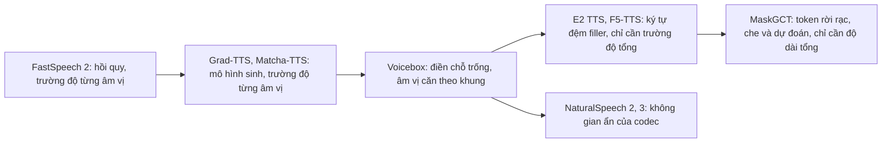
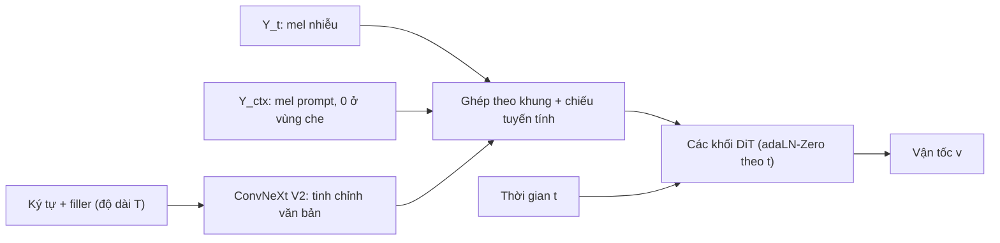

# Chương 33. TTS không tự hồi quy quy mô lớn

!!! abstract "Mục tiêu học tập"
    Sau chương này, bạn có thể:

    - **Giải thích** vì sao bài toán "điền vào chỗ trống" (*infilling*) trên tiếng nói hợp nhất được TTS zero-shot, chỉnh sửa giọng nói và khử nhiễu trong cùng một mô hình.
    - **Suy ra** hàm mất mát flow matching có che (*masked CFM*) của Voicebox và công thức hướng dẫn không cần bộ phân loại (CFG) cho trường vận tốc.
    - **Mô tả** cách NaturalSpeech 2 và 3 sinh trên không gian ẩn của codec, và vì sao NaturalSpeech 3 phân rã tiếng nói thành nhiều thuộc tính.
    - **Cài đặt** cách xây đầu vào kiểu E2/F5-TTS (chuỗi ký tự đệm token *filler* tới độ dài mel), hàm mất mát CFM có che, lịch thời gian *sway sampling* và bộ lấy mẫu Euler có CFG.
    - **Trình bày** hai giai đoạn của MaskGCT và cơ chế giải mã song song lặp kiểu MaskGIT.
    - **Phân tích** bài toán ước lượng trường độ tổng và đề xuất cách làm phù hợp cho tiếng Việt.
    - **So sánh** TTS tự hồi quy và không tự hồi quy ở quy mô lớn theo độ ổn định, tốc độ, độ đa dạng và khả năng chạy theo luồng.

!!! info "Kiến thức cần có"
    - [Chương 12](../phan-2-mo-hinh-sinh/ch12-flow-matching.md): flow matching có điều kiện, đường đi OT, bộ giải ODE, CFG cho flow matching, flow matching có che và sway sampling (chương này dùng lại và đi sâu vào ứng dụng TTS).
    - [Chương 22](../phan-5-mo-hinh-am-hoc/ch22-fastspeech.md) và [Chương 23](../phan-5-mo-hinh-am-hoc/ch23-glow-grad-matcha.md): TTS không tự hồi quy với trường độ tường minh, Matcha-TTS.
    - [Chương 31](ch31-audio-codec-speech-token.md) và [Chương 32](ch32-codec-language-model.md): token codec, học trong ngữ cảnh bằng prompt, các vấn đề của codec LM.
    - [Chương 5](../phan-1-nen-tang/ch05-transformer.md): Transformer, adaLN/adaLN-Zero.

[Chương 32](ch32-codec-language-model.md) cho thấy codec LM tự hồi quy nhân bản giọng rất ấn tượng nhưng chậm và đôi khi "mất kiểm soát": lặp, bỏ từ, không dừng. Chương này đi theo hướng ngược lại: **sinh toàn bộ câu song song** bằng flow matching, khuếch tán hoặc mô hình che token, vẫn giữ được khả năng học trong ngữ cảnh từ prompt. Câu chuyện là một chuỗi gỡ bỏ dần các ràng buộc: từ Voicebox (vẫn cần căn chỉnh âm vị), qua E2/F5-TTS (chỉ cần trường độ tổng), đến MaskGCT (trên token rời rạc, cũng chỉ cần độ dài tổng).

## 33.1. Từ FastSpeech đến NAR quy mô lớn: điều gì đã thay đổi?

Ở [Chương 22](../phan-5-mo-hinh-am-hoc/ch22-fastspeech.md), FastSpeech 2 sinh song song nhưng hồi quy mel bằng L1/L2 nên bị over-smoothing, và cần trường độ từ một bộ căn chỉnh bên ngoài. [Chương 23](../phan-5-mo-hinh-am-hoc/ch23-glow-grad-matcha.md) thay bộ giải mã hồi quy bằng mô hình sinh (Grad-TTS, Matcha-TTS) để giải quyết over-smoothing, nhưng các mô hình đó vẫn nhỏ, thường một hoặc vài người nói, và vẫn cần trường độ cho từng âm vị.

Các hệ NAR quy mô lớn thay đổi ba điều cùng lúc:

1. **Mục tiêu sinh thực thụ** (flow matching, khuếch tán, mô hình che token) xử lý bài toán một-nhiều mà không cần tự hồi quy.
2. **Học trong ngữ cảnh bằng điền chỗ trống**: thay vì embedding người nói, mô hình được huấn luyện để điền phần âm thanh bị che dựa trên phần còn lại; khi suy luận, prompt chính là "phần còn lại".
3. **Dần bỏ căn chỉnh tường minh**: càng về sau, mô hình càng tự học căn chỉnh văn bản–âm thanh bên trong attention, giảm phụ thuộc vào G2P và bộ căn chỉnh — điều rất có lợi cho các ngôn ngữ ít công cụ.



Trong cả chương, ta dùng quy ước flow matching của [Chương 12](../phan-2-mo-hinh-sinh/ch12-flow-matching.md): thời gian $t \in [0, 1]$, **$t = 0$ là nhiễu, $t = 1$ là dữ liệu**. Để không trùng với chuỗi văn bản $\mathbf{x}$, ta ký hiệu trạng thái của đường đi là $\mathbf{Y}_t \in \mathbb{R}^{T \times F}$, với $\mathbf{Y}_0 \sim \mathcal{N}(\mathbf{0}, \mathbf{I})$ và $\mathbf{Y}_1 = \mathbf{Y}$ là mel-spectrogram thật.

## 33.2. Voicebox: điền chỗ trống có hướng dẫn bằng văn bản

### Phát biểu bài toán

Voicebox (Le và cộng sự, 2023) huấn luyện **một** nhiệm vụ duy nhất: cho văn bản và một phần âm thanh, hãy sinh phần âm thanh còn thiếu. Cụ thể, với một câu có mel $\mathbf{Y} \in \mathbb{R}^{T \times F}$ và chuỗi âm vị **căn theo khung** $\mathbf{a} = (a_1, \ldots, a_T)$ (âm vị đang được phát âm ở mỗi khung, lấy từ bộ căn chỉnh cưỡng bức — [Chương 21](../phan-5-mo-hinh-am-hoc/ch21-alignment.md)), chọn một mặt nạ nhị phân $\mathbf{m} \in \{0, 1\}^{T}$ ($m_\tau = 1$ nghĩa là khung $\tau$ bị che, cần sinh). Định nghĩa:

$$
\mathbf{Y}_{\text{ctx}} = (\mathbf{1} - \mathbf{m}) \odot \mathbf{Y}, \qquad \mathbf{Y}_{\text{mis}} = \mathbf{m} \odot \mathbf{Y},
$$

với $\odot$ nhân theo khung (phát sóng theo chiều mel). Mô hình học $p(\mathbf{Y}_{\text{mis}} \mid \mathbf{a}, \mathbf{Y}_{\text{ctx}})$.

Vì sao nhiệm vụ này mạnh? Hãy xem các trường hợp đặc biệt:

- Che **phần cuối** câu, giữ phần đầu: đó là TTS zero-shot — phần đầu là prompt, văn bản phần cuối là câu cần đọc.
- Che **một đoạn ở giữa**: chỉnh sửa nội dung (thay vài từ) mà vẫn khớp giọng, ngữ điệu hai bên.
- Che một đoạn **có tiếng ồn** rồi sinh lại: khử nhiễu.
- Che **toàn bộ**: TTS không có prompt (sinh giọng ngẫu nhiên).

Một mô hình, một hàm mất mát, nhiều ứng dụng — tinh thần giống mô hình ngôn ngữ che (*masked LM*) trong NLP.

### Hàm mất mát flow matching có che

Nhắc lại từ [Chương 12](../phan-2-mo-hinh-sinh/ch12-flow-matching.md): với đường đi tối ưu vận chuyển có điều kiện

$$
\mathbf{Y}_t = \big(1 - (1 - \sigma_{\min})\, t\big)\, \mathbf{Y}_0 + t\, \mathbf{Y}_1,
$$

đạo hàm theo $t$ cho vận tốc mục tiêu

$$
\mathbf{u}_t = \frac{d\mathbf{Y}_t}{dt} = \mathbf{Y}_1 - (1 - \sigma_{\min})\, \mathbf{Y}_0,
$$

không phụ thuộc $t$. Mạng $\mathbf{v}_\theta(\mathbf{Y}_t, t, \mathbf{a}, \mathbf{Y}_{\text{ctx}})$ được huấn luyện để hồi quy $\mathbf{u}_t$, nhưng **chỉ trên các khung bị che**:

$$
\mathcal{L}_{\text{CFM-mask}}(\theta) = \mathbb{E}_{t, \mathbf{Y}_0, \mathbf{Y}, \mathbf{m}} \Big[ \big\lVert \mathbf{m} \odot \big( \mathbf{v}_\theta(\mathbf{Y}_t, t, \mathbf{a}, \mathbf{Y}_{\text{ctx}}) - \mathbf{u}_t \big) \big\rVert_2^2 \Big],
$$

thường chuẩn hóa bằng số phần tử bị che. Vì sao bỏ các khung ngữ cảnh khỏi mất mát? Trên một khung ngữ cảnh, mô hình được **cho biết** $\mathbf{Y}_1$ (qua $\mathbf{Y}_{\text{ctx}}$) và thấy $\mathbf{Y}_t$, nên suy ra được $\mathbf{Y}_0 = (\mathbf{Y}_t - t\mathbf{Y}_1) / (1 - (1-\sigma_{\min})t)$ và do đó $\mathbf{u}_t$ một cách tất định — một nhiệm vụ "chép bài" vô ích, lại không được dùng khi suy luận (ta ghi đè các khung đó bằng giá trị thật). Vì vậy Voicebox, và các mô hình kế thừa nó, chỉ tính mất mát trên vùng bị che.

**Chiến lược che.** Khi huấn luyện, Voicebox che một **đoạn liên tục** chiếm phần lớn câu (theo bài báo, khoảng 70–100% số khung), để mô hình vừa học sinh gần như từ đầu, vừa học nối tiếp từ một ngữ cảnh ngắn. Với một xác suất nhỏ, toàn bộ điều kiện ($\mathbf{a}$ và $\mathbf{Y}_{\text{ctx}}$) bị bỏ để phục vụ CFG.

**Kiến trúc.** Ở mỗi khung, ba véc-tơ được ghép lại — $\mathbf{Y}_t$ (trạng thái nhiễu), $\mathbf{Y}_{\text{ctx}}$ (ngữ cảnh, bằng 0 ở chỗ bị che), embedding của âm vị $a_\tau$ — rồi chiếu tuyến tính vào một Transformer. Transformer của Voicebox có các kết nối tắt kiểu U-Net (lớp thứ $l$ nối với lớp đối xứng ở nửa sau), giúp truyền chi tiết từ lớp nông lên lớp sâu.

### Mô hình trường độ

Vì cần $\mathbf{a}$ căn theo khung, khi suy luận ta phải biết **mỗi âm vị kéo dài bao nhiêu khung**. Voicebox có một mô hình trường độ riêng, huấn luyện cũng theo kiểu điền chỗ trống trên chuỗi trường độ âm vị: cho trường độ của các âm vị trong ngữ cảnh, dự đoán trường độ các âm vị bị che. Bài báo thử cả hồi quy (mất mát L1 trên log-trường độ) lẫn flow matching; phiên bản flow matching cho trường độ đa dạng hơn. Điểm khác FastSpeech 2: trường độ được dự đoán **có điều kiện trên trường độ của prompt**, nên tốc độ nói của người nói đích được bảo toàn.

### Hướng dẫn không cần bộ phân loại cho trường vận tốc

Khi suy luận, Voicebox (và các mô hình sau) dùng CFG: chạy mạng hai lần, có điều kiện $\mathbf{c} = (\mathbf{a}, \mathbf{Y}_{\text{ctx}})$ và không điều kiện $\varnothing$, rồi kết hợp

$$
\tilde{\mathbf{v}} = \mathbf{v}_\theta(\mathbf{Y}_t, t, \mathbf{c}) + \alpha \big( \mathbf{v}_\theta(\mathbf{Y}_t, t, \mathbf{c}) - \mathbf{v}_\theta(\mathbf{Y}_t, t, \varnothing) \big), \qquad \alpha \ge 0.
$$

Công thức này có ý nghĩa gì? Ta suy ra từng bước với $\sigma_{\min} = 0$. Đặt $\mathbf{Y}_t = t\mathbf{Y}_1 + (1-t)\mathbf{Y}_0$. Trường vận tốc biên tối ưu là kỳ vọng có điều kiện của vận tốc mục tiêu:

$$
\mathbf{v}_t(\mathbf{y}) = \mathbb{E}[\mathbf{Y}_1 - \mathbf{Y}_0 \mid \mathbf{Y}_t = \mathbf{y}].
$$

Từ $\mathbf{Y}_1 = (\mathbf{Y}_t - (1-t)\mathbf{Y}_0)/t$, ta có $\mathbb{E}[\mathbf{Y}_1 \mid \mathbf{y}] = (\mathbf{y} - (1-t)\mathbb{E}[\mathbf{Y}_0 \mid \mathbf{y}])/t$, nên

$$
\mathbf{v}_t(\mathbf{y}) = \frac{\mathbf{y} - (1-t)\mathbb{E}[\mathbf{Y}_0 \mid \mathbf{y}]}{t} - \mathbb{E}[\mathbf{Y}_0 \mid \mathbf{y}] = \frac{\mathbf{y} - \mathbb{E}[\mathbf{Y}_0 \mid \mathbf{y}]}{t}.
$$

Vì $\mathbf{Y}_t$ bằng $t\mathbf{Y}_1$ cộng nhiễu Gauss có độ lệch chuẩn $1-t$, công thức Tweedie cho $\mathbb{E}[\mathbf{Y}_0 \mid \mathbf{y}] = -(1-t)\nabla_{\mathbf{y}} \log p_t(\mathbf{y})$. Thay vào:

$$
\mathbf{v}_t(\mathbf{y}) = \frac{1}{t}\mathbf{y} + \frac{1-t}{t} \nabla_{\mathbf{y}} \log p_t(\mathbf{y}).
$$

Vận tốc là hàm **affine của score**, với các hệ số không phụ thuộc điều kiện. Do đó tổ hợp CFG của vận tốc tương ứng với tổ hợp cùng hệ số của score: hệ số của $\mathbf{y}/t$ là $(1+\alpha) - \alpha = 1$, còn phần score trở thành

$$
(1+\alpha)\nabla \log p_t(\mathbf{y} \mid \mathbf{c}) - \alpha \nabla \log p_t(\mathbf{y}) = \nabla \log p_t(\mathbf{y} \mid \mathbf{c}) + \alpha \nabla \log p_t(\mathbf{c} \mid \mathbf{y}),
$$

dùng quy tắc Bayes $\log p(\mathbf{y} \mid \mathbf{c}) = \log p(\mathbf{c} \mid \mathbf{y}) + \log p(\mathbf{y}) - \log p(\mathbf{c})$. Nói cách khác, CFG đẩy mẫu về vùng mà điều kiện (văn bản, giọng prompt) "giải thích" tốt hơn — tăng độ rõ lời và độ giống giọng, đổi lại giảm đa dạng và có thể sinh ra âm thanh "quá đà" nếu $\alpha$ lớn. (Lập luận chặt chẽ cho các mạng xấp xỉ cần thêm giả thiết; ở đây ta chỉ lấy trực giác.) Chi phí: mỗi bước ODE tốn hai lượt forward.

### Ứng dụng và giới hạn

Voicebox được trình diễn trên TTS zero-shot đơn và đa ngôn ngữ, chuyển phong cách xuyên ngôn ngữ, khử nhiễu, chỉnh sửa nội dung, và sinh dữ liệu đa dạng để huấn luyện ASR. Theo tóm tắt của bài báo, nó vượt VALL-E về độ rõ lời và độ giống giọng trên các bộ đánh giá được dùng, đồng thời nhanh hơn nhiều lần.

Giới hạn lớn nhất: cần **âm vị căn theo khung**, tức cần G2P và một bộ căn chỉnh cưỡng bức (như Montreal Forced Aligner) cho mọi ngôn ngữ. Với một ngôn ngữ như tiếng Việt, đây là một chuỗi công cụ phải xây dựng và bảo trì; lỗi căn chỉnh lan thẳng vào chất lượng tổng hợp.

**Audiobox** (Vyas và cộng sự, 2023) mở rộng Voicebox sang âm thanh tổng quát (tiếng nói và hiệu ứng âm thanh), cho phép điều khiển bằng mô tả ngôn ngữ tự nhiên, và dùng tiền huấn luyện tự giám sát theo kiểu điền chỗ trống trên âm thanh không nhãn trước khi fine-tune có điều kiện.

## 33.3. NaturalSpeech 2 và 3: sinh trong không gian của codec

### NaturalSpeech 2: khuếch tán trên latent liên tục

NaturalSpeech 2 (Shen và cộng sự, 2024) giải quyết vấn đề "lưới token quá dài" của VALL-E theo cách khác: thay vì sinh **token rời rạc** nhiều tầng, nó sinh **véc-tơ ẩn liên tục** của một codec dùng RVQ — mỗi khung một véc-tơ, không cần sắp xếp $Q$ tầng. Các thành phần, theo bài báo gốc:

- Một codec thần kinh có RVQ; mô hình sinh nhắm tới **latent liên tục** của codec, rồi decoder của codec tạo sóng âm.
- Một mô hình khuếch tán (kiến trúc kiểu WaveNet) sinh latent không tự hồi quy, có điều kiện trên biểu diễn âm vị đã được kéo giãn theo trường độ và trên cao độ dự đoán.
- Bộ dự đoán trường độ và cao độ, cùng cơ chế **nhắc bằng tiếng nói** (*speech prompting*): prompt được mã hóa và đưa vào các bộ dự đoán và mô hình khuếch tán qua attention, để bắt chước giọng và ngôn điệu.
- Một số hạng mất mát phụ khuyến khích latent dự đoán khớp với cấu trúc RVQ của codec.

Lợi ích của latent liên tục: chuỗi ngắn (một véc-tơ mỗi khung), không có lỗi tích lũy của tự hồi quy, mô hình khuếch tán xử lý tự nhiên tính một-nhiều, và decoder codec bảo đảm chất lượng âm thanh. NaturalSpeech 2 còn cho thấy có thể **hát** zero-shot chỉ với một prompt tiếng nói. Nhược điểm: vẫn cần trường độ cho từng âm vị (bộ căn chỉnh), và có nhiều mô-đun phụ.

### NaturalSpeech 3: phân rã thuộc tính

NaturalSpeech 3 (Ju và cộng sự, 2024) đặt câu hỏi: thay vì sinh một latent "trộn lẫn mọi thứ", sao không phân rã tiếng nói thành các **thuộc tính** và sinh từng thuộc tính? Hai thành phần chính:

- **FACodec**: một codec với lượng tử hóa véc-tơ phân rã (*factorized VQ*) thành các không gian con cho **nội dung**, **ngôn điệu**, **chi tiết âm học**, cùng một véc-tơ **âm sắc** toàn cục. Sự tách bạch được khuyến khích bằng nút thắt thông tin, giám sát phụ (ví dụ dự đoán âm vị cho nhánh nội dung, dự đoán F0 cho nhánh ngôn điệu) và đảo ngược gradient (*gradient reversal*) để loại thông tin không mong muốn khỏi mỗi nhánh.
- **Khuếch tán phân rã** (*factorized diffusion*): một mô hình khuếch tán rời rạc (dạng che và dự đoán token) sinh lần lượt trường độ, ngôn điệu, nội dung, chi tiết âm học — mỗi thuộc tính lấy prompt tương ứng từ âm thanh mẫu.

Bài học thiết kế quan trọng từ NaturalSpeech 3: **biểu diễn quyết định độ khó của bài toán sinh**. Khi đã tách được các thuộc tính, mỗi bài toán con đơn giản hơn, và ta có thể điều khiển riêng từng thuộc tính (giữ ngôn điệu của câu này, âm sắc của người kia). Cái giá là codec và hệ thống phức tạp hơn nhiều.

!!! note "Góc tiếng Việt: thanh điệu nằm ở nhánh nào?"
    Một codec phân rã kiểu FACodec được thiết kế với giả định ngầm của các ngôn ngữ không thanh điệu: F0 thuộc về "ngôn điệu", tách khỏi "nội dung". Với tiếng Việt, đường nét F0 của mỗi âm tiết vừa là thanh điệu (nội dung từ vựng) vừa chịu tác động của ngữ điệu câu ([Chương 16](../phan-3-tin-hieu-ngu-am/ch16-ngon-dieu.md)). Nếu dùng hoặc huấn luyện một codec phân rã cho tiếng Việt, hãy kiểm tra xem nhánh nội dung có phân biệt được các âm tiết chỉ khác thanh không — nếu không, việc "giữ nội dung, đổi ngôn điệu" có thể đổi luôn cả từ.

## 33.4. E2 TTS: đơn giản đến bất ngờ

### Ý tưởng

E2 TTS (Eskimez và cộng sự, 2024) — tên viết tắt của "Embarrassingly Easy" — đặt một câu hỏi táo bạo: có thật cần âm vị căn theo khung không? Thay vì $\mathbf{a}$ của Voicebox, E2 TTS dùng chuỗi **ký tự** của văn bản, **đệm thêm token đặc biệt** `<F>` (*filler*) cho đủ độ dài mel:

$$
\bar{\mathbf{x}} = (x_1, x_2, \ldots, x_N, \underbrace{\langle F \rangle, \ldots, \langle F \rangle}_{T - N}) \in \mathcal{V}^{T}.
$$

Phần còn lại giữ nguyên như Voicebox: ở mỗi khung $\tau$ ghép $[\mathbf{Y}_{t,\tau};\ \mathbf{Y}_{\text{ctx},\tau};\ \operatorname{Emb}(\bar{x}_\tau)]$, Transformer có kết nối tắt kiểu U-Net, huấn luyện bằng CFM có che. Không G2P, không bộ căn chỉnh, không bộ dự đoán trường độ từng âm vị. Khi suy luận, chỉ cần biết **tổng số khung** $T$.

Hãy chú ý một điều tinh tế: embedding văn bản ở khung $\tau$ **không phải** ký tự đang được phát âm tại khung đó (trừ khi tình cờ). Ký tự thứ 5 nằm ở vị trí 5, trong khi âm của nó có thể vang lên ở khung 40–50. Mô hình **phải tự học** ánh xạ "khung $\tau$ đang đọc ký tự nào" thông qua self-attention — tức là tự học căn chỉnh bên trong. Điều này khả thi vì (1) attention có thể định tuyến thông tin giữa bất kỳ hai vị trí nào; (2) ngữ cảnh âm thanh và độ dài tổng $T$ cho biết tốc độ nói, nên ánh xạ gần như tuyến tính; (3) với hàng chục nghìn giờ dữ liệu, mô hình thấy đủ nhiều ví dụ để học quy luật này.

Cái giá: hội tụ chậm hơn mô hình có căn chỉnh tường minh, cần nhiều dữ liệu, và đôi khi gặp lỗi đọc sai/bỏ chữ khi căn chỉnh ngầm học chưa tốt. Bài báo cũng giới thiệu các biến thể mở rộng (gọi là X1, X2) để bỏ yêu cầu bản ghi cho prompt và cho phép chỉ định cách phát âm từng từ; chi tiết xem bài báo gốc.

### Cài đặt cách xây đầu vào

Đoạn mã sau dựng đầu vào kiểu E2/F5 cho trường hợp TTS zero-shot: văn bản là **bản ghi prompt nối với văn bản đích**, mel gồm phần prompt (thật) và phần đích (bị che). Lưu ý chuẩn hóa NFC trước khi tra từ vựng ký tự.

```python
import unicodedata
import torch

PAD, FILLER = 0, 1                                    # chỉ số đặc biệt


def build_vocab(texts):
    chars = sorted({c for t in texts for c in unicodedata.normalize("NFC", t)})
    return {c: i + 2 for i, c in enumerate(chars)}    # 0 = PAD, 1 = FILLER


def text_to_frames(text, vocab, n_frames):
    """Chuỗi ký tự -> (n_frames,): ký tự ở đầu, phần còn lại là token đệm FILLER."""
    ids = [vocab[c] for c in unicodedata.normalize("NFC", text)]
    assert len(ids) <= n_frames, "số khung phải không ít hơn số ký tự"
    return torch.tensor(ids + [FILLER] * (n_frames - len(ids)))


def make_infill_inputs(mel, prompt_frames):
    """mel: (T, F). Trả về (cond, mask): cond giữ phần prompt, mask = 1 ở vùng cần sinh."""
    T = mel.shape[0]
    mask = torch.zeros(T, dtype=torch.bool)
    mask[prompt_frames:] = True                       # sinh phần sau prompt
    cond = mel.masked_fill(mask[:, None], 0.0)        # (T, F) ngữ cảnh âm thanh
    return cond, mask


prompt_text = "Xin chào các bạn. "
target_text = "Hôm nay trời đẹp."
vocab = build_vocab([prompt_text + target_text])
T_prompt, T_target, F = 120, 110, 100                 # số khung giả định
T = T_prompt + T_target
mel = torch.randn(T, F)                               # mel của prompt + chỗ trống
text = text_to_frames(prompt_text + target_text, vocab, T)   # (T,)
cond, mask = make_infill_inputs(mel, T_prompt)
assert text.shape == (T,) and cond.shape == (T, F) and mask.sum() == T_target
assert (cond[T_prompt:] == 0).all() and torch.equal(cond[:T_prompt], mel[:T_prompt])
n_chars = len(prompt_text + target_text)
print("số ký tự:", n_chars, "| số khung:", T, "| số FILLER:", int((text == FILLER).sum()))
print(text[:n_chars + 3].tolist())
```

Kết quả: 35 ký tự trải trên 230 khung, 195 vị trí còn lại là `FILLER`. Ràng buộc $N \le T$ hầu như luôn thỏa: ở 24 kHz với bước nhảy 256 mẫu có khoảng 94 khung mỗi giây, trong khi người nói chỉ đọc cỡ vài chục ký tự mỗi giây.

## 33.5. F5-TTS: DiT, tinh chỉnh văn bản bằng ConvNeXt, và sway sampling

### Kiến trúc

F5-TTS (Chen và cộng sự, 2024) giữ nguyên ý tưởng đầu vào của E2 TTS nhưng thiết kế lại mạng để hội tụ nhanh hơn và ổn định hơn:

1. **Nhánh văn bản**: chuỗi ký tự đã đệm filler tới độ dài $T$ được nhúng rồi đi qua vài khối **ConvNeXt V2** (Woo và cộng sự, 2023) — gọi là *tinh chỉnh văn bản* (*text refinement*). Các khối tích chập này cho biểu diễn văn bản ngữ cảnh cục bộ và thông tin vị trí **trước khi** trộn với tiếng nói.
2. **Ghép đầu vào**: ở mỗi khung, ghép $[\mathbf{Y}_t;\ \mathbf{Y}_{\text{ctx}};\ \text{đặc trưng văn bản}]$ rồi chiếu tuyến tính.
3. **Xương sống DiT** (Peebles và Xie, 2023): chồng các khối Transformer với **adaLN-Zero** — thời gian $t$ được nhúng và dùng để sinh hệ số co giãn, dịch chuyển, cổng cho từng khối; khởi tạo bằng 0 khiến mỗi khối ban đầu là ánh xạ đồng nhất, giúp huấn luyện mạng sâu ổn định ([Chương 5](../phan-1-nen-tang/ch05-transformer.md)). F5-TTS không dùng kết nối tắt kiểu U-Net của E2.
4. **Vocoder**: mel được chuyển thành sóng âm bằng một vocoder như Vocos (Siuzdak, 2024) trong bản phát hành.

Vì sao tinh chỉnh văn bản giúp? Trong E2, embedding ký tự "thô" được trộn ngay với tiếng nói, nên mạng phải đồng thời học hiểu văn bản và học căn chỉnh. Tách một nhánh xử lý văn bản riêng giúp mô hình có biểu diễn văn bản tốt hơn trước khi giải bài toán căn chỉnh khó; theo báo cáo gốc, điều này cải thiện tốc độ hội tụ và độ ổn định so với E2 TTS được tái hiện trong cùng điều kiện.



### Huấn luyện: hàm mất mát CFM có che

Huấn luyện giống Voicebox/E2: chọn ngẫu nhiên một đoạn liên tục để che (chiếm phần lớn câu), tính CFM chỉ trên vùng che, và thỉnh thoảng bỏ điều kiện âm thanh và/hoặc văn bản để học CFG. Đoạn mã dưới đây cài đặt hàm mất mát đó với một mạng vận tốc **đồ chơi** — thay vì DiT, ta dùng vài lớp tích chập và một véc-tơ tóm tắt prompt (trung bình các khung ngữ cảnh) để mô phỏng việc "nhìn" prompt. Dữ liệu đồ chơi có một "giọng" $\mathbf{g}$ cố định trong mỗi câu: mô hình chỉ đoán được $\mathbf{g}$ cho vùng bị che nếu biết đọc nó từ ngữ cảnh — đúng tinh thần học trong ngữ cảnh.

```python
import math
import torch
import torch.nn as nn

PAD, FILLER = 0, 1


class TinyVelocityNet(nn.Module):
    """Mạng vận tốc đồ chơi: đầu vào ghép [Y_t, ngữ cảnh, embedding văn bản] theo khung."""

    def __init__(self, n_mels, n_vocab, d=64):
        super().__init__()
        self.text_emb = nn.Embedding(n_vocab, d)
        self.inp = nn.Linear(2 * n_mels + d, d)
        self.time = nn.Sequential(nn.Linear(1, d), nn.SiLU(), nn.Linear(d, d))
        self.ctx = nn.Linear(n_mels, d)          # tóm tắt prompt (thay cho attention)
        self.convs = nn.ModuleList([nn.Conv1d(d, d, 5, padding=2) for _ in range(3)])
        self.out = nn.Linear(d, n_mels)

    def forward(self, y_t, cond, text, t):       # (B,T,F), (B,T,F), (B,T), (B,)
        h = self.inp(torch.cat([y_t, cond, self.text_emb(text)], dim=-1))   # (B, T, d)
        known = (cond.abs().sum(-1, keepdim=True) > 0).float()              # (B, T, 1)
        ctx = (cond * known).sum(1) / known.sum(1).clamp(min=1)             # (B, F)
        h = h + self.time(t[:, None])[:, None] + self.ctx(ctx)[:, None]
        h = h.transpose(1, 2)                                                # (B, d, T)
        for conv in self.convs:
            h = h + torch.nn.functional.silu(conv(h))
        return self.out(h.transpose(1, 2))                                   # (B, T, F)


def masked_cfm_loss(model, mel, text, mask, sigma_min=1e-5, p_uncond=0.2):
    """mel: (B,T,F) dữ liệu Y_1; mask: (B,T) True = vùng cần sinh."""
    B = mel.shape[0]
    y1, y0 = mel, torch.randn_like(mel)                    # Y_1 dữ liệu, Y_0 nhiễu
    t = torch.rand(B, device=mel.device)
    tt = t[:, None, None]
    y_t = (1 - (1 - sigma_min) * tt) * y0 + tt * y1        # đường đi OT có điều kiện
    u = y1 - (1 - sigma_min) * y0                          # vận tốc mục tiêu
    cond = mel.masked_fill(mask[..., None], 0.0)           # chỉ giữ ngữ cảnh
    drop = torch.rand(B, device=mel.device) < p_uncond     # bỏ điều kiện cho CFG
    cond = cond.masked_fill(drop[:, None, None], 0.0)
    text = text.masked_fill(drop[:, None], PAD)
    v = model(y_t, cond, text, t)
    m = mask[..., None].float()                            # mất mát chỉ trên vùng bị che
    return ((v - u) ** 2 * m).sum() / (m.sum() * mel.shape[-1])
```

Huấn luyện vài trăm bước trên dữ liệu đồ chơi (chạy tiếp sau khối trên):

```python
def toy_batch(B=16, T=64, F=8):
    """'Giọng' g cố định trong mỗi câu + một mẫu hình theo thời gian; che 40-70% cuối."""
    g = torch.randn(B, 1, F)                                         # đặc trưng người nói
    phase = torch.rand(B, 1, 1) * 2 * math.pi
    tgrid = torch.arange(T)[None, :, None]
    mel = g + 0.5 * torch.sin(2 * math.pi * tgrid / 16 + phase)      # (B, T, F)
    text = torch.full((B, T), FILLER)
    text[:, :10] = torch.randint(2, 30, (B, 10))                     # 10 "ký tự" + đệm
    start = torch.randint(int(0.3 * T), int(0.6 * T), (B, 1))
    mask = torch.arange(T)[None] >= start                            # (B, T)
    return mel, text, mask


torch.manual_seed(0)
model = TinyVelocityNet(n_mels=8, n_vocab=32)
opt = torch.optim.AdamW(model.parameters(), lr=2e-3)
for step in range(400):
    mel, text, mask = toy_batch()
    loss = masked_cfm_loss(model, mel, text, mask)
    opt.zero_grad(); loss.backward(); opt.step()
    if step % 100 == 0 or step == 399:
        print(f"bước {step:3d}  loss = {loss.item():.3f}")
```

Mất mát giảm từ khoảng 2,5 xuống khoảng 0,4 sau 400 bước. Lưu ý mất mát CFM **không** giảm về 0 kể cả với mô hình hoàn hảo, vì vận tốc mục tiêu phụ thuộc nhiễu $\mathbf{Y}_0$ ngẫu nhiên; chỉ có kỳ vọng có điều kiện của nó là học được.

### Sway sampling

Khi suy luận, ta giải ODE $d\mathbf{Y}_t / dt = \tilde{\mathbf{v}}$ từ $t = 0$ đến $t = 1$ với $K$ bước. Câu hỏi: nên đặt các mốc thời gian $0 = t_0 < t_1 < \cdots < t_K = 1$ ở đâu? Nhóm tác giả F5-TTS quan sát rằng **giai đoạn đầu** (gần nhiễu) quyết định "khung xương" của câu — căn chỉnh văn bản, đường nét tổng thể — còn giai đoạn sau chủ yếu tinh chỉnh chi tiết. Vì vậy họ đề xuất **sway sampling**: lấy $u_k = k/K$ đều rồi biến đổi

$$
t_k = f_{\text{sway}}(u_k; s) = u_k + s\left(\cos\!\Big(\frac{\pi}{2} u_k\Big) - 1 + u_k\right).
$$

Kiểm tra các tính chất:

- **Hai đầu mút được giữ**: $f(0; s) = 0 + s(1 - 1 + 0) = 0$ và $f(1; s) = 1 + s(0 - 1 + 1) = 1$.
- **Đạo hàm**: $f'(u; s) = 1 + s\big(1 - \tfrac{\pi}{2}\sin(\tfrac{\pi}{2}u)\big)$. Tại $u = 0$: $f'(0) = 1 + s$; tại $u = 1$: $f'(1) = 1 + s(1 - \tfrac{\pi}{2})$.
- **Đơn điệu** (để các mốc thời gian tăng dần) khi $f' \ge 0$ trên $[0, 1]$. Vì $1 - \frac{\pi}{2}\sin(\frac{\pi}{2}u)$ giảm từ $1$ xuống $1 - \frac{\pi}{2}$, điều kiện tệ nhất nằm ở hai đầu: với $s < 0$ cần $1 + s \ge 0$, tức $s \ge -1$; với $s > 0$ cần $1 - s(\frac{\pi}{2} - 1) \ge 0$, tức $s \le \frac{2}{\pi - 2} \approx 1{,}75$. Đây đúng là miền $s \in [-1, \frac{2}{\pi-2}]$ mà bài báo nêu.
- **Ý nghĩa của dấu**: $s < 0$ làm $f'(0)$ nhỏ, tức các mốc $t_k$ **dày đặc gần $t = 0$** (giai đoạn nhiễu); $s = 0$ là lịch đều; $s > 0$ dồn mốc về cuối. Với $s = -1$, công thức rút gọn thành $f(u) = 1 - \cos(\frac{\pi}{2} u)$, và $f'(0) = 0$ — bước đầu tiên cực nhỏ.

Theo báo cáo gốc, F5-TTS dùng $s$ âm (mặc định $s = -1$ trong bản phát hành tính đến thời điểm biên soạn) và sway sampling cải thiện chất lượng ở cùng số bước; vì nó chỉ thay đổi lịch suy luận, có thể áp dụng cho mô hình đã huấn luyện mà không cần huấn luyện lại.

Bộ lấy mẫu Euler có CFG và sway (chạy tiếp sau hai khối trước):

```python
def sway_timesteps(n_steps, s=-1.0):
    """Lịch thời gian sway: t = u + s*(cos(pi*u/2) - 1 + u), u đều trên [0, 1]."""
    u = torch.linspace(0, 1, n_steps + 1)
    return u + s * (torch.cos(math.pi / 2 * u) - 1 + u)


@torch.no_grad()
def sample_infill(model, cond, text, mask, n_steps=16, sway=-1.0, cfg=2.0):
    """Giải ODE dY/dt = v từ t=0 (nhiễu) tới t=1 bằng Euler, có CFG; giữ nguyên prompt."""
    y = torch.randn_like(cond)
    ts = sway_timesteps(n_steps, sway)
    null_cond, null_text = torch.zeros_like(cond), torch.full_like(text, PAD)
    for k in range(n_steps):
        t = ts[k].expand(cond.shape[0])
        v_c = model(y, cond, text, t)
        v_u = model(y, null_cond, null_text, t)
        v = v_c + cfg * (v_c - v_u)                     # CFG kiểu Voicebox/F5
        y = y + (ts[k + 1] - ts[k]) * v
    return torch.where(mask[..., None], y, cond)        # vùng prompt: dùng giá trị thật


ts = sway_timesteps(32, s=-1.0)
assert abs(ts[0]) < 1e-6 and abs(ts[-1] - 1) < 1e-6 and (ts[1:] > ts[:-1]).all()
print("8 mốc đầu (s=-1):", [round(v, 4) for v in ts[:8].tolist()])
for s in (-1.0, 0.0, 2 / (math.pi - 2)):                 # hai biên và giữa miền hợp lệ của s
    assert (sway_timesteps(64, s).diff() >= -1e-7).all()

model.eval()
mel, text, mask = toy_batch(B=32)
cond = mel.masked_fill(mask[..., None], 0.0)
m = mask[..., None].float()
mse = lambda y: (((y - mel) ** 2) * m).sum().item() / (m.sum().item() * mel.shape[-1])
print("MSE nếu đoán 0:", round(mse(torch.zeros_like(mel)), 3))
for n in (2, 4, 16):
    torch.manual_seed(1)
    out = sample_infill(model, cond, text, mask, n_steps=n, sway=-1.0)
    print(f"MSE với {n:2d} bước Euler:", round(mse(out), 3))
assert torch.equal(out[~mask], mel[~mask])              # prompt được giữ nguyên
```

Với $s = -1$ và 32 bước, tám mốc đầu là $0;\ 0{,}0012;\ 0{,}0048;\ 0{,}0108;\ \ldots$ — dày đặc gần $t = 0$ như phân tích. Trên dữ liệu đồ chơi, sai số vùng sinh giảm từ khoảng 1,1 (đoán 0) xuống khoảng 0,8 với 2 bước và khoảng 0,4 với 16 bước. Đừng dùng bài toán đồ chơi này để so sánh các giá trị $s$: lợi ích của sway sampling được báo cáo trên mô hình TTS thật, nơi giai đoạn đầu thực sự quyết định căn chỉnh.

### Suy luận, dữ liệu và mã nguồn mở

Khi suy luận, F5-TTS cần: âm thanh prompt cùng bản ghi, văn bản đích, và **tổng số khung** — bản phát hành ước lượng bằng tỉ lệ độ dài văn bản (Mục 33.7), có thể nhân thêm hệ số tốc độ. Mô hình được công bố cùng mã nguồn và checkpoint, huấn luyện trên tập Emilia (He và cộng sự, 2024) — một tập dữ liệu tiếng nói thu ngoài đời (*in-the-wild*) đa ngôn ngữ cỡ khoảng 100 nghìn giờ theo báo cáo gốc. Với tiếng Trung, bản phát hành chuyển chữ Hán sang pinyin; với tiếng Anh dùng ký tự.

Tính đến thời điểm biên soạn (2026), F5-TTS là một trong những nền tảng phổ biến nhất để fine-tune TTS zero-shot cho ngôn ngữ mới, kể cả tiếng Việt — xem [Dự án 4](../phan-10-du-an/du-an-4-zero-shot-tts.md). Giấy phép của mã nguồn và của checkpoint có thể khác nhau (checkpoint chịu ràng buộc từ giấy phép dữ liệu huấn luyện); hãy kiểm tra trước khi dùng cho mục đích thương mại.

!!! note "Góc tiếng Việt: từ vựng ký tự khi fine-tune F5-TTS"
    - **Mở rộng từ vựng**: checkpoint gốc có thể không chứa đủ các chữ cái tiếng Việt có dấu. Tiếng Việt có 12 nguyên âm cơ sở (a, ă, â, e, ê, i, o, ô, ơ, u, ư, y), mỗi nguyên âm có 6 dạng thanh, cộng các phụ âm (kể cả đ) — khoảng chín chục chữ cái thường ở dạng NFC, gấp đôi nếu tính chữ hoa. Mỗi ký tự mới cần một hàng embedding mới (khởi tạo ngẫu nhiên hoặc từ ký tự gần nhất) và mô hình cần đủ dữ liệu để học chúng.
    - **NFC là bắt buộc**: ở dạng NFD, "ế" thành ba mã (e + dấu mũ + dấu sắc). Nếu dữ liệu huấn luyện ở NFC còn văn bản suy luận ở NFD (hoặc ngược lại), các dấu rời có thể bị ánh xạ thành token lạ hoặc bị bỏ qua **mà không có lỗi nào được báo** — mô hình đọc sai thanh. Chuẩn hóa NFC ở mọi điểm vào ([Chương 17](../phan-4-frontend/ch17-chuan-hoa-van-ban.md)).
    - **Một lựa chọn thiết kế khác**: cố ý tách dấu thanh thành token riêng (giống "thanh là một token" ở [Chương 18](../phan-4-frontend/ch18-g2p-bieu-dien-dau-vao.md)) giúp từ vựng nhỏ và chia sẻ thông tin giữa các nguyên âm; nhưng khi fine-tune từ checkpoint huấn luyện với ký tự dựng sẵn, giữ NFC thường đơn giản và an toàn hơn. Dù chọn cách nào, phải **nhất quán** giữa huấn luyện và suy luận.

## 33.6. MaskGCT: che và dự đoán trên token rời rạc

### Mô hình sinh che token (MaskGIT)

MaskGCT (Wang và cộng sự, 2024) quay về token rời rạc, nhưng sinh **song song** bằng kỹ thuật che token của MaskGIT (Chang và cộng sự, 2022) thay vì tự hồi quy. Ý tưởng, với một chuỗi token $\mathbf{q} = (q_1, \ldots, q_L)$ và điều kiện $\mathbf{c}$:

**Huấn luyện**: lấy $r \sim \mathcal{U}(0, 1)$, che ngẫu nhiên $\lceil \gamma(r) L \rceil$ vị trí (thay bằng token `[MASK]`), với $\gamma$ là một **lịch che** giảm dần từ 1 về 0, ví dụ $\gamma(r) = \cos(\pi r / 2)$. Mô hình (Transformer hai chiều) dự đoán token gốc ở các vị trí bị che:

$$
\mathcal{L}_{\text{mask}} = -\,\mathbb{E}_{r, \mathcal{M}} \sum_{i \in \mathcal{M}} \log p_\theta\big(q_i \mid \mathbf{q}_{\setminus \mathcal{M}}, \mathbf{c}\big),
$$

với $\mathcal{M}$ là tập vị trí bị che, $\mathbf{q}_{\setminus \mathcal{M}}$ là các token còn lại.

**Suy luận** với $K$ vòng lặp: bắt đầu từ chuỗi toàn `[MASK]`. Ở vòng $k$, mô hình dự đoán **mọi** vị trí đang bị che, lấy mẫu một token cho mỗi vị trí kèm độ tự tin (xác suất của token đó); giữ lại các token tự tin nhất và **che lại** $\lfloor \gamma(k/K) L \rfloor$ vị trí kém tự tin nhất cho vòng sau. Sau $K$ vòng, mọi vị trí đã được điền. Lịch cosine điền ít token ở các vòng đầu (khi ngữ cảnh còn nghèo) và nhiều token ở các vòng sau.

So với tự hồi quy, số lượt forward là $K$ (thường vài chục) thay vì $L$ (hàng trăm đến hàng nghìn), và mỗi token được dự đoán với ngữ cảnh **hai chiều**. Đoạn mã dưới đây cài vòng giải mã với một "mô hình" giả biết đáp án nhưng có nhiễu.

```python
import math
import torch


def cosine_schedule(r):
    """Tỉ lệ token còn bị che khi đã đi được tỉ lệ r của quá trình (r: 0 -> 1)."""
    return math.cos(math.pi / 2 * r)


@torch.no_grad()
def maskgit_decode(predict_logits, length, n_steps=8, mask_id=-1):
    """Giải mã song song lặp kiểu MaskGIT cho một chuỗi token độ dài `length`."""
    tokens = torch.full((length,), mask_id)
    for k in range(n_steps):
        logits = predict_logits(tokens)                      # (length, V)
        probs = torch.softmax(logits, -1)
        sampled = torch.multinomial(probs, 1).squeeze(-1)    # (length,)
        conf = probs.gather(-1, sampled[:, None]).squeeze(-1)
        still_masked = tokens == mask_id
        sampled = torch.where(still_masked, sampled, tokens) # token đã chốt giữ nguyên
        conf = torch.where(still_masked, conf, torch.full_like(conf, float("inf")))
        n_mask = math.floor(cosine_schedule((k + 1) / n_steps) * length)
        tokens = sampled
        if n_mask > 0:                                       # che lại các token kém tự tin nhất
            idx = torch.topk(conf, n_mask, largest=False).indices
            tokens[idx] = mask_id
    return tokens


torch.manual_seed(0)
V, L = 50, 40
target = torch.randint(0, V, (L,))
def dummy_model(tokens):                                     # "mô hình" biết đáp án, hơi nhiễu
    logits = torch.randn(L, V)
    logits[torch.arange(L), target] += 4.0
    return logits

out = maskgit_decode(dummy_model, L, n_steps=8)
assert (out >= 0).all()                                      # không còn token bị che
print("số token còn che sau mỗi bước:",
      [math.floor(cosine_schedule((k + 1) / 8) * L) for k in range(8)])
print("tỉ lệ đúng:", (out == target).float().mean().item())
```

Với 40 token và 8 vòng, số token còn bị che sau mỗi vòng là 39, 36, 33, 28, 22, 15, 7, 0: vòng đầu chỉ chốt một token, các vòng cuối chốt nhiều token một lúc. Trong mô hình thật, `predict_logits` là Transformer nhận cả điều kiện và các token đã chốt, nên các token chốt sau được hưởng ngữ cảnh của các token chốt trước.

### Hai giai đoạn của MaskGCT

MaskGCT áp dụng cơ chế trên theo phân cấp "ngữ nghĩa trước, âm học sau" quen thuộc ([Chương 31](ch31-audio-codec-speech-token.md)):

1. **Văn bản → token ngữ nghĩa (T2S)**: token ngữ nghĩa được lấy từ đặc trưng của một mô hình SSL (w2v-BERT 2.0), rời rạc hóa bằng một VQ-VAE thay vì k-means để giảm mất thông tin. Mô hình che token sinh chuỗi token ngữ nghĩa của câu đích, với văn bản và token ngữ nghĩa của prompt làm tiền tố (học trong ngữ cảnh). **Độ dài chuỗi đích phải cho trước** — chỉ cần độ dài tổng, không cần trường độ từng âm vị.
2. **Token ngữ nghĩa → token âm học (S2A)**: sinh token của một codec RVQ có điều kiện trên token ngữ nghĩa và token âm học của prompt, **từng tầng một** từ thô đến mịn, mỗi tầng bằng giải mã che token — cách làm tương tự SoundStorm (Borsos và cộng sự, 2023). Cuối cùng decoder của codec tạo sóng âm.

Theo báo cáo gốc, MaskGCT được huấn luyện trên khoảng 100 nghìn giờ của Emilia và mã nguồn được công bố trong bộ công cụ Amphion. Ưu điểm: hoàn toàn không tự hồi quy, không cần căn chỉnh, tầng ngữ nghĩa trung gian cho phép làm thêm chuyển giọng, chỉnh sửa. Nhược điểm: hai giai đoạn nối tiếp nên lỗi giai đoạn đầu lan sang giai đoạn sau, nhiều mô-đun (mô hình SSL, VQ-VAE ngữ nghĩa, codec, hai Transformer), và vẫn phải ước lượng độ dài tổng.

## 33.7. Bài toán trường độ tổng

E2 TTS, F5-TTS, MaskGCT (và biến thể NAR của Seed-TTS, xem [Chương 34](ch34-he-thong-lai-hien-dai.md)) đều cần biết **tổng số khung** $T$ của câu đích trước khi sinh. Có bốn cách:

1. **Người dùng chỉ định**: hữu ích cho lồng tiếng (khớp thời lượng video), nhưng không thực tế cho mọi trường hợp.
2. **Quy tắc tỉ lệ**: giả định tốc độ nói của câu đích bằng tốc độ nói của prompt. Nếu prompt có $\tilde{n}$ đơn vị văn bản trong $\tilde{T}$ khung, tốc độ là $\rho = \tilde{n}/\tilde{T}$ đơn vị/khung, nên câu đích $n$ đơn vị cần

    $$
    \hat{T} = \frac{n}{\rho} = \tilde{T} \cdot \frac{n}{\tilde{n}}.
    $$

    Đây là cách mặc định của nhiều bản phát hành, với "đơn vị" là ký tự (hoặc byte UTF-8).
3. **Bộ dự đoán trường độ tổng**: một mạng nhỏ nhận văn bản và đặc trưng của prompt, hồi quy $\log T$. Linh hoạt hơn quy tắc tỉ lệ (học được rằng dấu câu thêm khoảng nghỉ, từ khó đọc chậm hơn) nhưng cần huấn luyện thêm.
4. **Để mô hình tự quyết**: dùng một LM tự hồi quy sinh token ngữ nghĩa (tự dừng bằng EOS), rồi để mô hình flow matching sinh âm học theo đúng độ dài đó — chính là kiến trúc lai của [Chương 34](ch34-he-thong-lai-hien-dai.md).

**Hậu quả của ước lượng sai.** $T$ quá ngắn: câu bị đọc vội, nuốt chữ hoặc bỏ từ (mô hình buộc phải nhồi văn bản vào ít khung). $T$ quá dài: đọc chậm bất thường, khoảng lặng dài, hoặc tệ hơn là "bịa" thêm âm thanh để lấp chỗ trống. Một nguồn sai số hay bị bỏ qua là **khoảng lặng trong prompt**: prompt có 0,8 giây im lặng ở cuối khiến $\rho$ bị đánh giá thấp và mọi câu đích đều bị kéo dài.

!!! note "Góc tiếng Việt: đếm theo âm tiết, sau khi chuẩn hóa văn bản"
    Với tiếng Việt, **số ký tự là thước đo kém của thời lượng**: âm tiết "nghiêng" có 7 chữ cái, âm tiết "à" có 1, nhưng thời lượng phát âm không chênh nhau gấp bảy. Vì tiếng Việt viết tách từng âm tiết, đếm **âm tiết** (số "tiếng" cách nhau bởi dấu cách) là đơn vị tự nhiên hơn nhiều cho quy tắc tỉ lệ. Hai lưu ý: (1) **chuẩn hóa văn bản trước khi đếm** — "2026" là một chuỗi ký tự nhưng đọc thành "hai nghìn không trăm hai mươi sáu" (7 âm tiết), "TP.HCM" đọc thành "thành phố Hồ Chí Minh" ([Chương 17](../phan-4-frontend/ch17-chuan-hoa-van-ban.md)); (2) dấu câu ứng với khoảng nghỉ, nên cộng thêm một lượng khung cố định cho mỗi dấu phẩy/dấu chấm nếu prompt và câu đích có mật độ dấu câu khác nhau.

Đoạn mã sau so sánh ước lượng theo ký tự và theo âm tiết cho hai câu cùng có 5 âm tiết:

```python
import re
import unicodedata


def count_units(text, unit="char"):
    text = unicodedata.normalize("NFC", text)
    if unit == "char":                                   # mọi ký tự, kể cả dấu cách, dấu câu
        return len(text)
    return len(re.findall(r"\w+", text))                 # "syllable": các tiếng cách nhau bởi dấu cách


def estimate_total_frames(prompt_text, prompt_frames, target_text, unit="char"):
    """T_hat = T_prompt * (độ dài đích / độ dài prompt), giả định tốc độ nói không đổi."""
    rate = count_units(prompt_text, unit) / prompt_frames      # đơn vị / khung
    return round(count_units(target_text, unit) / rate)


prompt = "Chào buổi sáng."                      # 3 âm tiết, giả sử đọc trong ~1 giây
T_prompt = 94                                   # ~1 s ở 24 kHz, hop 256
targets = ["Nghiêng nghiêng bóng nguyệt soi.",  # 5 âm tiết nhiều chữ cái
           "Ai đi ô tô à?"]                     # 5 âm tiết ít chữ cái
for tgt in targets:
    assert count_units(tgt, "syllable") == 5
    c = estimate_total_frames(prompt, T_prompt, tgt, "char")
    s = estimate_total_frames(prompt, T_prompt, tgt, "syllable")
    print(f"{tgt:33s} theo ký tự: {c:4d} khung | theo âm tiết: {s:4d} khung")
```

Theo ký tự, câu thứ nhất được cấp khoảng 201 khung còn câu thứ hai chỉ khoảng 81 khung — chênh gần 2,5 lần dù cùng 5 âm tiết; theo âm tiết, cả hai đều khoảng 157 khung. Thời lượng thật còn phụ thuộc cấu trúc âm tiết (âm tiết có âm cuối tắc, nguyên âm đôi dài hơn), nên một bộ dự đoán trường độ tổng học từ dữ liệu sẽ tốt hơn nữa; nhưng chỉ đổi đơn vị đếm đã loại được phần lớn sai số hệ thống.

## 33.8. Tự hồi quy hay không tự hồi quy ở quy mô lớn?

| Khía cạnh | Codec LM tự hồi quy ([Chương 32](ch32-codec-language-model.md)) | NAR (flow matching, che token) |
|---|---|---|
| Trường độ | Ngầm, mô hình tự dừng bằng EOS | Cần trường độ tổng (hoặc từng âm vị) cho trước |
| Lỗi đặc trưng | Lặp, bỏ từ, không dừng, ảo giác | Đọc vội/chậm khi $T$ sai; lẩm bẩm khi căn chỉnh ngầm chưa học tốt; hiếm khi kẹt vòng lặp |
| Tốc độ | $O(T')$ bước tuần tự, mỗi bước rẻ nhờ KV cache | $K$ bước (vài chục, gấp đôi nếu có CFG), mỗi bước xử lý cả chuỗi; nhanh trên GPU với câu ngắn–vừa |
| Chi phí theo độ dài | Tuyến tính số bước, ngữ cảnh tăng dần | Bình phương theo $T$ ở mỗi bước (attention toàn chuỗi) |
| Đa dạng, biểu cảm | Lấy mẫu cho ngôn điệu đa dạng | Phụ thuộc CFG và nhiễu; thường ổn định, đôi khi "phẳng" hơn |
| Chạy theo luồng | Tự nhiên (sinh tới đâu phát tới đó) | Cần chia chunk, flow matching nhân quả ([Chương 35](ch35-streaming-speech-llm.md)) |
| Chỉnh sửa, điền giữa câu | Cần sắp xếp lại chuỗi (VoiceCraft) | Tự nhiên (che đoạn cần sửa) |
| Cần căn chỉnh bên ngoài | Không | Voicebox, NaturalSpeech 2: có; E2, F5, MaskGCT: không |

Không có bên thắng tuyệt đối. Hướng NAR thắng về tốc độ (với câu ngắn đến vừa trên GPU), tính dễ kiểm soát và độ bền trước vòng lặp; hướng AR thắng về trường độ tự nhiên, chạy theo luồng và tận dụng hạ tầng LLM. Chính vì vậy, thiết kế phổ biến nhất 2024–2026 là **lai**: một LM tự hồi quy sinh token ngữ nghĩa (quyết định nội dung, trường độ, ngôn điệu thô), rồi một mô hình flow matching không tự hồi quy sinh mel hoặc latent (âm sắc, chi tiết) — [Chương 34](ch34-he-thong-lai-hien-dai.md). Ngoài ra, có thể giảm số bước ODE của các mô hình NAR bằng chưng cất (*distillation*) hoặc các kỹ thuật flow vài bước ([Chương 12](../phan-2-mo-hinh-sinh/ch12-flow-matching.md)).

## Lỗi thường gặp và mẹo thực hành

- **Rò rỉ vùng đích vào điều kiện.** Lỗi kinh điển khi tự cài đặt: quên che $\mathbf{Y}_{\text{ctx}}$ ở vùng cần sinh (hoặc che bằng mặt nạ đảo ngược). Mô hình học cách chép từ điều kiện, mất mát huấn luyện thấp bất thường, nhưng khi suy luận (vùng đích thực sự trống) chỉ sinh ra tiếng rè. Luôn `assert` rằng `cond` bằng 0 trên vùng `mask`.
- **Tính mất mát trên khung đệm.** Khi batch có câu dài ngắn khác nhau, khung đệm phải bị loại khỏi cả mặt nạ mất mát lẫn attention (mặt nạ key padding).
- **Bản ghi prompt sai.** Với E2/F5, văn bản đầu vào là *bản ghi prompt + văn bản đích*. Bản ghi prompt thiếu hoặc thừa chữ làm lệch căn chỉnh ngầm: mô hình đọc lại đuôi prompt hoặc nuốt đầu câu đích. Chạy ASR kiểm tra bản ghi prompt.
- **Prompt quá dài hoặc quá ngắn.** Prompt dài làm tổng độ dài vượt độ dài thường gặp khi huấn luyện (chất lượng giảm, tốn bộ nhớ); prompt quá ngắn (dưới 2–3 giây) không đủ thông tin giọng. Một khoảng 3–10 giây sạch, không có khoảng lặng dài ở cuối, là điểm khởi đầu hợp lý.
- **Không khớp cấu hình mel với vocoder.** Mô hình và vocoder phải cùng tần số lấy mẫu, số kênh mel, bước nhảy, cách chuẩn hóa log ([Chương 14](../phan-3-tin-hieu-ngu-am/ch14-xu-ly-tin-hieu-so.md), [Chương 26](../phan-6-vocoder/ch26-diffusion-vocoder-va-so-sanh.md)). Khi fine-tune F5-TTS, dùng **đúng** hàm trích mel của kho mã gốc.
- **CFG quá mạnh hoặc quá yếu.** Quá yếu: lời không rõ, giọng ít giống; quá mạnh: âm thanh gắt, méo, ngôn điệu cứng. Quét vài giá trị trên một tập kiểm tra và đo cả CER lẫn độ tương đồng giọng, không chọn theo cảm giác trên một câu.
- **Giảm số bước ODE với lịch đều.** Khi cần nhanh (ví dụ 8–16 bước), dùng lịch dồn mốc về giai đoạn đầu (sway với $s < 0$) hoặc bộ giải bậc cao; kiểm tra lại CER vì lỗi căn chỉnh tăng nhanh khi giảm bước.
- **Từ vựng ký tự thiếu hoặc lệch chuẩn Unicode.** Ký tự lạ có thể bị ánh xạ âm thầm sang token mặc định. Viết một bước kiểm tra: mọi ký tự trong tập huấn luyện và tập kiểm tra phải có trong từ vựng, ở dạng NFC.
- **Đánh giá độ giống giọng sai cách.** Nếu dùng cùng một đoạn âm thanh làm prompt và làm tham chiếu để tính độ tương đồng người nói, kết quả bị thổi phồng (mô hình có thể "chép" đặc trưng kênh). Dùng một câu khác của cùng người nói làm tham chiếu ([Chương 38](../phan-9-thuc-tien/ch38-danh-gia-tts.md)).
- **Văn bản dài.** Mô hình NAR xử lý cả câu một lúc với attention toàn chuỗi; đoạn văn dài vừa tốn bộ nhớ vừa khó căn chỉnh. Chia theo câu, giữ cùng prompt, ghép lại với khoảng nghỉ phù hợp.

## Tóm tắt

- NAR quy mô lớn kết hợp ba ý: mục tiêu sinh thực thụ (flow matching, khuếch tán, che token), học trong ngữ cảnh bằng điền chỗ trống, và giảm dần phụ thuộc vào căn chỉnh tường minh.
- Voicebox huấn luyện flow matching để điền phần mel bị che, có điều kiện trên âm vị căn theo khung và ngữ cảnh; mất mát chỉ tính trên vùng che; một mô hình làm được TTS zero-shot, chỉnh sửa, khử nhiễu. Nó vẫn cần bộ căn chỉnh và mô hình trường độ.
- CFG cho vận tốc, $\tilde{\mathbf{v}} = \mathbf{v}_c + \alpha(\mathbf{v}_c - \mathbf{v}_\varnothing)$, tương đương cộng thêm $\alpha \nabla \log p_t(\mathbf{c} \mid \mathbf{y})$ vào score, vì vận tốc của đường đi Gauss là hàm affine của score.
- NaturalSpeech 2 sinh latent liên tục của codec bằng khuếch tán; NaturalSpeech 3 phân rã tiếng nói thành nội dung, ngôn điệu, chi tiết, âm sắc (FACodec) và sinh từng thuộc tính.
- E2 TTS chỉ cần chuỗi ký tự đệm token filler tới độ dài mel; mô hình tự học căn chỉnh qua attention. F5-TTS thêm tinh chỉnh văn bản bằng ConvNeXt V2, xương sống DiT với adaLN-Zero, và sway sampling $t = u + s(\cos(\pi u/2) - 1 + u)$, hợp lệ khi $s \in [-1, 2/(\pi-2)]$.
- MaskGCT sinh token ngữ nghĩa rồi token âm học bằng giải mã che token song song kiểu MaskGIT, không cần căn chỉnh, chỉ cần độ dài tổng.
- Ước lượng trường độ tổng là điểm yếu chung của E2/F5/MaskGCT; với tiếng Việt, đếm âm tiết sau khi chuẩn hóa văn bản tốt hơn hẳn đếm ký tự.
- AR và NAR có điểm mạnh bổ sung nhau, dẫn tới kiến trúc lai LM + flow matching thống trị giai đoạn 2024–2026.

## Bài tập

1. **[Cơ bản]** Với đường đi $\mathbf{Y}_t = (1 - (1-\sigma_{\min})t)\mathbf{Y}_0 + t\mathbf{Y}_1$: (a) suy ra $\mathbf{u}_t$; (b) chứng minh rằng nếu biết $\mathbf{Y}_t$ và $\mathbf{Y}_1$ thì $\mathbf{u}_t$ được xác định hoàn toàn; (c) dùng (b) giải thích vì sao tính mất mát trên khung ngữ cảnh là vô ích.

    ??? success "Lời giải"
        (a) $\mathbf{u}_t = \mathbf{Y}_1 - (1-\sigma_{\min})\mathbf{Y}_0$. (b) Từ định nghĩa, $\mathbf{Y}_0 = (\mathbf{Y}_t - t\mathbf{Y}_1)/(1 - (1-\sigma_{\min})t)$ (mẫu số dương với $t < 1$ hoặc $\sigma_{\min} > 0$), thay vào (a) được $\mathbf{u}_t$ là hàm tất định của $(\mathbf{Y}_t, \mathbf{Y}_1, t)$. (c) Trên khung ngữ cảnh, $\mathbf{Y}_1$ có sẵn trong điều kiện, nên mạng chỉ cần học một phép tính đại số — không học được gì về phân phối tiếng nói, trong khi các khung đó bị ghi đè lúc suy luận.

2. **[Cơ bản]** Với $f_{\text{sway}}(u; s) = u + s(\cos(\frac{\pi}{2}u) - 1 + u)$: kiểm tra $f(0) = 0$, $f(1) = 1$; tìm miền $s$ để $f$ đơn điệu tăng; với $s = -1$ và $K = 4$ bước, tính các mốc $t_k$ và so sánh độ dài bước đầu với bước cuối.

    ??? success "Lời giải"
        Xem Mục 33.5 cho hai phần đầu; miền là $[-1, 2/(\pi - 2)]$. Với $s = -1$: $t_k = 1 - \cos(\pi k / 8)$, cho $t \approx 0;\ 0{,}0761;\ 0{,}2929;\ 0{,}6173;\ 1$. Bước đầu dài khoảng 0,076, bước cuối khoảng 0,383 — gấp khoảng 5 lần.

3. **[Nâng cao]** Hoàn thiện suy dẫn ở Mục 33.2 cho trường hợp $\sigma_{\min} > 0$: viết $\mathbf{Y}_t = t\mathbf{Y}_1 + \sigma_t \mathbf{Y}_0$ với $\sigma_t = 1 - (1-\sigma_{\min})t$, biểu diễn vận tốc biên qua score, và chứng minh rằng CFG trên vận tốc vẫn tương đương CFG trên score.

    ??? tip "Gợi ý"
        Tweedie: $\mathbb{E}[\mathbf{Y}_0 \mid \mathbf{y}] = -\sigma_t \nabla \log p_t(\mathbf{y})$. Vận tốc mục tiêu là $\mathbf{Y}_1 - (1-\sigma_{\min})\mathbf{Y}_0$; thay $\mathbf{Y}_1 = (\mathbf{y} - \sigma_t\mathbf{Y}_0)/t$ rồi lấy kỳ vọng. Bạn sẽ được $\mathbf{v}_t(\mathbf{y}) = a_t \mathbf{y} + b_t \nabla \log p_t(\mathbf{y})$ với $a_t, b_t$ chỉ phụ thuộc $t$ — phần còn lại giống hệt trường hợp $\sigma_{\min} = 0$.

4. **[Nâng cao]** Ước lượng thô chi phí sinh một câu 10 giây bằng (a) một codec LM AR kiểu VALL-E ở 75 Hz (chỉ tính phần AR, có KV cache), và (b) một mô hình kiểu F5-TTS trên mel 24 kHz bước nhảy 256 với 32 bước ODE và CFG. Giả sử hai mô hình có cùng số lớp và chiều ẩn; đếm số "lượt xử lý một vị trí qua toàn mạng" và chi phí attention. Khi nào mỗi phương án nhanh hơn trên GPU? Trên CPU?

    ??? tip "Gợi ý"
        (a) 750 bước tuần tự, mỗi bước xử lý 1 vị trí mới (cộng attention lên ngữ cảnh đã cache, độ dài tăng dần đến cỡ 750 + prompt). (b) Khoảng 938 khung (cộng prompt), $32 \times 2 = 64$ lượt, mỗi lượt xử lý cả chuỗi. Về tổng số phép tính, (b) có thể lớn hơn; nhưng GPU song song hóa rất tốt một lượt xử lý cả chuỗi, còn (a) bị giới hạn bởi độ trễ tuần tự của 750 bước. Trên CPU, lợi thế song song của (b) giảm.

5. **[Nâng cao]** Thiết kế một bộ dự đoán trường độ tổng cho TTS tiếng Việt kiểu F5: đầu vào gồm gì (số âm tiết sau chuẩn hóa, số dấu câu, loại âm tiết, tốc độ nói đo từ prompt…), hàm mất mát nào, và đánh giá thế nào. So sánh với quy tắc tỉ lệ theo âm tiết.

6. **[Lập trình]** Sửa `masked_cfm_loss` để tính mất mát trên **toàn bộ** khung thay vì chỉ vùng che. Huấn luyện lại mô hình đồ chơi với cùng số bước và so sánh sai số vùng sinh khi lấy mẫu. Giải thích kết quả bằng Bài tập 1.

7. **[Lập trình]** Cài đặt bộ giải ODE điểm giữa (*midpoint*) và so sánh với Euler ở cùng số lần gọi mạng (NFE), với lịch đều và lịch sway, trên mô hình đồ chơi. Sau đó lặp lại với một bài toán 2D có lời giải đóng (ví dụ biến đổi Gauss sang hỗn hợp Gauss ở [Chương 12](../phan-2-mo-hinh-sinh/ch12-flow-matching.md)) để đánh giá khách quan hơn.

8. **[Lập trình]** Trong `maskgit_decode`, thay lịch cosine bằng lịch tuyến tính $\gamma(r) = 1 - r$ và lịch "lồi" $\gamma(r) = 1 - r^2$. Với "mô hình" giả có độ nhiễu tăng dần (giảm hệ số cộng vào logit đúng), đo tỉ lệ đúng theo số vòng $K \in \{2, 4, 8, 16\}$. Lịch nào bền nhất khi mô hình kém tự tin?

## Tài liệu tham khảo

1. Le, M., Vyas, A., Shi, B., Karrer, B., Sari, L., Moritz, R., Williamson, M., Manohar, V., Adi, Y., Mahadeokar, J., Hsu, W.-N. (2023). *Voicebox: Text-Guided Multilingual Universal Speech Generation at Scale*. NeurIPS. arXiv:2306.15687.
2. Vyas, A. và cộng sự (2023). *Audiobox: Unified Audio Generation with Natural Language Prompts*. arXiv.
3. Lipman, Y., Chen, R. T. Q., Ben-Hamu, H., Nickel, M., Le, M. (2023). *Flow Matching for Generative Modeling*. ICLR.
4. Ho, J., Salimans, T. (2022). *Classifier-Free Diffusion Guidance*. NeurIPS Workshop on Deep Generative Models and Downstream Applications.
5. Shen, K. và cộng sự (2024). *NaturalSpeech 2: Latent Diffusion Models are Natural and Zero-Shot Speech and Singing Synthesizers*. ICLR. arXiv:2304.09116.
6. Ju, Z. và cộng sự (2024). *NaturalSpeech 3: Zero-Shot Speech Synthesis with Factorized Codec and Diffusion Models*. ICML.
7. Eskimez, S. E. và cộng sự (2024). *E2 TTS: Embarrassingly Easy Fully Non-Autoregressive Zero-Shot TTS*. IEEE Spoken Language Technology Workshop (SLT).
8. Chen, Y. và cộng sự (2024). *F5-TTS: A Fairytaler that Fakes Fluent and Faithful Speech with Flow Matching*. arXiv:2410.06885.
9. Peebles, W., Xie, S. (2023). *Scalable Diffusion Models with Transformers*. ICCV.
10. Woo, S. và cộng sự (2023). *ConvNeXt V2: Co-designing and Scaling ConvNets with Masked Autoencoders*. CVPR.
11. Siuzdak, H. (2024). *Vocos: Closing the Gap between Time-Domain and Fourier-Based Neural Vocoders for High-Quality Audio Synthesis*. ICLR.
12. He, H. và cộng sự (2024). *Emilia: An Extensive, Multilingual, and Diverse Speech Dataset for Large-Scale Speech Generation*. IEEE Spoken Language Technology Workshop (SLT).
13. Wang, Y. và cộng sự (2024). *MaskGCT: Zero-Shot Text-to-Speech with Masked Generative Codec Transformer*. ICLR 2025.
14. Chang, H., Zhang, H., Jiang, L., Liu, C., Freeman, W. T. (2022). *MaskGIT: Masked Generative Image Transformer*. CVPR. arXiv:2202.04200.
15. Borsos, Z., Sharifi, M., Vincent, D., Kharitonov, E., Zeghidour, N., Tagliasacchi, M. (2023). *SoundStorm: Efficient Parallel Audio Generation*. arXiv.
16. Anastassiou, P. và cộng sự (2024). *Seed-TTS: A Family of High-Quality Versatile Speech Generation Models*. arXiv.
17. Wang, C. và cộng sự (2023). *Neural Codec Language Models are Zero-Shot Text to Speech Synthesizers*. arXiv:2301.02111.
