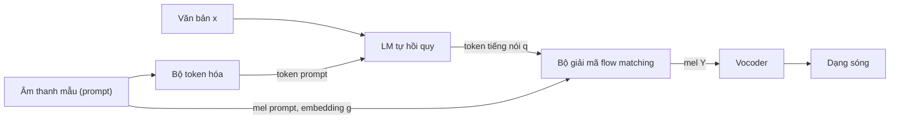

# Chương 34. Kiến trúc lai LM + Flow hiện đại

!!! abstract "Mục tiêu học tập"
    - Giải thích vì sao nhiều hệ thống TTS quy mô lớn giai đoạn 2024–2026 hội tụ về thiết kế hai tầng: một mô hình ngôn ngữ (LM) sinh token tiếng nói rời rạc và một bộ giải mã flow matching sinh đặc trưng âm học liên tục.
    - Hình thức hóa phép phân rã $p(\mathbf{Y} \mid \mathbf{x})$ qua token trung gian và lập luận về "ngân sách thông tin" (bitrate) mà mỗi tầng phải mô hình hóa.
    - So sánh các loại token trung gian (token codec, token SSL, token ngữ nghĩa có giám sát, token tách rời toàn cục/cục bộ) theo ba tiêu chí: dễ dự đoán từ văn bản, khả năng tái tạo, mức tách bạch thông tin người nói.
    - Cài đặt mặt nạ attention nhận biết chunk (*chunk-aware*) và kiểm chứng bằng mã rằng nó cho phép sinh mel theo luồng mà không sai khác so với chạy toàn chuỗi.
    - Suy ra hàm mất mát DPO từ bài toán tối đa hóa phần thưởng có ràng buộc KL, rồi cài đặt nó cho một LM token tiếng nói.
    - Đặt các hệ thống CosyVoice, Seed-TTS, Fish-Speech, Spark-TTS, MiniMax-Speech, IndexTTS vào một không gian thiết kế chung và so sánh ưu, nhược điểm.
    - Lập kế hoạch fine-tune một mô hình lai mã nguồn mở cho tiếng Việt: kiểm tra tokenizer, chuẩn hóa NFC, đo trần chất lượng của bộ token hóa và đánh giá thanh điệu.

!!! info "Kiến thức cần có"
    - Flow matching có điều kiện, CFG và bộ giải ODE: [Chương 12](../phan-2-mo-hinh-sinh/ch12-flow-matching.md); Matcha-TTS: [Chương 23](../phan-5-mo-hinh-am-hoc/ch23-glow-grad-matcha.md).
    - Transformer, mặt nạ nhân quả, KV cache, các chiến lược lấy mẫu: [Chương 5](../phan-1-nen-tang/ch05-transformer.md).
    - Codec, RVQ, FSQ và token ngữ nghĩa: [Chương 31](../phan-8-mo-hinh-lon/ch31-audio-codec-speech-token.md).
    - Codec language model (VALL-E và họ hàng): [Chương 32](../phan-8-mo-hinh-lon/ch32-codec-language-model.md); TTS không tự hồi quy quy mô lớn (Voicebox, E2/F5-TTS): [Chương 33](../phan-8-mo-hinh-lon/ch33-nar-quy-mo-lon.md).
    - Embedding người nói và nhân bản giọng: [Chương 28](../phan-7-e2e-bieu-cam/ch28-da-nguoi-noi-voice-cloning.md).

Hai chương trước đã giới thiệu hai trường phái lớn của TTS quy mô lớn. Trường phái thứ nhất ([Chương 32](../phan-8-mo-hinh-lon/ch32-codec-language-model.md)) coi tổng hợp tiếng nói là bài toán mô hình hóa ngôn ngữ trên token codec: một Transformer tự hồi quy "nói tiếp" một đoạn âm thanh mẫu. Trường phái thứ hai ([Chương 33](../phan-8-mo-hinh-lon/ch33-nar-quy-mo-lon.md)) sinh toàn bộ mel-spectrogram song song bằng flow matching hoặc khuếch tán, không cần căn chỉnh tường minh. Chương này nói về con đường thứ ba, kết hợp cả hai: **LM sinh một chuỗi token ngắn mang nội dung và ngôn điệu, rồi flow matching "tô màu" chuỗi đó thành mel-spectrogram mang âm sắc của người nói mẫu**. Đây là khung kiến trúc của CosyVoice, Seed-TTS và nhiều hệ thống khác ra đời trong giai đoạn 2024–2026.

Chúng ta sẽ không học thuộc từng hệ thống, vì chi tiết thay đổi theo từng phiên bản. Thay vào đó, chương được tổ chức quanh **các nguyên lý thiết kế ổn định**: chọn token trung gian, chia việc giữa LM và bộ giải mã, cơ chế sinh theo luồng, cách đưa thông tin người nói vào, và hậu huấn luyện (*post-training*). Nắm được các nguyên lý này, bạn có thể đọc báo cáo kỹ thuật của bất kỳ hệ thống mới nào và nhanh chóng định vị nó.

!!! warning "Về tính thời sự của chương này"
    Lĩnh vực TTS quy mô lớn thay đổi rất nhanh. Mọi mô tả về hệ thống cụ thể trong chương được tóm tắt từ báo cáo kỹ thuật gốc **tính đến thời điểm biên soạn (2026)**; số liệu, giấy phép và khả năng hỗ trợ ngôn ngữ có thể đã thay đổi. Trước khi dùng một mô hình cho dự án, hãy đọc lại báo cáo và kho mã nguồn chính thức của nó.

## 34.1 Hai trường phái và ý tưởng lai

### Codec LM thuần túy: mạnh về ngôn điệu, yếu về độ bền

Một codec LM kiểu VALL-E mô hình hóa trực tiếp token âm học của codec (EnCodec, DAC…). Ưu điểm của cách làm này là:

- **Học trong ngữ cảnh** (*in-context learning*): chỉ cần vài giây âm thanh mẫu, mô hình "nói tiếp" với cùng âm sắc, cùng điều kiện thu âm.
- **Ngôn điệu đa dạng, tự nhiên**: lấy mẫu tự hồi quy cho phép mỗi lần sinh là một cách đọc khác nhau, giải quyết tự nhiên bài toán một-nhiều đã nêu ở [Chương 7](../phan-2-mo-hinh-sinh/ch07-tong-quan-mo-hinh-sinh.md).
- **Độ dài tự quyết định**: mô hình tự phát token kết thúc, không cần bộ dự đoán trường độ.
- **Thân thiện với streaming**: token sinh ra đến đâu có thể giải mã đến đó.

Nhược điểm cũng xuất phát từ chính token âm học. Token codec chứa *mọi thứ*: nội dung, ngôn điệu, âm sắc, tiếng ồn nền, đặc tính micro. LM buộc phải mô hình hóa tất cả, với nhiều token mỗi giây (ví dụ cấu hình EnCodec 6 kbps có 75 khung/giây × 8 sổ mã). Chuỗi dài khiến suy luận chậm và căn chỉnh ngầm giữa văn bản và âm thanh dễ "trượt": đọc lặp, bỏ chữ, hoặc sinh âm thanh vô nghĩa (*hallucination*), như đã phân tích ở [Chương 32](../phan-8-mo-hinh-lon/ch32-codec-language-model.md).

### NAR flow thuần túy: bền và nhanh, nhưng cần biết trước độ dài

Các mô hình như E2 TTS và F5-TTS ([Chương 33](../phan-8-mo-hinh-lon/ch33-nar-quy-mo-lon.md)) sinh toàn bộ mel song song từ chuỗi ký tự được đệm tới độ dài mel. Chúng ổn định hơn codec LM về mặt bỏ chữ, lặp chữ, và tận dụng tốt GPU. Đổi lại:

- **Tổng độ dài phải biết trước** (thường ước lượng thô từ số ký tự và tốc độ nói của âm thanh mẫu). Ước lượng sai làm giọng bị nhanh hoặc chậm bất thường.
- **Khó streaming**: attention hai chiều trên toàn câu nghĩa là khung đầu tiên phụ thuộc vào khung cuối cùng.
- Căn chỉnh ngầm giữa ký tự và khung phải học từ đầu, thường hội tụ chậm.

### Ý tưởng lai: giao đúng việc cho đúng mô hình

Quan sát then chốt là bài toán TTS gồm hai loại "quyết định" rất khác nhau về bản chất:

1. **Quyết định rời rạc, tầm xa**: nói chữ gì, theo thứ tự nào, ngắt nghỉ ở đâu, mỗi âm tiết dài bao nhiêu, ngữ điệu lên hay xuống. Đây là loại quyết định mà mô hình ngôn ngữ tự hồi quy làm rất tốt.
2. **Quyết định liên tục, cục bộ**: phổ chi tiết của từng khung, âm sắc, độ thở, đặc tính kênh thu. Đây là loại phân phối liên tục nhiều chiều mà flow matching mô hình hóa hiệu quả.

Kiến trúc lai đặt giữa hai tầng một **token trung gian** tốc độ thấp, được thiết kế để mang loại thông tin thứ nhất và *càng ít* loại thông tin thứ hai càng tốt. Sơ đồ tổng quát như sau.



Bảng sau tóm tắt so sánh định tính ba cách tiếp cận. Đây là xu hướng chung, không phải quy luật tuyệt đối: một hệ thống cụ thể có thể khắc phục nhược điểm bằng kỹ thuật riêng.

| Tiêu chí | Codec LM thuần | NAR flow thuần | Lai LM + flow |
|---|---|---|---|
| Độ dài câu | LM tự quyết định | Phải ước lượng trước | LM tự quyết định |
| Độ dài chuỗi LM | Dài (nhiều sổ mã, tốc độ khung cao) | Không có LM | Ngắn (một sổ mã, 12,5–50 Hz) |
| Bỏ chữ / lặp chữ | Dễ xảy ra | Hiếm | Giảm nhờ token bám sát văn bản |
| Streaming | Tự nhiên | Khó | Được, nếu bộ giải mã nhận biết chunk |
| Âm sắc, chi tiết phổ | Bị giới hạn bởi codec | Tốt | Tốt (flow + prompt mel) |
| Số mô hình phải huấn luyện | 1–2 | 1 (+ vocoder) | 2–3 (+ bộ token hóa) |

## 34.2 Hình thức hóa: phân rã qua token trung gian

### Mô hình hai tầng

Gọi $\mathbf{x}$ là văn bản, $\mathbf{Y} \in \mathbb{R}^{T \times F}$ là mel-spectrogram cần sinh và $\mathbf{c}$ là toàn bộ điều kiện từ âm thanh mẫu (mel của prompt, bản ghi văn bản của prompt, embedding người nói $\mathbf{g}$). Gọi $\mathbf{q} = (q_1, \ldots, q_{T'})$, $q_j \in \{1, \ldots, V\}$ là chuỗi token tiếng nói một sổ mã (trường hợp $Q = 1$ của ký hiệu $\mathbf{q}$ trong [bảng ký hiệu](../gioi-thieu/ky-hieu.md)), với $T'$ là số khung token. Mô hình lai giả định:

$$
p_\theta(\mathbf{Y} \mid \mathbf{x}, \mathbf{c}) = \sum_{\mathbf{q}} p_{\theta_1}(\mathbf{q} \mid \mathbf{x}, \mathbf{c}) \; p_{\theta_2}(\mathbf{Y} \mid \mathbf{q}, \mathbf{c}).
$$

Công thức nói rằng: để sinh mel, trước hết sinh một chuỗi token $\mathbf{q}$ từ văn bản và prompt, sau đó sinh mel từ token và prompt. Ẩn trong công thức là một **giả định độc lập có điều kiện**: khi đã biết $\mathbf{q}$ và $\mathbf{c}$, mel không còn phụ thuộc vào văn bản, tức $\mathbf{Y} \perp \mathbf{x} \mid (\mathbf{q}, \mathbf{c})$. Vì vậy bộ giải mã của CosyVoice không cần nhìn văn bản: toàn bộ thông tin nội dung phải đi qua token.

Tổng trên mọi chuỗi $\mathbf{q}$ là không thể tính, nhưng ta không cần tính nó. Lý do là token không phải biến ẩn cần suy diễn: nó được tạo **tất định** bởi một bộ token hóa $E$ đã huấn luyện sẵn, $\mathbf{q} = E(\mathbf{Y})$. Từ mỗi cặp (văn bản, âm thanh) trong tập huấn luyện ta có bộ ba $(\mathbf{x}, \mathbf{q}, \mathbf{Y})$ và huấn luyện hai tầng **tách rời** bằng hợp lý cực đại:

- Tầng 1 (LM) cực tiểu entropy chéo $-\log p_{\theta_1}(\mathbf{q} \mid \mathbf{x}, \mathbf{c})$.
- Tầng 2 (bộ giải mã) cực tiểu hàm mất mát flow matching có điều kiện, một cận thay thế cho $-\log p_{\theta_2}(\mathbf{Y} \mid \mathbf{q}, \mathbf{c})$.

Khi suy luận, ta lấy mẫu tuần tự (*ancestral sampling*): $\hat{\mathbf{q}} \sim p_{\theta_1}(\cdot \mid \mathbf{x}, \mathbf{c})$ rồi $\hat{\mathbf{Y}} \sim p_{\theta_2}(\cdot \mid \hat{\mathbf{q}}, \mathbf{c})$, cuối cùng vocoder biến $\hat{\mathbf{Y}}$ thành dạng sóng.

Có một điểm tinh tế: bộ giải mã được huấn luyện trên token "thật" $E(\mathbf{Y})$ nhưng khi suy luận lại nhận token do LM sinh ra. Hai phân phối này lệch nhau một chút, tương tự hiện tượng vocoder huấn luyện trên mel thật nhưng chạy trên mel dự đoán ([Chương 25](../phan-6-vocoder/ch25-gan-vocoder.md)). Trong thực tế độ lệch này thường nhỏ vì LM được huấn luyện để khớp phân phối token thật, nhưng nó là một nguồn lỗi bạn cần nhớ khi gỡ lỗi.

### Ngân sách thông tin của từng tầng

Vì sao phân rã này hiệu quả? Hãy đếm số bit mỗi giây mà mỗi biểu diễn có thể mang. Với một dòng token có tốc độ $f_{\text{tok}}$ khung mỗi giây, $Q$ sổ mã, mỗi sổ mã $V$ mục, **bitrate tối đa** là

$$
R = f_{\text{tok}} \cdot Q \cdot \log_2 V \quad \text{(bit/giây)}.
$$

Áp dụng cho vài cấu hình tiêu biểu:

| Biểu diễn | $f_{\text{tok}}$ (Hz) | $Q$ | $V$ | $R$ (bit/s) | Số token cho 10 giây |
|---|---|---|---|---|---|
| Token codec kiểu EnCodec 6 kbps | 75 | 8 | 1024 | 6 000 | 6 000 |
| Token ngữ nghĩa FSQ, $V = 3^8$ | 25 | 1 | 6 561 | ≈ 317 | 250 |
| Token ngữ nghĩa 12,5 Hz, $V = 16\,384$ | 12,5 | 1 | 16 384 | 175 | 125 |

(Hàng thứ ba là một cấu hình giả định để minh họa; xem [Chương 31](../phan-8-mo-hinh-lon/ch31-audio-codec-speech-token.md) cho các codec cụ thể.)

Trong khi đó, nội dung văn bản của lời nói chỉ cỡ vài chục bit mỗi giây. Phép phân rã vì vậy chia bài toán thành hai bước "nạp thêm thông tin":

- **LM** đi từ vài chục bit/giây (văn bản) lên vài trăm bit/giây (token). Phần thông tin được thêm vào chính là *cách nói*: trường độ, nhịp, ngữ điệu, chỗ ngắt. Đây đúng là phần "một-nhiều" của TTS, và lấy mẫu tự hồi quy xử lý nó tốt.
- **Bộ giải mã** đi từ vài trăm bit/giây lên một biểu diễn liên tục nhiều chiều. Phần thông tin còn thiếu (âm sắc, kênh thu, chi tiết phổ) phần lớn **lấy từ prompt** $\mathbf{c}$. Do đó bộ giải mã về bản chất là một bài toán *điền khuyết có điều kiện* (*conditional infilling*) giống Voicebox, chứ không phải sáng tạo từ hư không.

So với codec LM thuần, LM ở đây chỉ phải sinh khoảng 250 token cho 10 giây thay vì 6 000, và mỗi token gần với nội dung văn bản hơn. Đó là lý do chính khiến kiến trúc lai vừa nhanh hơn vừa ít lỗi bỏ chữ hơn.

### Rò rỉ thông tin và sự tách bạch

Phép phân rã chỉ hoạt động tốt nếu ranh giới giữa hai tầng "sạch". Xét hai tình huống cực đoan:

- Nếu token **mang quá nhiều thông tin người nói**, bộ giải mã sẽ học cách lấy âm sắc từ token thay vì từ prompt. Khi đó muốn nhân bản giọng, LM phải tự sinh token mang đúng âm sắc người mẫu, một việc khó hơn nhiều. Độ giống giọng (*speaker similarity*) sẽ giảm.
- Nếu token **mang quá ít thông tin ngôn điệu**, bộ giải mã (vốn không nhìn văn bản) phải tự "bịa" ngữ điệu. Kết quả thường đơn điệu, hoặc sai thanh điệu với tiếng Việt.

Thiết kế token tốt nằm giữa hai cực này: giữ nội dung và ngôn điệu, loại bớt âm sắc và điều kiện kênh. Đây là chủ đề của mục tiếp theo.

## 34.3 Chọn token trung gian: quyết định thiết kế quan trọng nhất

### Bốn họ token

[Chương 31](../phan-8-mo-hinh-lon/ch31-audio-codec-speech-token.md) đã trình bày chi tiết cách xây dựng các loại token. Ở đây ta so sánh chúng dưới góc nhìn của kiến trúc lai.

| Họ token | Ví dụ | Thông tin chủ yếu | Dễ dự đoán từ văn bản | Tái tạo âm thanh | Tách bạch người nói |
|---|---|---|---|---|---|
| Token âm học (codec RVQ) | EnCodec, DAC | Mọi thứ | Khó | Trực tiếp, chất lượng cao | Kém |
| Token SSL (k-means trên HuBERT/WavLM) | HuBERT units | Ngữ âm, một phần ngôn điệu | Trung bình | Cần bộ giải mã sinh | Trung bình |
| Token ngữ nghĩa có giám sát | Bộ token hóa của CosyVoice, GLM-4-Voice | Nội dung bám sát văn bản, ngôn điệu | Dễ | Cần bộ giải mã sinh mạnh | Tốt |
| Token tách đôi toàn cục + cục bộ | BiCodec của Spark-TTS | Cục bộ: nội dung; toàn cục: người nói | Dễ (phần cục bộ) | Trực tiếp qua bộ giải mã codec | Tốt, theo thiết kế |

Cột "tách bạch người nói" mô tả xu hướng, không phải bảo đảm. Không có bộ token hóa nào loại bỏ *hoàn toàn* thông tin người nói; bạn luôn nên kiểm tra bằng thực nghiệm (ví dụ huấn luyện một bộ phân loại người nói trên token và xem độ chính xác).

### Token ngữ nghĩa có giám sát

CosyVoice (Du và cộng sự, 2024a) phổ biến ý tưởng **token ngữ nghĩa có giám sát** (*supervised semantic tokens*). Thay vì phân cụm biểu diễn tự giám sát như HuBERT, ta lấy một mô hình nhận dạng tiếng nói (ASR) encoder–decoder, chèn một bộ lượng tử hóa vào giữa encoder và tiếp tục huấn luyện **bằng hàm mất mát ASR**:

$$
\mathbf{h} = E_{\text{dưới}}(\mathbf{Y}), \qquad \mathbf{q} = \operatorname{Quant}(\mathbf{h}), \qquad \mathcal{L}_{\text{tok}} = -\log p_{\text{ASR}}\big(\mathbf{w} \mid E_{\text{trên}}(\operatorname{Dequant}(\mathbf{q}))\big),
$$

trong đó $E_{\text{dưới}}$, $E_{\text{trên}}$ là các tầng encoder nằm trước và sau bộ lượng tử hóa, $\mathbf{w}$ là bản ghi văn bản của câu nói. Vì mục tiêu duy nhất là nhận dạng đúng chữ, các token bị **ép** giữ thông tin nội dung ngôn ngữ; ngược lại thông tin về người nói hay kênh thu không giúp ích cho ASR, nên có xu hướng bị loại bỏ khi phải đi qua "nút cổ chai" rời rạc. Theo báo cáo gốc, bộ mã hóa ASR của CosyVoice được lấy từ họ mô hình SenseVoice (FunAudioLLM Team, 2024).

Hệ quả là token có tương quan đơn điệu, gần như thẳng hàng với văn bản. LM dự đoán chúng dễ hơn nhiều so với dự đoán token codec, và khi LM sai thì sai ở mức "đọc sai từ" có thể đo bằng WER, chứ ít khi tạo ra âm thanh vô nghĩa kéo dài.

!!! note "Token ngữ nghĩa có mang ngôn điệu không?"
    Một hiểu lầm phổ biến là token "ngữ nghĩa" chỉ mang chữ. Thực ra token được tính theo khung thời gian (ví dụ 25 khung/giây), nên **số token ứng với mỗi âm tiết đã mã hóa trường độ**, và chuỗi token khác nhau giữa cách đọc nhanh, chậm, có ngắt nghỉ hay không. Thông tin cao độ cũng có thể được giữ lại một phần, nhất là khi ASR được huấn luyện trên ngôn ngữ có thanh điệu như tiếng Trung. Mức độ giữ lại bao nhiêu phụ thuộc vào bộ token hóa cụ thể, và cần được đo, không nên giả định.

### Từ VQ đến FSQ

Phiên bản đầu dùng lượng tử hóa véc-tơ (VQ) với sổ mã học được, vốn dễ gặp hiện tượng nhiều mục trong sổ mã không bao giờ được dùng (*codebook collapse*). CosyVoice 2 (Du và cộng sự, 2024b) thay bằng **lượng tử hóa vô hướng hữu hạn** (*finite scalar quantization*, FSQ; Mentzer và cộng sự, 2024). Nhắc lại ý tưởng của FSQ: chiếu véc-tơ ẩn xuống $d$ chiều, chặn mỗi chiều vào một khoảng bị giới hạn rồi làm tròn về một trong $L$ mức:

$$
\hat{z}_i = \operatorname{round}\!\Big(\tfrac{L-1}{2} \tanh(z_i)\Big), \qquad i = 1, \ldots, d,
$$

(với $L$ lẻ, mỗi $\hat{z}_i$ nhận một trong $L$ giá trị nguyên đối xứng quanh 0) và dùng *straight-through estimator* cho gradient. Sổ mã là tích Descartes ngầm định của các mức, kích thước $L^d$; không có tham số sổ mã nào để "chết", nên mức sử dụng mã gần như tự động đầy đủ. Theo báo cáo gốc của CosyVoice 2, sổ mã có $6\,561 = 3^8$ mục, tức ứng với $d = 8$ chiều, mỗi chiều $L = 3$ mức, và token có tốc độ 25 Hz.

### Tốc độ token: đánh đổi giữa LM và bộ giải mã

Giảm tốc độ token (ví dụ từ 50 Hz xuống 25 Hz hoặc 12,5 Hz) có ba hệ quả:

1. Chuỗi LM ngắn hơn, suy luận nhanh hơn, ngữ cảnh dài hơn với cùng chi phí attention.
2. Mỗi token phải "gói" nhiều thông tin hơn, nên bộ giải mã phải sinh nhiều chi tiết hơn từ mỗi token; chất lượng tái tạo có thể giảm.
3. Độ phân giải thời gian thô hơn: một token 12,5 Hz phủ 80 ms, gần bằng độ dài một âm vị. Điều này ảnh hưởng đến cả độ trễ streaming nhỏ nhất (phải chờ ít nhất một token) lẫn khả năng biểu diễn các âm ngắn.

Không có giá trị tối ưu chung. Các hệ thống công bố trong giai đoạn 2024–2026 thường chọn trong khoảng 12,5–50 Hz cho token đơn sổ mã.

!!! note "Góc tiếng Việt"
    Tiếng Việt có sáu thanh điệu, phân biệt không chỉ bằng đường nét F0 mà cả bằng chất giọng (thanh ngã và thanh nặng thường kèm hiện tượng thanh quản hóa, xem [Chương 15](../phan-3-tin-hieu-ngu-am/ch15-ngu-am-tieng-viet.md)). Một bộ token hóa được huấn luyện chủ yếu trên tiếng Trung và tiếng Anh *có thể* giữ được một phần thông tin cao độ, nhưng không có gì bảo đảm nó phân biệt được "mả" với "mã" hay "ma" với "mạ". Nếu thông tin thanh điệu bị mất ở tầng token, không LM nào khôi phục được, và bộ giải mã (không nhìn văn bản) sẽ đoán mò. Vì vậy, bước đầu tiên khi đưa một hệ thống lai sang tiếng Việt là **đo trần chất lượng của bộ token hóa** (Mục 34.9).

## 34.4 Tầng thứ nhất: LM từ văn bản sang token

### Định dạng chuỗi

LM của hệ thống lai là một Transformer chỉ-decoder (*decoder-only*), giống LLM văn bản. Mỗi mẫu huấn luyện được xếp thành một chuỗi duy nhất:

```text
[BOS] <văn bản prompt> <văn bản đích> [TURN] <token prompt> <token đích> [EOS]
```

Khi huấn luyện, phần "prompt" thường được tạo bằng cách cắt một đoạn đầu của chính câu đó hoặc lấy một câu khác của cùng người nói. Hàm mất mát chỉ tính trên các token tiếng nói cần dự đoán (cộng token kết thúc):

$$
\mathcal{L}_{\text{LM}} = -\sum_{j=1}^{T'+1} \log p_{\theta_1}\big(q_j \mid q_{<j}, \mathbf{x}, \mathbf{c}\big),
$$

trong đó $q_{T'+1}$ là token `[EOS]`. Các vị trí văn bản và token prompt được che khỏi hàm mất mát. Khi suy luận, ta nạp văn bản prompt, văn bản đích, token prompt (trích từ âm thanh mẫu bằng bộ token hóa), rồi để LM sinh tiếp đến khi gặp `[EOS]`.

Một hệ quả quan trọng: **độ dài câu được LM quyết định**, thông qua thời điểm sinh `[EOS]` và số token ứng với mỗi âm tiết. Không cần bộ dự đoán trường độ hay ước lượng tổng độ dài như ở E2/F5-TTS.

### Khởi tạo từ một LLM văn bản đã huấn luyện

CosyVoice phiên bản đầu dùng một Transformer huấn luyện từ đầu, có bộ mã hóa văn bản riêng. CosyVoice 2 đi theo xu hướng chung của giai đoạn này: **khởi tạo LM từ một LLM văn bản đã huấn luyện sẵn** (theo báo cáo gốc là Qwen2.5-0.5B). Cách làm cụ thể gồm:

1. Giữ nguyên tokenizer BPE của LLM cho phần văn bản, nên đầu vào là văn bản thô, không cần G2P.
2. Mở rộng bảng embedding với $V$ token tiếng nói mới cùng vài token đặc biệt; các dòng mới được khởi tạo ngẫu nhiên.
3. Thêm một đầu ra (*head*) dự đoán phân phối trên các token tiếng nói.

Lợi ích của việc khởi tạo từ LLM là mô hình thừa hưởng hiểu biết về văn bản: cách đọc từ đa âm, cấu trúc câu, ngữ cảnh để quyết định nhấn nhá, khả năng làm theo chỉ dẫn bằng ngôn ngữ tự nhiên ("đọc vui vẻ hơn"). Cái giá là kích thước mô hình lớn hơn và **phụ thuộc vào tokenizer văn bản của LLM gốc**, một điểm đặc biệt quan trọng với tiếng Việt (Mục 34.9).

### Bỏ embedding người nói khỏi LM

CosyVoice phiên bản đầu đưa một x-vector (embedding người nói, [Chương 28](../phan-7-e2e-bieu-cam/ch28-da-nguoi-noi-voice-cloning.md)) vào đầu chuỗi của LM. CosyVoice 2 loại bỏ nó, với lập luận (theo báo cáo gốc) rằng x-vector không chỉ chứa âm sắc mà còn chứa thông tin về ngôn ngữ và ngôn điệu, gây **rò rỉ thông tin** làm giảm độ tự nhiên và khả năng chuyển ngôn ngữ. Khi bỏ x-vector, LM chỉ còn biết về người nói qua token prompt, tức là thông tin người nói đi vào theo kiểu học trong ngữ cảnh. Âm sắc lúc này do bộ giải mã đảm nhiệm hoàn toàn.

Đây là ví dụ cụ thể của nguyên lý "ranh giới sạch" ở Mục 34.2: **LM lo cách nói, bộ giải mã lo giọng ai**.

### Lấy mẫu và kiểm soát độ dài

Các chiến lược lấy mẫu của [Chương 5](../phan-1-nen-tang/ch05-transformer.md) và [Chương 32](../phan-8-mo-hinh-lon/ch32-codec-language-model.md) áp dụng nguyên vẹn: top-k, top-p, nhiệt độ, và lấy mẫu nhận biết lặp lại (*repetition-aware sampling*) của VALL-E 2. Ngoài ra, các bản cài đặt thường chặn số token sinh ra trong một khoảng tỉ lệ với độ dài văn bản: nếu LM sinh quá ít token so với số âm tiết thì gần như chắc chắn bị bỏ chữ, quá nhiều thì có thể đang lặp vô hạn. Đây là lớp bảo vệ rẻ tiền nhưng hiệu quả, bạn nên luôn bật nó.
