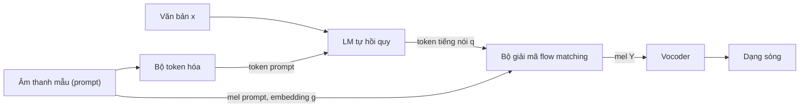

# Chương 34. Kiến trúc lai LM + Flow hiện đại

!!! abstract "Mục tiêu học tập"
    - Giải thích vì sao nhiều hệ thống TTS quy mô lớn giai đoạn 2024–2026 hội tụ về thiết kế hai tầng: một mô hình ngôn ngữ (LM) sinh token tiếng nói rời rạc và một bộ giải mã flow matching sinh đặc trưng âm học liên tục.
    - Hình thức hóa phép phân rã $p(\mathbf{Y} \mid \mathbf{x})$ qua token trung gian và lập luận về "ngân sách thông tin" (bitrate) mà mỗi tầng phải mô hình hóa.
    - So sánh các loại token trung gian (token codec, token SSL, token ngữ nghĩa có giám sát, token tách rời toàn cục/cục bộ) theo ba tiêu chí: dễ dự đoán từ văn bản, khả năng tái tạo, mức tách bạch thông tin người nói.
    - Cài đặt mặt nạ attention nhận biết chunk (*chunk-aware*) và kiểm chứng bằng mã rằng nó cho phép sinh mel theo luồng mà không sai khác so với chạy toàn chuỗi.
    - Suy ra hàm mất mát DPO từ bài toán tối đa hóa phần thưởng có ràng buộc KL, rồi cài đặt nó cho một LM token tiếng nói.
    - Đặt các hệ thống CosyVoice, Seed-TTS, Fish-Speech, Spark-TTS, MiniMax-Speech, IndexTTS vào một không gian thiết kế chung và so sánh ưu, nhược điểm.
    - Lập kế hoạch fine-tune một mô hình lai mã nguồn mở cho tiếng Việt: kiểm tra tokenizer, chuẩn hóa NFC, đo trần chất lượng của bộ token hóa và đánh giá thanh điệu.

!!! info "Kiến thức cần có"
    - Flow matching có điều kiện, CFG và bộ giải ODE: [Chương 12](../phan-2-mo-hinh-sinh/ch12-flow-matching.md); Matcha-TTS: [Chương 23](../phan-5-mo-hinh-am-hoc/ch23-glow-grad-matcha.md).
    - Transformer, mặt nạ nhân quả, KV cache, các chiến lược lấy mẫu: [Chương 5](../phan-1-nen-tang/ch05-transformer.md).
    - Codec, RVQ, FSQ và token ngữ nghĩa: [Chương 31](../phan-8-mo-hinh-lon/ch31-audio-codec-speech-token.md).
    - Codec language model (VALL-E và họ hàng): [Chương 32](../phan-8-mo-hinh-lon/ch32-codec-language-model.md); TTS không tự hồi quy quy mô lớn (Voicebox, E2/F5-TTS): [Chương 33](../phan-8-mo-hinh-lon/ch33-nar-quy-mo-lon.md).
    - Embedding người nói và nhân bản giọng: [Chương 28](../phan-7-e2e-bieu-cam/ch28-da-nguoi-noi-voice-cloning.md).

Hai chương trước đã giới thiệu hai trường phái lớn của TTS quy mô lớn. Trường phái thứ nhất ([Chương 32](../phan-8-mo-hinh-lon/ch32-codec-language-model.md)) coi tổng hợp tiếng nói là bài toán mô hình hóa ngôn ngữ trên token codec: một Transformer tự hồi quy "nói tiếp" một đoạn âm thanh mẫu. Trường phái thứ hai ([Chương 33](../phan-8-mo-hinh-lon/ch33-nar-quy-mo-lon.md)) sinh toàn bộ mel-spectrogram song song bằng flow matching hoặc khuếch tán, không cần căn chỉnh tường minh. Chương này nói về con đường thứ ba, kết hợp cả hai: **LM sinh một chuỗi token ngắn mang nội dung và ngôn điệu, rồi flow matching "tô màu" chuỗi đó thành mel-spectrogram mang âm sắc của người nói mẫu**. Đây là khung kiến trúc của CosyVoice, Seed-TTS và nhiều hệ thống khác ra đời trong giai đoạn 2024–2026.

Chúng ta sẽ không học thuộc từng hệ thống, vì chi tiết thay đổi theo từng phiên bản. Thay vào đó, chương được tổ chức quanh **các nguyên lý thiết kế ổn định**: chọn token trung gian, chia việc giữa LM và bộ giải mã, cơ chế sinh theo luồng, cách đưa thông tin người nói vào, và hậu huấn luyện (*post-training*). Nắm được các nguyên lý này, bạn có thể đọc báo cáo kỹ thuật của bất kỳ hệ thống mới nào và nhanh chóng định vị nó.

!!! warning "Về tính thời sự của chương này"
    Lĩnh vực TTS quy mô lớn thay đổi rất nhanh. Mọi mô tả về hệ thống cụ thể trong chương được tóm tắt từ báo cáo kỹ thuật gốc **tính đến thời điểm biên soạn (2026)**; số liệu, giấy phép và khả năng hỗ trợ ngôn ngữ có thể đã thay đổi. Trước khi dùng một mô hình cho dự án, hãy đọc lại báo cáo và kho mã nguồn chính thức của nó.

## 34.1 Hai trường phái và ý tưởng lai

### Codec LM thuần túy: mạnh về ngôn điệu, yếu về độ bền

Một codec LM kiểu VALL-E mô hình hóa trực tiếp token âm học của codec (EnCodec, DAC…). Ưu điểm của cách làm này là:

- **Học trong ngữ cảnh** (*in-context learning*): chỉ cần vài giây âm thanh mẫu, mô hình "nói tiếp" với cùng âm sắc, cùng điều kiện thu âm.
- **Ngôn điệu đa dạng, tự nhiên**: lấy mẫu tự hồi quy cho phép mỗi lần sinh là một cách đọc khác nhau, giải quyết tự nhiên bài toán một-nhiều đã nêu ở [Chương 7](../phan-2-mo-hinh-sinh/ch07-tong-quan-mo-hinh-sinh.md).
- **Độ dài tự quyết định**: mô hình tự phát token kết thúc, không cần bộ dự đoán trường độ.
- **Thân thiện với streaming**: token sinh ra đến đâu có thể giải mã đến đó.

Nhược điểm cũng xuất phát từ chính token âm học. Token codec chứa *mọi thứ*: nội dung, ngôn điệu, âm sắc, tiếng ồn nền, đặc tính micro. LM buộc phải mô hình hóa tất cả, với nhiều token mỗi giây (ví dụ cấu hình EnCodec 6 kbps có 75 khung/giây × 8 sổ mã). Chuỗi dài khiến suy luận chậm và căn chỉnh ngầm giữa văn bản và âm thanh dễ "trượt": đọc lặp, bỏ chữ, hoặc sinh âm thanh vô nghĩa (*hallucination*), như đã phân tích ở [Chương 32](../phan-8-mo-hinh-lon/ch32-codec-language-model.md).

### NAR flow thuần túy: bền và nhanh, nhưng cần biết trước độ dài

Các mô hình như E2 TTS và F5-TTS ([Chương 33](../phan-8-mo-hinh-lon/ch33-nar-quy-mo-lon.md)) sinh toàn bộ mel song song từ chuỗi ký tự được đệm tới độ dài mel. Chúng ổn định hơn codec LM về mặt bỏ chữ, lặp chữ, và tận dụng tốt GPU. Đổi lại:

- **Tổng độ dài phải biết trước** (thường ước lượng thô từ số ký tự và tốc độ nói của âm thanh mẫu). Ước lượng sai làm giọng bị nhanh hoặc chậm bất thường.
- **Khó streaming**: attention hai chiều trên toàn câu nghĩa là khung đầu tiên phụ thuộc vào khung cuối cùng.
- Căn chỉnh ngầm giữa ký tự và khung phải học từ đầu, thường hội tụ chậm.

### Ý tưởng lai: giao đúng việc cho đúng mô hình

Quan sát then chốt là bài toán TTS gồm hai loại "quyết định" rất khác nhau về bản chất:

1. **Quyết định rời rạc, tầm xa**: nói chữ gì, theo thứ tự nào, ngắt nghỉ ở đâu, mỗi âm tiết dài bao nhiêu, ngữ điệu lên hay xuống. Đây là loại quyết định mà mô hình ngôn ngữ tự hồi quy làm rất tốt.
2. **Quyết định liên tục, cục bộ**: phổ chi tiết của từng khung, âm sắc, độ thở, đặc tính kênh thu. Đây là loại phân phối liên tục nhiều chiều mà flow matching mô hình hóa hiệu quả.

Kiến trúc lai đặt giữa hai tầng một **token trung gian** tốc độ thấp, được thiết kế để mang loại thông tin thứ nhất và *càng ít* loại thông tin thứ hai càng tốt. Sơ đồ tổng quát như sau.



Bảng sau tóm tắt so sánh định tính ba cách tiếp cận. Đây là xu hướng chung, không phải quy luật tuyệt đối: một hệ thống cụ thể có thể khắc phục nhược điểm bằng kỹ thuật riêng.

| Tiêu chí | Codec LM thuần | NAR flow thuần | Lai LM + flow |
|---|---|---|---|
| Độ dài câu | LM tự quyết định | Phải ước lượng trước | LM tự quyết định |
| Độ dài chuỗi LM | Dài (nhiều sổ mã, tốc độ khung cao) | Không có LM | Ngắn (một sổ mã, 12,5–50 Hz) |
| Bỏ chữ / lặp chữ | Dễ xảy ra | Hiếm | Giảm nhờ token bám sát văn bản |
| Streaming | Tự nhiên | Khó | Được, nếu bộ giải mã nhận biết chunk |
| Âm sắc, chi tiết phổ | Bị giới hạn bởi codec | Tốt | Tốt (flow + prompt mel) |
| Số mô hình phải huấn luyện | 1–2 | 1 (+ vocoder) | 2–3 (+ bộ token hóa) |

## 34.2 Hình thức hóa: phân rã qua token trung gian

### Mô hình hai tầng

Gọi $\mathbf{x}$ là văn bản, $\mathbf{Y} \in \mathbb{R}^{T \times F}$ là mel-spectrogram cần sinh và $\mathbf{c}$ là toàn bộ điều kiện từ âm thanh mẫu (mel của prompt, bản ghi văn bản của prompt, embedding người nói $\mathbf{g}$). Gọi $\mathbf{q} = (q_1, \ldots, q_{T'})$, $q_j \in \{1, \ldots, V\}$ là chuỗi token tiếng nói một sổ mã (trường hợp $Q = 1$ của ký hiệu $\mathbf{q}$ trong [bảng ký hiệu](../gioi-thieu/ky-hieu.md)), với $T'$ là số khung token. Mô hình lai giả định:

$$
p_\theta(\mathbf{Y} \mid \mathbf{x}, \mathbf{c}) = \sum_{\mathbf{q}} p_{\theta_1}(\mathbf{q} \mid \mathbf{x}, \mathbf{c}) \; p_{\theta_2}(\mathbf{Y} \mid \mathbf{q}, \mathbf{c}).
$$

Công thức nói rằng: để sinh mel, trước hết sinh một chuỗi token $\mathbf{q}$ từ văn bản và prompt, sau đó sinh mel từ token và prompt. Ẩn trong công thức là một **giả định độc lập có điều kiện**: khi đã biết $\mathbf{q}$ và $\mathbf{c}$, mel không còn phụ thuộc vào văn bản, tức $\mathbf{Y} \perp \mathbf{x} \mid (\mathbf{q}, \mathbf{c})$. Vì vậy bộ giải mã của CosyVoice không cần nhìn văn bản: toàn bộ thông tin nội dung phải đi qua token.

Tổng trên mọi chuỗi $\mathbf{q}$ là không thể tính, nhưng ta không cần tính nó. Lý do là token không phải biến ẩn cần suy diễn: nó được tạo **tất định** bởi một bộ token hóa $E$ đã huấn luyện sẵn, $\mathbf{q} = E(\mathbf{Y})$. Từ mỗi cặp (văn bản, âm thanh) trong tập huấn luyện ta có bộ ba $(\mathbf{x}, \mathbf{q}, \mathbf{Y})$ và huấn luyện hai tầng **tách rời** bằng hợp lý cực đại:

- Tầng 1 (LM) cực tiểu entropy chéo $-\log p_{\theta_1}(\mathbf{q} \mid \mathbf{x}, \mathbf{c})$.
- Tầng 2 (bộ giải mã) cực tiểu hàm mất mát flow matching có điều kiện, một cận thay thế cho $-\log p_{\theta_2}(\mathbf{Y} \mid \mathbf{q}, \mathbf{c})$.

Khi suy luận, ta lấy mẫu tuần tự (*ancestral sampling*): $\hat{\mathbf{q}} \sim p_{\theta_1}(\cdot \mid \mathbf{x}, \mathbf{c})$ rồi $\hat{\mathbf{Y}} \sim p_{\theta_2}(\cdot \mid \hat{\mathbf{q}}, \mathbf{c})$, cuối cùng vocoder biến $\hat{\mathbf{Y}}$ thành dạng sóng.

Có một điểm tinh tế: bộ giải mã được huấn luyện trên token "thật" $E(\mathbf{Y})$ nhưng khi suy luận lại nhận token do LM sinh ra. Hai phân phối này lệch nhau một chút, tương tự hiện tượng vocoder huấn luyện trên mel thật nhưng chạy trên mel dự đoán ([Chương 25](../phan-6-vocoder/ch25-gan-vocoder.md)). Trong thực tế độ lệch này thường nhỏ vì LM được huấn luyện để khớp phân phối token thật, nhưng nó là một nguồn lỗi bạn cần nhớ khi gỡ lỗi.

### Ngân sách thông tin của từng tầng

Vì sao phân rã này hiệu quả? Hãy đếm số bit mỗi giây mà mỗi biểu diễn có thể mang. Với một dòng token có tốc độ $f_{\text{tok}}$ khung mỗi giây, $Q$ sổ mã, mỗi sổ mã $V$ mục, **bitrate tối đa** là

$$
R = f_{\text{tok}} \cdot Q \cdot \log_2 V \quad \text{(bit/giây)}.
$$

Áp dụng cho vài cấu hình tiêu biểu:

| Biểu diễn | $f_{\text{tok}}$ (Hz) | $Q$ | $V$ | $R$ (bit/s) | Số token cho 10 giây |
|---|---|---|---|---|---|
| Token codec kiểu EnCodec 6 kbps | 75 | 8 | 1024 | 6 000 | 6 000 |
| Token ngữ nghĩa FSQ, $V = 3^8$ | 25 | 1 | 6 561 | ≈ 317 | 250 |
| Token ngữ nghĩa 12,5 Hz, $V = 16\,384$ | 12,5 | 1 | 16 384 | 175 | 125 |

(Hàng thứ ba là một cấu hình giả định để minh họa; xem [Chương 31](../phan-8-mo-hinh-lon/ch31-audio-codec-speech-token.md) cho các codec cụ thể.)

Trong khi đó, nội dung văn bản của lời nói chỉ cỡ vài chục bit mỗi giây. Phép phân rã vì vậy chia bài toán thành hai bước "nạp thêm thông tin":

- **LM** đi từ vài chục bit/giây (văn bản) lên vài trăm bit/giây (token). Phần thông tin được thêm vào chính là *cách nói*: trường độ, nhịp, ngữ điệu, chỗ ngắt. Đây đúng là phần "một-nhiều" của TTS, và lấy mẫu tự hồi quy xử lý nó tốt.
- **Bộ giải mã** đi từ vài trăm bit/giây lên một biểu diễn liên tục nhiều chiều. Phần thông tin còn thiếu (âm sắc, kênh thu, chi tiết phổ) phần lớn **lấy từ prompt** $\mathbf{c}$. Do đó bộ giải mã về bản chất là một bài toán *điền khuyết có điều kiện* (*conditional infilling*) giống Voicebox, chứ không phải sáng tạo từ hư không.

So với codec LM thuần, LM ở đây chỉ phải sinh khoảng 250 token cho 10 giây thay vì 6 000, và mỗi token gần với nội dung văn bản hơn. Đó là lý do chính khiến kiến trúc lai vừa nhanh hơn vừa ít lỗi bỏ chữ hơn.

### Rò rỉ thông tin và sự tách bạch

Phép phân rã chỉ hoạt động tốt nếu ranh giới giữa hai tầng "sạch". Xét hai tình huống cực đoan:

- Nếu token **mang quá nhiều thông tin người nói**, bộ giải mã sẽ học cách lấy âm sắc từ token thay vì từ prompt. Khi đó muốn nhân bản giọng, LM phải tự sinh token mang đúng âm sắc người mẫu, một việc khó hơn nhiều. Độ giống giọng (*speaker similarity*) sẽ giảm.
- Nếu token **mang quá ít thông tin ngôn điệu**, bộ giải mã (vốn không nhìn văn bản) phải tự "bịa" ngữ điệu. Kết quả thường đơn điệu, hoặc sai thanh điệu với tiếng Việt.

Thiết kế token tốt nằm giữa hai cực này: giữ nội dung và ngôn điệu, loại bớt âm sắc và điều kiện kênh. Đây là chủ đề của mục tiếp theo.

## 34.3 Chọn token trung gian: quyết định thiết kế quan trọng nhất

### Bốn họ token

[Chương 31](../phan-8-mo-hinh-lon/ch31-audio-codec-speech-token.md) đã trình bày chi tiết cách xây dựng các loại token. Ở đây ta so sánh chúng dưới góc nhìn của kiến trúc lai.

| Họ token | Ví dụ | Thông tin chủ yếu | Dễ dự đoán từ văn bản | Tái tạo âm thanh | Tách bạch người nói |
|---|---|---|---|---|---|
| Token âm học (codec RVQ) | EnCodec, DAC | Mọi thứ | Khó | Trực tiếp, chất lượng cao | Kém |
| Token SSL (k-means trên HuBERT/WavLM) | HuBERT units | Ngữ âm, một phần ngôn điệu | Trung bình | Cần bộ giải mã sinh | Trung bình |
| Token ngữ nghĩa có giám sát | Bộ token hóa của CosyVoice, GLM-4-Voice | Nội dung bám sát văn bản, ngôn điệu | Dễ | Cần bộ giải mã sinh mạnh | Tốt |
| Token tách đôi toàn cục + cục bộ | BiCodec của Spark-TTS | Cục bộ: nội dung; toàn cục: người nói | Dễ (phần cục bộ) | Trực tiếp qua bộ giải mã codec | Tốt, theo thiết kế |

Cột "tách bạch người nói" mô tả xu hướng, không phải bảo đảm. Không có bộ token hóa nào loại bỏ *hoàn toàn* thông tin người nói; bạn luôn nên kiểm tra bằng thực nghiệm (ví dụ huấn luyện một bộ phân loại người nói trên token và xem độ chính xác).

### Token ngữ nghĩa có giám sát

CosyVoice (Du và cộng sự, 2024a) phổ biến ý tưởng **token ngữ nghĩa có giám sát** (*supervised semantic tokens*). Thay vì phân cụm biểu diễn tự giám sát như HuBERT, ta lấy một mô hình nhận dạng tiếng nói (ASR) encoder–decoder, chèn một bộ lượng tử hóa vào giữa encoder và tiếp tục huấn luyện **bằng hàm mất mát ASR**:

$$
\mathbf{h} = E_{\text{dưới}}(\mathbf{Y}), \qquad \mathbf{q} = \operatorname{Quant}(\mathbf{h}), \qquad \mathcal{L}_{\text{tok}} = -\log p_{\text{ASR}}\big(\mathbf{w} \mid E_{\text{trên}}(\operatorname{Dequant}(\mathbf{q}))\big),
$$

trong đó $E_{\text{dưới}}$, $E_{\text{trên}}$ là các tầng encoder nằm trước và sau bộ lượng tử hóa, $\mathbf{w}$ là bản ghi văn bản của câu nói. Vì mục tiêu duy nhất là nhận dạng đúng chữ, các token bị **ép** giữ thông tin nội dung ngôn ngữ; ngược lại thông tin về người nói hay kênh thu không giúp ích cho ASR, nên có xu hướng bị loại bỏ khi phải đi qua "nút cổ chai" rời rạc. Theo báo cáo gốc, bộ mã hóa ASR của CosyVoice được lấy từ họ mô hình SenseVoice (FunAudioLLM Team, 2024).

Hệ quả là token có tương quan đơn điệu, gần như thẳng hàng với văn bản. LM dự đoán chúng dễ hơn nhiều so với dự đoán token codec, và khi LM sai thì sai ở mức "đọc sai từ" có thể đo bằng WER, chứ ít khi tạo ra âm thanh vô nghĩa kéo dài.

!!! note "Token ngữ nghĩa có mang ngôn điệu không?"
    Một hiểu lầm phổ biến là token "ngữ nghĩa" chỉ mang chữ. Thực ra token được tính theo khung thời gian (ví dụ 25 khung/giây), nên **số token ứng với mỗi âm tiết đã mã hóa trường độ**, và chuỗi token khác nhau giữa cách đọc nhanh, chậm, có ngắt nghỉ hay không. Thông tin cao độ cũng có thể được giữ lại một phần, nhất là khi ASR được huấn luyện trên ngôn ngữ có thanh điệu như tiếng Trung. Mức độ giữ lại bao nhiêu phụ thuộc vào bộ token hóa cụ thể, và cần được đo, không nên giả định.

### Từ VQ đến FSQ

Phiên bản đầu dùng lượng tử hóa véc-tơ (VQ) với sổ mã học được, vốn dễ gặp hiện tượng nhiều mục trong sổ mã không bao giờ được dùng (*codebook collapse*). CosyVoice 2 (Du và cộng sự, 2024b) thay bằng **lượng tử hóa vô hướng hữu hạn** (*finite scalar quantization*, FSQ; Mentzer và cộng sự, 2024). Nhắc lại ý tưởng của FSQ: chiếu véc-tơ ẩn xuống $d$ chiều, chặn mỗi chiều vào một khoảng bị giới hạn rồi làm tròn về một trong $L$ mức:

$$
\hat{z}_i = \operatorname{round}\!\Big(\tfrac{L-1}{2} \tanh(z_i)\Big), \qquad i = 1, \ldots, d,
$$

(với $L$ lẻ, mỗi $\hat{z}_i$ nhận một trong $L$ giá trị nguyên đối xứng quanh 0) và dùng *straight-through estimator* cho gradient. Sổ mã là tích Descartes ngầm định của các mức, kích thước $L^d$; không có tham số sổ mã nào để "chết", nên mức sử dụng mã gần như tự động đầy đủ. Theo báo cáo gốc của CosyVoice 2, sổ mã có $6\,561 = 3^8$ mục, tức ứng với $d = 8$ chiều, mỗi chiều $L = 3$ mức, và token có tốc độ 25 Hz.

### Tốc độ token: đánh đổi giữa LM và bộ giải mã

Giảm tốc độ token (ví dụ từ 50 Hz xuống 25 Hz hoặc 12,5 Hz) có ba hệ quả:

1. Chuỗi LM ngắn hơn, suy luận nhanh hơn, ngữ cảnh dài hơn với cùng chi phí attention.
2. Mỗi token phải "gói" nhiều thông tin hơn, nên bộ giải mã phải sinh nhiều chi tiết hơn từ mỗi token; chất lượng tái tạo có thể giảm.
3. Độ phân giải thời gian thô hơn: một token 12,5 Hz phủ 80 ms, gần bằng độ dài một âm vị. Điều này ảnh hưởng đến cả độ trễ streaming nhỏ nhất (phải chờ ít nhất một token) lẫn khả năng biểu diễn các âm ngắn.

Không có giá trị tối ưu chung. Các hệ thống công bố trong giai đoạn 2024–2026 thường chọn trong khoảng 12,5–50 Hz cho token đơn sổ mã.

!!! note "Góc tiếng Việt"
    Tiếng Việt có sáu thanh điệu, phân biệt không chỉ bằng đường nét F0 mà cả bằng chất giọng (thanh ngã và thanh nặng thường kèm hiện tượng thanh quản hóa, xem [Chương 15](../phan-3-tin-hieu-ngu-am/ch15-ngu-am-tieng-viet.md)). Một bộ token hóa được huấn luyện chủ yếu trên tiếng Trung và tiếng Anh *có thể* giữ được một phần thông tin cao độ, nhưng không có gì bảo đảm nó phân biệt được "mả" với "mã" hay "ma" với "mạ". Nếu thông tin thanh điệu bị mất ở tầng token, không LM nào khôi phục được, và bộ giải mã (không nhìn văn bản) sẽ đoán mò. Vì vậy, bước đầu tiên khi đưa một hệ thống lai sang tiếng Việt là **đo trần chất lượng của bộ token hóa** (Mục 34.9).

## 34.4 Tầng thứ nhất: LM từ văn bản sang token

### Định dạng chuỗi

LM của hệ thống lai là một Transformer chỉ-decoder (*decoder-only*), giống LLM văn bản. Mỗi mẫu huấn luyện được xếp thành một chuỗi duy nhất:

```text
[BOS] <văn bản prompt> <văn bản đích> [TURN] <token prompt> <token đích> [EOS]
```

Khi huấn luyện, phần "prompt" thường được tạo bằng cách cắt một đoạn đầu của chính câu đó hoặc lấy một câu khác của cùng người nói. Hàm mất mát chỉ tính trên các token tiếng nói cần dự đoán (cộng token kết thúc):

$$
\mathcal{L}_{\text{LM}} = -\sum_{j=1}^{T'+1} \log p_{\theta_1}\big(q_j \mid q_{<j}, \mathbf{x}, \mathbf{c}\big),
$$

trong đó $q_{T'+1}$ là token `[EOS]`. Các vị trí văn bản và token prompt được che khỏi hàm mất mát. Khi suy luận, ta nạp văn bản prompt, văn bản đích, token prompt (trích từ âm thanh mẫu bằng bộ token hóa), rồi để LM sinh tiếp đến khi gặp `[EOS]`.

Một hệ quả quan trọng: **độ dài câu được LM quyết định**, thông qua thời điểm sinh `[EOS]` và số token ứng với mỗi âm tiết. Không cần bộ dự đoán trường độ hay ước lượng tổng độ dài như ở E2/F5-TTS.

### Khởi tạo từ một LLM văn bản đã huấn luyện

CosyVoice phiên bản đầu dùng một Transformer huấn luyện từ đầu, có bộ mã hóa văn bản riêng. CosyVoice 2 đi theo xu hướng chung của giai đoạn này: **khởi tạo LM từ một LLM văn bản đã huấn luyện sẵn** (theo báo cáo gốc là Qwen2.5-0.5B). Cách làm cụ thể gồm:

1. Giữ nguyên tokenizer BPE của LLM cho phần văn bản, nên đầu vào là văn bản thô, không cần G2P.
2. Mở rộng bảng embedding với $V$ token tiếng nói mới cùng vài token đặc biệt; các dòng mới được khởi tạo ngẫu nhiên.
3. Thêm một đầu ra (*head*) dự đoán phân phối trên các token tiếng nói.

Lợi ích của việc khởi tạo từ LLM là mô hình thừa hưởng hiểu biết về văn bản: cách đọc từ đa âm, cấu trúc câu, ngữ cảnh để quyết định nhấn nhá, khả năng làm theo chỉ dẫn bằng ngôn ngữ tự nhiên ("đọc vui vẻ hơn"). Cái giá là kích thước mô hình lớn hơn và **phụ thuộc vào tokenizer văn bản của LLM gốc**, một điểm đặc biệt quan trọng với tiếng Việt (Mục 34.9).

### Bỏ embedding người nói khỏi LM

CosyVoice phiên bản đầu đưa một x-vector (embedding người nói, [Chương 28](../phan-7-e2e-bieu-cam/ch28-da-nguoi-noi-voice-cloning.md)) vào đầu chuỗi của LM. CosyVoice 2 loại bỏ nó, với lập luận (theo báo cáo gốc) rằng x-vector không chỉ chứa âm sắc mà còn chứa thông tin về ngôn ngữ và ngôn điệu, gây **rò rỉ thông tin** làm giảm độ tự nhiên và khả năng chuyển ngôn ngữ. Khi bỏ x-vector, LM chỉ còn biết về người nói qua token prompt, tức là thông tin người nói đi vào theo kiểu học trong ngữ cảnh. Âm sắc lúc này do bộ giải mã đảm nhiệm hoàn toàn.

Đây là ví dụ cụ thể của nguyên lý "ranh giới sạch" ở Mục 34.2: **LM lo cách nói, bộ giải mã lo giọng ai**.

### Lấy mẫu và kiểm soát độ dài

Các chiến lược lấy mẫu của [Chương 5](../phan-1-nen-tang/ch05-transformer.md) và [Chương 32](../phan-8-mo-hinh-lon/ch32-codec-language-model.md) áp dụng nguyên vẹn: top-k, top-p, nhiệt độ, và lấy mẫu nhận biết lặp lại (*repetition-aware sampling*) của VALL-E 2. Ngoài ra, các bản cài đặt thường chặn số token sinh ra trong một khoảng tỉ lệ với độ dài văn bản: nếu LM sinh quá ít token so với số âm tiết thì gần như chắc chắn bị bỏ chữ, quá nhiều thì có thể đang lặp vô hạn. Đây là lớp bảo vệ rẻ tiền nhưng hiệu quả, bạn nên luôn bật nó.

## 34.5 Tầng thứ hai: bộ giải mã flow matching có điều kiện

### Đầu vào và các nguồn điều kiện

Bộ giải mã nhận chuỗi token $\mathbf{q}$ (tốc độ $f_{\text{tok}}$) và phải sinh mel $\mathbf{Y}$ (tốc độ khung mel, thường cao hơn). Các bước xử lý điều kiện điển hình:

1. **Mã hóa token**: embedding token đi qua vài tầng Transformer hoặc Conformer để có biểu diễn theo ngữ cảnh.
2. **Tăng tốc độ khung**: lặp hoặc nội suy biểu diễn để khớp tốc độ mel. Ví dụ token 25 Hz và mel 50 Hz thì mỗi token ứng với đúng 2 khung mel. Kết quả là một chuỗi điều kiện theo khung $\boldsymbol{\mu} \in \mathbb{R}^{T \times F}$, đóng vai trò giống đầu ra bộ mã hóa văn bản của Matcha-TTS ([Chương 23](../phan-5-mo-hinh-am-hoc/ch23-glow-grad-matcha.md)). Khác biệt là ở đây **không cần căn chỉnh**: quan hệ giữa token và khung là cố định, vì LM đã "quyết định trường độ" bằng số token.
3. **Mel của prompt** $\mathbf{Y}^{\text{p}}$: đặt ở đầu chuỗi điều kiện, phần còn lại điền 0, giống cơ chế điền khuyết của Voicebox ([Chương 33](../phan-8-mo-hinh-lon/ch33-nar-quy-mo-lon.md)). Nhờ nhìn thấy mel thật của người nói mẫu, bộ giải mã "chép" được âm sắc và điều kiện thu âm.
4. **Embedding người nói** $\mathbf{g}$: chiếu tuyến tính rồi phát (*broadcast*) theo thời gian, hoặc đưa vào qua cơ chế điều biến như AdaLN.

Mạng ước lượng trường vận tốc thường là U-Net 1-D xen các khối Transformer (kiểu Matcha-TTS) hoặc một DiT ([Chương 5](../phan-1-nen-tang/ch05-transformer.md) nói về cơ chế điều kiện AdaLN).

### Hàm mất mát

Để tránh trùng ký hiệu với văn bản $\mathbf{x}$, ta ký hiệu trạng thái của flow tại thời điểm $t \in [0, 1]$ là $\mathbf{Y}_t$, với $\mathbf{Y}_0 \sim \mathcal{N}(\mathbf{0}, \mathbf{I})$ là nhiễu và $\mathbf{Y}_1 = \mathbf{Y}$ là mel thật. Đường xác suất OT có điều kiện ([Chương 12](../phan-2-mo-hinh-sinh/ch12-flow-matching.md)) cho

$$
\mathbf{Y}_t = \big(1 - (1 - \sigma_{\min})\,t\big)\,\mathbf{Y}_0 + t\,\mathbf{Y}_1,
\qquad
\mathbf{u}_t = \frac{d\mathbf{Y}_t}{dt} = \mathbf{Y}_1 - (1 - \sigma_{\min})\,\mathbf{Y}_0 .
$$

Bộ giải mã $\mathbf{v}_\theta$ được huấn luyện để hồi quy vận tốc mục tiêu $\mathbf{u}_t$, chỉ trên các khung **không thuộc prompt**:

$$
\mathcal{L}_{\text{CFM}} = \mathbb{E}_{t, \mathbf{Y}_0, \mathbf{Y}_1}\Big[\big\lVert \mathbf{m} \odot \big(\mathbf{v}_\theta(\mathbf{Y}_t, t \mid \boldsymbol{\mu}, \mathbf{g}, \mathbf{Y}^{\text{p}}) - \mathbf{u}_t\big)\big\rVert^2\Big],
$$

trong đó $\mathbf{m} \in \{0, 1\}^{T \times F}$ bằng 1 ở các khung cần sinh. Khi huấn luyện, độ dài prompt được chọn ngẫu nhiên (kể cả bằng 0), để mô hình vừa sinh được khi có prompt vừa sinh được khi không có.

### Hướng dẫn không cần bộ phân loại

Trong lúc huấn luyện, các điều kiện ($\boldsymbol{\mu}$, $\mathbf{g}$, $\mathbf{Y}^{\text{p}}$) được thay bằng giá trị rỗng với một xác suất nhỏ. Khi suy luận, vận tốc dùng cho bộ giải ODE là

$$
\tilde{\mathbf{v}} = (1 + w)\,\mathbf{v}_\theta(\mathbf{Y}_t, t \mid \text{điều kiện}) - w\,\mathbf{v}_\theta(\mathbf{Y}_t, t \mid \varnothing),
$$

với $w \geq 0$ là cường độ hướng dẫn. CFG làm tăng độ rõ và độ giống giọng nhưng **nhân đôi chi phí mỗi bước** (hai lần gọi mạng, thường được gộp chung vào một batch). Số bước Euler thường ở mức khoảng mười; giảm số bước là đòn bẩy tốc độ quan trọng nhất của tầng này ([Chương 39](../phan-9-thuc-tien/ch39-trien-khai-production.md)).

### Vì sao không giải mã token thẳng ra dạng sóng?

Một câu hỏi tự nhiên: nếu đã có token, tại sao không huấn luyện một bộ giải mã tất định (kiểu bộ giải mã codec) để đi thẳng từ token ra âm thanh? Câu trả lời nằm ở ngân sách thông tin của Mục 34.2. Token ngữ nghĩa bị nén mạnh và cố tình loại bỏ thông tin người nói, nên ánh xạ từ token sang âm thanh là **một-nhiều**: cùng một chuỗi token có thể ứng với vô số giọng và điều kiện thu. Một bộ giải mã tất định huấn luyện bằng L1/L2 sẽ cho ra trung bình của các khả năng đó, tức âm thanh nhòe ([Chương 7](../phan-2-mo-hinh-sinh/ch07-tong-quan-mo-hinh-sinh.md)). Một mô hình sinh có điều kiện như flow matching, cộng với prompt mel, giải quyết đúng vấn đề này.

Ngược lại, nếu token được thiết kế để **cùng nhau** mang đủ thông tin (ví dụ token cục bộ cộng token toàn cục mô tả người nói như BiCodec của Spark-TTS), thì bộ giải mã tất định kiểu codec là đủ. Hai lựa chọn này là hai điểm khác nhau trong không gian thiết kế, ta sẽ gặp lại ở Mục 34.7.

Đầu ra mel cuối cùng được đưa vào một vocoder họ HiFi-GAN ([Chương 25](../phan-6-vocoder/ch25-gan-vocoder.md)). Theo báo cáo gốc, CosyVoice dùng một vocoder kết hợp nguồn kích thích kiểu NSF với đầu ra iSTFT (HiFTNet). Hãy nhớ hợp đồng tương thích cấu hình mel giữa bộ giải mã và vocoder ([Chương 26](../phan-6-vocoder/ch26-diffusion-vocoder-va-so-sanh.md)): tần số lấy mẫu, bước nhảy, số kênh mel, cách lấy log phải khớp tuyệt đối.

## 34.6 Streaming: flow matching nhận biết chunk

### Bài toán

Với LM, streaming gần như miễn phí: token sinh ra đến đâu có thể chuyển xuống tầng dưới đến đó. Nút thắt nằm ở bộ giải mã flow matching. Nếu mạng $\mathbf{v}_\theta$ dùng attention hai chiều trên toàn chuỗi, vận tốc tại khung đầu tiên phụ thuộc vào token cuối cùng; ta phải chờ LM sinh xong cả câu mới bắt đầu được, và độ trễ đến gói âm thanh đầu tiên tăng tuyến tính theo độ dài câu.

Cách đơn giản nhất là cắt chuỗi token thành các đoạn rồi giải mã từng đoạn độc lập. Nhưng như thế mỗi đoạn không biết gì về đoạn trước, gây đứt gãy ngữ điệu và tiếng "cạch" ở ranh giới. Điều ta muốn là: **khung thuộc đoạn $k$ được nhìn mọi khung của đoạn $k$ và các đoạn trước, nhưng không nhìn đoạn sau**.

### Mặt nạ chunk

Chia trục thời gian (ở tốc độ khung của bộ giải mã) thành các chunk dài $M$ khung. Khung $i$ thuộc chunk $c(i) = \lfloor i / M \rfloor$. Định nghĩa mặt nạ attention

$$
A^{(M)}_{ij} = \mathbb{1}\big[c(j) \leq c(i)\big] = \mathbb{1}\Big[\big\lfloor j/M \big\rfloor \leq \big\lfloor i/M \big\rfloor\Big].
$$

Hai trường hợp riêng quen thuộc: $M = 1$ cho mặt nạ nhân quả thông thường (mỗi khung chỉ nhìn quá khứ và chính nó); $M \geq T$ cho mặt nạ đầy đủ, không nhân quả. Giữa hai thái cực là các mặt nạ chunk: bên trong một chunk, attention là hai chiều (chất lượng tốt hơn nhân quả thuần), giữa các chunk thì nhân quả (cho phép streaming).

**Mệnh đề.** Xét một mạng gồm $L$ tầng, mỗi tầng chỉ trộn thông tin giữa các khung qua attention với mặt nạ $A^{(M)}$ (các phép toán còn lại tác động từng khung độc lập). Khi đó đầu ra tại các khung của chunk $k$ chỉ phụ thuộc vào đầu vào của các chunk $0, \ldots, k$.

*Chứng minh (quy nạp theo số tầng).* Ở tầng thứ nhất, đầu ra tại khung $i$ là tổ hợp có trọng số của các khung $j$ với $c(j) \leq c(i)$, nên chỉ phụ thuộc vào đầu vào của các chunk $\leq c(i)$. Giả sử khẳng định đúng tới tầng $\ell$. Đầu ra tầng $\ell + 1$ tại khung $i$ là hàm của các biểu diễn tầng $\ell$ tại các khung $j$ với $c(j) \leq c(i)$; theo giả thiết quy nạp, mỗi biểu diễn đó chỉ phụ thuộc vào đầu vào của các chunk $\leq c(j) \leq c(i)$. $\square$

Mệnh đề đòi hỏi *mọi* phép trộn theo thời gian đều tôn trọng ranh giới chunk. Nếu mạng có tích chập theo thời gian (như U-Net 1-D), tích chập đó phải là **nhân quả** hoặc chỉ nhìn trong phạm vi chunk; cách cài tích chập nhân quả có bộ đệm trạng thái được trình bày ở [Chương 35](ch35-streaming-speech-llm.md). Bộ giải ODE không phá vỡ tính chất này: mỗi bước Euler chỉ là một lần gọi mạng cộng với phép cộng theo từng khung.

Đoạn mã dưới đây xây dựng mặt nạ chunk và kiểm chứng mệnh đề bằng thực nghiệm: chạy một bộ giải mã đồ chơi trên các tiền tố tăng dần (mô phỏng streaming) phải cho đúng kết quả của lần chạy toàn chuỗi.

```python
import torch
import torch.nn.functional as F

def chunk_mask(T: int, chunk: int | None) -> torch.Tensor:
    """Mặt nạ attention boolean (T, T); True = khung i ĐƯỢC nhìn khung j.
    chunk=None: không nhân quả (nhìn toàn bộ); chunk=1: nhân quả hoàn toàn;
    chunk=M: khung i nhìn mọi khung thuộc chunk của nó và các chunk trước."""
    if chunk is None:
        return torch.ones(T, T, dtype=torch.bool)
    c = torch.arange(T) // chunk               # chỉ số chunk của từng khung, (T,)
    return c[None, :] <= c[:, None]            # (T, T): c(j) <= c(i)

print(chunk_mask(6, 2).int())

# Một "bộ giải mã" đồ chơi: 3 lớp self-attention một đầu, có residual
torch.manual_seed(0)
C, T, M = 16, 12, 4
Wq, Wk, Wv = (torch.randn(3, C, C) / C**0.5).unbind(0)

def decoder(x, mask):                          # x: (B, T, C), mask: (T, T)
    for _ in range(3):
        q, k, v = x @ Wq, x @ Wk, x @ Wv       # (B, T, C)
        x = x + F.scaled_dot_product_attention(q, k, v, attn_mask=mask)
    return x

x = torch.randn(1, T, C)
y_full = decoder(x, chunk_mask(T, M))          # chạy một lần trên cả chuỗi

# Kiểm tra 1: đầu ra của chunk k chỉ phụ thuộc vào các chunk <= k.
# Mô phỏng streaming: mỗi lần chỉ đưa vào tiền tố gồm các chunk đã có.
for k in range(T // M):
    end = (k + 1) * M
    y_prefix = decoder(x[:, :end], chunk_mask(end, M))
    assert torch.allclose(y_prefix[:, k * M:end], y_full[:, k * M:end], atol=1e-5)

# Kiểm tra 2: thay đổi tương lai không làm đổi quá khứ
x2 = x.clone()
x2[:, 2 * M:] += 10.0                          # sửa chunk thứ 3 trở đi
assert torch.allclose(decoder(x2, chunk_mask(T, M))[:, :2 * M], y_full[:, :2 * M], atol=1e-5)

# Đối chứng: với mặt nạ không nhân quả, quá khứ BỊ ảnh hưởng
assert not torch.allclose(decoder(x2, chunk_mask(T, None))[:, :2 * M],
                          decoder(x, chunk_mask(T, None))[:, :2 * M])
print("Streaming theo chunk cho kết quả trùng với chạy toàn chuỗi.")

# Khi huấn luyện: bốc ngẫu nhiên một loại mặt nạ cho mỗi batch
def sample_train_mask(T: int, M: int) -> torch.Tensor:
    kind = torch.randint(0, 4, ()).item()
    return chunk_mask(T, [None, 1, M, 2 * M][kind])
assert sample_train_mask(T, M).shape == (T, T)
```

Chú ý cách gọi `F.scaled_dot_product_attention` với mặt nạ boolean: `True` nghĩa là *được phép* nhìn. Quy ước này ngược với tham số `key_padding_mask` của `nn.MultiheadAttention` (ở đó `True` nghĩa là *bị che*), một nguồn lỗi rất phổ biến.

### Một mô hình, nhiều mức độ trễ

Hàm `sample_train_mask` ở cuối đoạn mã phản ánh ý tưởng của CosyVoice 2: theo báo cáo gốc, khi huấn luyện bộ giải mã, mỗi batch được gán ngẫu nhiên một trong bốn mặt nạ: **không nhân quả**, **nhân quả hoàn toàn**, **chunk-$M$** và **chunk-$2M$**. Cùng một bộ trọng số vì thế phục vụ được nhiều chế độ khi suy luận:

- Chế độ ngoại tuyến (đọc sách nói, tạo dữ liệu): dùng mặt nạ không nhân quả để có chất lượng tốt nhất.
- Chế độ hội thoại cần độ trễ thấp: dùng chunk-$M$ hoặc nhân quả.

Bài báo còn lập luận rằng việc huấn luyện chung các mặt nạ có nhiều ngữ cảnh hơn giúp các mặt nạ ít ngữ cảnh hơn học tốt hơn, một dạng tự chưng cất ngầm. Đây là nhận định của tác giả; bạn nên kiểm chứng bằng thí nghiệm loại bỏ (*ablation*) nếu áp dụng cho dự án của mình.

Ngoài mặt nạ, bộ mã hóa token thường được cho phép nhìn trước một vài token tương lai (*lookahead*) qua một lớp tích chập nhỏ. Lookahead cải thiện phát âm ở ranh giới chunk, đổi lại tăng độ trễ đúng bằng số token nhìn trước.

### Phía LM: xen kẽ văn bản và token

Khi văn bản đầu vào cũng đến theo luồng (ví dụ do một LLM sinh ra), LM không thể chờ đủ câu. CosyVoice 2 giải quyết bằng cách huấn luyện LM trên chuỗi **xen kẽ** theo tỉ lệ cố định: cứ một nhóm token văn bản lại đến một nhóm token tiếng nói (theo báo cáo gốc, 5 token văn bản rồi 15 token tiếng nói). Nhờ vậy LM có thể bắt đầu sinh tiếng khi mới nhận một phần văn bản. Cơ chế này và các chiến lược chia văn bản theo luồng khác được trình bày kỹ ở [Chương 35](ch35-streaming-speech-llm.md).

### Chi phí của streaming với flow matching

Streaming không miễn phí. Với một chunk mới, bộ giải ODE phải chạy $K_{\text{ODE}}$ bước (ký hiệu $K_{\text{ODE}}$ để phân biệt với số bước khuếch tán $K$), mỗi bước cần attention tới các khung của những chunk trước *tại cùng bước ODE đó*. Có hai cách:

- **Lưu đệm** key/value của các chunk trước cho từng tầng và từng bước ODE. Bộ nhớ tỉ lệ với (số tầng) × $K_{\text{ODE}}$ × (số khung quá khứ) × $C$.
- **Tính lại** phần quá khứ, có giới hạn bằng cửa sổ trượt (chỉ nhìn một số chunk gần nhất). Đơn giản hơn, tốn tính toán hơn, và chất lượng phụ thuộc độ rộng cửa sổ.

Độ trễ đến gói âm thanh đầu tiên xấp xỉ

$$
\tau_{\text{đầu}} \approx \tau_{\text{văn bản}} + \tau_{\text{LM}}(n_{\text{tok}}) + K_{\text{ODE}} \cdot \tau_{\text{flow}}(M) + \tau_{\text{voc}}(M),
$$

trong đó $n_{\text{tok}}$ là số token cần cho chunk đầu (kể cả lookahead). Công thức cho thấy các "núm vặn" độ trễ: chunk nhỏ hơn, ít bước ODE hơn, LM nhanh hơn. [Chương 35](ch35-streaming-speech-llm.md) phân tích chi tiết ngân sách độ trễ của một hệ thống hội thoại hoàn chỉnh.

## 34.7 Các hệ thống tiêu biểu và không gian thiết kế

Mục này điểm qua một số hệ thống tiêu biểu. Mục tiêu không phải ghi nhớ chi tiết, mà là luyện cách **đọc một hệ thống mới qua lăng kính các trục thiết kế**: token gì, LM nào, bộ giải mã gì, thông tin người nói đi vào ở đâu, có streaming không. Mọi mô tả dưới đây tóm tắt từ báo cáo gốc tính đến thời điểm biên soạn (2026); các chi tiết có thể khác ở phiên bản mã nguồn mở hoặc phiên bản sau.

### Dòng CosyVoice

**CosyVoice** (Du và cộng sự, 2024a) là hình mẫu "chuẩn" của kiến trúc lai: token ngữ nghĩa có giám sát từ bộ mã hóa ASR, LM Transformer sinh token với x-vector ở đầu chuỗi, bộ giải mã flow matching có điều kiện (embedding người nói, mel prompt) sinh mel, và vocoder. Mô hình hỗ trợ nhân bản giọng không cần huấn luyện thêm (*zero-shot*), đa ngôn ngữ, và có biến thể nhận chỉ dẫn bằng ngôn ngữ tự nhiên.

**CosyVoice 2** (Du và cộng sự, 2024b) giữ khung kiến trúc nhưng thay đổi ở ba điểm đã phân tích: (1) FSQ thay cho VQ trong bộ token hóa; (2) LM khởi tạo từ LLM văn bản, bỏ bộ mã hóa văn bản riêng và x-vector; (3) bộ giải mã flow matching nhân quả nhận biết chunk, cùng LM xen kẽ văn bản và token, để thống nhất chế độ streaming và không streaming trong một mô hình.

**CosyVoice 3** (Du và cộng sự, 2025) được công bố năm 2025. Theo báo cáo, các thay đổi chính gồm mở rộng mạnh quy mô dữ liệu và mô hình, một bộ token hóa mới được huấn luyện đa nhiệm (không chỉ ASR mà cả các nhiệm vụ hiểu tiếng nói khác) và một phương pháp hậu huấn luyện tối ưu phần thưởng khả vi gọi là DiffRO. Vì báo cáo còn mới, bạn nên đọc trực tiếp bản gốc để nắm chi tiết.

### Seed-TTS

**Seed-TTS** (Anastassiou và cộng sự, 2024) là một họ mô hình của ByteDance. Theo báo cáo, hệ thống gồm bốn khối: bộ token hóa tiếng nói, LM token tự hồi quy, mô hình khuếch tán sinh biểu diễn âm học liên tục từ token, và vocoder âm học. Về khung kiến trúc, đây vẫn là "LM + bộ giải mã sinh liên tục", chỉ khác ở chỗ bộ giải mã là khuếch tán thay vì flow matching. Báo cáo đáng chú ý ở mấy điểm:

- **Một biến thể hoàn toàn không tự hồi quy** (Seed-TTS$_{\text{DiT}}$) dùng một Transformer khuếch tán sinh thẳng biểu diễn âm học từ văn bản, không qua token, chỉ cần tổng thời lượng. Đây là bằng chứng rằng hai trường phái ở Mục 34.1 có thể đạt chất lượng tương đương khi đủ dữ liệu.
- **Fine-tune theo người nói** (*speaker fine-tuning*): tinh chỉnh mô hình gốc trên dữ liệu của một giọng cụ thể để tăng độ giống và độ ổn định so với zero-shot thuần.
- **Hậu huấn luyện bằng học tăng cường**: báo cáo so sánh các phương pháp dùng mô hình phần thưởng ngoài (như PPO, REINFORCE) với DPO, dùng các tín hiệu như WER, độ giống giọng và bộ phân loại cảm xúc (Mục 34.8).
- **Bộ đánh giá Seed-TTS-eval**: gồm tập tiếng Anh lấy từ Common Voice, tập tiếng Trung lấy từ DiDiSpeech và một tập câu khó (lặp từ, câu líu lưỡi); đo WER bằng mô hình ASR (Whisper-large-v3 cho tiếng Anh, Paraformer cho tiếng Trung) và độ giống giọng bằng embedding từ một mô hình WavLM tinh chỉnh cho xác minh người nói. Bộ này về sau được nhiều công trình dùng làm chuẩn so sánh ([Chương 38](../phan-9-thuc-tien/ch38-danh-gia-tts.md)).

Seed-TTS không công bố mã nguồn và trọng số; các con số trong báo cáo vì vậy khó tái lập độc lập.

### Fish-Speech

**Fish-Speech** (Liao và cộng sự, 2024) đi theo hướng "LLM thuần" hơn: dùng LLM xử lý trực tiếp văn bản thô, không cần G2P, và một kiến trúc **Dual-AR**: một Transformer "chậm" chạy theo trục thời gian và một Transformer "nhanh" sinh các token của nhiều sổ mã trong cùng một khung (ý tưởng tương tự RQ-Transformer). Token đến từ một codec dùng biến thể lượng tử hóa vô hướng theo nhóm, và bộ giải mã là một vocoder họ GAN, tức hệ thống **không dùng flow matching**. Fish-Speech là ví dụ cho thấy "LM + bộ giải mã tất định" vẫn cạnh tranh được khi codec giữ đủ thông tin. Các phiên bản sau được phát hành dưới tên thương mại khác; hãy kiểm tra giấy phép của từng phiên bản trọng số.

### Spark-TTS

**Spark-TTS** (Wang và cộng sự, 2025) đề xuất codec **BiCodec** tách tiếng nói thành hai loại token: **token ngữ nghĩa** tốc độ thấp mang nội dung, và **token toàn cục** độ dài cố định mang đặc trưng người nói. LM (khởi tạo từ Qwen2.5 theo báo cáo) sinh cả hai loại trong một dòng duy nhất, và bộ giải mã của BiCodec biến chúng thành dạng sóng mà không cần flow matching. Thiết kế này cho phép một kiểu điều khiển thú vị: LM có thể sinh nhãn thuộc tính thô (giới tính, mức cao độ, tốc độ) rồi đến giá trị chi tiết, rồi mới đến token, theo lối "chuỗi suy luận" (*chain-of-thought*), nên người dùng có thể tạo giọng mới bằng mô tả thuộc tính thay vì âm thanh mẫu.

### MiniMax-Speech

**MiniMax-Speech** (MiniMax, 2025) nhấn mạnh vào một **bộ mã hóa người nói học được** (*learnable speaker encoder*) huấn luyện chung với LM tự hồi quy, thay vì dùng embedding cố định từ mô hình xác minh người nói. Bộ mã hóa này chỉ nhận âm thanh tham chiếu, không cần bản ghi văn bản của nó, nên mô hình nhân bản giọng được ngay cả khi không có transcript, điều mà các hệ thống dựa trên prompt văn bản + prompt token (như CosyVoice) không làm được trực tiếp. Theo báo cáo, phía sau LM là một mô hình flow matching sinh biến ẩn liên tục của một bộ tự mã hóa biến phân kết hợp flow (gọi là Flow-VAE) thay vì sinh mel. Hệ thống là sản phẩm thương mại; báo cáo không đi kèm trọng số mở.

### IndexTTS

**IndexTTS** (Bilibili IndexTTS Team, 2025) phát triển từ dòng XTTS/Tortoise ([Chương 32](../phan-8-mo-hinh-lon/ch32-codec-language-model.md)): LM kiểu GPT sinh token tiếng nói, bộ mã hóa điều kiện dựa trên Conformer trích thông tin người nói từ âm thanh mẫu, và một bộ giải mã họ BigVGAN sinh dạng sóng trực tiếp từ biểu diễn ẩn của LM. Với tiếng Trung, mô hình cho phép trộn ký tự Hán và pinyin trong đầu vào để sửa cách đọc các chữ đa âm, một ý tưởng hữu ích tương tự việc trộn chữ và phiên âm cho từ mượn trong tiếng Việt. Phiên bản IndexTTS2 (2025), theo báo cáo, bổ sung khả năng điều khiển trường độ ngay trong LM tự hồi quy và tách bạch cảm xúc khỏi âm sắc.

### Các hướng khác cần biết

- **LLM + token đơn sổ mã + bộ giải mã codec**, như Llasa (dùng codec X-codec 2) hay các mô hình dựa trên Llama sinh token SNAC; xem [Chương 32](../phan-8-mo-hinh-lon/ch32-codec-language-model.md).
- **LM sinh biến ẩn liên tục** thay vì token rời rạc: mỗi bước tự hồi quy, một "đầu khuếch tán" nhỏ sinh véc-tơ biến ẩn liên tục của bước đó. Hướng này bỏ qua hoàn toàn lượng tử hóa; một ví dụ là VibeVoice của Microsoft (2025), theo báo cáo dùng bộ token hóa liên tục tốc độ khung rất thấp (7,5 Hz) để sinh hội thoại nhiều người nói dài nhiều phút.
- **NAR quy mô lớn** (F5-TTS, MaskGCT) vẫn là lựa chọn mạnh khi không cần streaming; xem [Chương 33](../phan-8-mo-hinh-lon/ch33-nar-quy-mo-lon.md).

### Bản đồ không gian thiết kế

Bảng sau đặt các hệ thống trên vào cùng một hệ trục. Ô ghi "không công bố rõ" nghĩa là báo cáo không nêu đủ chi tiết hoặc chúng tôi không chắc chắn; đừng điền vào đó bằng suy đoán.

| Hệ thống | Token trung gian | Phần tự hồi quy | Phần sinh âm học | Thông tin người nói đi vào | Streaming |
|---|---|---|---|---|---|
| CosyVoice | Ngữ nghĩa có giám sát (VQ) | Transformer từ đầu | Flow matching → mel → vocoder | x-vector (LM và flow), prompt | Không phải trọng tâm |
| CosyVoice 2 | Ngữ nghĩa có giám sát (FSQ, 25 Hz) | Khởi tạo từ LLM văn bản | Flow matching nhận biết chunk → mel → vocoder | Prompt token (LM); x-vector + mel prompt (flow) | Có |
| Seed-TTS | Token tiếng nói (không công bố rõ) | LM token | Khuếch tán → biểu diễn liên tục → vocoder | Prompt; fine-tune theo người nói | Không công bố rõ |
| Fish-Speech | Codec nhiều sổ mã | Dual-AR | Bộ giải mã codec (GAN) | Prompt | Có thể, nhờ AR |
| Spark-TTS | BiCodec: ngữ nghĩa + toàn cục | Khởi tạo từ LLM văn bản | Bộ giải mã BiCodec | Token toàn cục | Không phải trọng tâm |
| MiniMax-Speech | Token âm thanh (không công bố rõ) | Transformer AR | Flow matching → biến ẩn Flow-VAE | Bộ mã hóa người nói học được | Không công bố rõ |
| IndexTTS | Token tiếng nói kiểu XTTS | LM kiểu GPT | Bộ giải mã BigVGAN từ biểu diễn ẩn LM | Bộ mã hóa Conformer | Không công bố rõ |
| F5-TTS (đối chiếu) | Không có (ký tự + mel) | Không có | Flow matching DiT → mel → vocoder | Mel prompt (điền khuyết) | Không |

Từ bảng này có thể rút ra các trục thiết kế chính mà bạn sẽ gặp lại ở mọi hệ thống mới:

1. **Loại token**: âm học, SSL, ngữ nghĩa có giám sát, tách đôi, hay liên tục.
2. **Kích thước và khởi tạo LM**: từ đầu hay từ LLM văn bản; vài trăm triệu hay vài tỉ tham số.
3. **Bộ giải mã**: sinh (flow matching, khuếch tán) hay tất định (codec, GAN), sinh mel hay biến ẩn.
4. **Điều kiện người nói**: embedding cố định, bộ mã hóa học được, token toàn cục, hay học trong ngữ cảnh từ prompt.
5. **Streaming**: có hay không, độ trễ tối thiểu, có chế độ ngoại tuyến chất lượng cao hơn không.
6. **Đa ngôn ngữ**: tập ngôn ngữ của dữ liệu, của tokenizer văn bản và của bộ token hóa tiếng nói. Ba tập này có thể khác nhau!

### Đối chiếu: các mô hình nhỏ gọn

Không phải dự án nào cũng cần một hệ thống vài trăm triệu tham số. Song song với các hệ thống lớn, các mô hình nhỏ vẫn được dùng rất nhiều:

- **Kokoro** (một mô hình khoảng 82 triệu tham số, phát hành năm 2024–2025 theo giấy phép Apache 2.0 tính đến thời điểm biên soạn) dựa trên kiến trúc StyleTTS 2 ([Chương 29](../phan-7-e2e-bieu-cam/ch29-prosody-cam-xuc-phong-cach.md)) với bộ giải mã kiểu iSTFTNet. Mô hình không nhân bản giọng zero-shot mà dùng một tập giọng định sẵn; số ngôn ngữ hỗ trợ hạn chế.
- **VITS và Piper** ([Chương 27](../phan-7-e2e-bieu-cam/ch27-vits.md)), **Matcha-TTS** ([Chương 23](../phan-5-mo-hinh-am-hoc/ch23-glow-grad-matcha.md)): huấn luyện được trên một GPU với vài chục giờ dữ liệu một người nói, chạy nhanh trên CPU.

Các mô hình nhỏ thua hệ thống lai ở khả năng nhân bản giọng, độ biểu cảm và xử lý ngữ cảnh dài, nhưng thắng ở chi phí, độ trễ, khả năng chạy trên thiết bị và **tính dự đoán được**: chúng ít khi "bịa" ra âm thanh lạ như LM. Với một trợ lý ảo tiếng Việt chỉ cần một giọng cố định, chất lượng ổn định, một mô hình VITS huấn luyện tốt có thể là lựa chọn hợp lý hơn một hệ thống lai cỡ lớn.

## 34.8 Hậu huấn luyện: căn chỉnh TTS theo sở thích

### Vì sao hợp lý cực đại là chưa đủ

LM của hệ thống lai được huấn luyện bằng hợp lý cực đại trên hàng chục nghìn đến hàng triệu giờ dữ liệu thu thập "ngoài thực địa" ([Chương 36](../phan-9-thuc-tien/ch36-du-lieu-tts.md)). Hợp lý cực đại có nghĩa là mô hình học cách **bắt chước phân phối dữ liệu**, kể cả những phần ta không muốn: bản ghi văn bản sai lệch so với âm thanh, tiếng ồn, giọng đọc lí nhí, ngắt nghỉ vụng về. Hơn nữa, các thước đo ta thực sự quan tâm (đọc đúng chữ, giống giọng mẫu, nghe tự nhiên) không trùng với log-likelihood. Một mô hình có log-likelihood tốt hơn chưa chắc đọc ít sai hơn.

LLM văn bản đã gặp đúng vấn đề này và giải quyết bằng **hậu huấn luyện**: sau giai đoạn tiền huấn luyện và tinh chỉnh có giám sát (SFT), mô hình được tối ưu thêm theo một tín hiệu đánh giá chất lượng đầu ra (Ouyang và cộng sự, 2022). Các hệ thống TTS dựa trên LM thừa hưởng trực tiếp bộ công cụ này. Điểm thuận lợi đặc biệt của TTS là nhiều tín hiệu chất lượng có thể **đo tự động**, không cần người gán nhãn.

### Tín hiệu phần thưởng cho TTS

| Tín hiệu | Đo cái gì | Công cụ điển hình | Cách mô hình có thể "lách luật" |
|---|---|---|---|
| WER/CER (âm thanh → ASR → so với văn bản) | Đọc đúng, không bỏ, không lặp | Mô hình ASR mạnh | Đọc chậm, rời rạc, cường điệu từng âm để ASR dễ nhận; ngữ điệu đơn điệu |
| Độ giống giọng (SIM) | Âm sắc khớp prompt | Embedding xác minh người nói ([Chương 28](../phan-7-e2e-bieu-cam/ch28-da-nguoi-noi-voice-cloning.md)) | Sao chép cả tiếng ồn, tiếng vang của prompt |
| MOS dự đoán | Độ tự nhiên, chất lượng | UTMOS, DNSMOS ([Chương 38](../phan-9-thuc-tien/ch38-danh-gia-tts.md)) | Khai thác điểm mù của bộ dự đoán |
| Bộ phân loại cảm xúc / phong cách | Đúng cảm xúc yêu cầu | Mô hình phân loại cảm xúc | Cường điệu quá mức |
| Ràng buộc trường độ | Tốc độ nói hợp lý | Tỉ lệ thời lượng / số âm tiết | Hiếm khi gây vấn đề, nhưng dễ đặt sai ngưỡng |

Cột cuối là hiện tượng **lách phần thưởng** (*reward hacking*): khi tối ưu mạnh một thước đo đại diện, mô hình tìm ra cách tăng thước đo mà không tăng chất lượng thật. Các mô tả trong cột này là những rủi ro điển hình có cơ sở lý luận, không phải kết quả thực nghiệm của một bài báo cụ thể. Biện pháp phòng ngừa chung là kết hợp nhiều tín hiệu, giữ mô hình gần mô hình tham chiếu (ràng buộc KL bên dưới) và **luôn nghe thử** cùng với đánh giá chủ quan định kỳ.

### Từ bài toán tối đa hóa phần thưởng đến DPO

Gọi chính sách (*policy*) $\pi_\theta(\mathbf{q} \mid \mathbf{x})$ là LM cần tối ưu (để gọn, ta gộp prompt $\mathbf{c}$ vào $\mathbf{x}$) và $\pi_{\text{ref}}$ là mô hình SFT đóng băng. Bài toán hậu huấn luyện kinh điển là

$$
\max_{\pi} \; \mathbb{E}_{\mathbf{x} \sim \mathcal{D},\, \mathbf{q} \sim \pi(\cdot \mid \mathbf{x})}\big[r(\mathbf{x}, \mathbf{q})\big] - \beta\, D_{\mathrm{KL}}\big(\pi(\cdot \mid \mathbf{x}) \,\Vert\, \pi_{\text{ref}}(\cdot \mid \mathbf{x})\big),
$$

với $r$ là phần thưởng và $\beta > 0$ điều chỉnh mức được phép rời xa mô hình tham chiếu. Số hạng KL là "dây an toàn" chống lách phần thưởng: mô hình chỉ được thay đổi khi lợi ích đủ lớn.

Rafailov và cộng sự (2023) chỉ ra rằng bài toán này có nghiệm dạng đóng và từ đó suy ra một hàm mất mát không cần mô hình phần thưởng tường minh, gọi là **DPO** (*Direct Preference Optimization*). Ta suy ra từng bước.

**Bước 1: nghiệm tối ưu.** Cố định $\mathbf{x}$. Viết lại mục tiêu (bỏ dấu kỳ vọng theo $\mathbf{x}$):

$$
\mathbb{E}_{\pi}\Big[r(\mathbf{x}, \mathbf{q}) - \beta \log \frac{\pi(\mathbf{q} \mid \mathbf{x})}{\pi_{\text{ref}}(\mathbf{q} \mid \mathbf{x})}\Big]
= -\beta\, \mathbb{E}_{\pi}\Big[\log \frac{\pi(\mathbf{q} \mid \mathbf{x})}{\pi_{\text{ref}}(\mathbf{q} \mid \mathbf{x}) \exp\big(r(\mathbf{x}, \mathbf{q})/\beta\big)}\Big].
$$

Định nghĩa phân phối

$$
\pi^{*}(\mathbf{q} \mid \mathbf{x}) = \frac{1}{Z(\mathbf{x})}\, \pi_{\text{ref}}(\mathbf{q} \mid \mathbf{x}) \exp\Big(\frac{r(\mathbf{x}, \mathbf{q})}{\beta}\Big),
\qquad
Z(\mathbf{x}) = \sum_{\mathbf{q}} \pi_{\text{ref}}(\mathbf{q} \mid \mathbf{x}) \exp\Big(\frac{r(\mathbf{x}, \mathbf{q})}{\beta}\Big).
$$

Thay mẫu số trong logarit bằng $Z(\mathbf{x})\,\pi^{*}(\mathbf{q} \mid \mathbf{x})$, mục tiêu trở thành

$$
-\beta\, D_{\mathrm{KL}}\big(\pi(\cdot \mid \mathbf{x}) \,\Vert\, \pi^{*}(\cdot \mid \mathbf{x})\big) + \beta \log Z(\mathbf{x}).
$$

Số hạng thứ hai không phụ thuộc $\pi$, còn KL không âm và bằng 0 khi và chỉ khi hai phân phối trùng nhau. Vậy nghiệm tối ưu là $\pi = \pi^{*}$.

**Bước 2: biểu diễn phần thưởng qua chính sách.** Lấy logarit hai vế định nghĩa $\pi^{*}$ rồi chuyển vế:

$$
r(\mathbf{x}, \mathbf{q}) = \beta \log \frac{\pi^{*}(\mathbf{q} \mid \mathbf{x})}{\pi_{\text{ref}}(\mathbf{q} \mid \mathbf{x})} + \beta \log Z(\mathbf{x}).
$$

Phần thưởng được xác định bởi tỉ số giữa chính sách tối ưu và chính sách tham chiếu, cộng một hằng số chỉ phụ thuộc $\mathbf{x}$. Hằng số $Z(\mathbf{x})$ là tổng trên mọi chuỗi token, không tính được, nhưng ta sắp thấy nó tự triệt tiêu.

**Bước 3: mô hình sở thích Bradley–Terry.** Giả sử dữ liệu gồm các cặp $(\mathbf{x}, \mathbf{q}_w, \mathbf{q}_l)$, trong đó $\mathbf{q}_w$ được ưa hơn $\mathbf{q}_l$. Mô hình Bradley–Terry (Bradley và Terry, 1952) giả định

$$
P(\mathbf{q}_w \succ \mathbf{q}_l \mid \mathbf{x}) = \sigma\big(r(\mathbf{x}, \mathbf{q}_w) - r(\mathbf{x}, \mathbf{q}_l)\big).
$$

Thay biểu thức của $r$ ở Bước 2 vào, hai số hạng $\beta \log Z(\mathbf{x})$ triệt tiêu nhau:

$$
P(\mathbf{q}_w \succ \mathbf{q}_l \mid \mathbf{x}) = \sigma\Big(\beta \log \frac{\pi^{*}(\mathbf{q}_w \mid \mathbf{x})}{\pi_{\text{ref}}(\mathbf{q}_w \mid \mathbf{x})} - \beta \log \frac{\pi^{*}(\mathbf{q}_l \mid \mathbf{x})}{\pi_{\text{ref}}(\mathbf{q}_l \mid \mathbf{x})}\Big).
$$

**Bước 4: hợp lý cực đại trên dữ liệu sở thích.** Thay $\pi^{*}$ bằng mô hình có tham số $\pi_\theta$ và cực đại hóa log-likelihood của các sở thích quan sát được, ta có hàm mất mát DPO:

$$
\mathcal{L}_{\text{DPO}}(\theta) = -\,\mathbb{E}_{(\mathbf{x}, \mathbf{q}_w, \mathbf{q}_l)}\Big[\log \sigma\Big(\underbrace{\beta \log \frac{\pi_\theta(\mathbf{q}_w \mid \mathbf{x})}{\pi_{\text{ref}}(\mathbf{q}_w \mid \mathbf{x})} - \beta \log \frac{\pi_\theta(\mathbf{q}_l \mid \mathbf{x})}{\pi_{\text{ref}}(\mathbf{q}_l \mid \mathbf{x})}}_{\Delta_\theta}\Big)\Big].
$$

Đại lượng $\hat{r}_\theta(\mathbf{x}, \mathbf{q}) = \beta \log \frac{\pi_\theta(\mathbf{q} \mid \mathbf{x})}{\pi_{\text{ref}}(\mathbf{q} \mid \mathbf{x})}$ được gọi là **phần thưởng ngầm**, và $\Delta_\theta$ là hiệu phần thưởng ngầm giữa mẫu thắng và mẫu thua. Lấy gradient:

$$
\nabla_\theta \mathcal{L}_{\text{DPO}} = -\beta\, \mathbb{E}\Big[\sigma(-\Delta_\theta)\,\big(\nabla_\theta \log \pi_\theta(\mathbf{q}_w \mid \mathbf{x}) - \nabla_\theta \log \pi_\theta(\mathbf{q}_l \mid \mathbf{x})\big)\Big].
$$

Gradient đẩy xác suất mẫu thắng lên, kéo xác suất mẫu thua xuống, với trọng số $\sigma(-\Delta_\theta)$ lớn khi mô hình đang xếp hạng sai. Cặp nào mô hình đã phân biệt tốt thì đóng góp rất ít.

Với LM token tiếng nói, $\log \pi_\theta(\mathbf{q} \mid \mathbf{x}) = \sum_{j} \log \pi_\theta(q_j \mid q_{<j}, \mathbf{x})$ chỉ là tổng log-xác suất từng token, đúng đại lượng ta đã tính khi huấn luyện bằng entropy chéo. Vì thế DPO cài đặt rất gọn: hai lượt truyền thẳng cho mỗi cặp qua mô hình đang học, hai lượt qua mô hình tham chiếu (không cần gradient).

### Tạo dữ liệu sở thích cho TTS

Quy trình điển hình để tạo các cặp $(\mathbf{q}_w, \mathbf{q}_l)$ hoàn toàn tự động:

1. Với mỗi câu văn bản (và prompt) trong một tập đa dạng, lấy mẫu $n$ chuỗi token từ mô hình SFT (ví dụ $n$ từ 4 đến 10, với nhiệt độ đủ cao để có khác biệt).
2. Giải mã tất cả thành âm thanh qua bộ giải mã và vocoder.
3. Chấm điểm mỗi mẫu bằng các tín hiệu ở bảng trên, gộp thành một điểm (ví dụ ưu tiên WER rồi đến SIM).
4. Chọn mẫu tốt nhất làm $\mathbf{q}_w$, mẫu kém nhất làm $\mathbf{q}_l$; **bỏ các cặp có chênh lệch điểm quá nhỏ**, vì chúng chủ yếu là nhiễu của bộ chấm điểm.

Vì các mẫu được sinh ra từ chính mô hình, phân phối dữ liệu sở thích bám sát phân phối của mô hình, điều quan trọng để DPO hoạt động tốt. Có thể lặp lại quy trình nhiều vòng (lấy mẫu lại từ mô hình đã cải thiện). Hướng tiếp cận này đã được khảo sát cho codec LM, ví dụ SpeechAlign (Zhang và cộng sự, 2024).

### Cài đặt DPO cho LM token

Đoạn mã sau cài hàm mất mát DPO và chạy vài bước tối ưu trên một LM token đồ chơi. Các khẳng định (`assert`) kiểm tra hai tính chất suy ra ở trên: khi $\pi_\theta = \pi_{\text{ref}}$ thì $\Delta_\theta = 0$ và $\mathcal{L}_{\text{DPO}} = \log 2$; sau khi tối ưu, hiệu phần thưởng ngầm dương.

```python
import copy, math
import torch
import torch.nn as nn
import torch.nn.functional as F

def seq_logprob(logits, tokens, mask):
    """Tổng log-xác suất của chuỗi token tiếng nói.
    logits: (B, S, V) dự đoán token tại mỗi vị trí; tokens, mask: (B, S)."""
    logp = F.log_softmax(logits, dim=-1)                          # (B, S, V)
    tok_logp = logp.gather(-1, tokens.unsqueeze(-1)).squeeze(-1)  # (B, S)
    return (tok_logp * mask).sum(dim=-1)                          # (B,)

def dpo_loss(pi_w, pi_l, ref_w, ref_l, beta=0.1):
    """pi_*/ref_*: log p(y|x) dưới chính sách đang học / mô hình tham chiếu, (B,)."""
    margin = beta * ((pi_w - ref_w) - (pi_l - ref_l))  # hiệu "phần thưởng ngầm"
    return -F.logsigmoid(margin).mean(), margin.detach()

class TinyTokenLM(nn.Module):
    """LM token tiếng nói đồ chơi: embedding -> GRU -> logits (bỏ qua điều kiện văn bản)."""
    def __init__(self, V=32, C=32):
        super().__init__()
        self.emb, self.rnn, self.head = nn.Embedding(V, C), nn.GRU(C, C, batch_first=True), nn.Linear(C, V)
    def forward(self, tokens):                       # tokens: (B, S)
        h, _ = self.rnn(self.emb(tokens))            # (B, S, C)
        return self.head(h)                          # (B, S, V)

def logits_for(model, y, bos=0):
    """Dịch phải một vị trí: logits tại bước s dự đoán y[:, s]."""
    inp = torch.cat([torch.full_like(y[:, :1], bos), y[:, :-1]], dim=1)
    return model(inp)

torch.manual_seed(0)
B, S, V = 8, 20, 32
policy = TinyTokenLM(V)
ref = copy.deepcopy(policy).eval().requires_grad_(False)   # mô hình SFT bị đóng băng
y_w = torch.randint(1, V, (B, S))                          # mẫu "thắng" (vd. WER thấp)
y_l = torch.randint(1, V, (B, S))                          # mẫu "thua"
m_w = torch.ones(B, S); m_l = torch.ones(B, S)

opt = torch.optim.Adam(policy.parameters(), lr=1e-2)
with torch.no_grad():
    ref_w = seq_logprob(logits_for(ref, y_w), y_w, m_w)
    ref_l = seq_logprob(logits_for(ref, y_l), y_l, m_l)
for step in range(30):
    pi_w = seq_logprob(logits_for(policy, y_w), y_w, m_w)
    pi_l = seq_logprob(logits_for(policy, y_l), y_l, m_l)
    loss, margin = dpo_loss(pi_w, pi_l, ref_w, ref_l, beta=0.1)
    if step == 0:   # policy == ref  =>  margin = 0  =>  loss = log 2
        assert abs(loss.item() - math.log(2)) < 1e-5
    opt.zero_grad(); loss.backward(); opt.step()
    if step % 10 == 0 or step == 29:
        print(f"step {step:2d}  loss={loss.item():.4f}  margin TB={margin.mean():.3f}")
assert loss.item() < math.log(2) and margin.mean() > 0
```

Trong một hệ thống thật, `logits_for` sẽ là lượt truyền thẳng của LM với đầy đủ văn bản và prompt, còn `mask` che đi các vị trí văn bản, prompt và đệm, chỉ giữ token tiếng nói cần đánh giá.

### Các lưu ý khi áp dụng

- **Thiên lệch độ dài.** $\log \pi_\theta(\mathbf{q} \mid \mathbf{x})$ là tổng trên mọi token, nên chuỗi dài có độ lớn log-xác suất lớn hơn. Nếu mẫu thắng thường dài hơn hoặc ngắn hơn mẫu thua một cách hệ thống, DPO có thể học "nói dài hơn" hoặc "nói ngắn hơn" thay vì "nói đúng hơn". Có thể chuẩn hóa theo độ dài (như SimPO; Meng và cộng sự, 2024) hoặc ghép cặp các mẫu có độ dài gần nhau.
- **Cả hai xác suất cùng giảm.** DPO chỉ ràng buộc *hiệu* của hai log-tỉ số. Trong nhiều thí nghiệm với LLM văn bản, người ta quan sát thấy xác suất của cả mẫu thắng cũng giảm theo thời gian huấn luyện. Hãy theo dõi riêng $\log \pi_\theta(\mathbf{q}_w)$, đừng chỉ nhìn hàm mất mát.
- **Chọn $\beta$.** $\beta$ nhỏ cho phép rời xa mô hình tham chiếu nhiều hơn (tăng rủi ro lách phần thưởng); $\beta$ lớn thì thay đổi ít. Các giá trị trong khoảng 0,01–0,5 thường được thử; cần dò trên tập kiểm định có nghe thử.
- **Trực tuyến hay ngoại tuyến.** DPO là phương pháp ngoại tuyến trên một tập cặp cố định. Các phương pháp học tăng cường trực tuyến (PPO; Schulman và cộng sự, 2017, hay GRPO; Shao và cộng sự, 2024) lấy mẫu mới ở mỗi vòng và tối ưu trực tiếp phần thưởng, linh hoạt hơn nhưng tốn kém và khó ổn định hơn. Seed-TTS báo cáo đã thử cả hai hướng. Một số công trình năm 2025 cũng thử GRPO cho TTS; đây là hướng đang phát triển nhanh.
- **Phần thưởng khả vi.** Thay vì học tăng cường, có thể làm cho bộ chấm điểm (ví dụ một mô hình ASR nhỏ nhận trực tiếp token) khả vi theo đầu ra của LM, thông qua các kỹ thuật như Gumbel-softmax, rồi lan truyền ngược trực tiếp. Theo báo cáo, DiffRO của CosyVoice 3 đi theo hướng này.

## 34.9 Đưa kiến trúc lai vào tiếng Việt

Tính đến thời điểm biên soạn (2026), phần lớn các hệ thống lai mã nguồn mở được huấn luyện chủ yếu trên tiếng Trung và tiếng Anh, cộng thêm một số ngôn ngữ châu Á và châu Âu. Tiếng Việt thường không nằm trong danh sách hỗ trợ chính thức, hoặc chỉ có qua các bản fine-tune của cộng đồng mà chất lượng và giấy phép cần được kiểm tra kỹ. Vì vậy con đường thực tế nhất là **fine-tune một mô hình mở** trên dữ liệu tiếng Việt. Mục này đưa ra một quy trình có thứ tự, đi từ kiểm tra rẻ đến huấn luyện đắt. [Dự án 4](../phan-10-du-an/du-an-4-zero-shot-tts.md) áp dụng tinh thần tương tự cho một mô hình NAR.

### Bước 0: kiểm tra giấy phép và phạm vi

Đọc giấy phép của **trọng số** (không chỉ của mã nguồn), giấy phép của dữ liệu bạn định dùng và các điều khoản sử dụng giọng nói ([Chương 40](../phan-9-thuc-tien/ch40-dao-duc-an-toan.md)). Nhiều mô hình chỉ cho phép dùng phi thương mại.

### Bước 1: văn bản và tokenizer văn bản

Nếu LM được khởi tạo từ một LLM văn bản, đầu vào đi qua tokenizer BPE ở mức byte của LLM đó. Ba vấn đề cần kiểm tra:

1. **Chuẩn hóa Unicode.** Văn bản tiếng Việt có thể ở dạng dựng sẵn (NFC) hoặc tổ hợp (NFD), và dấu thanh có thể đặt theo kiểu cũ hoặc kiểu mới ("hòa" và "hoà"). Với tokenizer ở mức byte, hai dạng cho ra **hai chuỗi token khác nhau**. Nếu dữ liệu huấn luyện trộn lẫn các dạng, mô hình phải học hai cách viết cho cùng một âm tiết; nếu suy luận dùng một dạng chưa từng gặp khi huấn luyện, chất lượng giảm mà không báo lỗi. Hãy chuẩn hóa *mọi* văn bản (huấn luyện và suy luận) về cùng một dạng, theo [Chương 17](../phan-4-frontend/ch17-chuan-hoa-van-ban.md).
2. **Độ dài chuỗi token.** Tokenizer của LLM huấn luyện chủ yếu trên tiếng Anh, tiếng Trung thường cắt tiếng Việt thành nhiều token hơn mỗi âm tiết. Điều này không sai, nhưng làm chuỗi dài hơn và quan hệ token văn bản – âm tiết kém đều đặn. Hãy đếm số token trung bình mỗi âm tiết trên dữ liệu của bạn.
3. **Chuẩn hóa văn bản không chuẩn.** Một LLM khởi tạo từ tiếng Anh có thể "đọc" số theo kiểu tiếng Anh. Đừng phó mặc cho mô hình: chuẩn hóa số, ngày tháng, chữ viết tắt thành chữ trước khi đưa vào.

Đoạn mã nhỏ sau minh họa vì sao NFC quan trọng với tokenizer ở mức byte.

```python
import unicodedata

text = "Người Việt hỏi: thuở ấy, ai đã ngã?"
for form in ("NFC", "NFD"):
    s = unicodedata.normalize(form, text)
    print(f"{form}: {len(s):3d} ký tự (code point), {len(s.encode('utf-8')):3d} byte UTF-8")

# Hai chuỗi trông giống hệt nhau trên màn hình nhưng KHÁC nhau với máy
a, b = unicodedata.normalize("NFC", "ngã"), unicodedata.normalize("NFD", "ngã")
print(a == b, [hex(ord(ch)) for ch in b])
assert a != b and unicodedata.normalize("NFC", b) == a

# Bảng chữ cái tiếng Việt: 12 nguyên âm x 6 thanh = 72 dạng chữ thường, tất cả có dạng dựng sẵn
vowels = "aăâeêioôơuưy"
marks = ["", "̀", "́", "̉", "̃", "̣"]  # huyền, sắc, hỏi, ngã, nặng
letters = {unicodedata.normalize("NFC", v + m) for v in vowels for m in marks}
assert len(letters) == 72 and all(len(ch) == 1 for ch in letters)
print("".join(sorted(letters))[:24], "...")
```

Với câu ví dụ, dạng NFD dài hơn dạng NFC cả về số ký tự lẫn số byte, và các byte của dấu thanh tách rời khỏi nguyên âm. Các phép gộp (*merge*) BPE học trên văn bản NFC sẽ không áp dụng được cho văn bản NFD. Với mô hình dùng bảng ký tự cố định (như F5-TTS), dòng kiểm tra cuối cho thấy 72 dạng nguyên âm có dấu chữ thường đều là một ký tự đơn ở NFC; hãy chắc chắn chúng (cùng "đ" và chữ hoa) đều có trong bảng ký tự, nếu không chúng sẽ bị thay bằng token "không biết".

### Bước 2: đo trần chất lượng của bộ token hóa

Đây là bước rẻ nhất và quan trọng nhất. Lấy vài trăm câu tiếng Việt có bản ghi chuẩn, rồi **tái tổng hợp** chúng qua đường ống *không có LM*: âm thanh → bộ token hóa → token → bộ giải mã (với prompt là một câu khác của cùng người nói) → vocoder → âm thanh. Sau đó đo:

- CER bằng một mô hình ASR tiếng Việt tốt (ví dụ PhoWhisper hoặc Whisper; [Chương 38](../phan-9-thuc-tien/ch38-danh-gia-tts.md));
- tỉ lệ lỗi thanh điệu trên một bộ câu chứa các cặp tối thiểu (ma/má/mà/mả/mã/mạ…), chấm bằng tai người hoặc bằng ASR;
- độ giống giọng.

Kết quả tái tổng hợp là **giới hạn trên** của toàn hệ thống: LM tốt đến đâu cũng không vượt qua được nó. Nếu CER tái tổng hợp đã cao hoặc thanh điệu bị nhầm thường xuyên, bộ token hóa không phù hợp, và bạn cần huấn luyện lại hoặc tinh chỉnh bộ token hóa (rất tốn kém, vì phải làm lại cả LM và bộ giải mã), hoặc chọn một hệ thống có token phù hợp hơn với tiếng Việt.

### Bước 3: fine-tune từng tầng theo thứ tự

1. **LM trước tiên.** Phần lớn tri thức ngôn ngữ đặc thù (văn bản tiếng Việt → token) nằm ở LM. Với vài chục đến vài trăm giờ dữ liệu, fine-tune toàn bộ LM với tốc độ học nhỏ, hoặc dùng LoRA nếu tài nguyên hạn chế ([Chương 37](../phan-9-thuc-tien/ch37-huan-luyen-va-debug.md)). Các con số giờ dữ liệu chỉ mang tính định hướng; mức cần thiết phụ thuộc mô hình gốc và chất lượng dữ liệu.
2. **Bộ giải mã flow matching khi cần.** Nếu tái tổng hợp ở Bước 2 đã tốt, bộ giải mã thường chuyển giao được sang tiếng Việt mà không cần huấn luyện thêm, vì việc của nó (token → âm thanh, âm sắc từ prompt) ít phụ thuộc ngôn ngữ. Nếu âm sắc hoặc chất lượng phổ kém với giọng Việt, fine-tune nó trên cùng dữ liệu.
3. **Vocoder hiếm khi cần đổi**, trừ khi dữ liệu có đặc tính rất khác (ví dụ âm thanh điện thoại 8 kHz).
4. **Hậu huấn luyện (tùy chọn).** Khi mô hình đã đọc được tiếng Việt, một vòng DPO với phần thưởng CER từ ASR tiếng Việt có thể giảm lỗi bỏ chữ, lặp chữ. Hãy cẩn thận với lách phần thưởng: một mô hình ASR thiên về một phương ngữ có thể "đẩy" TTS về phương ngữ đó.

!!! note "Góc tiếng Việt"
    - **Phương ngữ nhất quán.** Dữ liệu ngoài thực địa thường trộn giọng Bắc, Trung, Nam. Với kiến trúc lai, phương ngữ chủ yếu được quyết định ở LM (qua token) và được "củng cố" qua prompt. Nếu muốn một giọng Bắc chuẩn, hãy lọc dữ liệu fine-tune hoặc gắn nhãn phương ngữ như một token điều kiện.
    - **Trộn mã Việt–Anh.** LM khởi tạo từ LLM đa ngôn ngữ thường xử lý từ tiếng Anh trong câu tiếng Việt khá tự nhiên, nhưng cách đọc (kiểu Việt hóa hay kiểu Anh) phụ thuộc dữ liệu fine-tune. Xem [Chương 30](../phan-7-e2e-bieu-cam/ch30-da-ngon-ngu-code-switching.md) để xây dựng tập kiểm thử riêng.
    - **Prompt và bản ghi phải khớp.** Với các hệ thống dùng cả văn bản prompt và token prompt, bản ghi sai một chữ của âm thanh mẫu có thể làm LM lệch căn chỉnh và đọc sai câu đích. Hãy kiểm tra bản ghi prompt bằng ASR trước khi dùng.

## Lỗi thường gặp và mẹo thực hành

- **Lệch tốc độ khung giữa các tầng.** Tốc độ token, tỉ lệ tăng mẫu trong bộ giải mã và bước nhảy mel phải khớp nhau. Ví dụ token 25 Hz, tăng mẫu 2 lần, mel 50 Hz ứng với bước nhảy 480 mẫu ở 24 kHz. Đổi một tham số mà quên các tham số kia sẽ làm giọng nhanh/chậm bất thường hoặc gây lỗi kích thước khó hiểu.
- **Vocoder không khớp cấu hình mel.** Vẫn là lỗi kinh điển của mọi hệ thống hai tầng: tần số lấy mẫu, `fmax`, kiểu chuẩn hóa mel phải trùng với lúc huấn luyện vocoder ([Chương 26](../phan-6-vocoder/ch26-diffusion-vocoder-va-so-sanh.md)).
- **LM không dừng hoặc dừng quá sớm.** Luôn đặt giới hạn số token tối thiểu và tối đa theo độ dài văn bản; ghi log các trường hợp chạm giới hạn để phát hiện câu "khó".
- **Prompt quá dài hoặc quá ồn.** Prompt dài làm chậm LM và có thể khiến mô hình bắt chước cả tiếng ồn. Thường vài giây âm thanh sạch là đủ; hãy cắt im lặng hai đầu.
- **CFG quá mạnh.** Cường độ hướng dẫn lớn làm giọng "gắt", méo phổ. Dò $w$ trên tập kiểm định, nghe thử ở nhiều giọng.
- **Mặt nạ attention sai quy ước.** `True` nghĩa là *được nhìn* với `scaled_dot_product_attention` nhưng là *bị che* với `key_padding_mask`. Hãy viết kiểm thử kiểu "thay đổi tương lai không làm đổi quá khứ" như đoạn mã ở Mục 34.6.
- **Tích chập phá vỡ tính nhân quả.** Một lớp `Conv1d` đệm đối xứng trong bộ giải mã đủ làm streaming sai. Kiểm tra từng khối, không chỉ attention.
- **Đánh giá bằng một thước đo duy nhất.** WER thấp không có nghĩa giọng tự nhiên; SIM cao không có nghĩa phát âm đúng. Báo cáo ít nhất WER/CER, SIM và một đánh giá chủ quan.
- **Lách phần thưởng khi hậu huấn luyện.** Theo dõi cả các thước đo *không* được tối ưu (ví dụ tốc độ nói, MOS chủ quan) để phát hiện sớm.

## Tóm tắt

- Kiến trúc lai tách TTS thành hai bài toán: LM tự hồi quy sinh chuỗi token tốc độ thấp mang nội dung và cách nói; bộ giải mã flow matching sinh mel mang âm sắc và chi tiết phổ, lấy thông tin người nói từ prompt.
- Phép phân rã $p(\mathbf{Y} \mid \mathbf{x}, \mathbf{c}) = \sum_{\mathbf{q}} p(\mathbf{q} \mid \mathbf{x}, \mathbf{c})\, p(\mathbf{Y} \mid \mathbf{q}, \mathbf{c})$ được huấn luyện tách rời vì token do bộ token hóa tất định tạo ra; khi suy luận ta lấy mẫu tuần tự qua hai tầng.
- Lựa chọn token quyết định cả hệ thống. Token ngữ nghĩa có giám sát (ASR + VQ/FSQ) bám sát văn bản nên LM dễ học, ít bỏ chữ, và tách bạch người nói tương đối tốt; bitrate chỉ vài trăm bit/giây.
- Khởi tạo LM từ LLM văn bản và bỏ embedding người nói khỏi LM là hai xu hướng tiêu biểu, nhằm tận dụng hiểu biết văn bản và giữ "ranh giới sạch": LM lo cách nói, bộ giải mã lo giọng ai.
- Mặt nạ chunk $A^{(M)}_{ij} = \mathbb{1}[\lfloor j/M \rfloor \leq \lfloor i/M \rfloor]$ cho phép flow matching sinh theo luồng với attention hai chiều trong chunk; huấn luyện với nhiều loại mặt nạ cho một mô hình phục vụ nhiều mức độ trễ.
- Các hệ thống tiêu biểu (CosyVoice, Seed-TTS, Fish-Speech, Spark-TTS, MiniMax-Speech, IndexTTS) khác nhau dọc các trục: loại token, LM, bộ giải mã, điều kiện người nói, streaming và đa ngôn ngữ.
- Hậu huấn luyện (DPO, học tăng cường) tối ưu trực tiếp các thước đo đo được tự động như WER, SIM; DPO suy ra từ bài toán tối đa phần thưởng có ràng buộc KL và mô hình Bradley–Terry, trong đó hằng số chuẩn hóa tự triệt tiêu.
- Với tiếng Việt: chuẩn hóa NFC, kiểm tra tokenizer văn bản, **đo trần tái tổng hợp của bộ token hóa** trước khi fine-tune, rồi fine-tune LM trước, bộ giải mã khi cần.

## Bài tập

**Bài 1 [Cơ bản].** Tính bitrate tối đa và số token cho một câu dài 8 giây với: (a) token FSQ 25 Hz, $V = 6\,561$; (b) codec 50 Hz, 4 sổ mã, mỗi sổ 1 024 mục; (c) token 12,5 Hz, $V = 65\,536$. Với LM có độ phức tạp attention bậc hai theo độ dài chuỗi, chi phí attention của (b) (nếu trải phẳng mọi sổ mã) gấp bao nhiêu lần (a)?

??? success "Lời giải"
    (a) $25 \times \log_2 6561 \approx 25 \times 12.68 \approx 317$ bit/s; 200 token. (b) $50 \times 4 \times 10 = 2\,000$ bit/s; $50 \times 8 \times 4 = 1\,600$ token khi trải phẳng. (c) $12.5 \times 16 = 200$ bit/s; 100 token. Tỉ lệ chi phí attention (b)/(a) $\approx (1600/200)^2 = 64$ lần.

**Bài 2 [Cơ bản].** Giải thích bằng lời vì sao CosyVoice 2 bỏ x-vector khỏi LM nhưng vẫn giữ nó ở bộ giải mã flow matching. Điều gì có thể xảy ra nếu làm ngược lại (giữ ở LM, bỏ ở bộ giải mã)?

??? tip "Gợi ý"
    Nghĩ về "ranh giới sạch": tầng nào nên chịu trách nhiệm về âm sắc? Nếu bộ giải mã không có thông tin người nói (ngoài prompt mel), còn token lại được ép mang ít thông tin người nói, thì âm sắc sẽ lấy từ đâu?

**Bài 3 [Nâng cao].** (a) Chứng minh rằng với mặt nạ chunk $A^{(M)}$, nếu $M$ chia hết $M'$ thì mọi cặp $(i, j)$ được phép bởi $A^{(M)}$ cũng được phép bởi $A^{(M')}$. (b) Từ đó giải thích vì sao chế độ chunk-$2M$ có chất lượng không kém chunk-$M$ (về mặt thông tin khả dụng) nhưng có độ trễ lớn hơn.

??? tip "Gợi ý"
    Nếu $M' = kM$ thì $\lfloor i/M' \rfloor = \lfloor \lfloor i/M \rfloor / k \rfloor$. Hàm $a \mapsto \lfloor a/k \rfloor$ không giảm.

**Bài 4 [Nâng cao].** Trong DPO, xét trường hợp đặc biệt khi chỉ có một cặp $(\mathbf{q}_w, \mathbf{q}_l)$ và mô hình có thể biểu diễn mọi phân phối. (a) Hàm mất mát có cực tiểu hữu hạn không? (b) Điều gì xảy ra với $\pi_\theta(\mathbf{q}_l)$ khi tối ưu đến cùng? (c) Vai trò của $\pi_{\text{ref}}$ và $\beta$ trong việc hạn chế hiện tượng này trên thực tế là gì, khi DPO không có số hạng KL tường minh?

??? success "Lời giải"
    (a) Không: $-\log\sigma(\Delta)$ giảm về 0 khi $\Delta \to \infty$ nhưng không đạt được, nên tối ưu đến cùng sẽ đẩy $\Delta$ ra vô cùng. (b) Cách dễ nhất để tăng $\Delta$ vô hạn là đẩy $\pi_\theta(\mathbf{q}_l) \to 0$; mô hình có thể đồng thời làm thay đổi tùy ý xác suất của các chuỗi *không* xuất hiện trong dữ liệu. (c) $\pi_{\text{ref}}$ và $\beta$ chỉ xuất hiện qua phần thưởng ngầm; ràng buộc KL chỉ được bảo đảm ở *nghiệm tối ưu lý thuyết* với dữ liệu sở thích phủ đủ rộng. Trên thực tế, người ta hạn chế bằng dừng sớm, số epoch nhỏ, $\beta$ đủ lớn, dữ liệu đa dạng, và theo dõi các thước đo không được tối ưu.

**Bài 5 [Lập trình].** Mở rộng đoạn mã ở Mục 34.6: thêm vào "bộ giải mã" đồ chơi một lớp `Conv1d` với `kernel_size=3, padding=1` (đệm đối xứng) giữa các tầng attention. Chạy lại các kiểm thử và giải thích vì sao chúng thất bại. Sau đó sửa lớp tích chập thành nhân quả (đệm 2 mẫu bên trái) và xác nhận kiểm thử lại vượt qua.

??? tip "Gợi ý"
    Tích chập đệm đối xứng cho khung cuối của chunk $k$ nhìn thấy khung đầu của chunk $k + 1$. Sau nhiều tầng, "rò rỉ" này lan rộng. Dùng `F.pad(x, (2, 0))` rồi `Conv1d(..., padding=0)`.

**Bài 6 [Lập trình].** Viết hàm `build_pairs(scores, min_gap)` nhận ma trận điểm WER có kích thước (số câu, số mẫu mỗi câu) và trả về chỉ số mẫu thắng, mẫu thua cho mỗi câu, bỏ các câu có chênh lệch điểm nhỏ hơn `min_gap`. Sau đó sửa `seq_logprob` để có thêm phiên bản chuẩn hóa theo độ dài, và thiết kế một thí nghiệm đồ chơi cho thấy phiên bản không chuẩn hóa thiên vị chuỗi ngắn khi mẫu thắng ngắn hơn mẫu thua một cách hệ thống.

**Bài 7 [Nâng cao].** Chọn một hệ thống TTS công bố gần đây mà chương này không đề cập. Đọc báo cáo kỹ thuật và điền một dòng vào bảng không gian thiết kế ở Mục 34.7 (token, phần tự hồi quy, phần sinh âm học, thông tin người nói, streaming). Ô nào báo cáo không nêu rõ, hãy ghi "không công bố rõ" thay vì suy đoán.

## Tài liệu tham khảo

1. Du, Z. và cộng sự (2024a). *CosyVoice: A Scalable Multilingual Zero-shot Text-to-speech Synthesizer based on Supervised Semantic Tokens*. arXiv preprint.
2. Du, Z. và cộng sự (2024b). *CosyVoice 2: Scalable Streaming Speech Synthesis with Large Language Models*. arXiv preprint.
3. Du, Z. và cộng sự (2025). *CosyVoice 3: Towards In-the-wild Speech Generation via Scaling-up and Post-training*. arXiv preprint.
4. FunAudioLLM Team (2024). *FunAudioLLM: Voice Understanding and Generation Foundation Models for Natural Interaction Between Humans and LLMs*. Báo cáo kỹ thuật, arXiv preprint.
5. Anastassiou, P. và cộng sự (2024). *Seed-TTS: A Family of High-Quality Versatile Speech Generation Models*. Báo cáo kỹ thuật, arXiv preprint.
6. Liao, S. và cộng sự (2024). *Fish-Speech: Leveraging Large Language Models for Advanced Multilingual Text-to-Speech Synthesis*. arXiv preprint.
7. Wang, X. và cộng sự (2025). *Spark-TTS: An Efficient LLM-Based Text-to-Speech Model with Single-Stream Decoupled Speech Tokens*. arXiv preprint.
8. MiniMax (2025). *MiniMax-Speech: Intrinsic Zero-Shot Text-to-Speech with a Learnable Speaker Encoder*. Báo cáo kỹ thuật, arXiv preprint.
9. Bilibili IndexTTS Team (2025). *IndexTTS: An Industrial-Level Controllable and Efficient Zero-Shot Text-To-Speech System*. arXiv preprint.
10. Mentzer, F. và cộng sự (2024). *Finite Scalar Quantization: VQ-VAE Made Simple*. ICLR 2024.
11. Lipman, Y. và cộng sự (2023). *Flow Matching for Generative Modeling*. ICLR 2023.
12. Mehta, S. và cộng sự (2024). *Matcha-TTS: A Fast TTS Architecture with Conditional Flow Matching*. ICASSP 2024.
13. Le, M. và cộng sự (2023). *Voicebox: Text-Guided Multilingual Universal Speech Generation at Scale*. NeurIPS 2023.
14. Wang, C. và cộng sự (2023). *Neural Codec Language Models are Zero-Shot Text to Speech Synthesizers* (VALL-E). arXiv preprint.
15. Chen, Y. và cộng sự (2024). *F5-TTS: A Fairytaler that Fakes Fluent and Faithful Speech with Flow Matching*. arXiv preprint.
16. Li, Y. A. và cộng sự (2023). *StyleTTS 2: Towards Human-Level Text-to-Speech through Style Diffusion and Adversarial Training with Large Speech Language Models*. NeurIPS 2023.
17. Ouyang, L. và cộng sự (2022). *Training Language Models to Follow Instructions with Human Feedback*. NeurIPS 2022.
18. Rafailov, R. và cộng sự (2023). *Direct Preference Optimization: Your Language Model is Secretly a Reward Model*. NeurIPS 2023.
19. Bradley, R. A. và Terry, M. E. (1952). *Rank Analysis of Incomplete Block Designs: I. The Method of Paired Comparisons*. Biometrika.
20. Schulman, J. và cộng sự (2017). *Proximal Policy Optimization Algorithms*. arXiv preprint.
21. Shao, Z. và cộng sự (2024). *DeepSeekMath: Pushing the Limits of Mathematical Reasoning in Open Language Models*. arXiv preprint (giới thiệu GRPO).
22. Meng, Y. và cộng sự (2024). *SimPO: Simple Preference Optimization with a Reference-Free Reward*. NeurIPS 2024.
23. Zhang, D. và cộng sự (2024). *SpeechAlign: Aligning Speech Generation to Human Preferences*. arXiv preprint.
