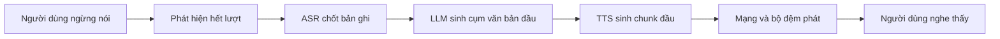
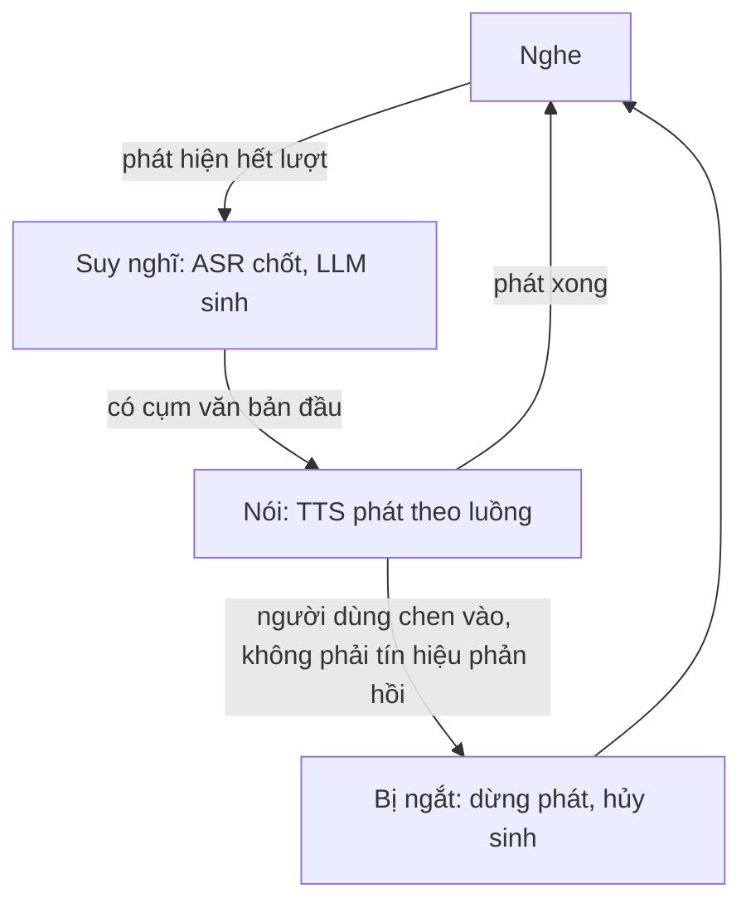

# Chương 35. Streaming, Speech LLM và hội thoại

!!! abstract "Mục tiêu học tập"
    - Định nghĩa và đo đúng các thước đo độ trễ: độ trễ đến âm thanh đầu tiên (TTFA), hệ số thời gian thực (RTF), độ trễ phản hồi đầu-cuối; lập ngân sách độ trễ cho một trợ lý giọng nói.
    - Suy ra điều kiện để âm thanh sinh theo chunk được phát liên tục không ngắt quãng, và dùng nó để thiết kế lịch kích thước chunk.
    - Cài đặt bộ chia cụm văn bản theo luồng cho đầu ra của LLM, không cắt nhầm số, chữ viết tắt hay tiểu từ cuối câu tiếng Việt.
    - Cài đặt tích chập nhân quả có bộ đệm trạng thái, chứng minh nó tương đương với chạy toàn chuỗi; suy ra quy tắc crossfade phù hợp khi ghép các chunk âm thanh.
    - So sánh hệ thống ghép tầng ASR → LLM → TTS với speech LLM đầu-cuối; phân loại các thiết kế (token xen kẽ, Thinker–Talker, song công).
    - Giải thích cơ chế hội thoại song công (Moshi: luồng kép, độc thoại nội tâm) và các hiện tượng lượt lời, ngắt lời, tín hiệu phản hồi.
    - Đề xuất bộ thước đo đánh giá hội thoại bằng giọng nói và các lưu ý khi xây dựng trợ lý giọng nói tiếng Việt.

!!! info "Kiến thức cần có"
    - Kiến trúc lai LM + flow matching và mặt nạ chunk: [Chương 34](ch34-he-thong-lai-hien-dai.md).
    - Codec language model, mẫu trễ (*delay pattern*): [Chương 32](ch32-codec-language-model.md); codec và token tiếng nói: [Chương 31](ch31-audio-codec-speech-token.md).
    - Tích chập nhân quả, trường tiếp nhận: [Chương 4](../phan-1-nen-tang/ch04-cnn-rnn-mo-hinh-chuoi.md); KV cache: [Chương 5](../phan-1-nen-tang/ch05-transformer.md).
    - Vocoder GAN và đo RTF: [Chương 25](../phan-6-vocoder/ch25-gan-vocoder.md), [Chương 26](../phan-6-vocoder/ch26-diffusion-vocoder-va-so-sanh.md).
    - Chuẩn hóa văn bản tiếng Việt: [Chương 17](../phan-4-frontend/ch17-chuan-hoa-van-ban.md).

Một hệ thống TTS đọc sách nói có thể mất vài giây để bắt đầu mà không ai phàn nàn. Một trợ lý giọng nói thì khác: nếu người dùng hỏi xong mà phải chờ hai giây mới nghe tiếng trả lời, cuộc trò chuyện trở nên gượng gạo. Chương này bàn về TTS trong bối cảnh **tương tác thời gian thực**. Chúng ta bắt đầu từ cách đo độ trễ cho đúng, đi qua các kỹ thuật sinh theo luồng (*streaming*) ở cả phía văn bản lẫn phía âm thanh, rồi mở rộng sang **speech LLM**, các mô hình ngôn ngữ lớn nghe và nói trực tiếp, và cuối cùng là hội thoại song công (*full-duplex*), nơi máy vừa nghe vừa nói như con người.

Phần speech LLM là lĩnh vực đang phát triển rất nhanh. Như ở [Chương 34](ch34-he-thong-lai-hien-dai.md), chúng ta tổ chức nội dung quanh các nguyên lý thiết kế, và mọi mô tả về hệ thống cụ thể được tóm tắt từ báo cáo gốc tính đến thời điểm biên soạn (2026).

## 35.1 Độ trễ: định nghĩa, ngân sách và điều kiện phát liên tục

### Các thước đo

Ba đại lượng cần phân biệt rõ:

- **Hệ số thời gian thực** (RTF): tỉ số giữa thời gian xử lý và thời lượng âm thanh sinh ra, $\rho = t_{\text{xử lý}} / t_{\text{âm thanh}}$. $\rho < 1$ nghĩa là sinh nhanh hơn thời gian thực. RTF đo **thông lượng**, không đo độ trễ.
- **Độ trễ đến âm thanh đầu tiên** (*time-to-first-audio*, TTFA; còn gọi là độ trễ gói đầu tiên, *first-packet latency*): khoảng thời gian từ khi văn bản sẵn sàng (hoặc từ khi gửi yêu cầu) đến khi mẫu âm thanh đầu tiên có thể phát. Cần nói rõ đo ở đâu: phía máy chủ (chưa tính mạng) hay phía người dùng (tính cả mạng và bộ đệm phát).
- **Độ trễ phản hồi đầu-cuối** trong hội thoại: từ lúc người dùng *ngừng nói* đến lúc họ *nghe thấy* âm thanh đầu tiên của câu trả lời. Đây là con số người dùng cảm nhận.

Một hệ thống có thể có RTF rất tốt (0,05) nhưng TTFA tồi (phải chờ sinh xong cả câu), và ngược lại. Hai thước đo trả lời hai câu hỏi khác nhau: "máy có theo kịp không?" và "người nghe phải chờ bao lâu?".

Mốc tham chiếu từ hội thoại tự nhiên: nghiên cứu so sánh nhiều ngôn ngữ của Stivers và cộng sự (2009) cho thấy khoảng lặng giữa hai lượt lời thường rất ngắn, điển hình chỉ cỡ 200 ms, và người nghe bắt đầu chuẩn bị câu trả lời trước khi người kia nói xong. Một hệ thống máy phải *chờ người dùng im lặng rồi mới bắt đầu xử lý* khó có thể đạt mức này; đây là động lực cho các thiết kế song công ở Mục 35.5.

### Ngân sách độ trễ của một trợ lý ghép tầng

Xét một trợ lý gồm các khối nối tiếp: phát hiện hết lượt nói, ASR, LLM, TTS, mạng. Bảng dưới đây liệt kê các thành phần với **khoảng giá trị minh họa** để thấy thứ tự độ lớn; đây không phải số đo của một hệ thống cụ thể, con số thực phụ thuộc rất nhiều vào phần cứng và cấu hình.

| Thành phần | Việc phải làm | Khoảng minh họa |
|---|---|---|
| Phát hiện hết lượt (VAD + ngưỡng im lặng) | Chờ đủ lâu để chắc người dùng đã nói xong | vài trăm ms đến gần 1 s |
| ASR hoàn tất | Chốt bản ghi cuối cùng | vài chục đến vài trăm ms |
| LLM: token đầu tiên | Nạp ngữ cảnh (*prefill*), sinh token đầu | vài chục đến vài trăm ms |
| LLM: cụm văn bản đầu tiên | Sinh đủ vài từ để TTS bắt đầu | vài chục đến vài trăm ms |
| TTS: TTFA | Sinh chunk âm thanh đầu | vài chục đến vài trăm ms |
| Mạng + bộ đệm phát | Truyền, chống giật | vài chục đến vài trăm ms |

Hai bài học rút ra từ bảng này. Thứ nhất, các thành phần **cộng dồn**, nên tối ưu riêng TTS không đủ. Thứ hai, khâu phát hiện hết lượt thường là khâu lớn nhất nhưng hay bị bỏ quên: nếu đặt ngưỡng im lặng 700 ms để tránh cắt ngang người dùng đang ngập ngừng, thì 700 ms đó đã nằm sẵn trong độ trễ trước khi bất kỳ mô hình nào chạy.



### Điều kiện phát liên tục khi sinh theo chunk

Giả sử TTS sinh tuần tự các chunk âm thanh có thời lượng $d_0, d_1, \ldots$ (giây), mỗi chunk tốn thời gian xử lý $\rho\, d_k$ (RTF không đổi $\rho$), sau một độ trễ khởi động $\tau_0$ (chờ văn bản, nạp prompt…). Thời điểm chunk $k$ sinh xong là

$$
R_k = \tau_0 + \rho \sum_{i=0}^{k} d_i .
$$

Ta bắt đầu phát ngay khi chunk 0 xong, tức tại $R_0$; vậy TTFA $= \tau_0 + \rho\, d_0$. Nếu không bị ngắt, chunk $k$ bắt đầu phát tại $P_k = R_0 + \sum_{i=0}^{k-1} d_i$. Điều kiện phát liên tục là chunk $k$ phải xong trước khi đến lượt phát nó, $R_k \leq P_k$ với mọi $k \geq 1$. Thay vào và triệt tiêu $\tau_0 + \rho\, d_0$ ở hai vế:

$$
\rho \sum_{i=1}^{k} d_i \;\leq\; \sum_{i=0}^{k-1} d_i \qquad \forall k \geq 1 .
$$

Hai hệ quả quan trọng:

- **Chunk đều nhau** ($d_i = d$): điều kiện trở thành $\rho\, k d \leq k d$, tức $\rho \leq 1$. Chỉ cần sinh nhanh hơn thời gian thực.
- **Chunk tăng theo cấp số nhân** ($d_i = d_0 r^i$, $r > 1$): hai vế là $\rho\, d_0 r (r^k - 1)/(r - 1)$ và $d_0 (r^k - 1)/(r - 1)$, nên điều kiện là $\rho\, r \leq 1$, tức **$r \leq 1/\rho$**.

Hệ quả thứ hai rất thực dụng. Để giảm TTFA, ta muốn chunk đầu thật ngắn; để có ngôn điệu tốt và ít chi phí trên mỗi chunk, ta muốn các chunk sau dài. Công thức cho biết tốc độ "nở" tối đa của kích thước chunk: với $\rho = 0.25$, mỗi chunk có thể dài gấp tối đa 4 lần chunk trước; với $\rho = 0.9$, gần như phải giữ chunk đều. Trong thực tế thời gian xử lý dao động (GPU dùng chung, mạng chập chờn), nên người ta thêm một **bộ đệm phát** nhỏ: bắt đầu phát tại $R_0 + B$ thay vì $R_0$, đổi $B$ giây độ trễ lấy biên an toàn.

Đoạn mã sau mô phỏng quá trình này.

```python
import numpy as np

def simulate_stream(chunk_sec, rtf, t_first=0.0):
    """Sinh tuần tự các chunk audio (thời lượng chunk_sec[k] giây) với hệ số RTF cho trước;
    t_first: độ trễ cố định trước khi sinh chunk đầu (chờ văn bản, nạp prompt...).
    Phát chunk 0 ngay khi xong. Trả về (TTFA, tổng thời gian bị ngắt quãng)."""
    ready = t_first + np.cumsum(np.asarray(chunk_sec) * rtf)  # thời điểm chunk k sinh xong
    play_at, stall = ready[0], 0.0
    for k, dur in enumerate(chunk_sec):
        if ready[k] > play_at:                  # chunk k chưa sẵn sàng: người nghe phải chờ
            stall += ready[k] - play_at
            play_at = ready[k]
        play_at += dur                          # thời điểm phát xong chunk k
    return ready[0], stall

equal = [1.0] * 6                               # 6 chunk x 1 giây
growing = [0.25, 0.5, 1.0, 1.0, 1.0, 1.0, 1.25] # chunk đầu ngắn, sau dài dần (tổng 6 giây)
for name, chunks in [("đều 1 s", equal), ("tăng dần", growing)]:
    for rtf in (0.3, 0.9, 1.2):
        ttfa, stall = simulate_stream(chunks, rtf, t_first=0.15)
        print(f"{name:9s} RTF={rtf:3.1f}  TTFA={1000 * ttfa:5.0f} ms  ngắt quãng={1000 * stall:5.0f} ms")

assert simulate_stream(equal, 0.9)[1] == 0.0    # RTF < 1 và chunk đều: không ngắt quãng
assert simulate_stream(equal, 1.2)[1] > 0.0     # RTF > 1: chắc chắn ngắt quãng
```

Kết quả chạy cho thấy đúng như lý thuyết: với $\rho = 0.3$, lịch "tăng dần" giảm TTFA từ 450 ms xuống 225 ms mà không ngắt quãng; nhưng với $\rho = 0.9$, cùng lịch đó gây ngắt quãng (vì chunk thứ hai dài gấp đôi chunk đầu, vi phạm $r \leq 1/\rho \approx 1.1$), trong khi chunk đều thì vẫn ổn. Không có lịch chunk nào cứu được một hệ thống có $\rho > 1$.

## 35.2 Văn bản đến theo luồng: TTS tăng dần

### Vì sao không thể đọc từng token một

Trong trợ lý giọng nói, văn bản cần đọc do một LLM sinh ra từng token một. Chờ LLM sinh xong cả câu trả lời rồi mới gọi TTS thì độ trễ tăng theo độ dài câu trả lời. Ngược lại, đưa từng token vào TTS ngay khi nó xuất hiện cũng không được, vì bốn lý do:

1. **Ngôn điệu phụ thuộc phần phía sau.** Ngữ điệu của một từ phụ thuộc vào việc câu là câu hỏi hay câu kể, từ đó có được nhấn mạnh không, phía sau có ngắt nghỉ không. Đọc mà không biết gì về phía sau giống như đọc to một văn bản lạ mà không được nhìn trước.
2. **Chuẩn hóa văn bản cần nhìn đủ.** Token BPE của LLM có thể cắt "1.000.000" thành "1", ".", "000", ".000". Nếu cắt cụm ngay sau "1." ta sẽ đọc "một chấm" thay vì "một triệu". Tương tự với "3,5%", "TP.HCM", "2/9".
3. **Từ nhiều âm tiết.** Tiếng Việt viết cách nhau từng âm tiết, nhưng một từ có thể gồm nhiều âm tiết ("học sinh", "thành phố"). Cắt giữa hai âm tiết của một từ làm ngắt nghỉ sai chỗ.
4. **Chi phí trên mỗi lần gọi.** Mỗi lần gọi TTS có chi phí cố định (nạp prompt, khởi động bộ giải mã). Cụm quá ngắn làm tổng chi phí tăng và RTF xấu đi.

Đây là một bài toán **ra quyết định trực tuyến**: tại mỗi thời điểm, đã đọc đủ văn bản để phát âm phần đầu chưa, hay nên chờ thêm? Bài toán có cùng cấu trúc với dịch máy đồng thời, nơi chiến lược *wait-k* (Ma và cộng sự, 2019) luôn đi sau văn bản nguồn $k$ từ: từ đích thứ $i$ chỉ được sinh khi đã đọc $i + k - 1$ từ nguồn. Ma và cộng sự (2020) áp dụng ý tưởng "tiền tố sang tiền tố" này cho TTS tăng dần (*incremental TTS*): chỉ tổng hợp một từ khi đã nhìn thấy thêm một số từ phía sau nó.

### Bốn chiến lược

| Chiến lược | Cách làm | Độ trễ | Ngôn điệu | Ghi chú |
|---|---|---|---|---|
| Chờ hết câu | Gom đến dấu kết thúc câu | Bằng thời gian LLM sinh câu đầu | Tốt nhất | Đơn giản, phổ biến |
| Cụm theo dấu câu + ngưỡng độ dài | Cắt ở dấu câu khi cụm đủ dài; cụm đầu ngắn hơn | Thấp | Tốt nếu cụm không quá ngắn | Chiến lược mặc định hợp lý |
| Nhìn trước $k$ từ (wait-k) | Phát âm từ $i$ khi đã có từ $i + k$ | Thấp, có thể điều chỉnh | Phụ thuộc $k$ và mô hình | Mô hình nên được huấn luyện để chịu được ngữ cảnh cụt |
| Luồng kép trong mô hình | LM của TTS nhận văn bản xen kẽ với token tiếng nói | Thấp nhất | Mô hình tự học | Cần huấn luyện riêng, ví dụ CosyVoice 2 |

Chiến lược cuối cùng đã được mô tả ở [Chương 34](ch34-he-thong-lai-hien-dai.md): LM của TTS được huấn luyện trên chuỗi xen kẽ một nhóm token văn bản, một nhóm token tiếng nói, nên có thể bắt đầu nói khi văn bản còn đang đến. Ngay cả khi dùng mô hình như vậy, một bộ chia cụm phía ngoài vẫn hữu ích để bảo vệ chuẩn hóa văn bản và để kiểm soát hành vi.

### Một bộ chia cụm cho đầu ra LLM

Bộ chia cụm dưới đây cài chiến lược thứ hai với ba quy tắc, áp dụng theo thứ tự ưu tiên:

1. Gặp **dấu kết thúc câu** (`.`, `!`, `?`, `…`) và từ đó không phải chữ viết tắt đã biết: luôn cắt.
2. Gặp **dấu ngắt vế** (`,`, `;`, `:`) và cụm đã đủ số từ tối thiểu: cắt. Cụm đầu tiên dùng ngưỡng nhỏ hơn để giảm TTFA.
3. Cụm đã dài quá số từ tối đa mà chưa gặp dấu câu: cắt cưỡng bức.

Mẹo quan trọng nằm ở chỗ **chỉ cắt tại một khoảng trắng đã đến**. Khi thấy dấu chấm, ta chưa cắt ngay mà chờ ký tự tiếp theo. Nếu đó là khoảng trắng thì dấu chấm kết thúc một từ; nếu đó là chữ số hay chữ cái (như trong "1.000" hay "TP.HCM") thì dấu chấm nằm bên trong một từ. Chỉ cần nhìn trước đúng một ký tự là phân biệt được.

```python
import random
import re

SENT_END, CLAUSE_END = ".!?…", ",;:"
ABBREV = {"tp.", "ts.", "ths.", "pgs.", "gs.", "bs.", "v.v.", "mr.", "dr."}

class StreamingChunker:
    """Gom luồng token văn bản (từ LLM) thành các cụm đủ dài để đưa vào TTS.
    Chỉ cắt tại khoảng trắng ĐÃ đến: nhờ "nhìn trước" một ký tự, dấu chấm trong
    '1.000.000' hay 'TP.HCM' không bao giờ bị hiểu nhầm là hết câu."""
    def __init__(self, first_min_words=2, min_words=6, max_words=16):
        self.first_min, self.min, self.max = first_min_words, min_words, max_words
        self.buf, self.n_out = "", 0

    def push(self, token: str) -> list[str]:
        self.buf += token
        out = []
        while (cut := self._find_cut()) is not None:
            chunk, self.buf = self.buf[:cut].strip(), self.buf[cut:].lstrip()
            out.append(chunk)
            self.n_out += 1
        return out

    def flush(self) -> list[str]:
        rest, self.buf = self.buf.strip(), ""
        return [rest] if rest else []

    def _find_cut(self):
        min_words = self.first_min if self.n_out == 0 else self.min
        for m in re.finditer(r"\s+", self.buf):
            words = self.buf[:m.start()].split()
            if not words:
                continue
            w, n = words[-1], len(words)
            if w[-1] in SENT_END and w.lower() not in ABBREV:
                return m.start()                     # hết câu: luôn cắt
            if w[-1] in CLAUSE_END and n >= min_words:
                return m.start()                     # hết vế câu, đủ dài: cắt
            if n >= self.max:
                return m.start()                     # quá dài mà chưa gặp dấu câu: cắt cưỡng bức
        return None

def fake_llm_stream(text, seed=0):
    """Giả lập LLM: nhả văn bản thành các mảnh 1-4 ký tự (như token BPE)."""
    rng, i = random.Random(seed), 0
    while i < len(text):
        k = rng.randint(1, 4)
        yield text[i:i + k]
        i += k

text = ("Dạ, em chào anh! Theo báo cáo, doanh thu quý 3 của chi nhánh TP.HCM đạt "
        "1.000.000 USD, tăng 3,5% so với cùng kỳ năm ngoái. Anh có muốn em gửi "
        "báo cáo chi tiết qua email không ạ?")
for seed in range(20):                               # thử nhiều cách cắt token khác nhau
    ch = StreamingChunker()
    chunks = [c for tok in fake_llm_stream(text, seed) for c in ch.push(tok)] + ch.flush()
    assert " ".join(chunks) == text                  # không mất / thêm ký tự
    assert not any(c.endswith(("TP.", "1.000.")) for c in chunks)
    assert any("1.000.000 USD" in c for c in chunks)
for c in chunks:
    print(repr(c))

long = " ".join(["một"] * 40)                         # văn bản không có dấu câu
ch = StreamingChunker()
chunks = [c for tok in fake_llm_stream(long) for c in ch.push(tok)] + ch.flush()
assert [len(c.split()) for c in chunks] == [16, 16, 8]
```

Với câu ví dụ, bộ chia cụm cho ra bốn cụm: "Dạ, em chào anh!", "Theo báo cáo, doanh thu quý 3 của chi nhánh TP.HCM đạt 1.000.000 USD,", "tăng 3,5% so với cùng kỳ năm ngoái." và "Anh có muốn em gửi báo cáo chi tiết qua email không ạ?". Cụm đầu không bị cắt sau "Dạ," vì mới có một từ (ngưỡng cụm đầu là 2), và "Theo báo cáo," không bị cắt vì chưa đủ 6 từ. Kiểm thử chạy với 20 cách băm token ngẫu nhiên khác nhau để bảo đảm kết quả không phụ thuộc vào cách LLM tách token. Đừng quên gọi `flush()` khi LLM kết thúc, nếu không phần đuôi không có dấu câu sẽ bị mất, một lỗi rất hay gặp.

Bộ chia cụm này cố ý đơn giản. Một phiên bản dùng trong sản phẩm cần thêm: danh sách chữ viết tắt đầy đủ hơn (lấy từ bộ chuẩn hóa ở [Chương 17](../phan-4-frontend/ch17-chuan-hoa-van-ban.md)), xử lý dấu ngoặc và dấu nháy, không cắt bên trong URL hay địa chỉ email, và khi phải cắt cưỡng bức thì ưu tiên ranh giới từ (dùng công cụ tách từ) thay vì khoảng trắng bất kỳ.

!!! note "Góc tiếng Việt"
    - **Tiểu từ cuối câu mang ngữ điệu cả câu.** Các tiểu từ như "nhé", "nhỉ", "ạ", "à", "chứ", "đấy" quyết định sắc thái và ngữ điệu kết câu ([Chương 16](../phan-3-tin-hieu-ngu-am/ch16-ngon-dieu.md)). Đừng bao giờ để chúng rơi sang một cụm riêng; quy tắc "chỉ cắt ở dấu câu hoặc khi quá dài" đã bảo vệ điều này trong đa số trường hợp, nhưng ngưỡng cắt cưỡng bức cần đủ lớn.
    - **Ngày tháng và phân số.** "2/9" có thể là "mùng 2 tháng 9" hay "hai phần chín" tùy ngữ cảnh. Nếu bộ chuẩn hóa cần ngữ cảnh phía sau để quyết định, hãy chuẩn hóa *sau khi* đã có cụm hoàn chỉnh, không chuẩn hóa từng token.
    - **Hướng dẫn LLM "viết cho tai".** Cách rẻ nhất để có đầu vào TTS tốt là yêu cầu LLM (qua lời nhắc hệ thống) trả lời bằng câu ngắn, không dùng định dạng Markdown, bảng, danh sách gạch đầu dòng, và hạn chế ký hiệu. Văn bản viết để đọc bằng mắt thường rất khó đọc thành tiếng.

## 35.3 Sinh âm thanh theo luồng

Khi văn bản đã được chia cụm, phía âm thanh cũng phải sinh theo luồng. Cách làm phụ thuộc vào kiến trúc.

### Codec LM tự hồi quy

Một LM sinh token codec ([Chương 32](ch32-codec-language-model.md)) vốn đã sinh theo thời gian, nên chỉ cần **bộ giải mã codec cũng nhân quả**. Các codec như SoundStream (Zeghidour và cộng sự, 2021) và Mimi (Défossez và cộng sự, 2024) được thiết kế với tích chập nhân quả để giải mã từng khung một. Hai điểm cần lưu ý:

- Với **mẫu trễ** (*delay pattern*) trên $Q$ sổ mã, khung thời gian thứ $j$ chỉ có đủ $Q$ token sau $Q - 1$ bước sinh nữa, nên độ trễ tăng thêm $Q - 1$ khung codec.
- Tốc độ khung codec đặt giới hạn dưới cho độ trễ: với codec 12,5 Hz, một khung đã là 80 ms âm thanh.

### Bộ giải mã flow matching theo chunk

Như [Chương 34](ch34-he-thong-lai-hien-dai.md) đã trình bày, bộ giải mã flow matching có thể sinh theo chunk nhờ mặt nạ chunk và tích chập nhân quả, có thể kèm nhìn trước vài token. Một biến thể khác là dùng attention **cửa sổ trượt theo khối**: mỗi khối chỉ nhìn một số khối trước và một số nhỏ khối sau, giới hạn cả độ trễ lẫn chi phí; theo báo cáo, Qwen2.5-Omni dùng một DiT với cơ chế như vậy cho phần giải mã âm thanh theo luồng.

### Vocoder: nhân quả có bộ đệm, hoặc cửa sổ có ngữ cảnh

Có hai cách để chạy vocoder theo luồng:

1. **Vocoder nhân quả có bộ đệm trạng thái.** Mọi tích chập đều nhân quả (chỉ đệm bên trái). Khi chạy theo chunk, mỗi lớp giữ lại vài mẫu cuối của đầu vào chunk trước làm "quá khứ" cho chunk sau. Kết quả **trùng khớp chính xác** với chạy toàn chuỗi, không tốn tính toán thừa. Nhược điểm: phải huấn luyện vocoder ở dạng nhân quả, chất lượng có thể giảm nhẹ vì không được nhìn tương lai.
2. **Vocoder không nhân quả, chạy trên cửa sổ có ngữ cảnh.** Với một vocoder bình thường như HiFi-GAN, cắt mel thành chunk $M$ khung, mỗi lần đưa thêm $c_L$ khung ngữ cảnh bên trái và $c_R$ khung bên phải, rồi bỏ phần âm thanh ứng với vùng ngữ cảnh. Nếu $c_L$, $c_R$ đủ lớn so với trường tiếp nhận thì kết quả gần như trùng chạy toàn chuỗi. Cái giá: tính toán thừa theo tỉ lệ $(c_L + c_R)/M$ và độ trễ thêm $c_R$ khung.

Cách thứ nhất đáng để hiểu kỹ vì nó xuất hiện ở khắp nơi: codec, vocoder, bộ giải mã U-Net nhân quả, cả các mô hình ASR streaming. Xét một lớp tích chập nhân quả kích thước nhân $k$, độ giãn $\delta$. Đầu ra tại thời điểm $t$ là

$$
y[t] = \sum_{i=0}^{k-1} w_i\, x[t - i\delta],
$$

chỉ cần các mẫu đầu vào từ $t - (k-1)\delta$ đến $t$. Vậy để tính đầu ra cho một chunk bắt đầu tại $t_0$, ta chỉ cần thêm $(k-1)\delta$ mẫu đầu vào **cuối cùng** của phần trước $t_0$. Đó chính là nội dung của bộ đệm (*cache*). Với một chồng $L$ lớp, mỗi lớp giữ bộ đệm riêng trên *đầu vào của chính nó*; bằng quy nạp theo số lớp, đầu ra của cả chồng khi chạy theo chunk trùng với khi chạy toàn chuỗi. Đoạn mã sau cài đặt và kiểm chứng điều đó với các chunk có độ dài tùy ý, kể cả chunk ngắn hơn kích thước bộ đệm.

```python
import torch
import torch.nn as nn
import torch.nn.functional as F

class CausalConv1d(nn.Module):
    """Conv1d nhân quả, chạy được cả kiểu toàn chuỗi lẫn kiểu streaming có cache."""
    def __init__(self, c_in, c_out, kernel_size, dilation=1):
        super().__init__()
        self.ctx = (kernel_size - 1) * dilation          # số mẫu quá khứ cần nhớ
        self.conv = nn.Conv1d(c_in, c_out, kernel_size, dilation=dilation)

    def forward(self, x):                                # x: (B, C, T) toàn chuỗi
        return self.conv(F.pad(x, (self.ctx, 0)))        # đệm bên trái => nhân quả

    def step(self, x, cache=None):                       # x: (B, C, t) một chunk
        if cache is None:                                # đầu luồng: quá khứ là 0
            cache = x.new_zeros(x.shape[0], x.shape[1], self.ctx)
        xx = torch.cat([cache, x], dim=-1)               # (B, C, ctx + t)
        new_cache = xx[..., xx.shape[-1] - self.ctx:]    # ctx mẫu cuối (đúng cả khi ctx = 0)
        return self.conv(xx), new_cache                  # (B, C_out, t)

class CausalStack(nn.Module):
    def __init__(self, C=8, dilations=(1, 2, 4, 8)):
        super().__init__()
        self.layers = nn.ModuleList(CausalConv1d(C, C, 3, d) for d in dilations)

    def forward(self, x):                                # (B, C, T)
        for layer in self.layers:
            x = x + torch.tanh(layer(x))
        return x

    def step(self, x, caches):                           # caches: list, mỗi lớp một cache
        new = []
        for layer, cache in zip(self.layers, caches):
            y, c = layer.step(x, cache)
            x = x + torch.tanh(y)
            new.append(c)
        return x, new

torch.manual_seed(0)
net = CausalStack().eval()
x = torch.randn(2, 8, 300)                               # (B, C, T)
with torch.inference_mode():
    y_full = net(x)
    caches, outs, s = [None] * len(net.layers), [], 0
    for t in [1, 7, 30, 2, 100, 160]:                    # chunk có độ dài bất kỳ
        y, caches = net.step(x[..., s:s + t], caches)
        outs.append(y)
        s += t
    y_stream = torch.cat(outs, dim=-1)
assert s == 300 and torch.allclose(y_stream, y_full, atol=1e-6)
print("Streaming có cache == chạy toàn chuỗi. Trường tiếp nhận:",
      1 + sum(l.ctx for l in net.layers), "khung")
```

Ba chi tiết đáng chú ý trong mã. Thứ nhất, bộ đệm mới được lấy bằng `xx[..., xx.shape[-1] - self.ctx:]` thay vì `xx[..., -self.ctx:]`: khi `ctx = 0` (nhân kích thước 1), biểu thức thứ hai trả về *toàn bộ* tensor chứ không phải tensor rỗng, một lỗi rất khó phát hiện. Thứ hai, bộ đệm là **trạng thái của từng phiên**: trong máy chủ phục vụ nhiều người dùng, mỗi luồng âm thanh phải có bộ đệm riêng và phải được khởi tạo lại khi bắt đầu câu mới, nếu không âm thanh của người này sẽ "rò" sang người kia. Thứ ba, các lớp tăng mẫu bằng tích chập chuyển vị (`ConvTranspose1d`) cũng cần trạng thái, nhưng theo kiểu khác: phần đầu ra "tràn" sang chunk sau phải được giữ lại để cộng chồng (*overlap-add*) với đầu ra chunk sau (Bài tập 6).

### Ghép các chunk: crossfade

Khi các chunk được sinh **không hoàn toàn nhất quán** (ví dụ vocoder không nhân quả chạy trên cửa sổ, hoặc mỗi chunk của bộ giải mã flow matching dùng nhiễu khởi đầu khác nhau), nối thẳng chúng gây ra bước nhảy biên độ ở ranh giới, nghe thành tiếng "tách". Cách chữa là sinh dư một đoạn chồng lấn $n_o$ mẫu giữa hai chunk liên tiếp và trộn chúng bằng hai cửa sổ: cửa sổ giảm dần $a[n]$ cho chunk trước và tăng dần $b[n]$ cho chunk sau.

Chọn $a$, $b$ thế nào? Gọi $u[n]$, $v[n]$ là hai tín hiệu trong vùng chồng lấn, cùng công suất $\sigma^2$, có hệ số tương quan $\gamma$. Công suất kỳ vọng của tín hiệu trộn là

$$
\mathbb{E}\big[(a u + b v)^2\big] = \sigma^2 \big(a^2 + b^2 + 2\gamma\, a b\big).
$$

- Nếu hai chunk gần như **trùng nhau** ($\gamma \approx 1$, trường hợp thường gặp vì chúng cùng mô tả một nội dung), công suất là $\sigma^2 (a + b)^2$: muốn giữ nguyên biên độ thì cần **$a + b = 1$**, tức crossfade tuyến tính (hoặc cửa sổ Hann bình phương).
- Nếu hai chunk **không tương quan** ($\gamma = 0$), cần **$a^2 + b^2 = 1$**, tức crossfade đẳng công suất $a = \cos\varphi$, $b = \sin\varphi$. Dùng crossfade tuyến tính trong trường hợp này làm công suất giữa vùng chồng lấn tụt còn một nửa ($a = b = 1/2$), tức hụt khoảng 3 dB.

Với âm thanh tiếng nói sinh từ cùng nội dung, trường hợp thứ nhất là phổ biến hơn, nên crossfade tuyến tính là lựa chọn mặc định. Đoạn mã dưới kiểm chứng: (a) với các chunk khớp nhau hoàn toàn, crossfade tuyến tính tái tạo chính xác tín hiệu gốc; (b) khi mỗi chunk lệch nhau một chút (ở đây là một độ lệch một chiều ngẫu nhiên), nối cứng tạo ra bước nhảy lớn, còn crossfade làm bước nhảy trở về cỡ của tín hiệu gốc.

```python
import torch

def crossfade_concat(chunks: list[torch.Tensor], overlap: int) -> torch.Tensor:
    """Ghép các đoạn audio 1-D; đoạn k+1 lặp lại `overlap` mẫu cuối của đoạn k.
    Vùng chồng lấn được trộn bằng cửa sổ tuyến tính: w_out + w_in = 1 tại mọi mẫu."""
    w_in = (torch.arange(overlap) + 0.5) / overlap        # tăng dần từ ~0 lên ~1, (overlap,)
    w_out = 1.0 - w_in
    out = chunks[0]
    for c in chunks[1:]:
        mixed = out[-overlap:] * w_out + c[:overlap] * w_in
        out = torch.cat([out[:-overlap], mixed, c[overlap:]])
    return out

def split_with_overlap(x, hop, overlap):
    """Cắt x thành các đoạn dài hop + overlap (đoạn cuối có thể ngắn hơn)."""
    return [x[s:s + hop + overlap] for s in range(0, len(x) - overlap, hop)]

sr, overlap, hop = 16_000, 160, 1600                     # chồng lấn 10 ms, mỗi chunk 100 ms
t = torch.arange(sr) / sr
x = 0.5 * torch.sin(2 * torch.pi * 220 * t)              # 1 giây tín hiệu "thật"

# (a) Các chunk khớp nhau hoàn toàn => ghép lại đúng tín hiệu gốc
chunks = split_with_overlap(x, hop, overlap)
assert torch.allclose(crossfade_concat(chunks, overlap), x, atol=1e-6)

# (b) Mỗi chunk được "sinh" độc lập nên lệch nhau chút ít (ở đây: độ lệch DC ngẫu nhiên)
torch.manual_seed(0)
noisy = [c + 0.05 * torch.randn(()) for c in chunks]
hard = torch.cat([c[:-overlap] for c in noisy[:-1]] + [noisy[-1]])   # nối cứng
soft = crossfade_concat(noisy, overlap)
max_jump = lambda y: y.diff().abs().max().item()          # bước nhảy lớn nhất giữa 2 mẫu
print(f"tín hiệu gốc: {max_jump(x):.4f}  nối cứng: {max_jump(hard):.4f}  "
      f"crossfade: {max_jump(soft):.4f}")
assert max_jump(soft) < max_jump(hard)
```

Trong lần chạy của chúng tôi, bước nhảy lớn nhất giữa hai mẫu liên tiếp là khoảng 0,043 với tín hiệu gốc, 0,18 khi nối cứng và 0,044 khi crossfade. Một vùng chồng lấn 5–20 ms thường đủ để che vết nối mà không làm tăng đáng kể chi phí; vùng quá dài có thể gây hiện tượng "hai giọng chồng nhau" nếu hai chunk lệch pha nhiều.

!!! tip "Crossfade không chữa được mọi thứ"
    Crossfade che được bước nhảy biên độ, nhưng nếu hai chunk khác nhau về *nội dung* (ngữ điệu đứt gãy, cao độ nhảy bậc) thì người nghe vẫn nhận ra. Cách chữa tận gốc là cho mô hình nhìn thấy ngữ cảnh quá khứ (mặt nạ chunk, bộ đệm trạng thái) để các chunk nhất quán ngay từ đầu; crossfade chỉ là lớp bảo vệ cuối cùng.

## 35.4 Speech LLM: từ ghép tầng đến đầu-cuối

### Hệ thống ghép tầng và giới hạn của nó

Cách dễ nhất để có một trợ lý giọng nói là nối ba mô hình: ASR chuyển lời người dùng thành văn bản, LLM văn bản sinh câu trả lời, TTS đọc câu trả lời. Thiết kế **ghép tầng** (*cascaded*) này có nhiều ưu điểm thật sự:

- Dùng được LLM văn bản mạnh nhất hiện có, cùng toàn bộ hệ sinh thái của nó: gọi công cụ, truy xuất tài liệu (RAG), bộ lọc an toàn trên văn bản.
- Từng khối có thể thay thế, đánh giá và gỡ lỗi riêng; log văn bản trung gian giúp truy vết lỗi.
- Kiểm soát tốt: muốn đổi giọng chỉ cần đổi TTS, muốn đổi ngôn ngữ chỉ cần đổi ASR và TTS.

Nhưng văn bản là một **nút cổ chai thông tin**:

- **Mất thông tin cận ngôn ngữ** (*paralinguistic*) ở đầu vào: cảm xúc, giọng điệu mỉa mai, sự ngập ngừng, tuổi tác, tiếng cười của người dùng đều biến mất khi chỉ còn bản ghi chữ. LLM không biết người dùng đang bực bội hay đang đùa.
- **Mất khả năng biểu đạt** ở đầu ra: LLM chỉ sinh chữ, nên TTS phải tự đoán cách nói. Các âm thanh phi ngôn ngữ (cười, thở dài, "ừm") khó biểu diễn.
- **Lỗi lan truyền**: ASR nghe nhầm thì LLM trả lời sai câu hỏi.
- **Độ trễ cộng dồn** như đã phân tích ở Mục 35.1, và lượt lời bị quản lý bằng các quy tắc cứng (ngưỡng im lặng).

**Speech LLM** là tên gọi chung cho các mô hình cố gắng phá nút cổ chai này bằng cách để một mô hình ngôn ngữ lớn trực tiếp nhận và/hoặc sinh biểu diễn tiếng nói.

### Ba trục phân loại

Thay vì liệt kê từng hệ thống, hãy phân loại theo ba câu hỏi:

1. **Đầu vào tiếng nói được biểu diễn thế nào?** (a) Token rời rạc (HuBERT units, token codec) được thêm vào từ vựng của LLM; hoặc (b) véc-tơ liên tục từ một bộ mã hóa âm thanh (thường là encoder của Whisper) đi qua một lớp chuyển đổi (*adapter*) rồi đưa vào LLM như các embedding.
2. **Đầu ra tiếng nói được sinh thế nào?** (a) Sinh văn bản trước rồi mới sinh tiếng nói (chuỗi suy luận đa phương thức); (b) sinh văn bản và token tiếng nói **xen kẽ** trong cùng một chuỗi; (c) sinh **song song** nhiều luồng trong cùng một bước; (d) tách thành hai mô hình "nghĩ" và "nói" nối với nhau bằng biểu diễn ẩn.
3. **Song công hay bán song công?** Mô hình chỉ nói khi đến lượt (bán song công, *half-duplex*), hay vừa nghe vừa nói liên tục (song công, *full-duplex*)?

### Các hệ thống tiêu biểu

Các mô tả sau tóm tắt báo cáo gốc tính đến thời điểm biên soạn (2026); chi tiết kiến trúc có thể khác giữa các phiên bản.

- **GSLM** (Lakhotia và cộng sự, 2021) là thử nghiệm sớm về mô hình ngôn ngữ "không văn bản": một LM huấn luyện thuần trên HuBERT units. Mô hình sinh ra tiếng nói có ngữ âm và ngôn điệu hợp lý nhưng nội dung thiếu mạch lạc. Bài học: chỉ học từ token tiếng nói thì rất khó đạt khả năng ngữ nghĩa của LLM văn bản, vì token tiếng nói dày đặc hơn nhiều mà mỗi token mang rất ít "ý nghĩa".
- **SpeechGPT** (Zhang và cộng sự, 2023) thêm HuBERT units vào từ vựng của một LLM văn bản và huấn luyện theo lối **chuỗi phương thức** (*chain-of-modality*): khi nhận câu hỏi bằng tiếng nói, mô hình chép lại câu hỏi thành chữ, sinh câu trả lời bằng chữ, rồi mới sinh units của câu trả lời. Văn bản đóng vai trò "giàn giáo" cho suy luận; đổi lại, độ trễ cao vì phải sinh xong văn bản trước.
- **Spectron** (Nachmani và cộng sự, 2024) làm việc trực tiếp trên spectrogram thay vì token rời rạc: một bộ mã hóa tiếng nói đã huấn luyện cung cấp đầu vào cho LM, và mô hình sinh lần lượt bản ghi chữ của lời nhắc, phần tiếp theo bằng chữ, rồi spectrogram của phần tiếp theo trong cùng một lượt giải mã.
- **LLaMA-Omni** (Fang và cộng sự, 2024) đi theo hướng đầu vào liên tục: encoder Whisper cộng một adapter đưa tiếng nói vào một LLM Llama 3.1 (bản 8B Instruct theo báo cáo). Phía đầu ra, một bộ giải mã tiếng nói không tự hồi quy đọc trạng thái ẩn của LLM và dự đoán chuỗi units rời rạc bằng hàm mất mát CTC, rồi vocoder sinh dạng sóng. Văn bản và tiếng nói được sinh gần như đồng thời, nên độ trễ thấp.
- **Mini-Omni** (Xie và Wu, 2024) dùng một LLM nhỏ sinh **song song** token văn bản và token của nhiều tầng sổ mã âm thanh trong cùng một bước, với token văn bản đi trước một chút để dẫn dắt; các tác giả mô tả đây là "vừa nghĩ vừa nói".
- **GLM-4-Voice** (Zeng và cộng sự, 2024) dùng một bộ token hóa tiếng nói **có giám sát** một sổ mã, tốc độ 12,5 Hz (cùng tinh thần với token của CosyVoice, [Chương 34](ch34-he-thong-lai-hien-dai.md)). LLM sinh **xen kẽ** các nhóm token văn bản và token tiếng nói theo tỉ lệ cố định, văn bản luôn đi trước; token tiếng nói được giải mã theo luồng bằng một bộ giải mã flow matching dựa trên CosyVoice.
- **Qwen2.5-Omni** (Xu và cộng sự, 2025) đề xuất kiến trúc **Thinker–Talker**: Thinker là một LLM đa phương thức nhận âm thanh, hình ảnh, video và sinh văn bản; Talker là một mô hình tự hồi quy nhận trực tiếp biểu diễn ẩn cấp cao của Thinker để sinh token tiếng nói theo luồng. Báo cáo cũng giới thiệu một cách mã hóa vị trí đồng bộ thời gian giữa các phương thức (TMRoPE).
- **Moshi** (Défossez và cộng sự, 2024) là mô hình song công, trình bày ở Mục 35.5.

### Văn bản làm giàn giáo: phân tích xác suất

Nhiều hệ thống trên có chung một ý tưởng: **văn bản đi trước, tiếng nói theo sau**. Hình thức hóa cho trường hợp xen kẽ: đầu ra là chuỗi các cặp nhóm $(\mathbf{w}_1, \mathbf{a}_1, \mathbf{w}_2, \mathbf{a}_2, \ldots)$, với $\mathbf{w}_k$ là nhóm token văn bản và $\mathbf{a}_k$ là nhóm token tiếng nói. LLM phân rã

$$
p(\mathbf{w}_{1:K}, \mathbf{a}_{1:K} \mid \text{ngữ cảnh}) = \prod_{k=1}^{K} p(\mathbf{w}_k \mid \mathbf{w}_{<k}, \mathbf{a}_{<k}, \text{ngữ cảnh})\; p(\mathbf{a}_k \mid \mathbf{w}_{\leq k}, \mathbf{a}_{<k}, \text{ngữ cảnh}).
$$

Thừa số thứ nhất là "nghĩ bằng chữ": quyết định *nói gì* tiếp theo. Thừa số thứ hai là một mô hình TTS ẩn bên trong LLM: quyết định *nói thế nào* cho nhóm văn bản vừa sinh. Cách phân rã này hiệu quả vì:

- Mật độ thông tin ngữ nghĩa trên mỗi token văn bản cao hơn nhiều so với token tiếng nói, nên "suy nghĩ" trên chuỗi văn bản ngắn và gần với dữ liệu tiền huấn luyện của LLM. Khả năng suy luận của LLM văn bản được bảo toàn tốt hơn.
- Token tiếng nói luôn có "kế hoạch" văn bản để bám theo, giống như LM của TTS được điều kiện hóa trên văn bản, nên ít khi sinh tiếng vô nghĩa.

Điều kiện để cơ chế hoạt động là văn bản phải luôn **đi trước** tiếng nói. Tỉ lệ số token mỗi nhóm được chọn sao cho tốc độ "tiêu thụ" văn bản của phần tiếng nói không vượt tốc độ văn bản được sinh ra; nếu tiếng nói đuổi kịp văn bản, nó mất giàn giáo và dễ nói sai.

Kiến trúc Thinker–Talker là một biến thể của cùng ý tưởng, nhưng tách hai thừa số thành hai mô hình: Talker không chỉ nhận token văn bản rời rạc mà nhận cả biểu diễn ẩn liên tục của Thinker, vốn có thể chứa thông tin về sắc thái mà văn bản không thể hiện.

## 35.5 Hội thoại song công

### Từ bộ đàm đến điện thoại

Phần lớn trợ lý giọng nói hoạt động như **bộ đàm**: người dùng nói, hệ thống chờ đến khi phát hiện im lặng đủ lâu, rồi mới trả lời; trong khi hệ thống nói, nó hoặc không nghe, hoặc chỉ nghe để phát hiện bị ngắt lời. Hội thoại giữa người với người thì giống **điện thoại** hơn: hai bên có thể nói chồng lên nhau, chen vào các tín hiệu phản hồi ngắn ("ừ", "vâng", "thế à") mà không giành lượt, và người nghe dự đoán được khi nào người nói sắp dứt câu.

Các hiện tượng cần xử lý:

- **Luân phiên lượt lời** (*turn-taking*): khi nào nên bắt đầu nói? Một khoảng lặng có thể là ngập ngừng giữa câu chứ chưa phải hết lượt.
- **Ngắt lời** (*barge-in*): người dùng nói chen khi hệ thống đang nói; hệ thống cần dừng lại nhanh.
- **Tín hiệu phản hồi** (*backchannel*): những tiếng ngắn như "ừ", "dạ", "vâng" cho biết đang nghe, *không* phải yêu cầu dừng lại.
- **Nói chồng** (*overlap*) và **từ đệm** ("ờ", "à") khi suy nghĩ.

### Cách 1: ghép tầng cộng máy trạng thái

Cách phổ biến nhất vẫn là ghép tầng, cộng một bộ điều phối dạng máy trạng thái.



Các chi tiết kỹ thuật quyết định trải nghiệm:

- **Khử tiếng vọng** (*acoustic echo cancellation*, AEC): khi loa đang phát câu trả lời, micro thu lại chính giọng hệ thống. Không khử tiếng vọng, hệ thống sẽ "tự ngắt lời mình".
- **Phân biệt ngắt lời với tín hiệu phản hồi**: dựa vào độ dài đoạn nói, năng lượng và nội dung (từ ASR streaming). "Dạ" ngắn là phản hồi; "dạ không, ý em là…" là ngắt lời.
- **Dừng nhanh**: khi quyết định đã bị ngắt, phải dừng phát trong vài chục mili-giây, hủy các yêu cầu LLM/TTS đang chạy và xóa bộ đệm phát phía người dùng.
- **Cắt lịch sử hội thoại theo phần đã thực sự được phát.** Nếu LLM đã sinh ba câu nhưng người dùng chỉ nghe được câu đầu thì bị ngắt, lịch sử hội thoại phải chỉ ghi câu đầu. Nếu không, LLM sẽ tưởng người dùng đã nghe những điều họ chưa nghe.

Thay vì ngưỡng im lặng cố định, có thể dùng mô hình **dự đoán lượt lời**. Ví dụ, Voice Activity Projection (VAP; Ekstedt và Skantze, 2022) huấn luyện tự giám sát để dự đoán hoạt động giọng nói của cả hai người trong vài giây tới từ âm thanh hội thoại, từ đó suy ra xác suất người đang nói sắp dứt lượt. Mô hình như vậy tận dụng được ngữ điệu cuối câu, thứ mà một bộ phát hiện giọng nói đơn thuần bỏ qua.

### Cách 2: song công gốc trong mô hình

Hướng thứ hai là để mô hình **tự học** khi nào nói, khi nào im, từ dữ liệu hội thoại hai kênh. dGSLM (Nguyen và cộng sự, 2023) là một thử nghiệm sớm: hai tháp Transformer, mỗi tháp mô hình hóa units của một người nói, trao đổi thông tin qua cross-attention, huấn luyện trên hội thoại điện thoại có kênh riêng cho mỗi bên. Mô hình sinh được các hiện tượng như nói chồng, cười, tín hiệu phản hồi một cách tự nhiên, nhưng nội dung thiếu mạch lạc vì không có văn bản dẫn dắt.

**Moshi** (Défossez và cộng sự, 2024) kết hợp ý tưởng luồng kép với giàn giáo văn bản. Theo báo cáo gốc, các thành phần chính là:

- **Codec Mimi** tốc độ 12,5 Hz, nhiều tầng RVQ, trong đó tầng thứ nhất được chưng cất từ biểu diễn của một mô hình tự giám sát (WavLM) để mang thông tin ngữ nghĩa, các tầng sau mang thông tin âm học. Codec nhân quả nên giải mã được theo luồng.
- **Hai luồng âm thanh song song**: luồng của Moshi và luồng của người dùng. Tại mỗi khung 80 ms, mô hình đọc token của cả hai luồng và sinh token cho luồng của mình. Khi suy luận, luồng người dùng được lấy từ micro (qua bộ mã hóa Mimi) chứ không do mô hình sinh. "Im lặng" cũng chỉ là một chuỗi token, nên mô hình *luôn* đang nghe và *luôn* đang "nói", kể cả khi điều nó nói là im lặng.
- **Độc thoại nội tâm** (*inner monologue*): trước các token âm thanh của mỗi khung, mô hình sinh token văn bản được căn thời gian khớp với tiếng nói của chính nó (chèn token đệm khi không có từ mới). Đây là giàn giáo văn bản ở mức khung, giúp nội dung mạch lạc hơn nhiều so với dGSLM.
- **RQ-Transformer**: một Transformer lớn chạy theo trục thời gian (khởi tạo từ một LLM văn bản 7B tên Helium) và một Transformer nhỏ chạy theo trục sổ mã trong mỗi khung, để không phải trải phẳng mọi tầng RVQ thành một chuỗi dài.
- **Độ trễ**: báo cáo nêu độ trễ lý thuyết 160 ms (80 ms của một khung Mimi cộng 80 ms trễ giữa token ngữ nghĩa và token âm học) và khoảng 200 ms trong thực tế trên GPU.

Có thể hình thức hóa mô hình luồng kép như sau. Gọi $\mathbf{o}_s$ là token (văn bản và âm thanh) của hệ thống và $\mathbf{u}_s$ là token âm thanh của người dùng tại khung $s$. Mô hình học

$$
p(\mathbf{o}_{1:S}, \mathbf{u}_{1:S}) = \prod_{s=1}^{S} p(\mathbf{o}_s, \mathbf{u}_s \mid \mathbf{o}_{<s}, \mathbf{u}_{<s}),
$$

và khi suy luận chỉ lấy mẫu $\mathbf{o}_s$, còn $\mathbf{u}_s$ là quan sát thật. Vì mỗi bước đều có điều kiện trên toàn bộ lịch sử của *cả hai* luồng, quyết định nói hay im, chen phản hồi hay dừng lại đều là kết quả của cùng một mô hình xác suất, không cần máy trạng thái viết tay.

### Thách thức còn mở

- **Dữ liệu**: hội thoại hai kênh tách biệt, chất lượng tốt, quy mô lớn rất hiếm, nhất là cho các ngôn ngữ ít tài nguyên như tiếng Việt. Nhiều hệ thống phải dùng hội thoại tổng hợp bằng TTS.
- **Năng lực suy luận**: các báo cáo thường ghi nhận speech LLM đầu-cuối kém LLM văn bản gốc về tri thức và suy luận khi được đánh giá trên cùng nội dung, một cái giá của việc chia sẻ năng lực mô hình cho tiếng nói.
- **Kiểm soát và an toàn**: lọc nội dung trên luồng âm thanh khó hơn trên văn bản; giàn giáo văn bản giúp phần nào vì có thể kiểm tra văn bản trước khi nó được nói ra.
- **Gọi công cụ, truy xuất tài liệu**: tự nhiên với hệ thống ghép tầng, phức tạp hơn với mô hình song công.

Vì vậy, tính đến thời điểm biên soạn (2026), nhiều sản phẩm thực tế vẫn dùng ghép tầng hoặc dạng lai (LLM văn bản + TTS streaming chất lượng cao + bộ dự đoán lượt lời), trong khi mô hình song công đầu-cuối là hướng nghiên cứu sôi động.

## 35.6 Đánh giá hội thoại bằng giọng nói

Đánh giá một trợ lý giọng nói cần nhiều tầng thước đo, vì một câu trả lời có thể đúng nội dung nhưng đến quá muộn, hoặc đến đúng lúc nhưng giọng méo.

| Tầng | Thước đo | Cách đo | Lưu ý |
|---|---|---|---|
| Độ trễ | TTFA, độ trễ phản hồi đầu-cuối (p50, p90), RTF | Đo phía người dùng, trên phân phối câu thực tế | Báo cáo phân vị, không chỉ trung bình |
| Nội dung | Độ chính xác, mức hữu ích của câu trả lời | ASR chép lại câu trả lời rồi chấm bằng đáp án hoặc bằng LLM | Lỗi ASR khi chép lại làm nhiễu điểm |
| Nhất quán chữ – tiếng | WER giữa văn bản mô hình định nói và ASR của âm thanh thật | ASR trên đầu ra | Quan trọng với mô hình xen kẽ văn bản – tiếng nói |
| Chất lượng tiếng | MOS chủ quan, MOS dự đoán (UTMOS…), độ giống giọng | [Chương 38](../phan-9-thuc-tien/ch38-danh-gia-tts.md) | MOS dự đoán kém tin cậy với ngôn ngữ ít dữ liệu |
| Tương tác | Tỉ lệ cắt ngang nhầm, thời gian dừng khi bị ngắt lời, phân phối khoảng lặng giữa lượt, độ phù hợp của tín hiệu phản hồi | Kịch bản hội thoại có chú thích thời gian | So với phân phối của hội thoại người – người |
| Cảm nhận tổng thể | Độ tự nhiên của cuộc hội thoại, mức hài lòng, tỉ lệ hoàn thành nhiệm vụ | Đánh giá chủ quan, thử nghiệm người dùng | Tốn kém nhưng không thay thế được |

Tính đến thời điểm biên soạn (2026), cộng đồng đã đề xuất một số bộ đánh giá công khai cho trợ lý giọng nói (ví dụ VoiceBench cho nội dung câu trả lời, cùng các bộ đánh giá riêng cho hành vi song công), nhưng chưa có chuẩn nào được chấp nhận rộng rãi như Seed-TTS-eval với TTS. Với tiếng Việt, bạn gần như chắc chắn phải tự xây bộ kịch bản đánh giá.

## 35.7 Trợ lý giọng nói tiếng Việt

Các nguyên lý ở trên áp dụng cho mọi ngôn ngữ, nhưng tiếng Việt có những điểm cần chú ý riêng ở từng khối.

**Nhận dạng tiếng nói.** Các lựa chọn phổ biến là Whisper (Radford và cộng sự, 2023) và các bản tinh chỉnh cho tiếng Việt như PhoWhisper (Le và cộng sự, 2024). Cần kiểm tra độ bền với phương ngữ (Bắc, Trung, Nam), với trộn mã Việt–Anh, và với âm thanh điện thoại 8 kHz nếu hệ thống chạy qua tổng đài. ASR thường xuất số dưới dạng chữ số ("15 triệu"), nên LLM phía sau cần quen với cả hai dạng.

**Mô hình ngôn ngữ.** Yêu cầu LLM trả lời bằng **văn nói**: câu ngắn, không định dạng, xưng hô nhất quán với vai của trợ lý ("em" với "anh/chị", hay "tôi" với "bạn"), dùng tiểu từ lịch sự ("dạ", "ạ") phù hợp ngữ cảnh. Sự không nhất quán giữa giọng đọc (ví dụ giọng nữ trẻ) và cách xưng hô (ví dụ "tôi") nghe rất lạ tai với người Việt.

**Tổng hợp tiếng nói.** Chuẩn hóa văn bản phải chạy trên cụm hoàn chỉnh (Mục 35.2). Khi sinh theo chunk, cần kiểm tra thanh điệu ở ranh giới chunk: một âm tiết bị cắt đôi hoặc mất ngữ cảnh có thể bị đọc sai thanh. Giọng đọc nên cùng phương ngữ với đối tượng người dùng chính.

!!! note "Góc tiếng Việt"
    - **"Dạ", "vâng" vừa là tín hiệu phản hồi vừa là câu trả lời.** Người Việt dùng "dạ", "vâng", "ừ" liên tục khi nghe để tỏ ra lịch sự và chú ý. Một bộ phát hiện ngắt lời ngây thơ sẽ dừng hệ thống mỗi lần người dùng "dạ". Ngược lại, "vâng" cũng có thể là câu trả lời "có" cho một câu hỏi. Phân biệt hai trường hợp cần ngữ cảnh: hệ thống vừa hỏi hay đang giải thích?
    - **Tín hiệu kết thúc lượt.** Các tiểu từ hỏi cuối câu ("không?", "à?", "nhỉ?", "chứ?") và ngữ điệu kèm theo là tín hiệu mạnh rằng người nói đang nhường lượt. Mô hình dự đoán lượt lời huấn luyện trên tiếng Anh không học được các tín hiệu này; cần dữ liệu hội thoại tiếng Việt.
    - **Từ đệm khi suy nghĩ.** "Ờ…", "à…", "thì…" kéo dài thường *không* phải hết lượt. Ngưỡng im lặng cố định dễ cắt ngang người dùng đang tìm từ.
    - **Hạ tầng.** Nếu máy chủ mô hình đặt ở trung tâm dữ liệu nước ngoài, riêng độ trễ mạng khứ hồi đã có thể chiếm một phần đáng kể ngân sách; với ứng dụng cần phản hồi nhanh, hãy đo độ trễ mạng thực tế từ phía người dùng và cân nhắc đặt máy chủ gần người dùng ([Chương 39](../phan-9-thuc-tien/ch39-trien-khai-production.md)).

## Lỗi thường gặp và mẹo thực hành

- **Báo cáo RTF thay cho độ trễ.** RTF 0,05 trên câu dài không nói gì về TTFA. Luôn đo TTFA trực tiếp, phía người dùng, và báo cáo phân vị (p50, p95).
- **Quên khởi động** (*warm-up*). Lần gọi đầu tiên sau khi nạp mô hình thường chậm hơn nhiều (cấp phát bộ nhớ, biên dịch nhân, ghi lại CUDA graph). Đừng để người dùng đầu tiên gánh chi phí đó, và đừng đưa nó vào số đo.
- **Bộ đệm trạng thái dùng chung giữa các phiên.** Bộ đệm của tích chập nhân quả, KV cache, trạng thái crossfade đều phải gắn với một phiên và được xóa khi bắt đầu câu mới.
- **Quên `flush()`** ở cuối luồng văn bản, làm mất phần cuối câu trả lời không có dấu câu.
- **Cắt văn bản giữa số hoặc chữ viết tắt.** Kiểm thử bộ chia cụm với nhiều cách tách token ngẫu nhiên như đoạn mã ở Mục 35.2.
- **Tiếng "tách" ở ranh giới chunk.** Kiểm tra: độ lệch một chiều (DC) giữa các chunk, độ dài chồng lấn lệch một mẫu, chunk sinh với nhiễu khởi đầu khác nhau mà không có ngữ cảnh quá khứ.
- **Tự ngắt lời do tiếng vọng.** Luôn bật khử tiếng vọng khi hệ thống vừa phát vừa nghe; kiểm thử với loa ngoài, không chỉ tai nghe.
- **Lịch sử hội thoại không khớp với những gì đã được nói.** Sau khi bị ngắt lời, cắt lịch sử theo phần đã thực sự phát.
- **Không xử lý áp lực ngược** (*backpressure*). Nếu phía người dùng nhận chậm hơn tốc độ sinh, bộ đệm phía máy chủ phình ra; cần giới hạn và xử lý.

## Tóm tắt

- RTF đo thông lượng, TTFA đo thời gian chờ; trong hội thoại, độ trễ người dùng cảm nhận là tổng của phát hiện hết lượt, ASR, LLM, TTS và mạng, trong đó khâu phát hiện hết lượt thường lớn nhất.
- Khi sinh tuần tự các chunk với RTF $\rho$, phát liên tục khi và chỉ khi $\rho \sum_{i=1}^{k} d_i \leq \sum_{i=0}^{k-1} d_i$ với mọi $k$; chunk đều cần $\rho \leq 1$, chunk tăng theo cấp số nhân với tỉ số $r$ cần $r \leq 1/\rho$.
- Văn bản từ LLM cần được chia cụm: cắt ở dấu câu khi cụm đủ dài, cụm đầu ngắn để giảm TTFA, và chỉ cắt tại khoảng trắng đã đến để không cắt nhầm số, chữ viết tắt.
- Sinh âm thanh theo luồng dựa trên tính nhân quả: codec nhân quả, flow matching với mặt nạ chunk, vocoder nhân quả có bộ đệm trạng thái (chính xác tuyệt đối) hoặc vocoder thường chạy trên cửa sổ có ngữ cảnh (tốn tính toán thừa).
- Crossfade tuyến tính ($a + b = 1$) phù hợp khi hai chunk gần trùng nhau; crossfade đẳng công suất ($a^2 + b^2 = 1$) phù hợp khi chúng không tương quan.
- Hệ thống ghép tầng ASR → LLM → TTS mạnh về khả năng kiểm soát và tận dụng LLM văn bản, nhưng mất thông tin cận ngôn ngữ và cộng dồn độ trễ.
- Speech LLM phân loại theo cách biểu diễn đầu vào, cách sinh đầu ra (văn bản trước, xen kẽ, song song, Thinker–Talker) và tính song công; ý tưởng chung là dùng văn bản làm giàn giáo cho tiếng nói.
- Moshi mô hình hóa đồng thời hai luồng âm thanh với độc thoại nội tâm bằng văn bản, nhờ đó học được luân phiên lượt lời, ngắt lời và tín hiệu phản hồi trong cùng một mô hình xác suất.
- Đánh giá hội thoại cần nhiều tầng: độ trễ, nội dung, nhất quán chữ – tiếng, chất lượng tiếng, hành vi tương tác và cảm nhận tổng thể.

## Bài tập

**Bài 1 [Cơ bản].** Một trợ lý ghép tầng có các thành phần: ngưỡng im lặng 600 ms, ASR chốt bản ghi 120 ms, LLM token đầu 250 ms, LLM cần thêm 150 ms để có cụm văn bản đầu, TTS có TTFA 180 ms, mạng và bộ đệm phát 100 ms. (a) Tính độ trễ phản hồi đầu-cuối. (b) Nếu chỉ được tối ưu một khâu, khâu nào có tiềm năng giảm nhiều nhất và bằng cách nào?

??? success "Lời giải"
    (a) $600 + 120 + 250 + 150 + 180 + 100 = 1\,400$ ms. (b) Ngưỡng im lặng 600 ms chiếm gần một nửa. Thay ngưỡng cố định bằng mô hình dự đoán lượt lời (kiểu VAP), hoặc bắt đầu chạy LLM một cách "đầu cơ" ngay khi phát hiện khả năng hết lượt (và hủy nếu người dùng nói tiếp), có thể giảm khâu này đáng kể.

**Bài 2 [Cơ bản].** Một TTS có RTF $\rho = 0.4$ và độ trễ khởi động $\tau_0 = 0.1$ s. Bạn muốn chunk đầu dài 0,2 s và các chunk sau tăng dần đến 2 s rồi giữ nguyên. (a) Tính TTFA. (b) Thiết kế một lịch kích thước chunk thỏa điều kiện phát liên tục và đạt 2 s nhanh nhất có thể. Kiểm chứng bằng hàm `simulate_stream`.

??? tip "Gợi ý"
    TTFA $= 0.1 + 0.4 \times 0.2 = 0.18$ s. Với tăng trưởng hình học, tỉ số tối đa là $1/\rho = 2.5$. Lưu ý điều kiện là trên *tổng tích lũy*, nên với chunk đầu nhỏ, bạn có thể tăng nhanh hơn một chút ở vài bước sau; hãy thử bằng mô phỏng.

**Bài 3 [Nâng cao].** (a) Với hai tín hiệu có hệ số tương quan $\gamma \in [0, 1]$, tìm điều kiện trên cặp cửa sổ $(a, b)$ để công suất trộn bằng $\sigma^2$ tại mọi điểm. (b) Đề xuất một họ cửa sổ tham số hóa theo $\gamma$ bao gồm cả crossfade tuyến tính ($\gamma = 1$) và đẳng công suất ($\gamma = 0$). (c) Trong thực tế không biết trước $\gamma$, làm sao ước lượng nó từ hai chunk?

??? tip "Gợi ý"
    Điều kiện là $a^2 + b^2 + 2\gamma ab = 1$. Với (c), tính tương quan chuẩn hóa giữa hai đoạn trong vùng chồng lấn (có thể sau khi căn chỉnh độ trễ nhỏ bằng tương quan chéo).

**Bài 4 [Nâng cao].** Chứng minh bằng quy nạp rằng chồng $L$ lớp tích chập nhân quả (mỗi lớp kèm hàm kích hoạt và kết nối tắt theo từng khung) chạy theo chunk với bộ đệm $(k_\ell - 1)\delta_\ell$ mẫu ở mỗi lớp cho kết quả trùng với chạy toàn chuỗi. Sau đó tính tổng bộ nhớ đệm (tính theo số phần tử) cho một vocoder có 4 khối, mỗi khối 3 lớp với độ giãn 1, 3, 5, kích thước nhân 3, số kênh lần lượt 256, 128, 64, 32.

??? success "Lời giải"
    Bước quy nạp: nếu đầu vào lớp $\ell$ khi chạy theo chunk trùng với khi chạy toàn chuỗi, thì vì đầu ra tại $t$ chỉ phụ thuộc đầu vào trong $[t - (k_\ell - 1)\delta_\ell, t]$ và bộ đệm cung cấp đúng các mẫu đó, đầu ra lớp $\ell$ cũng trùng. Bộ nhớ: mỗi lớp cần $(3 - 1)\delta$ mẫu, ba lớp cần $2(1 + 3 + 5) = 18$ mẫu mỗi kênh; tổng $18 \times (256 + 128 + 64 + 32) = 18 \times 480 = 8\,640$ phần tử mỗi luồng (chưa tính các lớp tăng mẫu và các lớp khác).

**Bài 5 [Lập trình].** Mở rộng `StreamingChunker`: (a) thêm tham số `max_wait_ms`: nếu bộ đệm có ít nhất `first_min_words` từ và đã chờ quá `max_wait_ms` kể từ token đầu tiên của cụm mà chưa cắt được, thì cắt tại khoảng trắng gần nhất (dùng thời gian giả lập truyền vào `push`); (b) không bao giờ cắt ngay trước một tiểu từ cuối câu ("nhé", "nhỉ", "ạ", "à", "chứ"); viết kiểm thử cho cả hai.

**Bài 6 [Lập trình].** Cài đặt phiên bản streaming cho `nn.ConvTranspose1d(C, C, kernel_size=2*r, stride=r, padding=0)`: với mỗi chunk đầu vào $t$ khung, đầu ra "đầy đủ" có $(t - 1) r + 2r$ mẫu, trong đó $r$ mẫu cuối chồng lên đầu ra của chunk sau. Giữ phần chồng lấn làm trạng thái, cộng vào đầu chunk sau, và kiểm chứng kết quả ghép trùng với chạy toàn chuỗi.

??? tip "Gợi ý"
    Tích chập chuyển vị là tổng các "bản sao" của nhân đặt cách nhau $r$ mẫu. Với nhân dài $2r$, mỗi khung đầu vào ảnh hưởng tới $2r$ mẫu đầu ra, nên phần đuôi dài $r$ của chunk này phải được cộng vào $r$ mẫu đầu của chunk sau. Chú ý xử lý `bias`: chỉ cộng một lần.

**Bài 7 [Nâng cao].** Thiết kế chính sách ngắt lời cho một tổng đài viên ảo tiếng Việt: (a) liệt kê các đặc trưng dùng để phân biệt tín hiệu phản hồi với ngắt lời thật; (b) đề xuất các thước đo và cách xây dựng tập kiểm thử có chú thích thời gian; (c) phân tích đánh đổi giữa tỉ lệ dừng nhầm (dừng khi người dùng chỉ "dạ") và tỉ lệ không dừng (người dùng phải nói to hơn hoặc lặp lại).

## Tài liệu tham khảo

1. Stivers, T. và cộng sự (2009). *Universals and Cultural Variation in Turn-Taking in Conversation*. Proceedings of the National Academy of Sciences (PNAS).
2. Ma, M. và cộng sự (2019). *STACL: Simultaneous Translation with Implicit Anticipation and Controllable Latency using Prefix-to-Prefix Framework*. ACL 2019.
3. Ma, M. và cộng sự (2020). *Incremental Text-to-Speech Synthesis with Prefix-to-Prefix Framework*. Findings of EMNLP 2020.
4. Du, Z. và cộng sự (2024). *CosyVoice 2: Scalable Streaming Speech Synthesis with Large Language Models*. arXiv preprint.
5. Zeghidour, N. và cộng sự (2021). *SoundStream: An End-to-End Neural Audio Codec*. IEEE/ACM Transactions on Audio, Speech, and Language Processing.
6. Lakhotia, K. và cộng sự (2021). *On Generative Spoken Language Modeling from Raw Audio*. Transactions of the ACL.
7. Zhang, D. và cộng sự (2023). *SpeechGPT: Empowering Large Language Models with Intrinsic Cross-Modal Conversational Abilities*. Findings of EMNLP 2023.
8. Nachmani, E. và cộng sự (2024). *Spoken Question Answering and Speech Continuation Using Spectrogram-Powered LLM*. ICLR 2024.
9. Fang, Q. và cộng sự (2024). *LLaMA-Omni: Seamless Speech Interaction with Large Language Models*. arXiv preprint.
10. Xie, Z. và Wu, C. (2024). *Mini-Omni: Language Models Can Hear, Talk While Thinking in Streaming*. arXiv preprint.
11. Zeng, A. và cộng sự (2024). *GLM-4-Voice: Towards Intelligent and Human-Like End-to-End Spoken Chatbot*. arXiv preprint.
12. Xu, J. và cộng sự (2025). *Qwen2.5-Omni Technical Report*. arXiv preprint.
13. Défossez, A. và cộng sự (2024). *Moshi: a Speech-Text Foundation Model for Real-Time Dialogue*. Báo cáo kỹ thuật, Kyutai, arXiv preprint.
14. Nguyen, T. A. và cộng sự (2023). *Generative Spoken Dialogue Language Modeling*. Transactions of the ACL.
15. Ekstedt, E. và Skantze, G. (2022). *Voice Activity Projection: Self-supervised Learning of Turn-taking Events*. Interspeech 2022.
16. Radford, A. và cộng sự (2023). *Robust Speech Recognition via Large-Scale Weak Supervision*. ICML 2023.
17. Le, T.-T. và cộng sự (2024). *PhoWhisper: Automatic Speech Recognition for Vietnamese*. ICLR 2024 Tiny Papers.
