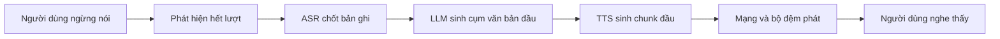

# Chương 35. Streaming, Speech LLM và hội thoại

!!! abstract "Mục tiêu học tập"
    - Định nghĩa và đo đúng các thước đo độ trễ: độ trễ đến âm thanh đầu tiên (TTFA), hệ số thời gian thực (RTF), độ trễ phản hồi đầu-cuối; lập ngân sách độ trễ cho một trợ lý giọng nói.
    - Suy ra điều kiện để âm thanh sinh theo chunk được phát liên tục không ngắt quãng, và dùng nó để thiết kế lịch kích thước chunk.
    - Cài đặt bộ chia cụm văn bản theo luồng cho đầu ra của LLM, không cắt nhầm số, chữ viết tắt hay tiểu từ cuối câu tiếng Việt.
    - Cài đặt tích chập nhân quả có bộ đệm trạng thái, chứng minh nó tương đương với chạy toàn chuỗi; suy ra quy tắc crossfade phù hợp khi ghép các chunk âm thanh.
    - So sánh hệ thống ghép tầng ASR → LLM → TTS với speech LLM đầu-cuối; phân loại các thiết kế (token xen kẽ, Thinker–Talker, song công).
    - Giải thích cơ chế hội thoại song công (Moshi: luồng kép, độc thoại nội tâm) và các hiện tượng lượt lời, ngắt lời, tín hiệu phản hồi.
    - Đề xuất bộ thước đo đánh giá hội thoại bằng giọng nói và các lưu ý khi xây dựng trợ lý giọng nói tiếng Việt.

!!! info "Kiến thức cần có"
    - Kiến trúc lai LM + flow matching và mặt nạ chunk: [Chương 34](ch34-he-thong-lai-hien-dai.md).
    - Codec language model, mẫu trễ (*delay pattern*): [Chương 32](ch32-codec-language-model.md); codec và token tiếng nói: [Chương 31](ch31-audio-codec-speech-token.md).
    - Tích chập nhân quả, trường tiếp nhận: [Chương 4](../phan-1-nen-tang/ch04-cnn-rnn-mo-hinh-chuoi.md); KV cache: [Chương 5](../phan-1-nen-tang/ch05-transformer.md).
    - Vocoder GAN và đo RTF: [Chương 25](../phan-6-vocoder/ch25-gan-vocoder.md), [Chương 26](../phan-6-vocoder/ch26-diffusion-vocoder-va-so-sanh.md).
    - Chuẩn hóa văn bản tiếng Việt: [Chương 17](../phan-4-frontend/ch17-chuan-hoa-van-ban.md).

Một hệ thống TTS đọc sách nói có thể mất vài giây để bắt đầu mà không ai phàn nàn. Một trợ lý giọng nói thì khác: nếu người dùng hỏi xong mà phải chờ hai giây mới nghe tiếng trả lời, cuộc trò chuyện trở nên gượng gạo. Chương này bàn về TTS trong bối cảnh **tương tác thời gian thực**. Chúng ta bắt đầu từ cách đo độ trễ cho đúng, đi qua các kỹ thuật sinh theo luồng (*streaming*) ở cả phía văn bản lẫn phía âm thanh, rồi mở rộng sang **speech LLM**, các mô hình ngôn ngữ lớn nghe và nói trực tiếp, và cuối cùng là hội thoại song công (*full-duplex*), nơi máy vừa nghe vừa nói như con người.

Phần speech LLM là lĩnh vực đang phát triển rất nhanh. Như ở [Chương 34](ch34-he-thong-lai-hien-dai.md), chúng ta tổ chức nội dung quanh các nguyên lý thiết kế, và mọi mô tả về hệ thống cụ thể được tóm tắt từ báo cáo gốc tính đến thời điểm biên soạn (2026).

## 35.1 Độ trễ: định nghĩa, ngân sách và điều kiện phát liên tục

### Các thước đo

Ba đại lượng cần phân biệt rõ:

- **Hệ số thời gian thực** (RTF): tỉ số giữa thời gian xử lý và thời lượng âm thanh sinh ra, $\rho = t_{\text{xử lý}} / t_{\text{âm thanh}}$. $\rho < 1$ nghĩa là sinh nhanh hơn thời gian thực. RTF đo **thông lượng**, không đo độ trễ.
- **Độ trễ đến âm thanh đầu tiên** (*time-to-first-audio*, TTFA; còn gọi là độ trễ gói đầu tiên, *first-packet latency*): khoảng thời gian từ khi văn bản sẵn sàng (hoặc từ khi gửi yêu cầu) đến khi mẫu âm thanh đầu tiên có thể phát. Cần nói rõ đo ở đâu: phía máy chủ (chưa tính mạng) hay phía người dùng (tính cả mạng và bộ đệm phát).
- **Độ trễ phản hồi đầu-cuối** trong hội thoại: từ lúc người dùng *ngừng nói* đến lúc họ *nghe thấy* âm thanh đầu tiên của câu trả lời. Đây là con số người dùng cảm nhận.

Một hệ thống có thể có RTF rất tốt (0,05) nhưng TTFA tồi (phải chờ sinh xong cả câu), và ngược lại. Hai thước đo trả lời hai câu hỏi khác nhau: "máy có theo kịp không?" và "người nghe phải chờ bao lâu?".

Mốc tham chiếu từ hội thoại tự nhiên: nghiên cứu so sánh nhiều ngôn ngữ của Stivers và cộng sự (2009) cho thấy khoảng lặng giữa hai lượt lời thường rất ngắn, điển hình chỉ cỡ 200 ms, và người nghe bắt đầu chuẩn bị câu trả lời trước khi người kia nói xong. Một hệ thống máy phải *chờ người dùng im lặng rồi mới bắt đầu xử lý* khó có thể đạt mức này; đây là động lực cho các thiết kế song công ở Mục 35.5.

### Ngân sách độ trễ của một trợ lý ghép tầng

Xét một trợ lý gồm các khối nối tiếp: phát hiện hết lượt nói, ASR, LLM, TTS, mạng. Bảng dưới đây liệt kê các thành phần với **khoảng giá trị minh họa** để thấy thứ tự độ lớn; đây không phải số đo của một hệ thống cụ thể, con số thực phụ thuộc rất nhiều vào phần cứng và cấu hình.

| Thành phần | Việc phải làm | Khoảng minh họa |
|---|---|---|
| Phát hiện hết lượt (VAD + ngưỡng im lặng) | Chờ đủ lâu để chắc người dùng đã nói xong | vài trăm ms đến gần 1 s |
| ASR hoàn tất | Chốt bản ghi cuối cùng | vài chục đến vài trăm ms |
| LLM: token đầu tiên | Nạp ngữ cảnh (*prefill*), sinh token đầu | vài chục đến vài trăm ms |
| LLM: cụm văn bản đầu tiên | Sinh đủ vài từ để TTS bắt đầu | vài chục đến vài trăm ms |
| TTS: TTFA | Sinh chunk âm thanh đầu | vài chục đến vài trăm ms |
| Mạng + bộ đệm phát | Truyền, chống giật | vài chục đến vài trăm ms |

Hai bài học rút ra từ bảng này. Thứ nhất, các thành phần **cộng dồn**, nên tối ưu riêng TTS không đủ. Thứ hai, khâu phát hiện hết lượt thường là khâu lớn nhất nhưng hay bị bỏ quên: nếu đặt ngưỡng im lặng 700 ms để tránh cắt ngang người dùng đang ngập ngừng, thì 700 ms đó đã nằm sẵn trong độ trễ trước khi bất kỳ mô hình nào chạy.



### Điều kiện phát liên tục khi sinh theo chunk

Giả sử TTS sinh tuần tự các chunk âm thanh có thời lượng $d_0, d_1, \ldots$ (giây), mỗi chunk tốn thời gian xử lý $\rho\, d_k$ (RTF không đổi $\rho$), sau một độ trễ khởi động $\tau_0$ (chờ văn bản, nạp prompt…). Thời điểm chunk $k$ sinh xong là

$$
R_k = \tau_0 + \rho \sum_{i=0}^{k} d_i .
$$

Ta bắt đầu phát ngay khi chunk 0 xong, tức tại $R_0$; vậy TTFA $= \tau_0 + \rho\, d_0$. Nếu không bị ngắt, chunk $k$ bắt đầu phát tại $P_k = R_0 + \sum_{i=0}^{k-1} d_i$. Điều kiện phát liên tục là chunk $k$ phải xong trước khi đến lượt phát nó, $R_k \leq P_k$ với mọi $k \geq 1$. Thay vào và triệt tiêu $\tau_0 + \rho\, d_0$ ở hai vế:

$$
\rho \sum_{i=1}^{k} d_i \;\leq\; \sum_{i=0}^{k-1} d_i \qquad \forall k \geq 1 .
$$

Hai hệ quả quan trọng:

- **Chunk đều nhau** ($d_i = d$): điều kiện trở thành $\rho\, k d \leq k d$, tức $\rho \leq 1$. Chỉ cần sinh nhanh hơn thời gian thực.
- **Chunk tăng theo cấp số nhân** ($d_i = d_0 r^i$, $r > 1$): hai vế là $\rho\, d_0 r (r^k - 1)/(r - 1)$ và $d_0 (r^k - 1)/(r - 1)$, nên điều kiện là $\rho\, r \leq 1$, tức **$r \leq 1/\rho$**.

Hệ quả thứ hai rất thực dụng. Để giảm TTFA, ta muốn chunk đầu thật ngắn; để có ngôn điệu tốt và ít chi phí trên mỗi chunk, ta muốn các chunk sau dài. Công thức cho biết tốc độ "nở" tối đa của kích thước chunk: với $\rho = 0{,}25$, mỗi chunk có thể dài gấp tối đa 4 lần chunk trước; với $\rho = 0{,}9$, gần như phải giữ chunk đều. Trong thực tế thời gian xử lý dao động (GPU dùng chung, mạng chập chờn), nên người ta thêm một **bộ đệm phát** nhỏ: bắt đầu phát tại $R_0 + B$ thay vì $R_0$, đổi $B$ giây độ trễ lấy biên an toàn.

Đoạn mã sau mô phỏng quá trình này.

```python
import numpy as np

def simulate_stream(chunk_sec, rtf, t_first=0.0):
    """Sinh tuần tự các chunk audio (thời lượng chunk_sec[k] giây) với hệ số RTF cho trước;
    t_first: độ trễ cố định trước khi sinh chunk đầu (chờ văn bản, nạp prompt...).
    Phát chunk 0 ngay khi xong. Trả về (TTFA, tổng thời gian bị ngắt quãng)."""
    ready = t_first + np.cumsum(np.asarray(chunk_sec) * rtf)  # thời điểm chunk k sinh xong
    play_at, stall = ready[0], 0.0
    for k, dur in enumerate(chunk_sec):
        if ready[k] > play_at:                  # chunk k chưa sẵn sàng: người nghe phải chờ
            stall += ready[k] - play_at
            play_at = ready[k]
        play_at += dur                          # thời điểm phát xong chunk k
    return ready[0], stall

equal = [1.0] * 6                               # 6 chunk x 1 giây
growing = [0.25, 0.5, 1.0, 1.0, 1.0, 1.0, 1.25] # chunk đầu ngắn, sau dài dần (tổng 6 giây)
for name, chunks in [("đều 1 s", equal), ("tăng dần", growing)]:
    for rtf in (0.3, 0.9, 1.2):
        ttfa, stall = simulate_stream(chunks, rtf, t_first=0.15)
        print(f"{name:9s} RTF={rtf:3.1f}  TTFA={1000 * ttfa:5.0f} ms  ngắt quãng={1000 * stall:5.0f} ms")

assert simulate_stream(equal, 0.9)[1] == 0.0    # RTF < 1 và chunk đều: không ngắt quãng
assert simulate_stream(equal, 1.2)[1] > 0.0     # RTF > 1: chắc chắn ngắt quãng
```

Kết quả chạy cho thấy đúng như lý thuyết: với $\rho = 0{,}3$, lịch "tăng dần" giảm TTFA từ 450 ms xuống 225 ms mà không ngắt quãng; nhưng với $\rho = 0{,}9$, cùng lịch đó gây ngắt quãng (vì chunk thứ hai dài gấp đôi chunk đầu, vi phạm $r \leq 1/\rho \approx 1{,}1$), trong khi chunk đều thì vẫn ổn. Không có lịch chunk nào cứu được một hệ thống có $\rho > 1$.
