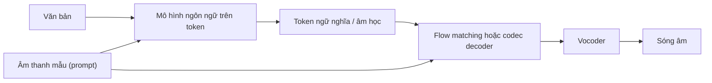

# Phần VIII. TTS thời mô hình lớn

Từ năm 2023, TTS bước vào giai đoạn mới giống như xử lý ngôn ngữ tự nhiên trước đó: **dữ liệu hàng chục đến hàng trăm nghìn giờ, mô hình hàng trăm triệu đến hàng tỷ tham số, và khả năng zero-shot** — nhân bản một giọng nói chưa từng thấy chỉ từ vài giây âm thanh mẫu. Hai trụ cột kỹ thuật là: (1) **neural audio codec** biến âm thanh thành chuỗi token rời rạc để mô hình ngôn ngữ có thể "nói"; và (2) **flow matching quy mô lớn** sinh trực tiếp đặc trưng liên tục. Các hệ thống mạnh nhất hiện nay thường **lai** cả hai.

## Các chương

| Chương | Nội dung |
|---|---|
| [31. Neural audio codec và speech token](ch31-audio-codec-speech-token.md) | RVQ, SoundStream, EnCodec, DAC, FSQ, token ngữ nghĩa và token âm học |
| [32. Codec language model](ch32-codec-language-model.md) | AudioLM, VALL-E, mẫu xen kẽ token, Tortoise, XTTS, TTS dựa trên LLM |
| [33. TTS không tự hồi quy quy mô lớn](ch33-nar-quy-mo-lon.md) | Voicebox, NaturalSpeech 2/3, E2 TTS, F5-TTS, MaskGCT |
| [34. Kiến trúc lai LM + Flow hiện đại](ch34-he-thong-lai-hien-dai.md) | CosyVoice, Seed-TTS, Spark-TTS và các hệ thống 2024–2026; hậu huấn luyện |
| [35. Streaming, Speech LLM và hội thoại](ch35-streaming-speech-llm.md) | Độ trễ, sinh theo luồng, speech LLM, hội thoại song công |

!!! warning "Lĩnh vực thay đổi nhanh"
    Các chương trong phần này tập trung vào **nguyên lý thiết kế bền vững** hơn là bảng xếp hạng. Thông tin về các mô hình cụ thể được ghi "tính đến thời điểm biên soạn (2026)"; hãy kiểm tra bài báo và kho mã gốc trước khi dùng.
